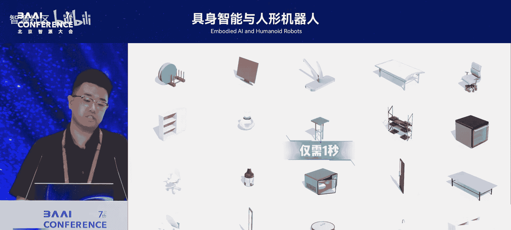
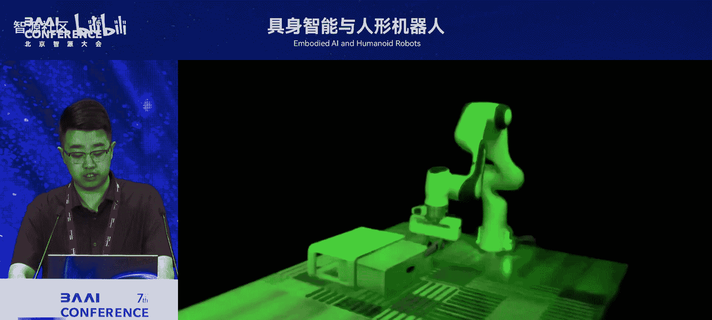
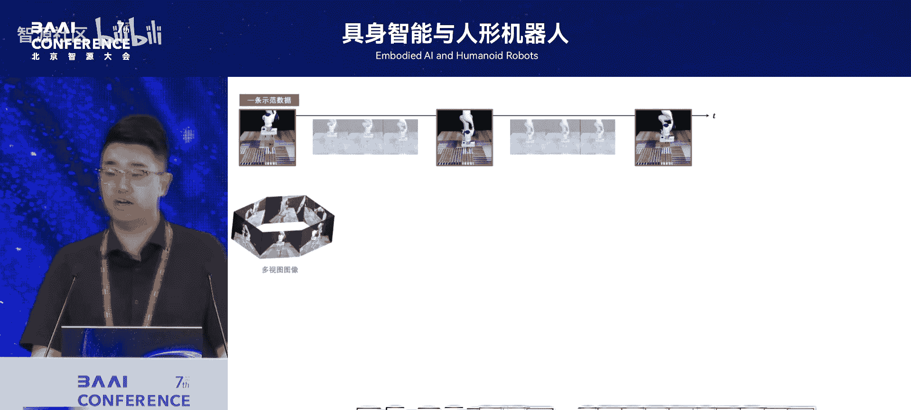
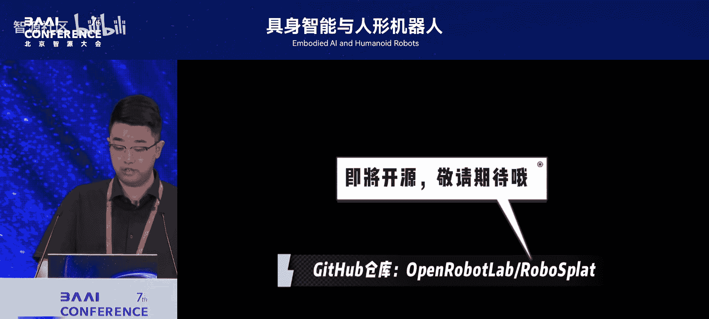
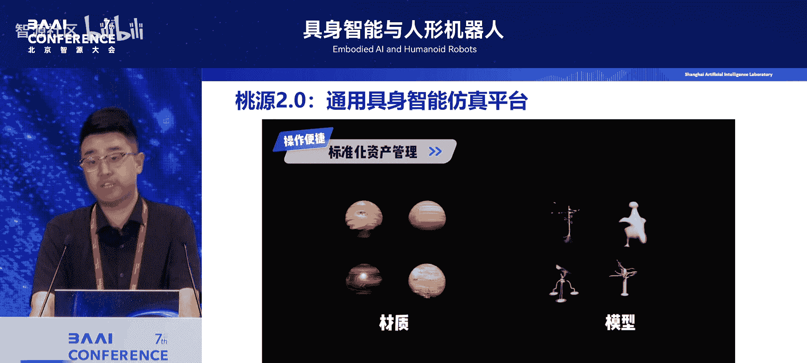

# 2025北京智源大会- 具身智能与人形机器人 p05 可泛化操作与运动智能；庞江淼 -BV1MSNEz8EuG_p5-

那么下面呢我们邀请这个是呃来自上海AI labb的这个庞江淼啊博士啊，庞江淼博士呢是上海AI labb的青年科学家巨深智能中心的负责人。研究方向呢是机器人学习多模态学习和巨深智能。

那么他在 meIJCV coral啊CVPR等会议呢发表论文50余篇啊，那么引用呢超啊13000次。那么他也曾获得CVPR2023和ECCCV的最有影响力论文ECV2024最佳论文候选等荣誉。

让我们欢迎庞老师。嗯，好，对，然后呃非常感谢。然后今天这个我分享的题目是可泛化的运动呃操作与运动智能。然后呃首先第一个其实呃这个就比较老生常谈啊，就是集身智能肯定三个能力非常重要。

感知认知推理想象到移动操作。那从人工智能的角度来看，其实我觉得人工智能算法最重要的是为呃集身智能解决三个问题，就是本体泛化任务泛化和场景泛化啊，那这个其实是跟过去机器人呃所带来最大的一个不同。呃。

那这里面其实是有非常多的呃科学和技术问题的。然后同时呢也会带来非常多的技术路线之争啊，就是现在所有东西都没有收敛。那从数据的角度，数据模型评测本质上呃人工智能算法的三大要素。从数据角度哎。

比如说刚才王鹤老师提到了这个合成数据跟真实数据的区别。其实我们会发现合成数据是非常有助于去做本体泛化和场景泛化的。因为呃我我我其实可以通过机器人的描述文件就。😊，都可以在仿真里面去仿真任一台机器人。

然后我可以去仿真各种各样的物体场景。但是它其实做到技能的幻话会相对来说比较困难。对，因为我们需要在仿真这样的环境里面去去一个又一个的去做更加物理真实的这样的一个技能仿真。那对于真实的数数据来说。

它非常有助于做任务范化。因为对于任何一个技能来说，我可以随时随地的在真实世界里面进行一个要操作的采集。但是我永远不可能去便利所有的光照场景物体。那怎么样去。

真的通过各种各样方式出据的方式问题去解决这个问题。我觉得就是现在整个科学界的探究的问题。呃，从模型的角度来说，对吧？其实大家都在谈VOA然后这里面其实呃我们内部其实讨在日常讨论的时候会比较有意思。

我们一般会说现在市面上的VOA有3种啊，就是第一个第一种VOA呢，其实最早的这个RT对吧？就出来之后先跟动态数据，就保留语言交互能力的同时去给它添加一个action的能力。这个我觉得是刚刚出来的时候。

最最最狭义的VOA。但后来大家发现这件事很难第一时间搞work啊，因为我们先要解决action层面上的分化性问题。以这个时候大家开始去做的VOA呢。

就是我去采用了一个动态的这样的一个大模型作为一个预训练的权重啊，我基于这个东西去做了1个VOA啊，那但它还是去使用了这样的一个动物态模型的能力啊，所以这这是第二种OA还有第三种VOA呢就是很多就。

我只要我这个模型里面有vient加一个action。然后我这也是个VOA对，所以其实现在大家这个对这个定义会非常的发散啊。但是我们内部呢一般会认为只有前两种啊。

就通过了这种ation model的训练方式，它才属于VOA啊，然后我们比较喜欢把第二种称之为A式的VOA。因为它其实并不具备VO级别足够好的泛化能力。那还有一种就是我们怎么用双系统的方式。

使得这个模型能够保持语言交互能力，同时添加这个action能力。然后以及评测评测也非常的重要。那我们刚才提到了三种泛化，就是里面最重要的是场景的泛化和任务的泛化。

大家现在没有一套足够公正的体系能够去看不同的动作，到底在哪些层面泛化能力怎么样啊，但是这件事也也非常难做。就是因为我们在真实世界里面所有的评测都是不可重复的啊，那在仿真里面其实可以重复但是虚实一一致性。

是非常难难去做这样的一个评判的那其实这些都是整个机身智能领域现在存在的非常关键的这个科学和技术问题啊。然后呃那一些过去的进展，其实过去实验室呃呃其实在一直以来吧。

其实我们通过这种呃围绕这个real to to real的这样一条技术路线，在看整个行业的发展。比如说最早的时候，我们实验室做了这个实呃书生天际的这个实景三维大模型啊。

能够通过AIGC的基础快速的把整个真实世界重建到数字空间里面。我们其实也做过这个数字的这个纺织平台啊，以及后续的在多么态大模型，尤其是三维多模态大模相关的一些工作，到四维的世界模型啊。

然后怎么样用AIGC的方式，去面向机身智能生产足够多的可交互数据的场景和方法，以及在围绕着人形机器人所做的一系列的人形机器人驾驶舱啊，然后包括它走媒。化妆自主起的一些算法啊，但是呃这是过去的一些进展。

今天其实呃给大家介绍一些新的进展啊，就是呃也是围绕着数据模型和评测三个方面。第一个就是怎么样真的是好好的去利用生成式世界建模的方法去助力具深数据合成啊，这里面其实比如说基于我们基于这个仿真空间啊。

能够用用一个以一个非常高效的一个速率啊，生产这个合成数据，同时怎么样用高深sping的方式去自动化编辑整个场景，使得只用一条数据做一个任务的实力化。

就可以在真实世界达到一个非常高的这样的一个任务的成功率。在模型方面围绕着导航和操作两个方面，围绕着双系统协同去提升感知交互和执行能力。以及在评测方面，怎么样能够去为呃建立一套足够好的任务评测体系。

然后因为在这个地方评测，我们其实一直有个观点评测的价值，只需要去ra。方法而不要而不需要绝对客观。就是所以只需要通过这样的方式，我们知道有一个事情能够让这个任务变好了，它就是一个合理的评测方式。🎼啊。

那么到第一块可以看一下，这是我们做的这个叫infinite mobilityity这样的一个工作。我们其实通过对整个环境可呃这样呃整个物体的这样的一个建模，能够输生成不同的这种可交互物体啊。

然后那这是一个程序化的一个建模方式啊，它能够去用一个非常快速的时间，以及泛化的去生成22种这个可交互物体啊，然后把它导入到这个环境之面，它呃可以去人跟人进行一定的交互啊。

我们其实也把这个东西它直接为我们内部的操作团队提供多样化的数据资产啊，然后我们能够去操作不同的这个微波炉啊，不同的抽体啊，以及不同的环境啊，那那在这样的情况下呢。

其实我们把它导入导入这个这个这个用之后呢，其实我们就可以发现哎我们通过各种各样这个编程的这样的一个方式啊，它这个机器人就可以在这个环境里面自主的生成各种各样的轨迹啊就。

包括这里面的这种角接物体啊，以及各种各样的物体。那那前面的那样的一个技术呢，其实就可以为整个环境提供足够好的数字资产。然后我们在这个环境中呢，就可以对背景光照等各种情况进行一个非常快速的扩增。嗯。

那这里面其实呃大家可以看到这个。那，这里面其实做了很多的这样的一个呃一个具体的比较比较具体的一个。呃，一一些比较具体的动作吧，就是涉及到抓取推，然后开关对于不同物体从不同方向进行的操作啊。

然后怎么样能够把这样的一个技能在仿真空间里面一套一套scalable的方式，能够应用到足够dverse的物体上，这件事情其实它还是具备一定的技术难度的啊，嗯那在这样的情况下呢。

我们其实会发现对于小呃这样的一个问题，就是说我我如果想要去对一个物体进行数据的采集，我到底要采集多少数据啊，就是呃在这个地方，如果我们从成本的角度来看的话，就是我尽可能少的去采集真实数据。

尽可能多的去生成合成数据。这样的一种方式，一定是最经济化的。因为合成数据的成本非常之低。那在这样的情况下，我们围绕技术链就是持续的去压低真实数据采集的数量，持续的去提升合成数据的数量。

直到全合成数据能够达成零样本。转化，那这个肯定是需要一定的时间。啊，那大概在这里面呃可以得到一个初步的结论，就是对于小或中等的空间范围，大约800条视角数据，可以实现大约80%的成功率。啊。

然后对于这呃这个工作呢也体现了对于不同2D平面以及三维空间物体的角接物体，其实是有不同相对不同的结论，能够指引我们去在这个数据引擎的里面进行数据的合成工作。

🎼那接下来呢就是说我怎么样对一个环境进行一个更加高效的增广。那这里面其实我们做了一个工作，就是我们使用高深sping的技术啊，然后实现高保真的操操作场景重建。就是我们对一个环境啊，通过多视角图像。

把它重建重建到一个三维空间里面。然后我们直接去编辑这个高深sping的这样的一个一个一个一个就直接去编辑三维高斯，然后就能够去直接对它进行一个扩增啊，这个视频会比较直观一些啊。

就是比如说在一个重建之后呢，我们直接去编辑这样的一个三维高斯，我们可以去变换里面的物体，变换里面的机器人的类型啊，然后直接直接去编辑里面的光照。

🎼然后替换里面的场景。🎼然后生成各种各样的数据啊，那在这个里面呢，我们用了一条真机数据做了任务实例化啊，就是它代表着未来的任务泛化的方向。同时它也。

🎼然后通过合成数据去解决掉刚才我们说所说的本体泛化和场景泛化两个方向的内容。

🎼然后在这样的情况下呢，我们通过一条只采集一条真集数据，就可以达成在真实世界里面非常强的6种算法。

啊，包括了位置啊这个物体类别、相机呃相机视角、背景、光照条件以及本体等各个方面啊，然后那这里面医生800其实跟真机里面采集200的这样的一个视角数据是效果是相当的。

我们通过这样的一个方式就可以持续的去扩增，生产更多的数据，在更大的规模的预训练，以及后训训练上进行一个结果的一个确认。呃，那刚才其实数据方面，那数据方面的话，其实接下来就是我们肯定是要试训练大模型啊。

那训练大模型它也是这个一个探索的过程。我们怎么样能够进行一个非常高效的预训练，进行大大量数据的一个预训练，然后怎么样进行一个非常高效的后训练，使得这个模型能够在真实世界有限场景。

有限技能下达到100成功率。那这里面导航对于导航这个任务来说，我们其实基本可以达成合成数据的零量本泛化，并且达成长程任务执行。

那首先是一个它其实我们整体的思路还是围绕着这个sstem2和stem一就是这样的一个一个一个方向来看的，就是stem2其实本质上是代表着这个呃系统的一个思考能力。

然后stem一可能会代表它的一个执行能力。那首先就是怎么样在一个环境里面去做到这个足够好的导航执行啊，那这里面其实对于首先这个因为很多这个学界的这个同学都会说唉这个导航。这个问题是否已经被解决了。

就是因为传统的slam的方式其实已经做的挺好了。那你到底还要不要用AI的方式来做这个问题。那其实我们看到他会呃首先我我们一直会觉得这个问题没有被解决。

因为它只是说在过去的建图的这样的一个有限的应用领域里下，它被解决了。但是如果我希望通过语言交互的方式，在一个无图的场景，让一个智能体随时随地的去导航。

无论这个导航是一个目标指导向的还是一个过程导向的这个问题都依旧困难。那在这样的情况下的话，呃，这个我们就呃会可以用这样的一套呃虚实结合的方式来做。首先比如说有数千级别的三维场景资产。

可以供我们去生成数据。然后在这个里面，我们通过一些传统方式可以生成一些最佳的路径，同时呢也可以去呃通过这个路径规划产生一些优先图去生成一些critic函数。

那这里面我们做了一个这样的叫navigation diion policy，通过action和critic两种superion去进行trajectory的generation和 selectionction。

它最大的价值除了能够在联样本泛化之外，它能够非常灵巧的去处理动态物体。这个是相比于传统物体传统的这样的一个规划方式带来最大的增议。就比如说这个机器人在导航的过程中。

如果前面有非常非常经常出现各种各样动态的呃这个人人的扰动的时候，它依旧能够非常灵敏的避开这样的一个环境啊，然后这个其实。就是需要一些及时的反应策略。

就是通过我们上面这种方式来做到的那同时呢它也可以非常轻松的去完成跨本体的避障导航任务啊。比如说我们通过不同的人形机器人，轮式双臂机器人能够去去直接去达成在不同环境里面的部署啊。

因为我们就是全合成数据来做这件事啊，然后在自主导航的这个过程中呢，怎么样去进行一个常识的导航啊，那这里面我们还进行了另外一部分的院中，就是real to seem这件事，到底对于导航场景有没有用。

我们依旧用三维高斯重建的技术，对整个环境进行重建。在这个环境中生产数据，并且完成整个训练的一个模型部署，最终达到的结论是它会非常的有用啊，但是有用也是有限的啊，就达到一定的数据比例之后呢。

它其实就没那么有用啊，就是所以这未来也是一个数据配方需要去探索的一个问题。那进展到这个交互层面，就是我们其实首么样去首先过去的这个视频多模态大模型，对于导航这个任务来说其实是都是离线的一种处理方式。

它其实跟据身智能的在线处理是之间是有一个比较大的矛盾的那这里面呢主要难点就是过去的模型无法支持多轮的在线推理，以及流式上下文的这样的一个信息丢失是非常严重的那在这样的一个情况下。

我们提出了这个streamamA的这样的一个算法去实现信一代流式机身导航大模型的这样的一个框架。那我们通过双轨上下文啊这样的一个方式啊，然后构成了两两条tokenization啊。

就是一部分呢就是当下的这样的一个一个一个一个一个实例化。另外一个呢就是做一个长期记忆的一个压缩尺啊，然后进行一个基于时空剪制的一个KV的高效复用架构。

使得能够尽尽可能的去保留在记忆空间里面的过去的这样的一些信息。然后。同使用导航任务和doomomaha大模型的一个数据进行导航大模型的数据的一个训练。那比如说在下面最下面的这个图里面。

我们可以看到我们大概使用了3分之2的导航合成的3这样的一个数据，以及3分之1的传统的doomaha数据啊，然后这里面包括了从一些仿真场景里面生成的数据。同时也包括了用dagger的方式。

在整个环境里面产生的试错的这样的一些数据。一块去训练这样的个大大模型。它其实可以在实时推理的情况下，在楼层和建筑范围内实现超长程指令跟随和零样本泛化啊，然后在相关的一些仿真评测上。

也达到了一个领先的这样的一个表现啊，那主要的情况也可以在这个场具体的场景里面，我们可以看到它其实是可以在非常外部的这样的一个环境里面，达成长城零样本的泛化能力。啊，给了一个具体的语言指令之后呢。

它就能够跟随这个语言指令啊，就在这样的一个环境里面去完成一个实长长时序的这样的一个呃具体的一个导航啊。那我们其实可以看一下呢这个其实是在我们实验室里面做了一个两分钟的超长指令跟随啊。

那它能够根据比如说那当你看到这个黑色的雨伞的时候，向左转啊，并且进入了这样的一个区域。啊后在立即右转啊，在在这个沙发的时候，再去走向这样的一个电视。然后再右转，然后再走向前面。

这其实主要看它的一个过程的一个跟随能力。然后整个的这样的一个推理时长达到了2分钟。然后在这过程中，通过动作态大模型的实时的这样的一个感知识别能力，它就能够比较好的去完成这样的一个任务。对。

然后刚才其实介绍的是在导航大模型相关的一些工作。那我们其实最重要的事情是希望一个机器人如果真的能够去做一些事儿，最重要的是它的操作能力啊。

那这里面其实我们呃主要的这样的一个想法或者方向就是要做到这个想象执行一体化，以及同时呢是它的交互推理能力尽量少的去做一些损失啊，首先第一个就是这个视觉预测引导动作执行啊，就是从人的角度来看的话。

我们的这样的一个执行能力一般都是在vis和action两个层面上其实都是闭环的啊，但是大部分的这样现在这样一些工作其实都没有真的做到这一点啊，就是所以其实从action的角度上。

大家之前很多西都是in learning啊，就是者reinfor就是从大量的机器人数据里面进行行为克隆来增强行为上的化，或者我们从视觉的角度，对吧？

进从大量的视觉数据进行视觉的表征与训练或者生成式的模型来增强模型。在视觉上的方化。那我们提解决的一个我们提出了一种预训练的方式啊，就是通过端到端的predictive inverse models。

根据机器人预测的视觉状态，建立逆动逆动力学模型，从而去指导动作的输出。啊，那在整个这样的一个框架下呢，我们其实先去做了这样的一个多模态的这样的一个建模。同时呢在下面。在每在这样的一个过程中。

通过inverse dynamics prediction以及这个呃viro的这样的一个这样的一个过程去进行两个闭环的一个预测。那在这个具体实际化的过程中呢，呃，这个这个视觉的这个预测。

其实是在这个过则工作里面是通过一个MAE的方式去建模的。但是它本质上代表了这个对未来的一个预测吧。所以其实未来它会越来越走向这个世界模型这样的一个一个应用的一个方向。然后同时IDM这边其实是一个。呃。

具体的一个一个一个呃执行方面的一个事情啊，怎么样未来通过更大规模的这样的一个数据的训练，使得它能够完真正的完成视觉。基于基于世界模型的微人和action的闭环。嗯。

那在大规模的机器人的数据上进行这样的一个预训练，并且在少少量的下游数据里面进行一个后训练。其实我们可以看到这样的一种方式。

在这个各各个公开的这个liberal或者calvin的这些榜单上达到了一个非常好的效果，并且它能够它的性能可以持续随着模型参数量的增大而持续的提升。啊，然后在这样的一个情况下呢。

其实呃这个模这个算法其实在各个奔nch mark达到了一个比较领先的性能。我们其实也可以看一下它在各个呃情情况下所完成的一些效果，比它能够去比较好。就经过预训练之后。

我们其实发现这个模型确确实实可以更好的处理。我们刚开始所说的这个技能泛化和场景泛化。比如说我们随意的往这个呃面板上去推不同的这样的一个框。包括在这个。这个这样的一个推理的过程中。

随意的去改变这里面的位置，以及对里面的框架进行实时的扰动啊，就这样的一个模型，其实是能够比较好的去完成这样的一个实时的调整啊，就是。包括对各个光照啊进行的一些具体的一些变化。

然后直接在整个环境中去播放不同的这样的一个背景框架啊，就是呃背这背背景视频啊，就是然后这个其实往后播了播了一个猫和老鼠的这样的一个视频啊。

那在接接下来的就是我这个其实算是一个比较鲁棒的一个小呃一个动作模型，就是它其直直直接根根据一个指令去完成这样的一个能力。那接下来一个比较重要的事情是如何保留viOM在机器人里面的动态推理能力。呃。

那在这样的情况下呢，我们其实提出了一个叫做instruct VOA的算法。呃，这个暂时还没挂出来。对，是不是然后利用那个混合专家模型MOE去解偶视觉语言推理以及机器人的这样的一个操作模态的训练啊。

然后有做这样的一个预训练之后呢，我们通过。

一个 model这样的一个MOE，使得我们能够更好的去到下游的action啊这样一个expert上，然后进行多元数据的一个联合训练啊。

然后这个系统呢其实可以在80个未见任务的深推理评测中超出同类VOA34%的效果，那这里面整体使用了足够多的这样的一些比如说呃开源的这些manulation的数据多模态的数据。

以及我们自己生产的VOA合成的这样的一些数据啊，那态的操作能力与基础模型，能够在相应的一些ch mark上基本持平或者有一定的提升啊，但这个其实呃坦白讲它是一个在有限具深测试环境下的一个效果。

我们能够保证它在具深条件下动态能力有一定持平或提升。那实际上我们现在观测到它的真实的这种开开的动态能力肯定还是会有一定损失啊，那接下来我们要做的事情就是怎么样。量的不让这个事情有损失啊啊。

那这里面其实就会涉及到比如说零样本识别油画场景。就比如说呃我们怎么样把这样的一个cube放到一个科学家的图片上，对吧？然后那你在整整个开源的推理过程中，这个动模态它需要去识别唉，这是谁什么样的一个地方。

它是一个科学家，然后我再把它放上面，它就会先识别爱因斯坦啊，通过爱因斯坦这样的一个一个画量再放上去。同时呢进行一些长城任务。理解领样本的去理解多步呃进行一个相关的一个指令的一个执行。🎼嗯。

哎过完这个模型这块呢，其实大在支撑了前面的所有的模型的数据的生成也好，还是模型的迭代也好，都是一套一定要非常高效的infrra啊，就是这个infrra涉及到效率训测的这样的一个框架。

那其实实验室呃其实在去年的时候开源了一个叫Gtop的平台。这样的一个平台里面，其实能够去支持不同的灵巧操作以及导航啊，然后这里面集成了不同的数据集啊，比如说能够去生成不同的材质和模型。

🎼然后对整个场景进行一定量无限的一个扩展和。🎼和编辑啊以及自动化的搭建，能够使得我们在这个环境的过程中能够进行呃快速的场景的数据的扩征，包括物体的随机化啊，然后呃这个其实是。🎼对呀。

这个其实是能够丰富的不断的给我们整个集身智能训练提供足够好的数据资产和行维资产。然后有一定的编辑能力。呃，那这里面其实我们基于它呃之前呢它其实相当于更多的是一个呃基础的一个一个一个infr吧。

其实我们之前一直在开源之后缺的一个东西，就是一个比较好的一个应用场景。那所以接下来我们其实是会推出一个面向大规模剧深推理任务的仿真训测基准。

这里面其实是包括面向现在所有具深仿真平台场景相对单一化任务相对单一化的问题，去看怎么样能够构建一个剧深推理任务泛化执行这样的一个评测基准啊。这里面其实呃大家可以看到，其实在过去的一两年的过程中。

从pE到最近的一些工作。其实大家呃对于这个巨深大模型的这样的一个兴趣是在快速的一个提升的那在这里面其实我们通过仿真机底座的方式呃，去看这个1万1万个带有语义标签的物体集合。

这里面其实还有100多种铰链式物体和动作序列。在这。这样的一个物体的基础上，对通过大模型的协助，对整个任务进行一个高效的拓展合成啊。

这里面其实涉及到think to task和task to之间的一个具体的一个一个一个一个协作和生成，然后能够生成采量的具备推理任务性质的多态数据在这样的情况下呢。

我们基于刚才提到的数据管线进行呃数据的生成，同时用这种端到端的策略啊，比如接ACT这种相对小的这样的一个模型，对像生产的数据先进行扩展性和s的验证。那这里面我们就可以得到足够多的面向推理任务的数据集。

有了这样的数据集之后呢，我们其实呃这里面总共支持了四类视觉推理长城任务评动态模型的任务和动作规划能力。然后在这个上面呢，我们其实也对现有的一些呃动态模型进行了一些具体的验证啊。

比如其实获得了呃对这里面比如说。其实在得到一些初步的结论。就比如说GPT4。5在空间外观和常识推理能力上是优于cloud和jamii2。0的啊。然后但是呢其实现在对于不同的任务的分类来说。

长城任务相相较于视觉推理对于VM来为现有的VM来说还是呃会有更大的一个挑战啊。包然后。这个点对点的这种优化策略呢，也优于其他的一些方式啊。

然后未来呢我们也会持续的去优化这样的一个推理的剧身操作的这样的一个数据集的构建，以及评测体系的构建，使得大家能够更好的去看这样的一个呃模型到底在往哪一个方向优化。你做的改动。到底是否是真正的这个提升了。

还是降低了这样的一效果，而不是在一个有限的非常有限的一个场景和技能下进行了一个demo式的验证。那最后呢其实也给大家呃展示一下这个哎。我们过去在人形机器人方面的一些。呃，这个这个可能不不太出来。对。

这这个其实反正这个可能这里有有点问题啊，就是其实过去实验室在呃这个人形机器人运动运动控制方面其实做了很多的工作。这里面包括了我们其实提出了一个叫做人形机器人驾驶舱的这样的一个概念。如何通过这个。

看一下这个能不能破。🎼啊，应该是这个解码会有一些问题啊，也没关系。对，然后那个呃其实包括这个因为对于人性啊O可了。🎼对我们怎么样通过基础运动到感知融合。

完成真形人形机器人在不同场景下的这样的一个感知的一个跳跃，它能够去。🎼然后包括能够怎么样去融合视觉和盲走算法，去实验人形机器人在各种环境下的一个灵巧的一个自主地障。

🎼然后可以走这种通过视觉感知去走梅花桩啊，然后因为我们用了雷达的感知，所以它既正向侧侧向都可以完成这样的一个具体的一个动作。🎼然后一个策略，然后怎么样通过单个策略能够控制人性机神完成8种动作。

🎼然后这里面涉及到了走跑跳下蹲站起，以及非常灵巧的上身的一个。🎼的一个优化。包括在摔倒之后，怎么样从原地站起来。就是其实我们当时做这个呃算法的movation，就是因为做上台阶这个实验的时候。

机器人天天摔啊，然后那怎么样能够去去去去去把它让它站起来，然后包括这个驾驶舱，对吧？我全身对对于人形机器人来说，其实我们呢看到它的全身运动的能力发展的非常非常快。

但是对于手臂上的影销操作的达到实用性还非常还有一定的距离。那我们就用这个人工智能的算法去控制人形机器人的升体。通过先通过一种摇操介入的方式，使得在全身控制的情况下，它能够去做一些摇操。通过数据的回流。

持续去实践，给于人形机器人的基础模型。呃，那未来的话，这个其实是我们的一个github。然后未来实验室的呃工作也会持高速的去迭代，并对外公布。然后也请大家关注我们工作。好，谢谢大家。

