# 2025北京智源大会- 具身智能与人形机器人 p06 Scaling Humanoid Robot Learning with Internet Videos：卢宗青 -BV1MSNEz8EuG_p6-

来自北京大学计算机学院的常聘副教授卢宗青教授，他呢也是国家级青年人才智源学者，主要研究强化学习多模态大模型和通用智能体，担任ICML newcle等领域主席。

那么今天呢呃卢老师给我们带来的报告的题目呢是scaling humanoid robot learningwithin videos，让我们欢迎卢老师。谢谢王贺老师的介绍。嗯。对。知吧。嗯好。然后呃。

12点吃饭，尽量不耽误大家的这个时间，争取提前5分钟结束。然后我今天主要讲一下呃，我们我们对于这个剧身或者是人形机器人的一些思考，如何从如何更fundamental的去解决这类问题。

而不是说像现在的更多的是从一些任务的角度出发去解决这个问题。那我的主题是这个scaling up humanoid learning with啊互联网视频。呃，去年的话。

newop呃伊利说这个呃protrainingwill end。但是呃我我们认为就是对于预训练来讲的话，其实还没到一个结束的呃，还没有结束吧，短期内不会结束。

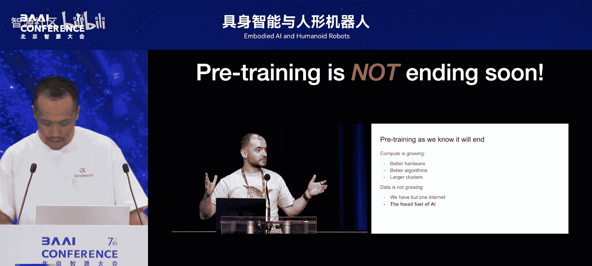

那其实最主要的问题的话，其实就是我们啊目前来讲的话，还没有能把这个互联网的视频啊用起来。当然对于互联网视频来讲的话，它所包含的信息量要远比这个文本要多的多。但是呢呃也有一些缺点。比如说文本的话。

其实是一个浓缩的信息的一个表示，那么对于互联网的视频的话，它其实它的这个information density会非常的低。而且它需要的计算量会更大。我们需要做更多的处理。

比如说我们对于一个视频的理解来讲的话，一个图片就是啊好好多的这个token。那么另外的话，其实对于现在市面上的这些多mat态模型来讲的话，对于视觉信息的处理远没有像这个对于文本处理那么好。

其实我们同样很难去把这个视频的信息用起来。当然目前市面上大家在。用的视频信息更多的是这个video的 understanding和video的generation。那么我们的话。

当然对于一个巨深论坛来讲的话，我们如何去更好的利用互联网的视频，是为为这个我们的人形机器人的humanoid learning而服务。那么再说回到机器人，刚才说互联网视频，现在说回到机器人。

那么机器人的话，我们更多的是fos在这个呃人形的机器人加上灵巧手。那么对于这样的一个呃本体的形态来讲的话，其实我们最主要的问题就是数据的缺失。当然我们现在有很多方法去训练各种样的。

比如说loccomotion的策略，又或者是manipulation的策略。通过比如说呃simulator，当然通过强化学习的方法，当然每一种方法的话，都会有一些缺陷。比如说像啊simulation。

啊，很难就是因为用强化学习很难去融入一个prior的信息。当然那么对于真机数据的话，其实现在不管是谣操也好，还是对于某一个本体的谣操，其实我们无法得到一个大量的数据，因为机器人的本体，包括双足的本体。

包括灵巧手，它其实都在。我们不可能针对每某一款机器人去采集，大量的去采集数据。那么还有一类做法就是通过生成数据，比如说像word model。呃。

当然市面上有很多很多这个学者以及很多创业公司在说这个word model的事情。但是从我个人的角度来看的话，word model是呃不可能去给机器人去训练的。

因为它没有任何的这个action level信息的genration。因为要给机器人训练的话，你必须要把动作空间定在机器人上面。而。对于现在的这些word model，不管是像NVDR出的custs。

还是市面上大家在做的一些这个视频的生成来讲的话，远没有到这个action level的程度。而且如果有了action level的信息的话，我们其实直接可以训练策略了。

不需要再基于这样的数据去学一个模型。OK那这就是我们对于当前的机器人来讲的话，一些呃困境吧，就是simulation真集数据，生成数据OK。

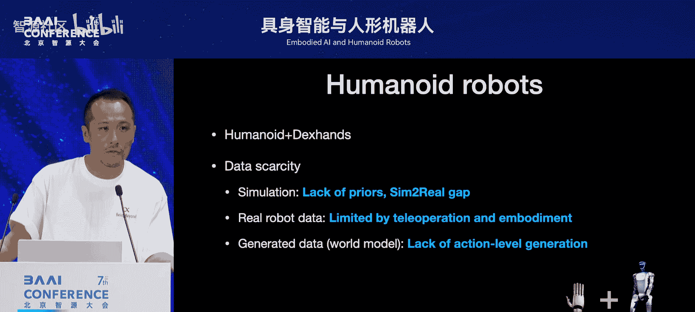

其实呃去年的话我还在在智呃在智愿研究院，其实我们当时就做了很多的工作，包括从t operation到sme to real。再到real to seem再 to real以及word model。

其实我我们都做过一些探索。最终得到的效果就是虽然demo的 videodeo非常好。但是这个现场画面的话，往往就是呃跟这个展示出来的video的差别是非常大的。其实呃怎么说呢？就是这些方法呢。

其实对于某些特定的任务当然是有用的。但是能啊 fundamentally去解决我们的humanoid learning嘛，其实是不能的。

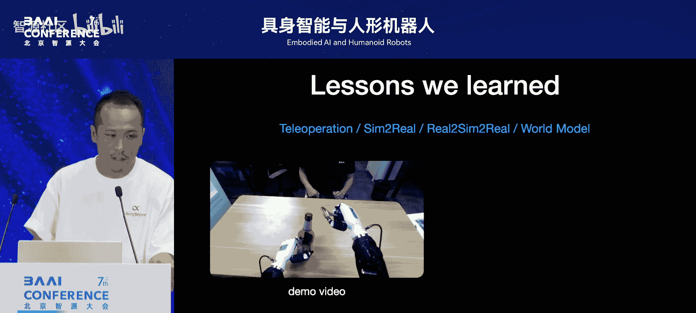

那当然今天这个top的主题的话，其实就是如何去利用这internet video，然后来实现我们的humanoid learning。

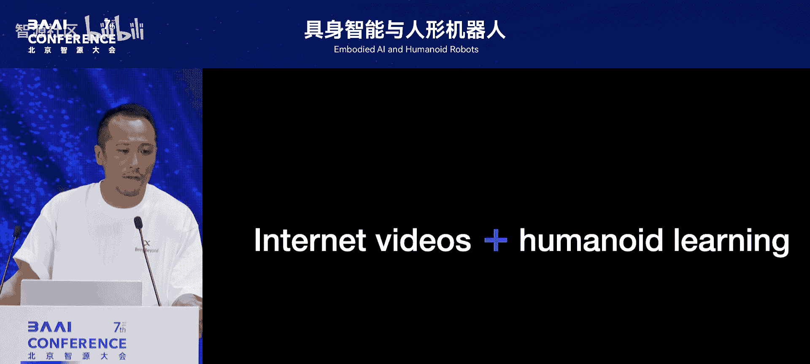

但其实哦我相信大家读论文的话，其实会发现一个事情就是哎你这个东西不是好多人都提过了吗？这个为什么你会在这儿重新再讲一个这样的一个故事。其实如果你们仔细去看论文的话，大家说internet video。

其实就是从互联网中找到可能不超过100个视频，精心挑选的100个视频，然后把当把它当做是这个互联网的视频。而我们要做的。

我在这儿需要给大家或者是我们希望做到的是如何去scale up这个human learning。🤧。我们是要基于大量的互联网的数据去做类似于语言模型与训练一样的这样的scaling。

而不是说精心挑选100个视频，然后把它用在机器人的学习上。

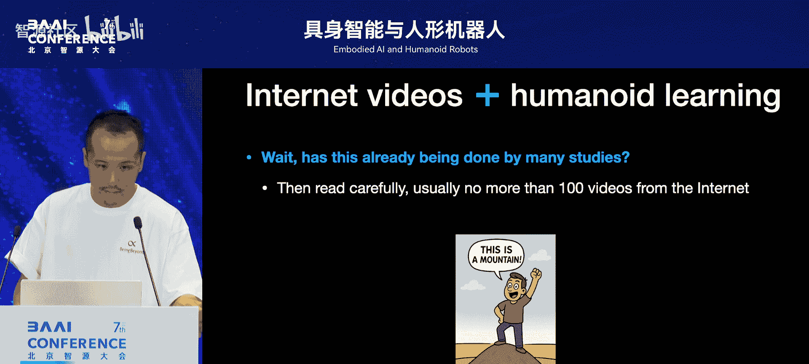

O。那对于啊 scaling up。通过互联网数据互联网的视频去scaling up有什么呃好处呢？或者是为什么是一个好的idea呢？其实呃互联网的视频的话，其实我们有大量的互联网的视频。

互联网的视频多到你无法想象存储的代价都非常非常的大。其实对于这些视频的话，我们当然可以去做这个预训练。另外的话，互联网视频对于我们今天要做的这个人形机器人来说的话。

互联网的视频是记录了大量的人类的运动的。我们的人形机器人造的就和类似类照的就是照着人的模样去造出来的。所以的话如果我们能把这些人类的运动的鲜艳，能够去学到。不管是这个运就是运动控制也好。

全身运动控制也好，还是说手护的操作也好。我们的预训练。如果能把人的motion的prior学到，其实就已经。完成很大的一部分。而且对于large scale data来讲的话。

我们很容易的去实现这个泛华鞋。因为包括我们后面会提到的这个手部操作的话，我们会看到就是如果通过人的一些操作去学的话，其实我们可以学会。更复杂或者更灵巧的这个灵巧手的操作，类似于人。

而不是说现在我们对于林对于林巧手做的事情，更多的还是p can place。当然，互联网视频也是有缺陷的，呃，我们不可能仅仅依赖于protraining去做这件事情。那么互联网视频或者视频本身的话。

它是缺乏patial或者physcal以及perceptive的信息的，就是缺乏空间、物理和本体感知的信息。那么也就是说，预训练是远远不够的。我们还需要进一步的去把这些信息融入到模型中。

从而才能给机器人去用。

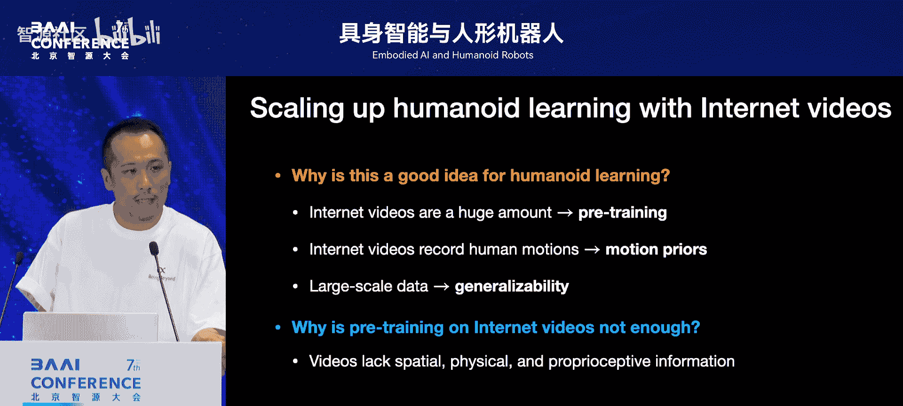

Okay。那么我们所或者是从我的persspec来看的话，我们希望得到的就是一个foundal的humanoid learning paradigm。

那其实刚才已经给这个pretraining铺垫了很多。其实我们对于training来讲的话，主要是两部分，一部分是vis understanding。

也就是对于比如说机器人大脑对于通过视觉信息对于空间的理解。还有就是pretraining要得到的就是human的motion的prior，如何去操作一个物体如何去运动。

当然我们这边说的这个human的motion是希望explit去学这些humanmotion，就是比如说类似就是监督学习，我们从视频中比如说提取一些人的运动的这些动作。

那么我们如何让模型学会人类如何去动的O那么更关键的一步或者是非常重要的一部不可或缺的一部是post trainingpost training的话，我们会focus在这个。

真机的数据以及通过simulator如何去对齐。那么主要是是对齐我们的真机的真正的机器人，以及我们的物理世界。Okay。呃，这个套话主要会cover三部分内容。

第一部分内容的话就是我们去介绍一个完整的 pipeline，就是我们有预训练，还有post training。post training的话。

我们是通过我们提出一个新的方法叫 from physical，其实就是呃第一块的话，就紫紫色的部分，其实就是我们如何通过互联网的数据，然后去训练一个姿态生成模型。

然后如何去在post training中对齐。后面两部分的话就是一gomigo hands和这个open e的话是我们在预训练阶段的两个正在进行中的工作。一个是首部姿态的生成。

一个是对于第一人称视角的视频的理解。

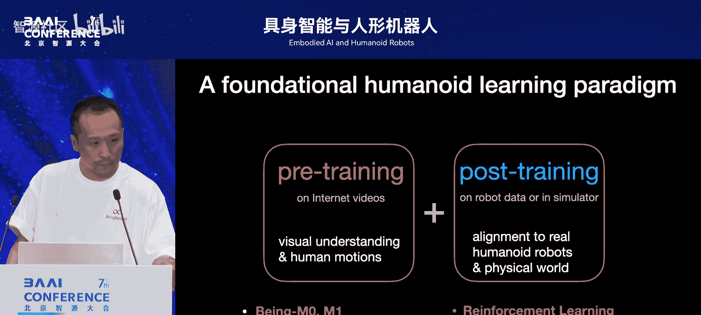

Okay。那么首先是这个姿态生成。同视频中的话，其实就像我刚才提到的，就是对于互联网的视频，我们是可以去。得到各种各样的视频，就是记录到人的运动。

那么我们就可以通过比如说threD的to estimation的模型，把人的姿态去提取出来。像中间这一行啊，当然这边是为了能够更好的展示，通过一个卡通人物来展示出来。

然后再通过把human motion，比如说通过做retgeting，把它retget到这个机器人的motion层面，让机器人来完成。

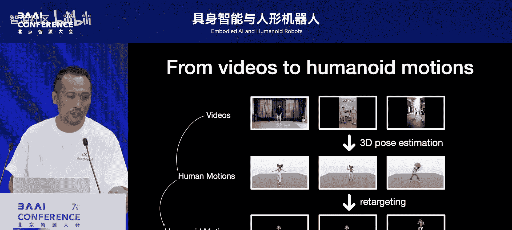

OK那么去年的话其实我们就想做这样的一件事情。然后做的时候发现这个当然motion模型的话是在这个animation里边，大家animation的人做的比较多了。

我们会发现对于animation来讲的话，唯一的一个数据集就叫motion X。然后数据集呢只有大概。如果没记错的话，是880K吧。

所以的话我们当时就希望能够得到一个呃lar scale的 data set。所以的话我们去年在支远的时候，就build了这个第一个这个呃mining level的这样一个d set。

它其实就已经是当时最大的数据集的15倍了。做完这件事之后呢，我们首先验证的就是对于这个motion模型的话，它到底有没有scaling了。其实我们可以看到就是右右下角这个图的话，啊。

X坐标是这个模型的参数量。然后Y坐标的话是FIDID是越低越好。然后不同的颜色表示不同的数据量，可以看到就是我们bu的这个数据集是motion lab的话，是其实还远还没有这个imagenet大。

但是我们从不同的这个数据量上来看的话，随着数据量的增加，就是从上到下，然后随着模型参数量的增加的话，FID是呃是越来越好的，其实就是验证了对于姿态生成模型的话，如果通过大量的数据集。

是可以去得到一个更好的这个模型的。

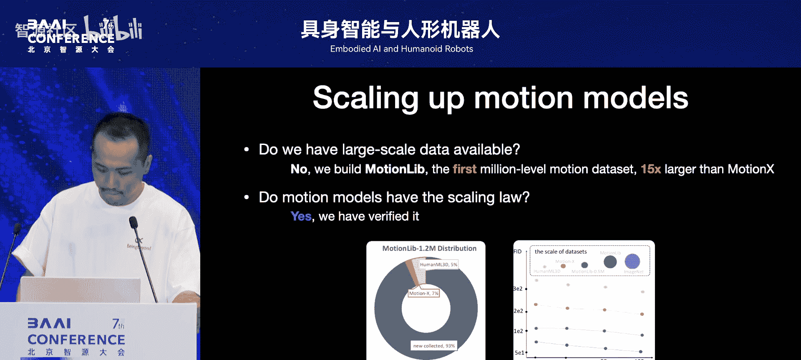

ok。有了数据集其实就比较简单了。有了motion lab之后，我们更多的是在这个action token levels上面做一些呃action tokenr层面去做一些操作啊。

这些具体的技术细节就不不讲了。那么我们得到的一个结果，就是OK有了数据集，然后设计了一个新的motion token，然后去训练了一下。

其实我们当时就得到了一个sofa的 performanceform。当然这一个模型的话，我们本来标beze beingM zero，它其实就是可以通过文本去生成这样资产。

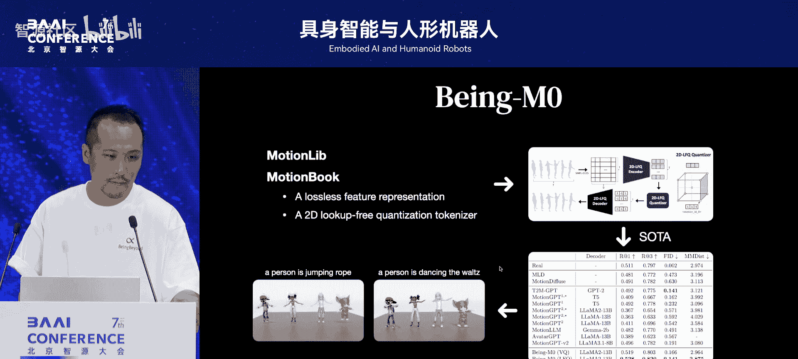

Okay。那么我们今年做的事情。刚才那个工作是呃去年做的，其实啊也是种了今年的SML。但是我们接下来要做的是呃，其实是更大的一个数据集。我们最新的这个呃humo100M的话是有1亿个这个这个。

文本motiontion以及视频的序列。那么我们这边的话也是啊通过一个自动化的 pipeline plan，如何从互联网的数据集啊互联网的视频去构造这样的数据集。

包括我们新增的有power level的 description，就是描述具体的胳膊腿以及更长的long horizon的 motion。还有更重要的一点，我们是有这个vision的c。

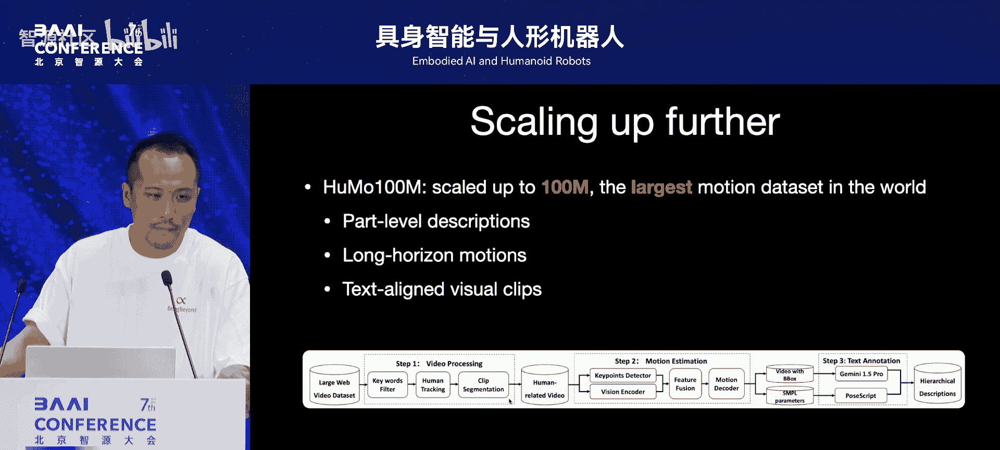

那么有了这样的数据集之后，同样的事情再跑来一遍，那么就得到了这样一个啊BM one。它其实不一样的地方，它是有出有这个vision的信息的。而且我们没有在这个这个一亿的这个数据集上训练。

我们是是用了一部分数据，因为代价太大了。所以的话但是呢其实我们可以看到，就是对于右下角这个图的话，对于姿态生成模型来讲的话，我们基本上已经是。呃，碾压其他所有的模型，在各个这个维度吧。

在各个这个评测的维度。OK当然不管是哪个数据级，我们后面都会呃release给这个com，希望大家能够在啊姿态的生成这件事情上面进一步的去做探索。哦。

也希望能够鼓励大家去思考如何去fuamental的去解决机器人控制这样一个啊比要。

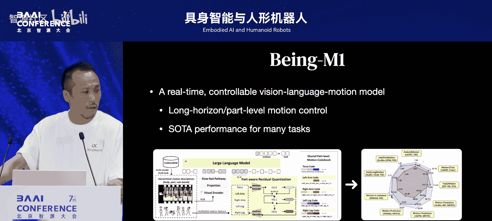

困难的问题吧。ok。那么我们有了姿态生成模型，可以从文本到姿态，然后人的姿态retgeting，然后给机器人。但这里边缺少的一块其实是一个motion tracking policy。

但如果我们要把整个的pi连起来的话，我们的这个motion tracking policy必须要是可以完成任意的motion的 sequence。

所以的话我们呃训练了一个呃 generalralist motion tracking policy。它就是可以把任意的姿态的序列翻译成这个对于机器人的控制。呃。

由于时间关系具体如何去训练这个motion tracking policy，我就呃具体不讲了。其实它能够完成的就是他可以给任意的姿态都可以去很好的完成，而且是非常长城的任务。

比如说啊几十秒的这样的motion的 sequenceequ，它都可以去很好的tracking。ok。那有了这样的一个motion tracking policy，是不是我们就可以通过语言。

然后生存姿态，然后控制机器人了呢？其实我们已经把整个拍 plan都连起来了，对吧？字态生成，然后motiontion tracking policy。问题是呃显然是不能的。对于这样一个模型来讲的话。

是从互联网的视频数据来训练的，或者是motion的数据来训练的。它的互联网的视频即使通过3D post estimation，它质量也不高。即使我们做了这个数据的fu，它其实质量还是不高。另外的话。

因为这些数据的话，模型姿态的生就是姿态就是呃姿态模型生成的这些姿态吧，它是无法 guarantee这些姿态是服从这个物理的physical law。另外也不能 guarantee让机器人能够去执行。

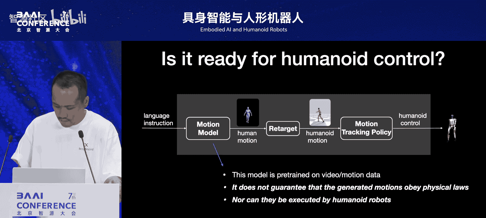

OK那这个时候其实就是RL的发挥的时候了。呃，我们提出这样RL from physical feedback bank或者是RLPF。他其实要做的就是在这边再加一个再加上simulator。

然后我们去在simulator里边，通过强化学习的方法来去翻听我们的姿态生成模型，从而让姿态生成模型所生成的姿态是符合机器人物理属性的。而且对于这一步来讲的话，其实我们可以去适配任意的一个呃机器人。

但是再加上motion tracking policy。OK强要学习的话，两个reward，一个是task motion alignment reward，主要是防止这个这个模型坍塌的。呃。

指的意思就是如果你不加这个reward的话，模型可能仅仅输出一个非常简单的姿态，就可以让motion tracking policy来完成。

另外一部分reward就是啊motiontion tracking的 error，就是如何去更好的去生成这个能让下游的这个motiontion tracking policy来去完成的这样的姿态。

但熟悉RL的同学的话，就会很很快发现，其实这就是一个典型的hierarchical的RL的一个问题。我们是通过一些技术手段来如何更好的去解决这件事情。

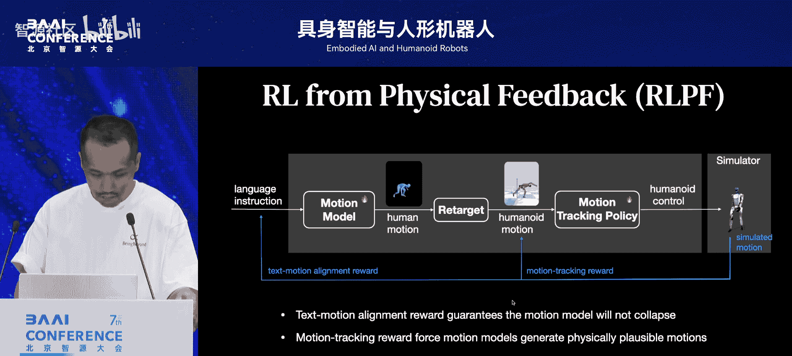

ok。那么相较于RL的方法和SFT来讲的话，其实我们可以看到我们是呃在起码在simulator里边可以看到的就是远远要好于基于SFT这样的fin tune的方法去做的。

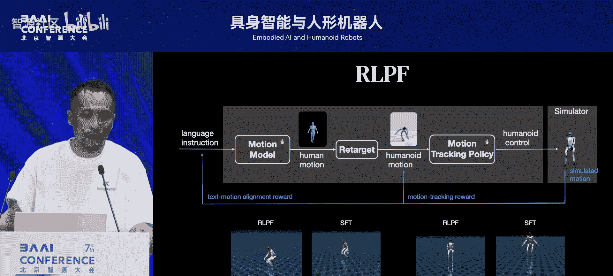

那么有了这个RLPF之后呢，其实我们就完成了一个对齐。就是刚才提到的post training。从呃姿态生成模型的预训练到RLPF跟机器人在similulator里边的对齐。

那么就是完成了刚才所说的ptrain和post training的部分。那么从而我们能实现的就是language的inputs，然后去控制我们的机器人。

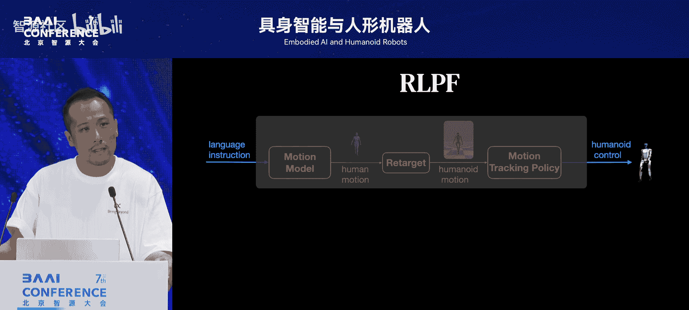

比如说对于呃任意的这样的，不能说任意吧。对于这些呃这个language instruction来讲的话，机器人都是可以去很好的来完成的。

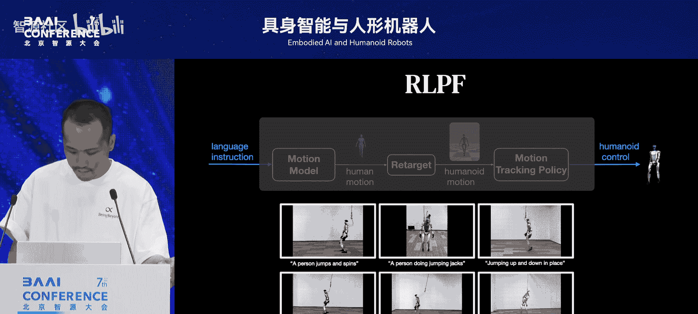

OK其实当刚才的话就是介绍了整个的一个 pipeline，如何去做预训练，如何去做post training。当然整个预训练的数据包括我们post training的LPF。

我们后面也会开源给给这个com，希望大家去进一步的去迭代啊这样一个这个sing up的方法。

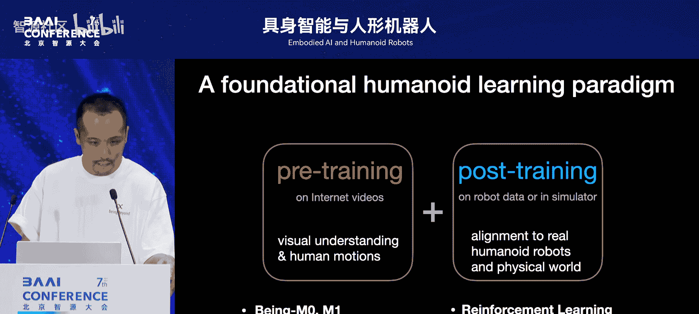

ok。那其实对于手的话，呃，我想大家也能也能get到这个我们的这个技术路线了。其实就是在互联网中找到这个eago century的视频。但这个视频必须有手部的操作。然后我们会标出来人手的这个姿态。

比如说menal的一个姿态来统一的表示人手的动作空间，然后学好这样的姿态。呃，人的这个motion的或者什么man的pri之后呢，就可以把它ret到dex hands上面。

其实我们要做的事情也是直接去学人的manip的 prior。那这个就是我们的一个简单的目标。

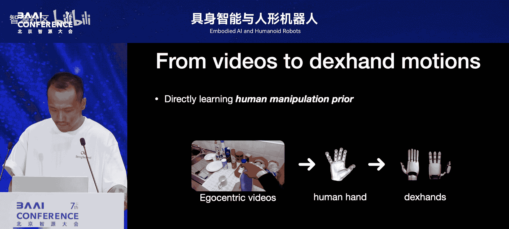

OK同样的拍 plan就会构造数据集。其实就是我们呃基于公开的一些数据集和公开的一些数据集，我们构造了这样一个呃三个命令这样的。第一个2GB，然后加上tax。

然后人手的manal的action space这样的一个数据集。然后呃设计到这样一个模型，其实就是呃一个比较传统的vision language的模型。

再加上一个flow matching的方flow matching的这个diffusion action generation。那需要说的一点，其实是呃这里我们在做这个姿态生成的时候。

其实我们会把当前人手的这个in当前人手的这个姿态作为一个condition给这个diffusion模型去生成。接下来的这个motion首部的姿态。

那这一点是非常重要的是对于我们刚才提到的这个姿态生成的话，就全身姿态生成也是非常重要的。但是刚才忘提到这一点。Okay。那么大家可以看一下，就是呃我们其实简简单的构建了这么一个数据集。

然后能够实现的就是呃第一行视频是我们的方法，下面是一个baseline。然后对于这个视频的话，其实红色的就是这个模型生成的这个手的姿态。它跟视频中真实手的重合度的话，重合度越高，说明它的准确率越高。

我们可以看到，对比上面一行和下面一行的话，其实要比现有的方法要好得多。当然就是从整个的呃mic来讲的话，就是68%和34%的降低。但是我觉得这个也仅仅是第一步。我们可以看到。

即使对于GMEgo hand来讲的话，它生成的这个手的姿态，也是跟。视频中的手是有差距的对，但是这个的话其实就是给我们open了，给我们打开了更多的想象的空间。

我们可以看到这些操作其实是要比我们现在林小手。林销售能做的事情要复杂的多得多。但是对于我们真的如果是通过强化学习的方法，然后去学的话，他其实很难以及代价很大去学类似的事情。

但是我们互联网上已经记录了大量人是怎么去做的。为什么不让模型去直接去学人的这些呃操作或觉得motion的prior。我觉得是非常一个非常好的一个思路吧？ok。

那最后一部分内容其实就是呃比较比较常见的这个视频理解。

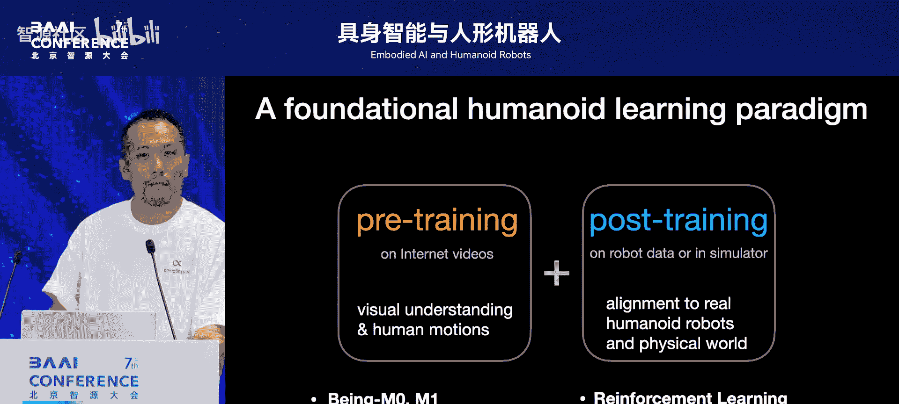

对于视频理解的话，对于机器人来讲呢就是egocentric的video understanding。但是对于第一人称视角的视频理解来讲的话，其实呃现在市面上的模型做的都不好。

不管是开源的也好还是闭源的也好。由于这个第一人称视角尤其是操作跟相售相关的。其实它的场景以及这个视觉的一些contexs是非常复杂的。所以会导致我们的模型，对于这个呃。

第一人称视角的视频理解的话表现不好。我们也是呃构建了第一个这个最大的一个低人称视频的理解的一个de set，大概有10个ming就是1000万。然后我们在这个数据集上面，通过一个简单的模型的训练。

其实就达到了一个一个sota的 performance。对于我们市面上所有的这些Ego的 benchmarkch。其实我们也可以看到，整个的包括千字2。5啊等等这些开源的模型。

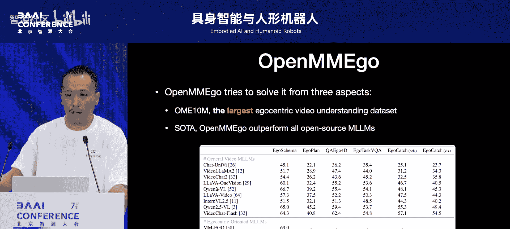

OK其实可以大家看一下，这个就是一个第一人称的呃视频，大家可以。大家可以理解一下，当然后面会有几个问题，会有三个问题，看看你能不能回答出来。一会儿的这三个问题。其实从这个角度来看的话。

其实我们的多模态模型也挺艰难的。OK差不多了，大家可以看看这三个问题。第一个question。描述一下这个。放了多少的这个杏仁在这个这个bandnder里边。啊。

当然第第一个回答就是第一个是第一个是第一行是问题，中间这个是千问2。5的Vout的回答，这个是我们模型的一个答案。然后第二个问题是有儿。呃，勺子是从哪弄出来的？对。ok。其实呃这个让大家回答这个问题。

其实是有一个思考题留给大家。就是为什么对于第一人称的视频来讲的话，对于我们人来看的话，也感觉比较难理解。我不知道大家是怎么样，反正我对于这个看别人做这个就是从别人的第一视角来看到的视频的话。

我每次看都头晕。我不知道大家有没有同样的感觉，如果有同样的感觉的话，大家可以思考一下，其实为什么呃原因是什么。这个还有。原因的话，我个人的理解啊。其实没没有标准答案没有标准答案。我说说我的理解。

原因是我们没有本体感知。因为我们对于我自己来看的话，看当前比如说这个画面，我是知道我自己在空间中的位置，我知道我自己手的位置。但是对于比如说我们现在的多模态模型来讲的话，它的输入就是视频和文本。

输出也是文本。它对于这个人把它放在机器人上面，就是对于这个机器人他没有对于机器人任何的本体的感知，他当前在空间中的位置在哪，他的胳膊多长，腿多长，如何去运动它。那这些都是不知道的。

所以的话其实如果我们要做一个更好的多模态的理解的模型，或者是对于第一人称视角的多模态的理解模型的话，我们最终还是要做我们刚才提到的posetrain。那么这对于这个posetrain的话。

更多的是融入机器人的本体感知。那么如果把机器人的本体感知融入进去了。那对于这样的视频理解我们的模型，才可以初步的作为机器人的大脑，否则的话。

我觉得对于呃即使是我们现在在做的以及市面上所有的这些多模态的模型来讲的话，他都不能充当这。机器人的大脑，这也是我们为什么要在多么态就这个视频理解模型层面。

接下来我们要做的事情就是在post training的时候去融入机器人的本体感知。

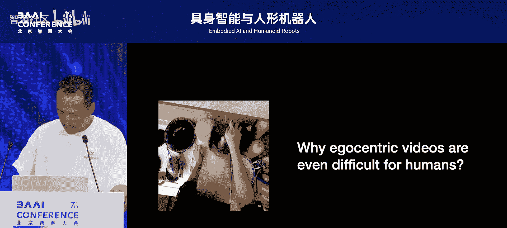

OK其实今天呃说了这么多，大大家也看到我们做事的这个风格就是呃。build数据集在模型层面做出一些突破，然后去迭代模型。那么其实这就是呃传统的做这个大模型的一个技术的方法，技术的手段吧。

当然还有我们的post training，如何去在呃有了大量的预训练之后，如何仅仅通过一些少量的数据，比如说少量的征机数据，少量的这个simulator里边的数据去对齐我们的模型。呃。

我觉得这这样的一条技术路线。当然我个人认为啊才是呃有可能去根本的去解决这个human knowing learning的这样的一个呃一个per一个范式吧。

当然我觉得我们今天当然在今天下午的这个panel环境，我们也可以尽情的去讨论这个问题。但我不排斥对于一些特定的任务，大家去做一些啊。数据特定的数据收集等等。

但是如果我们希望像呃GPT解决所有的LP任务LP的task一样，去解决统一的去解决这个机器人的问题的话，我觉得我们还是需要从整个学习的范式层面去进行一些思考。啊，这个就是我讲的所有的内容。好，谢谢大家。

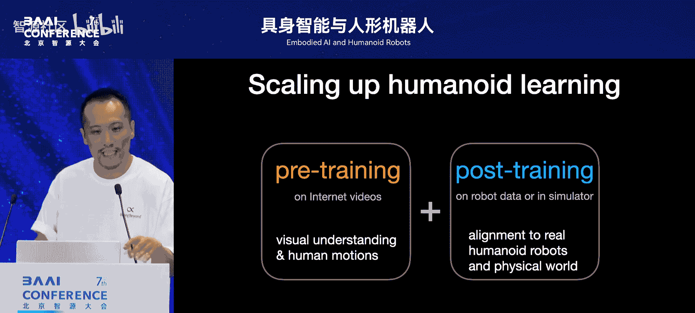