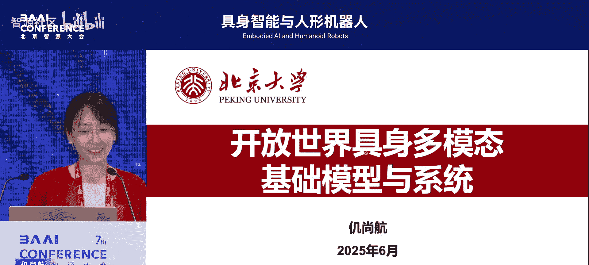
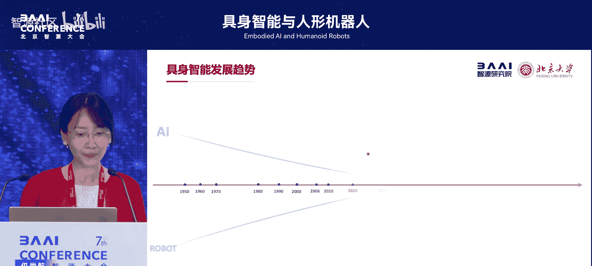
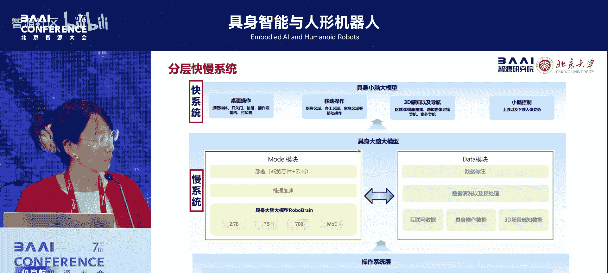
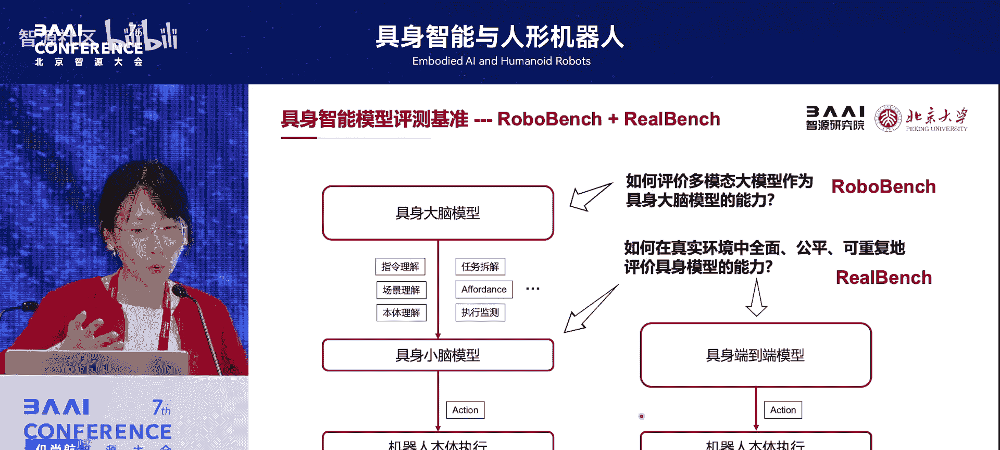

# 2025北京智源大会- 具身智能与人形机器人 p07 开放世界具身多模态基础模型与系统：仉尚航 -BV1MSNEz8EuG_p7-

尊敬的各位来宾，还有亲爱的老师们、同学们，我们的论呃巨身智能与人形机器人的论坛，我们下午呢继续进行。上午呢我们很荣幸的邀请到了像王鹤老师、孙凤春老师赵明国老师、庞江淼老师。

还有卢宗青老师为我们带来关于巨身智能和人形机器人的非常丰富精彩的报告。那么今天下午呢就将由我来继续主持。嗯，然后我们下午也会带来关于巨身智能和人形机器人的一系列的更加精彩的报告来。

最后我们会有一个圆桌的论坛来结束本次的论坛。那么因为本次论坛的呃截止时间，也是我们整个智援大会的结束的时间。所以我们也荣幸的邀请到了黄铁军理事长来为我们做本次智援大会的闭幕。😊。

那么今天下午的论坛呢将由我来主持。我是来自于北京大学计算机学院，同时呢也是智源学者呃，负责智源的巨深多模态大模型研究中心。那首先呢呃也非常荣幸的能有机会向大家介绍智源啊，我们的巨深智能多模态大模型中心。

在过去一年关于巨深智能的一系列的工作。所以说今天我先抛砖引玉啊，作为我们下午开场的第一个报告。😊，那么我今天为大家分享的呢就是开放世界巨深多模态基础模型与系统的研究。我们都知道。

人工智能和机器人是分别沿着各自的路径蓬勃的发展。而他们在22年大模型出现之后啊，也出现了一个非常好的结合点。因为我们大模型可以促使机器人啊具有更强的泛化性和通用的能力。

所以说这也成为了一个巨深智能研究的转折点。巨深多模态大模型呢，也引领了人工智能与机器人融合的新范式。

在22年之前啊，巨身智能往往面临单一的任务，单一的场景和单一的本体。大模型出现之后呢，就有可能赋能它去解决多种任务，跨越不同的本体，面对不同的场景。但是已有的巨身大模型还是一个很早期的研究阶段。

它具有不好用、不易用、不通用的科学难题。所以说我们需要去研究更加聪明的大脑模型和跨本体的大小脑协作框架，来实现跨本体跨场景，可泛化的巨身智能。那么为了去实现更加具有泛化能力的巨神智能啊。

今天上午像王鹤老师啊庞老师，庞马老师也给大家分享了不同的技术路线。嗯，其实目前的巨神大模型的研究，还是早期的阶段展现出一个百花齐放的状态啊，既有这种啊端到端的技术路线啊。

就是我们常说的VLA模型也有分层的技术路线，也就是大脑加小脑。当然也有世界模型，这也是上午孙虎春老师为大家分享的部分。😊，那么这个图啊就展示了一些代表性的工作啊，都是关于这个具身大模型的。嗯。

早期呢最开始像google的C看RT1RT2RTH等等。受到他们的启发呀，像国内呀也展开了一系列的研究。那么后来呀又出现了一条有意思的分支啊，就是以前的这个巨身大模型啊。

可能都是面临的一个呃端到端的VLA或者是一个单系统的思路。但后来呀又涌现出了一些快慢系统的思路。😊，那么呃北京大学我们团队也是在去年5月份提出了1个VLA快慢系统的思路。那么这些红色的框啊。

就是在智源和北大联合去做的一些关于矩身大模型的工作。因为时间关系呢，我就简要的向大家汇报一下。我们研究的核心思路啊，就是基于人类的啊这种快慢系统的思维方式，构建了一个面向具深智能的长城的闭环框架。

这也是心理学家diel Car尼man在他的书thinking fast and slow中啊，强调的人类的思维呢，既有这种system one这种快速直觉系统。

也有ss systemtem two这种有意识的借助外部知识的有推理的思维过程。那么我们啊就是在巨身智能领域，实践了这种快慢系统的思路。我们既做了分层的快慢系统，也做了端到端的VLA快慢系统。

今天我们利用简短的时间为大家介绍一下我们如何去实现分层的快慢系统，以及端到端的快慢系统。这是两个不同的技术路线，但各自各有优劣。😊，分层的话呢非常简单啊，我们的慢系统就是我们的大脑模型，啊。

它就像人的大脑一样，去借助各种知识做出有意识的这种conscious processing的推理。而快系统呢就是各种小脑模型。因为大脑啊它是不用输出具体的action。所以它很方便跨越不同的本体。

而小脑可以根据不同的本体来进行不同的设计了。😊。

那么首先啊我们刚才说了有三种技术路线。那为什么要有大小脑这种技术路线，它又有什么样的优势呢？啊，那首先啊这个大脑加小脑啊，它是比较容易落地的一种方案。

现在很多的业界呀的思路也是大脑加小脑的大脑加小脑的这种思路呢，它更容易实现模块化，也更具有了可显释性。而且有了大脑，它可以跨越不同的本体。所以它的泛化性，尤其是在不同本体上的泛化性，也可以增强。😊。

但是啊这个大脑并不好做，不是咱们随便拿一个多模态大模型，就可以作为大脑的啊。因为呃当然我们也做了具体的评测啊，就发现像GT4O这些在general领域，非常强悍的多模态大模型。在巨深智能的这个领域啊。

如果让他去做我们机器人的大脑啊，却并不是很理想啊，因为它缺乏了面向机器人的，像这种长城的规划呀、空间的理解呀、认知啊等一系列的面向具身智能的能力。所以说我们要设计一个面向具深智能的大脑啊。

它本质上就是一个VLM啊，但是它是面向具身智能的大脑。而且它要实现一种感知认知控制的一个闭环。当然控制是要结合小脑去做的。😊，那么为了去实现。集身智能的大脑模型啊，我们也梳理出了它应该具备的三大能力啊。

包含了啊这种任务的规划能力啊，任务规划能力也是我们VLM最常容易输出的啊，就这个planning的能力，也包含了轨呃区域的感知，也就是我们常说的aance，还有轨迹的预测，也就是trajectory。

啊，那么第一项可能是现在的VLM经常容易输出的这个planning的能力。但是后面两项啊确实是机器人比较容易啊独有的这样的一些能力了。😊，那么为了让我们的多模态大模型具备巨深大脑的能力呢。

我们也专门去构建了一个share robot这样的巨深大脑数据集啊，它呢也是专门要让机器人具备这三大能力而去收集和标注的。那么这样的数据集啊，它是包含了50K高质量的epode和me数据队嗯。

也包含了各种的规划呀，还有aance trajectory这些的信息。啊，那么基于share robot这样的一个互联网数据，还有我还有我们构建的一个模型架构以及相应的训练策略呢。

我们就实现了从抽象指定理解到具这样的重动作执行的这样的一个巨身大脑大模型了。😊，那么这边就是展示了我们的一个模型架构啊，它呢它这个底座就是一个多模太大模型，它可以替换成任何一个开源的多模态大模型。

当然也可以采用啊我们私有的这个多模太大模型了。那么它的输出呢就包含了planning affordance和 trajectory三大能力。

那么左边展示的就是我们这个大脑啊当机器人用我们的大脑去执行任务的时候，它是怎么一步一步做规划啊，去感知它的afordance和去预测它的轨迹的。😊，那么其实像svin在讲座中也提到啊，这个巨深大模型啊。

其实它这个模型架构的设计嗯很难有很好的突破。那么现在的大分研究也都是在呃或者说很重要的一部分啊，就是它这个输入和输出的数据啊，怎么去配配比啊，以及它的训练策略啊，怎么去设计。

因为呢咱们这个多模态大模型啊，它都是在海量的互联网数据上训练的。它已经具备了已有的常识和知识。我们既希望他记住啊这种general的这种常识知识推理能力，又希望它具备机器人的啊这三大能力。

所以说呢我们也设计了一个两阶段的训练策略，让他不忘记过去，也能够记住未来适应未来啊，而且每一个阶段呢，大家可以看到啊都有很详细的这个数据配比的设计，既包含了我们自己的share robot数据呢。

也包含了已有的开源数据。😊，那经过以上的这些设计啊，我们的大脑大模型啊，在这个公开的benchmark上面，在多个能力维度上面可以超越已有的这个模型。这边是一些更加定量的结果展示。这边是可视化的结果啊。

就是说我们的大脑呢可以做出planning啊，给我一个任务的指令，我可以一步一步的把它进行拆解。我们可以做aance啊，就是如果眼前看到这么大的一个水杯，我该知道他抓它的什么位置。

还有trajectory啊，我该用什么样的轨迹去执行这个任务。那如这个工作呢？也有幸被今年的CVPR接收，并且入选了CVPR的年度趋势热点工作啊，这个是CPR官网有4篇啊选出了4篇具神智能的工作。

我们呢也是其中的之一。😊，而且呀在我们去年11月投稿之后，我们又紧迷紧锣密鼓的来去继续大脑模型的研究啊，经过过去半年的努力呢，我们也很高兴的去推出了robo brain2。0啊。

它是一个面向长城啊操作任务及空间智能的一个大脑模型啊，在我们可以看到它这个模型架构啊，在我们上一个版本的基础上呢，又有了更多的设计，而且强调了这个空间的啊这种感知能力。

以及呢跨异购本体的这种多机的啊协作能力啊，右边呢就是这两个能力的一些具体的评测指标。那么我们可以看到啊这个robo2。0呢啊它也是在跨异构本体的多机任务规划上面比以前有74%的提升，在空间感知的方面呢。

也有17%的绝对提升。而且呢它还新增了闭环反馈和去深智能深度思考两个新的能力啊，这就是我们。😊，ro brain2。0了，它呢提供了7B和32B两个版本啊。

32B在绝大多数的维度上面都可以超越已有的这个多模态大模型，而且展现出了更强的空间推理、闭环反馈和具深智能的深度思考能力。😊，也就是我们说的这个复杂推理的能力了啊。那么这边呢就是简单展示了我们这个2。

0版本的一些空间的这种推理的能力的展示。啊，因为这个时间的关系，我迅速的为大家播放一下啊，就是我们嗯可以去指令中包含更多的空间关系的指令啊，然后我们的大脑可以去更加准确的去理解。比如说眼镜左右啊深浅啊。

相对关系等等。😊，那么有了大脑之后啊，我们就会有小脑，有了大脑叫小脑，我们还需要什么呢？还需要一个大小脑协作的框架啊，把这个慢系统和快系统整合在一起，形成一个真正的分层的快慢系统。

所以说呢我们也提出了这个boOS这样的一个整体的大小脑的协作框架。它呢当然是以robo brain为核心的啊，那么这样的一个框架呢，就可以实现跨本体跨场景多任务的快速部署。可以将巨身智能从单机智能啊。

推向群体智能的新阶段开启群体智能的新纪元了。😊，那么我们这样的一个roboOS呢，也具备了啊更多的像这种推理呃推理链度效率的提升，还有多本体时工技共享的这个能力。而且经过半年的迭代啊。

roboOS是在3月29号中关村论坛第一次发布。而这样的一个新的版本啊，这也是院长啊在昨天上午的报告中啊，为大家所介绍的我们的roboOS啊也进行了升级，现在也是2。0的版本了。

那么它呢我们进一步的在2。0版本中强调了巨深智能的ss平台。啊，我们提出的roboOS2。0呢，它是全球首个巨深智能的啊，这种ss平台，可以将这种机器人部署成本，从以天为级别降低到以小时为级别。

其次呢我们也也构建了这种巨深智能的MCP的这样的一种体系啊，它是全球首个巨深智能的应用商店啊，可以支持MCP的啊跨本。😊，体大小脑协作，而且呢呃它是一个全新小脑技能注册代码啊。

而且仅需要原来的10分之1。所以说这样的一个roboOS2。0，可以更方便的让我们的大脑更轻松简洁，快速的适配到多种小脑上面去。因为这个不同的像零销售啊，机械臂像人形机器人轮式机器人。

他们可能都有各自的小脑，对吧？但是我们这种MCP的这种体系，可以让robo brain这样的大脑可以更好的更快速的去适配不同的小脑了。😊，刚才呢提到我们roboOS2。0有两个特殊的这样的一个设计哈。

第一个呢就是这个共享记忆啊，共享记忆系统包含了这种空间的记忆啊，空间的记忆。嗯，这个也和咱们robo的这个空间智能啊是相关的啊。那么第二个呀就是时间的记忆啊她可以记录历史情况与任务执行的状态。

并且根据反馈重新制定这种策略和优化的这样一些操作，并且他还具备了本体的记忆。那么基于以上的这些设计啊，这边就展示了我们这个robo o啊，它这种定制化微调的这样的一些过程啊。

以及呢啊这个视频呢也是昨天院长在志愿大会开幕的过程中发布的我们啊新鲜出炉的啊这个robo2。0加robo2。0的一种多本体协作的啊过程展示。

像这边女士她发出一个指定之后呢啊我们的这个robo啊就开始啊进行指定的理解定。😊，🎼拆解任务的拆解。呃，如果OS就开始协同协作各种啊三种本体，包含了松宁的双臂机器人，还有语数G one。

还有瑞耳曼单臂机器人啊，去共同去协调完成这个任务。而且可以看到啊这个松铃的双臂加加爪和语数的J one灵巧手啊，还有瑞尔曼单臂啊，他们都是不同的本体形态完全不一样啊。

但是他们都可以去share我们的robo brain的这些能力啊，像右边展示的这种空间感知和推理啊，闭环反馈啊，深度思考啊，跨本体异扣多机规划啊啊。

这些能力啊都是可以在不同的机器人本体上面去share的。😊，🎼当然我们每一个具体的机器人可以去有具体的小脑的能力啊。比如说这个我们松宁展示的是这种双臂协作，做汉堡啊，一会儿呢我们的语数的G one啊。

就会给大家做饮料啊，因为时间关系呢啊我们请问对，现在我们就到了这个语数G啊就会去做饮料，其实他这个语数的这个人形机器人肯定它的开发难度啊，还是会比桌面的这个机械臂要难很多哈。

因为它可能还涉及到这个转腰啊弯腰啊，甚至他这个要mobil manipulation啊，就是这种腿和脚的这种协作哈，所以啊这边啊确实是我们花了非常多的精力啊去做这种面向人形的机器人的啊。

这种啊有点啊几乎啊也算是这个全身的啊这种协作的这些能力。像它他的这个腿会走到一个位置。因为它的这个摄像头的空间是很受限的啊，就人可能不需要走这两步啊，但是这个机器人啊，他看到的。😊，🎼范围有限。

所以他要先走过来，然后再去打开这个饮料，然后再去接饮料。啊，然后这个瑞尔曼呢就去收藏，所以我们也实现了多个机器人的协作哈。😊，🎼那么这边就展示了我们的这个呃。🎼呃。

因为大家可能觉得哎这demo太fy了啊，但我们就日常我们日常随手拍了一个啊，就说我们这个roboOS是具体怎么一步步的去执行，让多个机器人来进行写作的。😊，那么以上啊我们就介绍了分层的快慢系统。

那么有了这样的一个快慢系统之后啊，大家看着好像很厉害的样子，它到底能力怎么样呢？所以说我们也非常需要一个非常公平公正很受认可的计身智能的模型评测基准。

所以说我们团队呢也专门提出了robobo和re两个啊这个模型评测基准。robo benchch呢它更侧重于这种分层的啊大小脑的这种框架而提出的哈，就是robo bench啊。

它专门针对这个大脑加小脑的这种框架啊，去提出这种评测的这样的一个呃一个数据集加评测的标准，而且呢它是要在这种啊能够让很多不同的像科研界工业界的用户，可以很方便的就是去使用我们这一套标准化的设计。

所以说我们也专门针对大脑的能力而设计了指令理解感知推理任务规划可操作区域。😊。

推理啊，还有这种错误监测和分析啊，就说我们也是分析了一下这个巨深的大脑到底应该具备哪些能力。为了去评测这些能力而专门去构建了我们的这种bechmark。😊，那么呃。这样的一个ch呀。

我们评测了已有的这些模型啊，就发现啊当前的这个多模态大模型啊，确实在巨深大脑的任务上面存在着明显的不足啊。就比如说没有一个VLM具备全能的这种巨深的大脑能力，而且它的细力度维度高啊。

最高分分布比较分散啊，就它这种细力度维度，其实是我们经常会被的问的一个问题，就说你这个大脑去做规划的时候，它的这个规划的力度到底是粗一点还是细一点啊，这个现在好像还是一个难题哈。对。

而且呢呃我们发现已有的GP4O相对较强啊，而且边缘模型整体确实是高于开源模型，但是他们还是明显低于人类大脑的这个水平。当然这也是一个我们未来可能多年都需要攻克的一个难题啊。

那么有了专门去评测大脑加小脑这种框架之外，我们也有real啊，它是我们想说这个大家都说制约巨深智能发展的一个重要的问题啊，就是没有一。😊，个公开的啊这种通用的这种真机的评测。

因为大家做论文写论文都知道啊，就是往往这个在模拟器中跑的结果，大家比较公认，哎，一到了真机跑结果之后，就是咱们自己的模型，被别的啊团队跑总会低一点，对吧？

所以大家都觉得哎好像特别缺一个真机的bench能够统一的去评测所有的模型，所以说我们也进一步提出了real benchch啊这种评估manulation的一个在真实场景任务执行能力的bech。

它包含了32个标准任务，两个真实可以复现的场景，两种本体以及呢6000多条的这个数据。当然我们也会持续性的增加这样的一个benchmark，它包含了8种维度啊，而且它是一个公平的标准的一个测试的流程。

😊，那么这边呢就展示了它的一个re bench的一个具体的评测流程了。以上向大家介绍的像robo brain2。0啊，roboOS2。0，还有我们的这个roboch等一系列的工作。

都已经实现了全面的开源啊。我们robo2。0也是全球首个支持MCP的跨本体的大小脑协作框架。而robo brain2。0呢也是我们目前评测。当然我们也在公开的啊，其他的bech上面进行了评测。

也是一个全球最强开源的一个剧深的大脑模型了。那也欢迎大家啊加入我们的这种学习交流群啊，以及呢致远呢也是面向企业孵化，也欢迎大家来加入群体交流。😊。

那么以上啊我向大家介绍了关于这个分层的快慢系统的一系列的设计。那么接下来呢啊就是我们的第二条技术路线了，就是这个端到端的这个快慢系统啊，因为呀这个VLA啊端到端的这种模型啊。

也是现在集身智能研究的一个非常主流的一种技术。为了去研发这种端到端快慢系统呢？我们就涉及到了啊它的数据啊，我们如何去收集仿真和真集数据啊，如何去设计它的输入啊，这个也是我们很多从业者所体会到的啊。

就它这个输入和输出非常重要。所以我们有输入的设计，有输出和架构的设计，还有我们的模型该怎么训练的相应设计，以及呢有了啊这个我们核心的快慢系统的思路，如何去实现一个端到端的快慢系统的这个框架的设计哈。

这以上这些工作大部分也被RSSSCPRps加秒等论文接收啊，当然呢也展现出了不同。😊，那这种端到端的技能啊，包含了移动操作，零小手操作、人形的操作、脚接式物体、刚性物体、柔性物体等不同的这个操作对象啊。

嗯，因为的因为时间的关系啊，我们呢嗯可能只能去简要的向大家介绍一下我们关于这种端到端快慢系统VL的呃两个代表性的工作吧。嗯嗯但是可能因为时间很短哈，我就迅速的向大家介绍一下嗯。

这个bri呢是我们团队今年3月份啊刚提出的一个工作啊，但是很开心我们的工作提出之后呢，像physical intelligence的最新的两篇论文啊，像派0。5啊。

还有这个train strategies for efficientic reasoning啊，这个呢都是像这个派团队啊，这两个工作都引用了我们的这个论文啊，而且呢他最近的这个工作啊。

就是这个他们叫派的那个knowledge injection啊，这样的一个模型叫派0。5KI的模型呢也专门和我们的brid进行了这个比较啊。

所以我们很开心啊进入了这个派的工作的这个比较的这个这个群体里面去啊，也认可了他们在论文中啊。😊，也认可了我们haA这种输出范式的设计。那么VLA比起刚才说的这个分层的这个技术路线啊。

它的一个主要的思路啊，就是利用已有的这个多模态大模型啊，在这个海量的互联网数据上面训练之后所具备的这种更强的知识常识推理和指定遵循的能力。

但是呢这个VLA啊它叫vis language actionction model啊啊它呢又进一步的去强化了它的这种视觉信息和语言信息的理解，以及呢它要去生成这种像动作的规划和预测未知的这些能力啊。

所以说还强化了生成动作规划和这种预测未知能力，最终呢想实现一个可泛化的这样的一个控制。这个是我们VLA模型的一个特点。像上午啊庞老师和王老师也都为大家介绍了很多非常优秀的VLA的工作啊。

那已有的这个VLA啊，它往往可以概括成三个方面的设计啊，三个方面的设计。😊，第一种呢就是这个自回归的预测啊，第二种是回归式拟合的设计。第三种呢是这个扩散头生成的设计。每一个工作都有相应的代表作啊。

像自回归预测，像RT one和open就是自回归预测。它的优势是保留了大规模预训练知识的同时呢也保持了推理能力。但是呢它的这个量化。因为它是一个那个呃deecre的这个量化的这个动作的这个生成啊。

会破坏它动作位姿的连续性，从而降低啊它的这个动作未姿预测的准确性啊。这是第一种路线。第二种路线是回归式拟合像roboing和GR one two都是字节跳动啊，代表性的工作。

他们呢具备了更强的呃具备了一定的泛化能力，动作也比较平滑自然，但是它却忽略了策略图的头的这个head的可扩展性，同时呢未能充实充分的去利用机器人动作的概率性的表达。😊，啊。

因为它也是一个像是一种连续性的这个概率的预测。😊，那么这是第二种回归是拟合的方式。第三种啊，就是这个扩散头的这个生成啊，这个典型的像派零啊，caACT啊，都是这样的工作。

它呢是在VLM的后面加上了一个扩散头，它可以实现更加精准的精确的这种操作。但是啊它却没有能够充分的去发挥VLM的这种推理能力啊，就当于呃我们说它就是这个语言的这个输出，基本上就就没有了。😊。

所以说呀我们也观察到了已有的这个VLA啊，它是从自回归的预测到回归式拟核，再到VLM结合扩散头生成的这样的一个路径啊，逐步在将VLA的输出，从离散化的动作变为了一个连续的动作。

再变成对于连续多峰动作的一个建模啊，它是有这样的一个演进的过程。但它现在仍然具备一个关键的难题啊，就是如何在VLA中统一自回归和扩散生成来兼顾啊这种推理能力和多峰连续动作的建模的能力呢。

那么为了去回答这个问题解决这个问题啊，我们也从脑科学理论中寻找启发。因为脑科学的研究就发现人脑呢它是存在着不同的这个分化的区域。那么我们就是我们小孩刚出生之后，他的这个脑细胞会迅速的这个先分裂。

但它最后呢会达到一定程度就开始分化成不同特。😊，特定功能的脑区，而不同脑区之间会有非常简单的呃，它并非是一个很简单的这种连接，而是一种紧密的耦合啊。就像我们的视觉皮层呢。

它其实也接受了大量的运动信息的反馈，从而就启发我们去思考啊，从自回归这种VLM的架构，如何去通过训练去分化出啊，像人的大脑在分化一样。我们也让VLM去分化出一个动作生成的这样的一个能力。

而不是一种简单的这种简单的去拼接。😊，这样也更加符合人脑这个呃发展的这样的一个逻辑啊。所以说呢为了去实现这个目标啊，我们就提出了 a它是一个统一的一个VA框架。

将diffusion和n token prediction进行了一个无缝的融合啊，它可以啊去啊将这个ffusion和AR的token序列进行融合，并且分析了多种协同训练的策略。

还设计了一个协同动作集成的机制。那么在这样的一个设计下呢啊我们可以实现两种动作预测相互增强。而且适应了多样的复杂操作任务，从而实现更加稳定的机器人控制。

那么这里的架构图就是我们这个的一个具体的一个设计啊，因为时间的关系我可能会先跳过细节。但是所有的论文啊，我们都是在已经发布出来，大家可以去看细节哈。😊，这那么我们这样的一个设计啊。

也是首先呢去克服了如何去融合diffusion和ARtoken序列的这样的一个挑战啊，而设计了一套token序列公式。它可以实现扩散与自回归token的无缝的融合啊，就像这个图啊，这边所展示的啊。

就是现在已经有工作把两者拼接在一起。但是我们的设计是如何让他们更加无缝的去融合，而且可以相互的促进。😊，并且呢我们也去分析了多种的训练策略啊，就像我们刚才说的，我们第二步是如何分析多种这种训练策略。

包括token序列公式的设计混合目标的监督和结构化的训练阶段等等。😊，那么最终呢我们也去啊得到了两种方式的动作预测，并且在我们的这个框架下让两者相互的去促进。

从而呢使得我们用自回归token的平均置信度啊可以去自适应的指导动作的这样的一个集成。在超过80%的成功测试的样本中呢，自回归动作token的平均置信度啊超过了0。96啊，这个也是非常难达到的一个指标。

这边是一些像啊我们的一些去在不同的啊这种这个呃情况下的一个测试的一个结果。那么最终的话呢我们将A和啊多个啊像这种公开的非常受关注的工作，像派灵coACT还有open vA等工作都进行了比较。

我们发现啊这个在10个任务上面的平均成功率也达到了74%，比起以前搜他的VA方法得到了显著的提升。而且呢比起这种像openA啊提升有33%cogACT比起他来说提升了14%。

这样的结果也说明我们的这种让两者无缝衔接的方法呢，可以有效的去融合两种姿态方生成的方式的优势。而且我们还和派林啊做了一个比较啊，我们也提升了6%到11%的这样的一些性能。

也证明了我们方案设计的这种有效性了。😊，那么最终啊我们在真惜情况下也做了多种情况的这个实验啊，包含了我们的这个松宁的双臂机器人和fnk卡的单臂机器人。而且和这个派林，还有cogACT比起来。

我们都有一个比较呃明显的这样的一些提升。😊，并且我们也想去验证一下它的这个泛化性啊，因为像上午所讲到的呃，也各位老师提到了这个模型的泛化性是一个很呃难的问题啊。

所以说我们也测试了在空间位置上面的泛化能力，还有操作本体的这个操作物体啊，就操作对象的泛化能力，还有背景泛化灯光泛化等等啊，这些视频也展示了我们的泛化能力啊，以及这个表格中也展示了我们的泛化能力。

还是比啊以前的这个效果要好一些。那么以上我们就介绍了这个A的一个工作啊，就是如何用人脑的这样的一个分化的这个脑区来启发我们去设计的一个呃模型的架构啊，以及它输出的这个控制。那么接下来的问题啊。

就是如因为我们今天的主题就是快慢系统嘛啊那么怎么去真正的实现一个端到端的快慢系统呢啊那我们最近也就是25年的6月，就是这个月啊，我们刚刚去。😊，发呃提交到的这个fast in slow的这样的一个工作。

它呢啊是一个我们它整体就是1个VLA。但是呢它在这个VLA中啊，同时具备了这个快系统的能力和慢系统的能力啊。所以说我们是首个快慢系统一体化的这个框架。相较于这种搜他的方法。模拟器成功率是8%真机成功率。

增加了提升了11%，控制频率可以达到117赫兹。😊，那么这样的一个工作啊，也是呃我们基于啊咱们这个人脑的这个思维模式的这个启发啊。因为呀已有的这个VLA啊，还是具备了像动作推理过慢。

依赖参数过大复杂任务欠佳这样的一些局限性。所以说我们就基于人脑思维的这个快慢系统。一个是快系统啊，它可以快速直觉的去做出决策。一个是慢系统。

它可以需要更多的外部知识去进行思考和推理来完成复杂的这个任务啊，所以说呢我们也是结合了这样的一个快慢系统的思路，想说如何通过一个VLA端到端的模型，就可以同时具备两者的能力呢啊。

这边的话就是如也提出了一个关键的科学问题，就是如何兼顾能力与速度的这个问题啊。那么我们也是受到了这个cannyman的这个双系统的这个快慢系统的这个启发。所以呢我们就想说把这个双系统快慢系。😊。

统直接融入到这个VLA的这样的一个设计中啊，它的核心思想呢就是要既提高这个VLA模型的频率，又能够兼顾场景长时序的规划理解啊这样的啊两者都兼巨的这样一个能力，并且我们将整体的这个VLA啊拆分成两个系统。

sstem two呢负责高级任务推理。sstem one呢负责低级动作生成。但是需要注意的是啊，我们的啊这个双系统并不是真正的两个系统或者是两个模型。

我们提出的fat in slow的这样的一个双系统的设计呢，是将二者合二为一啊，合二为一的去进行了啊呃一个模型的统一的设计。😊，那么已有的这个快慢系统的这个方法呀。

他们都具备啊可能是这种同频的双系统架构啊，也可能是一个异频的双系统的这样的一个架构。但是呢他们都具备了一定的关键的难题啊，就是如何将这个VR如果将这个VRM模型视为机器人的大脑的话。

那么如何能够啊融合系统一和系统二的工作流啊，在一个统一的1个VRM模型中，从而使它成为一个具备了快慢系统能力的VOA模型呢，并且让它同时具备高效的和这种更强的推理和执行能力啊。

那么为了去实现啊这样的一个目标解决已有的快慢系统的这些问题的话呢，我们也是受到了这种啊前脑理论的这种前脑与深脑理论的这个启发，而去设计了我们的一个。😊。

二者合二为一的fast in slow的这样的一个模型设计。啊。那么前脑呢就是指它无需构建完整的世界模型，而是通过直接的感知行为进行预测啊，进行感知行为的映射。

而深脑呢它是指它的智能行为依赖于对环境的内部建模因果推理与这个计划的机制的这个形成。所以说呢我们也去受到了这种啊理论的启发，提出了我们的fast in slow的这样的一个快慢系统合二为一的一个模型。

那么这样的一个模型啊，它就是一个基础的VLA模型。那么它将这个系统一的快速执行能力啊，整合进了一个预训练的VLM模型中。同时呢保留了它本身的系统二的推理能力啊，因为已有的这个快慢系统啊。

它往往是两个分开的不同的这个模型。大家可以看到。😊，我们的这个设计啊，大家看这个蓝色的stem一和绿色的stem，蓝色stem2和绿色stem一啊，它是完全呢都是同一个模型的啊。

它是源自于同一个基础的VLM模型，而且它系统一和系统二之间可以无缝的协同。系统二呢负责理解与推理。系统一呢负责快速的动作的生成啊。

这个就是我们这个设计和刚才展示的已有的这个双系统工作比起来的不同点和它的这个优势了。因为这个已有的方法，它往往是把系统一系统二作为两个独立的模型来进行设计的。😊，那么这个设计里面。

我们fas in这个工作有两个非常关键的设计，一个是异步频率的设计。另外一个是异购模态输入的这个设计。那么在异步异步频率设计方面呢，我们的工作它由一个慢速的系统二和一个快速的系统一来组成。

这种灵感也是受到双系统的这个启发。那么关于这个异购模态输入的设计呢，我们也是考虑到了这个脑区的分化，不同的这个模块要负责不同的这个能力啊，所以说呢我们让系统一的模态输入和系统二的模态输入啊，是不同的啊。

系统一呢它是快速系统，所以更强调这种视觉的这个感知。系统二它是慢系统，它更强调语言的这种abstract和概念的这种抽象啊，所以说我们这边这个fast in的设计也是强调了异步频率和异步模态，如何在。

😊，系统一和系统二上面有不同的这样的一个设计。那么为了去联合优化这个fastin中的推理与执行模块啊，我们也提出了一种双系统感知的协同训练策略。对于这种执行模块系统一啊。

我们就采用了扩散建模中概率性与连续性的这样一个特点。通过像系统一的嵌入空间，注入带噪声的这种动作作为潜在变量来学习这个动作的生成。而对于这个推理模块系统二来说呢，我们就保留了它高维的推理能力。

采用了自回归逐token预测的范式来作为训练目标，从而去生成离散的语言或者动作，避免慢系统发生的灾难性遗忘。这个也是很多VRAA模型经常我们头论文re经常问哎你这个语言输出能力怎么样。

你的推理能力怎么样。在过去很多的模型中啊，确实它都损失了这方面的能力。但是呢我们。😊，将系统一和系统二有机的融合成一个模型，再加上我们的这种协同训练策略之后啊。

就可以让它的这种嗯既可以保留系统二的这个上下文推理能力，又能赋予系统一的一个准确的动作生成能力。😊，那么这样的一个模型啊，也是在大量的数据上面进行了一个预训练。就是在我们设计的协同训练框架下面。

我们在超过了86万条轨迹上面进行了大规模的预训练。当当然也包含了我们自己提出的robomanroboman的这个数据集啊，但现在已经到了10万条呃真集标注的数据，也也欢迎大家去关注啊。

就是这个roboman现在已经是10万条真机。😊，嗯带标注的高质量的真迹轨迹了啊，那这边啊就是展示了我们这个fa工作的一个易频易购的快慢双系统性能的这个优势啊。

我们呢第一个实验啊是在RL啊这样的一个模拟器单实验结果啊，并且和最塔的派ACT进行了比较啊，也进行了这种啊我们的骁融性的实验，经过实验验证啊，快系统确实具备了高效稳健的动作生成。

而慢系统具备了充分利用啊预训练知识的这种啊就是我们把这些外部的知识也是可以充分的利用起来。右边呢这些模块就反映了我们怎么去做骁融实验，验证每一个模块设计是有效的。

那么第二个实验就是快慢双系统在不同变体设置，对于动作生成性能的这种比较啊，也可以看到我们的这个工作啊啊可以去实现一种。😊，能够更加具有这种泛化性和稳定性的。而且它既能饱含保持了过去的这个推理能力。

又可以具备一个很高的呃效率啊这种效率啊，比如说呢我们的呃fasing slow，它的性能啊在不同的H值下可以保持稳定。但是呢它的这个控制频率呢还可以成比例的增加啊，在H等于8的时候呢。

它的理论控制频率达到了117。7赫兹的这样的一个效率。所以说呃这些实验结果也证明了我们的模型啊，集成了高精度的机器人控制的多模态信息方面的鲁棒性和灵活性。😊。

那么第三个实验就是在这个真实的真实世界中的松林双臂机器人啊，以及这个阿phabo实验中啊来验证我们的这个泛化性啊，像这个操作对象的泛化背景的泛化，光照的泛化等等。

那么可以从这些实验中看到啊fasing slow的这个工作，它可以在精确空间推理的这个同时啊，可以在复杂的啊这种多变的任务和背景中保持较高的成功率。😊，为了去评测它的泛华性。

我们也进行了三个啊测试场景的这样的一个设计。这边呢就展示了我们的真机上面啊，在这个阿phabo和松灵的双臂机器人上面，我们可以在多种任务上面具备了啊比较好的表现。而且呢也具备了一定的这种泛华性啊。

比如说光照啊、背景啊啊未见物体啊，就即使这个物体我们没有见过，它也可以去准确的进行操作。😊，啊，那以上的话呢，我们就是向大家介绍了我们团队关于分层的快慢系统和端到端的快慢系统的两种不同技术路线的设计。

那么今天其实昨天啊我们也在啊，我们也很高兴的带着我们的呃不同的这些机器人啊在志愿大会的那个我们签到的那个会场啊，有现场的演示，也欢迎大家啊去现场来去啊我们最后还有半天的时间啊。

也欢迎大家去现场和我们的这个机器人互动来看一下我们的这个模型啊，所展示出来的一些能力啊。😊，那么以上的工作呀也是离不开我们团队多个成员的努力。在分层的快慢系统中啊，有彭伟老师。

像化杰同学等一系列的老师和同学的共同的设计。在最深数据和模型评测方面呢，也有梦迪老师带着一系列的实习生，还有北大的同学们来进行了这个研发。那么在端到端最后这一部分的快慢系统啊，就是VLA快慢系统中呢。

也是由佳明同学带着呃基本是北大的同学们来进行的这个一系列的设计，也非常欢迎大家加入我们的这个交流群啊，来进一步的呃进行线下的交流。因为这个线上时间确实已经非常紧张。我也超了有大概10分钟了，实在抱歉。

好，那本次我们就先分享到这儿啊，谢谢大家。😊。