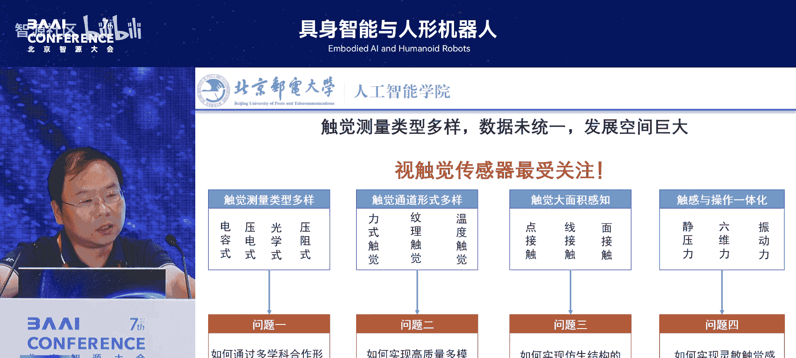
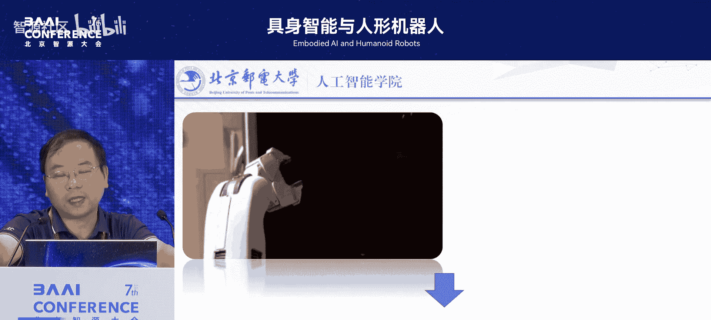
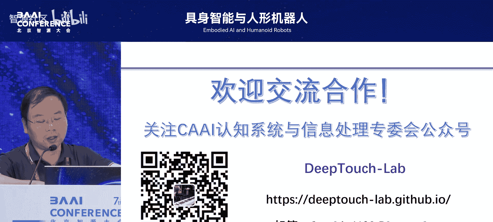

# 2025北京智源大会- 具身智能与人形机器人 p08 视触觉感知的具身智能操作：方斌 -BV1MSNEz8EuG_p8-

🎼我们就很荣幸的来邀请到我们的下一位嘉宾啊，也就是我们的赵呃我们的方斌啊，方斌教授来自北京邮电大学来为我们带来精彩的关于他们的这个我们视触觉感知的巨深智能操作的报告。哎，我们先请方斌老师上台。

大家热烈欢迎。😊，🎼我们先看这。那我们利用这个set up的时间来为大家介绍一下方冰教授啊。方冰教授是北京邮电大学的拔尖人才教授，他的主要研究方向啊就是我们的机器人智能感知交互与操作。嗯，方教授呢。

他兼任人工智能学会认知系统与信息处理专委会的秘书长，是中国人工智能学会的杰出会员，也是HE的高级会员，曾经发表过nature communicationTRO robots等高水平的期刊。

以及SRA这种会议等上百篇的论文，也获得了国际会议和期刊的8项最佳论文奖，是我们非常应该在座的各位都非常景仰久仰的啊方教授。所以说呢我们今天也非常荣幸的邀请到方教授进行诗数学感知的巨神智能操作。

来欢迎方教授好。😊，那个非常感谢呃王老师和张老师的邀请啊，然后非常荣幸的今天能在呃这里和大家分享一些我们关于这个呃是数学感知呃这个方面的研究。那今天上午其实那个我们孙峰老师啊，其实也给大家介绍。

其实我们当当时团队啊做了一些很多的工作。那下午这块我可能呃主要围绕的这个触觉这个方向。呃，和大家去这个呃介绍相关的这个工作。那我们知道这个现在巨深智能其实大家知道主要还是围绕两个这个方面去在做开展研究。

对吧？一个是面向的是这个navigation导航啊，第二个就是面向的这个操作。那对于操作这个是吧？大家有个共识对吧？也是有这个目前在通用操作这块还有很多的这个问题去这个挑战。

所以说本身面向的这个操作抓取的这样的一个任务啊，其实也是涉及到这个巨深智能。😊，说各个学科里面很多不同的这样的一个这个呃很交叉学科的这么一个方向。那对于章操作是吧？

我们简简单单的去拿个东西啊去去吃个东西对吧？这个呃对我们人来说很简单啊，但对于机器人来说涉及到这些方面。那从这个功能的这个发展方向来说啊，我觉得可以大概可以分为三个方面啊。

第一个阶段可能就是去做这个抓住啊，就是把这个东西能给抓起来那我们知道之前像这个很有代表性的这个罗老师的net对吧？

然后包括这个咱们呃资源王贺老师啊做的这个这种多背景切换的这样的都是面向以视觉为主导的啊这么一个这个把物体能实现自主抓取的啊，然后包括无论是场景的变换对吧？还是那个物体的变化啊。

都是首先去实现这么一个抓住的这么一个问题啊那第二个我觉得第二个阶段啊，那其实就应该是把它抓稳对吧？那这个除了结合视。😊，觉所引导的这么一个自主抓取能力。

那其实还具备了你和物体接触的手部的这样的一个触觉的这个能力，对吧？那我们现在这个呃看到的这个很多的这样抓取，其实这个在本身的物理的这个材质属性上啊，其实都是比较单一的啊。对于本身这种。

物体材质属性这种变化的就是说触觉在这里面的作用，其实相对来说都没有这个呃强调到一定的这个能力啊。所以说在第二个部分啊，结合应该说视觉和触觉，去把这个物体抓稳啊，尤其是对于一些动态性的这种操作任务啊。

而不是简单的这个p place的任务对吧？我们知道现在p place的这样的一些抓取释放啊，这其实对于来说是一个很简单的这么一个这个这个对于我们人来说啊，是一个相对比较简单的这么一个任务啊。

那在目前在物流分拣啊，对吧？包括王贺老师在这个这个咱们自源在这个演示的这个其实大部分都是这个呃针针对的这么个第一个场景的这么一个任务啊那对于抓稳对吧？尤其对一些动态性的操作，就是抓取物理后啊。

去实现后续的啊这么一些这个能力啊，其实还得需要这样的一个触觉啊那第三个阶段我觉得就是应该抓好，对吧？就是结合了具备认知能力的啊，尤其是我们大模型的。啊，去这样的就是面对我们可能对于针对不同人，对吧？

我们类似于比如说很典型的比如地灯剧啊，地工具这么一个事情，对吧？那可能是对于你所需要的这样的功能去给你更好的这样的一个理解啊，然后去实现这样一个这个这个方向啊，那在这三个不同的阶段里面。

那那我今天可能重点讲的是结合触觉啊，怎么去开展这个方面的这个这个任务那对于我们今天对吧我们这个主题是计生智能和人形机器人啊，那其实这个呃应该说在这么多年这样的一个发展是吧？到今天是吧？

其实就就是我们其实做机器人这个领域来说，这个我们从事23二十多年。那那为什么到今天计生智能啊，到这个能火的这么程度，其实很多一个重要的方面是在于本体的不这种成熟啊，尤其是视觉智能啊。

对于这个AI的这样的一个推动啊，以及对于计生智能的推动啊，一个很大的一个这个啊这个这个推力。那对于我们这个真正的去了解我们人的这些机理。那其实除了这个这个啊语言啊啊这个呃视觉啊。

那其实触觉其实是一个很重要的一个方面的因素。对我们知道我们人除了我们全身的这个皮肤的这种表面的触觉以外，其实我们内部的这个神经啊，包括里面很多的器官都是啊一些本体学都是属于这样的一个触觉的这个范畴。

所以说在s robottic的这个前面这个一个中枢论文也提到了啊，对于机器人或对于人性机能的发展，这种触觉的研究还是非常重要的啊，那这个我们今天可以看到呃这个语言智能和视觉智能啊。

对于具身智能来说有了很大的这样一个推动。那触觉智能啊，是不是在这个方向上去推动机器人的这样的尤其通用智能这样的一个发展，那其实还是有很多的这个问题去挑战。那在这个方向。

为什么和视觉和语言相对啊这个技术上是相对落后一些？那其实很大一个重要的一个原因是在于本身触觉的传感器，目前没有形成一个统一的一个路径啊，它的测量的类型非常的丰富，对吧？

有电容式的压组式的啊不同这样的一个方这种方式。所以说在数据格式上应该说还是比较多样。那这样的这样的多样性其实对于学术研究来说，其实还是提供了很多的这样的一个机会啊，百花齐放。

所以说大家可以看到这个sence nature上啊，很多的这个这个触觉相关的研究，这个论文非常多，对吧？包括这个应该说几乎每一个月啊在只刊上肯定至少得有几篇啊都是关于触觉或电子皮肤这一类相关的研究。😊。

啊，所以说这个对于研究来说，它有很大的这样的空间啊，但对于我们去做这个呃基于数据驱动的这样的一个学习。那这种多样性其实也带来很多的这种挑战。啊，那经过应该说这几年的发展啊，这个触觉类型。

这种多样性慢慢的形成了一个这个一个共识啊，我就这个这里面的共识就是视触觉传感器的这样的一个路径啊，就是基于这种图像去表征这个呃触觉的这样的一个测量方式啊，受到了一个最大的一个关注。

那尤其包括这个呃去年s robotticics啊，有两篇的这个论文啊，尤其其中还有一篇封面论文是 metata和CMU啊，结合这种视数学传感器去做的这个这样一个任务啊。

但这里面主要任务还是在于这个手内物体的这样一个三维重建这么个任务啊，包括这同一个这个期刊里面当时也发表了一个这种焦点论文啊。

也提到了这种fuizing of的这样一个观点啊这里面也是这个观点的主要的形成也是基于这种视数学传感器去推动了机器人领角操作这个发展啊，然后去推动了机器人这样生智能这样一个发展那它的这个优势在哪啊。

其实相对来说它的结构比较简单吧但它所具备的信息其实非常丰富啊，所以说这种视数学传感器这个怎么去形容它啊，它就是说具备了我们人眼睛的这样的一个分辨率以及我们人类皮肤的这样个敏感性啊，所以说这一类的。😊。

这种视说传感器这个呃应该说目前这个吸引了啊不仅是原来做传统这一类的这个sensor的这个这个研究啊，包括很多做CV的对吧？咱们都在这个方向去这个呃关注。那在这个方向上。

应该是我们科技组应该是在国内最早啊去开展了这个相关的研究。我们在14年就这个1年十多年前啊，就做出了相应的这这些视数传感器的这一系列的这样的一些工作啊。

这个开发了呃不同类型的啊这些这个呃这种视出传感器啊，包括里面。这个我们也探索了很多的这样的工艺啊材料啊，然后这个呃也搭建了这种视数学传感器的这种仿真器啊。

然后去做这个一系列这种这个呃视学相关的这种感知的工作啊，以及用在操作里面的啊这一系列的这样的一个研究啊。所以说在这个视数觉传感的这一个呃研究体系上啊，我们还是相对比较完善。那它的优势在哪儿呢？

那其实就刚才说的。😡，它所依赖的工艺啊不是那么复杂啊，它里面所涉及的这种材料啊，相对比较容易获得啊。所以说其实这个呃降低了这种传感器，在实际使用过程中的门槛啊，所以说因为我之前在这个清华计算机器工作啊。

其实都是CS背景的啊，但是这个呃就是因为我们所有的这些材料啊，基本都在淘宝上都能买到啊。然后这个对于制作传感器的这种整个工艺来说也不是很复杂啊，所以说呃这一类的视作传感器啊。

可以根据大家在不同实际操作这种需求啊，来自己DIY做出这样的这样的个sensor啊，所以说在这个2122年当时我们也整理这么一个这么一个serv位啊，就是把里面所有涉及到的这个传感器所呃一些材料啊。

一些器件啊，然后甚至到里面具体的型号。啊，我们都给它做了一个完整的完整的这样的一个这个整理啊，就是希望大家能根据自己的需求来定制出相应的这样的一个sensor啊。那基于这样的sensor是吧？

就是说它的优势在哪？刚才也提到了，它是基于这种图像去表征的这种触觉。所以说信息量很丰富啊，能得到很精细的这种纹理的这样这个这样的一个信息。所以说我们这个呃也也去啊把它用在了一些。😊，这个呃不同的场景啊。

包括了这种化石的啊这种场景，对吧？这个我们知道这种化石，很多时候这个表面是非常粗糙的啊，而且它这种化石的纹理其实说实话这个很多时候光靠我们的一些常规的肉眼不是能看得很清晰啊。

但是基于这种传感器的这种摁压，我们可以看到能得到很精细的这样的一些纹理的这样信息啊，那这样的一个信息就给我们提供在接触上一个很丰富的这样的一个这个这个这个信息啊，那除了啊能去测量纹理对吧？

那我们知道在触觉里面很重要的一个模态啊，或者说很重要的很重要的一个这个通道是吧？除了类似这样纹理的这个信息以外啊，那就是这个测量相应的这样的一些力的信息，对吧？那我们在实际操作过程中啊。

尤其对于一些contration啊，一些丰富的这些这种接触任务里面啊，我们得需要获得相应的力才能真正的去把这个一些类似种装配，才能把它装。备好啊，那我们也是把这种基于四出的传感器啊。

怎么去获取里面的这样的一个例的一些相关的一些算法啊，我们都做了一些这个呃完整的整理啊，包括我们自己的呃一些研究的工作，也在一些算法啊，都在开源，在这里面去做了一个呃完整的一个整理。啊。

那当然这个刚才说了是吧，除了测量力以外，对吧？这个同同时它其实能获取相应的这些图这个这个这种触觉的这种纹理的信息啊，那有了这种纹理的信息，对吧？我们其实对于这个呃很多的这种视觉。

我们去去就能去实现这种三维重建，对吧？就我们去抓一个一个物体啊，我们这个除了它这种表面的一些形态以外，对吧？那我们其实还能得到它里面的很精细的这种材质的这样这种纹理的信息啊。

所以说对于其实对于一些呃包括这个这个封面论文啊，其实就做了这个三维重建的这样任务啊。那尤其是在在在在图形学或者说在CV领域吧是吧？就专门有去做三维重建这个方向的啊。

那其实之前的应用工作大部分它都基于纯视觉的这种方向啊那对于这种视数学去做三维重建，其实还是里面有很多的啊一些。😊，这个空间可以再去探索啊，那除了这个去做一些感知的任务以外啊。

我们也是这个呃希望去能把它真正的去用到实际的操作任务里面啊，然后去能实现这样的一个稳定抓取。对吧？我们知道对于这个一些啊不同重量的啊，或者说不同材质属性的这样的一个这个抓取过程中。

对我们这个需要手上的这种感觉，对吧？才能真正的把它在手里面去给它这个呃真正的这种去实现这种抓稳啊，所以说我们也是结合了我们这样的一个思算器啊，去做一些稳定抓取的这样的一些研究。

那这里面啊我们也提出了这么一个这种to stage啊，两阶段这种稳定抓取的这样的一个策略啊，就是基于啊初步的这样的一个预抓取的一个探索啊，去实现这个对于我们未知物体啊。

这个是不是能进行这样的一个稳定抓取一个初步的探索啊。然后在第二阶段基于这样的一个触觉视服啊去实现。最终的这么一个抓取的这样一个策略啊。

当然这里面这个底层的也设计了一些啊一些这样的底层的这个控制控制控制器啊，去完成这样的一个任务。那这这里面我们啊结合的这个信息啊，主要是基于这种事实器，在这里面的这些标记点的这样的一个信息。

那我们知道对于一些稳定抓取，我们只是需要获取的它在动态过程中啊，相对滑动的这样的一个信息。那这种表面的这种纹理信息其实并不是重要啊，那这种相对运动的这种信息其实更重要。

所以说我们基于这种标记点去表征它在这种相对滑动中的这样的一个这个这个动态信息啊，然后去设计这么一个这个控制器啊，那这里面我们。这个呃去首先去设计了这么一个预抓取的这个控制器啊，那这里面的这个阈值的调整。

我们也去呃去做了这么一个呃实时的这个呃稳定性的这么一个呃判断，然后去实现这样一个一个一个响应的抓取。那这里面我们也是呃通搭建了这么一个实验装置啊，对它本身的这里面控制器的一些参数啊。

这个通过我们的一些标准平台啊，去做了一个一些参数的这个呃预。呃呃这个预设置的这么一个呃过程啊，然后去这个使用应迁移到这个真实的场景里面。那这里面呃这个我们可以看到啊。

从本身的这个标记点的一些初步的位移啊来判断啊，它在物体和手之间的这样的一个状态啊，然后去这个实现整个这么一个控制的这个策略啊，那这里面我们也做了一些这个测试啊，包括这个和无触觉这种反馈啊。

是一个什么样的效果啊，然后以及这个自适应以及这个这种鲁帮性啊，做了一系列这样的一个测试，这里面我们可以看到，如果说这个基于商业商业的这样的一些。这个呃假状。这个呃我们去抓了一些这样的一个鸡蛋啊。

或者说这种海绵，可以看到在没有力反馈的这些情况下啊，这种鸡蛋也是容易很容易去这个被捏碎的啊，那这个呃在结合我们自己这个开发的这种试探器，以及这种自适的这种抓取策略啊。

可以看到能实现一个稳这个基于这种预抓取和稳定抓取的啊。整个这么一个呃完整的过程啊，包括在这种很轻柔的这种海绵，我们可以看到啊，它能实现这么一个很很很精细的这么一个呃抓取过程啊。

包括一些这个呃重物的啊这种抓取过程中啊，为了防止它的这种这个呃滑脱啊，我们去能调整它的这种抓取力啊，整个这样的一个过程啊，所以说这个我们也拿了很多的这些针真的这些水果啊，这种葡萄啊啊这种这个呃这种。

水蜜桃啊啊这一类物体啊去对我们整个这个策略去做了一个这种鲁帮性的这个测试啊，可以看到一个能达到一个比较好的这种效果。啊，当然在实际的这个研究过程中，对吧？我们其实也在思考。

就说为什么呃这个这种语言和这个视觉，对吧？能在AI这块能发挥出这么好的这样的一个效果啊，那其实在数据上其实是非常有优势的那我们知道触觉在这块。因为它本身在sensor上就没有达到一个很好的这个呃这种。

这个呃量产啊，或者说大家这种通用的这么一个这个认识啊，那这个所以说它本身在这种数据的堆积上，如果从触觉这个模态上来说，它其实产生数据过程，其实耗时耗力啊，又耗财的那怎么去产生这种数据。

所以说这个呃仿真成为了现在一个这个一个热点的方向啊，那我们可以看到英伟达现在是这个呃在去生智能这个方向啊，是一个重点布局的一个方向。那这个呃在触觉这块啊，他们其实可以看到近近两年嘛啊。

其实也是在重点的去开发类似这一类的这种触觉的这样的一些仿真器啊，包括刚刚前上个月啊在这个TRO上他们发的这个呃这个texel啊，就是基于这种四数的传感器。啊，去开发了这么一个这个呃仿真啊。

包括呃还有类似于啊这种词触觉的啊去做这种触觉的这种仿真啊。那基于这样的这种触觉数据生成啊，应该说也是目前一个很重要的一个这个问题啊，也是应该说计生智能很值得去关注的这么一个方向。

所以说怎么去啊结合我们这种数数传器啊，去生成这样的一些这种数据啊，也是我们这个呃这个上个月啊我们这个这个发表了一篇工作啊，去探讨了这个触觉数据生成啊这么一个问题。

那目前这个呃数数传器在应该至少在学术圈嘛啊，大家慢慢形成了共识啊。所以说这个也很多的这种不同的这种group啊，也去开发了这样的一些数据集。那我们可以看到呃，在实际的这种应用过程中啊。

那呃把真实数据集真实的这种这种这种这种数学数据和仿真的数据啊去给它结合啊，然后在这个呃用到实际的应用过程中啊，这个无论从性价比上啊，还是在这个成功率上会达到这种更更好的这样的一个效果啊。

那这里面怎么去让这种仿真的数据能得到能或者说我们怎么能获取这种高质量的这种仿真的这种数觉数据。那这里面本质的这个呃仿真过程中当的核心的问题啊，应该是包括这个三个方面。啊，一个是啊就是这种弹性体的仿真。

那我们知道这个我们知道触觉是吧？大家思考过没有？这个它里面本质的这个因素是什么啊？那其实就是形变，对吧？这无论是你是这个什么样的这个原理。那其实本质上都是因为形变所产生的这个信号那其实视数学也是一样啊。

那就是在接触过程中弹性体的这种形变是吧？我们才能捕捉到啊，它这样的那我们只不过是用图像的这种方式去捕捉到这种形变的这样一个信息啊，那在仿真里面。

我们怎么去把这种啊这种形变的这种这种弹性体的这样的一个特性去给它仿问出来啊，是一个很重要的这个一个一个里面的一个最关键的一个因素啊，那这个呃当然本身这种四数串系啊。

是基于这种光学和图像去这个获取的啊这么一个测量方式啊，所以说在这里面光学怎么去仿真啊，以及包括这种位移点怎么去仿真啊，都是这个呃重要的一个问题。啊，那对于这种弹性体的这种仿真啊。

目前主流的这个技术手段有什么啊，主要是这三个方面。第一啊是基于这种深度的这种弹性体的仿真，对吧？就是像包括早期的有线源啊，或者说早期的这个这个呃我们知道的这个这个呃一些主流的机前的。

无论是排 bullet啊，对吧？还是z啊，那都是基于这样的一个方式啊，这个去去去做这种仿真。那它其实里面精度非常低，而且是没有什么物理特性的。啊，那第二类，那其是基于这种有些人员FEM的这种弹性反真。

那它其实能获取的这种物理特性或者精度还是比较高啊。但是唯一的这个这个这这个呃劣势就是效率上比较低啊，然后这个呃成本上计算成本上会更高一些。啊，那第三个就是这种基于MIMPM的啊这样的一个方式。

那它这种方式在呃这个尤其一些大变形的这种这个仿真上，它的效率上会这个更高一些啊。当然精度上会和有些原这一类方式会会会差一些。啊那当然还有一些这种基于learning based啊这种方式啊。

就是通过这种跨模态生成的啊，就是通过这种呃图像啊，我们正常的正常的这种图像啊，然后去生成接触的这种图像啊，这种跨模态这种生成方式啊，以及包这个呃这种im的这种方式啊，去生成这些呃这种触觉的这种数据啊。

那这个其实也是呃现在一个呃在这个方向上也是一个很热点的这么一个方向啊那拿到这些数据以后，对吧？这个刚才也提到了这个呃应用这块啊，其实主要还是在于这个呃这个包括这种东方的表征啊三维重建哪啊。

以及我们聚生智能这种操作啊，这个这个主要是这个三三个方面的应用。那关于这个视数觉触觉这块的这种仿真系啊，其实啊我们是比较早的呃就开始探索了这样一个方向。

那当时我记得这个呃清华那个这个之前清华毕业在MIT的这个这个毕业的这个胡渊明啊。当时呃开发了一个这个图形学很有名的这个太极啊，我们是结合这个太极的这种开源反进去。

我们去做了这么一个这个呃这种世数觉的这样的一个仿真系。那在这个方向上应该说我们从20年开始探索啊，到这个现在我们一直也是在呃不断的努力去迭代啊，然后包括前期对吧？跟那个浦江庞老师这边啊。

我们也是这个呃一起尝试的去合作，去把这种仿真系啊，用到我们的这个呃这种桃源2。0的啊这种版本里面啊，去去提供更好的这种接触这种触觉信息的啊这么一个这个呃方向。那在在那在。

早期啊我们呃最早的1个ACM的这个工作上啊，我们最早的是基于这种这个太极林这种粒子的这样的一个呃呃特性啊，去仿真了啊不同属性的啊这样的一个呃物体啊。

然后去实现了啊这种接触变形的这么一个基本的这样一个呃这个效果啊，我们可以看到在这种接触过程中，我们可以把这种物体的这样的一个形状啊去实时的这种反映出来啊。那这样的话，至少给我们这个视触觉啊。

最基本的这样的一个接触信息给了这么一个这个特性啊，那在这个基工作基础之上啊，我们又把这个呃光学模型啊mo这样一个模型去给它这个集身进去啊，当时就开发了这个太极1。0这个版本。

那这个版本我们其实还是只是在这个呃实现了这么一个按压啊，就是一个简单的按压这么一个过程去获取这样的一个触觉的这种图像。那在这个呃效果上。啊呃在sim to这个精度上啊。

其实呃这个这个还有待进一步的这种这个提高啊。那在这个呃在这个1。0这个版本上吧啊，我们又去对里面的这个路这个尤其是光学仿真的这个路径追踪啊。

去给他这个结合进去来提升它整个在实际仿真过程中的这样一个这个效率啊所以说这个又做了这个efffficiency呃这样的一个太极的这样一个工作。啊，那我们知道在实际的这个呃物体接触过程中，对吧？

我们按压其是只是一个最基本的一个这种这个这个touch的这种模式。那其实还有很多啊这种滑移啊旋转啊啊，都是我们这个经常使用的这么一个这种touch的这种方式。那我们在这个之前的100版本上啊。

我们又开发了这个这个matmotion的啊这种多运动模式啊，或者多运动接触这种这样的一个呃仿真器啊，那这个工作也是当时带着这个一个呃本科生去完成了这么一个工作。那在这个工作上。

我们这个呃有进一步的啊希望啊在我们实际的这种物理过程中啊，除了刚才说的这种干刚性以外啊，我们希望能把这种弹性的塑性的啊这种以及这种弹塑性的物体啊，我们都能在这个实实际的仿真过程中去给它模拟出来啊。

然后再去实现相应的这种man learning点这样的一些这个任务是吧？我们知道在操作任务里面啊，这种变形体的操作啊，一直是一个难题。那所以说我们在这样的过程中。

我们也是啊这个开发了这么一个新型的这种传感器啊，和原来的数算器来说，在这个感知域上会更。更这个呃模样上会更多一些啊，然后我们也开我们也这个呃这个呃探索了这么一个从sem real的啊一个整体的框架啊。

然后啊结合这个强化学习啊去学习在在sim里面啊去学这种不同这种变形体的这样的一个操作的这种策略啊，包括把它呃这个压成啊一个什么样的形状啊，或者说把它这个呃这个把它楼层啊一个什么样的一些这种形状啊。

包括这种圆柱形的啊，或者这种三维物体这种球形呢啊，我们通过在sim里面啊去学习这么一个整个这样的一个策略，然后呃啊然后去迁移到这个我们机器人上啊，从实际的这样的一个simem的一个效果上啊。

可以看到啊我们整个这样的这种触觉啊以及不同材质物体的这种仿真啊，对于我们实际的这种。学习上面还是有很高的这样的一个效率的个提升。啊，当然在这个最新的一个工作里面啊。

我们这个除了刚才说的这种纹理的这种图像以外，我们也把这种标记点的这样的一个信息给它同时结合进去。那这样的话对于啊这种游戏动态任务的啊这样的一个这个呃操作的这种学习啊。

基于这种这种标记点的这样的一个呃这个表针啊效率啊，就会更高一些啊，而且我们在运动模式上啊，也可以实现按压滑一旋转这种不同的这种组合的这样的一个运动啊，那结合这样的一个这种信息啊。

我们就可以获得啊很好的这样的操作任务。所以说在目前的研究过程中，我们也是把我们的这种成果现在运用到这种空间的这样的一个在轨操作的这种这个国家任务里面啊，我们知道现在我们这个国家有自己的空间站啊。

但是在空间站里面的在轨的这种维护维修。其实是这个风险非常高的啊，尤其是宇航员出舱啊，这种出一次仓的。啊，这种成本也是非常高的啊，然后对于宇航员的这种生理心理的这种挑战也是非常大。

那而且这种在维护维修过程中啊，其实是一个非常高难度的这种这种挑战那在这个方向上，我们也是现在在和啊这种这个航天院所去合作啊，那这个这种相应的成果。

也是去年我们在世界机人大赛的这个太空机器人这个呃这个这个比赛里面，我们拿到了一个唯一的一个特等奖啊，那这里里面总结了我们这几年关于视数觉感知啊，仿真操作的一些相关的一些这个这个呃文献啊。

所以说对于这个方向感兴趣的呃这个呃各位同学啊，我觉得这个看呃这个这个呃基本啊这个list啊，我觉得基本就能。😊，呃，能完成的这个这个工作。那。在呃本身对吧？

这个触觉其实应该说呃应该说其中唯一的一个模态啊，单一的一个模态。那我们是不是可以把它和视觉以及和语言啊去做关联啊，去做更丰富的这种视觉语言啊，触觉了这样的一个这个多模态的这种呃感知工作啊。

那我们这个也是和北郊那个韩军老师啊，我们去合作啊，这个发布了一个touch100K的啊这么一个这个数据集啊，这个数据集也是目前呃也是在giub上也是做了一些做了这个做了做了这个开源啊。

这个感兴趣的可以去那个呃关注了关注一下这个工作啊，包括也是最近我们这个呃提出了这么一个N能 touchuch的这么工作啊，这我们也是希望呃在视数学传感器。现在啊这样大家多元化的啊这么一个这个这个阶段啊。

我们是不是可以提出这么一个统一表征的这么一个框架啊，能把大家不同的这种。😊，这个四出传感器信息做一个统一表征。那这样的话，对于后面无论是啊做一些preception的一些呃running。

还是基于这种操作的啊这样的一些任务啊，我们都能去这个结合我们这样能touch啊这么一个框架啊去去做一个统一的表征啊，当然在这里面是吧我们也尝试着希望我们的这个呃ttail啊T的这个模态啊。

去融到现在这个VLA的这样一个框架里面啊，所以说我们现在也是也是在这个呃尝试着去探索去做这个VTLA的这样的工作啊那这个要做VTLA那首先你还得去做一个相应的。

这个呃怎么把T这个ttail啊和这个呃后面的action去做一些对齐啊，所以说我们最近的一个工作也是呃包括和语言的这样一个对齐啊，去做了这么一个这个呃这个呃CTL呃CLTP的啊这么一个框架啊。

就是希望我们在这个呃不仅是视觉能去做完成的这种操作啊，单靠这样的触觉模态，也能去完成相应的这样的一些这样的一个任务。啊。那对于这个呃未来的这个趋势啊，我也这个呃发表一点个人的一些观点啊。

那包括从去年开始，其实很多的这个呃工业界啊，包括投资界一直也在问我啊，这个现在的这种触觉的这种传感器方式很多样，是吧？到底是在什么时候这个收敛到一个一个一个一个呃一个路径上啊。

那这里面啊这个我个人的观点啊，仅供参考。啊，那至少目前视触觉传感的这个方案啊，在呃业界啊，无论在工业界学数学，其实在大家的这个研究的呃这个呃人数上啊，就说你这个方向是不是热是不是主流，对吧？

首先在看你这个研究这个基术上是不是群体上是不是这个呃规模大。那至少目前啊视觉传感系，我觉得应该是相对来说整个这个规模上，我觉得还是很可观的啊，所以说这样的一个技术路径啊，我觉得啊对于这种量指啊。

或者说多指的这种子间类的这种操作啊，我觉得应该说会呃形成一个统一的这么一个认识啊，所以说我觉得视触觉传感器在这种子间类的这种操作上，应该会形成一个较为统一的一个这个技术路径啊，那从去年开始对吧？

VLA是吧？包括今天早上是吧？王和老师啊，这个呃包括刚才的这个张老师对吧？也提到了这个VLA。啊，现在的这个一个很热的一个方向啊，那我个人的判断啊，从今年开始啊。

VTLA啊将会是居升智能的一个新的爆发点啊。这个呃把触觉融合到视觉里面，这样是对于尤其对于操作啊，应该会提供更强大的这样一个这个能力，对吧？我刚才提到了是吧？从抓住对吧？到抓稳到抓好啊。

其实三个不同的阶段，那这三个不同的阶段在你实际的啊无论是你工业场景，还是你家庭的服务场景啊，他所给你提供的能力啊，应该是这个呃会有一个阶段性的这样的一个节月的这么一个一个一个一个能力的这种提升啊。

那第三个观点，那我觉得这个对于双臂操作的这种这个呃能力，我觉得还会有进一步的这样一个这个提升和挖掘，对吧？我们知道从tford的哈这个双臂摇操作。

开始是吧点燃了这波亚头洛世教的这个热潮以及双臂操作的这么一个热潮啊，那我看到今年很多这个呃，但这波热潮对吧？末端其实还都是以假爪的这样的一个形态出现。那从这个呃去年下半年到今年是吧？我可以看到灵巧手。

其实尤其是这种多指灵巧手慢慢慢的这个呃。出现了很多啊成这个产品也是在不断的成熟啊，所以说这样的一个高维自由度的这种行成操作，我觉得后面的这个潜力会很大啊啊尤其对于我们计生智能。

在在如何在这种这种双臂的双手臂啊，这样的高维自由度上怎么去挖掘它的这样的一个能力，以及啊去很好的使用工具。啊，去做这个呃兼顾这个效率和通用性啊，这两个指标还是有很大的这个空间。对吧？

我们知道现在大家在做这个VIV很多在做研究过程中呢，可能大家一直在强调它这种通用性啊，但实际上我们到落到工业实际场景里面啊，效率其实一个很重要的一个方面啊，所以说这个是我这个个人的这个观点。

仅供大家参考啊，所以说这个对于机器人的这种通这个呃通用操作啊，以及这个触觉在这里面的这样的一个呃作用啊，我觉得未来还是有很大的潜力啊。

然后我也希望是吧我们能看到真正的这个机器人这个啊不仅只是在展台上去展出啊，真正能进入到我们的工作生活啊，给我们提供真正的这样的一些这个服务的价值。啊，谢谢大家。😊，然后最后这个呃做哎呀。

最后一页帮我打开一下呗。最后最后做广告啊，这个因为我是那个刚刚加入咱们那个智源，然后我是那个呃那个去年从清华计算机系调到了这个北邮，然后在北邮建立了这么一个那个de touch的啊这么一个呃lab。

然后跟智源这边也有那个联合培养的博士名额啊，这个呃感兴趣的啊，那个尤其是对志源是吧？非常一直有期待的这个优秀的同学啊，可以给我呃发邮件。好，谢谢大家。😊。

