# 2025北京智源大会- 具身智能与人形机器人 p09 人形机器人规模化落地的机遇与挑战：赵同阳 -BV1MSNEz8EuG_p9-

🎼今天呢我们就非常荣幸的邀请到了重情机器人的创始人兼CEO赵同阳、赵总来为我们带来。他今天的分享是关于人形机器人规模化落地的机遇与挑战。那我们来掌声热烈欢迎赵赵总的精彩报告。😊。

🎼那么赵总呢他是一位连续的创业者，现在呢就是我们非常受瞩目的重情机器人的创始人兼CEO了。那么25年25年的5月呀，就是在上个月，重情机器人呢就荣登了25年福布斯中国人工智能科技企业的top50的榜单。

那么赵总呢也构建了硬件平台加开发者生态的一种模式。S01呢也获得了科大讯飞年度的最佳杰出产品奖。而PM01也入选了英伟达的开发者生态计划。目前呢众情的团队已经接近了100人。

并且计划在年内实现产销1000台以上的目标，非常热烈的欢迎赵总为我们带来他的分享。😊，这个翻译是吧？对对。呃，感谢大家呃，各位嘉宾呃。😊，我是大概是半个月前被王贺老师邀请的。呃。

其实刚才听到各位专家啊教授的很多，我看研究的非常深，在巨神智能这一块呃，从理论公示了，到整个架构了。我觉得是嗯感觉到他们已经做的非常深了。呃，我自己的话其实也是做技术的。

因为呃但是更多是在呃硬件和呃软件这一块，但是在巨神智能这一块，我做的不是特别多。所以说这次过来也是想听听各位专家的一些看法啊，另外的话在那个人形机器人这一块的话，呃，我自己呃还算算一个合格的创业者。

但称不上优秀。对，因为毕竟这个事我已经干了十年了。呃，所以说我可能从另外一个角度来去分享一下人形机器人，我自己的一些看法。对。嗯。首先就是想说一下为什么去做人性机型这块，其实呃。

在我们大概是在2016年的时候就开始做了。其实在2015年2015年到201年开始做那个时候去杭州与杭州的一些伙伴们，还有国内的一些做人身机械，都从那个时时候开始的。但是那个时候做的时候，在中国的话。

可以说是一片技术上和商业上都是一片黑暗的。因为当时我们能看到只有日本本田的阿西莫，还有那个。还有就是呃波能动力呃，他们有这样的一个技术。对，但是的话价格是非常高昂，动不动都1000多万。呃。

但是中国那个时候几乎是只有玩具级别的。不管怎么样，其实很多商业的话呃，更多是来自于热爱。呃，因此的话我们其实刚开始呃，很多商业我们都是并没有说一定是呃看到就是非常清晰了，我们才去做。

而是说呃首先很喜欢这个事儿，然后我们才呃就就直接往下去做了。因此刚开始的话投融资这一块的话，是不被市场看好的。但是有的时候热爱是非常他能跨越周期的，能让你跨越十年。对，但是如果因为他会让你越做越兴奋。

就像你玩游戏一样，但是有纯粹为呃一些资本呃去做一件事的话，你会感觉到这个事情的话很累。因为你想着你要给很多一个交代，而不是给自己一个交代。因此的话一切都是来自于我们认为这件事情能改变人类以后的一些东西。

以前我们都看过一些机器人的一些呃片子，像我小时候受到影响的话，就像类似于终结者，他能从视觉上给你带来非常大的冲击。AI人工智能呃，他能在心灵上给你造成非常大的冲击。所以说都让我们小时候的这种信以为真。

这就是未来当然我也受到其中的影响。对，呃这是我们为什么去做机器人。然后做机器人的话，刚开始有人去建议我，你为什么不去做一些更容易落地的像机械力这行业。在2016年的时候，那个时候。

机械力行业确实是最容易受热捧的。因为呃市场场景啊很多。西的话他都是非常明确的。而人性机器人他是虽然说在当时他是非常大的一个梦想，但是投资一看都说你们是在做梦呃，管他呢，做梦就做着呗。

反正现在在座各位都有各自的一梦想，就让别人去他们去怎么说，我们无所谓。所以在创业的时候很早期的时候，不要介意别人怎么说，刚开做的时候，我们认为这这个事很简单啊，有多简单。

刚开始我认为半年就可以做出来所以说刚开始一切事情都是无知。很很无知，然后就无味无味，你才敢做。如果当时你就发现他需要1年才能走到现在，你还敢干吗？😊，我不知道呃，也许我还会会继续来。

所以说一切都是来自于自己的梦想，无知无畏才敢去做这个事儿。对，为什么要做？呃，我们定义人形机器人的时候，我们就想要做一一些具有灵魂的。就是说我们希望我们的机器人，它不再是呃一个工具。

因为人类到现在为止发明了太多工具，他都没有感情。呃，我们人形机器人，我们希望再做一个工具人，我们都希望有自己的思思想就有自己的决策的。所以说我们觉得我们做一件很酷很伟大的一个事儿。嗯，对。呃。

然后这是过去的1年。呃，16年开始呃，到那个现在呃25年接近1年的一个时间吧，最早的钱还是自己出的。呃，在我这之前自己成了一家公司，因为我不像大家很多在座的各位投上都是有非常大光环的，很多名校出来的。

我的学历不怎么高，同样没什么光环，只有一个梦想，穷的这是梦想，其实只是梦想是非常重要的。你至少可以说我穷的还是梦想，你可以坚持你自己想做这些事。因此呃但是只有梦想是不够的。呃。

那个我们在16年的时候之前我就想做这个机器人，但是我问了自己几个问题，同样你没有钱也没有很强那个管理能力，你可能穷的自撑梦想，那怎么办？好自己有我三五的产面，那怎怎么办，可能自己支撑自己的个梦想。

因此1212年到16年成了一家物联网公司，那家物联网公司的话是呃还好吧，因为我当。射频学的还不错，在深圳那边呃呃就是可以12年到16年，从一个人发展到200号人，也是自己创业。

然后做wifi蓝牙这个P模块到现在这家公司还在活了13年，一家公司活13年还存在一年还有呃两个多亿的营收的但算算第一次创业成功嗯，对，然后那个成功的钱主要就想用来去做机器人。

所以说当你自己条件不足的时候，你可以自己给自己创造条件就就O了。所以说没有必要让别人完全支持你为什么那时候资本也看不懂也看看不到。那自己可以支撑自己去做这个事。因在那个还好到16年的时候。

终于手里面有个六七百万了，然后就出来去做人形机器人。😊，当初当初去做这个机器人的时候，我们看了呃，首先不像现在新能源汽车，你至少可以买个特斯拉去对标，可以拆一下。当时16年的时候。

只有波森动力和特斯拉呃和波森动力和阿西莫，他们有1一卖就是1000多万。我们手上算然手上的资金可能连。可能连那个500万都没有，呃，怎么能连人家半个身子都买不到。所以说只能自己干。因此的话呃还好买不到。

因为有些东西一旦买到，你能买到，别人也能买得到。那问一下你的核心价值在哪里。所以说有的时候发现一些非常危险的时候也是非常有机遇的时候，因此我们从核心零部件，从电机间随机控制器传感器。

到那个时候我们就开始了。但是呃问题是不跨的太大了，上来就做人形是有很大问题的。大家都知道人形双柱人形比四族要难做很多，因为它天然就是一个不稳定的一个系统。对，而四族机器人的话，它天然它就四条腿。

为什么桌子有4条腿，就天然就有稳定系统。因此16年。😊，呃，做了到118年自己的差不多将近700万去呃，一个小的团队基本上耗的差不多了，赶紧转做四组，反而四组是能对呃我们快速的一个发展是有有帮助的。

因此，在创业过程中，你可能是不能顺利的一下子到你想要的东西，可能中间会有一些呃呃有些过程。对，但呃比较幸运的是，四族上的一些硬件一些核心零部件呃，它的一些核心技术以及它的软件算法的技术。

到最后有70%能用在我们双组上。所以说在创业过程中，还有一些非常幸运的一些事发生。就说虽然说从四组到双组上有个迁移。但是所有的人才，所有的技术硬件软件有百分之六七十均很通用的哦，这点是谢天谢地。嗯。

然后做到了时间就走到了呃，2020年。那个时候我的双组应该是国内第一款10公斤级别的。呃，杭州某家，他可能是比我们晚了半年时间出来，那半年我卖了将近200多台吧。

然后还好2020年的时候就被小鹏汽车收购了呃，终于。啊但售购的时候呃，很多家人都觉得啊是一件开心的，连我自己觉得开心的事儿。为啥？😊，因为创业过程中最难的就是资金的问题，没有钱，一切。很难去谈。

所以说被收购之后，终于感觉到用用不完的钱，用不完的人了，是件很开心的事。当时的话更更多是被小鹏汽车收购，主要是看何小鹏本人他从UC浏览器到小鹏汽车，每一次竞争都是200多家企业一起竞争。

他他每一次都能活到最后，都真的是从死人都那爬起来，我觉得这样的人是值得跟随的。以行为学习的态度也好。所以说就同意为收购了。但是在这三年中呃，然后我在深圳成立了呃鹏行呃。

从美国硅谷北京深深圳三个地方我建了三3百40多人的一个研发团队。对，面面过的工程师大概是也有两三千人呃，因此在一个平台上从一个小团队到一个大团队这个转变，也吃了不少的苦。

对当然非常感谢何小鹏本人天天的扑使我呃，捶我。😊，但是对我后面的帮助还是蛮大的。所以说在你生命中，只要你坚持，你可能碰撞各种各样的贵人，包括下面我也很认识很多人，他们对我都提了非常多的意见。

都是这样子一路打怪升级，往下走起来的对。在2023年的时候呃，以前就呃我就。呃，招了18个人，就是从以前彭行300多个人中，18个人拉到广州小鹏汽车呃，做。嗯，小鹏去的第一款人形机器人。

然后用了呃用了6个月时间嘛，然后就做出来了。当时做出来的时候，应该是国内只有三家做出来了。所以说以前那些沉淀到后面能保证你做什么东西都还是比较顺利的。但是还有一些不满意的地方呃，随着这段时间的发展的话。

经过经历过一些小公司小团队经历在经过一些大公司，然后你会让你感觉到，有的时候并不是有钱有人就一定能做成事了。所以说在小鹏的时候，我有300多人，我们一年这几年能花四五个亿，觉得是钱和人都不是事的时候。

你会发现有时候创业并不是只有钱有人就能做成一定做成巨伟大的事了。因为有钱有人的公司多了去了。但是极致伟大的创新，极致伟大的公司，往往是那种小的团队，所以说经历过小企业在经历过一个大的一个团队。

我才感感受到，也许我在离开了。因此在2023年。就重新再出来呃呃继续做。在2023年出来做的时候的话，当然的话，我算了一下，勇气也挺大的，身上也就是100多万。

那是那三年的所有的我我的所有的一些一些打工的，可以说创业的一些获获取100万用来做那个注册资本，20万留给两个孩子一年的上学费用，如果不成第二年的学费我可能就没法交了。但是不管怎么样，继续往下走下去。

然后那一段时间真的是只能破釜沉舟。所以说有的时候你做一件事情的时候，呃，有梦想变成破釜沉舟很重要，不要给自己留后路。但是这样也挺累的，尤其跟着你的孩子和你老婆会比较累呃，在接下来的话。

其实难度还在于在你有钱的时候，你招人很容易。在你没有钱的时候，你好招顶级的人。😊，是非常难的。如果你告诉你下面的人，你身上只有20万，而他们的年薪可能是200万，你怎么办？你怎么说服他们？其实很难。

非常难。所以说创业有的时候呃。会碰到很多坑的啊，还好，也是靠八字硬运气好。然后有些以前的兄弟们愿意跟随，然后就哦继续撑下了。其实来北京，我也来了。在2023年创业的时候，来北京也来了好好几次。

主要是找人，呃，对，主要是找人什么三顾茅庐，冒着大雪，我。六七次可能都没把人给。给找过来，然后很伤心的回去，这个事儿也经常碰到，不管怎么样，还好有这些又最后有招大了。

从UC伯克利了、清华啦、北大啦、杜克啦，然后CMU了、港中文这些呃呃顶级名校来的兄弟们来呃助力我一把。所以说呃很顺利，还还算顺利。对。😊，在刚开始的时候做产品，我们嗯一次性不能把所有的产品做好。

那怎么办？可以先做一个初级状态。那就这就是我们第一款的一个去年大概12月前的一个产品，就是现在价格可能就3万多块钱。但至少能完成行走了呃奔跑了这样的一些东西，变价格从以前四五十万，我们卖到了3万多块钱。

几乎每一家学高校都能买得起，甚至个人都能买得起。我们想用这个东西来推动整个行业的一个发展，同时磨练一下我们团队打打磨下我们团队。接着的话，有人就会吐槽我们，你只有半个身子，尤其是投资人来看。

你就半个身子怎么办？商业你也支撑不起来。为什么在你创业的时候，你只有三个人的时候，投资人问你，你本体小脑聚神你智能大脑，你都没有有没有在你30个人的时候。

他们照样会问你这个有没有那个有没总之是哪壶不开提哪壶的，真的是这样子的。他们在你怎么弱小的时候，他们就会这么去弄，但是也也是个好处，他会让你从你刚开始的时候就来去思考后面的团队怎么去搭建。对。

也是天天被锤。

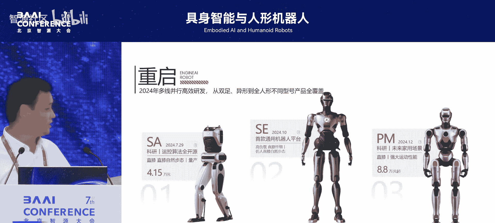

对，所以说嗯还好。因此我们第二款产品就出来了。在第二款产品出来的时候，对这整个行业我觉得还是还算酷是吧？呃，那个整体的流线度了。然后呃这款产品的话，我们是想按照工业级它去打造的。

就说希望它具有10到10块钱的寿命。其实大家可能是呃做软件的多一些，做硬件的略少一点，有点不太清楚机型到底有多少年的寿命，其实大部分取决于它的一个呃本体和机械结构的，而本体机械结构以现在人类的水平。

最知最好的一个工业验证就是汽车。汽车一般10到15年之后就到了一个寿命一个终结期。为什么？因为现现有的机械磨损一般都是只有10到15年。因此，人形机器实话告诉大家，只有10到15年的寿命。

基本上他已经像进入老人一样骨骼了，松散了和进入其他状态了。因此，有人假如果你机器人的寿命大概多长，告诉他们，10到15年。

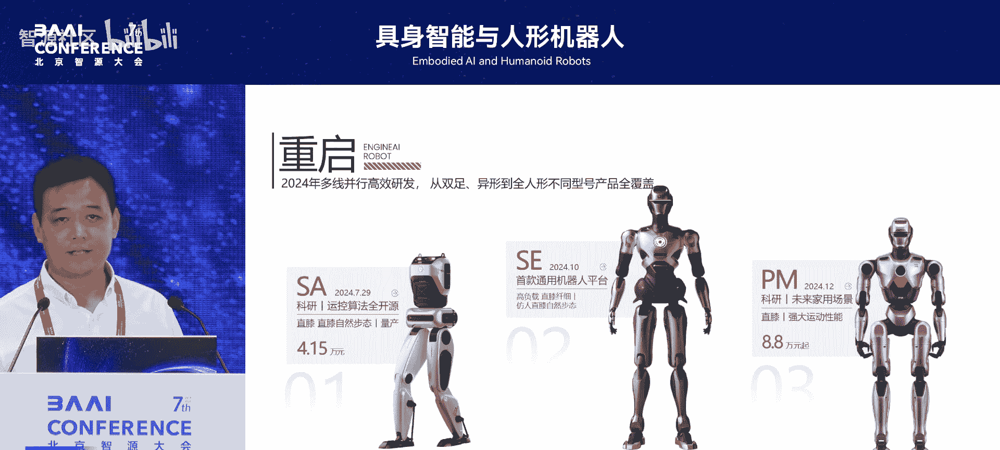

对，基本上是如此。因此我们第二款产品定义就是定义在它它大概有10到15年的一个呃寿命，但是用必须用工业级的去做。而机械人的话，大家可以发现有3万多的，有30万的，甚至有300万的一些。

那就是看他用的材料的，还有3000块钱的，3000块钱全用塑料的，所以说就看寿命，有的送给孩子去5玩的寿命可能只有呃只需要玩个三天就扔掉了。不坏就OK了。那可能用300块钱就就就能做到。

因此我们分析过真正能做事，并且用10到15年的，你的成本至少在10到15万，售价可能在十七八万，你才能用10到15年。对，不过还好，为什么？因为以前从四五百万的成本压缩到现在只有十七八万。

并且能用10到15年。😊。

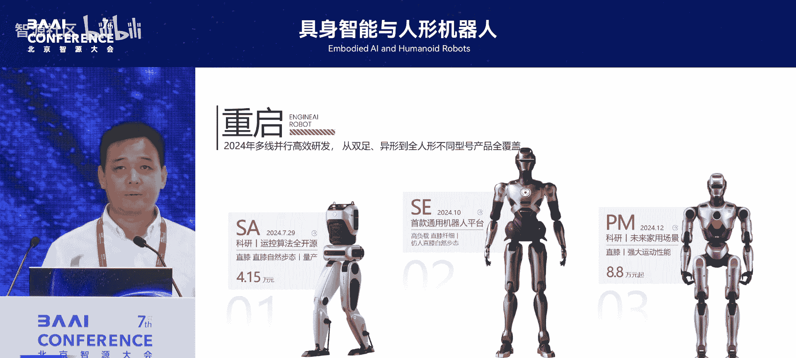

已经很划算了。所以说这个商业逻辑是成立的。但是我们仍然嫌贵了，所以说我们就推出了那个8000的，是想让大家快速呃快速获得一些验证吧。对这款产品的话呃等一下可以呃我们在呃推出推出的时候。

我们可以在去年10月24号推出的时候，呃，我们可以看到他是全球第一个像人一样大步流星的走起来的。像中国军军一样是挺直腰杆像人一样自然不带走起来的。呃，那么至少我们做到第一个这这么去做。呃。

因为以前我们机器人给我们的感觉都是弯着腿屈车其小碎步，像个老人家一样的。我问问我们工程师为什么这么做。他告诉我，他们老是是这么干的，他导是这么干的，连奔动力特斯拉都是这么干的，所以说他就这么干。

然后但但是那给我的感觉糟透了，因为我是做技术的，但是我更是一个产品经理。站在我的角度上，如果弯腿屈膝小碎步，让我感觉到像个老人家一样，比说服务你了，你还要。

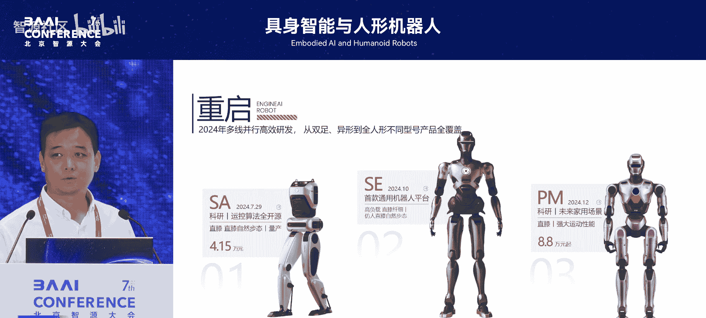

去过马路，所以给人的感觉完全不一样的。因此我对我们的团队及极致的要求，如果做不到，那就离开吧。所以说呃我还真的把我们钱做基于模型这这些东西它我们这次用强化学习加模仿学习，再加上特殊的技术做出来的。

而以前。如果墨守成规，还用以前基于model base那些那个团队，基本上被我干掉了。不好意思，因为他们做不到。你给他们说的话，他就说用我东西我只能做到这些，那我没办法。所以说在别创业过程中。

我们需要做一些改变。从有很多人去问我，做到这些，你做到哪一些，其实不仅是技术上的。虽然说我们在的它的一些关节上我们做到了嗯我们希望每一个地方都有流线程度。我们希望每每一个弧度它都是美的。

因为我们经经历过汽车。我以前在小鹏汽车待过一段时间，大家都知道汽车行业都是四个轮子一个车皮几个沙沙发，但是奔驰宝马保时捷的感觉和一般的车感觉就是不一样。所以说一旦一个产品的细节做到了极致，那才是大事。

而否则就是很普通的一些东西。对，因此我要求他们从各方面的一些从电机减速机控制器，包括它的关节的一些设计，包括外面不允许录任何一条线。任何一个连杆，我们希望能做到这些。

然后几乎把我们呃把我们工程师逼的嗯吵了几十次架。甚至工程师会告诉我，你懂还是我懂，后来我只能说啊你懂，但是还是要哄着他们把这事给做下去。对创销工他们就会这么这么问你你是专家，我是专家。

但是我允许我们内部还是比较扁平化，允许他这样对我问我，我告诉他你是专家，但是我是作为一个旁观者，我觉得这么low，我连我一个旁观者都觉得挺low的话，你觉对你个专家，你会怎么去认为这个事。

对我会这么去拷问他们。因此在一个产品这句话，除了技术之外，另外你对产品的一个极致的追求，其实是决定着你是否能往前走的一个很核心的一个东西。而不仅仅是技术。对。😊，Yes。呃，这是那个呃，身高是1。

38米的，我们看起来他走的还是比较潇洒，比较呃比较帅的对。呃，另外的话我们会有一些极致的追求。其实工程师我们经常是想测试一下。最早是液压的液压的波程动力，它能前空翻，能后呃能能后空翻，能蹦能跳。

但是一不小心他就是液压就漏油了之类东西。甚至我们一度怀疑电动的做不到这些呃这些呃高敏捷的动作？所以说我们一直在挑战，我们到底能做到什么样的水平。因此，很多人去问机器人为什么要蹦，要什么为什么要跳。

为什么要跑？根据机器根本不需要这些？但是作为我们工程师，我也是技术出身的。我们经常想知道这这个产品它极限能力在哪里，它是不是能跑起来，能蹦起来，能跳起来，以及跳起来能不能给比正常的机械比正常人类还高。

它跑起来能是不是比博尔特还快，我们真的是内部在验证这些事。因为只要只有我们工程师内部心里有底了，我们才能自豪的对外面说，哎呀，这个行业还是不错的。所以说有的时候我们做这种极限的这些运动。呃。

我们一直在想挑战下，我们自己想看看这个行业的水到底有多深，最终他能有多大。一旦我们心里面有底的时候，我们不会一直做这种这种嗯有超越性的一些动作。我可以看到他那个脚在跑的时候，呃两个人相遇的时候。

他会有一个腾空向，看到没有？他脚腾空的，他不是像快走一样脚两地的，就这一个动作，我把工程师逼了两个月时间。我说你必须调出这样的动作，否则的话只要快走，而不叫跑。对，是的，所以说我们对一些很多的一些细。

我们有极致的追求。因为我们希望他像一个人，你做人性机器，你告诉我你做的不像人，那么。😡，而而他不仅是行动像人，我们希望他后面的操作了，他各方面东西也像人。因此我刚才看到了大家的很多非常专业的一些数据。

但是站照我自己看一个产品之后，我其实我不对对比这些数据，我经常问我下面的工程师。我说你对你的产品满不满意，拿你自己对比最好了，不要拿数据来做对比。如果你自己还慢腾腾的过去。然后你自己还是呃很不连续的。

那你觉得你满意你自己嘛，这好像比你爷爷比你奶奶速度还要慢，你自己肯定会自己对有挑战。所以说有的时候我们做这个行业的话，其实容易连是因为我们做的人形机器人，做的双足人形机器人，那么可以拿自己去做对标。

如果我们发现他的行他的行动他的行为都特别像人的时候才算成功。我们希望我们的目标是不仅各方我们希望在35年之内你做到你跟他聊天，你跟他沟通，你跟他进行一些互动，你会发现他几乎和一个人。差不多。

你现在把它定义成了人，这才算成功，否则的话它就是一个工具。我们真的是做工具的吗？人类那么多工具了，我们还需要多一个冷冰的工具吗？其实我们不需要。那么工具和人最大区别是就是工具人和普通人最大区别是工具人。

就人是有自有意识的，是有一些自己的一些想法的，是有些喜怒哀乐的，而不仅说你倒尾水，他就咔咔倒过去，你容以你永远以异样的眼光去看它，你就知道这个家伙是个工具，而不是一个人，所以说我们希望脱离工具的属性。

这是我们非常核心的一点。因此，不管从我们的造型上了，还是从我们的动作上呢，也包括后面我们的我们在座的呃巨神智能和通用人工智能事，我们希望拿人来做的标准，我们不会参照很多数据。对我们会参照就是我们自己。

😊，啊，另外的话会有这种跳舞的这些这些事情。其实。嗯，我们也想看一看它到底灵活程度呃怎么样。在刚开始的时候，大概是1次能100次成功一次。哎，但是花了两三天之后，在训练呃算法在调整的时候。

我们发现哎10次差不多能成功两次。当再调一个月的时候，我们发现它呃能到90%的一些成功程度。呃，对，呃，但是有时候有你会发现，有的时候算法决定了它的一个天花板，但是工程的能力决定了它的地板。

有的时候我们其实有很多东西它并不是我们内部非常核心的算法，顶级的算法工程师或者顶级学历算，而是有下面的同同事调出来的。因为他们工程能力特别强。所以说你会发现。

有时候很多顶级的算法工程师并没有达到极致的一个展示效果，是因为有很多东西它不仅仅与算法相关，它与物理世界相关。有很多人根本不愿意去做这个事。我说的在座有很多都是这样是吧？我们想也就顶级的算法。

但是一到工程落地的时候，大家都觉得我去丢为别人去做就就就行了。呃，我们内部也会出现这样的问题，在做估计也会出现的问题。但是我认为大师和呃专家的区别就在这里，他不仅就像一个孩子捏一个泥娃娃呃。

大师可以把雕到他除了外形很像，他还能雕琢他每一个细节而一些小孩子可能只能把框架给做好。所以说如果你想成为极致的大师级别的，希望你能把细节做到极致，最终落地的形态才能决定着你是不是大师。呃。

另外的话在里面的话有很多呃在硬件这块可以说逐渐开始收敛了。对于这个行业来说，呃，包括从下面行星的到斜波的到直线推杆的这行业开始收敛了。然后效率的话，工作效率从以前的百分之五六十能到千内接近百分之七八十。

但是效率越高的话，它的发热量会越小的，它的续航能就越强的。还好就是机器人的话，整体的工作效率以及它的寿命还与它的算法极其相关。以前弯腿屈膝小碎步，它我们测出来它的功耗几乎比自然步态自然步太强。

它不仅好看，它还非常省能量。你自己试想一下，你弯腿屈膝去走，你最多走一公里也非常累。但是你如果直着腿去动不仅好看优雅，你还能走比以前多走1公里，就这样子。

所以有的时候我们嗯会要求我们的工程师在这方面做下优化。呃，另外成本的话也有非常大的一个。呃下降嘛。对，在最早的时候，但但是呃海外就是海外的那个人性机型创业和国内的话有很多不一样的。

我们国内的一上来可能最多是比完性能就赶紧比价格。而海外的话很多是他们直接会上最高级的，直接会上直向推杆。其其他的成本基本上是我们10倍啊。

并且话它的动态能力还不如呃不如国内这些做做那个呃呃这种行星准值区的这种方案。对啊，呃，另外实话这个行业的话，可能你们嗯如果不是做人性机芯深入做，你你们可不了解。我们可能需要10到10块钱的寿命。呃。

但是现有的机器人如果你连着现在我们还只能做到两年左右的一个寿命。但因为它很多工艺从热处理到材料选型到它的各种算法结构的一个稳定性，仍然需要35年的时间。但是不管怎么样，我们估算在5年之内。

它机器人的它的寿命基本上能达到嗯10到15年这样的一个机械寿命。但是软件还要更新，它内部可以可以做些可插拔的一些东西。对，嗯。为什么拿出这个说呢？是因为他占了整个身子。

关节占了整个身子重量的百分之六七十，占了整个身子造价的百分八0%。所以它像一个发动机的一个引擎一样是非常重要的。最终最容易坏的，或者是呃那个决定寿命的，决定爆发力的，所以决定它稳定性呢就靠它了。对。

另外10到15%会有半导体，像用呃那个一些呃mo似器件啦，还有一些半导体线，还有一些视觉传感知这样的一器件组成。

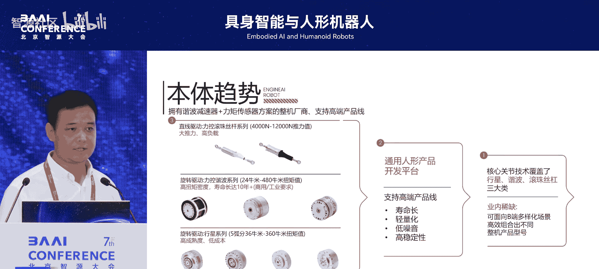

关于巨新智能这块的话，我可能是略我那块先看这这一部分。本体小脑巨新智能和大脑是机器人的四大板块，少一个都不成。你随便做两个，你可能成为一家百亿甚至千亿市值的一家公司，其实活的还算不错。

对你随便做你随便做2块，你都可以成为一家伟大的公司。像呃咱们这边银河通用啊呃行产图等等这样的只只用做好巨新智能这块就会成一家非常不错的公司。但你随便少一块的话，你都会一个非常大版图缺失的一块。

因此我们但是在创业的时候，就刚才说了，投资人会问你这些东西你是不是都有，并且是不是都强。在你三个人会问30个人这么问300个人估计他们还会这么问。因此从现在开始，我们都会做好全面准备。

但是有一点不要被他们节奏所被他们的节奏所打乱。因为你一个人不可能你的团队是慢慢发展起来，你不可能什么都有什么都。强如果你什么都有什么都强的时候，就意味着你可能尤其在早期的时候，你可能什么都没法聚焦。

你达不到。因此我们在本体销老这块先做起来，做的差不多的时候，我们再网上去做。其实巨深智能和呃和大脑这个团队，我们也在组建。因为它是机器人的灵魂。刚才说了，我们希望做具有灵魂的机器人。如果少了这一块。

那么我们算什么？我们在给。越往后我们就成为一个本体公司了，一个硬件公司了。我觉得这样子会对我们后面发展造成很大困。这次非常开心，我正好是需要招巨神智能和大脑的人。我就见到了各位。

然后如果后面的话是有想加入我们的好谈。现在公司呃。有很多钱有很多人，只要你们想过来，随时真的呃，我也是一个比较爽的，大家都知道我对兄弟们都还非常不错，公司也非常扁平化。哎，我中间加加加一段广告。

不好意思哈嗯嗯。😊。

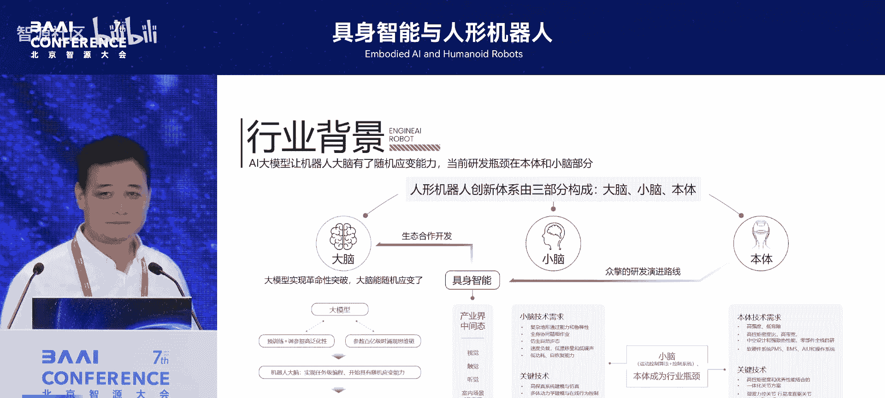

对，呃，但是我们希望呃一家公司不能把所有的市场吃下来，我们希望把我们的本体，把我们的小脑，把我们的其他的东西开放给大家，一起去做这个生态会好一些。呃，我们一家呃世界这个空间那么大。

它会向新能源汽车几乎是人类下一次工业革命，它给人类会带来巨大的价值。为什么呃以前的历史课本里面只会记录哪个名人，但是这个以后的历史课本里有有可能会记录机器人，因为它会是社会的一部分，以前发明的全是工具。

从人类最早期的石头到现在，我认为这是人类发明的最重要的一个工具，一定是非常最重要的工具。所以说嗯。

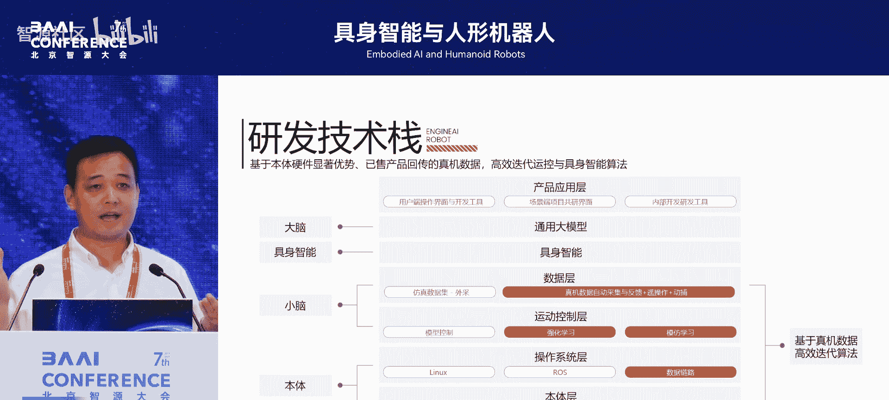

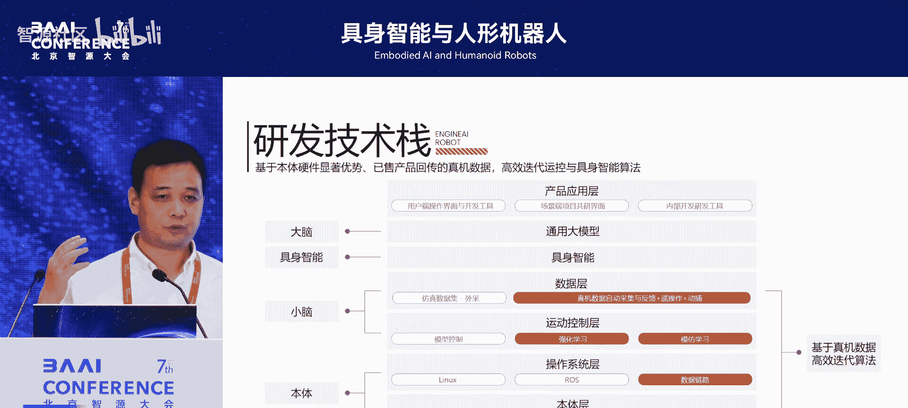

他会比呃电脑比汽车这个行业给人类造成的呃影响更加深远。

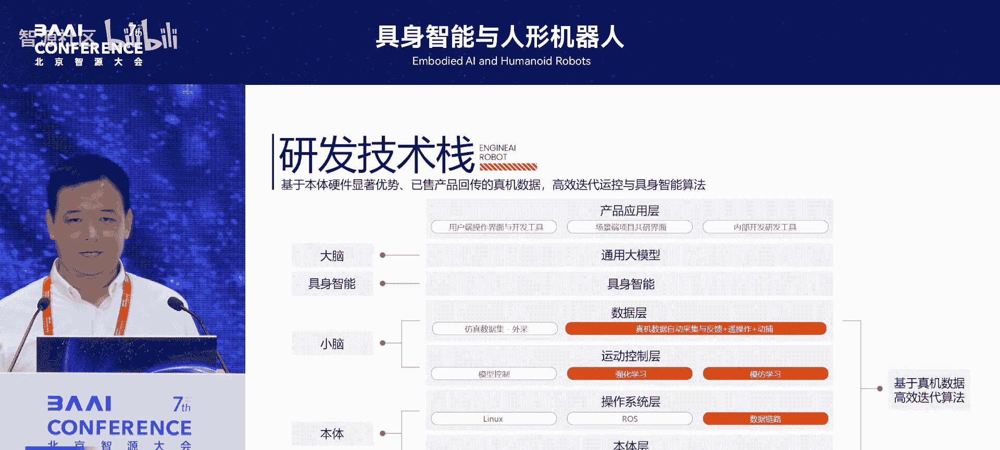

那么这么深远这个行业的话，不会一家独大，它不会像腾讯呃那些互联网行业一样，只会出现一家最厉害的，其他几家都挂了。而应用基群的话，市场空间足够大，所以说它能容许全球呃10家8家呃呃公司都会活的非常好。

所以说大家还是有机会的啊，如果你现在创业呃，现在我估计也不晚。但是如果能加入一一些呃。😊，好的企业，然后兄弟们一起来会会会更好。因为在非常早期的时候，我发现一个人能做一些很厉害的事儿。

但是一帮人能做一些牛逼的事，能做一些改变世界的事，一个人去改变一个世界太难了。但一帮兄弟们改变一个世界相对来说容易很多。所以说邀请大家。😊。

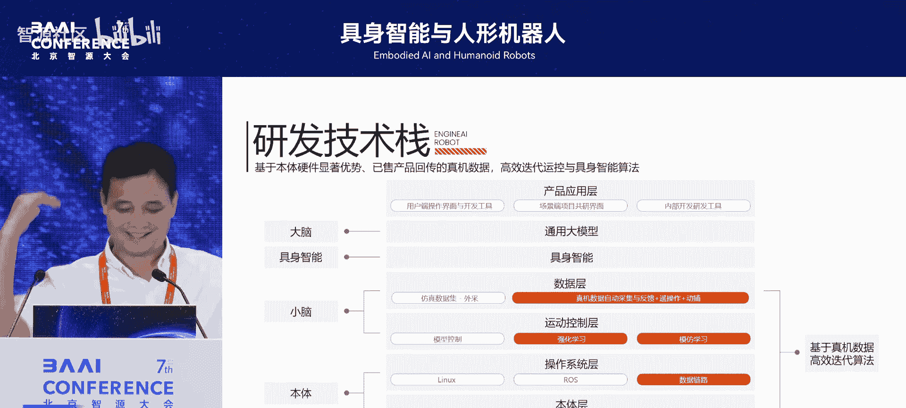

呃，接着的话就是我们会有一些合作的生态伙伴呃，就会加入我们的一些开发的计划。我们也正在把我们开发的东西同步给大家。呃，但是我们的人数我们呃人数暂时是比较少，大概只有八九十个人，一年半时间嗯。

发展了八九十个人，我们还得控制我们的人数。因为我们希望嗯就是每来一个人都是对这个不是拷贝复制你的能力，而是说有更高的一个提升。所以说我们希望我们每来一个人都是对我们有极致价值一个提升。对。

当然的话我们会也会培养人。呃，我们有很多也是从呃刚毕业呃来的呃的一些高校来的，我们也非常愿意去去培养。嗯。这些都跳过吧。然后呃在我们的呃。

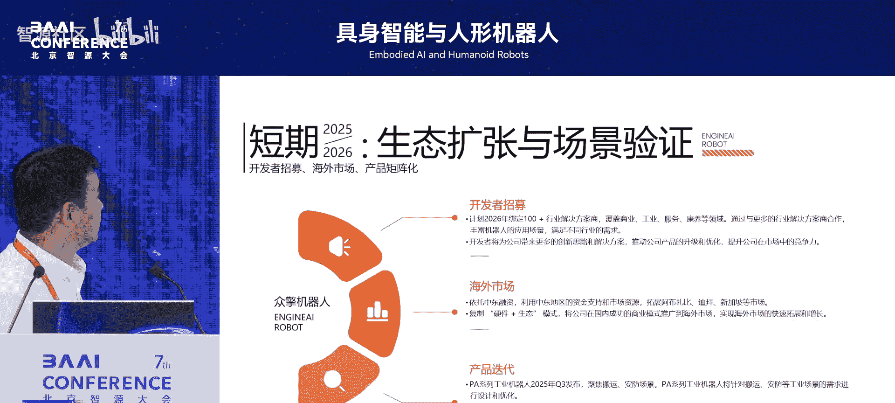

关于商业呃落地，很多人可能会问到什么时候能商业化。呃，你们一直在做一些能蹦能跳的或者这些事情，好像都娱乐大众这些事。没关系，娱乐大众也好。

因为刚开始所有的一些新的设备都给带来一些情绪价值或等等的一些价值的。所以只能给人带来价值的，并且能把生意做的很大的，我的都是很很好的。不管我们和语数都被定义在前一段时间我们都被定义成影视公司。

或者被定义一个什么什么公司。没关系，我觉得挺开心的，为什么影视也是个行业，有的影视能做成上几千亿的一家公司，如果把影把这种行业做大，未必也不是一次好的呃呃经历。所以说呃我是拥抱这个事情的。呃，在那个嗯。

😊，马斯克他有也说了一些话，这哥们也说了话，但是我们很多时候我们根本不看他们说了什么。因为这行业都刚开始，这些大佬师很励志的。但是为什么我们每个人不是很励志呢？是不是啊？

所以说都是刚开始从现在开始都有机会。😊。

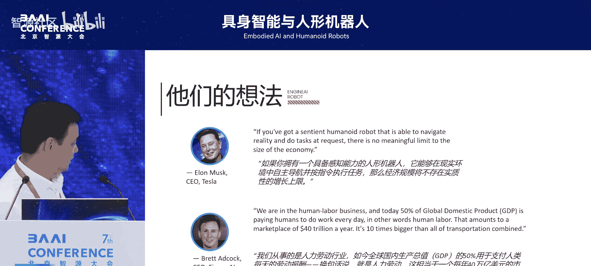

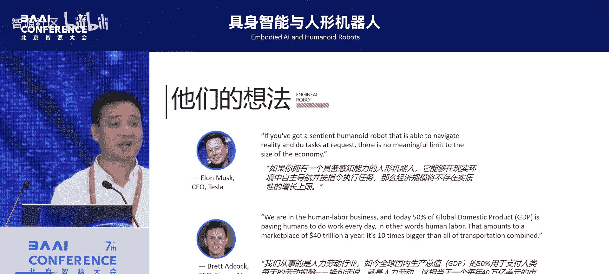

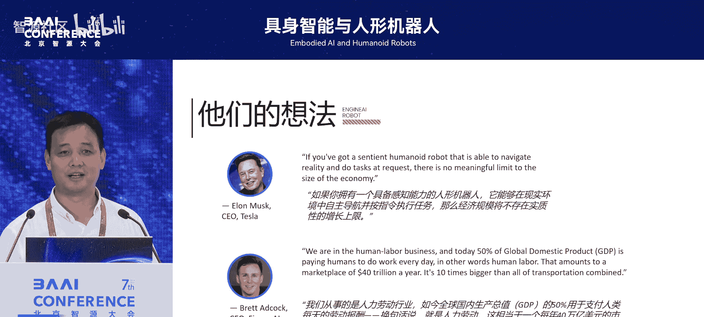

啊嗯。呃，关于人形机器人的话，然后他是呃。

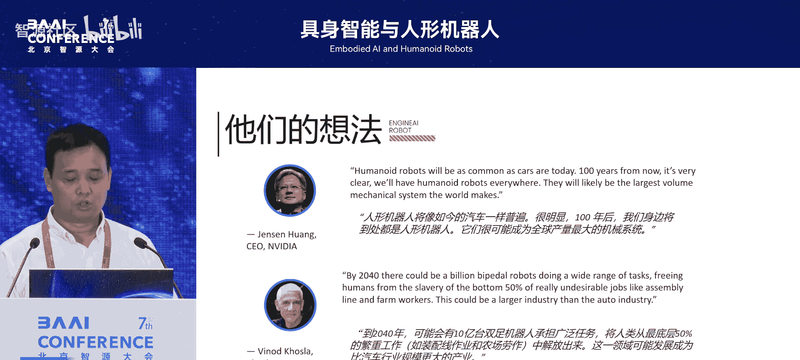

在这一年左右，我们大概能出两三千0台呃，我估计我们的竞争对手，他们也能出两三千0台。所以说大家一会机器人可能你在大街上能基本上能快速能看到。但是在三年之内的话呃，马斯克那边说要有30万台呃，这样子的话。

我自己是虽然在中国我调研了一边是缺乏理论数据和现有技术能力做支撑的。我认为在三年之内一年能出3万台。呃，差不多是至少我们能做到这样，我们计划能做到这样一个水平。但30万台这个目标定的太高了。

我们暂时也做不到。对呃，因为人呃在我们做这个机器有个分析热点就是2022年那个时候像类似P种大模型还没有特别应用应用很广的时候，我们认为机器人就算做的再优秀。如果没有灵魂，他就会呃。

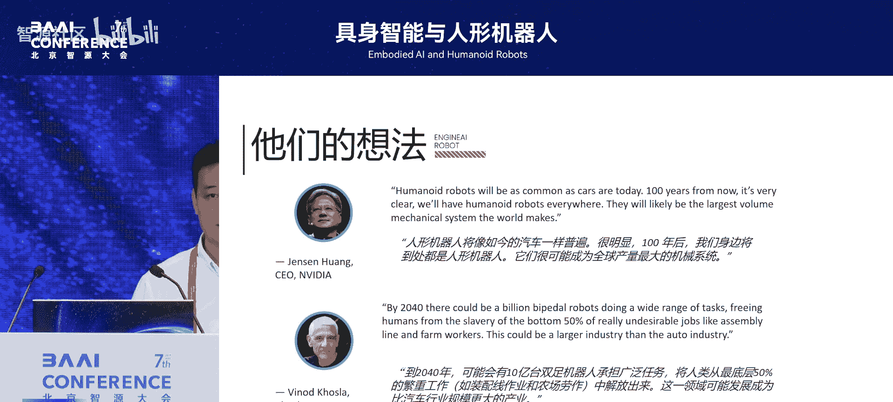

他将将失去很多一些价值。呃，甚至我给小鹏那边思考。我们认为20232035年才能出现。结果2023年的时候叉DB出来让我们非常惊讶。所以说除了我们在努力，在座的各位都在努力。因此有的人在做上半身的时候。

在做下半是非常开心，都在各自的领域能做到极致。而中国在这块的人才的数量和质量不比海外差。因此我们一起去做这事的话，我觉得中国在这个行业中能做到世界数一数二，还是有机会的对。

不管从成本上还是从它的性价比上。但是有一点可能会吃亏一点。在那个巨智能硬件算力上还有他算法的一个人员的数量上，我们可能要清晰的认识，我们确实更加有差有一定的差距。但是我觉得差距不大。

甚至有些地方还是可以超越。😊。

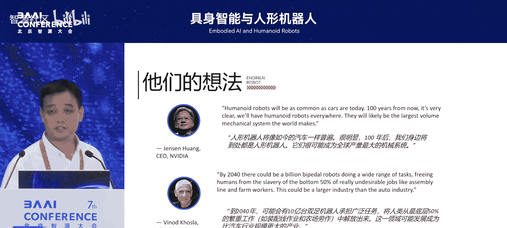

呃，再接着下来的话，就是我们我们自己在做，我可能会超时个5分钟啊。嗯，然后那个我们在做两件事。第一是体能的事，第二是智能的事。我们为什么在奔跑？甚至我们最近在做格斗，我们做的格斗是呃是身高可能是1。

8到2米多的，然后打起来可能会冒火花那种，而不在是小孩子打架，我们为什么要这么去做呢？因为我们想把体能的事做到极致，什么体能都到极致了，很多人在智己机器人，他到底稳不稳可不可靠？那好。

那我们希望在我们基本上能做到一年之内，你跑也跑不过他，打一打不过的时候，那你就。会觉你你就不会再问他有什么用了。那个时候其实有的时候制造一定的恐慌是有必要性的，否则他们。意识不到他这个事有多大的价值。

另外一点的话就是智能这个事，除了我们在努力，大家都都在做这方面的一个努力。对。嗯。Yeah。

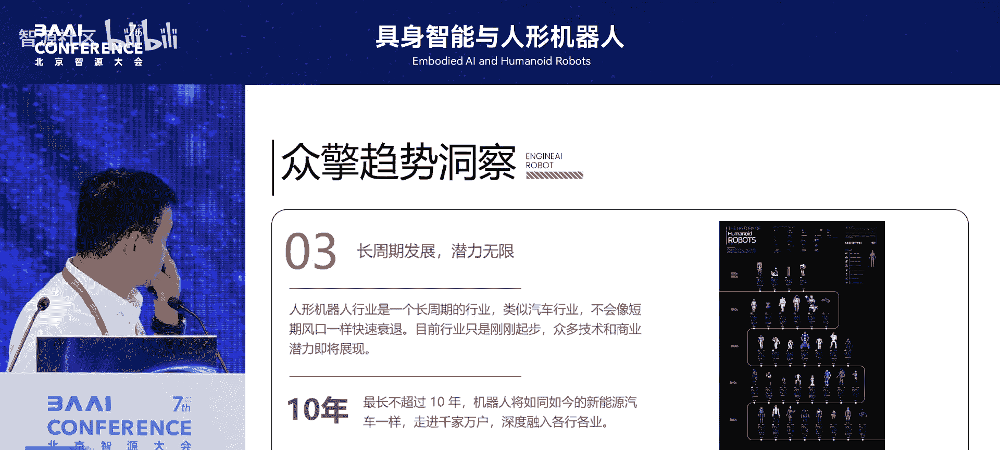

是的，然后我们在创业过程中，在发展的过程中，每时每刻都会被质疑。我甚至呃我们会有一些失败的东西，但是我们失败之后还仍然呃继续呃往往前走。甚至在网络上，不管我们还有行业，我们竞争对手上。

有时候我们会在某些方面会被骂的很惨的时候，呃，很。

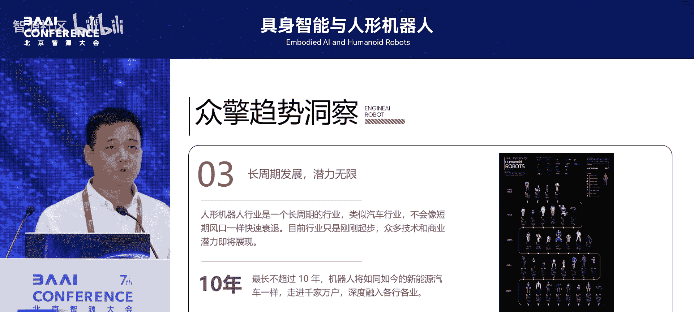

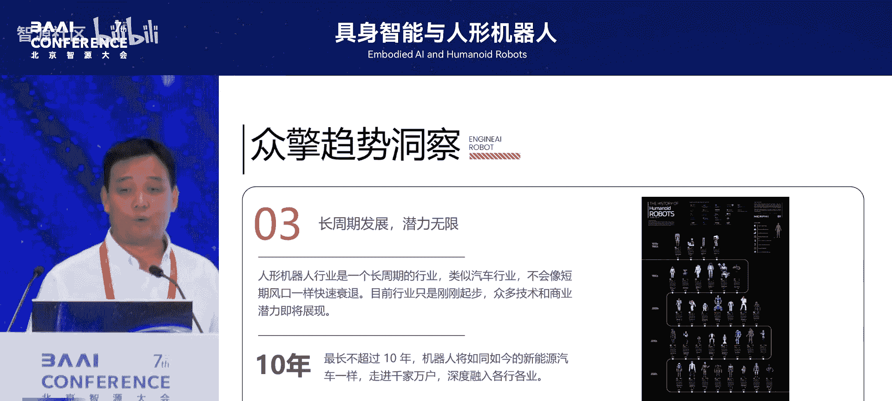

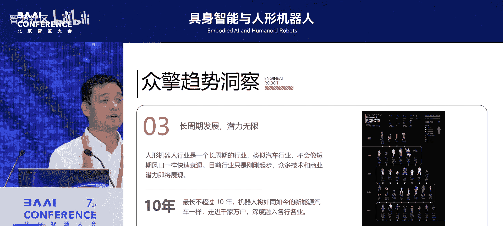

我们怎么办？我就像那个汽车刚出来的时候，他根本连马跑得快都没有，但是我们仍然往前走，甚至我还故意把他骂的最难听的那一部分，把它拉出来，放在我们的屏幕上，让每个工程师看，我们自己也坐在那里看。

大家觉得都挺愤怒的，没事，愤怒就是力量。所以说我们会不会回避外界对我们的质疑。我们反而是把这些质疑的东西拿出来，我们去看这些东西。你看又倒了，你看又跪了，还在那么多人跟前跪，然后我们会故意去做这些事情。

其实最痛的人他会承担最快，我们也是这么干的。我希望大家对我们有点耐心，有点信心。😊。

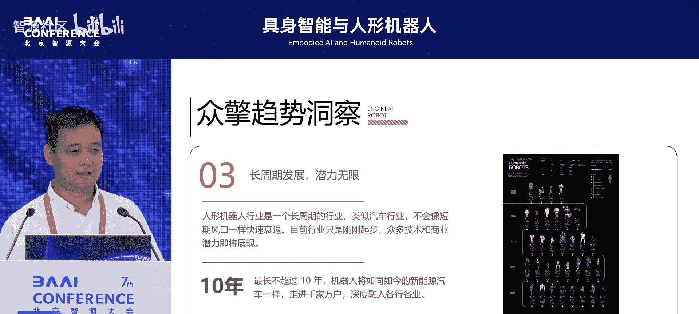

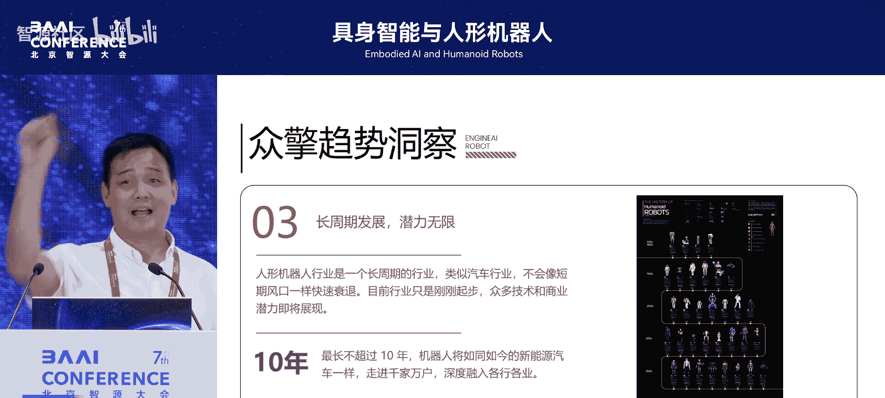

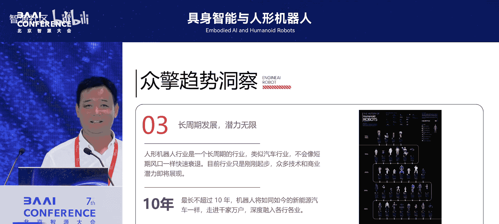

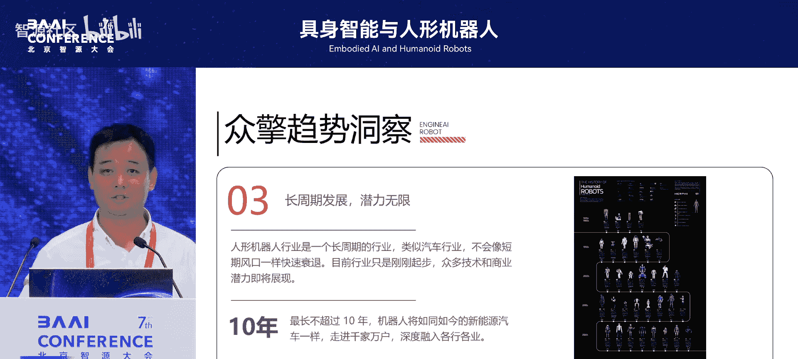

어。千订事情始于足下。然后现过了那一段时间就是能跑能跳的时候，我们对于我们做技术的人，我们做我们觉得我们做的。对于我们做技术人，我们觉得这个行业是有的玩了。但下一步怎么去落地是非常重要的事。因此。

我们接下来。要做好。一些稳定的事儿。机器人人形机器人如果不能安全的从这里走出去，从A点到B点。从比如说我从这里走走开了这个门，上个电梯到300米，另外一个楼拿个东西再过来。这个其实难度理论上是没有瓶颈。

但是工程上没实际上没有任何家做到的。没有任何一家不服，你们去问，就说实际上这么简单的事儿，从这里下楼梯开了门，走电梯。学术上没有瓶颈，但理论上呃呃但是工程上没有任何压构，但这是基础能力。

如果这个能力不解决，这个行业没救了，这个双足是伪命题，双足存在的价值就是让你能到达人类所到达的任何一个地方。否则我用轮式就可以了。为什么用双足，说以要快速解决双足在视觉引导下，全地形的适应能力。

并且很稳定优雅，快速的到达能力，这才是我们下一个解决这行业的根本。有了个技术能力之后，拿快递我去送快递，拿外面可拿送送过外卖。我说了这么多，连首护的能力我都还没说，为啥一定有很大的商业价值了。

所以说有些未来很伟大的事情都要始于足下。因此我们要除了做些酷炫的事，我们接下来还要去做一些对这个商业帮助，有稳定的事。接着的话，我们会在今年的呃年底我们会有些格斗的比赛。这个比赛的话，我们会有1。

8到2米多的。类似于WWE的这样的一些很激烈的一些表现。呃，然后我们内部有些有已经成立团队，他们就会格斗而生。很厉我们你们以前也参加过一个roboma这样的比赛是吧？大疆比赛的。

但是我觉得那小车不够不够不够刺激。所以说我们在内部在在创业过程中也会经常玩一些花活，玩一些能给世界带来一些有趣的一些活，本身是本身格斗就是一项全球性的比赛。所以说呃我希望这场比赛够精够精彩。

但是我们内部也在做努力。呃，谢谢大家，就这些吧。