# 2025北京智源大会- 具身智能与人形机器人 p10 解决具身智能的数据瓶颈：高阳 -BV1MSNEz8EuG_p10-

那接下来呢就是我们又切入到具深智能的环节。因为我们今天的主题是既有人形机器人，又有具身智能。所以我们又接下来的主题呢是我们很荣幸的邀请到了清华大学交叉信息研究院助理教授高阳教授来为我们带来啊关于解决巨深智能的数据瓶颈的报告。

来，我们掌声热烈欢迎。😊，那么刚阳教授呢，他除了是清华大学的助理教授之外，也是千寻智能的联合创始人。主要研究呢也是关于计算机视觉和机器人学的。在加入清华之前呢，他在加州大学伯克利分校完成了博士的学习。

导师呢就是很知名的教授，而且他在伯克利的时候也和巨深智能领域中的一个非常知名的教授pe特等人完成了这个博士后的工作。那么在美国求学期间啊。

他也在谷歌、vimo英特尔等研究院和相关的知名学者进行了自动驾驶相关的研究。到目前为止，在newM等国际顶会上面发表了多篇论文也有达到了5000次以上的谷ogle祖歌的学术引用。

那其实和高老师我们在学生时代就认识。我记得他应该是当年从伯克利回国的第一批啊同学们那对我当年还和高老。😊，是请教过在清华做教职的这些经验。那么我们也看到了高老师在过去几年啊，从自动驾驶到具身智能啊。

做出了很多非常有代表性的工作。那我们今天就非常热烈的欢迎高老师来进行他的分享，谢谢好。😊，喂喂喂喂。这是老师老师这个说喂嗯，好。啊，非常感谢张老师的介绍。

然后今天也非常开心能站在这里跟大家分享一些关于啊军身智能的一些呃我自己的一些思考，以及对于未来啊发展的一些判断。😊，OK那么今天我演讲的题目叫做呃居深数据瓶颈啊与突破啊以及千寻智能在这方面的一些探索啊。

那么我们都知道啊最近啊这个为什么巨神智能重新进入到大家的眼里呢？是因为大语言模型在呃通用的这种智能的层面上啊，展现了非常巨大的一些突破啊。那么这些突破的它的核心其实就是来源于使用大量的数据。

对于模型进行啊一个啊非常大规模的一个预训练。那么巨深智能啊，我们恰恰却面临着这个数据的瓶颈啊，OK。所以今天我想从啊这样四个方面跟大家分享一下，我们在如何去解决数据瓶颈上面的一些思考啊和一些探索。

那首先我呃相信前面呃诸位讲者也跟大家讲了很多什么是居深智能的一些啊一些探讨啊。那我想再从一个呃这个数据的角度啊去描述啊，我认为巨深智能和以前的机器人有什么不一样。

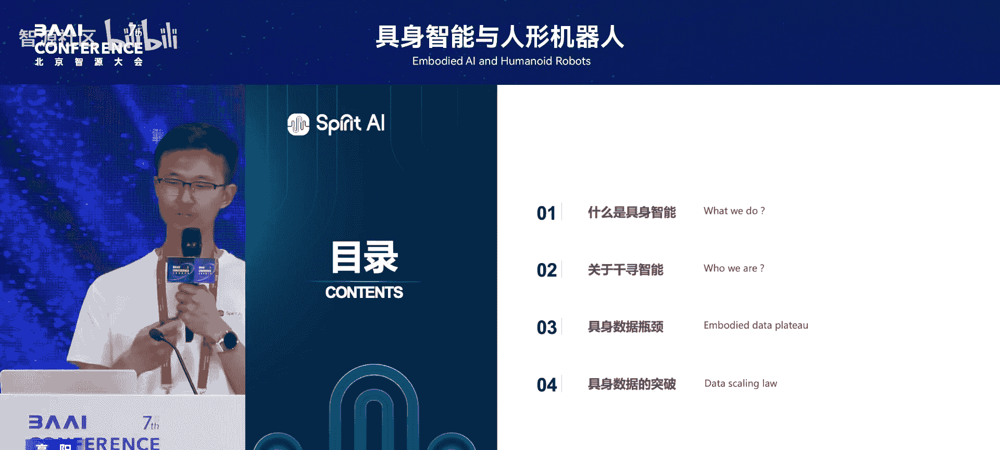

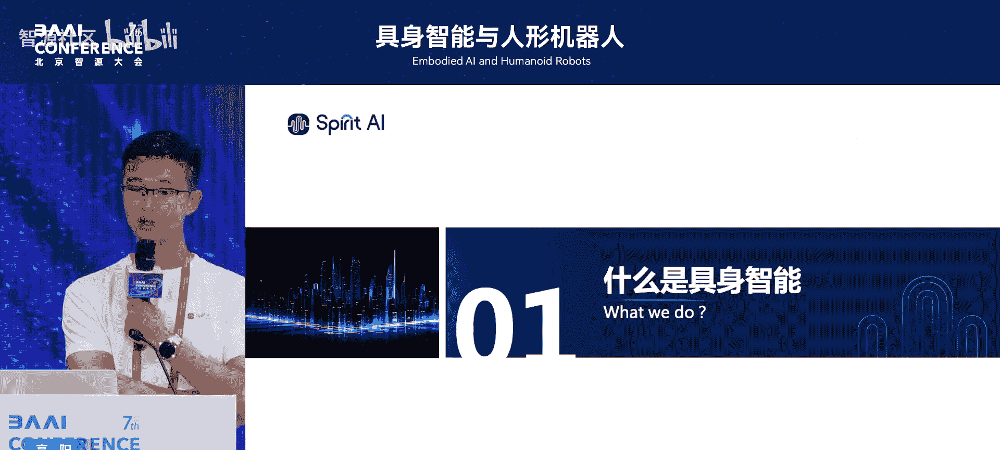

那么正如我刚才所讲啊，什么是巨身智能？具身之能就是从啊让这个机器从键盘侠变成一个行动派啊，那么大语言模型我们都知道可以说很多很多很聪明的一些话，然后可以帮我们解决很多的问题。

那么最近也可以帮我们去写代码，做很多很多很复杂的事情。那么巨深智能呢就是把这样的能力迁移到物理的世界中，希望机器人未来有一天可以帮我们去完成一些啊诸如这个比如说扫地倒垃圾啊、洗菜、切菜等等等等。

很多很繁杂的一些家务。Yeah。那么什么是巨身智能呢？巨身智能从字面上理解就是巨身加智能，就是把啊智能赋予到身体之上啊。那么具体来讲呢，巨身智能需要去理解嗯这个物理世界的，比如说重力摩擦力啊。

各种空间的关系形状啊，因果和啊这个物体的这个存在意义啊等等等等。那么嗯在谈论巨深智能之前呢，我想给大家放几个呃这个20年前的机器人的一些视频啊。呃，这个第一个是呢这个ho达的这个小机型人。

这个大概是呃20年之前啊，ho达就已经可以做到了让一个啊当然这个机器人非常非常矮，大概是一。2米这么高，然后就可以在这个就像我们现在这个台面上跑跑跳跳，对吧？然后还可以做出来很多啊。

这个现在看起来我们仍然会觉得很兴奋的一些事情啊。比如说推着一个小车往前走。😊，OK那么这是这个ho达的这个啊叫阿西莫夫的这个小机器啊，那么再再看第二个呢，第二个是shadow hands啊。

shad hands在很多很多年前也做出来了一个啊自由度非常非常高的一个灵巧手啊，那么这个灵巧手呢也可以去拿捏这个鸡蛋并且还可以做出来这种啊让鸡蛋这个在手指间啊运动这样非常复杂的一些行为啊。

那么当时的shale hands其实已经具备了啊20多个自由度啊，那么包括我们今天在做零巧售，其实也大概是啊这么多个自由度。😊，那么第三个呢是这个波博斯 dynamics的这个大狗啊。

这个到今天也已经有15多年的呃15年多的一个历史啊，那么可以看到当时这个大狗已经可以在。就我把这个暂停一下。呃，已经可以在。Sorry。啊，已经可以在这个冰天雪地上完成这个非常非常稳定。

非常非常啊这个啊鲁棒的一些控制啊，包括在冰面上它不小心滑了一下，然后它也会啊非常快速的去恢复起来。😊，那么最后一个呢是呃叫叫justin啊，是这个呃德国这个DLR他们在十几年前做的一个机器人。

啊后这个机器人也是一个轮式底盘加双臂，然后啊有零销手，然后有脑袋，然后他的脑袋也可以转来转去啊，然后他的手也可以啊这个完成一些看起来很复杂的东西啊，比如说再把这个瓶盖拧下来啊。OK那么我放这些的呃。

是想说什么呢？是想跟大家去讲说，其实我们现在在今天看到的很多机器人的能力，在十几年前啊有很多很多先驱已经可以把它们实现出来了啊，那么所以大家可能会问我，对吧？那我们今天在干嘛，对吧？

我们今天和十几年前是不是没有什么进步啊，恰恰不是的，我们今天相比于十几年前有非常非常大的进步，那么这个进步呢？😊，实际是在这个智能这一侧啊，那么十几年前。

所有这些大家看到这些东西都是用传统的非智能一些算法所达到的啊，比如说像这个啊这个零销手去捏鸡蛋。那么它的所有的轨迹其实都是提前去写好的啊，那么它这个机器就完全看不到这个鸡蛋，完全不知道它是一个鸡蛋。

他只知道我的手要到某个位置，然后我要抓到某个位置，然后我要怎么怎么去动啊，所以这个鸡蛋完全有可能在它动的这个过程之中滑落，但是它完全不知晓。那么今天唯一的变量，并不是说机器人的硬件。

而是我们具有了智能性。那么智能性是这一波巨式智能的最核心的一个变化。Okay。嗯。那么就像我刚才所讲，其实刚才这些非常炫酷的这些demo啊，他们呃这个为什么不能转化成我们日常的一些生产力呢？

因为所有的每一个demo都需要可能几十个工程师做一年的时间，甚至做几年的时间，才能让比如说波波森 dynamics这个大狗在这些地面上能够有一个比较好的一个行为。

但是我们知道我们为了去真的在现实生活中去应用它，我们不可能雇几十个人花一年的时间只解决一个动作啊，所以。呃，我的一个核心观点就是说今天的机器人。大规模落地的核心的问题，我们要解决的问题是智能化的问题。

Okay。那么呃这里面我列几个就是已经啊这个啊比较大规模去这个落地的一些机型的一些啊一些案例。啊，比如说机械币啊加扫地机器人，这大概是1个200亿美金的一个市场啊。呃，那么工业机器人呢。

它其实只有54万台的这个年出货量。那么为什么这么少呢？其实就是因为它不好用啊，因为每一个工业机器人落到一个车场，或者落到任何一个工厂里面。

都需要一个啊对于机器人十分了解的人进行一个两个月到3个月左右的一个编程。那么这就导致。啊，这个技术的这个使用的难度是非常高的，普通人没有办法轻易去使用这个技术啊。那么扫地机器人呢。

它啊相对来讲就简单了很多。那么到今天为止也是一个很大量的一个市场。那么比如说去年扫地机器人就有2000万台的一个出货量，已经比工业机器人大了啊这个。啊，几十倍这样的一个规模啊，那么相比之下呢。

手机是一个现在每个人都可以用的啊这样的一个设备。那么去年呢大概有12亿部这个出货量。那么汽车呢啊也是类似手机这样的一个东西，但是它的历史更加悠久。它大概有呃呃这个接近于1亿啊量的一个出货量啊。

那么我们认为如果我们把机器人的这个智能化的问题解决掉的，那么巨深智能的市场其实是一个汽车的价格乘以手机的数量这样一个量级的一个市场。因为我认为每一个人都需啊或者每一个家庭都至少需要一台机器人。

就像现在我们每一个人都需要至少一一部手机一样啊，那么机器人的价格呢呃我认为未来大概是啊可能汽车的这个3分之1左右啊，所以这是一个巨啊非常非常大量的一个市场啊，然后前一段时间我跟一个朋友聊天。

他问我一个问题，我觉得非常有意思啊。他说。你认为这个呃计身智能会不会是人类最后一个？这个呃这个呃最后一个产品啊。我我觉得就是呃这个这个问题，虽然他的答案可能是是也可能是否。

但是呃相当于说如果我们真的解决了机器人的这个智能性的问题的话，那么我们在这个数字世界可以有这个AGI在物理世界可以有巨身智能。那么看来我们这个人类的共产主义理想也并不是十分遥远。OK。

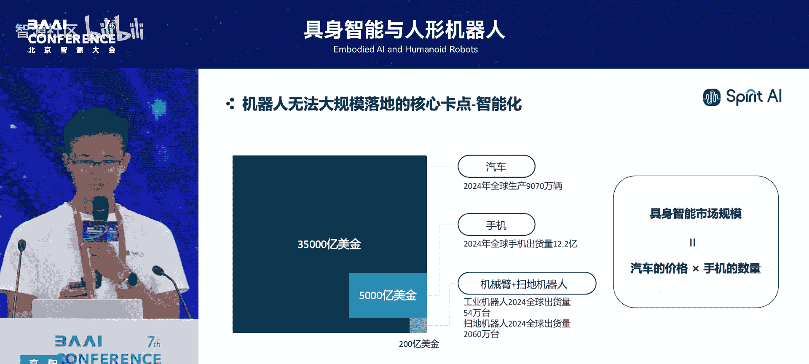

嗯。OK那么智能化呢在过去的啊十几年啊是有一个巨非常非常快速的一个变化。非常呃我觉得可以说是天翻地覆的一个一个进展啊。那么呃这里面呢，我列了这个呃智能呃的这个发展历程啊。

那么在1950年我们有了第一个这个智能的感知机，也就是percept，也就是现在神经网络的一个雏形啊，那么也是在类似的年代，我们有了unimation。

unimation是现代意义上第一个通用的这个工业信械B。那么呃在呃此后的大概五六十年，当然这个机械B在发展，然后人工智能在发展。但是最近的1年以来啊，比如1年1010年之前。

我们有了transformer啊，2022年我们有了chGPT啊，到了2025年，我们已经看到了这个语言模型给我们的生活带来了多么巨量的一个变化。所以我认为在未来的十年，我们呃依然会延续这种进展啊。

并且我认为巨神智能在当前的这个阶段，其实我们刚刚在GPT1到GPTA2的这样这样的一个非常初细的一个阶段啊。所以呃呃我自己的一个预测是大概在未来5年之后啊，我们可能会看到啊巨深智能的啊这个GPT3。

5的模型会出现啊。OK那么。嗯，经常有人会问我说，哎，这个呃你怎么看待这个人形机器人啊？呃其实巨身智能它并不见得是人形机器人。

巨身智能它可以是啊赋予到任何一个呃这个有啊mobility或者maniciplation形态的这样的一个技术啊，其实广义来讲，智能汽车啊机械臂和这个扫地机器人都可以把它们叫做巨身智能。因为在底层来讲。

他们的这个技术是有非常高度的一个统一性的啊。😊，那么呃当然我们千寻也在做这个类人型机器人。但是呃我们判断啊这种机器人他在。初期来讲还是要跟市场有一个比较好的一个匹配啊。

所以我们优先发展的是这种轮式加双臂的这样的一个啊物理的一个形态啊。

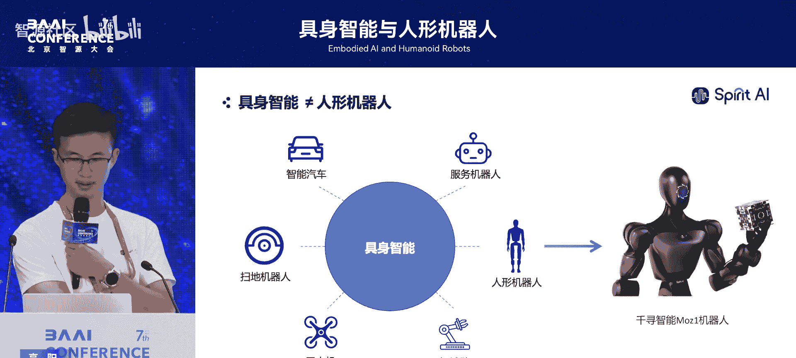

Okay。那么。嗯，很多人也经常问我说，这个巨神智能现在发展到什么程度啊，那么这是我们之前这个呃大致的对于巨神智能的一个L1到1个L5的一个分级啊，那么之前的这个工厂呢，其实是所谓的无知能的一个形态。

因为所有的程序都是人写的啊，那么现在呢啊我认为我们已经达到了啊L一的这样的一个水平啊，就是在特定啊这个环境下完成多项这个单工位的一些操作的一些能力啊。

那么这个其实就已经可以解锁很多这个现实的一些落地的一些场景啊。那么未来呢下一步就是啊在特定环境下完成组合式的长城的任务啊，那么这样的一个能力就可以啊解锁更多的啊面向business的一些应用场景啊。

那么L3我觉得L3是一个非常重要的一个节点，因为它是一个完全啊完全自主的在特定环境下完成完全自主这样一个能力啊啊，我认为L3啊是一个比较难的一个节点啊。O。

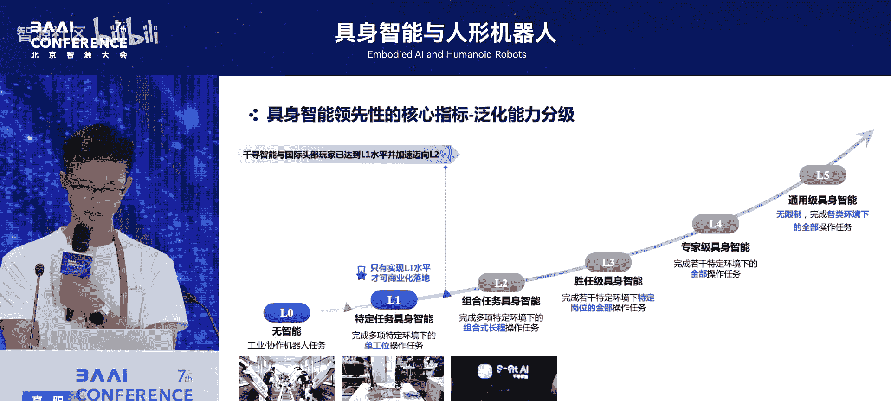

。OK那么呃相信大家也知道呃，我也在做一家创业公司，叫做千寻智能啊，然后呃我们的核心的呃这个思路呢，其实也和我刚才所讲的一样。我们认为智能是所有的这个呃当前机器人落地的核心瓶颈啊。

所以我们是一家聚焦啊通用巨神智能的呃一家公司啊。

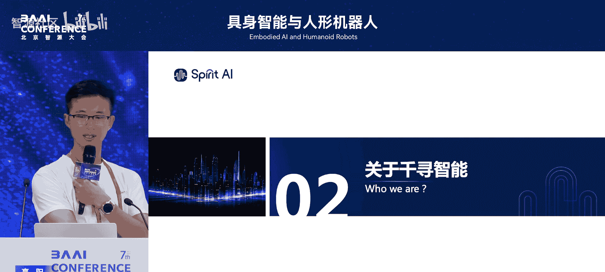

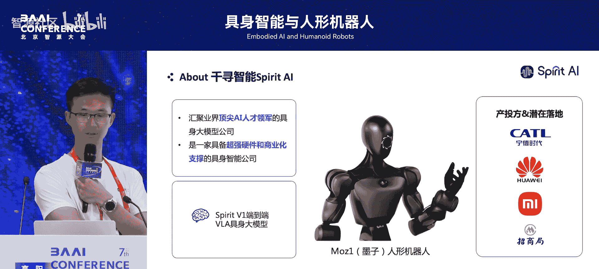

那么呃我们公司是呃主要两位联创是韩风涛和我啊，韩风涛是之前啊在国产工业机器人和协作机器人有非常非常深厚积累的啊。啊，也是一个创业老炮了，他之前的这个落视机器人啊啊是三个联创之一。

然后也是国内这个亲情机械臂非常头部的啊这个一家企业啊，那么我自己呢就是啊像刚才张老师也介绍了啊，是在AI这个方面啊有着很多积累啊，我的博士是在ucke啊，这个跟tv教授啊，这个做的。

然后博后也跟peer bill啊，包括s eleven啊等等这些这个国际上集身智能非常有名的一些教授有很多合作啊。😊，对，然后我们公司从成立呢到现在也吸引了很多这个啊无论是财头、国投还是啊站投啊。

然后嗯对这个我我想主要讲一下，就是嗯虽然智能是一个核心，但是我们认为智能它必须依托于一个本体啊，并且在短时间之内啊，这个本体和啊这个智能的算法是很难以解偶的啊，举个最简单的例子啊，就是说大家对吧？

平时都用筷子吃饭，对吧？那么。啊，嗯可能大多数人是一个右撇子，但突然我说哎，我让你用左手去用筷子去吃一顿饭，你肯定会觉得非常非常难受啊。那么这也也恰恰说明了这个具身智能。

它其实是一个和本体的这种肌肉机忆肌肉反射高度相关的这样的一个技术啊，所以。啊呃，我们认为本体是一个呃这个智能和这个现实物理世界交互之中非常非常重要的一环啊，所以我们自己在啊虽然是以智嗯sorry。

虽然是以智能为核心，但是是围绕着这个智能为核心，去驱动智能的本体的这个进步啊。啊，这个有一些非常有意思的例子，我们之前发现我们设计的本体啊，在这个智能算法的这个验证之下。

很多任务其实你连摇操作都摇操作不出来啊，更呃不用谈说让这个本体去自主的完成很多任务啊，所以我们认为在这个。巨身大模型和啊这个巨身机器人的一个呃联合的一个迭代，是一个对于智能的发展的一个必要的一个路径啊。

那么在这两方面呢呃我们线性智能都是在啊全世界范围之内都是非常非常领先的啊。比如说我们的这个人形机器人是中国首个全身利控的机器人啊，那么利控可能对于不熟悉机器人的同学啊啊不太知道这个东西是什么啊。

其实它非常简单，就是说我来啊拿一个纸杯，对吧？我拿一个纸杯，我能不能感受到我拿这个纸杯的力量，啊去推一个门，我能不能感受到这个门被锁了，啊我不应该继续去推动它啊。

那么利控在我们的人类的这个日常生活中是非常非常重要的一项能力啊，那么我们的机器人也是啊在全国之内是首个把全身利控啊，从啊第一天就开始去做到机器人之内，并且从各种利控算法啊。

去啊从底层进行一个完整支持的这样的一个机器人啊，那么在巨身大模型这一侧呢啊。我们。是啊最开始啊使用互联网视频数据，对机器人进行一个预训练啊。

并且啊我们啊构建了一个叫做数据金字塔的这样的一个啊高样本效率的一个巨身大模型的一个训练的一个框架啊。那么后面呢我会详细跟大家分享一些关于这个技术方面的一些思考啊。

OK那么第三个我想分享的就是关于巨身智能，我们到底卡在了哪儿啊？啊，一句话总结就是我们卡在了数据，我们没有数据啊，所以我们训练不出来好的巨身智能的模型。

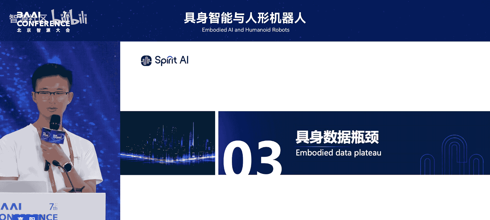

那么我们都知道这个啊chGPT这些模型，它的根本性的成功是因为我们在啊互联网上这个快速的20多年发展这个历程里面积累了海量的数据啊，那这些数据是所有大元模型的一个基础啊。

但是呢呃机器人我们这个机器人没有机器人的数据啊，因为这是一个机成蛋和诞生机的问题，对吧？没有这个智能，我们就不会造很多机器人，没有很多机器人，我就没有很多数据。

所以这个数这个呃让机让这个机器人获取这个动作的难度是远远大于啊文字的难度。因为我们没有数据。😊，那么很多能力也是没有办法去用语言描述的啊，比如包括什么游泳按摩呀，你不可能听一节这游泳课，不让你下水去游。

你就能会游，对吧？OK那么。所以呢就是呃我们怎么样去解决这个问题呢啊。那么呃可能有的人会讲说，哎，不如我们先卖机器人，对吧？那么卖了机器人之后啊，我们就可以把数据收回来。

我们就可以这个让这个数据飞轮转起来啊，那么这个的确是自动驾驶汽车这个行业所在使用的逻辑，并且到今天被证明是非常非常成功的一个啊一个模式啊，因为汽车在销售之后，这个司机就会自然去开车。

我们就自然有了数据的积累。那么像很多这个车厂都会把这些数据收回来去训练它自己的模型。😊，比如说特斯拉，比如说国内的很多这个新能源汽车厂都是这么去做的啊，但在机器人这一边啊啊这样的逻辑其实是不成立的啊。

因为汽车是一个非常容易被操作的一个机器啊，但是机器人是非常非常难以被操作的一个机器啊啊，如果大家没有试过摇操的话，其实可以去试一下，这个体验可以说是非常非常痛苦啊。因为呃你没有办法身临其境。

感受到机器人的感受啊，并且这个摇操作也有一些啊延迟啊和这个这个身临其境的一些问题啊。😊，OK那么所以如果这个自动驾驶这条路走不通，我们到底应该怎么去解决矩深智能这个数据瓶颈呢啊。

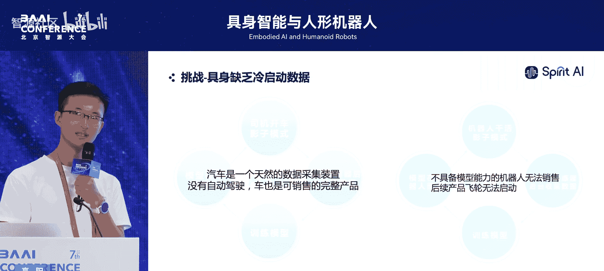

嗯，OK那这个莫拉莫拉维克悖论呃，相信很多同学也听过，就是说啊很多在人类看来看起来非常简单的东西啊，其实对于机器人来讲是非常困难的啊，比如说这个去玩一个乐高积木啊等等。但是在人类看来很复杂的一些事情。

比如算一个什么10位数的一个惩返，对于机器来讲是很简单的。😊，OK那么最后呢在技术上我想跟大家分享一些关于我们到底应该怎么去解决计深智能数据瓶颈的啊。

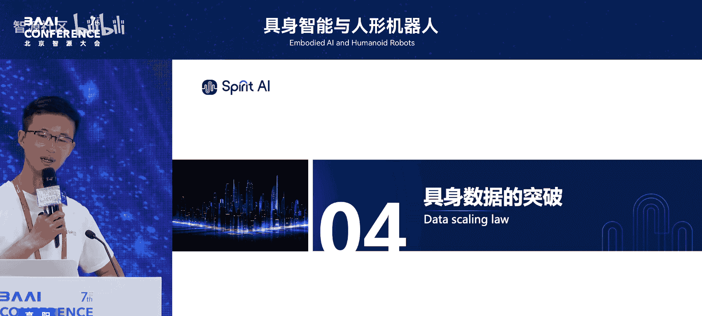

或者回答这个问题啊，我们的机器人的数据到底从哪里来啊？OK那么我认为机型的数据应该从这三方面来啊。第一方面呢是说互联网上啊我们已经积攒了很多很多数据。

那么其实我们对于互联网上这些数据还没有完全去这个exloit他们啊。那么第二点呢，其实现呃大家现在已经在用了很多，就是摇操作的数据啊，这是我们肯定需要去用的。那么第三点呢。

就是说机器人在获得了一定能力之后，在现实世界中去做一些行为的时候，他也会产生很多数据啊。OK那么说起来简单做起来难，对吧？那么每一样数据我们到底应该怎么去用呢啊？😊，那么举个例子啊，比如第一类数据。

这个互联网的视频啊，其实我们人类就有这样能力，对吧？这个小婴儿在看这个啊电视里的成龙，对吧？有一些很炫酷的动作，那么他就会自发的去模仿这些动作啊，那么这个就是人类去学习很多技能的一个啊一个方式之一。

人类是通过去啊模仿他家所看到的，即使跟他形态完全不一样的这样的一个啊其他的实体啊，去去进行这些动作的练习。😊，OK那么所以呃我认为机器人也需要同样的通过去观察其他的无论是人类还是其他的机器人的一些行为。

而从他们里面进行学习。啊，那么呃我们在千寻智能和清华也探索了很多这样的一些算法啊，比如说这是一个我们之前探索过的一个算法，叫啊anypoint tracking model啊。

那么它呢就是说通过去跟踪这个视频里面这个物体和机械机械B本身的一个运动啊，来去做一个预训练。那么通过这个预训练呢，我们就知道了这个图像中，每一个物体在被人类操作的时候，大概是怎么去运动的啊。

那么再把这个这个预训练的模型迁移到下游的啊这个机器人的摇操作的数据上进行一个微调。那么通过这样的一个预训练加微调的一个范式，我们就可以通过啊不使用海量摇操作的数据啊仅仅使用海量的啊很便宜的视频的数据。

可以对机器人的模型进行一个预训练。OK那么呃这个具体的数据长什么样子呢？啊，它大概长这个样子啊，比如说人类视频在叠一个毛巾，对吧？那么我们去学习人类叠毛巾这个过程中，毛巾是这么动的，人手是怎么动的。

那么我们把这个知识就迁移到机械臂之上啊，那么机械臂也就学会了说哦叠毛巾它就是把这个毛巾啊，这个脚这个这么折啊，这个手要这么去动。😊，啊，那么同样这些算法可以用在非常非常不同的啊所有的其他的任务上。

比如说包括啊去开关柜门，从柜子里拿东西啊，然后以及从桌上扫拉圾呀等等等等啊。那么所有这些东西都可以用一套统一的算法去做一个处理。🎼OK那么在宣性智能呢，我们啊也把这些技术啊进行了很好的一些工程化啊。

这个是我们大概去年啊6月份就已经可以达到的一个能力啊，就啊这是我们公司的CEO韩总啊，他说这个给我做杯咖啡，但是他这个非常不友不友善，对吧？这个咖啡杯直接啊这个平躺到这个桌子上了啊。

那么但是这个机器人因为啊见识过很多这种互联网上预训练这种视频。他知道怎么去处理不同的这种姿态啊。🎼OK那么值得一提的是说啊我们这个视频是一个完全一镜到底的这样的一个拍摄啊。

那么呃这呃背后的意义呢就是说啊我们这个算法的重率是非常非常高的，以至于我们不需要拍很多很多镜头来把很多镜头剪切起来啊。🎼就可以啊达到一个很很好的这样的一个成功率。hi， what can I do？

OK那么呃刚才讲的是说，我们可以利用海量的互联网的视频，对机器人进行一个预训练，使得我们可以采集更少的这种摇操作的数据啊，来让机器人学会很多技能啊，但是呃呃我们也想知道说，那么如果我们要采集要操作数据。

我们到底要采集多少啊，我们采集多少，才能让机器人达到80%的成功率采集多少能让机器人达到90%啊，95%到99%这样的一个采集数据的量和它的最后的性能的一个曲线是什么样的。

那么这个东西其实在啊大语言模型里面，open AI在呃这个45年之前就研究过这个问题啊，只不过是在大语言模型这个这个contex之下，它叫做这个sing law，对吧？

那么这里面呢我们也研究了说巨深智能的这个sing law是一个怎么样的。或者我们想问说呃，如果有合适的这种采集数据的策略，我们能不能在几乎任意的物体上任意的环境之中完成某一项任务。

那么答案呢当然是肯定的啊，那么这个机器人是在这个一个叫做小龙坎的一个火锅店啊，再给呃我们几位同学去这个给大佬倒茶，对吧？啊，那么这个机值得一提的是说，我们这个机器人是完全没有见过这家火锅店。

甚至完全没有见过任何一家火锅店，他就可以完成这样的一个任务啊，那么。当然除了这个这个给大佬倒茶之外呢，这个机器人还可以做很多很多事情啊，包括一些在很奇怪的地方去做的一些事情啊，比如说在这个电梯间里面啊。

去这个啊把这个鼠标放到鼠标垫上，然后在户外啊，把这个这个啊叠一个毛巾等等等等啊。那么。😊，我们是怎么做到这样的一些能力的呢？啊，那么我们做到的方法呢？其实是非常简单啊。

我们去研究了说这个巨深智能里面模仿学习的啊这种数据的缩放定律啊，我们大概采了大概4万个啊这个啊现实世界的这种轨迹啊，并且做了大概15000次现实世界的这种机器人测试啊，最后呢我们画了这张图啊。

有个巨深智能里面的powerloc啊 relationshiplationship。那么这张图是什么意思呢？这张图的。啊，第一行和第二行是两个任务啊，第一行就是一个倒水，第二行就是把鼠标放到鼠标垫上。

那么每一列呢是在研究啊相对于不同的衡量数据的这个维度，它是怎么样去scale的啊。第一列呢就是说相对于你的物体的数量。第二列相对于你环境的数量。第三列呢相对于你的物体环境的这个啊对的数量。

那么纵轴呢是我们所谓的一个叫做opimity gapap啊，就相对于最优的这样的一个机器人啊，的性能，我们到底还差多远啊，那么我们的横轴和纵轴都是一个这个呃对数的一个关系。那么简而言之。

我们结论是什么呢？我们结论是说在呃矩神智能同样满足sing law，并且它的sing law的形式是和大语言模型是一样的。它是一个log linear的一个关系啊。

那么什么是log linear的一个关系呢？就是说我每多采10倍的数据，我的机型的错误率就会降啊大致降低10倍啊。O。

那么这样一个s其实啊得到这个screenro啊啊基本上证明了说啊仅仅依靠这个采集数据这样的一个方式，是没有办法让机器人在任意环境做任意多的事情。因为如果你想从99%的成功率提到99。9%。

那么意味着你要多采集10倍的数据。那么这个成本它是一个指数上升的这样的一个形式。那么为什么大语言模型可以呢？因为大语言模型它本来就从互联网上爬取了很多数据，但是机器人没有这样的一个一个奢侈啊。

去有这样多的数据。OK那么我们到底最后怎么让能让机器人在现实世界中达到啊5个9甚至6个9的一个准确率呢啊。我认为应该通过这个物理世界的一个强化学习啊。那么什么是物理事业强化学习呢？啊。

强化学习很多同学可能都听过啊，就是说哎我们通过反复去尝试，对吧？然后就学会了一项技能啊，但是强化学习它的这个样本效率是非常低下的啊，我们经常需要尝尝试100亿次啊，才能把一个技能学会啊。

这也是为什么大家想用仿真器啊，因为仿真器可以给你无限多的数据。但是仿真器就有一些他自己的一些问题。比如说仿真器它没有办法和现实世界做到完全一模一样，并且构建仿真器本身也是一个很困难的一个事情啊。嗯。

所以呢在千寻和这个呃我们探索了很多关于物理世界强化学习的一些技术啊，那么这个技术举个例子来讲呢，它非常简单。它就是我们小时候你拿一个纸团往垃圾桶里扔，对吧？那最开始肯定你扔不准，对吧？

因为这个纸团他就是团到什么样子，他的这个空气动力学都很不一样。那么小孩也不懂空气动力学，所以这个小孩在扔啊，比如扔了五六次之后，他就知道说哎这个纸团，我稍微使劲一点会怎么样，稍微高一点会怎么样。

稍微矮一点会怎么样。他学到了这个知识。那么简而言之，我们在研发这个强化学习算法，就像人类的小孩一样，他能够通过少数的几次的尝试去学习到这个物理世界和他脑子里面的这个物理世界的区别。😊，OK啊。

那么这里面有一些算法的细节，我就啊时间所限，我就不过多展开了啊，我想给大家看一下这个视频啊，这个视频是一个呃我们想让这个机器人去交易啊浇花，对吧？那么但是我们最开始训练这个策略，它效果不是特别好啊。

最开始呢他只会这样。😊，哎，他连这个水壶都夹不稳，对吧？那么我们在物理世界训练了10分钟之后，这个机器人就会这样。他就可以把这个水壶拿起来了，哎，但是拿的不是特别稳。那我们在训练了20分钟之后呢。

它就可以把这个水壶啊比较缓慢的，但是非常稳定的拿起来，但是它还不会浇这个花儿。

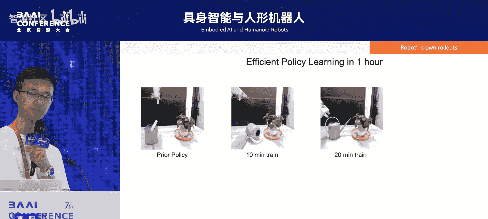

那么在60分钟之后呢，这个机器人就可以非常非常稳定的啊，并且相对快速的完成整个的所有流程啊。那么同样的算法呢啊我们呃也用到了很多很多不同的任务上啊啊包括比如说在这个桌上打一个高尔夫球啊。

包括啊开柜门等等等等。O。那么在千寻呢，我们把上面这一些技术啊结合起来进行一个工程化啊，我们也是国内首个通过完全端到端的一个方式攻克长城物体这个柔性操作的问题啊，那么说人话就是叠衣服，对吧？啊，就是。

啊，这个是大家写论文的一些小技巧，对吧？嗯。😊，OK那为什么对吧？我们要叠衣服，为什么对吧？不干别的事儿呢？因为啊其实叠衣服是一个非常困难的一个事儿啊，因为呃如果大家家里面有3岁的小孩的话。

你可以让他去试试叠衣服啊，其实他是不会做这件事儿的，为什么呢？因为衣服他最开始是一个有很大的一个褶皱的这样的一个状态啊。但是呃如何去理解这些褶皱，如何去。😊，啊。

处理这些褶皱是需要很高的这种啊我们叫具深的这种脑子的能力啊。所以啊我们通过呃把上述这些，包括互联网预训练和监督微调和强化微调，把这些技术结合起来。

就可以让这个激型去达到很高的这种具深的这种啊脑子这种能力啊，那么那么最新呢我们这个已经可以，对吧？你随便给他扔一件衣服，他啊这个不管这衣服是什么样的一个状态他都可以啊这个完成这样的一个任务啊。

那么如果大家有机会来我们公司的话，也可以自己来扔一下啊，这个东西啊，我在现场看的震撼还是啊看过的人都说好OK。😊。

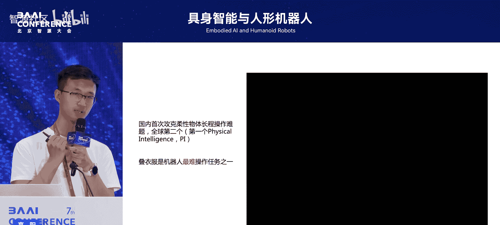

好，那么最后呢我想呃就是我我自己的一个目标呢是。啊，我们叫双十计划，我们希望在10年之内，至少让全世界10%的人拥有自己的机器人，来解放大家于日常的体力的烦恼之中。OK。那么我的研讲就到这儿，谢谢大家。

😊。

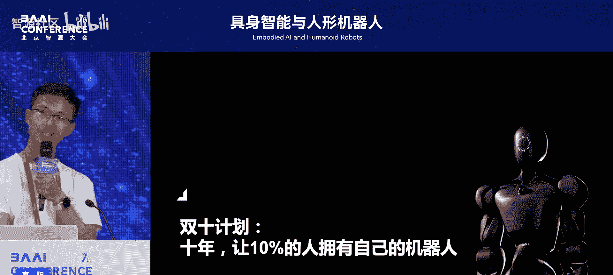