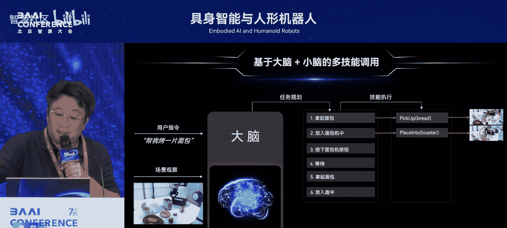
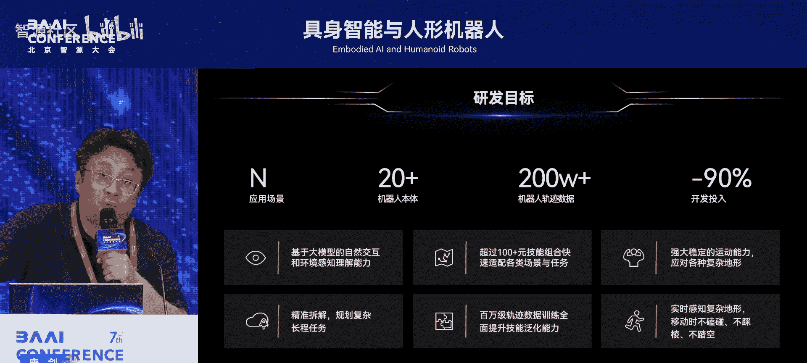
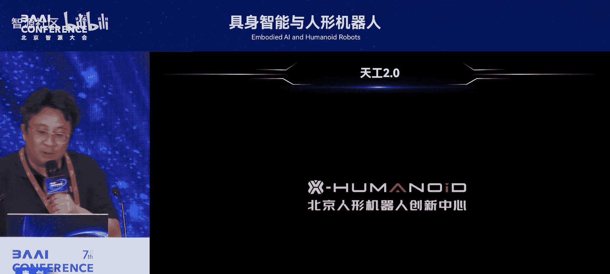
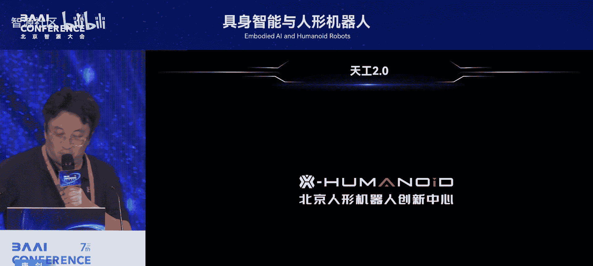
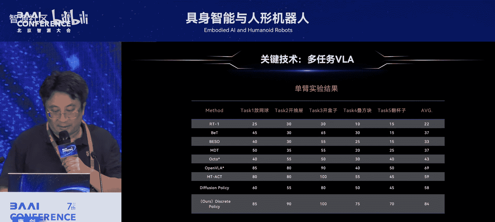
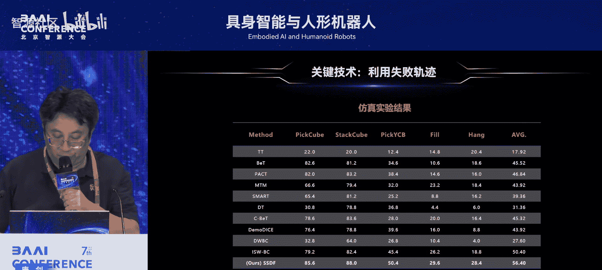
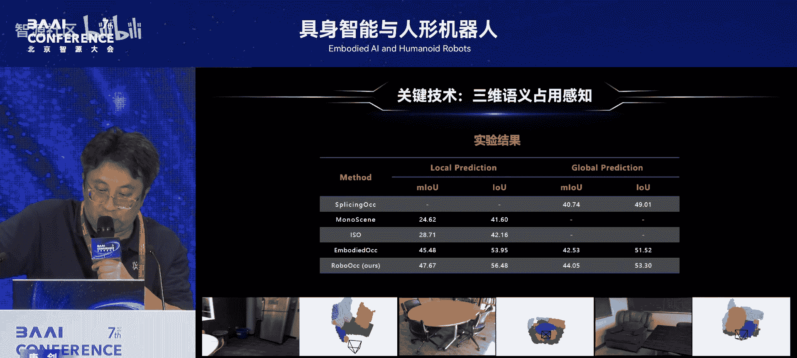
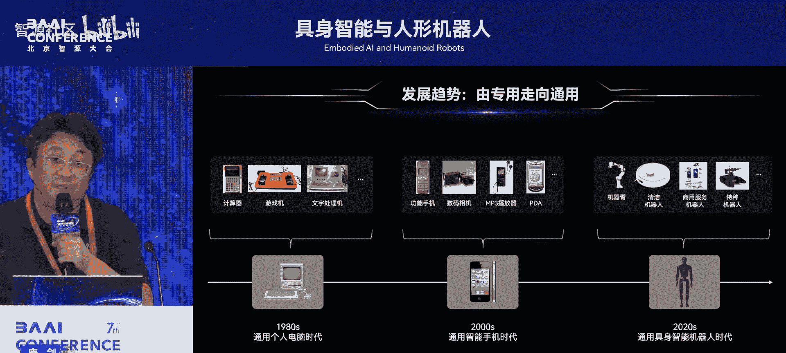

# 2025北京智源大会- 具身智能与人形机器人 p11 慧思开物：通往通用具身智能之路：唐 剑 -BV1MSNEz8EuG_p11-

那接下来呢就是我们的最后一个压轴的报告，我们也非常荣幸的邀请到了北京人形机器人创新中心呃，CTO唐建老师，我们掌声欢迎。😊。

🎼那唐建博士呢现任北京人形机器人创新中心CTO他是ACM杰出科学家、中国电子学会会士。他在国际顶级期刊和会议上发表了200余篇学术论文总引用达到1。8万次，拥有40多项授权发明专利。

在AI驱动的系统控制边缘智能和巨深智能方向上有很多开创性的贡献，并且多次获得了重要的奖项。那我们掌声隆重的欢迎唐建博士带来他的分享。好，谢谢好，非常感谢张老师呃，非常感谢呃这个智援大会组委会的邀请。呃。

今天非常荣幸呃，就是代表北京人形机器人创新中心。呃，和大家分享一下我们在巨深智能方向上的一些进展，以及我们对巨深智能未来技术以及产业化落地的一些展望。😊，呃，刚才那个高阳教授也介绍了。

就是一般来讲说到居深智能，大家都不由得想起就是上世纪80年代非常著名的莫拉维克悖论吧。呃，这这里头我我也就不再赘述了。但总的来讲，也就是说对人呃比较复杂的有一些任务，可能对机器人很简单，相反的。

对人很简单一些任务呃，对机器人可能很难呃，这就为什么对人很难的。比方说像这种下围棋的任务，我们基本上已经被机器攻克了。呃，但是这种开门关门呢，什么开抽屉关抽屉端插倒水一类。

大家觉得非几岁孩童都可以完成的很简单的任务，就是我们现在机器人还不能说完全征服了这些任务。所以整个机器人行业包括就是呃这个AI吧，也发展是经历了一个很长的一个时间。呃。

但是整个就是行业还是面临很多痛点吧。就是第一个就是我们觉得就是场景泛化能力差，现在机器人基本上呃你一款机器人就是只能工作在一个场景，或者说这个打螺丝的机器人就是在打螺丝。

然后我们这个酒店这种送送送毛巾的机器人，就是送毛巾，经常你一般不会看到一个在呃这个工厂打螺丝的机器人，今天在打螺丝，明天到这个酒店送毛巾啊，所以呢这个它整个就是场景要非常固定，然后只能针对单一的场景。

另外一个就是即便在单一场景内，比方说我们一个工厂的场景，甚至我们这个工厂是一个固定的，比方说1个3C的工厂，对吧？这里头有各种各样的任务，那么也需要由不同的这种机器人，然后机器人上也搭载不同的程序。

不同的软件来完成。所以它整个这个任务范。即便是同一场景，但任务泛化能力也非常差。另外一个呢，最后一个就是说本体的泛化能力比较差。一般来讲，我们都是做一款机器人，专门针对某一个应用。就是前面讲的。

比方说我打螺丝的工业机器人啊，或者是这种酒店送餐的机器人都完全不一样，对吧？所以它整个基本上是这种专用的机器人，都是专专门专门针对某个场景和某个任务，某个应用设计一款专门的本体来来完成这个任务。

那么传统的就是整个机器人的共控制的发展吧，也是经历了几个阶段。呃，就是之前用的比较多的，就是嗯这种所谓叫基于数学模型预测的控制，就是MPC嘛，model predictive control。

那么这个大家也非常清楚啊，在座的都是专家就是非常清楚，这个优优势非常明显，像刚可靠性啊，高确定性啊，高精确度啊等等。然后这就是为什么就是在一些这种工厂的工业机器人场景里头是广泛应用的。

但它缺点也非常明显。就是它需要预编程，基本上呃就是如前所述吧，它是针对单一的场景和任务，几乎没有任何的这种泛化能力。另外呢一般来讲只适合于这种结构化，就是这种环境是非常固定标准化的。呃。

有严格的这种这种这种规定，就是这样的一个环境。另外仅适用于这种固定流程。就是一般来讲你做这个任务要有SOP就是一步一步都说的非常明确啊。不能不能改这个两个步骤之间不能调换。还有呢就是操作对象。

一般也相对它的颜色、形状、大小、尺寸各方面都非常非常固定。那其实在这个大模型出现之前啊，那时候我也在高校做老师啊，就是也是做了很多的探索吧，就是大家也在探索。

就是基于这种AI的算法或者端到端的算法去来做这种机器人控制。那么呃就是我称为叫前大模型时代了啊，这样的方法呢，其实主流的也是分两类，一类是这种模仿学习im learning。

另外一个是这种强化学习re learning对吧？呃，然后这个优劣势其实也是就是各各有优劣吧。这个然后模仿学习大家也知道，一般被认为是这种就是学院派，就是我们跟着老师学，跟着数据去学。啊。

那么它的这个优势也是非常明显。然后强化学习相当于实战派，就是放到这个实际环境中去做。但是不管是模仿学习还是强化学习。啊，其实因为就是在大模型出现之前，这个由于数据模型的这种这种体量的限。

制吧呃一般来讲一个模型就是它是一种单一技能的学习。就是我这个模型只能有某种一种技能。比方说这个p and place，对吧？就是这么一种技能，或者说最多有若干种几种技能。对。那么随着就是2022年底。

就是像chadGPT一类这种大模型的这个出现啊，其实很多人就是特别是做机器人行业呃，以及做巨深智能行这个这个方向上的这个老师也好，或者是业内的从业人士也在好，就是说这种大模型和机器人这种结合在一起。

就是能否就是像这个机器人，他的这些上肢的这种操作能力。有一个呃接月式的这样的一个提升吧。大家都在思考，就是他们俩结合会发生怎么样的一个化学反应。

那我们北京人形机器人创新中心呢也是嗯就是这个巨深智能也是我们重要的研发方向之一。我们基本上两个任务，一个是做这种相对比较通用的这种人形机器人的本体。另外一个呢就是做我们的软件平台。呃，我们叫惠思开物啊。

这个也是在就是我们3月12号就是做了一次正式的发布啊，目前也是在紧锣密鼓的研发过程中吧。呃，就是随后就是在我们那个像下个月的AI大会世界AI大会以及这种机器人大会。

我们都会相应的呃一些新的成果的一些发布。呃，这个惠思开物呢，我们说是对传统机器人应用开发模式一个颠覆什么意思呢？就是说传统机器人应用开发是专专门针对某个机器人某款某个场景下，某个任务写一个专门的应用啊。

而我们希望通过惠司开物，就是说能够让所有的机器人应用开发者以一种通用的方式，针对任何场景下的。任何任务和任何机器人本体一种简单通用统一的方式来开发呃这样的应用啊。

然后当然目的就是希望能把这个呃我们机器人应用开发的这种投入啊大大的降低。呃，这个我在呃就是很多场合也有所展示了，就是我们整个惠思开物定位呃，是一个一脑多能一脑多机的这种通用具深智能的一个平台。呃。

那么一脑多能什么意思呢？我们希望就是它相当于机器人的大脑嘛，对吧？大小脑等于是然后希望通过这样的一个平台能够去支持各类机器人应用的一个开发，啊后就是说呃为什么能做到这一点，就是直觉上讲，对吧？

我们不管是任何一个任务，不管是打螺丝，还是在家里端茶倒水，都能被拆解成一系列的这种动作，那么动作就是包括像打开啊，关闭啊，拿起放下旋转插入，这些都是动作，对吧？那么都可以由这一系列的动作组成啊。

那么我们每一个动作我们叫一个技能，对吧？一个ski啊，可能其他公司有不同的叫法，那基本上大同小异，就是说呃那么我们可以用一个这种端到端的模型。

比方说VLA的模型vis language action model去实现。就是各种的技能啊，所以这里头有一个核心的一个呃整个平台一最核心的一个1一个组件吧。

就像我们去这边就是在巨深小脑部分这种原技能库啊，然后现在普遍的行业的认知。也就是说我们大概用50到100种这种技能能cover，就是这种物理世界的，就是绝大部分的一些工作和这种任务。

那么我们也是在就是构建这样的一个很好的泛化能力比较强的一个呃技能库。当然整个行业我觉得卡点也在这儿，就是你需要让每一项技能有强大的泛化能力，对吧？这个我们基本上业内人士也都知道。

然后整个平台呢是有两部分组成，在这边有所展示啊，这是一个功能模块图。那么由巨深大脑和小脑组成，大脑的就包括像自然交互啊，空间感知啊，然后意图理解理解这个用户的意图。然后它最核心的功能是任务规划啊。

就是来了一个任务。这个大脑要把它拆解成多个子任务。然后每一个子任务被映射成一个呃这样的就是呃模型，就是AI的端到端的模型来执行，它还包括了像呃这个就是大模型，其实比较常见一些能力啊，就像错误反思啊。

以及记忆管理的能力。呃，那么它的另一部分是这个巨深小脑小脑部分有两个子平台组成，一个是操作的子平台负责控制上升的一些操作以及运控的子平台。运控子平台其实basically是在操作子平台之下的。

它是真正像这种关节发指令的。那么操作子平台前面提到了就是它的一个核心就是我们这个原技能库。那么运控子平台呢要完成一些基础的呃，就是支持机器人的一些基本的一些运动能力，包括全身的控制一个WBC全身控制器。

还有双臂的协作啊稳定的移动以及定位导航等等功能。呃，另外呢我们讲就是整个平台我们是一脑多机的，就是我们是希望能兼容支持就是我们这种市面上。

就是各类的比较流行的这种机器人目前是适配了将近10种吧机器人和机械臂呃特别是一些像数材设备，这些是用的比较多。还有我们自己的机器人，以及我们合作伙伴优必选的这个worker系列的一些机器人啊。

这个我们也在努力过程中希望。未来能支持更多的这种机器人在我们的平台。然后这是整个平台的一个技术架构，呃，这个说的比较玄乎，好像就是一个通用巨深智能平台。但其实呢它是一个就是巨深智能体。

但它不是一个agent，它是多个agent，就是我们的大脑的基基本上是运行在云端。然后它包含了多个agent然后使用了多个大模型，不是一个大模型。

就我们使用了LLM另外有这种VLM最核心的当然是这个VLM它是负责这个就是任务规划的呃，以及一些其他的一些就是各种的模型吧。比方说我们用LLM支持，就是人机的这种对话等等。

然后端侧也是一个agent就是运行在这个我们这个端上呃，然后呢就是它就是负责去把这个子任务去映射成这种呃实际的VLA模型或执行，或者有的任务可能是用这种模块化的这种方式执行啊。

这个基本上都是由端上这个agent来控制的另外我们还是用了其实就应该也是和众情一样我们。整个这个呃运控是使用了这种模范强化学习的方法呃，来支持一些相对比较拟人的一些运动，支持这种自机器人能够自由运动啊。

这边特别想强调，就是我们这个平台是开源开放的，什么意思呢？就是一个是比方说在大脑端啊，我们当然是也有自己的呃这种自研的这种VLM啊，这个稍后我们会发布，大家进请期待。另外呢我们也接入了。

其实多个就是就是说现在比较流行的，包括像GPT啊这种LLM的模型也都接入到了我们这个平台之中。还有就是我们这个小脑测的像这个呃原技能库。我们既使用自己的呃这种自研的这种模型，也会使用一些开源的。

甚至也欢迎我们的合作伙伴啊，提供一些这种非常优秀的就是能支持这一些各种技能的这种VLA的这种模型，能能够集成到我们这个平台上。另外我们在整个这个开发过程中，也会不断的开源一些呃我们自研的一些模型。呃。

这边就是一个简单的例子，因为在座的都是这种专家啊，我就不详细介绍了，基本上就是用这个烤音片面包这个例子呃，接受到这个指令，并且这是这个机器人对场景的一个观察。然后大脑就开始思考。那大脑的核心作用。

就是把它刚才前面提到了给拆解成多个这种子任务啊，这里头这个这个任务就虽然是个简单任务，但也要被拆解成大概6步吧。就是6个子任务拿起面包放进面包机中按下按钮，等待再拿出来放到盘中。然后呢。

这些子任务都会被dispatch，就是发发给这个我们小脑这个小脑就是运行在这个机器人本体上的这个agent。

然后由他把每一个子任务给映射成一个我们这种VLA模型或者是我们的一个呃这种对这这样的技能的一个实现，也可能用模块化的方式实现啊，这个取决于这种技能到底是什么技能。

呃，然后进行执行，执行完以后，把这个结果反馈给我们这个大脑。然后整体这个平台的研发目标，我是我们是希望这个大脑具备基于大模型具备这种自然交互环境感知能力。另外更重要的是就是能非常精准的去拆解和规划。

非常复杂的。比方说十几步几甚至几十部的这样很复杂的一个任务。另外我们的这个呃巨深操作子平台呢呃目就是我们的目标是支持就是会拥有这种超过100种的原技能。这样的话针对任何场景，我们的非常快速的做适倍。

当然现在还达不到这种程度。但是我们在往这个方向上去努力啊。目前我们大概能支持大概30余种技能吧。呃，另外当然我前前面提到就是跟很多这种媒体的这个的投资人的朋友也讲，其实技能的数量多少。

现在并不是特别重要，而是每一种技能我们必须要有强大的泛化能力，这是没有任何一家企业或者是学校就是可以做到的。所以大家其实也正在这个方向上努力。然后另外呢就是在这个运控方面。

我们希望它有强大稳定的运动能力，能够应对各种地形啊，这也是我们自己的天工机器人比较呃有特色的一点吧。就是我们能去去在不同的复杂，各种复杂，包括一些施滑路面啊，上坡下坡啊。

什么这种坑坑洼洼地地形上都能比较呃稳定的运动。另外呢，它要具备一个实时感知复杂地形的能力。在这什么意思？就是在移动整个过程中做到能够不磕碰不踩空不踏空。然后总体上我们用这个平台。

其实它的一个over一个总体的目标，就是希望把整个这种研发投入，包括时间的成本，以及人力投入成本降低90%。

呃，这也是我们最新的一个成果。呃，这个稍后会有正式的发布。另外我们也这个投了一篇这个顶会的文章吧，在 archiveive上也把我们这个呃这个一个技术文档给放出来。

就是呃巨深大脑前面介绍巨深大脑有一个最核心的能力，就是要规划，就是他要能很精准的规划，所以我觉我我们认为啊整个巨深智能最核心的卡点是两个，一个是大脑如何能精准规划各类任务。

这个需要他有非常强大的这种泛化能力啊，因为任务就是千千万万种吧。这个就是每一种他拿到每一个任务，他能够很精准的规划。我觉得这个是比较难的。所以他自己要有一种自主探索的能力。因为基于现有的一些训练数据。

它未必能就是给你任何一个任务，它都能很精准的规划。后第二点呢就是说这种操作能力了，就是说你把它准确的拆解成一个子任务，那每一个子任务都能被成功的执行，对吧？这个也是非常。😊，困难的因为在不同的环境。

在一个开放环境中，非常就是这种变化的动态的环境中能做到这点也是非常不容易。所以呢我们整个我们需要让大脑有这种具备一种自主探索能力，然后呢我们这边用的是一种基于就是蒙特卡罗搜索的方法。

大家知道这个阿尔法购里头非常核心的一个一个方法，就是它能是一种启发式的探索策略，就是拿到一个任务以后它会做探索。然后这里头呢就是这个蒙特卡罗术，它每一个节点是一个状态，每一个状态是用这种图像啊。

或者是用一个这个图像加文字吧，这种形式来来表示的。然后每一条边对应一个action，就是比方说下棋就是你你那个棋要往哪哪个那个那个crosing上去落，对吧？呃，那么针对像像这里头我给了一个例子。

就是烤面包，对吧？呃，你你你接到任务就是加热面包就是去烤面包。那烤面包有不同种方法去考，你可以用烤箱烤，可以用那个微波炉加热，对吧？那么首先它。😊，探索我比方拿起面包往烤箱里放。

但是一个烤箱发现这个目前他们家这个烤箱非常小，就是根本塞不进这个面包。所以这这这就是一个失败的一个plan啊，然后另外呢就是说就是如果用微波炉去烤，那那也有不同的方法，一个是直接微波炉里塞发现不行。

因为那门还关着呢，所以得先打开门，然后再把那个面包塞塞进去。所以他整个蒙特卡罗上每一条路径是对应一个plan对然后每一条路径上一个节点有一些得分啊这个就讲这个得分就是跟这个状态以及它相关的这个action对应的这个所我们叫动作价值了。

有的得分可能是很好的一个正向的一个大的得分，有的可能是负向，就说你做这个a在这种状态下你做这个action是非常错误的。

所以呢整个呢就是我们形成了一个就是由多模太大模型到世界模型到奖模型的一个闭环这里头有涉及到三个模型。我们整个做任务规。😊，画的一个核心是VLM是这个多模太大模型。但是呢我们需要用世界模型。

黄仁勋经常讲的世界模型啊就是呃但是我就是世界模型，我们觉得在这里特别是基就针对机器人的世界模型，绝不是简简单单的一个视频生成器啊，它非常重要的就是要知道要能了解这个这个在世界的一些物理规律。

然后能准确的仿真出来。那这里头我们为什么要用世界模型呢，我们要用世界模型等于为每一个plan这样的就是这个树上的每一只啊做一个模拟，然后用这个奖励模型去判断这一个方案是不是一个好方案，啊。

比方说它是成功了，还是在这一步可以继续往下走是OK的，还是说这就已经失败了，已经不行了。比方说你试图把这个这个面包塞到这个呃这个烤箱里，这这条路肯定走不通。因为这烤箱太小了。对，那么我们需要就是世界。

😊，模型能很准确的去模拟这个过程。因为你不可能把每一个方案都实际在物理世界做一下啊，这个非常费时费力。所以我们需要用世界模型来模拟。

另外世界模型另一个我觉得比较重要的用用途就是能自动的生成这种虚拟仿真的轨迹数据啊，这个会比较极大的提高这种我们训练数据的数量，以及它这个diversity，就是多样性吧。😊，呃。

然后把整个这个过程中收集到的，比方说像A就是小A，就是我们的这个action，呃每一步的action以及它对action对应的一些呃这个我们叫动作价值吧，就是action value。

还有这个就是大A大A我们叫。呃，这个熟悉deep的一个GRRPO就是这个强化学习方法的，大家应该都清楚，把这些值colect起来，好的坏的都都colect起来。

然后一起丢到这个GRPO的这种呃这个强化学习训练框架中去训练，去微调我们的这个VLM让我们VLM能够就是有更强大的更精准的去拆解各类任务，所以这个就是给大家展示一个就是巨深多模态大模型。

等于是个自我进化的一个过程。因为它必须要有这种自主探索的能力，否则他不可能对任意你给来的一个任务都能够非常精准的做拆解。然后下面也通过视频展示一下，就是整个我们在剧深操作啊以及运控方面的一些进展吧。呃。

这个就是一个自自动错误处理的能力。如果去过我们创新中心，那一层有一个展示，专门就展示这个能力。呃，因为之前基于规则的方法做这种自动错误处理是比较麻烦的。因为你要可能考虑到各种失误的情况。

各种意外和失误的情况。那么现在我们用这种端到端的模型呢相对来讲就是呃做的会好的多，因为他可以去replan嗯，就是这个人他不断干干预他干就是就给他提供一些干预嘛，就是但是呢呃他可以就是重新规划。

然后非常做到使命必达吧，很执着的就是去完成这种任务。然后第二个就是一个lego的一个展示。呃，这个主要是展示大脑的，一个是空间感知，就是感知到这个人他可以搭出任意的lego形状。

另外呢呃这个机器人根据人搭出的形状，做做好空间感知识别以后呃，然后去plan，就是一步一步的去复现啊这些lego的形状。那第三个呢，也是我们目前做的算是应该算就是最实用以及最呃这个复杂的一个应用吧。

就是一个打包的应用。这里头涉及到5种技能，就是包括了像这个拿起啊，然后去扫描这个二维码，然后放到箱子里头呃，封上盒子贴上标签，再把它放到这个呃这个这个这个这个这个线上呃。

所以呢这个是展示一个这个我们这个呃会斯开物平台能够把多个技能，就像穿珍珠一样穿起来啊，这一个多技能的穿插调用。还有最后一个就是一个双臂控制的能力。因为很多工作是要双臂协调。

我们现在是用一个VLA模型去控双臂呃，去完成这个任务。在很多任务中，它是需要一种呃协同和配合的。然后这是我们在巨深运控呃方面的一些进展。啊，这个相呃相信可能在座的很多呃就是同学也都看到。

就是我们在4月19号首次呃这个呃亦装的这种半程马拉松是全呃世界首个吧。这个比赛中取得冠军。呃，然后目前也有一些进展。我们基本上机器人呃，现在可以以稳定的10公里每小时的速度去奔跑。

然后峰峰值速度最新是已经达到4米每秒，就大概14公里每小时这样的呃做非常快速的奔跑。这个8月份呃也会有这个机器人运动会啊呃，这个机器人运动会包括两部分，一个是这种田径的一些比赛。另外还有这个操作赛啊。

对，所以就是感情我们也会参加呃这个田径比赛，我们肯定会参加这我们比较有优势的地方，也是欢迎大家到时候去呃观摩观战。😊，뭐。呃，另外一个这是呃在其实在呃应该是2月份吧，2月底就是放出的这个视频。

就是连续攀爬100多级台阶嘛。然后这个一个特点就是它是一个实时的感知建图，而不需要提前建图。呃，就是然后连续攀爬这个呃就是利用这种激光雷达以及视觉传感器，呃，做这种三维的建图，然后规划落脚点。

然后连续上台阶。这个很快会在我们展厅里头呃，也有展示。呃，以及应付各种复杂地形的这种能力，包括一些呃湿滑地形、上坡下坡啊、沙坑啊什么这种。嗯，还有就是一些抗冲击的能力，用这种人来去怼他。

或者是用沙球来砸他。然后这是最新的我们天宫二。声音很高。跑过了。🎼大家好，我是天宫2。0。🎼实验室太简单了，不如看看我在户外真实环境的表现吧。🎼大家说你就只会走和跑，你还会干点啥吗？🎼当然了。

我给你秀一下。动作快点，别让我迟到了。🎼这是北京人形机器人创新中心研发的一体化关节，是让我们像人类一样灵活运动的核心部件，不仅能驱动超过百斤的庞大身体，还能实现精准的动作控制。🎼我来帮忙了。好呀。

我们需要把这箱零件分解完。😊，🎼该换班了，我来吧。呃，这个目前就是我们整个创新中心，现在在呃等于是出售和这种交付吧。呃，天工2。0的机器人，这个包括了呃这个light版呃plus版和pro版呃。

pro版是带这种7轴呃这种呃机械臂，然后零巧手无指零巧手的啊，当然这些都可以就是这种末端制信息都可以根据我们客户的需要来定制啊。所以呃各位感兴趣的话，可以与我们公司这个销售联系。

打一下广告。呃，另外就是呃整个就是在整个研发过程中吧，就是刚才那个高教授也提到，就是整个数据是非常非常重要的嘛。所以我们也是构建了这种呃巨深智能数据全链路的解决方案。呃。

这个包括呃一个是呃就是我们其实现在是在北京呃市政府的支持下，也是联络了，就是联系了就是呃这个。😊，呃，机器人的一些头部企业，还有一些场景方吧，场景企业。我们在呃构建这种呃就在我们创新中心。

就是这个亦庄旁边台湖这个地方会构建1万平米以上的一个叫巨深智能。北京巨深智能呃，这个机器人呃，数据与训练基地。啊，这个也是为了不仅是给我们自己提供数据啊，也是为希望能为整个全行业提供一个数据上的赋能。

所以就是说未来大家有一些数据上的采集的各类的这个需求啊。啊，就是我们都可以提供支持和帮助。所以构建这个数据基地，采集高质量的数据。另外我们也搭建了我们自己的这种自研的数据平台。

能够完成数据自动清洗标注啊治理以及可视化的一些工作。啊，另外还有就是国内首个这个巨深智能数据采集的标准，是由我们牵头联合了很多大概20多家单位嘛，就是共同来制定和发布的。

然这个相相信就是在座如果有高校的老师或者同学可能也都用过，就是我们的robmin的这个数据集啊，这个我们这个呃文章啊也是被那个RSSS马上就是这个月在那个洛杉矶。

我们也会正式去present我们这个文章，就是我们这个数据集叫robmin是一个多构型的规范化的数据集，设呃就是其中包含了10万多条轨迹数据，另外还包包含了几万条这种精标的这种训练这种机器人大脑。

就是大模型的一些数据，它涉及了5个场景，96类物体呃，6类操作470呃479项任务啊，这个昨天我来看大概已经呃下载量已经超过26000次了。然后大概有200多家这种企业和高校都在使用。

也欢迎就是呃各位这种行业的从业人员以及研发人员使用我们这个romin的数据集。将来我们会不断升级我们这个数据集啊呃，就是去包含更多的更多样化的一个数据。

还有呢我们也是一直坚持认为就是虚实数据结合是具深智能正确的一个打开方式啊，这个我们也做了非常多的试验，就是在这个试验中，基本上呃是一个简单一个是嗯pick up，然后旋转。

然后放下的这样的一个一个动作吧。然后在这个动作中，我们发现，如果我们只用这种实际的这种数据，这个成功率也就达到0。6%。然后加入了这种虚拟数据以后啊，就是随着虚拟数据不断增多的话。

我们最终就是大概在1比4这样的比例可以达到就是整个在真机上实现百分之百的一个成功率。啊，所以这个我们也是坚信这个虚实结合是一个正确打开方式。呃，然后因为张老师提到这个会议是学术性比较强的。

因为我们虽然北京人形机器人创新中心，大家听起来像一个研发机构，但其实是我们是一个初创公司。然后马上也要完成就是我们的A轮的融资。呃，但是呢我们也兼具了这个科研机构的一些特点吧。

所以整个我们在一些呃学术顶尖的学术会议上，每年大概有十几篇这种呃高质量论文的一个产出吧。这是在刚结束的，就是呃上个月吧，应该是就是在那个美国亚特兰大的一 Cr呃，像我们也有应该是4篇论文，这边时间有限。

我简单介绍其中几个工作。呃，一个是呃我们也是。提出了1个VLA的模型，这叫disc policy也叫DP但是个D是direet的意思就是离散的意思。

然后这个里头我们主要是呃就是去提出了一个新的这种支持多任务的呃，就是不像就是之前比方说像ACT啊，这种这种模型，都是这种单任务吧。我们一个多任务的一个模型。

然后这里头一些思想的一个是呃构建一个这种VQVIE的这种自编码器吧。然后呢让他能很好的从轨迹中学到这种特征，就是这个影变量学出来不同的这种不同的这种动作，不同的任务呃，相对应的这个引变量会离散开。

就是分散的比较开。这样的话容易做呃这种在解码的时候，就是能够比较好的那种区分开。然后提出了一种条件扩散的模型。我们要第一阶段训练出的这种这种变分的自编码器，作为一个生成的这种引变量做一个指导。

做一个监督，然后去训练这样的一个条件。模型啊能提这样的话，我们发现能很很大程度的提升这种任务的一个成功率。啊，这边也是跟很多流行的模型，像RT one啊这个open VLA啊。

有iffusion policy也是DP哈就是做了一个在很多任务上做了一个对比，因为他们有一些模型只支持单臂的一些试验结果嘛，所以这个是在单臂的一些实验结果。这个表格基本上我们达到了一个这样一个程度。

另外呢这里头一些视频也做一些双臂任务的一些展示，有很多任务需要双臂协同完成。那我们这个L的模型也可以支持。然后另外一个工作呢就是讲的是利用失败轨迹。这个也是在今年这个上发发表的，因为我们模仿学习呢。

就是很多的这个工作呢只能从这种成功的轨迹进行学习。然后一些失败的轨迹就是整个在执行过程中失败轨迹就被抛弃掉。但我们知道就是整个真机采集数据过程中，由于身体疲劳啊。

还有任务难度比较大这种原因可能会导致很多的失败轨迹。比方说在这个看这个这这篇工。😊。

中提到就是他采集了总共276K的轨迹，但只保留了只有12K是成功的。他只用了这12K来这个呃就是来训练这个模型吧。我们觉得这个非常可惜，所以就提出了一种自监督这种数据筛选的框架。

能够从失败的轨迹中去提取就是高质量的这种轨迹，为这种失败轨迹也打了一个就是跟这种成功轨迹相比打了一个分，就是那种分值比较高的失败轨迹也会被应用。在这训练过程中就这个lo function。

我们用失败轨迹的时候呢，会加一个这种全值，就是把它的影响力稍微降低一些啊，对，然后这样做了以后，就是发现也取到比较显著的一些成果。比方说跟一些其他的算法，这里头前三个算法是没有用失败轨迹。

后面一些算法都是用了即用了成功和失败的轨迹。然后我们也都跟他做了一个对比吧，就是也发现是达到了一个一个sota的一个水平。

还有最后一个工作是跟自主导航相关的啊，这里头呢我们提提出了一个三维语义占用的一个一个感知的一个模型。啊，因为这个机器人的自主导航其实跟自动驾驶的自主导航还是有很多就是不一样的地方或者说有很多挑战。

比方简单的讲啊，在感知方面，因为整个自动驾驶，自动驾驶现在OCC是最主流的一种方法嘛，这种你要生成一个Occup的图，然后呢能帮助你就是能非常好的去避障，对吧？那么我们在这个机器人中呢。

因为它可能在一个很复杂的环境中，然后这这这个复杂环境中呢，物体都堆叠在一起啊，所以这个给识别造成一些困难，就不像在道路上一般很少有两个车叠在一起，对吧？

还有呢就是说机器人呢它这个可能面临的面对的这种物体的种类也会非常繁多。然后有的物体非常小，所以你需要非常细利度，非常精细的啊，这种做这样的一个识别。所以这里头呢我们也是构建了。

这种呃所谓叫不透明度引导的自编码器吧，能加强网络这种呃前景就是分类的能力大大降低了这种语义的歧义。另外提出一种几何感知的这种编码器。

可以利用几何的一些特性加入这种编码器实现对场景一些细力度的描述精细的分类。这边也是跟呃现在多个比较流行的一些呃就是占用感知的一些算法做了对比。

特别是那个倒数第二行叫inbodyedOCC这是一个非常新的一个工作。是国内的啊呃，这个我们也是跟他做了一个非常全面的一个比较呃，基本上在一些重要的指标上呃，都都是bit了这这项工作。

然后最后呃时间也比较有限，我快速呃想跟大家分享一下我们整个对巨深智能技术呃未来发展趋势以及产业化落地的一个展望。呃，就是现在整个创新中心，其实有一个非常核心的任务是在做这个产业化落地。呃。

那也就是基于我们这个惠斯开物的平台，加上机器人。当然这个机器人可以是我们自己的天工机器人，或者我们天翼，就是轮式底牌的天翼机器人，以起结合形成一个行业的综合解决方案，为行业赋能。

那么目前我们就是比较关注的领域，就包括了像教育科研啊，物流搬运啊，工业制造电力巡检。还有一些特别是危险的这种特种的作业商业服务健康养老这都目前我们比较关注的领域。

现在也是在广泛的跟这些领域的这种行业这种客户接触吧。希望能跟他们就是有这种联合的研发项目共同推动这种呃人形机器人和我们惠思开户平台的落地。

我们觉得未呃这个巨深智能技术就是未来技术发展可能比较重要的几个东西啊。一个是我们觉得这个巨深大脑它需要有自主探索和自主学习的能力。因为这个巨深大脑它要面临的这种任务是无穷尽的。就是如果你自己不能学习。

不能自主的去学习去探索。呃，那么的话就是说肯定你会遇到一些任务，你自己不知所措嘛。呃，另外我们觉得就是整个在执行方面，这种具有强范化能力，特别是有全身控制能力的VIA不仅是控制上肢，包括控制你的腰。

控制腿部啊，这样的一个VIV这个模型也是非常非常重要的。还有就是通用泛化能力的人形机器人的全身运动控制器，就是这种hobody的controller啊，另外呢是这边特别要强调通用。

因为现在可能很多做这种运动的厂家，基本上是专用专网专用，就是说你一个网络大概就做一种动作，比方说是打咏咏春拳或者跳斧头帮的舞，像重金，可能就一个网络训练出来，就是做这样一个动作。对啊。

这个就是我觉得在实用环境中啊，可能就是不是不就是在这种实际产业化落地应用中肯定不行啊，那么我们需要这种通用，也就是一个网络他能做各种动作啊，就这样一个全身呃控制器。还有就是人形机器人全自主的导航方案。

人形机器人现在。大部分还是就是这种呃遥控器嘛，就是这种来遥控的呃，那后面的自主导航也非常重要。然后这个自主导航我前面提到，我们觉得其实它还是非常有挑战性。一个是就是现在全行业没有形成。

没有收敛成一个比较成熟的一个方案，比方说你要用什么传感器，要用多少个在机器人全身怎么部署，这是硬件方面的对吧？在软件方面，我前面提到了，它整个比方说你要做OCC对吧？那么呃可能他要面临的一些物体重叠啊。

还有多种各种各样的就是这种呃很细小的这种问物物体，你要做精准的识别。另外在导航方面，呃规划路径的规划可能跟这个自动驾是比较相似。但是规划完以后，你的controrl。

你要让你的机器人严格follow你的规划出的就是路径，这个也比较难，因为汽车有4个轮子比较好控制，然后一个机器人比方说像我们机器人除掉手之外，有30个关节，然后要严格follow这个轨迹来运动这个。

也是不是特别容易的啊，所以这个我们也在探索，很快呃会正式发布我们这个导航方案，并且在我们的这个一楼展厅做展示吧，就是全自主的。还有就是移动呃中的操作，包括移动中去操作或者操作移动物体。

另外我们觉得就是针对一些柔性流体弹性铰链物体，需要有更好的一些物理引擎啊，这个可能都是我们觉得整个行业包括学术界和产业界吧，需要努力的一个方向。这里边把它提出来，有一些工作我们也做。

也希望联合就是我们的这些在座的各位以及行业的这种合作伙伴啊去共同去公关。还有整个巨深智能产业化发展，我们觉得也会经历三个阶段，么第一个阶段呢是在这种结构化半结构化工业办工业这种或者是特种危险的场景啊。

能够支持摇操作，摇操作很可能是中间的一个步骤啊，因为摇操作本身也可以通过摇操作去采集数据去训练我们的机器人逐步实现自主操作。并且能够。完成巡检，一些简单的操作，还有搬运分拣啊、装配测量这些简单任务啊。

这样的场景先落地。我觉得近两三年是非常有希望的，包括人形机器人也都有可能在这些场景落地。那么第二阶段呢就是在一些商业服务场景。

在这种半结构化的环境中去完成像收纳整理、打包、扫码扫码等较为复杂的服务型的任务。啊，最后也就是大家都在想的就是最后一个阶段就是在生活这种家庭场景。

这里头需要强大泛化能力去扮演人类助手啊、保姆管家这种角色，这样真正推动人类社会进入一个人机共存的时代吧。然后最最后也是想呃和大家分享一个我们的观点。

我们认为从这种专用机器人走向通用机器人是一个历史的必然。然后我们经常讲就是历史会就是就是history alwaysre itself就是这种历史会不断重演。大家知道就上世纪80年代。

就是有各种的这种专用计算设备，包括计算器啊，游戏机啊，还有一些这种文字处理机，就WPS这种文字处理机，以前有个公司叫王安电脑，不知道大家是不是清楚，就是他等于是替代这种打字机的。

但是随着就是像这种带图形界面的，像麦金塔以及windows这种电脑出现呃，就是这种呃通用个人电脑吧，就是部分的或者是全部的取代了这些专用的这种呃计个人计算设备，像这种文字处理机，后来基本上就销声匿迹了。

基本上就是在80年代末就销声匿迹。但游戏机现在专用的游戏机还是有。但是部分有很多的这种游戏的这种玩家也开始用在这种电脑。常打游戏，这也是比较多的。然后过了20年左右吧，在200405年的时候。

之前也是有各种各类的这种移动设移动计算设备，像功能手机、数码相机MP3播放器啊，PDA不知道大家用没用过，这种主要用来发邮件的。然后这种通用的这种智能手机。

像iphone这样的通用智能手机出来把他们也是部分的或者是全部的像PDA现在基本上都没有了啊，就是取代了。当然数码相机一些高端的还是有啊MP3播放器也基本上没有。

所以我们认为呢就是未来就是这种具有通用呃巨身智能能力的人形机器人啊，是会全部的或者是部分的把现有的一些专用的像机械币啊。当然工业机械币，我相信不可能完全取代效率非常高啊，他专门做一个工作。

这个还是有它的用处的。还有一些像服务的商用服务的机器人，一些特用机器人部分或者全部的取代啊，这个我们也是。呃，我们创新中心也是希望全力以赴。

也希望和在座的各位业内人士就是共同推动这种通用的人形机器人能够进入千家万户。好，非常感谢大家。😊。

