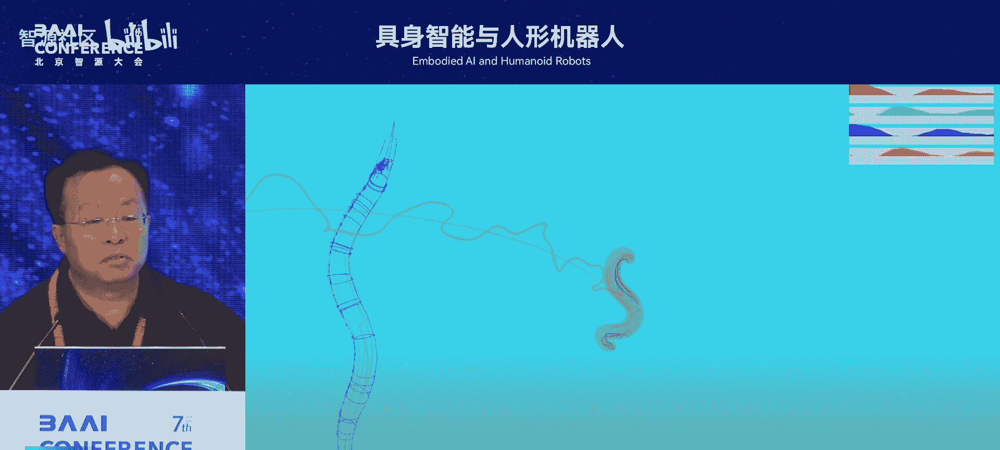

# 2025北京智源大会- 具身智能与人形机器人 p13 大会闭幕致辞：黄铁军 -BV1MSNEz8EuG_p13-

🎼那么接下来呢我们就非常隆重的邀请北京智源研究院理事长黄铁军教授为大家做闭幕的致辞，大家掌声欢迎。😊，🎼好，再次谢谢大家啊。咱们这个今天特别丰富的一次这个居神智能的论坛时间呢已经过了6点。

我们是6点要结束。所以我应该是没有时间给大家再致辞了。但是呢咱们作为整个大会啊，志愿大会，两天志愿大会的最后一个这个活动呢，还是快速的花一点点时间嘛，跟大家这个分享一下。

我希望能讲一点不同的这个呃这个内容哈，呃这是前啊这是第五次会宴大会的时候呃，那个志愿大会的时候呢，呃的那个致词的封辩哈叫无法闭目。那是当然安全，就是我是在安全论坛上讲的这个呃去年呢这个第六次也一样。

还是安全。呃，我们因为当时那个时候我们认为安全很重要。现在安全还重不重要。现在安全当然还同样有。😊，这是。当然当然重要，呃，但是呢我们也不能永远只看安全，是吧？还是要看发展。

所以今天呢我呃选的呢就是在咱们的这个剧深的这个论坛上呢呃发表一点看法。呃，为什么呢？呃这个也跟今天这这次的大会的安排有关系。呃。

我们去年呢搞过一次这个国际的这个呃AI的呃这个safety的一个一个一个对话。呃，当时呢列了5条人工智能不能这个呃这个僭业的这个红线。第一个呢就是不能自我复制，不能自我改进，不能寻求权力。😊。

这个呃这是我们的我们的这个怎么说呢？人类的这样的一个一个一个需求啊，但是呢事情的发展呃大概不会照着这样的规矩去走。比如最近大家都看看到哈这个一个呢就哥伦比亚大学ctor研究所。

还有呃叫sana AI lab做了发了一论文，说我要做一个具有自我编码改进，自止开放式演化能力的达尔文戈德尔基大就知道戈德尔这个定理哈，就是我们的人工智能呃这个计算机，包括人者在内的可以说是起点。

实际上就是要要做自我要做自我改进了。那第一朝就已经已经红线已经踩上了啊，就是人工智能自我改进。第二个呢那个两年前啊发过一篇这个一封信，我也签过名，大家都记得哈max takemark发的。😊。

就是GPT4之后，不能再发这个这个更大的模型了，否则的话这个带来风险。呃，但是你看啊最近也可能啊反正有消息了。也许下个月这个GPT5就出来了。所以这个拦你也拦不住。他这个安全啊。

这个这个这个问题太太复杂了。所以那这是最近哈今年3月份在新加坡的一个会上前两天上周那个呃max来北京的时候，那天跟薛老师我们在吃午饭。他他他这个T恤衫上就是这个就是这张图。

这是3月份的这个安全报告里面的一个就是AGI呢就人工智能呢不能在三方面同时超越人类。第一方面呢高度自主性。第二呢是通用性。第三个呢智能这个智能当然他为了凑AI这三个词啊。

这里边讲的智能是完成任务的能力就是执行能力，就是你脑子想的又清楚，你还敢干，你还要可以自主的干，那麻烦了这个人工智能就肯定会这个呃脱离人类的控制。😊，啊，就是那个呃。呃。

这张图呢在开幕的那个那个咱们那个本周的报告里也有个类似的哈，就是说这个这三这三个方面可不能同时达到，同时达到就就就不可控了。😊，但是呢我们也不能天天安全，对吧？这个呃毕竟这个技术发展是是是拦不住的。

我们还是要寻找一种呃希望，就是怎么来这个平衡这个安全和发展。所以像这个s讲的呃那个这个这个呃体这个叫什么体验的时代要到来，对吧？他讲的大概跟这个刚才安全正好是对相对的一种一种观点。

就是他是比较积极的对吧？呃，我们要靠这个这个强化学习，继续发展。所以我想呢我说这个这些背景呢，主要是可能我们得呃对人工智能的发展啊，有一个合理的一个一个一个一个一个道路。

我先说近期的哈近期的呢就是五年大概这么一个时间段之内，呃，确实是语以语语言大模型为代表的认知大模型的，可控这个问题已经是到了一个风险的边缘了。呃，如果是按现在这种做确实有可能在认知方面超越人类。

如果在被这个。😊，啊，他自己你现在有身体去跑，他现在没有居身，但是呢他可以被某些人去用，就是人的这个执行力，加上AI的这种智能加在一起，这麻烦这可能就会出事儿。

所以这件事呢是我们讲的安全的最眼前最着急的事情。😊，巨深呢现在我们今天经常说巨深这个还处在一个快速发展期，确实是巨深呢也别期望他马上多长时间超越人类，能帮我们人类干些活。就刚才讲了很多这个这个场景哈。

就是能代替一定的人类劳动呃，这大概是在过去这个未来啊这几5年啊甚至十年呃是比较期望的一种一种状态，这能这个认知别超越人类干活能力提高点，把我们不愿意干的那些活，危险的活，哎，有有人工智能来干。

我觉得呢这个这大概是我们的一个一个一个比较合理的选择。😊，呃，但是呢这个事件哈总在往前发展。呃，我在前几年的这个志愿大会的报告里边，这张图如果大家还记得有印象的话。

其实呢整个智能啊在这些在过去这些年发展很快，比如像GPT比如像QN就是这个深度强化学习呃，已经带来了很大的这个进展影响。但是智源呢还有一个不同的这个有独特的。

就是真的是构造一个这个自底向上的去构造一个完整的这个智能智能体啊，这个智能体不是咱们今天说的agent啊，是完整的一个一个有身体的，有从原子开始的理想啊。

有从原子开始的一个一个一个一个物理的这么一个一个一个智能体。😊，所以我们有些项目啊就是呃大家如果看啊，就是包括去体验去体验。我们有些项目大家会觉得有点奇怪，怎么一会儿做脑电啦，一会儿做心脏了，呃。

其实都是跟我们要构造一个物理的身体是是是是是相关的。呃，这方面呢呃为什么要这么做。因为智能本身啊，我们关心语言大模型。但是这个呢是这个我们所有智能中最后一个出现的，就是3到7万年前。

人类这个语言形成一个一个呃这种这种这这种能力，呃，所以语言大模型最先实现也不奇怪。因为这是最后数据越多，对吧？然后也是但是呢接着再往前就是我们的脑，这个我们的脑啊呃我我人类的这个叫叫我们叫大脑哈。

就是皮层大概是2亿年前开始出现的。之前动物没有脑嘛，有脑主要是小脑，主要是控制身体的这个这个这个部分，真正我们作为智能的这个主体的，是2亿年前出现的。

再往前就是眼睛5亿年前开始出现这个感光的这种这种细胞。😊，再往前还有3335亿年左右，是我们的身体，就不是我们的身体，就是这个我们生命的身体。所以在这个整个历程中呢，呃是这么多年的积累才有了我们今天。

所以为什么巨神智能难？大家看看这个花了多长时间产生的这个这样的一个一个呃一个一个结构，就知道这个难难难度了。😊，呃，我我刚才说的这些想法呢，因为我大概十0年前就是这个有这么一个呃思考哈。

这是2015年1月7号写过写的一篇科普文章，就是什么时候我们造出一个像人一样的，包括人的大脑在内的这么一个一个一个咱们说今天有今天的话就是居身的人啊，这个我当时认为呢30年。

也就是2045年已经过了十年了，还有还有220年，我差不多现在还是这样认为，因为这个事情呢很难，大家都知道很大家刚才说的难啊，但是真的你想象一个这个全面都跟人类媲美的，包括身体这个各个方面，呃。

说20年都很都很都很激进了啊，就是很多呃所以是那个时候呢，北京也做过一个这个呃脑的计划，叫脑认知与内脑计算。当时我也是这个着急人，在在在推动这件事。那十0年过去了，呃这是十年前的一些一些布局啊。😊。

说十年过去了，世界也发生了一些变化。我们回顾一下呢，可能确实有利于我们这个呃这个这个呃反思，或者说对未来的一些展望啊。

你看这个脑呢是当时13年到23年十年刚刚结束那个上个月那个他的负责人到致原来来讲他们进展。总的来说，当时梦想的把人类大脑十年搞定，那这个还是差还是差很远，这里边有很多波折啊，我就不说了。

总的来说这是很太复杂的一个一个对象了。美国当时跟欧洲要竞争，对吧？也叫脑脑计划，呃，到现在也没有太多的声音啊，就是大脑太复杂了。呃，在这个还在过程中的时候，大模型就突然出现了。

没人预测的到这么一个人工的神经网络能能实现这么强的能力。中国脑计划也是差不多2013年左右讨论，但是讨论了5年终于启动了。所以搞了5年，现在在进入第二阶段，所以总的来说脑的问题我觉得31年前我判断没有。

😊，30年左右的时间是是大概是不可能有有这个真正的这个呃解解决的。第二个就是眼睛的问题啊，眼睛的问题，眼是脑的一部分啊，眼眼睛是大脑的大脑是露在外面的，大家大脑是露在外面的，眼睛就是两个洞。

就是我们的大脑的露出来露出来的部分。😊，眼的问题解决了多少也没多少。大概现在讲20年前说这个差不多对视觉很粗的估计对生物视觉的理解也就是10%左右。现在到没到15%都不好说。

就是我们真的是对这个生物的这个视觉的过程了解很有限的。但是这不妨碍跟刚才说大模型一样，我们也可以做一个一部分仿映生物，但实际上在性能上比生物要强的眼睛，然后就是身体啊，所以时间有限哈。

我就快速的我们对一下，今天的脑和今天就是今天的大模型和我们人类的脑到底有多大的差别。人类大脑呢差不多啊，P层是300亿啊，但是一般我们说完整的脑一般说是860亿或者1000亿。

所以它是一个1000亿的神经元，100万亿神经突出，也就对应我们大模型的这个连接都是这样的一个大型系统。但是它是个慢速系统。我按毫秒说都好都往快速说了。

因为一般神经的频率就是十几赫兹几十赫兹的这样的速度。但是咱们就按这个这个。😊，这个感知的灵敏度大概是毫秒级的一个一个系统。所以一个毫秒级的系统乘以这个百万这个百万亿的连接。

那就是10的17次方的施工复杂度。😊，我们今天大模型做到多少呢？这个空间混杂度当然没有大脑，一般都是万亿对吧？大概是大模型的这个呃是人脑的这个1%，但是它的时间速度可快很多啊。

我们一般都是用纳秒级的赫兹的芯片，但是我们也不能说赫兹，你不能在一个时间部里边做一个token的这个这个处理，对吧？我们就是按照三个数量，就是按微秒，就是用100个时间步，这肯定没问题。

可以做一个token的处理。所以它大概是一个微秒级的一个一个精度的系统，这么一算，其实今天的大模型已经超过这个人人人类大脑了。所以它产生强的智能也是有物理也是有这么一个物理物理物理基础的。

当然大模型的结构还跟人脑还没法比啊，但是总的来说这是一个可比的一个一个一个系统，眼睛，我们说眼睛其实也很。😊，我们说很强啊，但是也有它不足的地我们我们人眼跟人脑之间的视神经只有只有100万路。

所以你要说物理分辨率，也就是100万像素的这么一个一个一个一个呃规模，速度也不快哈。我说是毫秒级，一定是这个往往这个高处估计了啊，一般到不了。所以这大概人眼就是这样。

但是我们今天的摄像头呢一般是做不到这个能做到的就是就是这个呃工间分辨率啊，跟人眼差不多了。我们应该说但时间分辨率比人眼慢的多，我们都是30赫兹。所以大概就也就是在刚才说的北京的脑计划的这个支持下呢。

呃北大我们团队呢做了一个呃10千0倍千倍速的，就是4万赫兹的这么一个仿人眼的这么一个一个摄像头，有了这么一个东西能干干什么？就是眼睛啊，所以我刚才脑跟人类大脑有可比性。

眼睛现在其实应该比人眼要快要快1000倍了，要要这么东西干啥。因为因为我们要感。😊，世界对吧？我们希望像人眼一样的感知世界，又比人眼快得多的这这这这种方法。呃。

最近呢这个热门的哈3D高斯大家都在用这个东西做3D的这个感知。呃，如果你用传统相机，因为它只有30赫兹，所以它做不了那么快。但是呢用这样的新型的眼睛就可以做的很快，这是我的一个博士生做的，就是0。

25秒就可以把一个三维的物体给建建立起来了。人肯定不可能这么快的对吧？因为你你你看着转每秒每秒这个转几十转的一个一个物体，你是没法但但是我然后如果放在车上，大概就是车速120公里的情况下。

实时的三维的这个高斯都就就出来了。所以它可以这个一今天的自动驾驶是以平面的方式在每秒30赫兹在感知世界，它可以用这个快得多的方式去感知世界。

所以这个呃视觉的能力超越人类是可以然后就是身体啊其实身体太复杂了哈。这个刚才说我们由胳膊有腿，但是。😊，那胳膊腿跟这个生物的胳膊腿，那那之间这个差手啊也在那啊远差的很远。

这是2而从这个这是去年12月份支援的一篇呃一篇文章哈，就是做了一条虫子。这条虫子呢做的这个这个做一条虫子哈，虫子也是有身体，它是完整的生命，其实的难度这个是是是很大的。在10年前2011年的时候。

国际上就想做一个虫子，但是花了10年的时间呢，也没做出来。因为这个工作量还是还是挺艰苦的一件事情。😊，呃，但是我们就做出来了啊，花了一年半的时间就做出来了。呃，主要就是团队我说的说的这个最重要的哈。

就是就是大家这个这个很辛苦啊，就是加班加点，然后把所有的生活数据拿来，然后训练它就做出来一个这个从。😊，行为上呃能够像真实的生命一样的呃觅食就寻找食物，你你食物投放到一个位置。

它就可以自自主的去去寻找食物。所以这这是巨神智能啊，所以大家看天天咱们今天今演示的都是刚刚钢筋铁骨的巨神智能，这是这是很灵活的巨神智能，对吧？他的身体96块肌肉，302神经元。

控制它去呃这个协调这个身体，然后去往一个方向游动，去去去去找到食物。呃，这一块呢最近会出版一本书啊，叫智能时代，5次转向，就是我刚才讲的41年的这个过程中，生命到底发生了智能上的重大的这个这个跃升。

其中第一次就是现成的这个它叫。😊，找方向对吧？你你要活着就得找你吃东西，对吧？这样的一个一个最最基本的背后的背后的东西。😊。

呃，马上结束啊哈，这是去年的那个那个讲安全的时候，我我我我我这个画的关于AGI的55叫5级啊。😊，呃，deep mind的话的那个5集呢，就是我这里边的第0级和第1级，其实他现在还没到第1级。

但是很快有可能呃，现在反正一般啊这些公司讲的说我我是要实现一家了，大概就是这个就是认知意义上的，因为他没有身体，它是就是一个大型的信息系统呃，数字版本的呃，是有可能的啊。我认为是你讲一年也好，两年也好。

5年也好，这这还是还是还是有可能的。😊，但是这个呢如果你只是一个数字的，只要人类别犯大错误，呃，就是因为执行者还是人，对吧？能能管理好的话，呃，还不会有颠覆性的。但是巨深要真有了。

就像刚才说三个要素全凑齐了的时候，这个那麻烦了。那人类真的是没有办法这个控制它，它就是超人。这个我还不是一般意义上的超人，你想象不到的那种超超越人类那个这个实现会有多长时间，我我还是原来的看法，20年。

2045年会实现的啊，还会会实现的。😊，这个如果真实现，就是我们这么多人搞巨身到底为了什么，对吧？我们今天说你用什么场景落地，怎么挣钱，这当然是眼前肯定是要考虑这些。但是我们真的到了10年20年之后。

我们造的这些巨身的都都都远远超越人类啊，脑子又又又又是像大模型那样聪明。😊，这个这个我们到底为什么为了让他代替我们吗？呃，其实我觉得呢呃第一技术趋势是不可逆转的，一定是会往那个方向发展。

也也可以说一定会超过超过我们。所以这个时候我们要想一想，意义到底我们造这个东意义，这个意义啊不是伺候我们，不是仅仅在家里帮我们端茶倒水，到工厂里边代替我们的劳动。😊，巨身机器人的命使命不在地球上。

我我认为是这样哈，这个这是我这我这半年给讲过几次，巨身机器人马斯克也讲啊，他将来要全球要100亿台机器人，我们才70亿人，100亿台每个人伺候一人再用一个，为什么要100亿台？😊，我认为啊。

但是他没这么讲，我猜是这样子的。😡，特斯拉要造车，接着要造这个这个space X，将来要把机器人送到火星上去，不是把人不是把人来放送到火星上去，为什么？😊，要到火星上去。开拓这开疆拓土对吧？

或者说这个星辰大海对吧？是靠机器人去的，为什么不是人人不应该去我画这个图就是这个意思啊，人类就是地球的一个咱们叫这个叫什么产物，对吧？我们身体的每一个原子都是地球上的这些这个相应的元素，我们的神经系统。

我们有智能，你知道为我们为什么要吃盐吗？对吧？你每天要吃一定的盐啊，没有盐，就神经系统就会出问题。因为神经系统条件那个离子主要就是钠钾，它就是这个这个这个这就是地球上的为为什么是钠钾，不是铁。

不是别的因为我们是从水里边进化出来的？海水里边就是这么一个成分，所以所以我们的身体的不大家不展开说了，我们身体的所有的特征都是因为我们的是个地球的产物，是这个环境的产物，包括我们的智能。

也就是地球这个环境的一个投射，对吧？或者今天的流行的说法，大模型就是世界模型，我。😊，的大脑唯心主义唯物主义讲的，其实最后其实你脑子里边想的和这个世界本身就是一个一对应射关系。

我们就是地球上的这个呃产物，把我们真的送到火星上去，送到这个其其他星星上去。咱先不说代代价当然很高啊，你要维持这个生命的这个生存。😊，我原来还觉得这事有有靠谱，有可能。

现在我绝对认为他不他他他他是不现实的，不是送不上去，不是不能让你这个这个在那旅游待待上一个月半个月，而是那个地方不是人类作为一个种群生存的地方，这就是右边这张图的意思。😊，为什么你可以造空气。

你也可以造养分，让人在那儿生存一段时间。但是你造不出一个像地球同样的这个这个这个星球的这个这个星际的环境，比如月亮。😊，那个那个星那个火星的这个有一个像地球一样的，每个月绕一圈的卫星嘛。没有。

那你说月亮那么重要吗？月亮太重要了。😊，我们女生都知道哈，这个这个为什么会有这个这个节律，那就是这个月球的吸引力。所以我们生活的节律日出而作，日落而戏。所以所有的我们生我们的生命的行为，我们的功能。

都是跟我们所在的这个环境是密不可分的。所以我们不适合到外星上去，但是我们又有星辰大海的梦想，怎么办？那就是我们搞巨神智能人的使命。你要造出比人类强大的机器人，不要怕他这个他他要去星辰大海。

他要面临比我们要复杂得多的这个这个环境，他要在那地方实现我们的梦想，他说为什么要实现我们的梦想，因为它是我们的孩子，他是我们的一种另外意义上的一个后裔啊，就是不是孩子总是要超越父母的吧？

谁也不希望自己的孩子比比自己笨，对不对？那那那这个巨神智能，为什么我们要他一起一直不超越我们的，我们希望呢超越我们超越我们没关系，他有他有他的这个更大的这个。😊，发展空间。

所以我认为呢未来应该就是这样哈，这就是远期的目标。为什么要造，一定要造，一定要超越人类的。他们要探索星辰大海，他们要解决我们解决不了的问题，包括跟外星人的互动问题吧？这个对我们来说。

我觉得我我们想不出什么办法来跟外星人，这个真的是这个无论是这个合作还是还是打仗。但是我们造的机器人完全是有可能的。所以我们的这个道路是星辰大海，我们的使命伟大而光荣，谢谢大家。好。

非常感谢非常感谢黄老师高屋建瓴的闭目至辞，谢谢，谢谢。😊，正如黄老师所说，呃，巨深智能永不闭幕，我们的智援大会啊即将落幕。但是呢我们关于巨深AJI的探索，正扬帆潜起航，迈向星辰大海。呃，尊敬的各位来宾。

期待我们明年志愿大会再见，谢谢大家。😊。