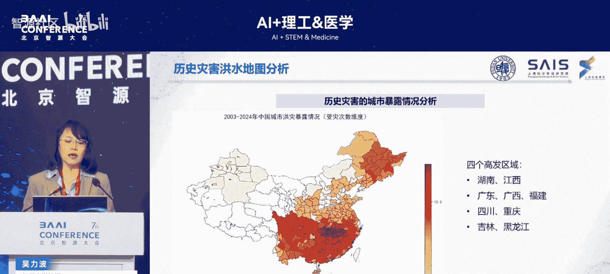
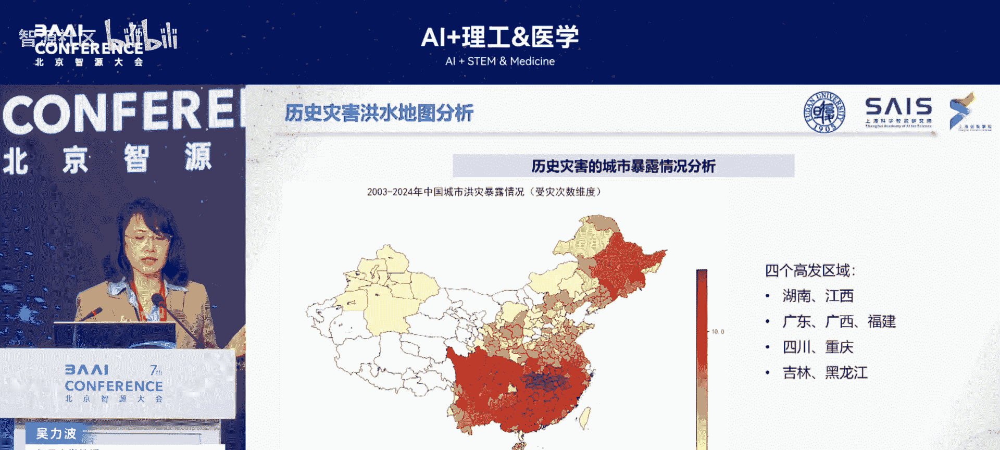
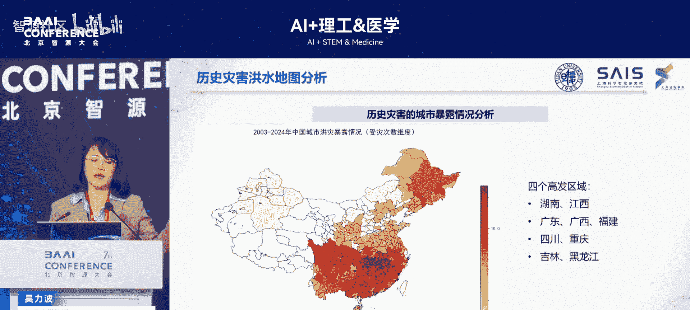
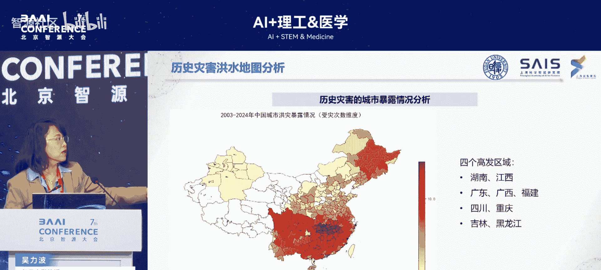

# 2025北京智源大会-AI+理工&医学 p02 AI驱动的气候风险识别与韧性电力系统优化：吴力波 -BV1X7N7zaEYD_p2-

啊，呃，今天这个特别高兴啊，呃受这个张张教授的邀请来参加我们的这个支研大会。刚才进来的时候，我已经感受到了这样的一个非常呃热烈的啊这个高浓度的一个呃AI for science的这样的一个盛会。

还有AI的这个这个harco的技术啊。那我看我们这一场的这个专题是AI和理工和这个医疗。然后我看了一下speaker的这个topic，我感觉我好像是代表了理工。

那么其他的可能是我们更多的从医学领域当中的，所以我这个话题可能对大家是不是会有点陌生，我尽量把它讲的这个呃简单一点啊。因为我们今天主要是我聚焦的是一个呃气候系统啊，跟这个电力系统的一个工作。

那么呃我们其实想要做的这个这个呃就我们聚焦的这个方向的话呢，其实是我们的这个气候系统和我们的这个可再生能源的这样的一个呃发电。呃，那么呃为什么。😊。

它的这个重要性应该说刚才其实呃郝老师讲的啊是一个人体的复杂系统。那我们今天讲的其实是一个呃这个自然系统和一个能源系统的以及社会经济系统的这样的一个交互耦合。那我们可以看到的话呢。

就是其实呃全球所面临的这个非常重要的这样的一个全球性的挑战之一，就是气候变化。呃，尽管呢我们已经达成了这样的一个就是巴黎协定啊，而且中国呢也承诺了30年要碳达峰60年呢要碳中和。

但实际上呃这个如果我们去对照一下啊，全球这些国家啊，他们在巴黎协定之后，他们的一个目标的达成度的话，可以看到，其实低碳转型的效果跟到本世纪末，我们把全球地表的温升控制在两度啊，甚至可以到1。

5度这样一个范围，其实减排还是有很大的差距的。因此的话呢气候风险比原来的话呢应该说是它的发生的频率呢大大的增加了。而另外一个方。面的话呢，我们知道要解决气候变化的问题。

又需要大量的可再生能源的这样的一个接入。那么这就变成一个悖论了。就是一个方面，我们要更强的去利用我们的这样一个自然系统来给我们提供能源啊，像风电光伏等等。但另外一方面呢。

本身这个系统它的这样一个风险又在持续的增加。那么这个跟我们原来的传统的能源系统来讲呢，是完全不一样的啊，那么在这里的话呢，我们所关注的问题的话呢，主要是几个点。一个呢就是对气候风险本身的这个特征啊。

我们怎么样去捕捉这样的一些气候风险，以及它对我们能源系统啊，电力系统产生的影响。第二的话呢就是我们大量的风电光伏接入之后，那么怎么样去有效的去预测它的出力，然后来降低这种不确定性啊，那最后的话呢。

把我们的电力系统能够成为一个更加韧性的这样一个系统。那未来的电力系统它一定是它有更强的约束，就是排放的约束。然后它有更。多的扰动就是我们的气候风险所带来的扰动。

所以我们是在这两个新的这样一个条件之下要构建这样一个系统。那因此的话呢，我们觉得主要的挑战呢其实就是有三个方面的这样一个挑战。那么呃第一个挑战就是气候风险本身的这个敞口在持续的这个扩大。

所以怎么样去构建啊这样的一些特别是以AI驱动的这样的一些呃气候风险的预测模型来更好的去捕捉到这样的一些气候风险。第二话呢，就是那么这样一些气候风险冲击到我们的这个系统当中之后呢。

我们现在的电力系统的话呢又呈现高度的这样一个我们叫源网和储之间的这样一个交互。啊，那么在这个过程当中，大量的可再生能源接入之后呢，我们又有很多储能的这个设备。然后我们有很多这种像我们的虚拟电场啊。

以及各种分布式的这样的一些发用电的设备。那怎么样进行这样一个系统的脆弱性的识别。那么那这样一的系统的话呢，它跟人类社会人类社会经。😊，活动是进行复杂的交互的那我们怎么样去模拟这样的一些交互的行为啊。

然后来保证我们这个系统啊，它人类社会行为的反馈啊，它是能够不去带来更大的冲击的，以及因为在这个过程当中，它又是一个跟我们的我们讲政府的各种各样的公共政策高度交互的那我们的政策在这个当中怎么样去协同优化。

所以实际上我们的工作其实就围绕着这四个板块啊在展开。那今天的话呢，我也跟大家分享一些呃进展。那么第一的话呢，就是关于气候风险感知。那么在这里的话呢。

我们主要是呃基于呃我们的这样的一个伏羲的这个气象大模型啊，我们做了一系列的这个工作。那么伏羲的话呢，目前的话呢，应该说它是在呃AI的这样的一个气象大模型当中的话呢，应该说在全球的啊AI的气象大模型当中。

各种指标的评测当中，我们都是在应该说是国际最前列的。啊，那么我们也是在全球首个发布了这个。😊，次季节的这样一个预报的大模型。那次季节指的就是什么呢？就是。😊。

在比如说40天这样左右的甚至更长时间段的这样一个呃预预报模型。那么这种预报的话呢，在气象预报当中呢，被称为是预报的沙漠啊，其实对于气象预报来讲，短零是最容易预报的次季节越时间周期越长的，越难以预报。

那我们的话呢呃首首次啊把这样的预报的时长推到了36天啊，目前已经到了42天。然后我们也成为首个登陆EC官网的刺季节的这样的一个大模型。那么另外的话呢就是在比如说极端啊，比如说极端的降水啊。

像台风啊这样的一些灾害事件方面的预报啊，那么伏羲的这个预测的这个效果也明显的优于啊，这个其他的一些模型。然后我们也做了一个呃同化真实观测的中期的这样一个天气预报的一个大模型。那么在这个过程当中。

我们不仅是用了像EC这样的这个就是来自于这个全球的。一般的这种公开数据的，我们也做了基于我们中国自己的卫星遥感数据的端到端的这样一个数据同跨基础上的我们自己的这样一个预报的大模型。

那么所以的话呢我们整个的这样一个结果的评测呢，应该说总体表现还是不错的啊，那么我们来看一下啊，比如说我们的这个呃伏羲的这个中期天气预报的这个大模型。那我们知道的话呢，其实传统的数值预报呢。

它的最大的一个难点就在于它的计算成本是非常高的。而计算速度呢又是比较低的。那么随着这种观测数据的增加。那么我们的这个传统数值预报，它的预测精度其实是出现了严重的这样一个收敛的啊，收敛的。

那么呃这个AI气象预报啊，比如说我们的这个V1。0啊，它主要是基于transformer架构啊，然后我们最大的好处就是什么呢？就是计算速度非常的这个快。那么这样的话呢，我们就可以进行多次的计算。

提供一个更加精准的概率预报啊。那么目前的话呢，这个模型像伏羲1。0呃参数量超过了45亿，可以提供未来15天的啊这样一个预报。那么我们现在的话呢已经进入到了伏羲的这个2。0时代。那2。0时代的话呢。

我们就更加的去面向啊这样的一个具体的产业应用的需求。比如说对于我们的这个风力发电来讲，我们需要百米的这个风速啊，比如光伏来讲，我们需要针对浮照对云量进行更加精准的预测啊，那另外的话呢。

我们需要更加高的这种时空分辨率啊，比如说要更加快速的预测小时级的啊，更加小的这样一个尺度。这里写的是9公里9公里，我们其实现在最精细的一个模型做到了500米乘500米啊。

然后另外的话呢就是怎么样去把我们的这个气象模型跟其他的复杂系统的模型进行耦合啊，比如说我们做海上风电的预报的时候，那就不仅仅啊其实基于我们的这个呃这个气象的这个大气的这样一个。😊，动力学的机制。

然后以及我们的相关的建模，我们还要融合一些我们海洋的特征。我们也做一些海陆耦河的这样的一些工作啊，那这是呃一些情况啊。那呃大家可以看到啊，比如说我们就举个例子吧，这是我们的一个平台。

呃现在的话呢相关的这样一个平台呢已经在向中国气象局上海气象局，香港天文台EC啊，已经在进入到他们的一些业务场景当中，进入到他们的这个呃系统当中。那另外的话呢，比如说呃这个右边下角。

我们在中国气象局组织的人工智能天气预报大模型示范计划当中，我们在三大类的各项指标评测当中，目前都是一直都是排名第一的。在EC的大模型的业务评测整体优度精度的话呢，呃也达到了最优的这样一个水平。

然后我们的这个海气耦河的中期的气象大预报呃气象模型的话呢，能够提供全球的未来15天的主小时的9公里的呃这样。😊，一个预测啊，那么呃能够耦合很多大气和海洋的这样的一个变量。那这是目前呢有一些数据的话呢。

我们已经啊在网上在这个开源。那么在这个气象的这个基础之上的话呢，我们又进一步的向更长时间尺度拓展。那就是气候啊。那么气候变化的话呢，它其实是一个长时间尺度的这样一个过程。

那么我们传统的气候变化的这样的一些综合评估模型，往往要把时间尺度拉到。比如说2100年，那但是在这个过程当中啊，这个损失了大量的这种极端的这样的一些信号。所以到后面的时候越往后拉。

那么很多灾害数据其实就被平滑掉了。那么所以我们的工作其实就是对我们的全球气候模式，然后结合我们的这样的一些我们的短零的中期的自激的预报呢，我们进行这样的一个降尺度的这个研究。

我们传统的这样的一些ECM它的分辨率是比较低的。然后也没有办法直接为这种台风极端降水啊，这样的一些区域的小尺度的这样一些灾害呢提供有效的这个支撑。那我们现在的工作的话呢，我们是基于。啊。

全球气候变化综合评估模式啊，就是我们业内叫sme啊，它的这个呃目前所涵盖的所有的气候变化的综合模式。我们把这些模式来进一步的进行降尺度。我们可以支持气候变化在SSP126245370585啊。

这些都是一些气候变化转型的路径，对应的是不同的温升情景以及不同的排放浓度。然后我们来进行它的降尺度的模拟，给它提供在不同的温升情景之下的它的一个气候风险的啊，它的一个未来的一个转型的路径。

然后我们也是呃提出了首个基于fow matching的这样一个生成式的气候模式统计的降尺度的这样的一个模型。那我们可以举几个例子啊，比如说右边的啊这个三呃这个这个三列，大家可以纵着来看啊。

在这里的话呢我们是针对一些这个极端的一些灾害事件啊，比如说暴雨大暴雨特大暴雨啊，这个大风飓风。等等。那这些都是一些极端灾害事件。那最左边的话呢，其实是一个E earth的它的一个预报。

那最右边的话呢是我们的E file它的一个真实的这个观测。那么中间的话呢是我们所做的这样的一个pre，那各位可以看到的这个最明显的就是说伏羲它最大的优势。

就是在这样的一些extreme的这样的一些di的预报上面呢，它更接近真实的观测啊，它相较EC它是一个典型的数据预报模式。那它的对极端气候的灾害的预测能力呢，是得到了显著的这个增强的啊。

那么再接下来就是有了这样的灾害之后，它会不会带来对我们人类社会系统的灾害呢？就真正的叫比如说我们有了大的降水。但如果我们的应对能力很强，那不一定会致灾，对吧？

那致灾的原因是因为我们人类的我们讲ad就是我们适应的能力非常的弱。比如说洪水来了，我们没有住堤坝。然后我们的。😊，城市的韧性很差。那么我们就会造成这样的非常严重的内涝啊，甚至灾害。

那我们又进一步的去研究了怎么样去啊用AI的技术来把我们的下店面的地球系统的特征来进一步的给它结构出来。那么我们可以看到啊，其实在这个过程当，我们可以看到很多下店面的特征。

比如说我们人造的表面和混合的这个土地利用啊，其实它的这种光谱的相似性限制了啊，我们用一般的这样的一些卫星数据来进行特征识别的时候的分类技术的这个有效性。那另外的话呢。

是数据的可用性和区域的差异性也挑战了啊，像一个单一模型能够在全球范围内进行泛化的这样的一个可行性。那么另外的话呢就是我们这样的一些经济部门的，它的这个用地的结构，其实是不明确的。

也就是说即使我知道了这个土地结构的特征。我不知道是什么样的经济部门在这个当中啊。😊，在这里，那我他所带来的这种灾害的损失，我也没有办法进行计量啊。那么所以现在很多针对灾害的研究非常的这个粗糙啊。

那所以我们的这个工作的话呢，我们就是做了几件事情。第一个的话呢，我们是基于卫星图像啊，它把这种洪水淹没的这个地图，我们给它绘制出来啊绘制出来。那这个工作其实是本身就是一个非常难的工作。

我们基于GFD的这个数据库，我们做了这样一个250米分辨率的山格的一个洪水的这个地图。然后我们基于全球的这样一个灾害的统计年件，我们去把所有的这样的一些灾害呢给它统计出来。

然后我们去把这个数据库跟我们的灾害年件去进行匹配。然后去得到洪灾和经济损失的这样一个匹配。通过我们的这样一个及数据的这样一个处理。通过山格的矢量化啊，以及开源数据高层的这样一个API等等这样的一些方法。

我们能够找到一些最典型的洪灾的，它一些淹没的地图以及它的。😊，这个属性，然后形成我们这样的一个呃洪灾的一个这个地图啊，然后的话呢我们啊进一步的去对这种各种这种灾害事件。

它最终会不会致灾以及致灾的这个程度啊，然后我们来进行进一步的这个处理。然后的话呢我们也把我们的这样的一些呃这个比较好的预测技术用进来。

然后进一步的去在原来的这种数据集上去进一步的补充了啊将近50次的全球洪灾的这样的一个洪水的这个地图。那么把我们的数据集呢进一步的这个扩大。那么基于我们这个工作呢。

我们就构建出来了中国的从啊过去20年的这样一个城市的洪灾的一个暴露的这个情况啊，那么这个它的输入就是我们的伏羲预测的这样的一些极端的这个降水。那么结合我们的这样的一个前历史的这个数据。

我们就把这样的一个洪灾地图呢给它还原出来，以及它的这样的一些这个强度啊，然后包括啊在城市尺度上面它。

的一个暴露的一个面积啊，暴露的一个面积。那我们也进一步的去这个预测出来。然后我们发现我们做的这个工作跟这个受灾的热点区域历史记载的是高度的这个吻合的啊。

那么我们也找到了一些这种就是说呃它暴露面积等级比较严重的这样一些地区。那么这些地区它有可能会发生这种偶发性的这种大型洪水一旦发生就会带来巨大的这种灾害啊，这个也是一个非常重要的一个信息啊。

然后我们又对城市下跌面啊做进一步的这个训练。那我们主要是基于这种高德的POI的这个数据啊，来进一步的来跟我们的这个工商业的这个注册数据来进行一个映射，添加我们行业的这个标签。

然后我们对地块呢进行一个分割。然后对它的这个占地面积，特别它的不透水面，我们进行这样的一个融合的这个分析。然后找到一个实体级的土地利用的这样一个识别的这个模型。那这个是我们的一个基于深度学习的一个。

把我们的这个经济部门的特征，然后跟我们的这个下界面的土地利用的特征，然后跟我们的这个企业的特征进行耦合的这么一个识别的这个模型。那我们可以看到在这里的话呢。

我们就把每一个城市的不透水面的它的这个面积给它识别出来，以及它可能带来的这样的一个经济的这个损失，我们给它进一步的这个展示出来啊，那这是我们的一个土地利用的一个基本的这个结果。然后在这个基础之上的话呢。

我们就构建了这样一个城市行业的损失风险的一个模型。我们的我们把伏羲的极端天气预测模型，作为我们的个输入端，结合我们的全行业的土地利用的清单啊，一起来做我们的这个输入端。

然后进入到我们的这个行业经济的这样一个风风险的这个损失模型当中，在这里我们可以去估算一个行业的GDB的损失。然后它的劳动力就业的损失，以及它的这样一些land use的这样的一些变化情况。😊，啊。

那这是我们啊现在我们这个工作的话，也已经在开源当中啊，我们在逐渐的这个开源一个城市的洪水暴露和经济损失的这样的一个完整的这个数据清单啊，这是我们做的一些结果啊。

就是把我们做的结果再进一步的去预测受灾的这总人口以及它的这个变化的这个情况啊，我们从这个中东西啊，做了不同的这样的一些分析啊，时间关系我就不展开了。那下面呢我们就再来看看。

那么有了这样的很好的这样一个气候风险的感知，我们怎么样去做更加精准的可再生能源的这个预测啊，因为我们现在有了更好的像我们的百米风速啊，像我们的这个浮照啊，云量啊等等这样一些预测。

然后我们的话呢也进一步的把它扩展到风能和太阳能的这个领域当中，然后验证它作为一个呃需要精确的天气预报场景啊的这样的一些场景，它是不是能够提供更加可靠的这样的一些工具啊，大家可以看到。

这是我们自己生成的一小时的全球天气预报。然后我们能够提供非常全面的基本的啊这样的一些气象的啊这样的一些这个变量。

然后我们把这些变量呢都作为input来提升我们对于我们的这这样一些风电光伏的它的一个出力的这个预测啊，那呃从这个右边的这样一些预测曲线。那当然这个因为是这个我们现在数据的局限性。

我们用的样本数据呢都是还是国外的这样的一些公开的风场光伏电站的数据啊，但是我们可以看到呃伏羲的这个预测效果呢，确实是啊有了相较我们传统的模型有了非常非常大的这么一个提升啊。

特别是在这个新呃新能源功率预测的准确率方面，我们远远的超过了ECMWF啊，他们的一个分工率的这个预测的这个水平啊，那么这个的话呢也是一个非常重要的一个进展。那么现在的话呢。

我们也已经把它引入到了这个南方电网啊，我们加入到了南方电网的这个功率预测的一个培育计划当中啊。那么大家可以看到，这是我们伏羲2。0新能源领域的一个预测要素的一个事例情况啊。然后的话呢。

目前最近啊呃这个南网正在进行它的这样一个功率预测的这个比赛。那么所有的这个参赛队伍，他们都用伏羲，我们提供的这样的一个刚才说的各种关键气象要素来作为input来做他们的这样一个可再生能源的一个风率预测的这个比赛啊。

那这是我们的一个情况。另外的话呢呃我们也跟南网合作啊，然后我们现在的在第三届正在进行的这样一个世界科学智能大赛当中，我们也把我们的数据结合南网的历史数据我们提供出来。

然后我们把新能源的这个发电功率预测作为我们的这样的一个这个赛题发布出来。那在这里的话呢，它有很多科学问题。比如说气象条件的随机性和不确定性，多过程的这个物理的这个耦合。那么从AI的角度来讲。

那么它不仅仅是一个复杂的一个序列建模的问题。😊，在这个过程当中，其实是一个呃我们讲不同的这个模型啊，不同的这个异构数据的这样一个混合建模的问题，以及不同场站的模型的一个算化能力提升的问题啊。

也欢迎啊我们有兴趣的呃团队啊来参加我们的这样的一个新功率呃新能源功率的一个预报的比赛啊，以上就是我的介绍，谢谢。

