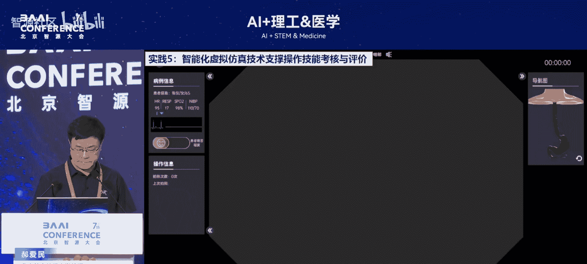

# 2025北京智源大会-AI+理工&医学 p03 医用数智人构建技术及应用：郝爱民 -BV1X7N7zaEYD_p3-

🎼好，感谢张老师啊，也感谢王老师和朱老师的介绍。呃，一点时间啊跟大家啊报告一下我们在医用数字人方面啊这些思考和体会啊，应该是一个一工交叉的一个方向啊。

呃北航呢应该呃这个全国重点实验室啊是科技部的应该说这个领域唯一的一个这个全国重点实验室。同时呢也是国家发改委啊，虚拟现实增加现实的国家工程实验室。呃，在这个领域呢。😊，一直哈持续连续不断的做个32年啊。

应该是还是从未摇摆过啊，无论波风波谷啊，无论这个技术的跌宕起伏。就我们一直坚守在这样一个方向啊，一直在做这个事情。呃，这个领域的唯一的位院士，我们赵院士，是我们的创始主任。呃。

我本人呢刚才已经介绍过了啊，这个特别呃难得的就是呃在计算机学院当个博导啊，也在北京协和医学院做博导。然后在做这个中国医学科学院院外创新单元的一个主任呃。

主要负责的就是虚拟人体和虚拟手术这样一个一共交叉的方向啊，呃这个科技的一等奖和教学的一等奖，还有个人的这个全国创新精先奖啊这个方向。那么其实我们做了将近32年的VR。

然后做虚拟现实从虚拟现实来看人工智能，或者说以虚拟现实的从业者的心态来拥抱人工智能的时候，我们会看到这样一。😊，很早我们就倡导的方向。其实呃大概这么多年，虚拟现实都是三害三三I特性。那大概在78年前。

赵启兵院士就在这个呃文章上面提出虚拟现实的六爱特性，其中重要的一个爱就是向人工智能的这个拓展。除了人工智能以外，还有个叫互通和迭代啊，相对复杂一点。我们不讲它。

我们看一看这个智能性在虚拟现实的视角看智能大概就是对象的本身的智能和建模的行为的智能。因为我们模拟任何一个东西啊，我模拟啊飞机坦克在虚拟环境下，他就有他的自主智能的能力是吧？那么模拟个病人。

病人他也在呃电脑系统啊信息空间，它有它的智能啊，还有就是交互，我们对他施加的各种交互，他所做出的反馈啊，当然对话是很正常。大家一个数字人的对话，大家都比较习惯，我报告的题目叫医用数字人。

就是我们面向医用的时候就会发现不仅仅是前。😊，表的我们这个肢体的、语言的表情的、肢体的、头发的啊呃穿着的。其实我们更加的向比看，看到他的内脏啊，这个心内的这个主任在啊。

这个大咖们都在就是我们看到它的这个逢啊哥企业啊啊给他加以各种样直接入入之后，它所带来的变化。这些智能，我们觉得也是很重要的。还有就是生产的智能化，就是各种内容啊，我们应用啊和生产。

包括数字娱乐数字文娱信息消费各方面啊，它的创造内容创作的智能化，这个也是智能的一个大的体现。那么最近呢我觉得呃这个大模型啊，因为今天我们这个厂子里面，大模型非常非常的多啊。

但是我们也看到更多的啊像更前一步看到的这个智能，就是世界模型空间智能。那也就是说把人工智能带入到三维交互世界，我加上两个括号，黑字部分，我觉得应该更加准确的认为是说或者说我们往深一步看，应该是把。😊。

再带入物理真实感的三维实时交互互动的世界。这个其实在我们医学领域就更加重要了。因为我们的医学手术啊，我们就说手术、问诊啊、治疗康复啊，包括预防啊。

包括这个前面的各种科普都应该是一个物理真实感的三维的交互世界。在这个里边，人工智能如何发挥作用。我们这里边还是啊有一些工作啊，一些思考。😊，那么关于我这个题目哈，当当然我提的题目叫医用数制人。

我们在下面我杨老师还跟我探讨医用数制人是啥哈。那其实2024年呢，中国科学发布了十大科学技术问题，排在第一号的，当时就叫做情智兼备的数字人和机器人。😊，这个呢主要还是指的像带货的呀、卖货的啊。

直播的呀啊播天气预报的呀，我们很多很多，现在差大大概大概感觉应该成为一个红海了啊，呃，有有将近上百个甚至甚至超过三五百个公司都在做各种各样的数字人。但是呢这个呢我们觉得他还是跟我们的医用数字人。

应该可以形成一个很互补的两个方向。我们的医用数字人，首先也是一个情式兼备的数字人，在他的基础上更加的偏向医学的各种业务的支撑。那么医用数字人呢我在这儿画了这么一个图啊，各位专家们都可以看到。

其是从数字化人体到几何人体就形态学的，再到物理人体，最后到数字人体，就首先他还是有生理生化功能可演化的，并且有智能性的这样一个人体啊。我们把它叫做虚拟人体的3。0主要特征就是可演化。呃。

当然美国这个科学美国人。😊，20年他公布的十大新兴技术，专门有一条，他叫虚拟患者啊，其实际上就是一个医用数字人，他可可能啊不是可啊可能会彻底的改变医学，就是他是从改变现在的兽视啊。

医学研究医学训练的兽视对象这个角度。目前我们其实呃应该客观的说，不可避免的有一些患者是被我们医生在某个不同阶段练手了，是吧？不然的话我们用什么呢？用这个医医医学生物医学生物模拟的这个胶皮啊。

这个各种这个物理型的模拟着啊，这些呢其实在跟真的病人的差异性还是比较强的啊。那么实际上当他水平正在提升过程中啊，他逐步的就会慢慢的有被练手的这种可能啊。

所以我们觉得如果在电脑空间里边打造一个数字化的病人，让他能够被医生进行啊问诊啊进行检查啊，进行这个手术啊，用药上器械是吧？进行康复手段啊进行方案规划，进行手术预演。我们觉得这个前景是非常广阔的。

我们可以设想啊，在物理世界空间，我们很难把钟南山先生和李兰娟老师的智慧，他们让他们两个融合到一起是吧？但是我们的信息空间这种概率就非常之大是吧？

我们的信息空间就能达到我们认为的全能智慧医生或者综合智慧患者智能患者这样的患者呢，他就可能打破我们科室的划分。因为现在其实科室的划分，在某种意义上讲还是有很大的问题的啊，我去看一个病。

他说你这个去皮肤科看吧，他说给眼睛太近了，你去眼科看吧啊，这个就是很大的一个呃这个划分哈，但实际上我们在这个虚拟空间里边，如果你在这个世界里边，未来有这样一个言宇宙的话。

那我我们可以可更精确的会知道他可能更倾向于皮肤科还是眼科呢啊，这个对患者来讲也是有好处的啊。😊，所以我们觉得这个互动性的啊就是带有实时交互，实时反馈的互动的手术操作。像我这边的一张图啊。

这个视频里边表达的这个就是我们对虚拟患者施加虚拟手术的一个简单的示意。我在电脑里边啊完整的把他的个性化的器官和他的病灶啊，以及他可能出现的并发症都给它模拟出来，让医生呢能够全程的把它做下来。

把这个手术啊按照自己的想法完整的做下来啊，并且呢去优选一个方案。这个就叫通俗说我们能够让手术有打草稿的机会啊，就是我们写一篇文章都是反复修改，反复修改啊。

我们做1个PPT它都是多次优化出来的一个好的效果。做手术呢基本上是这个几个团队的人一商量啊，大家想一想，可能我们以前大概这个经验。然后现在可能的问题就就下去了，就开始做了。

在过程中要出现问题临临时解决经验高的大夫呢就做的好一些啊经验差的。😊，那就可能会出现很多这个患者安全问题是吧？那这个手术打草稿其实没有很好的载体啊，是没有这个纸和笔啊，缺少工具。

其实我们觉得这还是一种很好的方式。但这个难度就非常大啊，因为我们这个很多老师都跟着我们一块参与在问着这个事情啊，这个事太难，用一个人就本身就很复杂，病就很复杂啊，个性化就很强。然后各种手术。

你你觉得这么做好，你照这个方法往这个人身上一做可能就坏了啊，这个事情很复杂。所以我们觉得呃从技术角度上讲，还有很多事情要做。所以我们其实跟着张老师啊，王老师我们都一块啊，就从19年我们就连续的开这个会。

可以看到啊，包括这个国家自然科基金呃，国家自然科学基金委的双清论坛，包括科学院基金委给了专门的战略性的研究报告的题目，都在呃像面向204年2040年的医用数字人体发展战略研究啊，我们有很多院士在呼吁。

应该在数字空间打造一个基时性的啊。😊，数字人体让他从微观向宏观支撑，然后呢能够呃给我们的医学业务带来很多的支撑啊。那这个14年啊我们连续的开了一系列的会啊，很多的专家在提这些建议。

我们也形成了一个初步的呃中国工程院的这样一个报告，是204年的医用数字人体的这样一个发展的报告啊。那么在这里边重点呢在今天与会的啊，因为这个还没有正式发布啊，大家可以拍都是没问题的。那这7个问题呢。

已经是我们经过多方讨论，认为呢。😊，医用数字人体发展方向科学技术问题，我们不敢说它是科学问题啊，但是一定是科学技术问题啊啊是纯科学问题也也不容易啊科学技术问题呢就是从采集是吧？到这个建模到这个交互响应。

到混合到演化到这个评价啊，到最后靶场，就是呃这样的一个任务谱系。我们觉得如果大家在这个方向啊，未来能够一起合并去做这个事情的话，那这还是个非常远大的目标，能把这个整个做出来的话，那能达造一个很大的人体。

当然这个我们是希望向呃国家的更高机关呼吁更好的项目支撑啊，提的这样一套体系非常庞大。其中任何一个一条啊都是能分解成很多任务的。所以呢这是一个很大的一件事情。

我们实验室呢呃很早啊在2012年就是现在说都已经13年前我们就拿到这个国家自然培育基金的重大项目。单个项目就2000万啊。当时这题目就叫做交互人体数器官啊。😊。

这个可交互人体器官的数字模型及虚拟手术研究啊，可以看到我们当时做的这样5个课题，而且呢在这个影像处理啊，交互仿真到最后这个手术的模拟器械的研制啊，然后最后评价啊打打造了一套体系。并且我们北航做这件事情。

不光是发了一批论文哈，我们当时做这个项目的同时，就做了一批的这个手术模拟器哈，就是上面这排东西。😊，然后我们这里边的技术呢，我在此不展开讲啊，大家知道因为个性化的建模肯定是很重要的。

我们要面向临床辅助啊，要一定要个性化的建模。这里面不光是几何形态，还有它的物理特性。因为我们要带有给反馈的手术的仿真。那那个他要有一些建模的东西第二个呢就是他的力反馈，就是手术的模拟和手术的操作。

如果没有给反馈这样一件事情的加持的话，它就变成一个流程仿真了是吧？很多的力反馈呢，也在这里边难度也是很大。然后我们也在这个这个几位老师的支持下，也做了一些电生理的一些仿真啊。这当然今天呢大家就比较多。

然后一些手术模拟器啊，可以看看我们跟人工智能的结合哈，就是这个就是一个模拟医生在接待病人的时候问诊的一个情景化的一个画面啊，可以反复多文次的专业知识的问答，多文次的问答。这个其实用现有的工具。

现有的模型基本上都是做不到这还要很深入的。😊，在这个大模型实际上是个专业小模型的支持下，问答之后，可以进行这个双手带药B反馈的一个检查。这种检查呢就是可以看到啊就完整的啊当体柔体啊。

然后交互的实时交互的啊探查，然后看看大家有什么问题，再调取他当前前面的这个体格检查的各种报告，形成医生的一个初步判断，然后后面进行用药啊，进行这个处置啊啊进行后面的回归，然后这个系统完了之后。

我们会给他打个分啊。那么第二个呢就是这个系统呢就是。😊，这个键盘有点快哈，这个实际上是这个人带的就是苹果的呃苹果的微生pro的这样款混合现实的眼镜。这款眼镜很大的一个好处。

就可以把一个病人实时的像这个病人啊生成的病人实时的给我放到一个现实中存在在牙医上面，这个牙医的各种调整啊，这个人都可以跟着很好的调整。然后我这个大夫用各种视角去接近它。

跟我实际的看病人的角度完完全全是一样的。这样一种虚实混合，就把虚拟病人啊，带有各种病症，出各种情况的这个状态呢。然后在它超时端，它的超时端又是一把真实的拔牙前和各种各样的手术器械可以去换的啊。

这样的一个训练，我们认为它就是一个虚实结合的啊，并且跟临床相对贴近的，而且出各种情况比较多的。而且所有的每个过程都可以数字化机构的可评价的一套啊模式，你可以把它当成是个训练系统啊。

当然也可以是个考核系统，也可以是个手术方案规划。😊，系统，也可以是未来新术式的研究的系统。就是它可以用于不同的方向。所以我们觉得这样一套虚实混合，其实也带有很多智能的东西。

因为因为你这个人如果是70分水平的一个大夫的话，我看你很容易就把这个事情做好了。我后台推这题啊推给你的情境给那复杂度，可能就是85分的难度，或者到90分的难度或者更加复杂的是吧？这样一个状态。

那这个工作呢就是就是空间智能的一个我们的一个工作了。就是我们模拟几个人啊，一块协同的来做一件事情，里面可以有老师，可以有学生啊，可以有多个一疗小组的人一起在一个信息空间达到协同啊。

这个这个是你看这个戴着眼镜，这个这个人底下人就是在眼睛里才能看到物理世界物理世界里是看不到这个人的啊，所以这样一个呃虚实结合呃，我们觉得在多人协同的一个三维的信息空间，能够在全交互情况下达成一个协同。

这个我们叫基于空间。😊，计算的多人协同的虚拟纺真实验啊这样一个工作。哎，时间关系我不分完概还是比较长哈，我就大概大家感觉一下对。😊。

可以考核啊老师在家里边拿这个pad就可以指导你说你这个地方这个角度不对哈，这个用力是不对的啊，这些。😊，就是可以达到这个效果。那么这这个工作呢，这个呃作为作为心内的各位专家就比较熟悉啊。

就我们PCI介入手术的一个模拟器。这款模拟器完整的能够做一套这个放置架的手术，而且可以模拟各种并发症的情况和各种难度啊。然后他这一端都是临床的这个东西。

应该说我们在国内啊目前还没有看到特别完整的这样的系统，我们做的是比较多的这是跟协和的张舒阳院长，我们一块儿啊在在做的这个工作，也做了很久。这个工作就是我们自然科学基金委的项目，5年结题的时候。

我们就演示成这个样子了啊，然后也基本上在市场上有销售的一个状态啊。😊。

呃，这个呢是一个考核。其实比如说胃肠镜的检查到底有没有漏检，怎么考核呢？仔细想一想，大家想一想，其实也没有什么好的手段，跟刚才的拔牙一样，拔牙特别难拔的牙，怎么培训这个人的水平提升呢？仔细想一想。

你拔谁谁的牙拔这个都都是难度特别大的，可能造成面瘫的，你也不太敢拔所以实际上非常值就是这也一样，这个是你的你的检查手法到底怎么样，你漏我减了多少。只有我先知道答案。人你是不知道先知道如果是人的真实情况。

你不可能先知道答案，只有我数字化的，我才先知道答案，那我可以埋各种各样的难的点啊，让你找这个角度啊，找这个力度去找到这个这个东西。所以我们觉得从考核的角度和评价的角度，这样一个虚实结合的仿真啊。

他还是有有一定的重大意义的啊。当这个工作呢就跟现在的居神智能更加的贴近来。就是呃刚才说的，比如我们把一个拔牙。我们拔这个拔这个叫叫做埋伏牙哈要多生牙，那其实咱们北京能拔这个牙特别复杂的，很多都拔不了。

但这个大夫要把它技能传递出去，光靠视频，光靠讲。😊，光靠说那该动手的时候，他就不敢动手了。我们上一个机器人的话，那机器人其实他也要学，他从哪学呢？他要从最牛的大夫身上学是吧？

这个时候怎么样传递这个知识呢，我们觉得一套虚拟仿真的系统，让很牛的医生做很多种这样的手术，全程的给他录下来是吧？不是录像是虚拟环境中的各种角度的数据记构用力的，包括力度，包括力的角度啊。

包括这个它处置的流程，它处置的方式，这个就是人的智能，未来如何向巨神智能传递很重要的一个中间的这样一个环节，也也是可以把它当成一个数据源啊，来提供数据的这样一个过程。这是我们的第六个实践啊。

那么这个应用呢就是北大口腔，咱们就在咱们北京啊，就是一整套的这个数字化的智能化的体系啊，包括虚拟现实的增强现实的啊混合现实的线上线下的这部分啊就在西方根这个这个部分啊专门建了这样一个样板间。😊。

还有呢就是这个工作这工作快点放一下哈，就是在杭州，杭州可以看到啊，目前已经能够做到用我们研制的设备50到60台套，让上两三百个学生同时在这里边开展一个专项的技能比赛。比完赛之后公布1个12三等奖。

立马就出开奖项啊所有的参赛的老师学生没有任何歧义啊，证明我的技能，我的水平被这台设备啊比较公平的展示出来了。那所以呢这个其实也是就是我们技术的支撑已经够够能达到数字化的去竞赛，非常公平啊。

否则主办方啊都有优势啊，很多主办方的选手就容易获奖。用我们这个设备呢，那就是你弄完出来，完全是你自己的真实水平啊。所以也保持同质化。然后我们这个工作呢也跟这个贝尔盖埃德大学啊，包括这个呃国外的一些高校。

包括像阿克塔就是口腔做虚地访真几乎是做的最好的哈啊在在交流包括国外的这个展会IDS啊，包括这个迪拜的一个。😊，展会我们也呃代表着中国的这样的一个水平啊去走向国门，在国际上啊做展示和竞争啊。

那当然这些领导们的一些关怀了哈呃我个人获得的一些奖项都是跟虚拟手术有关的啊，这这些这这最近5年啊获得的一些奖项。呃，我觉得呢这件事情其实还有很多很多刚才张老师说的任重道远啊，太多的事情没有做完了。

那今天我们这个会其实也大家大家一起来讨论呃展望未来，其实这里边我们搞计算机的人知道的就是算力算法网络是吧？但是像像朱主任这样的，大家就是医学的这些是吧？先进医学的业务侧，他的这个一些这个知识数据和模型。

😊，用计算家支撑起来之后，然后我们就能够看到这样一个啊叫工益结合和医工交叉，带来一个深度的发展哈。那我们这个团队呢召急兵院士啊，我本人啊李帅呃，这是我们的几个助手搞艺术决的，搞机极的啊。

搞这个生物医学的呃，搞这个就还是很庞大的，不是合交叉的。所以我期待着跟大家有进一步的合作呃，讲个不合适的地方，大家批评指正，谢谢。😊。

