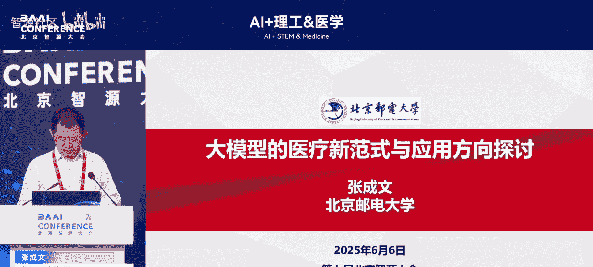
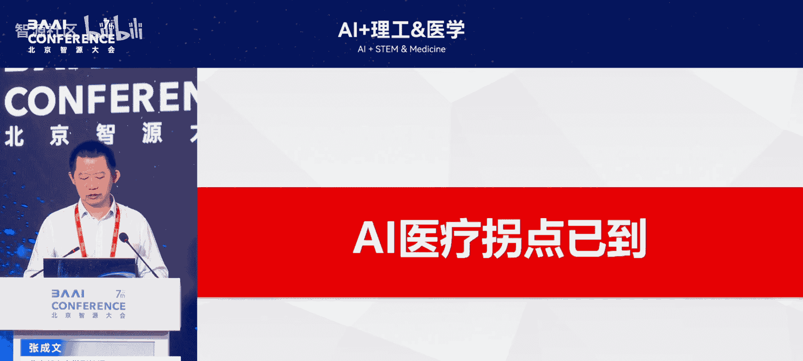
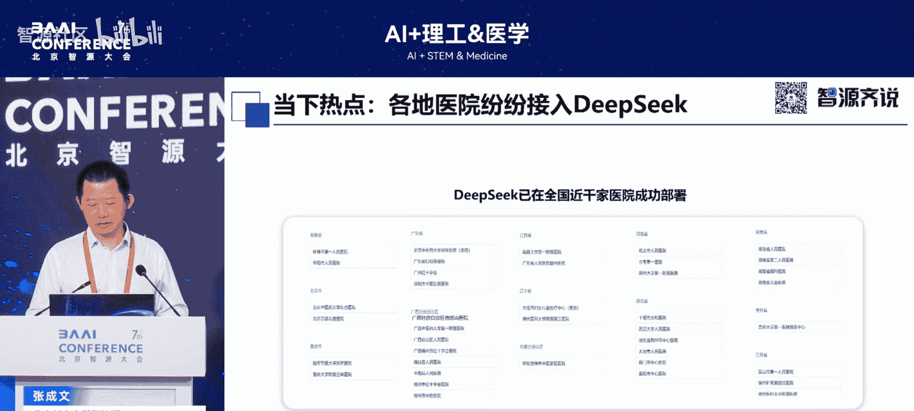
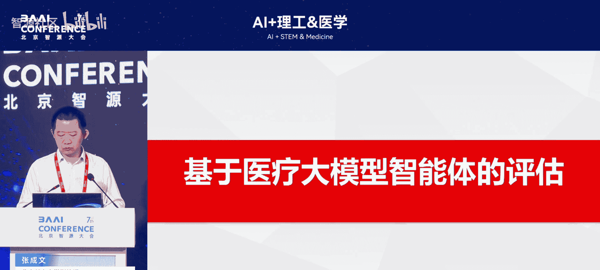
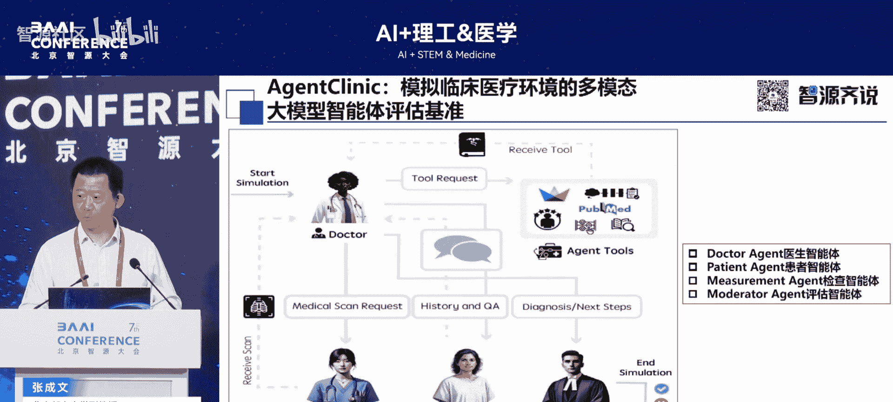
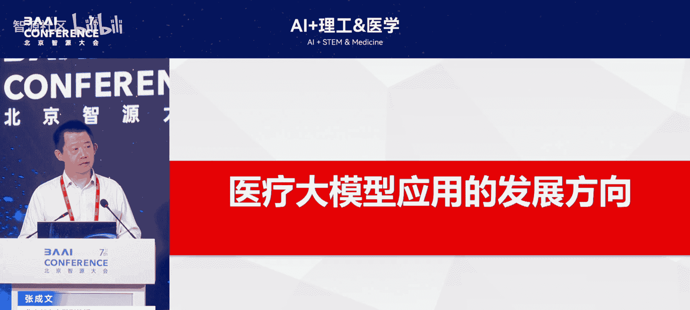
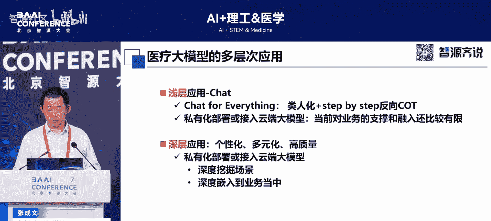
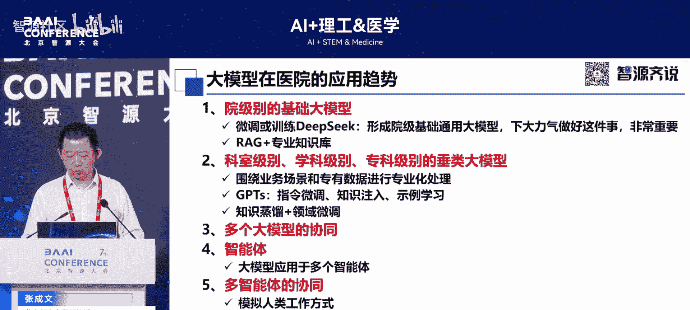
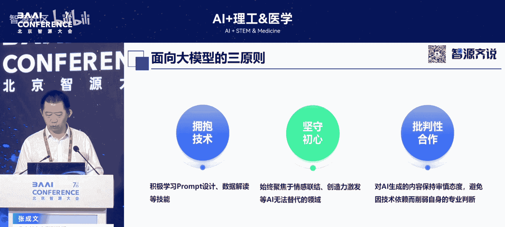
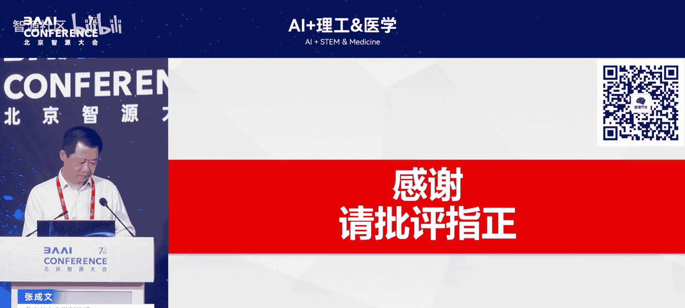

# 2025北京智源大会-AI+理工&医学 p04 大模型的医疗新范式与应用方向探讨：张成文 -BV1X7N7zaEYD_p4-

感谢呃恒贵教授的邀请啊，有这样一个机会啊来参加呃北京资源大会啊，第七届北京资源大会来分享啊。我在这个大明猩和医疗相结合方面的一些呃一些这个想法啊，有不对之处啊，请大家多多指导啊。

那么我们说大模型从2022年11月3号到现在啊，我们算了一下时间，已经将近有两年半的时间。那么无论是大模型，还是就是就是深度深度神经网络。那么在刚开始出现的时候呢。

我们说医疗领域都是他们最主要的一个应用场景。那么我这个报告呢主要从两个方面啊呃一个就是说啊随着就是大模型技术以及大模型的生态技术的发展啊，那么对于我们的医疗带来很多的新的啊技术的范式。

另外一个呢就是谈一下我对这个近几年来近一年来啊，以及半年来就是deep seek就是从1月20号开始啊，将近半年以来，我们国家的医疗在大模型方面的应用的一些方向的探讨啊。

还有一个就是我们在适用大模型方面啊，有三个这样一个呃原则啊。

那么首先呢给大家就是分享一下我和大明星的一些故事啊。就是首先呢写了两本大明星的方面的书啊，也成立了一个大明星专委会。那么我们知道就是说任何的一个新兴的一个技术在出现的时候呢。

我们都主要是关注啊技术它的本身的力量所带给带来的一些一些冲击。但是呢随着这样一个技术的呃逐渐的发展啊，我们会发现啊技术的它的最主要的价值，就是在于应用。那我们知道就是蒸汽机是英国这边刚开始发现的。

那么但是呢最后呢在美国这边啊，无论是在轮船还是纺织以及铁路方面啊，有了很大的一个应用啊，所以说成为一个啊最大的一个啊第一次啊产业革命的赢家。那么对于大模型技术也一样啊。

那么我们需要啊各个领域的去深入的去了解一下大模型的最基本的一个技术路线啊，然后呢在这个方面，然后结合啊具体的应用的方面的一些呃场景的需求来继续把它啊落落实下去。

那么这本书的话应该是一个呃大行技术的科普啊，那么随着deeps这样一个火爆的一个技术的出现啊，我我就推出了一个就是面向啊de seek具体技术的一个这样一个实战的一本书啊。

那么如果是呃过几个月如果是还有新的火爆的一个技术的出现的话，我们还会呃这个写相应的这个实战的方面书啊，所以说呢前面这本书的话，前面的书的话就是大星大行这个捣论的话，应该是属于像即模那样一个基础的书。

然后呢，像deep seek实战的话，就是一个具体的技术的一个实战。那么如果是仅仅呃写书的话，那可能还停留在这个人才教育以及技术应用方面的一个呃方面。那么更主要就是落地啊，那么4月15号。

也就是说在我们这个呃我们的义和厅啊，500500人的义和厅啊，我们成立了一个大模型应用产业专委会啊。那么大家可以看到啊，我们的副力长的这个组成架构啊，这里边包括了这个呃大模型的技术的公司。

以及很多的大模型应用领域的一些企业。那这里边呢还有很多的在比例更大的是呃医疗方面的这些呃这些方面的一些就是大模型应用的一些企业啊，所以说呢我们大模型应用产业专委会。

更主要的就是在呃医疗方面去做更多的一些落地的探索啊，在这方面呢也希望和呃在座的各位专家和领导啊进行啊深入的一些合作。那么我们说这个人工智能和医疗向来是一个非常重要的一个话题。

那么我们说为什么现在说呃人工智能医疗的拐点已经到来呢？因为我们现在的话呃大模型在具体应用的时候呢，我们都说现在都是呃大部分还都是一些浅层的一些应用，对吧？外挂式的应用。

但是呢这些浅层的应用和外挂应用呢还是非常有啊它的一些价值的啊，最起码呢对于我们培育我们的呃大模型和医疗的这样一个呃结合啊，然后培育我们的这个理念和人才啊，那么都起到了非常重要的一个作用。

但是呢我们说大模型呢它的本身的一个就是它的这个重点不在于这个呃就是这个浅层的应用，而是深层的应用。因为我们知道大模型它是融合了很多的呃多样性的复杂一些数据啊。

然后呢呃在大模型内部呢形成了这众多数据的这些复杂的这个逻辑的打通啊，可以生成多样性的啊个性化。精准的这个呃生成的内容。那么这个应该是大模型的一个本来的一个画像啊。

那么所以说呢我们随着大模型本身的推理技术啊，由于像deept这样一个开源的技术的呃大模型的技术的出现，以及像这个RG以及智能体这些大模型生态技术的这个繁蓬勃的发展啊。

所以说呢我们我们可以说现在呢是正是我们发展啊，大模型在医疗应用的啊一个非常好的一个时机。那么在今年1月份呢，这个世界经济论坛呃有一个这样一个论述啊，就是说这个呃人工智能医疗啊。

应该是呃大模平这样一个增长领域最快的啊这样一个领域。那么他认为应该是一个呃一个拐点的一个到来啊，那么。

另外一个呢就是说他提到了1个84亿的人工智能医生。因为我们知道大模型的在医疗应用的话，我们有很多的。比如to C方面啊，因为我们841的人口的话，我们可以说有了一个大模型以后。

我们每一个人都有一个随身的啊这样一个就是医疗助理。那么我们说大模型目前更多的更多的在这个治病方面。但是呢我觉得大模型最主要的还是在预测和预防疾病方面，在这方面的话。

我们说这个医疗的最终的目标应该是治病病，而不是说有病，大家去医院，对吧？那么因此呢我们说基于大模型的这样一个本身它的特点。那么在预测和预防疾病方面更好的发挥它的一个作用。

所以说呢我们说大模型在医疗领域的最主要的应用，还是在健康领域啊，保健领域。怎么样通过呃这个大模型能够让我们每一个人啊提前预测啊自己啊的这样一个健康的曲线来安排我们个人的这样。一个生活呀。

然后呢工作的这方面的一些内容。那么这个是to C的那么还有一个呢to B的对吧？那我们说现在呢医生的话，我们可以基于大模型，我们可以做很多的降本增效的一些工作。比如说写病例，对吧？还有看片子对吧？

那这些的话实际上也属于就是比较点式的一个应用。那么更主要的话就是说我们可以通过大模型，然后能够进行这个诊疗，对吧？一些建议啊，但是呢我们说无论是大模型生成内容的这样一个把关还是医疗行为的这样一个控制啊。

这个决策权啊，我们说应该都是在医生的手里边啊，这个是毋庸置疑的啊，那么to C的话呃，我们可以说呃通过大模型能够让大模型解决更多的百分之八九十的常见的一些问题。因为我们说现在医院的话，很多的人流量。

那么实际上我们统计一下百分之八九十都是一些常见病。那么在这些常面方面呢，我们有很大量的数据，对吧？我们可以完全发挥大模型的一个作用来把这些呃我们把我们的医生从大量的百分之八九十。

常见病从物病的这个工作当中解脱出来来去做更多的一些高认知的一些工作。那么这个是呃大模型呃出来以后，对于我们医生这个工作内容带来的一些挑战啊，那么当然呢我我还有这个这个报告里边呢。

只是提到了to C和to B。那么实际上呢我们说toH对吧？啊，那么对于医院来说，我们说呃正是由于大模型的出现，我们可以把医院的更多的数据，对吧？各科学的数据。

无论从语法还是语义还有逻辑方面啊彻底的进行打通啊，那么呃促进啊这个信系统的这个融合。那么还有一个突击，对吧？啊，我们更多的这个医疗的监管部门啊，无论是监管的角色的转变啊。

这个经济化治理的方面的能力的提升，还有这个管理模式的呃转型啊，那这些呢都是大模型可以说可以带来我们全面的一些一些一些一些改变啊，所以说。后呢我们说大屏出来以后呢，我们更多的提到一个名词，就是叫做虫丛树。

对吧？啊，那么无论是看病啊，还是就是呃就是去看病，还是去给别人治病，对吧？还是说就做做管理啊，那么这些丛树啊，向来都是是大模型的一个啊它的一个就是它的能力的啊就是发挥的地方。

那么我们说现在呢很多的医院从1月20号啊，过完年以后呢，就是形成了一个这样一个热潮啊，可以说现在呢接近有1000家的这个。这个医院啊。

那么当然这里边呢包括这个三三家啊三级医院、二级医院等等等一些基础医院都有啊。那么这样的话呢，我们说通过呃就是深度的接入大模型，从使得这个医院呢从从从外边的这个旁观者啊，真正进入入局者啊。

去呃去了解这个大模型，应该怎么样去解决业务的方面的一些问题啊。

那么在这个呃大模型在推动医疗的技术范式转变方面呢，我们说除了大模型本身啊，它的能力的提升啊，比如说这个推理能力提升，使得我们的医疗的在这方面可以有更多的依依赖以外。

那么我们说呃像智能体啊在这方面做了很多的一些呃这个呃这个潜瞻性的一些以及落地一些工作。那在这儿呢，我主要给大家汇报两个方面，一个是智能体在诊疗方面啊，这个是更多的大家在谈论。另外一个呢就是通过智能体。

我们还可以去呃动态的啊去评估大模型的这个效果啊，这个也是一个非常啊非常有创新的一个事情。那么首先呢我们看一下这个当前的就是基于智能体在医疗方面的啊这个一些事情，一些这个工作吧。

那么这个是今年的一个一个综述啊一个综述。那么我拿来给大家去做一下汇报啊，那这里边呢提到一个就是一个大白，对吧？超能呃这个。这样一个就是迪士尼一个动动画片吧啊超能陆战队，对吧？这里边有一个大白。

我不知道大家有没有看过啊，反正我是看过非常有印象啊，就是一个机器人非常白啊，就是雪白的一个机器人。那么这个机器人的话可以说代表了就是未来的我们的这样一个医疗机器人的一个一个一个一个模型。

那么这个机器人的话呃，它可以看病，对吧？啊，可以看病，然后有有医疗能力，而且呢它还具有这个呃这个情感的就是了解和输出啊，就是他可以了解到人的这个情感的变化，而且可以给你进行拥抱，对吧？啊。

进行情感的输出。那么我们说现在呢我们可以通过这个智能体的一些技术来模拟人类的这样一个能力。啊，可以说我们说大牌的话可以说呃体现了一个就是呃大模型智能体的一个技术方面，以及人的方面啊。

就是结合的这样一个一个这样一个呃一个一个设备。那么这个是一个他们这个是一个这个论文里边的这个矿图。那么从这个框图里边，我们看到这个智能体的一些方方面面。首先呢我们看中间的话是智能体的一些呃一些模式。

对吧？然后左上角的话是它的一些这个就是工具啊，就是说呃它可以呃基于这个智能体的逻辑判断来去呃调用一些这个呃一些这个一些就是比如说人工智能原来的一。0的那些比如说这个分割呀或者分类啊等等一些1。

0的一些一些小型的一些模型啊，或者说调用原来的一些呃数据库啊，或者说新的一些那个呃这个。呃，这个这个这方面的一些比如说直图谱方面的医疗支图方面一些一些内容。那么这个是一个能力的一个一个工具的一个调用。

那么左下角的话就是说这个呃我们说大模型的话，呃，要想模拟人类的这个治疗的话，更多的是需要去获取更多的一些现实的一些数据，对吧？那么医疗的话，我们如果有很多的这个电子病历啊，以及这个影像啊。

还有说检验啊等等方面的这些数据。那么通过这些数据的话，我们才能真正的能够实现这个个性化或者精准化的一个呃输出。那么右边的话我们说是这样一个推理啊，包括多步的推理以及一些专家的一些协同啊等等。

那么因此呢我们总体上来说的话，就是说通过这样一个呃就是组合拳，对吧？实现了这个模拟啊，我们医生的真正的工作的流程啊。那么并且呢呃通过这个大模型这个智能体里边的一些记忆的功能。

可以呃保存这个医生的当前的一些经验啊，以及或者说呃一些这个呃错误，对吧？啊，避免以后再在呃就是呃出现这相应的一些问题啊，那么这些的话我们说呃就是一个智能体的一个框架啊。

那么下面呢我们可以看到就是说呃这里边有总结了有4个就是智能体的这个范式啊，那么左边的话就是单一的智能体。那么单一的智能体的话是可以说是目前来说智能体应用的最主要的一个方面啊，因为最最简单嘛，对吧？

最初的一个形态，那这里边呢我们也可以把这个比较复杂的一个任务，对吧？啊，因为我们智能体的话，最最简最最初的第一个流程环节的话，就是说把用户提出的一个需求进行分就是就是进行这个呃把大的任务变成小的任务。

对吧？啊，然后呢呃小的任务之间。来形的一个序列化。那么通过这个的话呃，就是呃可以实现一些基本的啊一些功能，一些替代啊，比如说用户啊就是发出一些命令。当然这个用户的话呃他的命令的话。

这里边包括一些呃呃这些呃可以促使呃智能体访问更多的其他不同工具的一些呃任务。那么这个是左边呢，右边的话，我们知道就是说我们诊疗，我们去看病的话，一般就刚开始就是分诊，对吧？啊，然后去问诊。

然后问诊过程当中可能就需要去拍片子，对吧？然后呢再去诊疗，再治疗，最后呢形成啊比较落地的啊，就是比较沉淀的这样一个诊疗信息啊。那么当然这个诊疗系统里边包括文本啊，也包括这个影像啊等等多个模态。

那么通过这样一个智能体呢，我们可以模拟。哎，这样一个就是呃诊疗的一个流程。那么另外一个呢，我们知道有一些比较呃比较这个呃严重的一些疾病，对吧？啊，需要这个呃MD呃就是呃MDT对吧？

就是多学科的这样一个会诊。那么我们说大模型呢呃就是基于大模型的智能体，他们可以形成智能体之间的这样一个协作啊，比如说这里边有很多的呃不同的智能体啊。因为我们未来的话。

我们说呃我们可以有一些通用的智能体啊，但也有更多的一些专业的智能体啊，就好像我们有通用的大模型，也有专业的啊垂直领域大模型一样啊，那么对于一些比较专业的一些呃领域的话，我们啊更多的就是专业的逻辑啊。

专业大模型，然后形成形成一个专业的智能体啊，那这样的话呢啊我们各个智能体之间形成这样一个啊基于共同的一些呃一些这个呃医学的呃文本或者影像的一些数据啊形成呃这个呃MDT的这样一个效果。那么。啊。

右边的话我们就说呃需要不断的迭代，对吧？需要不断的迭代啊，通过呃实践啊，然后呢不断的形成反馈。那么这里边呢，我们说这个医疗的记录的话，在这方面起到了一个非常重要的一个作用啊。

因为我我们对于每一个病人的这样一个呃实践啊，那么最终它的沉淀啊，就在于啊这个诊疗的一个记录啊。所以说呢现在就是说无论是文本呢还是影影像啊，这个呃记录啊。

可以说呃形成了就是说呃无论是对于个人的就是患者的不同阶段的治疗，以及整个医院的这个疾病的呃就是学科的发展来说都是非常重要的啊这样一个沉淀啊，起到一个呃就是呃环节连接的一个呃非常重要的一个作用。

那下面呢我们可以就是说基于这四个范式呢，我们比如说我们找一个应用场景，比如说眼科对吧？啊，眼科，那么眼科的话，比如说我们说呃就是呃就是单个智能体的话，比如说我们可以上传一个这个病例。

或者说这个OCT的这个影像啊来进行这个呃相应的呃确定任务的一些诊疗。然后呢，还有后边的话就是基于眼科的这个分诊问诊啊，以及相应的一些呃这个措施啊，到底是就是呃是眼底病啊，还是说全身性疾病啊等等。

还是视力方面的一些问题啊，做相应的这个呃处理。那么这里边呢呃对于这个专家协同的话，也有很多的啊，比如说有些专业的一些眼科方面的一些智能体可以形成啊专业的合作。那么我们当然呃对于眼科来说呢。

呃也是一个大目型的重要的一个应用领域啊，因为眼科里边的独膜态的信息也是非常非常丰富的。而且呢基于眼底，我们可以看到全身的啊这样一个健康的状况。呃，那么基于这样一个推理的话。

对于非常复杂的一个严苛多类型的一个疾病啊，就是眼泪疾病还是全身疾病来说，都可以做非常好的一些啊方面的一些这个落地方面一些工作。那么下面呢给大家汇报一下，就是说前面的话，我们说智能体基于诊疗，对吧？

那么我们说基于智能体，我们能不能构建一个对于当前的大模型的一个动态的评估呢？哎，这个这个这个论文呢给给出来我们的一个场景啊。那么在这个论文里边呢可以看到有有一些这个模拟的一些智能体啊。

这里边呃一些角色啊，包括这个患者呀，医生啊，包括这个做做做影像还有一个做最终评估的啊。

哎，好。那么通过这个智能体的话，我们就说呃可以实现一个动态的啊，可以实实现一个动态的一个一个大模型的一个评估啊。呃，因为呃现在目前的话更多的就是说基于静态的就是呃一些基准的一个评估。

那如果说我们把一个大模型放到一个比如说模拟的一个医疗场景当中或者流程当中，我们看看它的一个效果。那么这样的话呢，会更好的一个反映这个大模型的一些一些这个情况啊。那么呃对于呃当前来说呢。

我们说呃呃呃这个智能体可以说是大模型进行落地应用的一个啊非常落地的啊一些关键的一个技术。那么对于大模型的应用方向呢，在大在医疗方方面，我们的应用的话，当前主要还是浅层的一些应用啊外挂式的。

但是呢我们说这也有非常重要的阶段性的一些贡献。那么更主要的就是个性化啊，就是高质量能够把大模型和当前的一些信息化系统进行呃融合。那么最终呢我们能够实现一个就是大模型原生，对吧？啊。

基于大模型的智能来去构建呃就是医疗的一些业务。呃，这方面呢有一些方面的思考啊，我们首先呢呃正是由于现在deep的这样一个火爆啊，那么现在的生态的话已经从原来的由下往上的一个发展变成由上往下的一个推动。

那么基于这样一个呃非常好的一个呃态势的话，我们说去构建院级别的技术大模型。

是一个正好的一个时机。那么基基于院级别的技术大模型，我们在构建各个科室啊，专科的呃这些模型。那么这样的话呢呃正好更好的去发挥大模型的一个作用。因为我们知道大模型本身它就是一个生态的一个一个一个概念啊。

因为无论是数据来说，它就是就是生态的啊多样的数据。那么对于模型来说，本身也是一个生态的模型，那么包括更多的一些生态一些技术二级和智能体，以及用于呃生态的一些环境，那么我们在这里边呢，我们对于医院来说。

我们可以用到更多的类型的大模型，对吧？啊，然后呢，一个智能体也可以用到多个大模型，我们用到多个智能体啊来混合去使用。那这方面呢，我们可以先去打造一些比较通用的。比如说这个导诊啊，或者说呃咨询啊。

或者说随访啊，这些各个科室都会用到的这个这个智能体或者模型。然后呢，我们在这个技术上呢，我们可以进行这个领域的。

一调啊，或者说支时的这个蒸馏啊，去构建专科的模型。那最后呢我们可以采去打造各个啊比较更专业的一些模型，实现深度的一些应用。那这方面呢有个三位落地的方方案。首先呢我们说数据是根本，对吧？数据根本。

然后呢我们去挖掘场景啊，不同医院的场景是不一样的。那么最终的话我们说每一个医院每个领域，它的呃它的这个要想更好的发展的话，我们需要一个生态啊去构造。

那这方面呢我们呃我希望就是说我们基于大不平应用产业专委会和大家一块来推动啊大不平在医院的生态的一些建设。这是最后呢给大家提提提就是有一三三原则，就是我们面对大不平，实际上呢不仅仅是医疗啊。

就是说我们要拥抱技术啊，这个拥抱技术的话，更多的是主动去拥抱啊，就是问一下自己我们每天是不是在用大模平。我们大不平在呃应用业务方面应用的程度是不是应该更加再深入一些。那么。同时呢我们要坚守初心。

我们知道大模型不是全能的。有一些是需要我们自己去做的。所以说我们向来去反对，就是说大模型出来以后会替代医生，替代什么什么岗位，替代教师，这个是绝对是不可行的啊，就是大模型的最后一个环节，肯定是我们人类。

另外一个呢批判性合作，对吧？啊，大模型有它所不能，对吧？无论是技术如何发展啊，我们都要呃不能因为大模型的能力来放放弃我们人类自己对能力提高的这样一个追求啊，这个是三个原则。这那么我的汇报到此结束，好。

谢谢大家。

