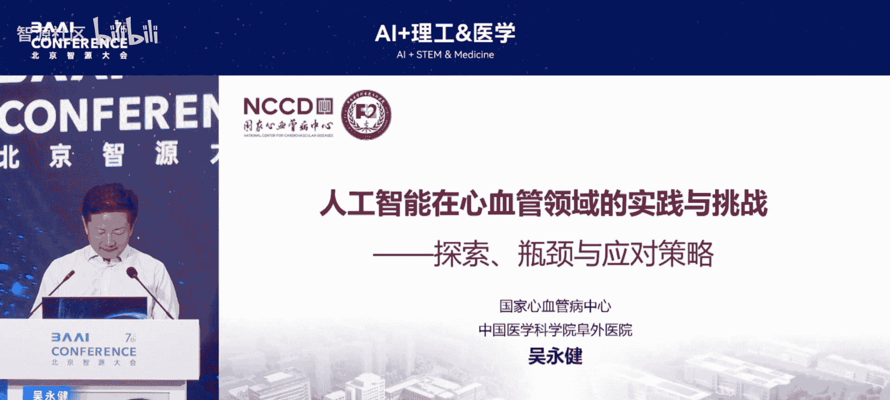
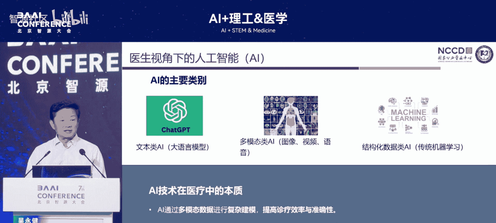
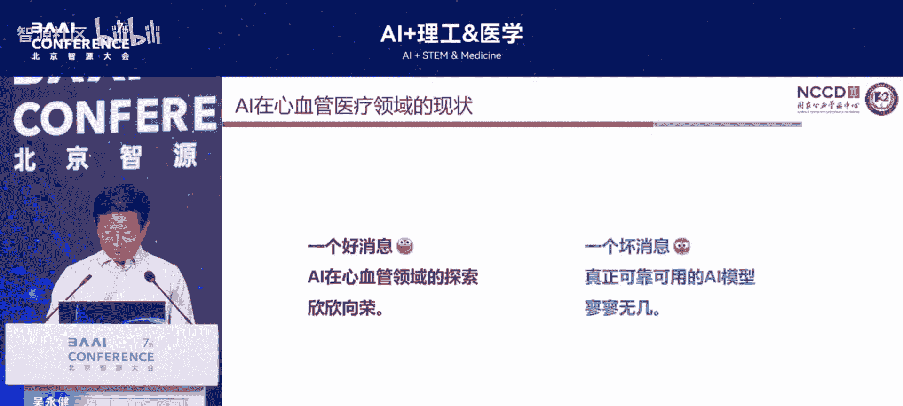
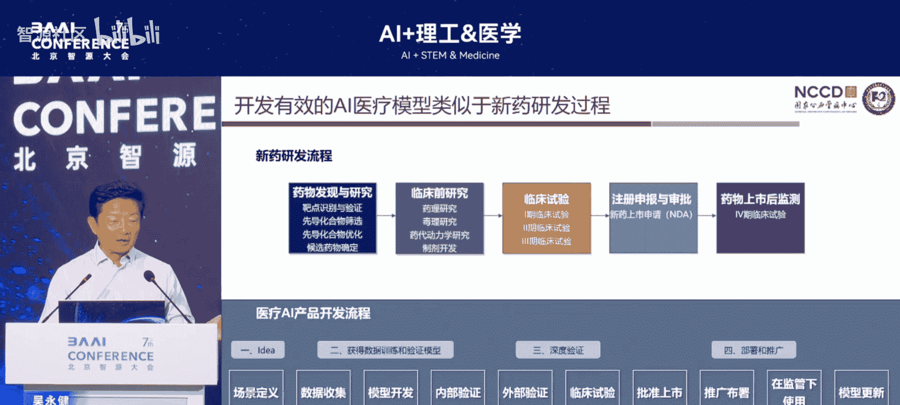
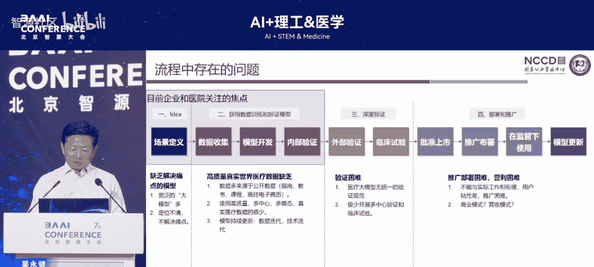
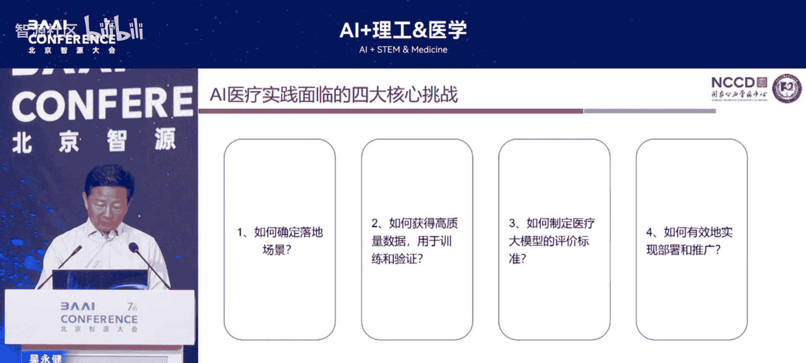
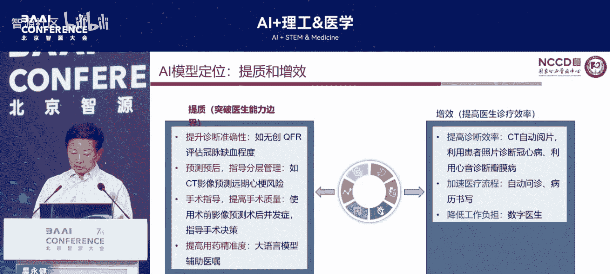
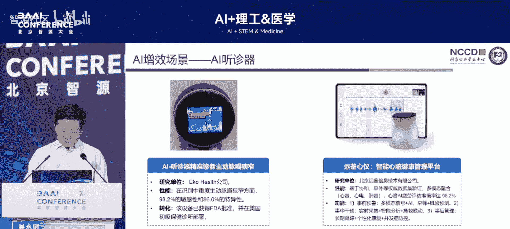
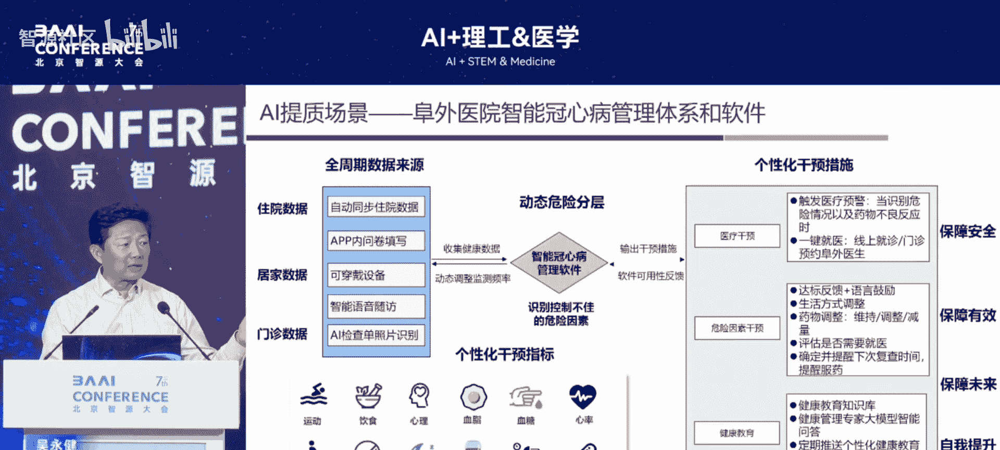

# 2025北京智源大会-AI+理工&医学 p06 心血管病长期管理中AI的应用及功能定位：吴永健 -BV1X7N7zaEYD_p6-

呃，谢谢建平院长的介绍。那个感谢今天我们这个叫做支援大会的邀请，给我们一次学习的机会。我今天团队一起来学习。我觉得现在这个时代如果不再参与到人工智能这个领域当中去啊，就已经落后了。

因为每一个时代都有每个时代的鲜明的特点，到今天呢所有的行业都在拥抱这个人工智能。我跟建平院长也是在这个领域当中，虽然都是向他介绍的一个老老医生，但是给那个。这个朱天刚教授，我们都是老医生。

那个刘华医生还是年轻年轻漂亮，所以就显得年轻年轻一生。我们可能今天在座的我不知道今天在座的大部分都是是来自于理工还是来自医疗。但是我想在这里面。

作为一个哎到了这个领域当中的一个小学生来谈探我这几年的一些感受。

呃，现在我想想说一下，就是当一个医生怎么来看待人工智能。如果说这个现在我们都是天天去看美诊等你做手术，就像刚才杨院长来讲的，但是怎么去看待这个人工智能你光看还得要亲自去实践，因为你得有一种动力。

所以我想一个呢就是人工智能现在当下在整个医疗系统当中，一个是文本的就是大语言模型这个刚才杨院长也讲了，就每个人都想用一个语言模型啊，然后来解决我们目前的医疗的问题。这个中国人可能更喜欢人工智能。

为什么呢？我们喜欢赌博，喜欢算命人工智能可能很多在一定程度上对大家理解啊，这是一个算命的，可以给自己反正我搞不清楚，我找人工智能看一看。现在大部分人拿一个是到哪里去看一看说我这个能干不能干。

今天今天刚才那个我们那个上海的教授来特别谈这个天气预报，我都在想这个这个天气。肯定是是肯定是有点医疗是不能算。但天气预报一预报。如果说我要预报一下，说我今天这个多大年龄，我大概多大年龄能得病啊。

我都要提前做好准备。我觉得这可能大概是大语言模型的一个一个魅力吸引人的地方。第二点就是呃。要给医生那个减负，不是让每个医生变成更加懒惰，那个就不需要思考了。比如这个心电图，我过去得需要学光学心电图。

学听诊，要学超市得需要很多年，我现在都不需要学了，马上人工智能就告诉我了啊，一个一个因为学心电图是个非常困难的事情，听诊也是个非常困难的事情。现在都不需要了，我们现在可以用人工智能来解决。

所以将来的人工智能是不是能够把医生都变成了都傻子，我都不知道啊，这这这是一个很严重的问题。第三个呢就是传统的机器学习。我们要建自己的很多很多的模型。

这些呢我觉得都是我现在作为一个一个医生对人工智能的理解。但是今天我想学习完了，也许我这条认知可能就会发生改变。那么现在呢在人工智能领域当中啊就是。

我们自己感受的啊就是。所有的这个大家都在去都在去学。啊，感觉在这个领域当中已经非常非常的热闹了。但是你实际情况下，当我把或者说过去的几年我们做的所有的模型拿过来以后，没有一个说你敢靠他看病吗？

根本不大可能的。所以我们不能依赖于这些大的模型。可能这些模型究竟给我们医生要做一个功能定位。他究竟将来我们怎么用。病人怎么用？我觉得这都是我们现在当下需要去考虑的问题。

那么这个好，我在现在来说了，过去我们医生开会。一一波开会的呢是搞器械的啊啊因为研发好多的器械啊，这个器械研发有一套这个规律，还有一波人呢是搞药品的。所以呢医生看病就是靠着一个器械，一个是药品。

如果没有这些的话，医生只会只会看病，不会治病。所以最近一段时间，我前段时间和几个这个院士的那聊天，我说现在要当医生的话，会看病的医生啊，可能比治病的医生更重要。因为你要说这个病我看好了是什么是什么病。

我直接就找那个医生去找治。你比如说是一个脑血管的这个脑血管瘤，我知道中国最做脑血管灵操作最好的那个那个工匠是谁，直接找他去到以后把那个脑血管有给他封下就够了。但是看病这个病如果说假设从来都没看过。

那这个我跟你说，连病都没看过，都不知道是怎么回事，怎么去看病。所以呢现在呢这个过去一直在研发药，研发器械，然后用什么因最近一些心肌病的一些心理药都出现了。但是现在又出现了第三方就是这个医疗模型。

我们都要都得学每一个医疗模型就像每一个药一样。如果这个药出来了，我赶快学这个药物的副作用怎么样，它能治什么病，他在哪些情况下如何使用。但是呢如果这些模型都有用的话。

医生就得要天天学一会儿出了一个这方面模型，我赶快去学一学，大概他将来怎么样，所以呢我觉得但是一个药的研发，他得要遵循从开始药物的开始发现到动物实验到临床前研究，然后到这临床研究，最后国家审批说可以了。

但是这个模型是不是国家可以审批，刚才几位教授也他讲了，他将来他能上市吗？因为看病他都要负责任的，你不能说我看一看跟算命差不多。其实呢这个过程呢是不是也要遵循像一个药研发一样的过程？因为对医生来说。

他必须得要走这个过程。然后国家认可了这个模型是可以看病的。就像一个医生一样，通过上大学上研究生博士上规培专培哦，他是一个心脏科医生，我是认可可以找他看病的。

但这个模型是不是能达到一个一个到专科医生的水平，这个就是有些问题。所以今天呢我想作为一个心脏科医生要面对的所有的我们在人工智能领营当中大家来说一下，就是临床医生是是这么看的。所以这就是我刚才说的。

就是你如果说假设这个模型上来以后，如果没有哪里拿到三类医疗证，你就不可能去上市。但是如果不上市的话，他的商业模式在哪里，他挣钱嘛，如果不挣钱的话，这个模型可能大概就没有多大的意义。

所以将来呢我觉得这些东西呢要遵循医疗当中的这些规律的话，我们下边该怎么办。所以我想就是从几个方面来谈我自己得考虑。一个呢第一个考虑呢，就是这个这个功能定位，它一定是体质和。

体质呢就比如说我我现在就这几年我们大概都用了，就是过去算一个冠状动脉啊，这个病变究竟我要不要弄它它长了个病变，但这个病变有意义没意义。我过去没有办法。现在用这个无用这个计算生理学，我就知道他怎么办。

然后呢还有一些这个诊分型方面的手术的质量，后边我在谈增效方面呢也是就是我不会看这个片子这个片子肯定一看这个人家这个人工智能看的可能比那个副教授看的视频都高啊。

你可能大概平时你就你甚至有很多时候你自动会生成的这个我下边具体来谈一谈这几个方面的东西。第一个呢就大模型。

今年都知道这个上个礼拜在东方会开这个院是发这个这个这个搞一个这个发布会开幕式上搞的热闹闹的叫个关心大模型叫的我记得有电大学也有这么一个模型叫的。

都在做这个就是这是第一个专科模型，专病模型。就是以前我们做的都是像这个像像这个医联，还有包括百川，都是在做这个医疗大模型。美国最近也刚做一个大模型，因为美国人做模模型步入中国。

他那个要想把所有的病人的隐私都都放进去，没有隐私就不会叫看病。因为你想我们给每一个病人看病啊，都得要得保留病人的隐私。他过去曾经干过什么坏事，对他的身体的影响。

你这些东西要都放在一个大模型都不可大模型不会看这个病的。所以现在呢咱这个模型呢，是我们今年刚刚5月份刚刚发布的。还有一个呢就是癌正医院马超生教的授前头的英泽医生在去年的长征会上当中发布。

这些都是基于我们心血管领域当中做的两个模型。但是这两个模型呢，现在是不是能看病，然后现在是在初级阶段，我觉得呢模型用的东西啊都是什么呢？指南共识。教程还有过去的病例，弄完了以后呢。

基本上就是没有互动性的啊，他培养出来的相当于什么水平。呃，本科生。但是你要在不断的学习，让他前瞻性的去学习互动，大概将来能够成为一个住院医生，或者是达到一个主治大夫的水平。我觉得就很好了。

所以你想说一个模型要达到一个教授的水平，我觉得可能大概就很困难。所以在现在更多的呢要给每个医生培养一个助手能达到住院医生和主治大夫的水平，就已经我们这是我们目前的一个希望的目标。

那么还有一些呢在临床模型啊，我们就就这个这是法院的关当时来牵头给清华大学自动化系一块做的，就是基于人脸这个视别，我们现在每一个病人上台之前，那么两个镜头，一个是对着正面，一个对着侧面的。

然后呢给他把这个整个的面部识别完了，接着就上台造造影，一做造影，这个病人是不是冠心病，所以现在我们在一直在做这个。那么现在目前来看呢，整个敏感性还可以。但是你知道每一个病人上午和下午照的都不一样。啊。

所以有时候可能大概这个事情还得要因为病人在上手术台之前，那种紧张的。情绪和他平时是不一样的，所以要给他平时照相，和在手术台照相，我们都是在那个打官室的外边弄了一个房间。

每个病人上台之前先给他照照完了以后，现在这个做这个工作，这做了好几年了，我们正治书记一块来做做的这个就是这个人脸人脸识别来诊断冠心病。第二个呢就是听诊器，这个听诊器现在做了很多。

因为我在监院知道我我除了做冠心病之外，做半毛病，所以呢我想就是听诊器这个学听诊啊，要学一辈子的，你看到光看了咕嘟咕嘟的在这里跳跳出来五花八门你能够诊断出来。这个过去那些老医生啊，他们听诊都非常强。

现在的年轻医生不会听了，只会听着心脏还跳不跳，所以所以这现在呢我们就弄了一个听诊器，一听说这个人群当中，在这这么多人当中，我直接在这听一遍，大概就能够找出就像美国那个F叫FBI一样。

他会能找出来这个在这这么多人群当中谁是犯罪的那。人我们将来希望呢能够找到在众多的人当中知道哦，这个人就是这个病，直接就这叫人群筛变。第二个，最近一段时间呢。

我们协和服外一块来做的这个做的一个小的这个小仪器，不用听诊，就往这个地方一放，大概就能够知道你得了是不是得了心脏病，有没有是主动慢慢狭窄还外观不全。这个呢现在正在做的过程中，而且现在已经变成商业化了。

可以卖了。据说现在卖的挺好，主要是卖个外国人，我们中国人现在还不是太相信他。

然后第三个就是用新战图使的万物病，因为棒物病得是靠着超声啊，今天朱天安教授是顶级的超声专家啊，咱们国家引领了整个国家的这个超声的这个发展的。现在呢我们是用因为做一个超声啊，配上一个超声医生非常困难。

我们直接做一个心电图，拉一下，大概是3秒钟拉出来了。一看心电图就知道超跟超声诊断差不多。这个就有点跟算命的差不多了。这个但是呢现在这个工作点做的现在据说是可以的。

我现在不是特别相信还有一个呢就我们医院呢现在跟航天航空大学一块来做的知道冠脉介入手术。这个是后边我现在这几年重点做的，就希望把整个人工智能系统给手术室绑在一块去，直接告诉这个医生，这个病变合适不合适。

这个病变未来会造怎么样，做完了手术，他将来怎么样，我们将来把法院的所有的数据都输进去了。但这个呢现在正在验证的阶段啊，这是我做一个临床医生就期望我们未来的啊，真正人工智能的帮我能帮到哪个程度。

我希望人工智能怎么样。再还有一个就是在去年我们呃前年我们发表的一个东西，在这个柳叶道的一个子刊上发表的就是这个瓣膜病。这个瓣膜如果我要放一个瓣膜的话，我得要做一个仿真，它放进去，它好不好？嗯。

我放什么样瓣膜放多大的，放到什么地方去，我术前都去做一个模拟，模拟完了以后来指导这个手术。现在我们做了很多了，已经看来这个呢有可能能帮助我们来解决这个问题，尤其对复杂病变。

那我一看完这个CT看这个瓣膜乱糟糟的究竟做了以后合适不合适，这是一个比较大的问题。我现在最想做的呢就是关于冠状动脉的危未来的危险分层。当然第一步做的人家防照国债做的，他是根据钙化的分数。

但我们现在要解决的问题呢，就是要根据人工智能来解决这个分层的问题。比如说这个病人我给他放完支架，他出院了，那个病人住。出院这个做完支架出院了，究竟他能活多长时间，他哪年可能会出问题，哪年可能会再回来。

这个事情是很重要的这个事情我们医院呢现在已经做了第一阶段的工作，我觉得已经做的很好了。那么这个工作做完以后得到这个结果，现在已经开始这个要马上发表了啊。

就是就是医院为个我们的信息中心全国是唯一一个8级的这个应该是我们信息中心主任为的好，现在已经被提这个国家卫健委信息中心主任，这这就是院所我们借助于这个这个平台啊，我们现在也做的工作。

那么下一步呢就第二个要解决的一个就是关于这个就是这个内部验证的问题。那这个呢其实所有的疗大模型个最大的问题就是一个局限性和现在的风险问题。那么这个这个这个就是数据来源非常重要。

我们现在用的基本上没有什么太大的数据来源。我前段时间给邮电大学的那个王光宇教授我说你做这个模型这个nature。

medicine上发表了那个大概这个80多分，我说你花了多少钱，他说我没没花什么钱，因为我要做这个东西，我大概算了一下，就是上段时间我去到了各个投资公司去做路演。所有投资公司的时候，哎说我一定给你钱。

我大概算了一下，我可能大概需要5个亿。我觉得这个国家没有一个项目，他是5个亿问了邮电大学说他就总共花了几百万就就做成了。因为我要做的东西是前瞻性的是交互式的。可是说以说现在呢就是这个数据就非常重要。

我们是要花大大价钱去买数据，要真实数据。而现在的目前的数据，我们多多少少都存在问题。一旦有一点点小的问题就会就会出将来出大问题，所以在冠心病这个领域当中，我们做细分，把所有的东西跟病人的对话。

全都自动的转变成文贝。这个要花很多的钱，所以中国要将来要做成一个真正的高质量的一个大模型，这个不是说我们现在就可以的，是未来的需要要钱砸出来的，而且要做更更多更多的这个人力的东西。

因为时间的关系我不能讲的太多，现在还有一个特别想做的，现在谁都想做科研，但是科研呢找CC找每一个数据都填起来要所以访打电话的时候，病人还不不太配合。我们现在医院的做这些东西啊。

大概我们现在用的人工智能的方式，这个配合率只有30%，这个这肯定不行。所以今年呢就是马上下个礼拜的这个国家工信部的结榜挂帅。我今年一定要做好，要花因为国家心脏中心嘛。

我们在全国要牵头找了200个最重要的专家top20包括院长一定要在里头，所以将来我们要做中国的冠性病专病数据库，这个专病是故去将前期我做了很多工作了。你看我现在拿了好多钱了，我一个医科院的转化项目。

然后直接说物中监给你800万给你启动一下。我说太感谢了。后去年12月份给了800万国家重点专项给了我1200万。然后医科院另外还有一个创新项目给了960万。然后现在高水平医院现上个礼拜又给了一些钱。

我们现在是十几万但是我都不知道究竟到了什么程度，但是呢国家的专病数据库一定要做的。因为这里头中美脱钩之后的问题非常严重。所以今年我们一定要用人工智能。方式来解决中国的专病数据库。

因为冠心病现在是中国第一大疾病，不解决这个问题肯定是不行。我又现在是国家中心的冠心病中心主任。我这个事好像我不干，可能就是是有责任的，必须所以我要干的什么事情？第一个解决就是手术当中的所有的数据库。

我现在做的全国第一个叫隔壁倒官室。然后现在全国都不断它增加隔壁倒官室互联互通，就是所有的倒官室，你在做手术过程中的图像语音自动生成，自动的定自动的这个这个这个标注，然后进入这个数据库。这个事情呢。

现在正在做的过程中。你看这这整个过程我现在都在都在去弄。然后用这个所有的数据，所有的文本，所有的图像将来每一个造的图像自动所有的学管的超声OT自动的这个索取这个呢数据库肯定会行。

还有一个呢就是关于这个安全性的问题，要解决好多好多的问题。现在这个今年这刚刚发布的叫叫。我觉得这个大家可能大家都在学这个里头也是就给我们一样。

用了很多2中国找了20个top做这个未来的这这个对话是这个我想将来但是我们美国这一点我社会延迟，但是是所有的疾病我们是专病就光心脏病将来一定全世界第一个心脏病的最大的模型一定是中国开始。

因为这一点上我们比美国要早了。但是再看看美国做的事情这里头全都是钱所以我在想就是里头包括所有大型的标准的这些所有的东西。

时间的关系都都在说一说还有一个呢最后就是一个场景的问题这个场景问题自给自己做了一张这是新闻专家数字技术。你看边是无永健数字无永健他联合好多好多的内的消。内分泌呼吸消化风支，那专家都在一块去。

最后就不是我个人了，就是那个是被AI赋能的无影件。他可以看所有的疾病。然后呢，他这个人呢他会把每一个病人的所有的过去的历史档案都找去。他又是把所有的知识这个指南都放进去。而病人带上可穿戴设备。

然后相互进行互动。所以一个主动健康自我管理数字专家，然后希望最后达到的目标就是生活方式的健康指数，这个心脏健康指数能够改善50%能够所有的这个病人未来的就诊量减到80%，我们剩下的那些他看不了的。

然后找我们看看病不像杨院长刚才北大医院院长说看到25个病人看到中午12点半吃不上。将来呢我100个病人可能大部分找我的助手就看完了。那最后呢就剩下的20个病人我自己看我就轻松了。

所以这是我希望达到这也是今年我就是给国家要特别谈的就是关于一个冠心病的专病的解决的问题。你这就是我我设计的这。个的这个东西，而且我是有CT的，最后我要拿3D医疗医疗证的。到那个时候。

我觉得呢我们就可以去能够真正的实现了这个AI，能够进入到我们这个临床当中去。好了，谢谢。