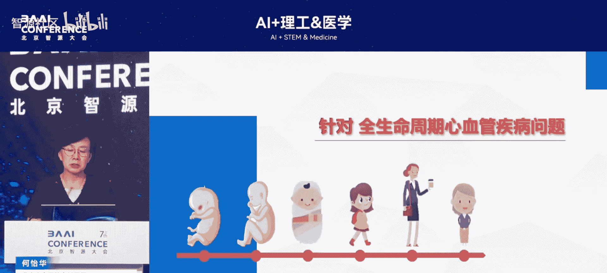
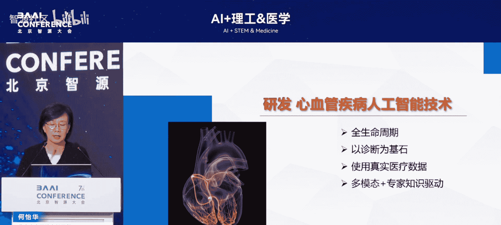

# 2025北京智源大会-AI+理工&医学 p07 基于大模型的心血管专业模型及下游产品研发：何怡华 -BV1X7N7zaEYD_p7-

谢谢大家哈，尤其在吴教授之后演讲，我实际上我已经闻到了金钱的味道。我不知道我这个大模型能不能在吴教授这拿点钱啊。😊，那么我今天和大家分享的就是全生命周期的心血管疾病呃，超声诊断大模型的一个研发过程。

实际上呢呃我们应对的是一个现在一个全生命周期的心血管疾病问题。那么我们可以看到心血管疾病和呃妇产新生儿这样的一个疾病负担是居全球的疾病负担之首，并且它的发病率是逐年上升的。

并且我们呃尤其关注到这个心血管疾病的死亡，也是呃给人类呃造成了一个非常呃严重的一个呃。

压力吧。并且我在最新的一个数据看到中国的心血管疾病70%发生在了院前。所以我们的AI能在我们整个的这样的一个现状，能做什么工作。首先我们要知道我们站在哪里。之后，我们才去知道我们怎么去应对。

我们怎么能够借助现在的科技革命的浪潮，应用AI来解决我们呃医疗的问题。所以。我们可以看到呃在这个呃梳理就是在我们的这种现状当中，我们梳理了几个问题，当然不是很全面哈。

也供我们一工交叉的很多这个工科的或者是信息口的这个呃专家们呃来和我们共同面对这个问题。实际上我在前面很多的这个专家讲到的一些呃技术方面，我认为已经呃飞速发展。

在我们在我们国家的这种呃呃工程方面的一个解决方案。那我们可以看到，实际上呃很多的这种诊断的不精准和延迟。及其对就是吴教授有经验哈，尤其我这个图还是这个吴教授非常呃在行的一个专业哈，这个瓣摩呃介入。

那么对某一些特定疾病的一个个体化的一个手术的呃这个治疗方案的一个规划，及其院前对这个疾病无法快速的识别和判断。那还有整。个我们国民的一个不良习惯啊，生活习惯。

所以就导致我们的这个疾病负担死亡率发病率的一个呃这个居高不下。所以现在的人工智能的这种呃对关键的新冠疾病防治节点的一个产品的研发。那么及其大语言模型在整合这些小模型在整个医疗流程当中。

我觉得大语言模型是会起到一个非常好的一个作用的。那我们在呃又回到聚焦到我们这个心心管超声的一个研究。我们可以看到在几个重要的这个顶刊和子刊当中，对这个超声的一个呃人工智能的一个研发。

还局限在这种单技术单点。我举一个例子，哈比说对心脏功能新内膜的一个自动描计及其自动测量，实际上在我们心脏超声整个的一个诊断，甚至决策当中呢，几十个参数或上百个参数技术点当中，它只占了一个技术点。

所以我们怎么来呃应用这种呃人工智能的技术。那么及其嗯大语言模型来解决整个的一个呃在超声诊疗的一个体系当中的呃一个一个工作。那又回到刚才实际上也是吴教授谈到的哈，就是现在的大模型。

刚才是我聚焦到呃心脏超声的一个研究现状。那对于整个的医疗的一个大语言模型的应用及其就我们可以通过这个jama的这个这个评测的一个呃研究，我们可以看到，那么几乎呃应用真实数据的这种大语言模型还是非常少的。

呃，就像刚才谈到的更多的是指南啊文献啊，这样的一个呃建模的一个过程。而集中在这种医疗服务的呃呃领域当中是比较多的，而管理当中是比较少的。那么对于这种评价。

就是说整个医疗的一个流程的一个呃评价体系呢是不健全的。那未来的一个方向，我相信目前已经在临床决策支持报告生成医学教育和辅助机器人药物研发多个领域都已经应用。那么。在未来体质就刚才谈到。

无论是在诊还是疗当中，我的体质增效啊，我会有很大的一个发展的空间。包括好比说个性化治疗的一个建议，患者护理质量的一个呃这个管理。那么会具有巨大的这种潜力。

那就看看我们安贞医院啊在我这个团队做的呃相应的一个工作。那呃我们这个中心呢实际上最有特点的就是我覆盖了全生命周期，就是当这个呃孩子还没有出生之前，在妈妈的肚子里，他的心脏呃。百余种吧。

或者是呃上百呃这个二三百种的这种疾病。那到新生儿到出生呃之后的成人获得性疾病。那我们全生命周期的。同时呢我们第一步起步，以诊断为基石啊呃，使用真实数据及其多模肽的一个呃多模肽加上专家知识库的一个驱动。

来构建我们的呃心血管的大模型。那首先我们选用的这种通用的语言的一个基座。实际上呢，我认为现在呃不会有太大差别，只是我把呃可公开的这些数据都可以学到，再有医疗垂育的大模型。实际上呃有一段时间他们问我。

就是说这个这个人用这个这个医疗的大模型看了一个冠心病还挺准确的。因为我说冠心病可能在我们的医疗心血管疾病当中也属于比较。容易拿到数据的一个疾病。

那么所以说呢呃我们会逐渐的深入的来进进行这种更细分垂域的模型的一个呃建设吧。就是说通用大模型医疗垂域大模型，心血管专病大模型。那我同呃第一步做的是心脏超声大模型。

那未来呢我们会融合更多的CT核磁的影像进行多模态大模型及其下游产品。那我第一代的产品是智能超声报告的一个生成。那这个时候呢我们就是通过了啊这个疾病的影像及其语意和语音。

这种多模态的一个融合来形成心血管的诊断大模型。那这是我们现在已经形成的一个产品形态。大家可以看到，对于心脏超声，我们都实现了在操作过程当中的切面自动识别切面自动测量。

同时呃会出现呃这种呃场就文本配对的这种。呃，自动测量和一些特征的描述。但是呢我们呃第一代的产品只是呃呈现了就是说我们呃在应用的部署的过程当中。

我们只做到了这个呃就或者说只部署了从影像呃到这个语翼的过程当中，我们是通过呃对照影像来进行结构测量和语义描述，自动推理成为它的诊断结果。那我们怎么实现的呢？

实际上这个可能会要打破一下这个吴教授的一些顾虑。当然呃依然会不断的去迭代哈，因为我们用了300万的真实数据。呃，这个这个数据呢呃涵盖了160种呃108种胎儿心脏病先天性心脏病。

那么及其160种成人心脏病。那这样的多模态数据，包括呃这种超声的影像结构。参数电子病例。那么及其我们胎儿心脏的母体风险因素就有300多项，并且10万例的胎儿心脏病，每一个都有300多项。

有2000个遗传小加戏。那这样的话呢，我们自自主研发了呃特就说胎儿心脏病瓣膜病。那么及其危重冠心病。那么不同疾病系的这个标注系统。那在这种标注系统下，我们同时有这个呃出标团队呃，外包团队。

那么及其审核专家团队来进行这个标注的一个指控。当然并不是这300万都标注了哈，这个其中一些根据训练我们去分成训练级之后进行相应的强化学习和标注。所以我们的这个模型投入的是呃。

300万数据当中有呃这个影像数据的这样的一个呃第一步产品嘛，这个智能超声报告。那么300万是报告系统，及其呃几十万的一个影像数据来建立的这个多么太融合的智能报告系统。

所以我们就可以看到我们呃分成了不同的数据集。在呃大语言的基座上的一个训练，及其强化强化学习的一个训练，那么这于精标微调这样的呃这样的一个过程啊，那最主要的呢？呃我们可以看到就是说我针对每一个疾病。

常见的哈，不可能是所有的我针对每一个疾病我都进行了专家知识体系构建。就是说呃一个决策数，当我看到什么的时候，我应该进一步检查什么，下一步是是怎么样？我建立了五十几个疾病的呃专家检测数。

及其呃所有的这种呃这个数据这个文献的一个学习，就是说我们有几个维度，一个是专家知识体系的一个建设，一个是文献的一个学。学习再有就是我们真实数据的一个呃投入。这样的话使得我们的这个大模型能够呃做到。

现有阶段一个更好的一个效能吧。所以呃我们整个的这个模呃模型的一个训练，就是基于这种大模型的一个基座心浪专家知识体系的一构建大模型的一些核心技术。

包括医学知识检索增强大模型的复杂诊啊推理大模型的个性化交互问诊及其语音识别多模态。最后，在应用场景当中，实现交互的一个应用。这是知识检索技术。那么复杂诊疗的一个推理技术，那么及其个性化交互的一个技术。

那我们最后看一下我们呃专家推理的一个准准确性哈，这是啊这里应该已经是最终的。就是说平均的我们对这个所有的我呃加加在一起快300种的心管疾病平均的诊断准确率是90%。但是对一些罕见病。

它的诊断准确率还比较低。我们是希望能够投入更多的。好比说类似于呃肥厚性心肌病，这个是在我们整个数据集当中比较少的哈。那这样我们在投入更多的这个数据来进行呃训练，强化训练来提高呃个别疾病的一个诊断准确率。

所以我们呃整个的产品的一个呃形态的一个设计，就是包括影像的一个自动识别。那么结构化参数的一个自动测量。那么及其针对影像的一个特征描述，这个特征描述是有提示词的。它在这个切面的时候，他希望你。

描述好比说二键半也没有钙化，二间半环又没有钙化，那么运动幅度怎么样？这些呢都有相应的一个提示词。你按照提示词来进行描述。最后呃推理出来一个诊断结果形成一个智能诊断报告，这是我们设计的。

那么最终也是呈现的呃，一直没有发布哈。因为卫健委把我们纳入这个人工智能基地，希望在人工智能基地有一个很明确的这种呃试试用之后，那么就向大家担心的，我有无数的大模型。但是我拿出来每一个都不好用。

我希望我能成为第一个好用的大模型哈。那这是我们呃最终实现的一个产品形态。现在在很多的这个健康助手上都在进行试用。那在胎儿心脏病里面呢，我们又实现了这个专家的一个决策。就是说现在的这种先天性心脏病。

它不单是我能诊断出来最主要的一个问题，就是说我诊断出这种先天性心脏病。呃，好比说呃这个法式。那么轻型的法寺，它是可以救治的像史缺一样的预后良好哈。那么对复杂的或者是重型的法刺，它可能只能建立成单性循环。

对于这种分层诊断它的一个决策和预后，实际上对我们整个产科和初生缺陷系统是非常重要的那我们呃基于这样的一个大语言模型和我们的呃这个复杂病例的一个呃报呃咨询报告来形成这种专家决策的一个系统。

最后我们的应用场景，现在在安贞医院是在整个内网的一个呃paax系统和hi系统的一个部署。那同时呢我们有介绍这些小模型，实际上。我的先天心脏病的小模型的研发已经呃开展了10年。那么针对这个小模型的研发。

我们形成了一个二类证的一个产品。那么我们这个大模型可以嵌入我们这个小模型的一个二类证的一个呃产品当中，在诊室当中实现影像的一个自动抓取，结合我们的语言大模型。

可以进行呃超声医生的一个语音录入和患者的一个对话。那么这样的一个智能体，呃，部署方式有几种。那么对于大模型的一个呃远程调用，我们目前还没有方案。因为这个呃确实像吴教授谈到的，我需要几个亿吧，或者是。

因为这个依然我们会去提到这种人工智能的发展，对一些地区可能产生了更加的不公平性哈。所以呃各种部署方案，但是我相信随着我们国家的一个发展，会逐步有相应的一个解决方案，就像d的出现。

使得我们的这个算力的一个呃好好好耗耗提就需求会逐渐的一个下降。呃，这都是未来的一个方向。那么所以在呃接下来的这个半年或者是一年的一个过程当中，我们是希望我们这样的一个产品呃依托国家人工智能基地呃。

迅速的在北京进行全覆盖。那么同时呢在全国试点单位来进行这个部署和试用。在这个过程当中肯定会有很多的呃这种呃优化和迭代。那么实现我们整个超声诊史的不仅是一个信息化数字化。智能化和人机交互的一个场景。

那么降低这种心血管整个的疾病负担。在某种程度上哈，只是我在我诊断的一个层面哈。那么那其实整个心血管的一个防治流程是非常庞大的。很多专家共同努力。那么能够降低一点点也很好哈。

降低这种疾病负担死亡率和出生缺陷的发病率。谢谢大家。