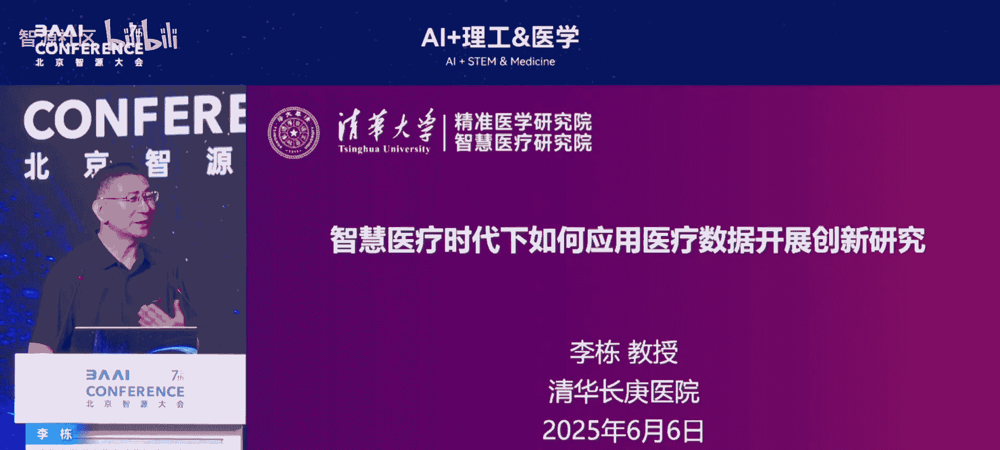
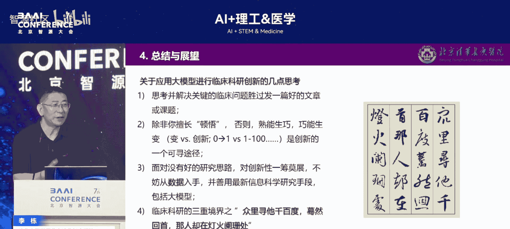

# 2025北京智源大会-AI+理工&医学 p08 演讲主题：李栋 -BV1X7N7zaEYD_p8-

非常荣幸在这里有机会跟大家交流。嗯。在这里我看我进来的时候，发现很多人在在讨论大模型。我我其实这个可讨论的地方很多。但是呢今天我想从稍微不同的角度，从数据的角度跟大家讨论一下这个大模型哈。

我调整一下我这个讲的顺序，可能更配合今天这样。

嗯。他们要顺序哈。嗯，deep sick大家都用过很火啊，先跟大家澄清几个概念啊。其实deep seek有三种使用方式。第一个就大家最常用的拿手机用一用哈。

第二种呢就是我们经常在报纸上我看到有些那个说某某医院又接入了deep sick，对吧？经常经常听到这个，其实deep seek最常用的，或者我们认为根据我们实践，他应该走第三种接入方式。

应该走本地部署化。加上定制开发，这里还缺了一条，加上断网使用三条哈，大家记住啊，这是根据我们在长庚医院的。第一条不用说了，第一条因为大家小范围使用，你没有办法在医疗场景上使用。

第二条为什么不能在医疗场景使用？因为你的服务器不在医院里面，大家知道在中国是规定数据不能离院的。如果你的服务器不在你医院里面，那就面临一个问题。就是你把它部署在外面。

那么你今天部署的和明年部署的它没有区别。因为你不能用医院的真实事业数据去训练它，它无法成长，所以你没有用，可以说完全依赖这个厂家去更新它的底座。

所以我们认为目前为止最可行的机制是第第三条本地部署加定制开发加断网使用，为什么断网使用，大家知道吗？数据污染哈AI场景下，两大新的挑战。第一个挑战，传统的编盲彻底失效，我可以把你拼出来。

第二个就是数据污染，它的这种强大的这种你说幻觉也好，你说造假也好，一旦把外延性稳混到医院里数据，你是再也分不开了。所以必须三条本地部署加定制开发加断网使用哈。呃，再给大家澄清一个概念。

大家都说dep sick是免费的对吧？你觉得是免费的，其实D不免费，而且还很贵。我们测算了一下Dep sick一次医院里测试训练一次模型，120万1次。下面是他当然他为什么为什么现在火起来了？

在去年12月份之前，11月份之前，咱们国家有120个注册的大模型。为什么dep six咱年后就火起来有两个原因，第一它比较低价。第二是他开源，这个大家要注意啊。然后当然它有一些模型，因为时间比较短。

它的特色我就不说了。它最主要是多专家模式。就是刚才这个我右面列出来1个MOE模式。大家我不知道有没有想过，为什么deep seek它能做到所谓的价格便宜量有足呢？对吧？那别的大模型怎么就不行呢？

open eye怎么不行呢？对吧？cloud怎么不行，为什么它行呢？不知道大家想没想过这个问题啊？因为它引入了一个叫MOE模式，我们叫混合专家模式。这个模式通俗的讲，就是说我每次去训练一个问题的时候。

他不把全部的这种类似我们大脑皮层，不把全部的这个我们叫乾馈神经网络，不把它全部进行运用，它只是部分，就是我右边那个示意图，就它拆成小部分，而这个MOE模式，通过我们的这个在临床上使用，发现它有几个。

我不敢说它是它的缺陷。但至少提醒咱们各位同仁就是在这里使用的时候注意啊，尤其在医疗场景。他有几个局限性，第一个局限性不能做什么。不能做会诊。因为它单一模式可以，但是一加上会准多模式不行。

第二个有什么曲限性啊，就是它为了使它保持了算力的始终在线，它会随机的释放一些数据。那我们在医院里不希望这样子，我们医院里希望他病人一进到这个医院里跟医生任何住宿，我都被记录下来。我不希望最关键的信息。

等我最后会诊的时候给切掉，对吧？这是目前为止，他我们发现的ME1个就是不能说它的局限性，至少目前还是一个一个一个缺陷嘛。当是这展开说就很多了。当是它的特点比较鲜明，它绕开酷达了。

就是说英伟达一个底层的一个一个一个设计，所以它导致DPC可以出现之后，导致美国科技股集体跳水13%，就是这个原因哈，因为可以不用高端的GPU。呃，简单的说一下它的特点啊，就是低价开源。

包括他的一些那个成本啊。这个是从D斯官网上摘录下来的收费标准啊，大家看看它不免费啊，不。你之所以没收费，是因为你点数据人不值得向你收费啊，你拿手机问一下，你在医院里试一下，普普通通，我们一个专科数据。

120万训练一次。对他说他很很贵的。这个是在deep使用的层面。我先说这大模型，然后我们再回到使用啊。使用层面，其实自从我们用了之后呢，长庚医院因为跟跟清华具有先天性医工结合的优势。

我们稍微做了一点点这个这个探索哈发现其实它远比我们想象的复杂，复杂在哪里呢？第一个就是大家在这之前在AI出现之前，包括国家卫健委，包括国家都希望什么？希望AI能够改善中国敷衍辽阔，医疗资源不平衡问题。

但是我们部署了3个月之后，我们发现好像这个结果跟我们相反，不但没有改善医疗资源不平衡，相反，极大的。把北京的这个头部的三甲医院重新洗牌。为什么这样子，大家想过没有？因为你原来的三甲医院。

你判断出个好还是不好，有几个标准，对吧？出名的医生，常见病毒化病能看得好，对吧？然后非常好的这个诊疗设备，对吧？诊断的也很好，治疗的也很好，再加上非常好的硬件环境，对吧？高楼大厦的已进去五星级宾馆。

那现在大模型来了之后，不行了，还是再加上三个东西，第一个强大的算力。😊，我们算力长科医院，我们是在一度冲到全北京医疗口前前二啊，都已经向难以支撑强大的算力，还要加上什么一流的数据治理工程师。

还要加上什么一流的算法工程师6个因素会导致前面的三甲医院不仅仅北京、全国三甲医院再次洗牌，这就是我们现在已经看到的哈。但是训练好之后，它就有好处。

而且还有一个就大家你要知道训练大模型是非常非常长期的工作。根据我们现在经验是以年纪的，不是说一个两星期吧训练好，我们至少以年一两年，而且它不免费。我们一轮数据治理就花了500万扔进去打水漂一样。

基本没有什么效果。但是有了主播没那么明显。所以你想想，任何一家医院，他花了两三年的时间投入上千万。然后训练成模型，他凭什么免费给你使用呢？凭时免费给你，你下面使用的不可能。

这就是为什么它导致大模型的出现极大的加剧了医疗资源的不平衡，除非国家卫健委给政策，就是你强行把它派到下面，或者是下面的医院租用的方式，因为不是每个医院都有强大的算力哈。大家注意这一点。然后医生层面呢。

因为刚才大家各个老师也说了，医生层面你过去可能做个好医生就可以了。现在还不行，你可能要懂点算法，至少那算法的结果你要能懂哈，这是医生层面，算法层面呢，大家也知道啊。你大模型出来的时候。

医生懂不懂他有个黑箱问题，他自己也有他的幻觉问题，我们要识别哪些幻觉问题，哪些是他提供了新的知识。而我们认为他误解他认为他他他在瞎说，这个要区别一下。另外医院层面。

当然对对大模型部署也提高提出了极大的要求，这是在我们长征医院大家看到左面这个我们一度是全北京市第二的算力，但大模型一出来之后，我们发现占掉了一半，但右面就是大模型出来之后。

我们就迅速的用这个大模型基座开发了一些就是过去想做，但是一直做不下来的一些研究。呃，像目前看来成果还可以哈。呃。很多人说，那我训练大模型怎么训练呢？我是不是拿预院数据直接训练就行了呢？😡，不行。

这是根据我们经验，大模型要走两条训练途径。第一。大模型的数据，它的要求程度远高于临床科研的要求程度。大家知道一个医院你能把数据治理成搞临床科研数据已经非常厉害了，都很少了。

大部分医院就是就是很很原始的数据，你能把它搞成拿过来就用临床科研已经是很厉害了。但大模型的训练远高于它，高于它在哪里。不是你把数据简单的弄进去就行。很多人就说他不是有无监督学习吗？

我把这个数据怼进去就行了。上来下来不是这样子的，它是可以无监督学习。但是就像一个医生，你可能十年成为一个主任医，也可能两年成为主任医。你让他无监督协，他很慢，而我们等不起，你要想快怎么办呢？

要配上医生的决策术。😊，所以这就是来讲，就大模型的它的对数据要求远高于普通的临床科研。这是第一点。第二点，根据我们的探索，任何医院目前为止就是我这是我说是比较叫三甲左右的，就三级医院嘛。

要想直接使用大模型训练，必须走通库加专科库加专病库加专项库的数据治理模式。这是我们融合了呃天坛和融合几家医院，认为目前这个这个结构是比较适合大模型训练的数据模式哈。啊，再有一个就是大模型。

大家要注意一下啊，可能大模型你有了很好的工程师，你也有了很好的数据，能不能拿来就用了呢？还要考虑它的算力，它的这个这个电力，我们那边一启动啊。

一启动我们的算力中心半栋楼就要停电的那还是小型算力中心要专线的哈，这个很关键啊，就大家可能一直没了解，就是一直大家传统的说这个人工智能三要素算法算力数据，对吧？大家传统的，但是其实在医疗上。

我们认为它有四要素，算法算力数据加应用场景，而应用场景才是在医疗领域最关键的一个，这就为什么不能用工科的这个直接照搬到医疗场景之内，大家知道这个算法算力数据这个应用场景各占多少比例吗。段海证多少比例？

10%。对吧这就是说国外其实跟我们差距不大，而且大部分算法是开源的算例呢算例现在说法不一样，有时候30%，有时40%的。但我们认为是30%。根据我们的经验，数据我们认为上升的比较大40%剩下占一点多少。

我们认为是医疗场景就是我们的医生要把他的临床意义给他哈，这个很重要。这就是为什么我我们比较看好在中国医疗上，这点能够拼过国外。因为在国外目前为止，今年今年是2025年三年以后，2028年所有的现有数据。

全部佣进，就对被大模星全部用进了啊，而且他用的数据是从1550年开始啊，500年前开始到到202028年全部用进，唯一没用进的就是咱们中国的医疗数据。为什么中国医疗数据没用进，我们没把它信息化电子化。

他用不了。对，所以这对对我我预判啊，将来可能很多公司会跟我们合作。因为他们的个数据已经完了，你想跟我们进行这个医疗合作的话，做任何数据研发只能用我们的哈。这个大家注意一下，所以还是大有希望的。嗯。

这个是我们总结了这个大模型在医院里使用以来十几个挑战吧，当然不止这十几个挑战。呃，还在不停的出现，但是目前看来就是这些挑战还比较多了。第一个就是算法硬伤，他不能确呃，他不能会诊。

另外呢他随机释放这个病人的数信息数据，导致他这个诊断的时候产生一定偏差哈，这个很重要。这个当展开讲，我们讲能讲一堂课啊，慢慢再讲呢。第二就换觉问题，幻觉问题以dep seek，他自己报啊。

最高程度可达到50%。当然他马上公布这版本就就说能压到20%以下了。另外就算力陷阱，包括A公平性。这简单说一下啊，那大家有一个前面的大模型，简单的这个这个铺垫之后，我再反过来讲。

我们用这些大模型做了什么哈。我们大冒险其实就干了一件事儿，就是怎么把医疗变得更智慧。当然这里面给一个简单时间关系啊，简单的给一下这个什么叫智慧医疗概念。因为这个目前目前为止没有定义啊，只有一个概念。

我们简单给一下啊。核心基座就是。大数据云计算、互联网、人工智能就基本当然还有了，主要这4点，这里面我们要注意重点提出数据是及时。就是我们也从其他方面探索过，但最后都觉得效果不是很好。

最后我们又老老实实回归到数据层面啊。数据层面我们就想跟大家分享这个其实这张幻灯我放进来之后很犹豫。因为大数据这个理念很久了，但是我觉得在这个大模型基座时代，我们可可能需要重新定义。这什么叫大数据。

目前认为在大模型上，大数据应该具备4个特征，同时具备。😊，就是。规模性、多样性和高速性、价值性。规模性大家都知道了。大家也提大数据嘛都觉得很大，但这里的大跟大家理解大可能不太一样啊，要TB起步。

不是GB，也不是兆啊，替B起步啊。第二个大家就是可能比较忽视的。其实其实大数据应该包含有多样性的。就在这里啊包括结构化半结构化、非结构化啊，当然具体什么在医院里，我这里都列出来就不赘述了啊。

第三个大家可能很少意识到大模型需要有速度，它要交换。你如果这个病人的信息进到医院里死在那了，看完病就要就沉淀在那，那不叫大数据，对吧？我们要让他活起来。

它要交换的这就像欧洲数据中心跟跟跟跟美国4个小时交换数据一样啊。第四个就是大模型一定能够通过一些基座算法挖出它的价值性。如果他挖挖出价值性，我们也不认为它是大数据。所以现在目前为止是认为在大模型时代。

大数据应该同时具备这四个特点哈。那那有些人说，那这个过去这么多年医生做的好好的医疗做的好好的，我没人不也活的差不多吗？其实不是这样子啊，我这里给这张数据就是。

制药行业大家看出现了从上世纪50年的出现法摩尔定律，这个双十原则十年10个亿已经基本上就就走不下去了。所以他必须要拥抱A在当中有很多解释了。那你说制药行业可以就要拥抱I，我们医疗行业为什么拥抱I呢？

其实大家你到医院看病就知道了，人满为患。你进去之后，基本上你可能电梯要等等个几八七八分钟哈。我右面给一张图，大家可以看到我们国家三甲医院目前为止占全国的7。63%，承担了多少了？承担50。

97%的这个门诊量，病人量这个其实是是无法无法持续的长期啊。所以可以说，而且疾病谱系啊也在发生明显变化。大家可以看我左边列了一下，在这个这还不是到今年的2017他这谱系我看了一下，其实信血管正在上升。

上升到第一位了。那你说我临床上要用包A，我这要说用包A，我搞个个临床科研，我传统的什么卡方检验回归逻辑回归行吗？我不是也承压发顶刊吗？确实，但是这里面也有个问题，问题是什么呢？

咱们就举这个随便举个例子啊，长期污染、空气污染和这个心地象化的例子，通常大家怎么做呢？收集一些社会人口学特征。我们以前做了好多这个啊，包括这个加点生物标记物，临床上的检验指标，然后再加一点影像学。

但影像学只报告啊，不是影像主学那种。然后呢，大家怎么做呢？建了个模型，对吧？放进去，假如它结局变量放到新箱化，yes and no，然后把这些模型放进去，反成PM2。5PM10。你做出来的是什么呢？

你做出来，其实是你已经放到模型的危险数据的相关性，对吧？大家如果你做个统计就知道。但问题是，对于任何疾病，你想找到新的危险因素，你是不知道它的。所以你才去找对吧？而你现在你已经把它预先筛想过放在模型里。

你怎么能够找到模型之外的危险因素呢？你是不是找不到这就是基和蛋蛋核关蛋核机的关系，对吧？所以其实大家看到传统的你这种上个世纪70年代诞生以来的这种相关分析，在目前为止，它是没有办法的。

因为它找到的是相关性？我们医学需要什么？医学需要因果性，对吧？所以说我们建议啊，当然我们也在做传统相关。我们建议呢要以算法为为基准，要间接转向算法。而且传统的相关性分析它还有个局限性。它很很难做交互。

两个大家你做过统一分析，你知道两个因素交互就已经很难了，你不能做7个8个，对吧？而且你不能一次把很多变量放进去，你不能放个一二百变量，你也不能把影像直接放进去，对吧？这些都放不了。但是呢算法是可以的。

对吧？算法既可以做交互也可以做变量，而且算法呢理论上来讲，理论上来讲啊，尽管这个这观点我们提过，在在国际年会上被被被人家给说了一下，我们认为算法出来的是因果性。为什么算法出来是因果性？

因为当你每次给他一个token，当他跑他1000万次，1万万次1亿次，他前面每次出现的这个危险字都是它，我们就倾向于它是因果性了，至少是一种弱因果性啊，所以这个很重要。呃。

然后因为今天主题在跟吸息管有关嘛，那我们也把过去我们在吸血管当中都做的一些研究，在这里简单的跟大家汇报一下啊。就是大家你看在信息管领域，其实在AI方面已经占到4分之1的应用了。那这里面跟大家回顾一下。

比较典型的就是苹果公司。当他推出第一代apple watch的时候，他当时做了一个非常非常出名的一件事，就是怎么通过这个所谓的单导联，我就能能够所谓的哈国内有自家吊打1二导连实现它精准预测。

他这篇文章特别出名。当时是一度是冲到s从在nature上，我记不清了。反正简单的就是一个换测方法。通过这些简单方法。那他这个苹果公司出了这篇文章之后，我的团队就跟了一下，就是你用苹果手表。

不是每个人都能买起apple watch呢。那我们简单的运动手环，我是不是也能达到同样效果呢？对吧？我不管不管牌子，不管华为小米，我们就做了这么一个，然后发现呢好像也行哈，我们这文章发的也可以哈。

准确领导到99。67%。😊，说明什么呢？而且这个我们我们做了一个转换，我们不是心率，不是我们节律的那个率。我们这个率是心跳，就每分钟你跳多少次，我能通过收集它24小时，每分钟跳多少次来预测你的心率失场。

我们用了一个类似股市的这种K图的形式，把它转换了一下哈。然后呢，在这基础上我们又做了一个。因为大家知道现在预测心脏病它都是单一指标。我们就想那心脏做一个整体，对吧？它有自既有血管，又有神经，又有肌肉。

又有各有枪室。我们能不能通过算法整体把心脏弄一个打包，把它所有功能给整合起来，来预测这个心律失常呢？然后我们发现是可以的哈，但这篇文章发在这个扎马的呃，不是发在ja克的子刊啊，也可以24点几分啊。

就是而且当时我们这有一个特点，当时我不太确定这个对不对，但是至少给我们一个趋势，他可以长期预测，他最长可以预测到15年。人家说你预测15年准不准呢？我们说很准，为什么呢？我们倒着预测的。

我们是拿到他现在的这个发明规律，从他以前来推还是很准的哈。然后包括这个是我们做的一件。另外一个，因为时间马上到了，简单的说一下，就是在大模型基础上，我们的建议啊就是要做这个。怎么说呢？叫疾病网络分析吧。

这是我我本人以前的一篇文章，就是作为糖尿病的。这个简单的讲一下，就是在这之前呢，大家都认为早发性糖尿病了，因为你很年轻，对40岁之前发病对吧？那如果他20岁发病，他发病1年，那么他30岁仍然很年轻。

他的血压也很正常，血脂也很正常，没有其他并发症，对吧？理论上来讲，那如果这个人40岁发病发病十年，那他已经50岁了，血压也不正常，血脂也不正常，可能还有点其他疾病。

是不是大家你要是凭空想象应该是早发性糖尿病应该比比正常发病来的轻啊，是不是但其实你看左面这个图就是早发性糖尿病，右面都是正常发病糖尿病，每个不同颜色的小圈圈代表不同系统。

我们是整个全身所有系统里做了一下糖尿病的并发症谱。大家可以看到左面这个明显比右面来的这个圈要密，而且他的现实之间系统之间有交互作用。

有那个像同步连接的所以当时我们这篇文章其实投到新兰医学后来这个但是遗憾被拒了被剧的原因是三个。😊，有两个人又说的很好。另外一说你要补充黑人的这个数据，我没补上，最后就。这没没办法啊。

这个有的时候也是要看政治风向的那，因为时间关系就就就很快就过一下啊。就最后呢这这半年以来吧，就是通过大模型呢，我们就就一直很很在想，就大模型在在医疗上带给我们什么呢？

我们认为啊它其实带给我们一个创新性的有迹可循。为什么？因为大模型底座底座是数据，而数据你是可以通过你的反复去去琢磨你的数据来进行这个把它搞得很清楚来进行创新的。

这是最后我的一张啊，我感触很深。就是这这半年以来啊，我们发现这个明显感觉中国的AI在医疗方面在提速。所以在这里我引用李国杰院意张这个一段话，他说。呃，时代正在迈向智能时代，可以理解为第五犯事。

对时代的认识不能犯错误，错过时代的转变，将遭遭受历史性的降维打击。这个我感触很深，希望今天我的演讲能给大家一点点这个启示，能够把AI真正融入到一朗当中，回馈社会，来服务患者，谢谢。

