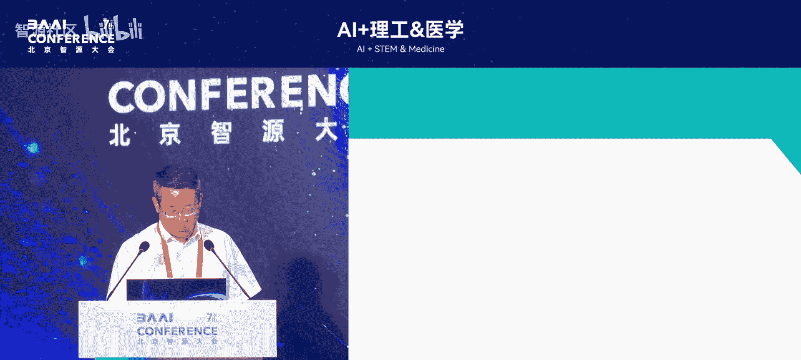
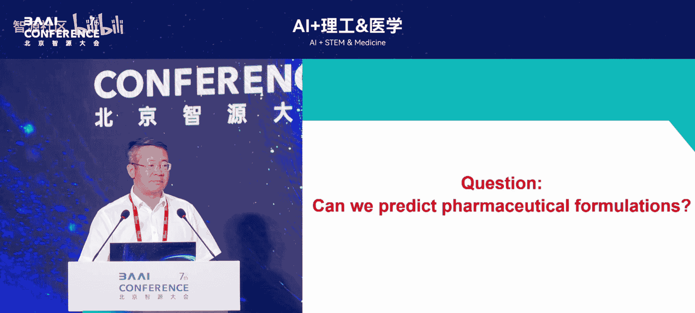
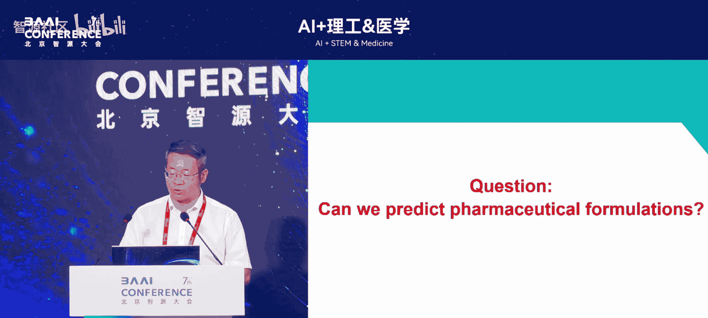

# 2025北京智源大会-AI+理工&医学 p09 人工智能在药物递送中的机遇与挑战：欧阳德方 -BV1X7N7zaEYD_p9-

谢谢主持人的介绍，也非常感谢张恒贵教师的邀请。然后今天有这个机会跟大家呃交流和汇报工作。然后我今天就就是介绍的这个呃工作，就是呃人工智能在这个药物递送里面，这个机遇和挑战。因为如果谈到澳门。

因为我来自澳门大学，大家可能第一想呢，就是赌场，对吧？但是实际上像现这是我们澳门大学这个呃现在的这个呃校园这个是非常的这个漂亮。而且呃我们最近十几年发展非常快。😊。

大学的全世界大学排名现在也是在前200位。然后今天我主要是因为时间的关系，我就快点介绍呃，首先介绍一下我们这个药剂学或者药物递送它的这个历史。然后是介绍一下我们计算药学的三个方法。

我们发展的一个是人工智能，一个是分子模拟，还有一个是PPK体内的模拟，然后是用两个案例来介绍一下在新药研发里面的这个具体的应用。因为我们都知道大家很多都都已经讲了，我们人体是一个复杂的系统。

因此这个我们的这个新药研发其实现在就是越来越困难。刚才前面几位老师也介绍了，其实反摩尔定律，这个新药研发其实是越来越困难，花的钱越来越多时间越来越长。但是我们新药研发其实可以把它分成两个大的环节。

因为第一个就是我们设计药物新分子对吧？然后在过去的实际上50多年里面，科学家们发展了大量的这些计算的工具，包括计算机辅助药物设计啊，包括近几年很火的。AIDDAI药物设计等等。呃，这是第一个环节。

有了药物性分子，怎么把它做成合适的剂型，就是我实际上我们患者不能直接吃原料药，对吧？所他要把它做成合适的剂型。呃，比如说我们药片啊、胶囊，这个是我们做药剂的人的这个第二个就是这个第二个环节。

我们做药剂的人的这个呃就是工作。呃，经常我经常开玩笑说，我们其实是做的大厨的这个工作，跟除湿的工作其实是差不多的是吧？那在第二个环节里面，到现在为止，主要还是通过实验试错的这个方法来进行的。

然后现在的药学实际上是从上个世纪50年代开始，第一代的这个物理药学从呃物理药学呃，然后到90年代的这个纳米药物。因为时间的关系我就不详细讲，然后发展了很多一些新的现现代的这些制剂的这个方法。

实际上就是我们可以看，其实今天我们人类研发新药到现在为止，其实并没有研发出来多少个新药。这个是我们对FDA批准已经上市的药物呃做了一个大数据的统计。

range book就是小分子的药物是大分子生物分子的药物。其实到现在为止，我们人类批准上市的小分子的药物是2000来种，大分子药物是605种，然后里面是设计到的这个呃辅料是500多种进行169种。

然后小分子的最后的产品是4万来种，然后生物大分子是1800种。另外一个临床的这个成功率这个特别是这种复杂制剂。刚才我们讲1个化合物一般临床只有一个新药只有一个最后一个被批准。

但实际上今天我们拿这个也就是成功率是10%，我们拿同样的这个成功率来比较做这种复杂制剂或者高端制剂其实。他的成功率比这个做新分子更低。比如说我们做这种长效缓视支下知识体呃，纳米药物等等。我就不讲一些呃。

讲特别详细的技术的细节。然后大家可能会问为什么，因为这个就跟我们做自己的这个特点是有关系。今天我我呃我们做自迹，实际上是从呃是材料的特型和工艺的参数组成的一个高维空间中进行多目标优化的这个问题。

我们估算过这种。呃，药物配方，它的这个筛选的空间可以达到10到25到10的34次方，这是个非常高位的空间。而目前我们主要只能通过实验试错的方法来进行。因为做个实验的可能呃大家就会知道。

一般我们能做几十次实验，或者陈破天，你做几百次实验就就到头了。因为时间的关系，人力的这个成本的问题。而我们也就是说你像通过1到2次方的这个实验的次数，在10的30次方这么高位的空间来进行。

就是最优化的就是进行最优化，其实就等于大卡捞针。从矛种意义上来讲。所以这就是为什么今天我们做自己是越来越困难的这个原因，就是因为你只能通过实验试错的方法，自然耗时耗力，成功率非常低，对吧？

所以经常我开玩笑说，今天我们做自己跟几百年几千年前我们老祖宗的炼单术是差不多的。所以这个里面我们就提出一个问题，从呃十几年前我们就提出来，是不是有可能这个我们发展一套计算的方法，就像做药物设计一样。

来帮助我们做药物制己配方的这个设计。所以这个是我们呃十几年一直在做的一件事情。

啊，第一个我们发展的方法是AI的方法。因为这个历史大家都是做这块的，我就不详细讲了，对吧？然后另外一个就是AI的这个革命，是从呃2012年开始，十几年前开始，这里面主要的原因是我们今天有更好的算法。

大数据，包括算力等等。这个我也不详细讲。然后呃，实际上AI用的要自接的领域呃，从4上个世纪70年代就有。但是以前的这些研究，他们都只用了呃一个更非常呃。就是为什么没有就是跟真正的落地的一个原因。

就是呃不像药物设计，药物设计目前有很多的公开的这个数据可以用。但是在药物制剂的这个领域，就是制药厂的药物的配方，他是不会轻易现呃给大家分享的对吧？所以那这样的话就没有公开的这个数据库。

你没有公开没有没有数据的话，你就没有办法来建II的模型。所以这个是一个难点。所以在2018年之前，这个领域里面呃，做的每年平均的SI只有十来篇就非常少。然后呃因为他数据最多你实验室拿一点这个数据来做。

所以他整个呃建的模型的泛化能力也比较差。而我们自己在这个领域里面呃，就是做了十几年以后，发现我要想做一个很好的这个I的模型，我们必须要要更大量的数据。比如说至少500个以上的10种以上的这个药物。

还有辅料等等，包括一些算法的选择特征工程等等呃，技术细节我就不不详细讲。然后你只要达到这个5个条件才有可能建一个比较好的这个也自剂的这个AI的模型。然后呃我就用一个例子跟大家介绍一下。

我们早期做的这个里外就是一个自己的配方的这个例子，它的一个稳定性的这个例子。呃，在以前这个一你要做两年的实验才知道它稳不稳定。但是如果一旦不稳定，你要退倒重来。

所以这个是一个非常痛苦的事情在制药公司所而我们现在发展了一个新的这个模型。这个我们只要几分钟就可以把它给预测出来。然后你再来做实验验证一下，其实。其实基本上就不会有问题。所以这样的话呃。

很快这个这个模型我们的当时在2019年就发在我们这个领域的顶看GSR上面。而且这个GSR的主编特意写了一个文章，就是AI是否有潜力变更药物处方。所以我们可以看，从201819年以后。

我们把整个的这个关键的这个环节打通以后，就是方法发展了以后，从2020年开始，整个领域是一个爆炸式的这个增长。到今到去年每年是发表了去年是发表了呃三四百篇的这个SI论文从十来篇。全世界的这个是。

而我们在这个领域里面，其实到现在为止已经发表了超过40篇以上的这个SL文。这个在全世界是排第一的。而且在各个自机的各个环节都有在呃研究。

另外一个就是我们在这个呃构建了全世界第一个这个药物自机人工智能的这个平台。然后因为这所有的数据都是我们自己从头收集的。然后哦这个平台用起来非常简单。然后只要输入药物的结构的基本信息。

然后呃点击提交就可以很短的时间内，他可以预测出来这个自机配方的这个关键质量参数。目前这个我们的平台已经在全球已经有几百个注册的用户，还有几几万次的这个使用的这个记录。包括有国外的一些大的制药公司。

国内的制药公司跟我们在进行密切的这个合作。然后这个是第1个AI的模型。AI的模型，刚才大家都知道，这个效果是预测的性能非常好，但是它的可解释性不够。而对于我们做药的人，包括其实呃在医院里面其实也是一样。

他不仅要知器然而且要知其所以然。所以我们发展了第二个工具，就分子模拟的这个方法。分子模拟它是一个物理建模的这个方法。以前主要是用在药物设计里面，呃，药物设计的模型就比较简单，锁合钥匙的模型，对吧？

一比1的。但是现在我们要把它用在制剂里面，实际上模型就复杂得多。比如说我们这个是呃SI的递送的这个系统。像这个就是呃。呃，药物和辅料的这个相关作用固体分散体。因为实间的关系我就不讲特别细节的这个。

像这个呃是黄国金的。像这个就是药物怎么样，包括在这个纳米药物里面，纸质体里面磷子双木者成列面的。但是当现在的这些做分子模拟的这个软件，他们我们大家可以看一下，都是一些呃就是国外的这个软件。

而且他们其实呃本来就不是设计做药物呃，分就是药物制剂配方设计的。而更多的是做药物设计的。所以而且这一块的话，他的这个每个自剂的环节都不一样。所以这个对我们的自剂科学家其实使用的门槛都很高。

所以最近我们开发了一个新的这个平台就门一些MM来帮助我们自剂的科学家，这个你只要点几下选几个药物，几个几个其他的这个辅料就可以来用，非常简单可以。然后这个是第二个这个我们发展的工具。

第三个工具是这个体内的建模。我觉得这块呃这个对医院里面包括新药的这个开发，大家更感趣。我觉得这个PPK的这个模型是把我们人体的每一个器官建一个微风诊，把生理参数给嵌进去，然后把它组合起来。

形成一个复杂的这个数学模型。这个模型的优点就是可以把我们临就是临床前动物实验的数据，还有患呃人体的数据把它打通。目前FDA就是美国食品药品监督管理局，他们是在大力倡导的这种模型引导的这个新药研发。

而这块当然你要建这个模型，你要需要大量的这些参数，包括人体的参数，包括药本身的参数，包括配方的参数，对吧？所以这块我们也是建立相应的这个自记的这个PPK的这个模型。呃，技术细节我就不太讲。

而目前的这些呃PPK的这个模型，它的就是它的这些软件都是国外的，像gapl是美国的是英国的。然后而且这些商业的软件价格都非常贵。另外他对自己的这个复杂的字迹其实并不太适合。而且大量的这个实验的这个数据。

而这块的话，我们最近也是几年花了很大的力气，从头建了我们的基于I的这个PK的这个模型。其实从矛盾因商它也是数数字人的。然后来进行要不在体内行为的这个预测。这样的话来更好的帮助我们进行新耀的这个研发。

那下面我就介绍两个例子来介绍一下我们在这个新药研发里面的这个呃具体的案例，大家可能会问怎么做的。像这个水难溶性药物这个小分子的药物。因为目前上市的药物里面小分子药物里面40%以上是水难溶性的。

而在研发管里面有超过70%是水难溶性的。而目前常用的这些自剂的这个配方里面有超过10种以上不同的策略。如果你要传统做实验，你就挨个就只能挨个去试，这个是是是非常困难的一个事情。

而目前我们发展的一个叫处方的这个决策术的这个算法。然后你就只要知道药把药物结构输进去，它就根据算法来判定出来那种真的策略效果更好。然后再根据具体的剂型来进行预测，这个效率会大大到提高。

像这个我们做的一个一个一个新药就是性链内，这个是一个中药的单体的中药的单体成分，目前在市场上有很多的这个就是产品在卖像片软软胶囊啊滴丸等等。然后但是这个分子。它水溶性极差，体内吸收不到3%。

也就是说你吃100毫克进去，只有只有3毫克才被被吸收。所以我们用我们的这个计算的这个方法进行大规模的这个快速的筛选。然后这些蒸容的这个辅料。

很快就找到一个伽马黄红精的蒸容的效果最好再来做实验验证其实就比较简单。像左边这个底下的这个图，就是呃我们的这个呃溶解度的实验的数据比试收的要好几十倍以上。然后是细胞的实验和动物的实验都要好一倍以上。

而且这个自己的配方非常简单，适合工业化的这个生产。而且我们在多个药物上都呃进行了实验。这个取得的效果都是比较好的。像胰黄素啊，人参皂苷HR啊，还有双明达摩等等。这是第一个我们呃。介绍的这个案例。

第二个就是这个MR支是纳米颗粒的。这个大家都知道，在新冠期间国外用的都是M的那个疫苗。然后卡塔林博士和德鲁威斯曼博士，因为他们在MR疫苗里面的这个关键的贡献获得了2023年的这个诺贝尔生理学奖。

而MR疫苗里面一个非最关键的一个非常关键的技术就是自持纳米颗粒。它的递送的这个技术。这个是UB呃加拿大的皮库里斯教授他们发明的。当然现在的这个这个资纳米颗粒，它已经上市了，是取得了很重要的进展。

但是它还有很多的这个缺陷，包括递送效率啊，包括它的专利的问题副作用等等。所以这块的话，大家都在现在全球都在筛选更好的这个地送的这个系统。而我们做的就是我们在在45年前就是开始做这块的这个研究。

构建了第一个MI的这个知识纳米颗粒的这个AI的模型。然后我们根据我们的AI的模型，我们构建了1个2000万的虚拟筛选的这个库。然后再用两个指标来进行虚拟筛选，我们进行了两轮的这个筛选。

第一轮第一第一轮筛选出三个分子进行这个实验的测试。第二轮筛出6个分子进行实验的这个测试。然后这个就是第一轮筛选的三个分子的结果，我们跟已经上市的这个产品进行对比，第一轮的效果不算太理想。

但是我们进行了第二轮筛选以后，6个分子基本上都比试售的要更好MC3，而且有一个分子跟最好的M102是基本上是相当的。也就是说我们只筛选了9个分子就得到了几个阳性的化筛选的效率还是比较高的。

而另外一个就是我们也研究了它这个这个复杂的这个字迹它是怎么样结合在一起。因为时间关节我就不讲细节了，这个是我们呃这个是体内的这个行为的这个模型的构建。所以我们可以看。

对于这种我们整个人体的这种复杂的这个模型，我们单一的这个计算的方法是不能解决所有的问题。所以我们一须要综合多尺度的这个模拟，包括量子力量化的这个模拟，量子力学到分子动力学模拟到呃过程的模拟。

到数学的模拟，人体的这个建模，最后用数据驱动的AI的方法把它结合起来，才有可能实现这种我们这种计算设计的这个计算驱动的这个药呃配方的这个设计。而我们是从2011年在这个领域就进行了深入的研究。

15年是出版了这个领域的第一本专注。英国外地出版社出版。我们去年是出版了这个呃领域的就是这这个书的第二版。然后另外一个就是今年我们把中文版也出就是出来。因为当时我们第一版出来以后。

很多国内的老师就说这个英文版太贵了，一本要两三百美金，就是那个的确是挺贵，对吧？两三一两千0块钱2千0块钱。所以我们就把第二版的时候就把中文版全保留下来。

然后另外一个从2015年开始在我回到澳大以后开了一门计算药学的这个新课也是到现在是十年的时间。另外像瑞典的沙拉大学，他们20121年开始也开了一门计算药学的新课，就是用我们这本书做教材。

然后实际上在十几年前，这个领域做的全世界都都做的非常少，只有两三个group在做。所以我们当时为了促进这个领域的更好的发展，也组织了一些会议。包括14年在美国芝加哥国际控大会上搞了一个workshop。

17年在澳门搞的论坛。然后另外2020年搞的一个在线的论坛。21年这个是在美国的USFD他们的这个在线就是在线的这个全球论坛上汇报了我们最新的这个进展。另外23年在新基他们搞的论坛邀请我做开场了pe。

然后去年我们在澳澳门搞了首首届的这个计算教学的这个论坛，也是邀请的这个领域的最早的几位先锋建的科学家来进行一起一起搞。所以我们可可以看今天AI整个在在在制药行业其实已经用的face如虎如荼了。

而这个里面全球的监管界像美国USFD他们是走在最前面的，他们19年就投资了5000万美金，发起了一个叫casa的项目，就是建一个新药数字化的评审的平台。而他们现在已经这个平台，现在已经是建成了。

他们内部反馈的结果是效果非常好。而他们向他们最近反馈的个结果就是以前他们要三天三天才能评审完了一个问题，现在只要6分钟，也就是效率是提高了几百倍到几千倍。

另外他们23年发布了AI在新药的研发AI在药物的生产这个指导原则。另外最近4月上呃4月份的时候发布了另外一个呃就是政策，他们就是用AI和类器官等一些体外的技术来替代这个动物实验。

这个这也是一个重磅炸弹的这个重磅的这个消息政策。另外当然我们国家的药监局其实从21年也开始发布相关的这个指导原则。我也参与了一部分里面的这个工作。所以这一块我们可以看整个的这个计生药理学嗯。

我们的药物自剂的整个开发，从上个从上个世纪50年代的第一代的物理药学到第二代的纳米药物90年代，到最近十几年的这个计生药理学，整个领域发展是非常快。

另外一个就是计算药学的概念现在也进入了就是呃这个药理学的本科的这个教材，包括国外的教材和我们现在国内的教材，现在也都收入了相关的这个概念。当然这个领域也很多的这个挑战，比如说数据的问题啊，包括呃算法啊。

包括一些人才的培养，因为从头开开始，这个都没有。但是这个领域其实有很多的因为是个全新的领域，有非常多的这个机遇，所以也欢迎更多的感兴趣的这个老师和同学加入。因为时间的关系。

我这个video可能就没有时间放了。最后也是谢谢我们的这个合作的老师，还有我们实验室的这个同学和基金的这个支持，谢谢大家。😊。

