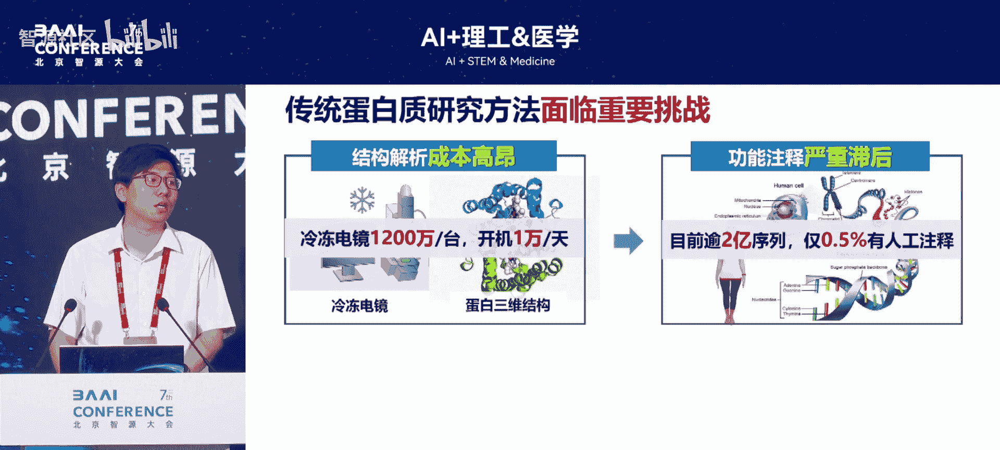
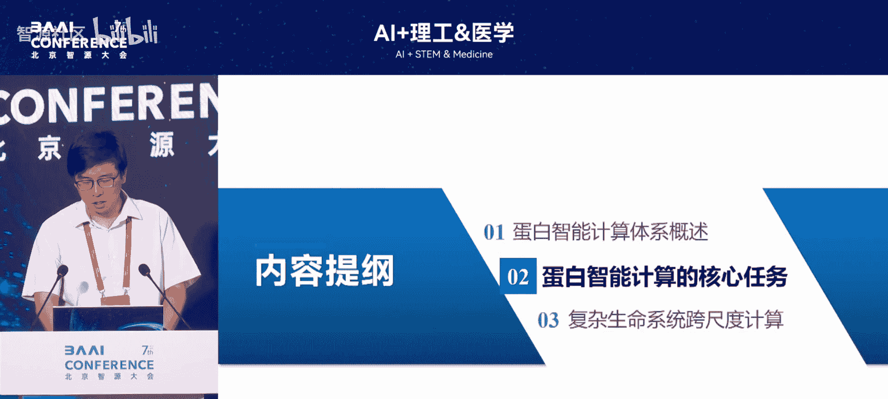
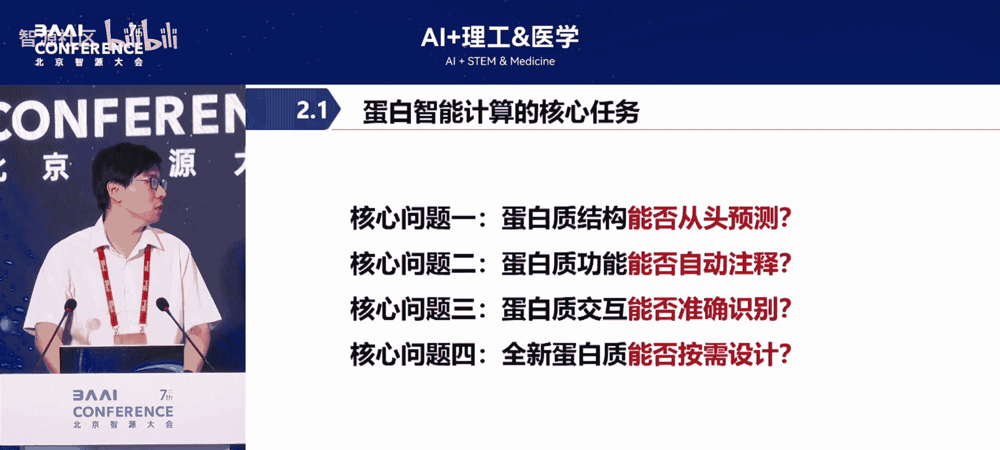
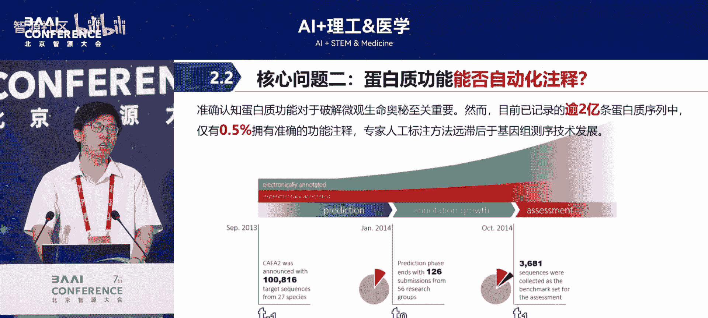
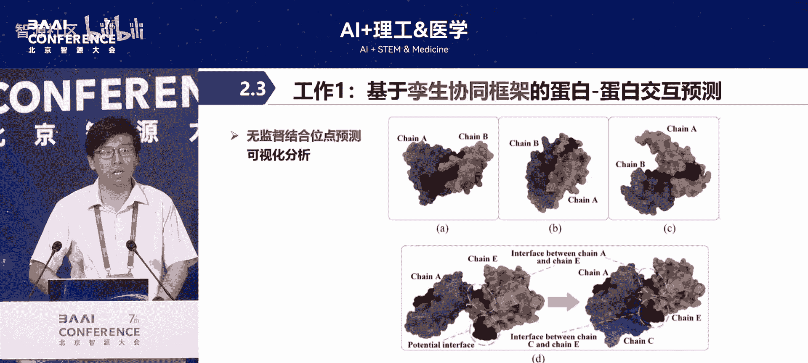
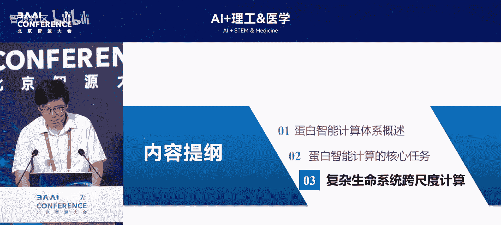
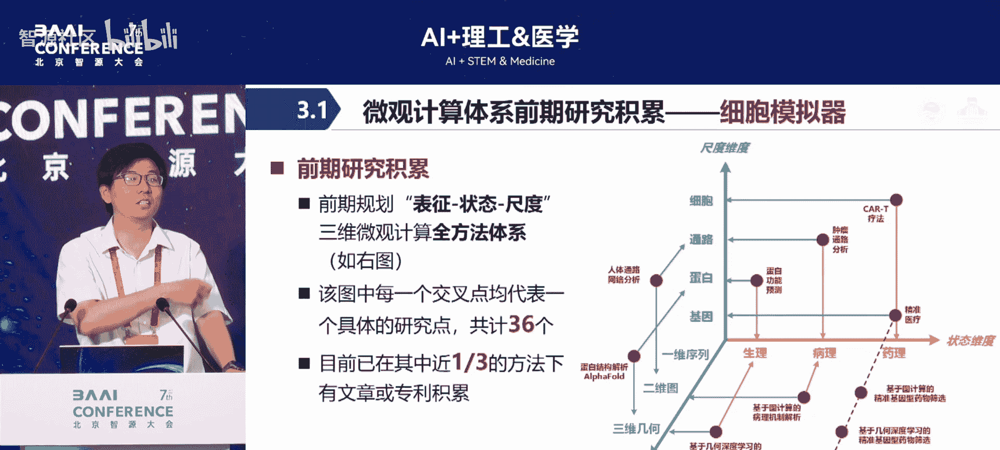
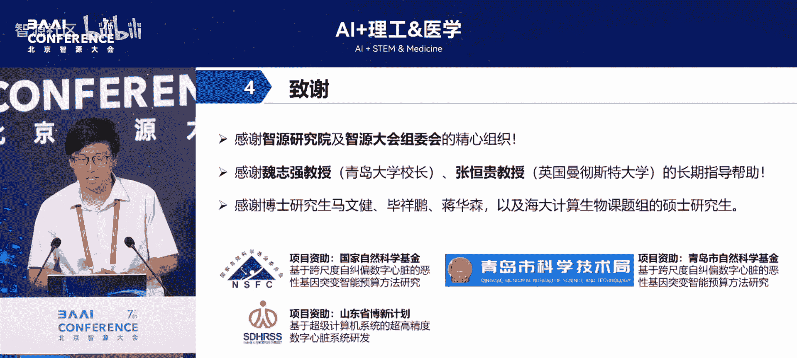

# 2025北京智源大会-AI+理工&医学 p11 蛋白智能计算体系构建及其应用：张树刚 -BV1X7N7zaEYD_p11-

呃，那么接下来呢我就简单的汇报一下我们课题组在蛋白智能计算啊这个方向相关的一些工作。好，呃，首先做一个概述啊，那首先大家都知道蛋白质呢，它在人体生命活动当中呢是扮演着非常重要的角色啊。

所以说咱们这个初中的生物课长上就写啊，说蛋白质是人体生命活动的主要承担者啊，像我们这个需氧运输啊，催化呀，以及咱们的这个抗体和免疫系统啊，实际上背后都有大量的这种蛋白分子啊。

在帮我们去行使各种各样的生命功能啊，所以说呢蛋白质呢它是在人体当中呢呃是一个举足轻重的角色啊，但是呢作为交叉领域来讲啊，应该来说传统的蛋白质领域呢面临三个重要的挑战啊。我这边梳理出来了三个方面。

第一个呢就是它的结构解析的成本非常高啊啊，这个事实际上大家这个广而周知了。就是我这两天还特别去查了一下呃，某某高校啊采购一台电竞啊，他们的招标最终中标价格是1200万。啊。

那么大家知道一一个面上基金也就才50万是吧？那得攒非常非常多的这种经费啊，才能买得起一台啊，当然你也可以去租啊。那租一台的话，一天开机1万块钱啊，你要解几个蛋白的话，几万就没有了啊。

所以说这件事呢也是传统蛋白研究方法面临的一个困境吧啊，这是其一啊，其二就是功能注释呢，它是严重滞后的啊，应该来说，咱们去查一下这个比较权威的unipro数据库啊，目前在收录的这个数据已经是前几年的了。

我今天上午刚查了一下，目前是收录了超过2。5亿条啊，那么后面这种人工注释的速度呢远远落后于咱们测序新发现的这些蛋白序列的数量啊，那么这个比例呢仅仅只有0。2%啊，这个数据同样是落后的，也就是大概是2。

5亿条里面也就500万啊，它是经过了咱们的生物专家完成了一个注释的啊大家又知道。蛋白质这么重要，它的功能呢反而是应该来说远远的落后于整个生命系统的认知啊。所以这是传统生命领域面临的第二大挑战啊。

那第三大挑战呢就是我们也尝试着去在计算机当中设计一些全新的蛋白啊，那么在这方面呢应该来说传统的这些方法啊，它也有一些这个固定的问题。比如说它这个难以筛选啊，改造的成功率比较低啊等等。这就是传统方法。

传统的生物学方法面临的一些问题。那么在这个领域里面呢，应该来说智能计算技术为解决啊这三大领域的挑战啊，带来了全新的思路和研究范式。

呃，那么在这方面最成功的，大家都知道啊，就是去年应该来说去年的三大诺奖啊全部跟这个方向有关。生物奖就不说了。生物本身就是计算生物方向。物理呢是颁给了人工神经网络啊，它是整个AI的基石啊。

然后诺贝尔化学奖呢是颁给了这个AI的蛋白结构预测以及AI的蛋白设计啊，所以说呢在这个这两年吧应该来说掀起了一股热潮啊，也是咱们今天AI for science主题最成功的呃应用的领域之一啊。呃。

那么在这个方向呢，我梳理出来四个问题啊，有一些是我们自己的方向，也有一些是这个呃蛋白领域一些比较重要的问题啊，分别是这个结构功能交互和这个设计问题啊。呃那么第一个问题简单做一下科普啊。

相信大家都了解差不多啊，就是阿 code为什么会这么轰动啊。大家其实可以想一下，如果你们手头有一根这个线条啊。

然后这根线条呢在空间当中，它可能折叠出各种各样的构象啊，那么这个构象呢，实际上多达多少种呢？就如果咱们完整的测算的话，是十的200次方这种构象假如说咱们手速足够快啊，就是每纳秒尝试一种构像。

如果我们把这种完整的构像全部折叠尝试完的话，那么它需要138亿年啊，这有带来一个很著名的叫莱文塔尔悖论啊，就是实际上在咱们人体当中啊，就是咱每个人人体当中蛋白分子从它序列转入翻译成之后啊。

一旦表达出来折叠出来这个蛋白也就几秒到几分钟的时间啊，但是为什么咱们人工尝试呢，就就要138亿年。所以这个里面一定是有规则的啊，但是这个规则呢困扰了整个学界应该说50年之久啊。

那么一直到这个2呃这个18年阿才开始尝试啊，用这个d方法去折叠这种结构啊，但是呢。呃，在第一代呢，应该当时没有引起太多的轰动啊，也没有对这个生物学的专家造成呃这个心理上很大的一个所谓所谓的一个恐慌啊。

呃，那么当时呢因为他的这个比赛的结果，虽然说比较震撼，也得到当年的第一啊，但是他没有足够的呃足够的这个能影响到咱们实验精度的这么一个效果啊，那么第二代就不一样了啊。

所以说nature的这个题目取的特别有意思啊，他写的是这个highly accurate啊，当时我就好奇什么样的精度才叫highly accurate，我就特别找了一下呃。

他这个nature正文里面的定义哈。他定义是这样的，就是说他说他预测出来的这个结构和我电竞解出来的结构平均的误差不超过一个原子。不超过一个原子的宽度啊，所以说这个结果讲出来之后呢。

确实呃完全足够成叫 accurateate了。这也是在当时引起了非常大的轰动啊。大家能够看到右边这个第二代阿已经比第一代呢超出了非常高的这么一个这么一个精度啊，呃，那么也是在这个去年啊大概是去年。

然后今年是把这个正文给开发出来了。第三代就是第二代呢它还是预测的单蛋白分子啊。第三代呢就应该能够把体内的所有的这些分子的交互过程的结构啊，全部都能够去预测到啊，应该来说这个工作呢做的还是呃非常的漂亮啊。

也是开启了咱们整个生物学的一个新的时代啊，这个赛道比较卷啊，所以说我们没有在这个方向去做过多的深入啊，我们转头去做了这个功能知识和交互啊。那么这个刚才的问题已经阐述清楚了，就是2。51条里面只有0。

50。2有。

么一个准确的注释啊，所以说呢我们也在尝试啊，就是能不能用这种深度学习的方法啊，来去快速的完成这种大规模的批量化的注释啊，因为不可能总让生物专家去挨个的这个逐个的去解析啊。

这是呃这个精准精准注释的相关的工作啊，呃，那然后呢我们在这个方向就开展一些我们自己的研究啊，呃，那么这个第一工作实际上比较早了，是在22年的时候啊，当时呢大家都知道深度学习它最赖以生存的。

实际上是数据啊，但是呢我们电竞解解到的数据非常少，非常昂贵啊，所以说市面上能够拿到的这种电竞的结构呢是非常少的。然后一出来之后呢，我们第一个想法就是说你加后的能预测出来这个结构。

那么你的这些结构数据到底和真实的数据有多么大的差别，或者说我拿你的这个虚拟的数据过来去做训练，可不可以有点像计算里面。这个数据增强的感觉啊，就很简单一个思想啊，但是我们拿过来以后呢，发现效果非常好。

因为那个预测的数据嘛，原先是500万，我现在可以扩到比如说这个这个几个亿都有可能打个比方啊啊，并且呢这个预测出来的效果啊，比那种原生版本的呢啊会发现更多的功能啊，这个是在2年当时发的一个M上的呃。

比较有意思的是23年24年的时候，西湖大学哪个老师忘了袁发杰老师啊，他们做了一个类似的工作，但我们的工作是比他们要早了接近两年的时间啊，呃这是第一个嗯完事第二个呢，我们也去做了一些这个自监督的算法啊。

简单说就是哪一个蛋白质的分子啊，然后把他们期间的这些残机的关联啊，去做一个编码，然后结合一些自监督的模型啊，去做这种预测技术细节时间原因就不展开了啊。然后再就是这个问题啊。就刚才刚才王老师也提到啊。

就是说这个模态很重要啊，实际上在生物蛋白的模态呢，它更加的重要。比如说对于一个蛋白分子来讲，它有多达6种模态啊，要求融合啊，并且这些模态呢还是跨尺度的。如果说我们直接把这些模态简单的平合在一起。

那么它的效果是非常差的啊，所以说针对这个问题呢，我们是提了一个多步骤的啊，然后结合这个计算领域的对比学习啊，包括多视图啊呃等等的这么一套方法，然后是完整的把6种模态啊，进行了一个很完美的融合。

每一个消融都消掉了啊。呃，那么在这个多达7个数据集上比了20种计线方法啊，然后全部达到了一个搜它的标准啊。呃，这是我们的工作。然后关于可解释性这块呢，我们也是去做了一些预测呃。

大家知道这个蛋白呢它的功能很多啊，有一个蛋白啊，这比如说这些蛋白列。举的可能都多达十多种啊，那非常小的一些条目啊，实际上要从这个几千条go terms里面去完美的注释出来十几条是很不容易的啊。

但我们的预测的结果呢还是比较不错啊，并且比较有意思的一点呢，就是呃我我就我就不再详细说了，但就是比较有意思一点，就是我们发现有一些呢我模型给出了非常高的知行度啊，但是呢这个数据库呢判我们是错的。

就是这个你没有预测对啊，后来呢我不服啊，我就去找了些文献啊，找学生也找了些文献啊，发现呢其实最新的文献呢已经证实了，就这个go terms。

它实际上是已经已经在这个确实是配合这个白质的功能只不过呢这个数据库用的版本比较老啊，所以导致它有一个误判。那么其实它在真实的表现里面效果可能会更加的好啊，呃。

这是这个功能预测的问题然后第三个呢就像刚才欧阳老师，包括这个黄老师刚才提到的。啊，这些这个药物方面的问题，那也是蛋白质作为人体当中的靶点啊，药物到体内，它除了这个动力学之外呢。

它必须要到我们相应的这个器官靶点的这个相关的位置上，然后就发生一个对接啊，这样才能去完整的发挥一个作用啊，那么在这方面呢，其实也是AI的一个用武之地啊，我这边列了一些这个蛋白核酸啊，蛋白蛋白啊。

包括蛋白小分子的一些交互啊，也有也有人会问啊，既然R都已经做的这么好了，为什么还要做这个自研的啊，这一点是这样啊。就是的第三代呢，它虽然在网上公开可访问啊，但它每天这个只能限制20次。

并且呢它的分子呢实际上只限制了大概15到20种。就如果说你想去自己做一些药物看一下它的对接效果的话，它是不允许你访问的啊，那么我也去尝试了申请他们的权重啊，他们权重的中奖概率非常低。

大概20个人能能给你发一个啊，并且还要看一下你是不是这个这个国防的限制单位。所以说我到现在也没有收到他们的邮件啊。么所以我们这个就把之前做这些方法去做了一个自研啊，呃，这边技术太细节了，我就不讲了。

就是用了一些这个交互注意力的方法，包括多任务学习的一些方法啊，去做了一些这个蛋白的交互预测呃，讲一下这个case吧啊，就是我们做完蛋白之后呢，深在学习很受诟病的一点，就是像刚才王老师说的。

就是它是一个黑盒嘛，他的这个可解释性啊intererability。差啊，所以说我们这个生物上面更需要这一点啊，我们拿到这个蛋白之后呢，呃去把这个模型关注的比较重点的这些区域啊给它做了一个可视化啊。

那么大家注意啊，我们是无监督的。我们不是为了干这件事儿而去可视化的啊，我们只是去判它是否对接啊，我们只是顺道呢把它这个认为比较重要的原子打印出来看了一下啊发现呢这个红色的区域基本上都在两个蛋白交接的地方啊。

代表呢这个模型呢还是能够去捕获到一些生物上面的一些这个incise啊。

呃，那么这些呢就是这个多模态交互感知的一些问题。那除了咱咱们现在主流的这个LP里面的transformer之外呢，我们也去做了一些这个图方面的这个叫graphra transformer的东西啊。

然后去达到一个远程交互依赖建模的这么一个特点。完事呢对于这两种模态之间呢又去做了进一步的交叉注意力啊，目前呢也是也也是在修改当中啊，这这边也是说一个case啊。

就我们在那个自己的模型上面已经达到了基本上99的准确率了，已经没没办法再卷了啊。那么呃后来我们跟这个青音去聊啊，他们说你这个在你自己这个模型啊，你怎么训，那那是你们说了算啊。

但是拿到这个实际场景里面真刀真枪的干一干，那看看行不行啊，所以说呢我们从那个轻音那边要了一组这个胰腺癌相关的通路数据啊，然后去预测了一下它的这个交互的准确性啊，大家能够看到啊。

就是整个这个图里面黑色的边啊，我指的是边上不是这个节点，黑色的边是我们预测正确的啊，红色的边是我们预测错误的啊。

基本上大家一眼看上去基本上百分之百都是这个黑色的边啊所以说我们的这个准确率实际上是达到了95以上，这是我们模型那个。泛化并不是说在自己的这个t上去做的这个固定模式的训练啊。

所以说这也是呃比较好的一个case吧啊呃后面这些网络的不再去说了。然后再有这是我们最近的一个工作，就除了我们蛋白去尝试从这个跨尺度啊，从这个网络的方面去降维去表征这个蛋白之外。

我们有时候也愿意去找一下蛋白自己它的一些特征啊，所以说像这个呢我们就用了这个最新的叫几何声的学习啊，因为传统的graphra呢它都是已经降到二维了，他们已经把所有的三维的结构信息全部都丢掉了啊。

那所以说呢我们这个就把这个三维的信息啊，提了一套很完整的范式啊，把它给柔合进去大家知道你空间当中去找一个位点，你把空间的信息扔掉了，把它压成一个平板。那这样的话肯定是不合理的啊。

但是三维的信息呢又很难啊，所以说呢提出这么一个范式也是希望着能够为。这个领域的这个三维这方面的建模去做一些相应的贡献吧啊。呃，这个是我们的又一个实测了，也是呃针对ACSS two这么一个蛋白啊。

呃筛选了若干化合物啊，然后从大概几万个里面筛了其中几个吧，然后拿到拿到清一那边呃可能是一个结清团队啊，他们在那边做了一个做了一个清和力的实验，呃，效果非常好，就是基本上微模以下呢这个成药就可以考虑了。

然后我们是做了一个纳摩纳摩尔级别就非常非常高的一个亲和力，就是整个数据级是假如说评分是1到10的话啊，它的这个亲和力的分数能到9啊，就是它的结合还是非常非常紧密的。而且它的特异性特别强。

不会说与其他的靶点结合，产生一个毒副作用啊，就就这方面的一个呃一个工作啊，呃然后最后呢就是这个有一个蛋白质啊，这个我就呃直接说一个比较有意思的例子吧啊，这个不是我们工作了。

是今年去年拿诺奖的贝克尔他们团队的，讲了个什么故。是呢就是澳洲那边当地有一种土蛇啊，这种土蛇是剧毒，就基本上人咬一口人就凉了啊，没几分钟人就不行了啊，那怎么办呢？

就是贝ker这边呢想办法我去找一种这个自然界中不存在的蛋白。因为这个蛇毒呢，它没有没有特定的解药啊，我能不能从计算机当中设计出一种新型的蛋白啊，然后我相对于一个呃不是很严谨啊，比如说抗毒血清一样东西。

我注射到我的体内之后呢，两种这个设计的蛋白和体内的蛇毒蛋白就会发生一个结核啊，这样一结合呢，这个人就可以可以救活了啊，那这个工作也非常有意思啊，是25年这个年初啊发表在nature正刊上那工作啊。

这也是我们未来打算去尝试做的一些方向，就是这个蛋白质的这种功能的设计啊，这也是去年呃诺奖的一个一个方向吧啊。啊，然后最后呢就是做一些这个跨尺度的耦和推演的这一方面介绍。呃。

因为我本身呢是恒贵老师的学生啊，呃在这个在在M4那边也是呃大概开展了呃一年多，包括回过以后博后呢又做了两三年的这个心脏的工作。啊，那么我个人认为呢，就是我之前做的这些器官的病理仿真。

它是属于一个数值驱动啊，简来说它是有一个传统的数值模式。然后我通过建立常一分方程平音方程啊，这样的方式来去建立这个器官的病理仿真模型也是目前这个数字孪生的一个主流吧啊呃那么后来呢我在尝试着做完这个之后呢。

想去往微观上做，也就是这个前面所谓的这个数据驱动这一块啊，大家可能也有了解，就目前比较火热的这个AI虚拟细胞数字细胞这一部分啊，呃那么在这方面呢细胞模拟器，我们有了一些积累啊，呃，画了一个简单的维度啊。

大家基本上一眼能看明白。

就是按照这个生理病理药理，这这是一条线啊，然后呢这个层次呢，基因蛋白啊信号通路细胞这是一条线啊，是一个跨尺度的微观跨尺度的。然后按照技术呢又可以分为一维二维和三维啊。

那么其实整个这个空间当中任何一个点啊，都是一个很好的啊所谓的一个硕士的开辟方向吧啊，这是我们在这个领域里面呃做了一些自己相关的积累啊。然后我自己呢也是呃在在魏老师的指导下。

当然提了一个微观生命系统的跨尺度的定义啊，就是从基因蛋白移植到信号通路和细胞啊，我的一个愿景呢，就是把整个这个细胞模拟出来啊，然后跟这个数字数字心脏呢去包括各个器官呢去做一个全尺度的这样的一个耦合。

就完整的从原子啊，到我们的心脏啊去完整的做一个耦合啊。呃那这是我之前的工作，然后就不在这边多展开了啊。

嗯，之前做的一个这个呃短QD综合症的啊，呃最后呢也非常感谢咱们组委会的邀请，也感谢我的导师魏志强老师和张恒贵老师啊，然后也感谢我的一些研究生。就做一个小小广告啊。嗯，咱都说把这个论文写在祖国大地上啊。

那这个呢是我目前担任编委的一个二区的期刊啊，是上海交大的魏东青老师啊，他主办的啊，那么也希望大家呢能够多多支持我们这个期刊。好，谢谢大家。😊。

