# 2025北京智源大会-AI+理工&医学 p12 心脏医学影像分析技术研究：骆功宁 -BV1X7N7zaEYD_p12-

各位老师，大家下午好，很荣幸有机会来这里汇报我的工作啊，感谢首先感谢张老师的邀请。呃，今天我讲的主题是心脏医学形象分析技术研究。

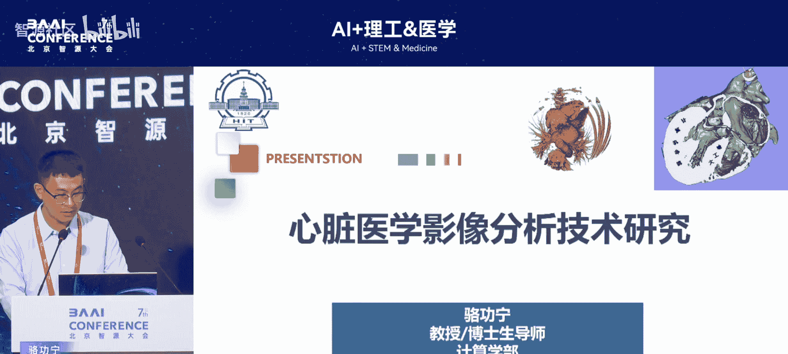

呃，这个在各位医学大咖面前，我就不过多的介绍这个背景了。就是其实心脏病确实像刚才几位医学大咖们说，这个呃确实是现在都位居首位了。在咱们国内也是位居首位。然后我主要做的是影像方面的研究啊。

所以影像方面有很多现在刚就CT啊和MI这个还有介入式的OCT呃超声介入式，还有pat的都在心脏上有一些应用。这是我今天汇报的一个提纲啊。首先呃我说一下，我是计算心脏学这个领域展开的。

最早也是跟张贵老师合作，也是张贵老师呃，最开始提出来呃，要让我们做一些心脏学以上的分析任务，所以就展开。但是呃这块的。

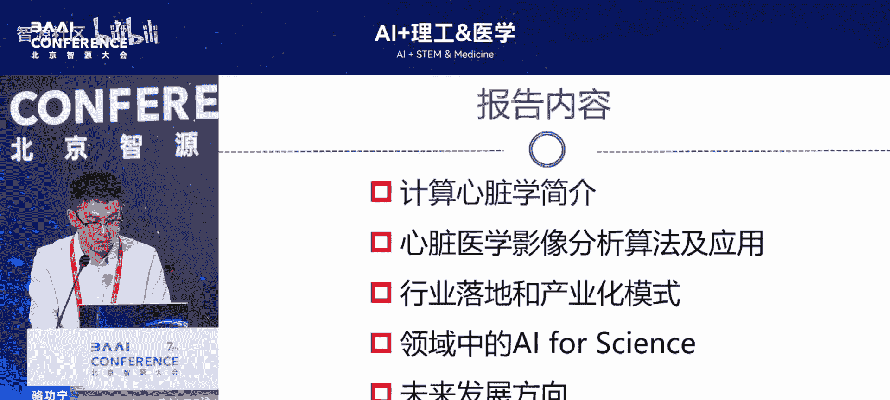

深入的这个病理在病理包括生理方面的研究，我并不是特别深入，主要在影像这一块做了一些工作啊。这是简单的一个心脏的一个工作原理啊，它是电气号驱动力呃，然后产生的。

包括有一些电力耦和流过耦核的一些东西非常多啊，将样产生了一些ECG的信号啊，这个因为今天这个汇报场景我就不多做介绍了，因为大家都是专家。

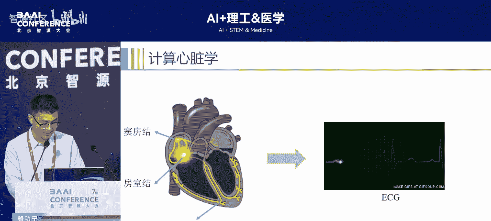

然后呢，就是计算心脏学这个领域其实非常复杂。它涉及到的呃领域非常多。从这个。24年的一届的这个会议的这个宣传策上，我们就可以看到呃，它涉及到一些计算机啊，涉及到人工智能啊，涉及到医学生理啊各个领域。

其实这个会议都办了，应该今年应该有5052届了，接近。我们最早也是从这个会去学习，然后去做一些相关的工作。呃，计算计象学包含了很多的这个学科领域。

包括系统生物学、影像学、计计算机科学、电生理学还有心内外的一些科学。在心脏这方面，我们相关的一些学者展开的一些工作，包括这个心脏疾病机理的探究、心脏疾病诊断，包括治疗一些方面的一个工作。

下面我接着主要汇报一下，我在心脏医学影像分析算法和应用这个领域做的一些研究吧。其实我主要还是从解剖层面上去做了一些呃工作啊，比如说我们在肺动静脉的这个提取啊，主动脉冠脉心房心室啊。

这种腔体的这些提取的这些工作。这是我这几年主要展开的呃，相当于呃为这个人真正的这个人工智能啊。诊断疾病做一些铺垫式的一些工作吧，希望未来能有更多的机会跟各位这医学领域的大咖，包括人工智能领域大咖多合作。

啊，我把这个领域就是我专注的这个领域啊，就心脏学影要分析分为几个层面。第一个就是对象层。对象层，我们可以从解剖上心式心房冠脉、肺动静脉和肿动脉等等来展开。再有一个是我们丞像这些。解剖结构的时候。

我们需要需要这个成像层啊CTMIDSC啊，超声啊、OCTpatt等等。然后在方法层面上，我们去基于这些呃任务，包括这些数据。我们方法上我们主要做的还有这分割检测、配准、可视化、分类啊、回归等等。

可以通过这些呃这些名词，我们可以看到，其实它是一个确实很交叉。除了医学啊呃成像，还有一些人工智能的东西。这个是这个这个就是我一个为什么要做这个任务的一个起源啊，这也是在呃十年十年前。

张贵老师给我的一个任务啊，当时给我一套呃非常高精度的一个狗的MCT的一个数据。他说龚宁，你那个给我标注一下，给我分割一下这个数据。我当时首先想的是自动化的一些方法。但是我尝试了非常多自动化的方法啊。

都分的不好。因为老师要做的是仿真啊，就是说最终做的可能是右边这个效果，所以这个是分割是不可以有马虎的，就是要非常的精度非常高啊，于是我就花了接近呃一个多月的时间啊，就是把每一张图用手动的方式给他勾出来。

也就是因为这个事情啊，我就进入这个领域，我就想未来我应该从事一些。自动化的包括智能化的一些方法啊，这就是1年前我做这个事情的起源，就张辉老师带我进来的啊。后来呢我就。做了很多的拓展了很多其他模台。

包括呃其他的这个。分分割，包括一些分类的一些任务啊，首先就是。围绕这个新房，后来我们找了一个公开的数据，开发了一些呃智能化的一些方法。也当然也实现了相对比较高的一个精度。当然距离仿真还是比较远的。

但是呃初步的做一些疾病的一些呃。预分割啊，一些预分系还是可以的。当然这些方法呢后面经过一些优化啊，也出了很多套一些方法，发在我们领域的一些比较呃。比较比较老牌的一些旗刊上吧。呃。

我当然我也做了一个当然我后来我也做了一些关于这个核磁啊，心室分析方面的一些工作。因为这个呃很多疾病的起源也都是从新室这个泵血功能时常呃展开开始的。所以这个领域的领域的非常的火热。

所以后来我也做了一些相关的这个工作。心式核磁呢，它是一个呃现在我认为它是1个4D的数据啊，就是在时间上。它是一个动态的，我觉得它是一个动态的那空间上它就是一个三维的。所以我认为它是一个四维的数据。

在成像软组织方面是非常有优势的。然后现在一些在医学上大家都认为是新不层规则，然后每一层或每每一张图给他精准的把心式给它分割出来，然后累加出来算出它的容积啊、质量以及涉血分数。

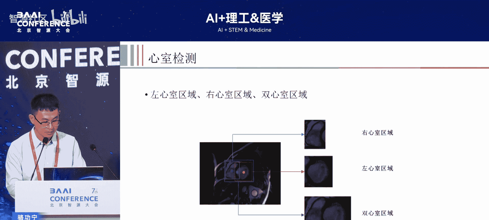

当然这里有自动化的分析呢是有难点的呃，包括其实自动化的最终的目的是辅助医生更快的去做一些分析诊断。但是他其实是有难点的。因为从这张张图我们就可以看到了。呃。这个右心室在单纯这个切面上。

它的一个心动周期就会发生top扑结构的一些变化啊。其实其实这像这种对呃自动化的这个分析带来非常大的挑战。也就是为什么至今这些问题也没有说用人工智能方法去很好的解决。

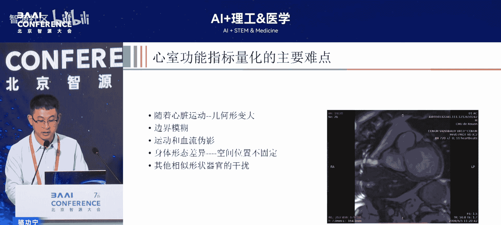

所以我们当时就首先把这个任务分解啊，先进行一个基本的检测任务，把心式给他检测出来。然后呢，我们当时提出了一个基于这个呃医生的这个手动操作这种先验的方式。因为在做医生在做这个扫描的时候。

他会做一个初步的定位。这个定位呢就空间上这个交叉的这个中这个位置呢，就是心室的中心的这个片见中心的这个位置。于是我们就基于这个先验。首先找到这个左心室的这个中心。然后再做一些呃突谱匹配的方法。

把它相对比较相对准确的匹配到这个心室。然后找到目标之后，我们再做用深度学习的方法输入网络中啊，进行一个预测。这当年发在这个TBME上。呃，后来也对方法做了一系列的这个改良，包括呃对错误的这个调优啊。

后来发在这个meing上啊，医学影象分析上。

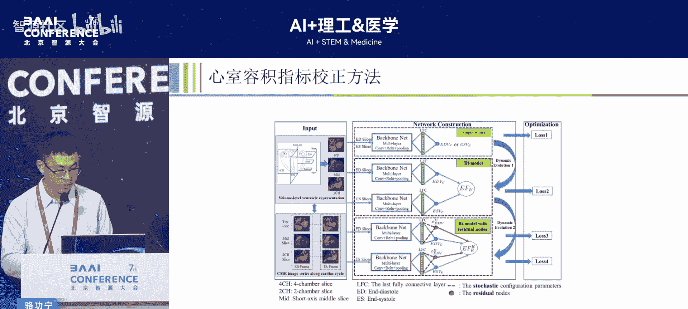

当然后来我也尝试把这个呃分割任务和预测任务融合到一起啊，做了一些方法层面的一些结合，然后提出了一种。比较新的一种不确定性。估计。因为我们不仅要预测出结果，还要估计出这个结果到底有大概有多大的误差。

给医生一个参考啊，不能说医生直接就用了，告诉他这个东西有误差啊。也发在这个medical emergency上。后来我们其实也做了一些灌卖的工作，其实灌脉是呃可能医生更关注的一个一个任务啊。

因为他的这个大多数这个这个猝死的这个原因，都是因为这个心梗啊，所以说后来我们就聚焦到这个任务上呃，首要的一个任务就是CTA啊CTA的这个分析。因为这个心梗主要是因为血管堵了。

所以导致的在CTA就是心呃基于增强CT这种方式呢，能把血管比较比较清晰的给它呈现出来。

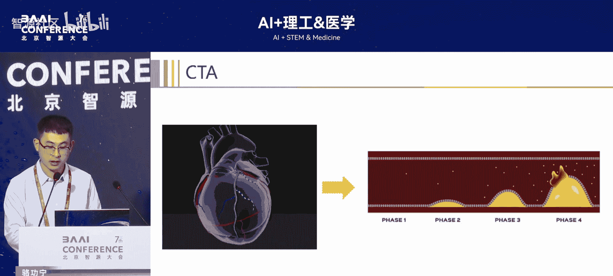

我们当时提出了一种。呃，方法去啊首先找到这个冠脉的中心线啊，当然这个方法到现在其实这个全自动的至今没有解决啊。但是医生其实用的还是一些交互的半自动的一些方法。因为他有一些难点。

比如说这张图我们就可以看到在这个冠脉狭窄，就是有病的这个地方，其实影像。当然医生很清楚的就看到，但对计算机来说，他并不那么容易去解析它，这其实呃恰恰是有问题的地方，也就是我们有难点的地方。呃。

我们也是模拟医生的这个思维啊，提出的一些相关的强化学习的方法。一般我去医院这个跟医生交流的时候啊，医生都说我们这个方法其实现在目前主流的一些软件，也都是说首先交互式的，我们找到这个冠脉的起点。

然后一个一个的去点，最后把它连起来，得到一个比较完整的冠脉的中心线啊，于是我们就模拟这种方法，呃，提出一种强化学习的方法，也就是首先找到一个点，让这个机器呢也模拟啊去医生的这种方法，一个个去找下一个点。

然后把它连起来，就是中心线。

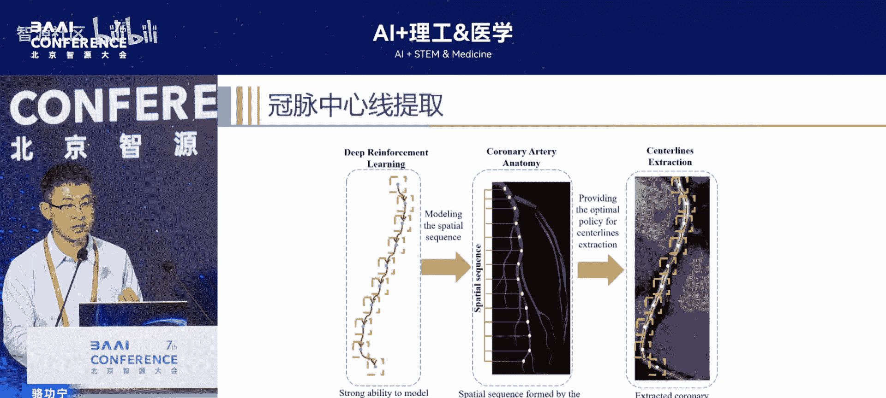

啊，当然这是一些方法上的东西吧。这些一系列的方法发在这个呃米看上，就是我们领域的一个顶会。呃，就是刚才王庆英老师的说的，要下呃下后年啊要在阿布扎比去办那，大家可以做支持，因为这个会也是。

领域是应该是最大的一个规模的一个会议了。呃，后呃后来也昨提出来一些比较呃比较这个。时髦的一些方法吧，当然也都发在这个人工智能，包括这个一选项分析的这些顶会上。就是我们可以提出一些，不仅是提出这个中医线。

沿着着中医线的，我们去找大概的病罩的位置在什么地方也是模拟医生的这种呃诊断的这种流程。然后也提出一些呃基于这个自动化的这种方法，能够判别啊有微有病的这种有斑块的属性啊，斑块的这个到底是什么样的属性。

斑块的狭窄的程度是什么样的，做一些这相关的一些工作。

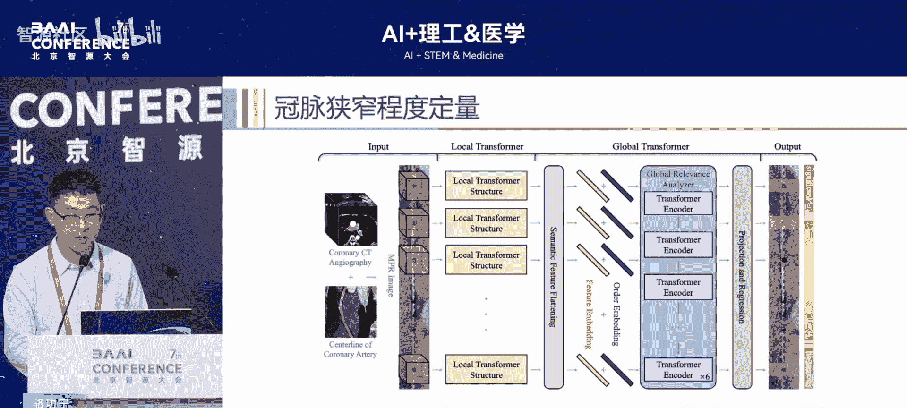

也开发了一些系统。

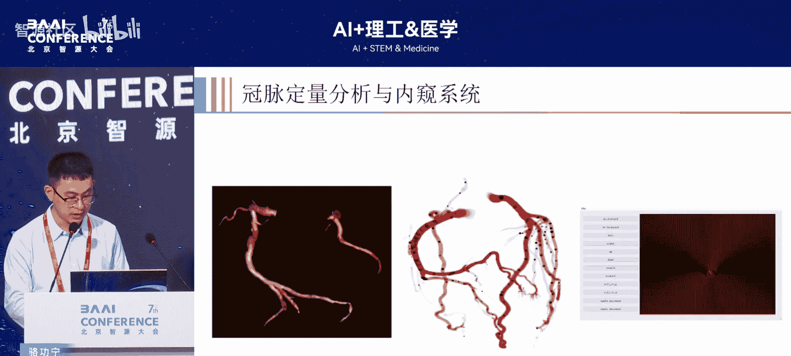

但是除了这个呃CTA之外，其实诊断这个冠心病呢，还有这个OCT啊，像介入式的这种方法。由于时间的问题我就不多展开了，还有这个iv啊这种OCT和，当然也是都是介入式，但他俩各有优势。

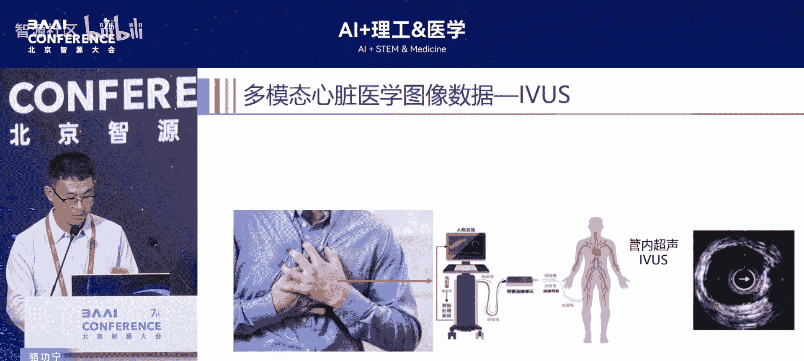

我们之前参加过一个挑战赛，拿到一套数据，然后做这个一损板块的这个检测啊，当时也发了一些文章啊，我们也提出来就是说一些深度学习的方法，能够自动找到这个具有角薄纤维帽的这个位置。这种一损的这个板块。

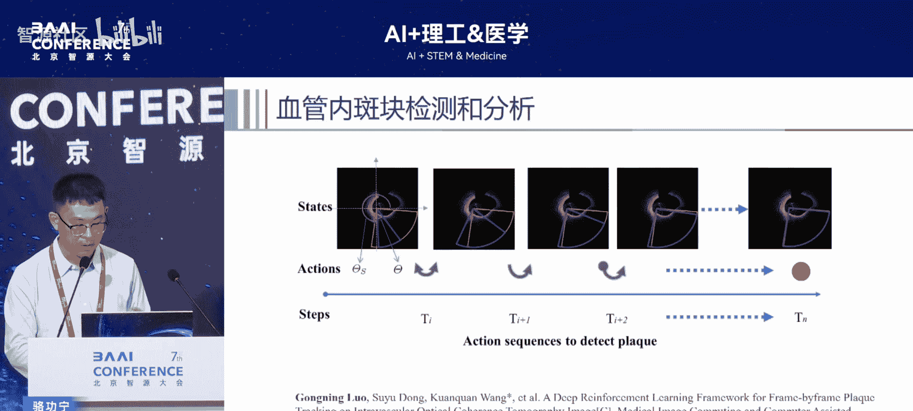

辅助医生进行一些分析啊，这是一个视频呃就沿着血管，我们能够呃去找每每一针啊有有病的这个位置。

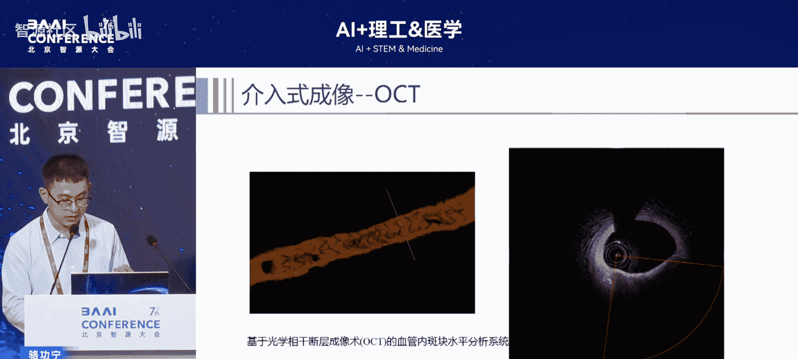

然后当年这是这个挑战赛，是一个公司发起的呃，我们是在接近100个团队拿到了冠军啊。呃，这个也做了一些3D超声的这个呃数据的分析。当时这个是3D超声。

当然并没有那么我认为啊其实至少在一些呃比较初级的一些医院，并没有那么普及，这个设备比较贵。但这个当时也是国际上公开的一套数据，我们拿过来啊分析，提出来这个基于图谱的自动匹配的一个方法。

然后能够实现相对比较准的一个新式的一个分割。

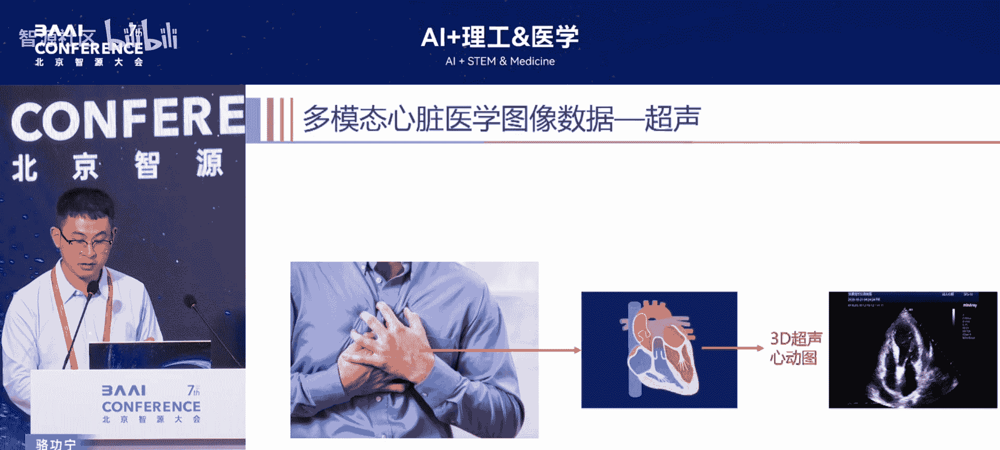

发表在这个medical imagin上。后来就是一直想跟朱教授合作，在二维上做这个重建。但这个问题一直没有解决，给他说声抱歉，一直没有解决。这个三维上还好，因为三维数据它是比较全的。在二维上。

我们基于几个切面去重建三维，这个是难度很大。

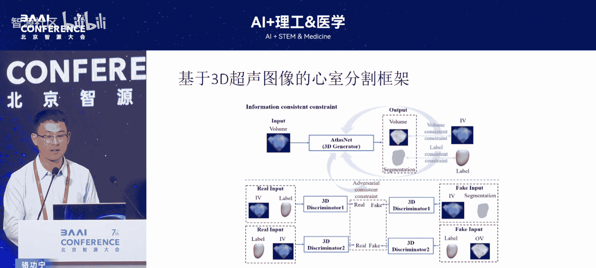

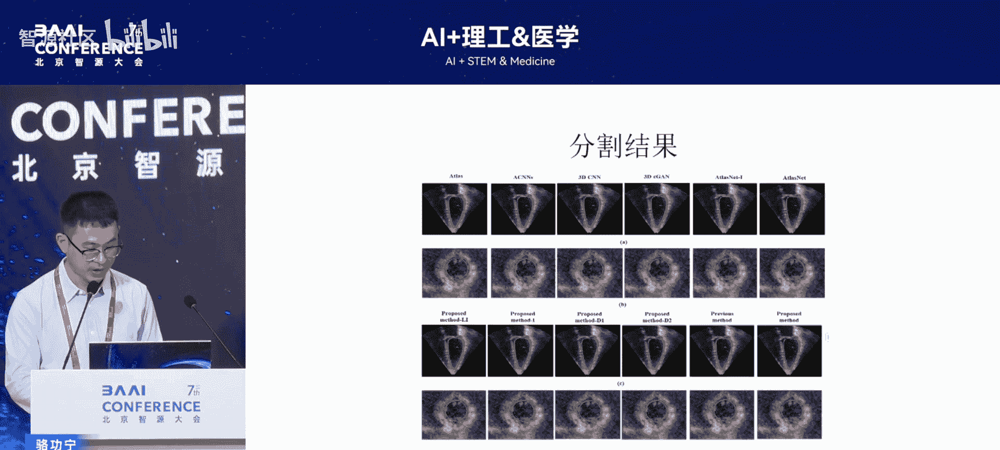

这是当时的一些分割的结果。呃，就是后面我给大家展示一下，我这我这几年在这个呃除了做算法之外啊，也做一些落地，包括应用的一些工作。

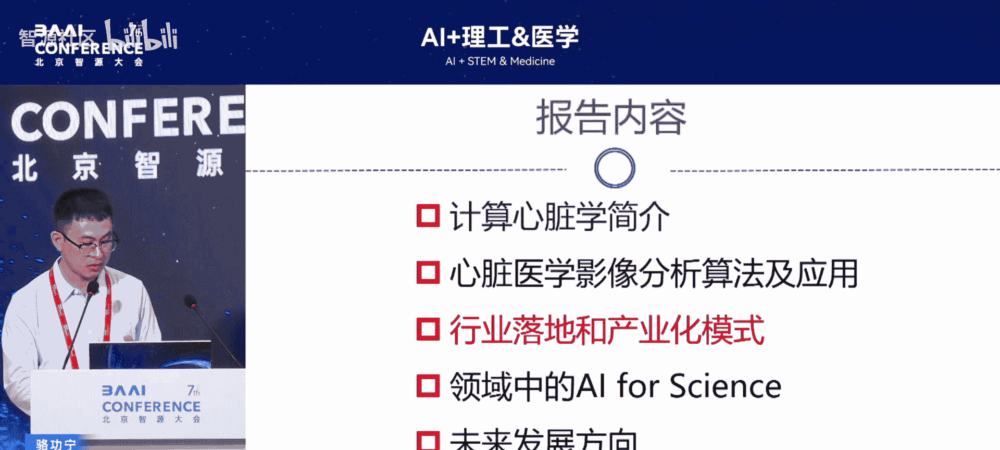

我们也开发了一个全新浪的建模平台，呃，跟我们哈尔滨的这个拓盟科技了呃比较展开这密切的合作呃。现在产值就是我们的他通过转化我们的技术呃，委托我们开发软件，产值已经超过2000多万。

这是一些软件使用过程中的呃一个初步的截图这个视频。

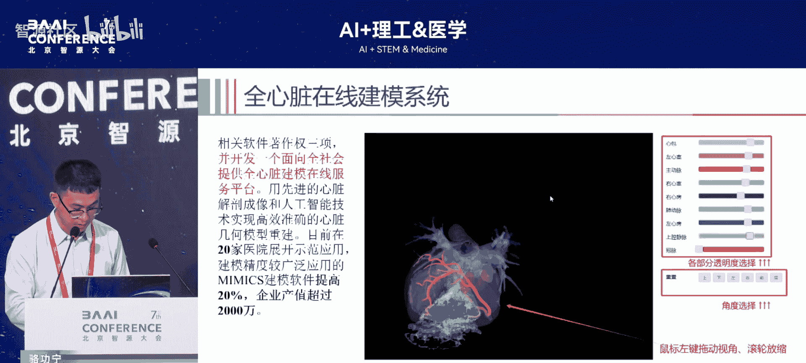

由于时间的关系，就简单的就是给大家放一放。我就。对，就是最开始这是个这个模型是可以让医生去呃传脱敏后的这个数据啊。虽然数据不能出院，但是脱敏后有一些我们可以去做一些科研合作。上传完之后呢。

AI进行自动的一个分析，然后可视化建模。

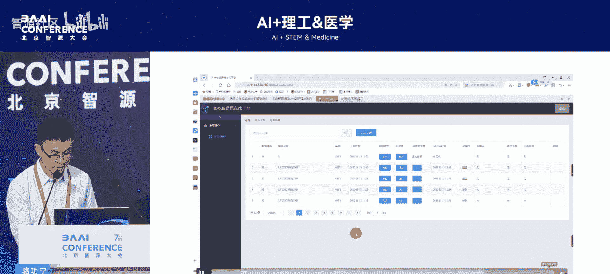

这是当时建的一个结果啊，就是上面的缺损是因为影像数据的呃，当时只有扫描的那个位置，所以是。

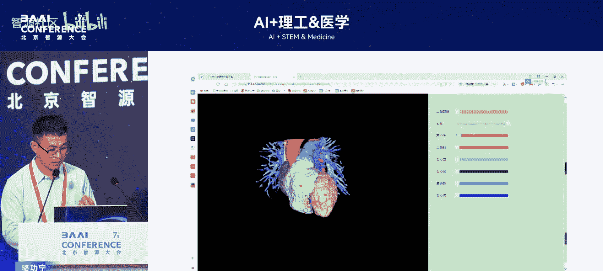

建模的一个数据。

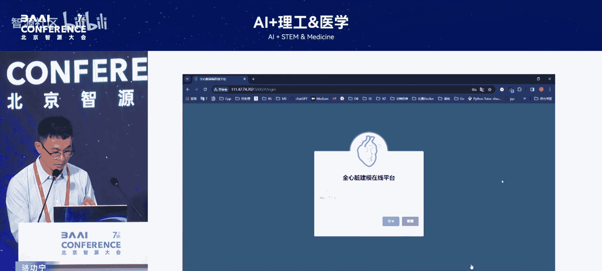

演技。呃，这样可能我鼠标滑轮，这个是一个冠卖的一个重建的结果的一个演示。专门针对冠卖，我们其实也开发了一个专门的软件。现在在还大一进行6个视角试用一下左右前后，这样这里就不一一展示了。

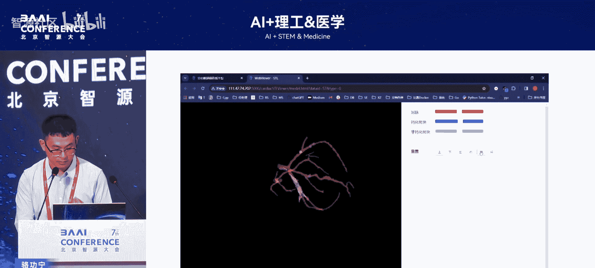

呃。然后也开发了一些本地的一些呃软件。也做了这个本地的软件现在比较灵活，可以做一些血管内的一些内窥啊。是当时当时基于这个心脏的这个呃CTA数据好像是做了一个。做了一些简单的一些处理啊，重建就是。

你发现其实这个CTA的心脏也是可以跳动的啊，如果确实加上时间轴的这个数据的话。呃，就是在这个过程中，我们也协助企业来申请了这个两张医疗器业证啊，做了一些转化。当然后来我这去年开始啊前年开始做了一个工作。

确实像之前这个医生们说的那样，需要一些大规模的数据来支撑，才能让算法更加的精准。呃，去年我们联合公司也是呃耗资了接近100多万，就是招了缴了很多医生也招了很多人来标注这个数据。

这是我们当时标注的这个1000多套呃肺动静脉的高精度的这个分割数据。然后用基于这个数据，在全国的这个市纪家医院做多中心。验证。然后我们开发了一个精度很高的一个肺动静脉的一个分割算法。呃。

今年发表在这个nature communication上。我们发现呢当算法达到精准度达到一定程度之后，其实其实是可以发现一些科学规律的。比如说这个文章我们就发现了一些科学规律，就是随着年龄的增长。

或者然后人的血管可能会慢慢的丰富度变低啊，当然男女血管之间的丰富度也会有一些差异，其实在公开场合，我有时候不太敢去说这个结论。因为下面都是大咖都是医生，当然我们当时发这个文章的时候，也在胆战心惊。

说这个结论是不是搞错了，确实是大家不知道的一个结论。问很多医生，为什么这个男性和女性的血管丰布度会有差异？有的人给我这样一个解释，说看看这个我们的手就可以发现女性的血管更细。但是同样的这个。

就随便拿出一块组织，如果血管更细的话，要保证供血的话，那是丰富度必然要高啊。所以这个后来有这个解释之后，我们就勇敢的去去投稿。然后后来结果也不错啊，其中有一个申稿人说。你这个投n有点亏了。

可以试一下n medicine。但是当时已经中了，所以就但是这个结果呢展现出来还是很震惊的。其实这个结果也恰恰说明，其实我们的AI能做很多事情，它不仅可以辅助临床，它还可以发现一些科学规律。

也许这个规律。仅仅是一些规律，但是当下没有什么用，也许在未来非常有用。当时我们验证这个结果的时候呢，也担心出现错误，但是做了很多的实验。比如说随着年龄的增长。这个血管的风度变低，这个正常的。

因为有一部分血管会闭塞。然后呢，基于这个呃其基于这个这个初步的这个验证结果，我们做了男女血管丰富度的这个差异的对比。当我们发现其实这个女性的血管在同等的这个体积下，它的丰富度会高一些。

但然这个有什么用呢？不知道这个问题可能抛给医生啊，抛给做临床的医生人去探索。这个数据我们标完之后，我们也发布出来啊，办了这个国际小人赛，现在有全世界大概基本上这个有400多个团队啊，都申请了这个数据。

在用我们的数据做这个肺动静脉血管分分析的这个测试。

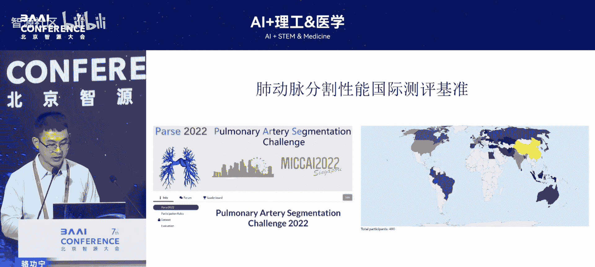

呃，未来的发展方向，我还是觉得这个张贵老师，包括D位大咖做的这个方向应该是呃非常有前途的。然后我们我做的这些都是给大家做铺垫啊，呃希望大家能够也多多合作，能助力这个领域的发展。啊。

这些都是这不是我做的啊，这些是从呃这个网上下载的一些结果，包括张老师的一些结果，就是可以未来肯定是在图像分析的基础上要做一些生命的模拟，规律的探索啊，规律的发现。

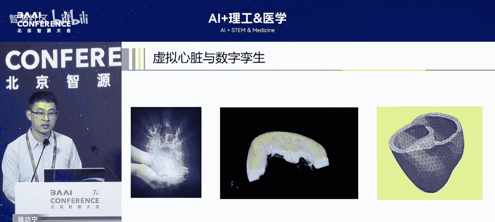

啊，这是我们团队的这个呃成员啊，我导师是王全老师啊，现在我们这些都是一起在哈尔滨工业大学这个平台上工作啊。然后这是我们团队的一些研究生和博士生。然后我们团队做了这些个这是我们平时公开的这个数据和代码呃。

大大家感兴趣也可以去呃，就是多多指教啊。好，谢谢。

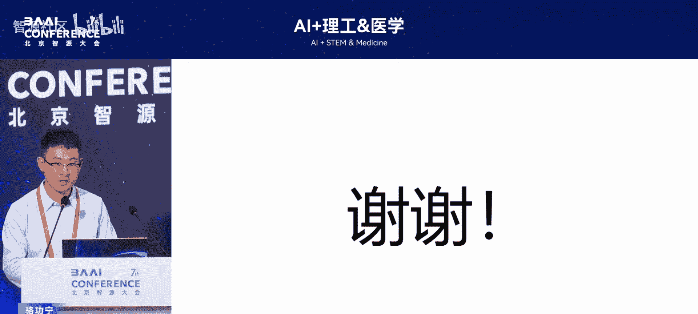