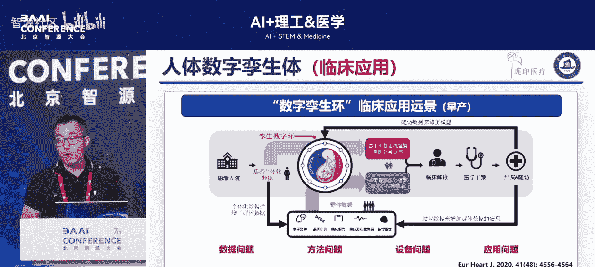
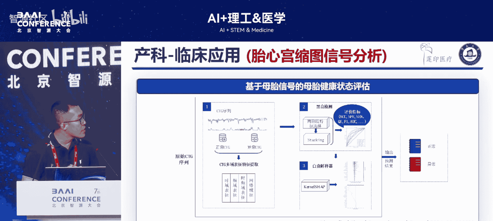
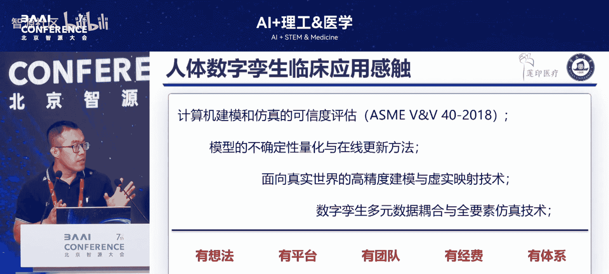

# 2025北京智源大会-AI+理工&医学 p13 面向医疗健康的人体数字孪生技术：白杰云 -BV1X7N7zaEYD_p13-

呃，首先呢非常感谢呢呃张贵教授的邀请。呃，我博是期间呢做的课题呢，就是说完全跟那个张老师的这个部分是吻合的。并且呢在这个部分的话呢，就是说呃不断的往前推进。

当然呢在这个部分呢只做了一点点的这个工作第呢真正的这个应用这个方面。呃，很长的路呃，要走。那么呢呃接下来呢我们就看一下。那么从国家的这个大的这个战略这个需求来看呢，就是说现在是老老龄化比较这个加速。

而且呢就是说慢性病的这个高发。那么在这种情况下的时候呢，就是说从医疗需求的这个角度呢，需要呢对于这个全生命这个周期的进行健康这样的管理。那么要打造呢就是说唉从这个就是说预防治疗。

还有康复养老的一一体化这种服务。那么在这个部分的话呢，就是说我们需要呢，就是说对于这个部分呢，就是说要进行全域的这个数据的感知，从而呢建立这个这个数字孪生的模型。然后呢。

通过这个部分实现这个辅助的这样决策以及应用。那么在这个部分。与我们国家的另外的一个呃十四五准备发展的一个方向呢，就是说这个数字经济的这个部分是吻合的。那么呢大家也可也可以看到呢。

就是说哎全中国的这个各个部分呢，就是说都推出了与这个就是说加快这个数字经济发展的这个呃项目呢，就是说有关。那么在这个部分的话呢，就是说大家最近几年感受非常深的一个部分呢。

就是说比如呢就是呃这个悟空的这个这个游戏，还有呢相当于是能吒2这个部分都是呢相当于数字经济对于这个部分发展的一个面向。那么在这个里边涉及到人的这个部分的话呢，就是说一个部分的话。

就是说这个数字人或者虚拟数字人从这个20世纪这个80年代到我们现在。然后呢，就是说通通过呢就是说AI这种方式呢，就是说不断的呈现出来呢这个素制人。

但是呢它这个部分的话呢都是体现在人体的这样的一个形态这个方面。那么呢就是说哎形态这个方面跟我们这个医疗的这个方面的时候呢，还是需有差异。因为呢就是说我们在治病看病的这个部分的时候呢。

就是说哎我们用什么药是基于呢就是说他这个疾病的这个机理。然后基于这样的机理了之后呢，就是说哎来设计相关的药物或者相关的这种肝预的这种方式呢才可以。所以呢在这个部分的话呢，就是又提出来呢。

就是说这个虚拟生理人，并且呢在这个呃21年的这个双清重感染这个部分呢，就是说也说到了，就是说唉这个虚拟生理人士呢？就是说这个技术迭代和创新的。这样的一个转型。他呢就是说能够呢这个探究这个人体的奥秘。

然后呢就是说来解析解析的这个疾病的产生，并且呢就是说能够对它这个氧化进行分析。最终的目的呢就像我们刚刚说到的要实现了这个精准治疗。而这个部分呢，就是说真正的要实现这个部分，或者说真正的要实现落地。

或者说要关键的一个技术呢，就是说这个数脂卵生技术。接下来呢我们来看呢就是说当前这个就是说虚拟生理人的这个呃发展的呃这个部分。那么当前的时候呢，就像呃呃70年代提出来的这个就是生理主学的这个呃。

方法是一样的，就是说呢就是说我们通过呢就是说构建这个亚细胞的了，细胞的了组织的了。然后呢，就是说这个亚系统的，还有系统，最后呢相当于构构建起来这个啊虚拟生理人。但是呢在这个部分我们还有很长的路要走。

然后呢，现在的时候发展呢就是说比较好的一个方面的就是心血管这个部分，包括的就是说这个电学的力学的，以及他们耦合的。还有呢包括刚刚那个呃骆教授讲到的就是说这个结构分析的这个部分。那么在这个部分。

我们要真正的实现呢，就是说我们未来的一个远景。就是说这个人体的这个数质孪生。我认为呢就是说一个方面呢就是说需要呢把这个仿真和这个数据呢相当于是双驱动，并且呢要融合起来。

那么这个部分呢就是说也切合呢就是说美国美国的这个就是说呃科学院24年就是提出来的一个一个指南。说呢就是说除了我们看到的这个数字孪生的这5块，就是说这个物理空间虚拟空间，然后呢，就是说从物理到虚拟。

然后从呃从虚拟呢到物理，还有呢中间的这个人机交互辅助决策之外，我们还需要关注的更重要的一个部分呢，就是说外边的这个绿色这个部分需要呢就是说核验验证不确定性量化，以及呢这个里边涉及到呢呃安全，还有个能力。

那么在这个这个里边呢，我们现在的时候呢，能看到的一个方向呢，就是说哎我们一方面的时候借助的这个AI的这个部分。另外的时候呢，一个一个部分呢借助这个呃这个模拟仿真。因为模拟仿真的时候。

我们可以呢相当于产生很多很很多的这个数据。并且呢就是说在这个模拟仿真的这个过程中，因为它是基基于机理模型的。那么它这个部分的话呢，就是说可以解释它为什么产生这种现象。而那个AI这个部分呢。

它又能起到一个呢相当于归纳的作用，就是说我们有大量这个数据。然后呢，就是说从里边呢就归纳唉哪些辨理指标是O的。然后呢，就是说一个方面的话呢。

我认为呢就是说基理模型的这个部分能够呢弥补AI这个AI模型这个部分呢，就是说可解释差可解释些差的部分这个部分。那么这个部分的话可能是归来的一个方向。那么呢在这个部分的话。

如果呢我们能够实现这个人体的素质孪生。那么在这个部分的话呢，就是说我们如何去落地。那么这个部分的话呢，就是整体的这个愿景是这样的，就是说哎一个患者入院之后。

他就会呢相当于取取得这个患者的个体化的这个数据。那么这个个体化的这个数据呢，一个方面呢就是说基于个体化的这个数据，我们可以构建一个个体化的这样的一个模型来预测他的这个疾病。另外一个部分的话。

它这个数据呢可以呢相当于增加到原有的这个就是说历史的这个数据中，然后呢去归纳。然后形成呢就是说一个呢相当于呢就是呃。一一个呢相当于是模拟仿真的这个呃数字化。

另外一个呢相当于通过这个这个呢相当于AI这个部分呢进行进行呢相当于分析。然后呢，就是说基于这个部分，医生基于呢相当于他们得到的这样的一个结果，然后呢进行判断，然后干预最后的时候把结局的时候呢给出来。

然后呢就是说不断的修正模型。然后还有一个部分的话呢，就是说把这个呢相当于数据集那相当于是不动不断的这样的标准化。然后呢从而形成一个可持续的。然后呢不断不断运转的这样一个数数字孪生模型。

但是在这个部分的话呢，就是说会存在很多很多的这样的问题。最关键最关键的一个问题呢，就是数据问题。因为呢就是说大家可以看到呢，就是说哎数字中国这个部分所有东西呢相当于都要数字化。

或者说现在刚刚讲到的这个AI的这个部分，你的数据的问题，数据质量的问题是最关键。接下来的时候呢才是方法。那么呢有了方法这个部分之外的时候呢，就是说哎我们真正的要把这个样这样的一个数字孪身的这样的模型。

然后呢要落地。我们这个部分呢相当于是要跟这个硬件，还有呢相当于整个医院这个信息系统呢相当于结合起来，才能够呢真正的落地。最后的一个部分的话就是应用场景。

那么呢我们首先来看呢，就是说最重要的这个数据的问题，就是刚刚那个王教授讲到的这个部分就是。多模态，多尺度这样数据的这个重要性。一个部分的话就是说我们要能够获得它。另外一个部分的话呢。

就是说哎我们如何去分析它。那么所以呢就是说它的这个可及性和必要性非常重要。但是呢我们前面的时候做很多模型的时候呢，就是说实际上呢就是说假如我们有某个人的这样的结构了。

但是呢对于他这个离子通道相关的这样的数据，我们又没有，对吧？我们可能呢就是这个部分的话是基于动物的，或者说或者说某某个地方基于并理的或正常的那么结合起来呢，就是说我们去做。而我们另外一个部分的话呢。

就是说哎我们如果能能能够从临床上拿到这样的数据，又会存在什么样的？就是说哎。他他的这个精确性不够。比如我们前面刚刚那个那个呃。洛销授讲到的那个部分，他标注了高精度的那个新版的那个数据。

那么那个部分的话呢，就是说是通过呢就是说特殊的那样仪器达到高精度。实际上真实的时候，临床上的那个数据呢根本达不到那么高的高的精度，对吧？那么还有呢，就是说我们这个数据里边的时候有一些有缺漏，对吧？

还有呢就是说一致性的等等的问题，都是呢就是说唉使得我们这个部分往前发展的，就是说很大一个障碍。那么基于刚刚说到的这样的这个现实的问题，我们怎么去做呢？

那我们就按照这个生理学这个不呃生理主学提出来这样一个方案，就把这些无序的，或者说这个碎片化的这样的数据，或者多物种的数据，多尺度的数据，或者说多健康状态的这样的数据呢，相当于都耦合起来。

然后呢定量的去描述它，我们先做一个呢相当于是通用的一个模型，或者说我们可以认为呢就是说它是一个拼装车，对吧？然后呢，我们不再不断不断的去搭对它进行优化，对吧？那么但是呢就是说这样的模型呢。

就是说还是呢就是说理论研究的这个部分，或者说在个在这个部分的话，就是说进行的这个理想的仿真。然后呢，接下来这个部分的话呢，就是说哎在这个通用模型的这个基础上呢。

我们考虑呢就是说现在能够拿到的这种个性化的这种数据。比如什么呢？比如前面拿到的就是说这个影像啦，或者说呢就是说哎这个信号啦，或者说这个人口统计的这样的信息，把它呢就是说融在这个基础模型的这这个部分呢。

就是说融入进去，然后形成一个呃认为的这样的一个个体化的这样的模型当中。接着呢就是说哎我们形成这样的就是说伪的这种个体化的这样模型之后呢，哎现在的时候呢，美国。说呢就是说哎使用这种模型呢。

就是说可以进行呢，就是说呃这个叫做虚拟的这个临床试验。那么这个部分的话就是说哎我们可以构建这种模型的种群。然后呢把这个就是说呃这个个体的这种差异的这种变化呢，就是说对它进行参数化，形成这样种群，然后呢。

就是说开展这种临床试验。不管是药物了或者其他的这个方面。另外的一个部分的话，就是接下来一个部分，或者说现在想往前发展一个方面，或者说真正的能够落地的一个方面呢。

就是说哎我要形形成这种个体化的这种在线的仿真，对吧？那么我们形成了这种个体化这样的模型。我们要结合呢就是说临床获得的这样的这个实时的数据耦合起来。然后呢形成呢形成呢就是说它可以呢就是说虚实映射。然后呢。

这个样的时候呢，就是说基于基于呢相当于呢就是说嗯。临床医生对于他的这种干预呢对他进行预测。但是这个部分的话呢，就是说还没有实实现，或者说这个部分呢还是停留在这个理论的这个部分。然后呢。

这个部分的话也需要呢就是呃很多医生。还有呢就是说呃这个就是说国家的这个监管的这个部门呢，就是说如何往前推进这个部分。最后一个部分的话就是说面向真实世界，对吧？我们要把这个东西呢。

相当于是接接入到了就是说整个的这个这个呢相当于是信息信息系统里边。然后呢，就是说通过这个医疗设备，然后获得这种孪生数据，然后呢基于孪生数据呢构建这种这种呢呃这个孪生的这种模型。

最后呢基于孪生数据和这个呃这个呢相当于是激理模型。然后呢做最后呢相当于做出来这个决策，或者说哎决策相关的这样的信息。然后呢，最后呢使得整个呢这个系统呢能够形成可持可持续的这样的一个呃孪生模型。

从而呢支撑了这个精准医疗。那么接下来介绍呢，就是说在这个部分我们做了哪些工作，对吧？在呃心脏仿真的这个部分的话，呃，我在我在哈尔滨工业大学的时候呢。

就是说比如呢就是说做的这个runQT8相关的这个这个呢相当于基因突变情况下的时候呢，就是说来预测它预测它呢相当于呢在宏观的这个心脏表面的时候，电传导到是怎么样的来解析它的这种宾理器势。

那么在这个新房子方面的话呢，我们也也也呢相当于考虑这个就是说某些上游的这个基因对于那个下游蛋白这种调控作用，把它相关的作用的这个生物实验呢，就是说。呃。

融入到呢计算机模型中来预测它的它的这个就是说呃结果，然后呢来分析它的这种病理机制。基于这种病理机制呢，来我们给出来什么样的建议呢？就是说哎是不是某种药物呢？就是说治疗它呢相当于是更好。呃。

在另外的时候呢，我们也做了，相当于是窦房结这个生理病理机制。然后呢，就是说结合呢就是说离体离体人体的就是说移植的那些心脏的这个这个结构这种信息。然后融合呢，就是说细胞模型来构建呢。

就是说具有呢这个解剖结构的这样的窦房结模型。然后呢来呃分析呢，就是说比如那个呃心衰或者其他方面的时候呢，就是说它产生的这种病理机制。那么在应用的这个方面的话呢，就是说我们也做了一个工作呢。

就是说对于它这个呃药效的评估。比如呢我们构建的就是说大规模的这样的这个呃种群，然后呢来评估呢，就是说哎这这种用的药呢，是三类药呢还是几类药。因为呢就是说看心率市场药物的时候呢。

它每一种药物虽然它划分划分为三类或者一类。但是呢就是说每一种药物呢相当于是对于多种离子通道呢有有有呃有作用。那么呢在这个部分的话呢，就是说哎我们是不是可以呢就是说怎么把它呢相当于归类归为呢。

就是说这一类。那么呢我们通过呢相当于是构建这样的这计算机模型再结合呢，就是说呃这个计算机学习的这个部分对它进行分类。那么在这个里边最关键的一个一个发现呢，就是说我们在这个里边对于药物划分的时候呢。

我们应该考虑这个性别的因素。大家可以看到呢，就是说下边的时候呢，就是说性别性别特异性的这种分类器呢，要比呢要比呢就是说上边呢就是说没有考虑性别的这个部分的话，它的这个准确率呢要。呃。

就是说AOC的这个部分呢提高了这个6个百分点。还有一个部分的话呢，就是说呃跟跟跟呢就是说临床上很相关，一个部分的话，就是说个体化的这种防颤风险的这个呃评估。那么在这个部分的话呢。

就会涉及到前面涉及到影像的这个部分。我们如何呢相当于是把它分割出来。然后呢分割出来呢，就是说跟之前不同的部分的话呢，就是说前面的时候呢，就是说主要看呢，就是说心脏表面呢就是他的这个疤痕了。

对于他这个影响。我们这个部分呢做的话呢，就是说这个心脏这个纤体的这个厚度变化。就是说哎正常和呢就是说异常这种厚度的这种变化，是不是能够导致这种房颤的产生。那么这样的这种情况下的时候呢。

就是说给他给他呢相当于是有一个有一个呢，就是说指标，就是说未来的时候在评判房颤的时候呢，就是说我们应该呢就是说考虑。前体背后有这种变化。除此之外呢呃大家可以看到呢。

就是说我们前面做到的这个心脏这个部分呢都是离线这种仿真，感觉呢就是说离这个应用这个方面呢就是还很远。那么呢我们另外一个部分的话，就是说在呃产科这方面做的。然后呢这个部分呢也切合呢就是说24年到25年呢。

包括这个柳叶刀nature或者这个ss提出的就是说要构建这个就是说虚拟产妇，对吧？然后呃来呢相当于呢就是说使得呢就是说这个儿童死亡率，婴儿死亡率产妇的这个死亡率来下降。

我们在这个就是说这个呃虚拟产妇的这个部分，我们更关注于这个分娩的阶段。因为呢就是说现在研究也发现呢，就是说。超过45%的死亡呢都是发生在分娩和分娩后的这个24小时。所以呢我们在这个地方的时候呢。

就是说希望呢利用这种数字人生的技术呢来进行这个分娩导航。那么在这个里边的时候呢，我们考虑呢就是说哎分别涉及到的这个因素，包括这个产道胎儿这个产力。那么在这个里边呃分别对应的就是说我们能够获得这个数据呢。

包括这个超声的影像啦，胎儿的心率啦。然后呢还有呢就是说产地的这个部嗯一个部分，就是说这个呃工作。为什么我们能做这个呢？因为我我所在的就是说支持的一个公司呢？

就是说它是呢相当于是面向场合的垂直领域的这样的一个企业。它它呢就是说有呢相关的就是说母台监护的所有的这种硬硬件的设备，以及支持他的这种这个就是说信息系统以及呢相关的就是说远程台监。

还有呢就是说医院医院台监的这个就是云平台，那么这样的话呢，就可以呢就是说解决我们前面说到的，就是说哎我要我要做这个数字纹身，它它能怎么样呢，就是说我们要数据完整数据要一致，对吧？然后呢。

我们就在这个这部分呢做了一一些。然后呢，我们现在做到的做到程度是怎么样的，就是说哎我们开发的软件呢能够呢就是说全面的实时的相当于呢个收集到呢，就是说相关舞台的这样的数据。

并且呢相当于是我们把它呢就是说对于他进行了3D的可视化，但是呢就是说离这个理子刚刚说到的。数字人生的这个部分还有一定的一定路路要走，并没有耦合进去。刚刚说到的就是说他的这个身体的这个功能。

还有呢就是说形成一个闭方。当然这个方面是我们呢就是说努力的这个方向。但是呢就是说在这个之前，我们也像呢其他的其他讲者一样的，就是说基础部分呢做了一些。比如呢相当于是我们在这个里边的时候。

我们涉及到了就是说医学影像的分析，涉及到整个厂道的医学影像的这个分析。一级呢相当于基于对我们舞台信号这种健康的这种评估。

还有呢就是说我们基于这个信息系统获得的这种数据呢，然后呢对于他这种封面方式的这个预测。但是这个地方需到需要呢说到的一点是怎么回事？我们是基于当前我们拿到的这个数据进行预测的。

并没有呢就是说实时的这样的得得到预警的这个部分。那么这个部分的话也是我们未来要做的一个部分。所以呢我对在这个人体素质孪生这个方面做做了这么多年。我认为呢就是说以下这个方面的时候呢，还需要去做。

比如呢就是说哎我们计算机仿真的新在的这样的这个模型，有很多的时候我们拿到医院去的时候呢，就是说医生既不认可，对吧？那么在这个地方的时候呢，就很重要的一个部分呢，就是说可信度评估。当然呢。

就是说国内还没有相关的这种标准。但是呢在美国的时候呢，就是说提出来呢，就是说怎么评估这样的模型的这种可信度。然后呢，就是说推荐往前走。另外一个部分的话，就是说很多的这种仿真呢还是这种离线的。

那么呢如何呢就是说通过不确定性量化。然后呢实现这个呃在线更新也是一个方面。最后一个部分的话，就是说这个就是说要面向这个真实世界的这个高高精度的建模，以及呢耦合这个呃这个多模态的数据。

然后最后呢实现这个呃复仇决策。那么呢这个部分的话就是说哎虽然有想法，有平台。我们需要的就是说聚合呢，就是说更多的人的这种力量呢，就是说往前推进。那么当然这个部分的话也是这个张老师的一个初初衷。

然后推进这些这个论坛，让大家的时候呢就是说来进行交流，然后进行碰撞，然后共同推进这个方面。

最后的这个部分的话呢，就是说做一个广告。然后呢，这个部分的话呢就是说我们今年买看呢相当于是做的一个千连级。然后呢，我们这个千链级呢相关的也会有一个呢IEJBHI的这个呃一个呃相关意。

然后呢就是说希望大家来投稿。除此之外呢，我们也把我们近几年在买看SDI呃上面相关的这个这个代码，还有呢数据呢都公开。然后呢，希望呢更多的人参与到我们这个研究当中共同数据这个部分。谢谢。😊。

