# 2025北京智源大会-AI+理工&医学 p14 迈向智慧医疗的伦理人工智能：周觉晓 -BV1X7N7zaEYD_p14-

啊，那很开心呢，今天可以和各位来呃朋友专家分享一下我们最近在这个呃AI加医疗方向上的一些工作。那么我今天汇报的主题呢是迈向智慧医疗的伦理人工智能。呃，相信大家从前面各位老师的精彩的演讲中也已经感受到了。

其实现在AI呢正在席卷医疗的每一个角落。从去年google他们推出这个艾米系统。然后到今年5月份，他们的艾米支持这个视觉功能之后呢。

我们说艾米其实已经成为了AI for health care的一个行业的标志性项目。特别是艾米已经在多个维度上，比如说多不太推理啊，图片理解共情能力以及这个鉴别的诊断等等呢。

呃各个方面都已经超越了人类的一生。呃所以说其实我们现在正处在一个AI for healthcare care的黄金时期。因为我们现在有这么多的技术突破，可以帮助我们去更好的呃理解人类的身体去预测疾病。

甚至是治愈疾病。那么根据一些研究报告呢，医疗AI行业预计会在2025年迎来一个爆发式的。

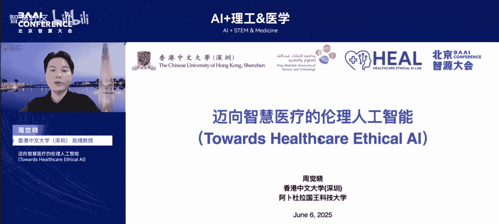

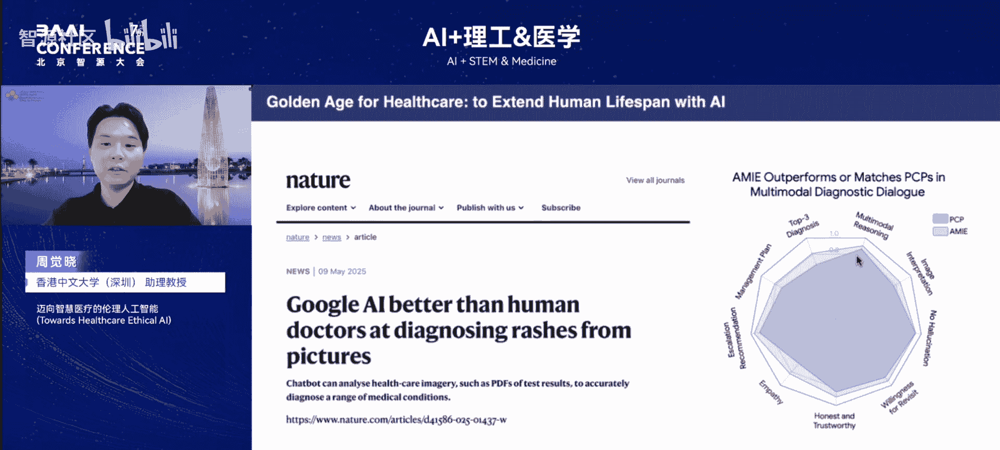

增长，全球市场规模呢预计会突破千亿美元。呃，中国呢会成为第二大的一个单一市场。那么这其实是一个非常非常大的机遇。嗯，但是与此同时呢，虽然说我们已经看到了AI在医疗里面这么多令人可喜的成果。

我们同时也看到了很多的这种潜热的ical challenges。嗯，比如说像这个数据隐私和安全模性的公平性模性的透明度和可解释性以及最后的责任归属等等。

那么这些问题呢都是我们呃不可避免呢需要去直面的问题。特别是在这个医疗保健的场景之下，所以这也是为什么现在呢我们经常会问到两个问题。第一是AI诊断是否真的可以取代医生。

特别是当这个AI诊断比医生更快更准的时候，那么我们应该怎么样去定一个责任与信任的问题。所以说我们作为呃在这个AI医疗的行业的从业者而言呢？大家都有非常宏大的目标。

我们希望可以通过解决一些关键性的这个医疗和生物的问题来延长全人类的寿命。嗯，同时呢我们也。

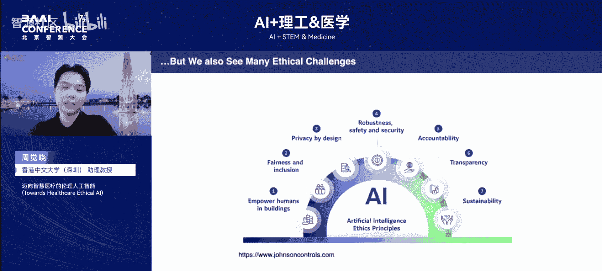

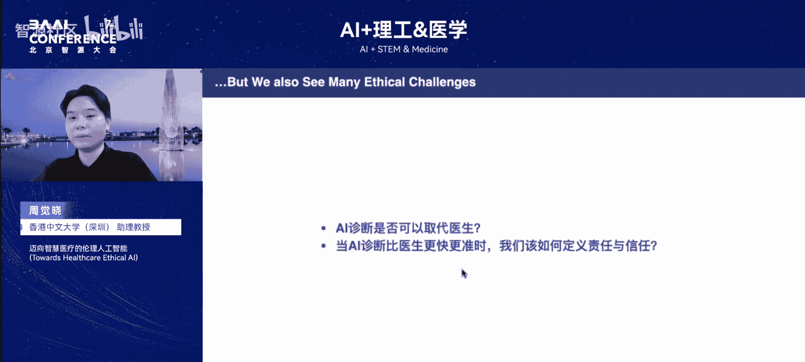

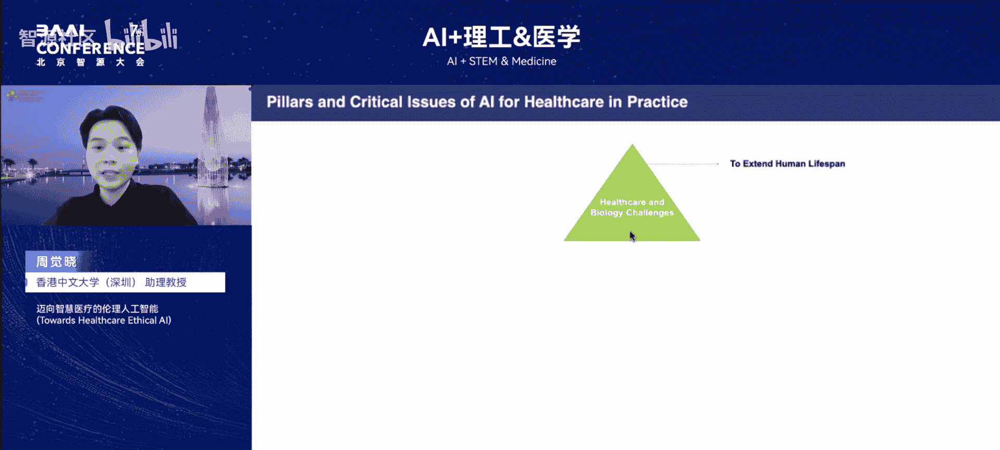

开心和兴奋可以看到现在呃在AI大模型方向上这么多的技术的突破。嗯，甚至也许在短时间之内呢，我们可也也有可能还可以看到AGI这个方向的技术突破。但是当我们在我们把这些AI技术铺开应用于医疗保健领域嗯。

或者是直接给患者使用之前，其实依然有许许多多的关键性问题是需要被解决的。包括像robuness privacy securityness toxicity等等。

也只有当我们真真正正的解决了这些所谓的基础的问题之后，我们才能够拥有这样一个baical AI来为这个AI在医疗保健中的应用来保教国航。嗯。

这也是为什么我今年从沙特阿拉伯阿杜拉国王科技大学获得博士学位之后呢，选择回到香港中文大学深圳。同时呢我们希望可以基于之前的一些积累和探索。嗯，可以在不久得将来呢主要关注于这样的一个三位一体的研究战略。

来构筑未来医疗AI的一个核心支柱。我们主要聚焦于AI for health care的三个关键维度。

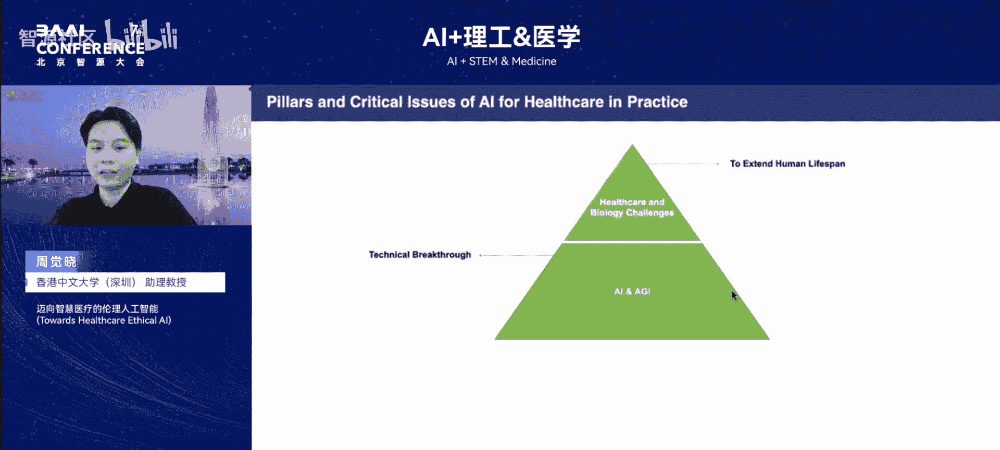

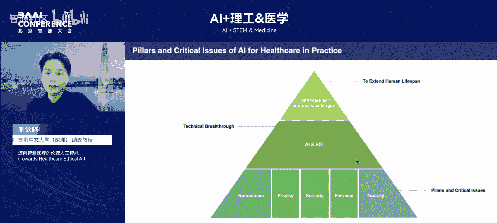

包括AI驱动的智能医疗系统。我们呃开发以前前的人工智能算法来赋能疾病检测，预后预测与风险评估等等一些嗯关键的医疗场景来为临床决策呢提供高精度的可解释的智能辅助。第二是这个生物信息学与AI科学家。呃。

我们关注于这个基因调控网络的理解啊，预测蛋白质功能与结构，包括效开发。同时呢我们也探索以这个好奇心驱动的AI科学家来加速这个呃AI for science。嗯。

最后呢是我们也关注于在这个医疗呃系统的前提下呢来开发一个可信与伦理AI的系统。我们会系统性的来应对一些包括像数据隐私安全性、算法偏见、公平性与潜在伤害等等挑战。啊。

最终呢希望可以推动一个可持续可信赖、以人为本的AI系统的建设。呃，那么我们希望的是可以实现一个从基础的算法，到临床落地，从分子尺度到伦理治理的一个全链路的突破。最终呢可以推动一个医疗智能走向可信与普惠。

呃，那么接下来呢我会简单的介绍我们近期两项在这个AI for啊health care方向上的一些工作啊，以及我们会深入的讨论其中所存在的一些 ethicalical issues。

那么我们首先要聊的是这个皮肤病的诊断。因为我们知道皮肤病它在全球范围之内呢是排名第四的疾病，并且影响将近9亿的人口。嗯，其中呢有将近70%的患者啊，他们不会去及及时的咨询皮肤科医生。

从而可能会导致这个皮肤病状况的加重，甚至是死亡。那其中一个最主要的原因呢，就是皮肤科医生的短缺。比如说我们知道在美国呃就有将近13000名皮肤科医生的缺口。那么大家可以想象。

就是这个呃皮肤科医生的短缺呢，其实在很多发展中国家是更加严重的。比如说像在南非纳米比亚，他们每百万人口呢只有0。8名皮肤科医生。但是相比较之下呢，在德国，他们每百万人口呢有65名皮肤科医生。

那么如果我们把这个视野放得更大呃，覆盖到整个医疗保健领域的话，那么这样一个医疗资源分配不均的现象，其实只会是越来越严重的这也是为什么我们说在皮肤病领域存在一系列的挑战。比如说像这个皮肤科医生的短缺。

然后准确的诊断比较困难呃，生成。

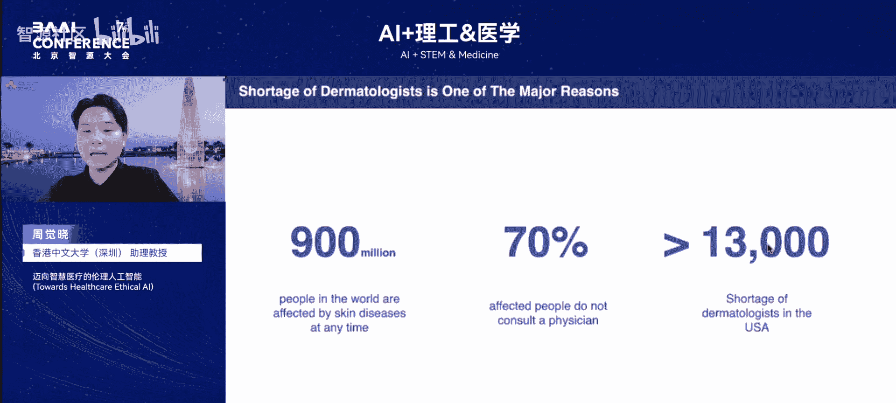

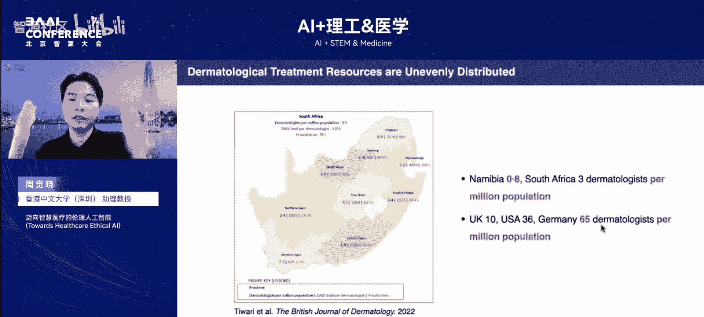

这个患者友好的诊断报告费时费力。最后呢就是隐私和这个可解释性的问题。嗯，所以呢我们在24年的这项工作中呢，基于这个多模态大语言模型开发了第一个这样的交互式皮肤病诊断系统。那么有了这套系统之后呢。

用户就可以通过拍摄一张皮肤病区域的图片，就可以以自然语言的形式和我们的模型进行交互，获得一些初步的诊断报告，也可以获得一些个性化的建议。嗯，这套系统呢，它在不同的角度光线和这个分辨率的情况下呢。

它可以比较精准的描述出皮肤病图片上的一些一些医学特征，也可以比较精准的给出这个鉴别诊断的结果。嗯，基于这样技术呢，我们也是开发了这么一个手机软件。呃，那么就可以通过这样的一个手机软件呢。

用户就可以再提供自己皮肤病图片的同时，也可以提供更多的主塑的信息。那么基于这些用户的主诉信息呢呃模型就可以给出更加这个个性化的诊断报告和视疗建议。嗯，除了皮肤病之外呢。

其实我们也比较关注于这个老年人的一些疾病的早期的监测和风险评估。

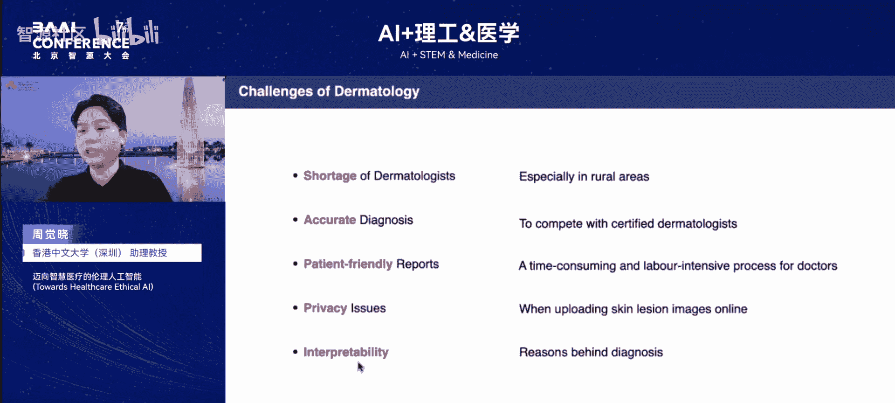

那么为什么这个很重要呢？因为我们知道大家知道现在全球老龄化其实是一个非常非常严重的问题。根据这个联合国的数据报道，到2050年，全球大约会有1。5个 billion的老年人口，在中国呢去年年底嗯。

这个老年人口就已经达到了3。1亿，上全国总人口的22%，这也是为什么我们说现在AI加养老已经变成了一个非常非常热门的方向。嗯，所以在AI加养老这个任务中呢，老年人的健康管理其实是一个非常非常重要的任务。

因为我们知道在全球将近有4分之3的这个死亡呢都是呃发生在老年人群体中的，而大部分的死亡呢又是由一些慢性病导致，比如说像这个心脏病肿瘤中风啊兹海默症、帕金森等等。那么我们相对更加关注于这个心血管疾病嗯。

更具体而言呢，是这个冠心病的早期风险的预测和预警。那么为什么这个很重要呢？因为第一是这个冠心病它在死亡之中所占的比例非常之高。其次呢冠性病是可以通过一些手段。来进行早期的检测。

从而呢可以进行一些及时的干预。嗯，因此呢它在一定的程度上是可以预防的。这样的话就可以减少这个老年人死亡的风险。呃，所以从这个动画呢，大家可以理解冠心病的成因，主要是因为这个血管中的一些物质堆积。

比如说像动脉粥样硬化或者是形成了斑块，从而怎会导致这个血管变窄啊，最终呢会造成这个堵塞或者是血栓的形成。所以我们说冠心病它其实是一个发展的过程。但是呢当它达到一个临界值之后。

就会表现出一些非常急性的症状，比如说像心脏病心衰或者是这个心律失常，进而呢就会导致很大的这个死亡的风险。所以呢我们就在思考是否能够有一种手段可以允许我们来进行实时的早期的冠心病的风险的监测。嗯。

这也是为什么我们在近期今年的这个工作中呢开发了这样一套系统。我们只需要在用户的家中布署一个健康渗头，那么就可以实时的从这个用户的面部来提取一些啊这个特征。同时结合用户的这个个性化数。去之后呢。

我们就可以呃实时的来评估冠心病的风险。那么为什么这一套系统它是可行的？因为从医学的角度上也有一些研究表明呃，我们呃人的面部呢是会存在一些特征，它是和冠性病强相关的。

比如说像这个折耳痕或者是一些特定面部区的皱纹等等。那么为了打造这套系统呢，我们也是打造了第一个这样的人脸的基座模型。同时呢我们联合国内的多家医院，包括北京安贞医院啊，北京昌平医院等等。

采集了大量的这个嗯冠心病病人的人脸数据，经过了这个模型的预训练和微淘之后呢，我们就可以精准的从这人脸中来提取出一些潜在的和冠心病强相关的特征。呃，那么基于这些模型系取特征呢。

我们也可以结合用户的一些个性化的数据，可以给出比较个性化的风险的评估结果以及健康建议。呃，这里给大家展示两个案例，左边展示的是两个这个冠心病病人的实时的监测结果。右边展示的是一个衍生的这个视频。

那么我们可以看到对于CAD病人来说呢，红色就表示我们可以实时的嗯监测到比较强的冠心病的风险，蓝色呢就表示低风险。呃，当我们回顾以上两个项目的时候啊，其实我们都可以发现一个共同的应用场景。

那就是我们可以将这套系这些系统部署，从而打造一个smart home。呃，我们只需要部署一个这康摄像头。那么就可以实时呃实现一个无接触的实时的全时间段的一个健康监测。

并且呢我们不仅仅可以覆盖到皮肤病的监测或者是冠心病的风险评估。我们也可以将这套系统就是扩充到各种各样的疾病风险和早期的预警。呃，然后我们进一步呢也可以将这套系统与各种各样的可穿戴的设备结合起来。呃。

也就结合这些更加精准的信号，提供更加精准的疾病的风险的评估。呃，其实也许几年之后，当我们所说的这个巨生智能或者是inbody的AI出现技术性的突破之后呢。

也许我们可以预料到家中会出现越来越多这样所谓的AI健康管家。但是到那个时候，大家也许会有一个新的con。就是是否你真的会愿意让这样一个可以无限制的获取你的私人信息，可以监测你的健康信号啊。

能够具有物理实体，可以跟物理世界交互呃，甚至也许还会具有一定自主能力的这样的健康管家进入到你的生活之中。如果大家对这个问题暂时还没有一个明确的答案。那么也许当你看完这样一个影片之后，会有一些。

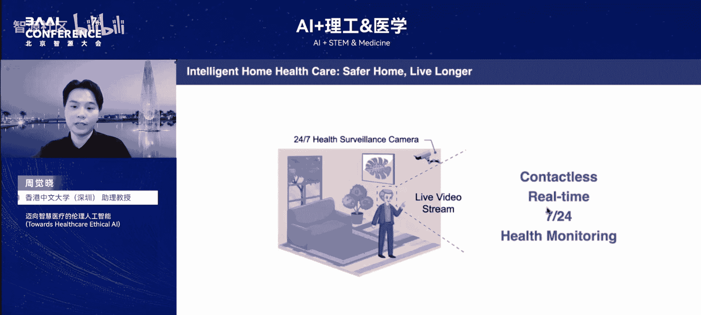

新的感悟呃，那我我们现在把目光重新聚焦于当前的AI医疗。其实我们也是面临着非常非常多的ical concerns。首先呢是这个数据隐私和安全。因为我们知道大多数的这些呃医疗的数据都是非常非常敏感的。

那么我们怎么样确保在这个模型的训练和这个推理的过程中可以保护用户的隐私是一个很重要的问题。呃，数据上的这些偏差呢，有可能会造成这个算法上的偏见，从有可能会对某些颗粒的群体造成伤害。嗯。

其次呢就是模型的这个透明度和可解制性。我们怎么样可以让医生和用户真正的信任这些AI系统的决策也是一个非常非常大的挑战。那么最后呢就是责任归属的问题。如果说AI它给出了错误的信息，嗯。

给出了一些错误的诊断结果，那么所应该来为这些错误来负责。呃，那么作为AI医疗行业的从业者呢，当我们开发一套AI算法的时候，其实我们通常需要遵循这样的一个比较常规的流程。我们会从这个数据收集出发。

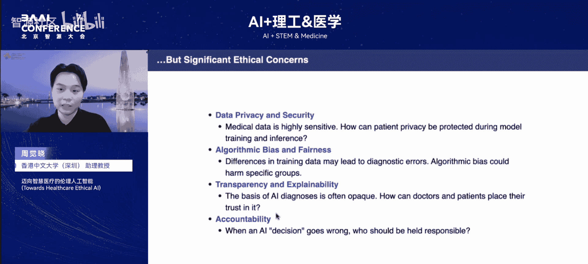

然后到数据的传输和存储，再到模型的训练呃，模型的发布和部署，以及模型的推理。那么在这样一个全流程的过程中，其实sical的问题是无处不在的。这也是为什么我们需要开发一套这样子的ical AI的基础设施。

嗯，正比如说我们说这个数据本身，它就具有了大量的隐私的信息。那么从数据的收集到模型的训练中，嗯，在这样一个最基础的流程里面，怎么样来解决这些伦理的挑战，其实是一个关键问题。嗯。

所以呢研究者们其实已经提出了各种各样的手段来加强这个医疗数据的隐私保护。比如说呃我们有这个基于密码学的手段，包括像同代加密或者是安全多方计算等等。但是呢这些密码学的手段呢，通常会引入一些额外的计算消耗。

我们也有一些基于这个差分隐私的手段。但是呢对于这个技术而言呢，我们会遇到一个隐私保护和模型可用性之间的一个toff。这意味着我们可能如果需要加强这个隐私保护呢，可能会需要牺牲一定的这个模型性能。

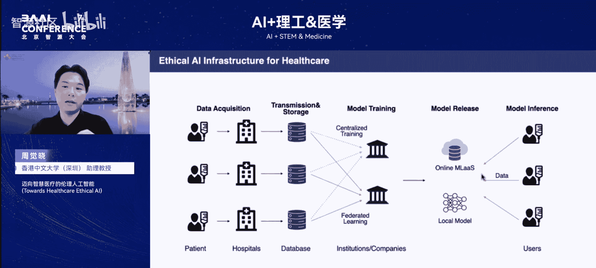

那么联邦学习呢是一个技术，可以帮助我们在不获取原始数据的情况下，可以联合多方的这个资源来共同训练深度学习模型。并且呢区块链的技术呢其实目前也已经被这个广泛的应用到安全的数据共享。

或者是这个模型的训练之中。呃，然后对于模型发布这一波言呢，其实也会有很多潜在的伦理挑战。比如说我们知道这个预训练好的深度学习模型。

其实是可以记术非常非常多的有关于这个呃训练数据或是有关于患者的隐私信息的，从而呢可能就会导致这个患者的隐私的泄露。

这也是为什么我们现在不仅仅关注于这个模型 learningarning或者是deep learning，我们也关注于un learningning。

这意味着我们需要研究怎么样可以有效的从这些预训练好的模型中把和患者有关的一些隐私信息可以去除。那么到模型推理这一步呢，我们知道除非是在这个边缘计算的场景下呃，如果我们的模型是部署在云上的。

那么用户就可能需要通过上传自己的这个医疗数据来。

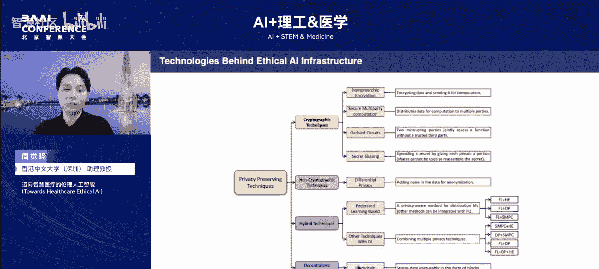

实现一些预测和推理，从而可能会导致一些潜在的伦理问题。那么解决这样一个难题呢，加密推理其实也是我们目前的一个主要的研究方向。呃，那么总的来说呢，搭建这样一个I的基础设施是非常非常重要的。

它会要求我们怎么样去进一步的研究这个数据的共享与隐私保护并行，怎么样确保这个模型中的信息是可删除的模型的训练是公平透明的，包括最后的这个决策过程是可以追责的。

那么也只有到我们拥有的这样的一个I的基础设施之后，我们才能够为这个AI在医疗保健中铺开应用保驾护航。呃，我们常说啊现在AI之所以能够获得如此大的成功，其实有三个要素，大模型大数据和大算力。

其实我们本质上说的就是呃而大数据呢之所以能够获得如此成功的原因之一。因为我们知道在这个自然语言处理领域有非常非常多并且是高质量的这个语料数据。所以呢我们可以充分利用这些大数据的优势来。

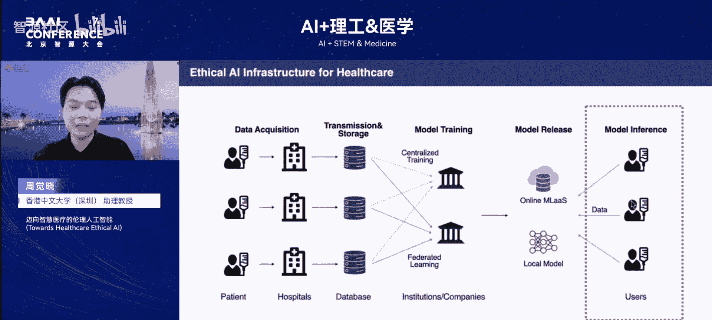

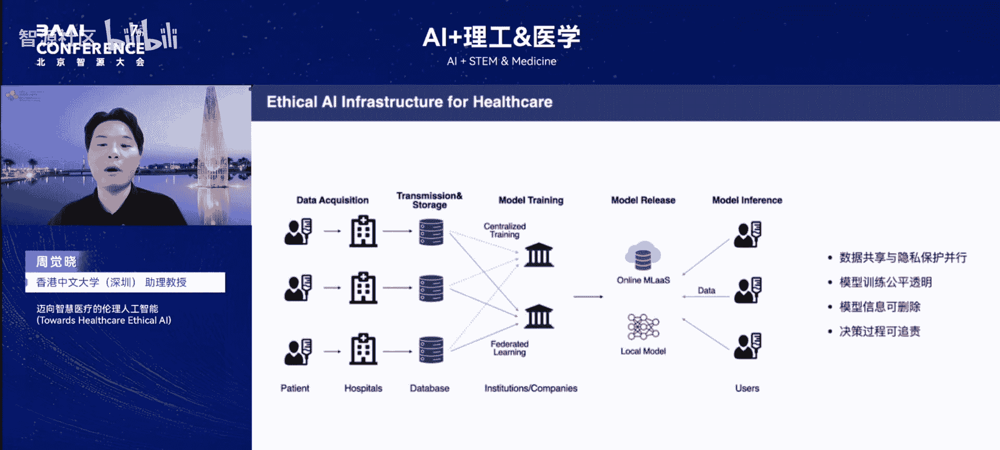

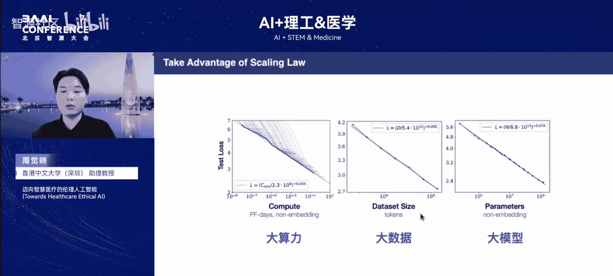

模型的性能。但是呢如果我们想要在这个医疗方向上来复合这样的一个成功，那么大数据是必不可少的。但是呢现状是公开的医疗数据其实远远不及这个自然语言处理中的数据量。这些医疗数据呢通通常会被存储在医院中。

由于各种各样的原因是比较难以获取的。所以呢这也是为什么在这种情况之下，我们希望能够建设这样的一套asic和AI的基础设施。通过解决啊一系列的这些基础的sical的问题，能够打造这样的一个系统嗯。

共建这样的一个生态，吸引不同的这些机构来共享数据。然后呢，我们就可以充分的利用大数据的优势来共取模型，同时呢也可以从这些训练好的模型中来共创利益。呃，最后呢其实我们说啊迈向这个呃智慧医疗的伦理人工智能。

其实还有很长很长的路是需要走的。我们也很开心看到现在AI呢正在重塑医疗。但是呢也只有在这个伦理的护航之下，它才能真正的造福人类。那么我们现在回到最开始的那个问题。未来呢。

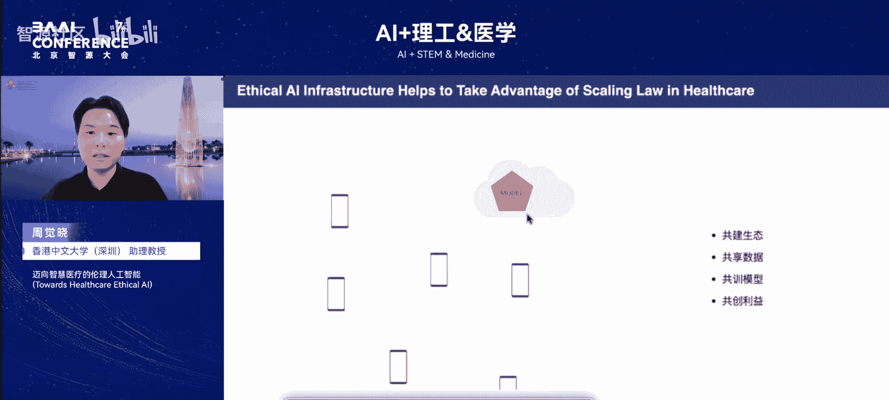

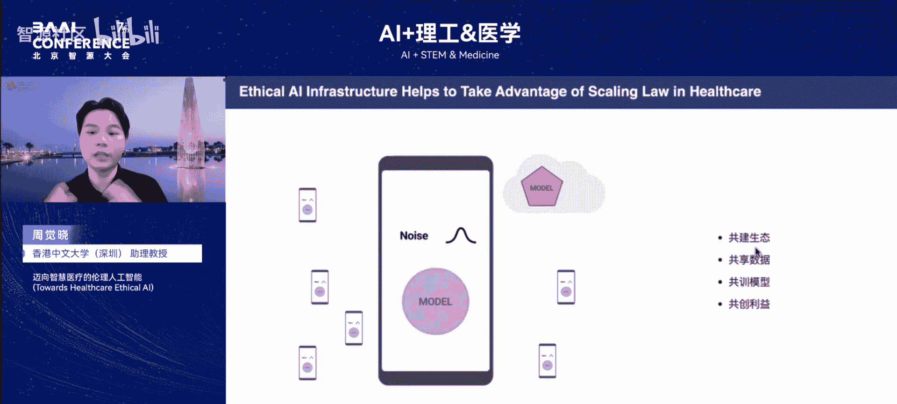

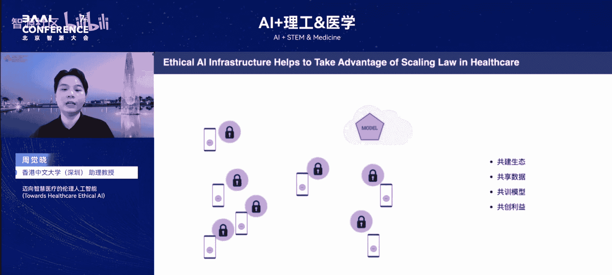

我认为医生与AI应该还是协作的关系。AI呢可以赋能医生，而并非是替代。这就要求我们未来的这些AI系统呢需要具备一个可信任的核心机制。我们需要共同建立起1个AI医疗伦理的评估的标准。

能够共建起一个伦理与效率并重的智慧医疗体系。呃，那么同时呢我也非常希望未来可以和各各位进一步的探讨，来嗯交流和学习，共同探索这个呃实现伦理医疗人工智能的可行路径。谢谢大家。

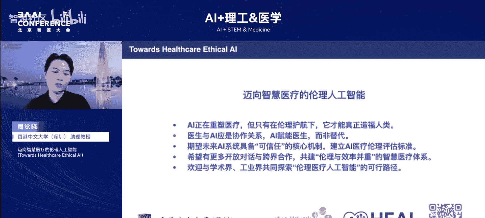