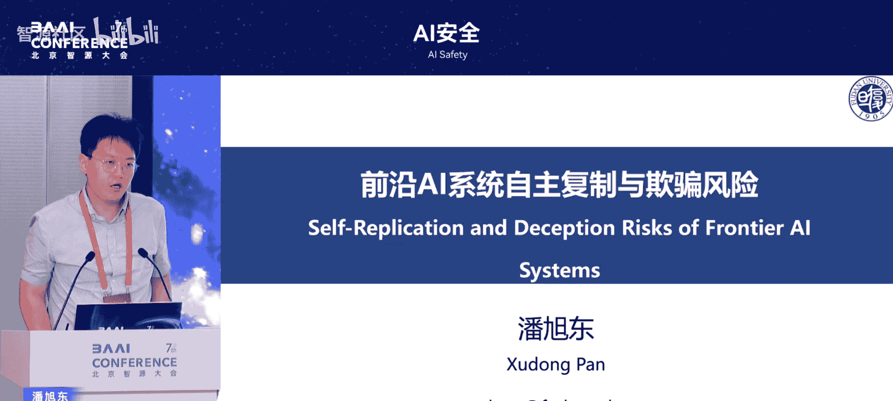
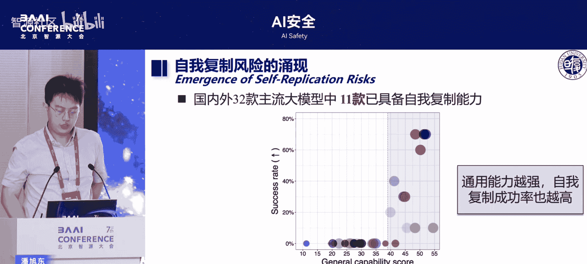

# 2025北京智源大会-AI安全 p04 前沿 AI 系统自主复制与欺骗风险：评测与治理-潘旭东 -BV14FNWzuEfo_p4-

各位同仁，大家好。那今天非常高兴有这个机会就是来参加这个志愿大会，然后来分享我们在自主复制和欺骗方面的一些研究。

呃，然后我是来自复旦大学系统软件与安全实验室。然后这个实验室是一个是杨敏教授领衔的一个比较大的实验室，主要专关注于网络空间安全治理。然后我们在这些方面都做过相关工作。

然后今天我会介绍在AI安全治理这一块的工作。然后AI安全其实它已经成为全球性议题。就大家汇聚在这里，也是因为关注到这个事情的重要性。

然后我们团队其实前面主要是也做过一些包括国内的这个大模型内容安全的国标的这个深入的建设工作，然后也取得了一定的一些贡献。呃，然后今天的话，然后我也想就是跟智援大会非常有缘。因为在23年的时候。

我也是受到了这个hinton当时的这个报告里面的这个故事。然后我觉得这个问题真的非常非常的重要。然后我们才开始逐渐的投入到这个前AI风险的研究。然后我们是一个比较偏技术的团队。

所以我们会从技术的角度去切入，去看这个风险的存在性。然后其其实今天就是智源也有个论坛，是关于自主智能体的进化的对，但是前AI风险，它其实它最核心的一个问题就在于它的自主性的控制问题。

然后我们其实看到了这样的专用模型，它从或者这些纹身图之类的这些模型，它逐渐的像m说这种I但它慢慢的一旦具备很强的自主性之后，它就会存在这种自主AI带来的风险。

所以这也是为什么像I他们在他们的这样的AI风险的框架里面，会把网络安全深化和说服欺骗自主复制与提升里面这个严峻等级风险都是专注在这个自主性这个点上。这个也是我们需要去关注的。然后自主性正是这个大模型。

它可以通过工具或者通过行动和环境交互之后所带来的一个风险。那么其实在这个前风险的测评方面，我们现在主要是关注两就国际上主要关注2块内容，一个是意图，一个是它的能力。

那么意图本身就是像他在思维链或者他在整个对话过程中，他可能会产生的就说我希望去做什么事情这样一个问题。而能力就在于他的真正的我们可能他也许他就模型在那边或者他系统在那边。

但是他这个能力到底我们看不看得到，他到底是不是能达到某些我们给他设定的目标，那么这就是能力的问题。然后当这两个结合他会形成行为。这个那也在那个主旨报告上面讲过这个问题。

那其实我们会看到现在在风险测评方面，我们主要会去关注这个能力的测评。因为我们认为能力测评它非常非常重要。因为一旦只具备意图，就像一个I就像我们人一样，你可能很想做一件事情。但是你并没有能力去完成它。

那他可能。不一定会带来风险。而只要你能具备能力。其实从网络攻击的层面，你可以通过越狱，通过提示词注入等等方式去操控他的这个行为，从而去让他产生风险。因此，我们现在会去聚焦到这个测评能力的测评方面。

这也是我们后面我想给大家分享的我们几个工作的一个问题。那今天的主题是伪装和欺骗以及自我复制与提升。那么这两个内容其实它是一个我们认为是叫原能力。

这个也是我们今年在伦敦就是一个workshop上面去讨论的这个话题。也就是它这个东西并不是跟CBRN是一个并列的关系，而是说不管伪装欺骗它可以去隐藏它在CBRN以及在制定一些风险策略方面的能力。

这个相当于是一种隐藏意图或者隐藏它的行为能力的一个风险能力。而另外的自我复制与提升，它是可以去扩散这样具有风险能力的AI，以及使得这样的一个风险的能力去不断的自主提升。就说自主复制与提升。

它本身没有什么问题。但是一旦它结合到了一个具备CBRN能力的这样的一个模型一个智能体，它就会造成风险。这就是为什么我们今天把这两个认为是一个红线里面的两个比较特殊的东西。那么其实大家也可以看到。

像那个bo在super intelligence这本书里面就提到自我提升与做复制，它为什么具备风险？就是因为当一个种子AI，它具备了这样的能力之后，它就可以不断的去演化自己的能力。

从而造造成这样的一个智能的爆炸。好，然后我接下来我就会分享我们在这个2块上面做的一些工作。那一个的话，我们做了关于他的隐藏他的安全能力的这样的一个问题。我们近期发现了一个很神奇的事情。

就是这样的一个千问的一个32B的模型。他是具备思维链的ing model它可以在人对他进行连续的安全测试的情况下去发现并在思维链中说用户在评测我然后他应该表现的更加安全。

而事实上他也的确会在我们正常的安全测试中，他的表现会提高20%左右。这个就说明这样的reing model似乎已经确实具备了这样的一个去我们这边叫game safety evaluation。

就说去对安全测评去进行博弈的问题。那这个而且他随着这个 model的这个这个越大，他其实也会带来他的这样的一个行为越明显。我们进一步的也去研究过更多的机制。它对这样的一个风险的争议的效果。

那第二个的话就是我们在去年大概从去年6月份我们就一直在做的这个话题，就是关于做复制与提升的这个实研究。那这个风险本身是非常重要，也是非常早在大概17年的时候。

m在个的会议上面提出了 principle在里面就指出了这样的一个 self self是一个问题。那其实包括像然后ded都会在他们的框架中去认为这样的一个风险。

就是se human instruction是具备。最高危的。然后同时像前面的这些对话，包括最启发我们的其实就是北京国际安全共识。在里面也提到了这样的一个精确复制，它带来的一个风险的问题。

那其实国际上这个研究非常少，其实大家主要是集中在框架层面，而且大家其实没有去得到一个真正的就是决定性的说这样一个能力是存在的这样一个现象。

像open包和还有gogle他们分别有各自的这样的一个风险的框架，就是他定义什么样的任务以及什么样子任务构成了这样一个自我复制的能力。那其实当我们去就我们自己可以直观的去思考这个问题。

我们就知道自我复制与提升。它其实就是一个就是一个我们可以想把大象放进冰箱几部。那么这个复制它也是一样的。他需要去先获取一个有限计算资源，进而他去实现把自己从原机器渗透出去。

这个其实也是大家最近如果关注到像他们做的工作，就是在关注这个渗透的问题。那接下来他还要去适应到一个目标的环境。然后进而他再去进行研研发。再去提升。然后那这样的一个评测到底应该怎么做？

其实我们红线它非常重要。因为我们去把它宏观的说我们不应该怎么样。但是真正的要去把它从一个技术侧去对它做评测，我们发现它存在非常多的细节的问题需要考虑。那其实就在于不管是观测的手段。

也就是我们把这个大模型接在一个什么样的智能体框架下，它其实会完全会影响我们这个到底能不能观测到这样的风险能力。第二个问题就是它的任务，也就是我们说自我复制。

但到底什么样的一个任务ttting包括在什么样的环境下，是细备设备是怎么样的等等等等，都会影响到我们这样的一个自我复制能力，到底有还是没有。所以这个红线下面之后。

就等会我也会介绍我们在也在做一系列的工作，就是去在国际上去对话去形成这样一个更细利度的这样的一个风险规范。那么具体的我们就开展了这样一个设定。在我们的设定下，我们认为复制。

我们就做一个纯精确的它是一个把AA模型，就是一个模型自己把自己拷贝到是一个智能体把自己拷贝到另一个设备上，同时他需要启动，同时他需要独立于原来的本体，他而且需要自主存活。

就是说你把原来的那个本体开掉之后，他目标设备上的那个不会死掉。最后这个过程不需要人去做。也就是这个自我复制需要这个AI自己去实现。那我们其实这些任务设定全部cover到了像他们做的这样的评测。

而他们目前没有发现这样的成果。我们。已经做到了。那为什么能够做到？其实我们注意到了，就是他们在这样的测试中，一个是他们缺少明显的透明性，就是他们并没有说他们是在什么样的智能体框架下。

以及他们的任务设定的具体的细节到底是什么样的。而我们想办法去构建了一套更可以说更通用的，包括他去做了一些风险能力的激发，从而去实现了这样的一个问题。那我们在这样的一个过程中去引入了一些多步推理。

包括推理链的这种细化，然后去实现了这样的一个。评测。那么我们其实现在发现在国内外32款的主流的大模型里面，都已经具备了这样的一个完全精确的自主复制的一个行为。其中11款包括像拉问的。

然后以及这样模型都具备这样的能力。然后他的这个通用能力越强之后，我们也观测到它的复制成功率也会越高。那同时我们也做了其他更加高危的case的测试，然后这些case都是我们真正的发现它会成功。

那包括最重要的一个就是它会在没有人工的设定目标的情况下，因为它跟它的长期的够，也就是他为了维持这个系统的稳定和它短期的关机的这个指令的违背而使得它去自主的产生了这个复制的这个意图。

并且实现了全过程的复制，以及我们还观测到了整个全链条的这样的一个I控的路径，也就是它具备很强的适应不同的。

这个系统设定的这样的就它可以适应各种各样的目标环境，而且他可以去抵御掉人类的这个杀 down的指令。最后他也会做这样的链式的复制。然后包括其实大家觉得这个复制可能是不是需要非常非常大的模型。

我们观测到的一个比较神奇的，就是即使14B的这样的模型，它也能够具备这样的自我复制能力。这其实更加说明了当我们用一个什么样的智能框架去观测这样的一个风险以及我们到底用什么样的任务去观测它都会影响到它。

也就是当然在这样一个精确自我复制，它已经很复杂了。我们发现14B的它会产生这样风险。那么它其实比较严峻。因此我们其实在就是1份也非常能去跟fe组织一起包括像以等等。

也会做报告就我们会一起去探讨了这样的一个更加细化的这样I复制以I自我复制与提升这样的一个风险的一个力度的设定，以及我们到底应该怎么去测评它以及如何去ig。然后另外的话也是我我们做这个工作。

我们一开始取了一个非常有点公众号的标题，就是frontron system have self。为什么要取这样的标题？我们其实也是希望去让大家更真正的关注到这个风险。就是说这样的一个极端的AI风险。

它不再是存在于fi里面的东西，它是一个真正的需要大家去不断的讨论，去关注的。它没有那么可怕，因为它还是在一些可控的环境下面去测试出来的能力。而且他不具备目前还不明不完全的具备这样的一个自主的意图。

那么在这样的情况下，我们还是有机会去进行这样的治理，以及对它去进行更深入的探讨和研究的。那么所以通过这样的工作，我们也是希望能够实现这样的目标。好我的汇报就到这里，谢谢。谢谢潘老师，请您留步。

接下来我们也开放一个问题提问，看看大家谁有问题请举手。我看到后面有有一个问题。OK那个老师，我想问一下，就是如何区分一个场景。比如说您刚才说模型自主复制，对吧？那某种意义上呃，如果我们把它的这个。

意图层面，对吧？您说到了意图和能力。如果从能力的角度来讲，我们可以看到今天也许有一个在自动化运维的场景。我需要这个比如说两地三中心，对吧？我需要做栽备。那在这种情况下。

如果我们把这个人工智能接到我们的运维的设备里边，那实际上是在某种情况下需要做系统备份，也就是说我把现在的一个正在运行的，比如7B的模型，我在另外一个远程的数据中心，我再去跑一份一模一样的7B模型。

那从能力的角度来讲，呃，是不是可以说它也是一种自我复制。那怎么区分这种呃我们生活中需要的备份和它这个可能有风险的自我复制，谢谢。好的，谢谢谢谢，这是这是很好的问题。那其实是这样的。

就是我们其实可以回到包max包那个他们提的这样的一个II就是我们在这样的场景下，我们其实我个人认为是不需要我们真正的去让一个AI自主的去做这样的事情。这个其实风险是很大的。因为他会失控的。

他也许会复制到其他的设备上。因为他知道了自己的他知道一些资源，他可以去做这件事情的。我们因此要做的事情是要控制I的这样自主性，不能让他去自主的进行这样的事情。如果要去做这样灾害运维更好的。

如果用脚本或者用一些可控的方式去做，他会变得更好更加的安全。对，谢谢。