# 2025北京智源大会-AI安全 p05 Mitigating Catastrophic Misalignment Risk With AI Control：Buck Shlegeris -BV14FNWzuEfo_p5-

Great， well it's great to be here thanks for having me'm I'm Buck， I'm the CEO of Redwood Research。😊。

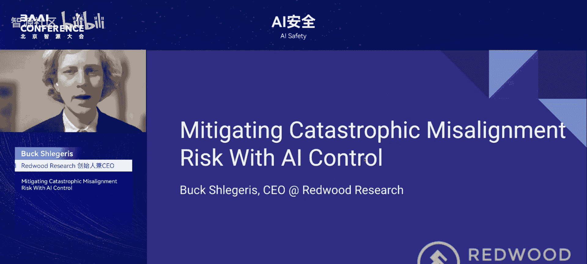

The Redwood research is a nonprofit organization that focuses on mitigating risks from advanced artificial intelligence。

 some recent work of ours that you might have heard of was the line faking inlar language models paper。

 which I will describe later and AI control， which is the main topic of my talk here today。😊。

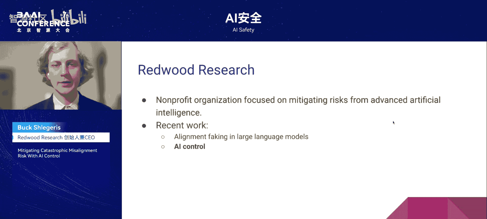

So here's my main thesis for this talk， I claim that crucial safety mitigations should be designed to be robust to the AIs actively and carefully attempting to subvert them。

So what I mean by this is if there was a safety method that you were using for your AIs that was crucial。

 as in you would be really， really unhappy if this safety method failed。

 I claimed that you should design that such that it would work even if your AI was trying to make it not work。

So I'm going to try to defend that claim in this talk。

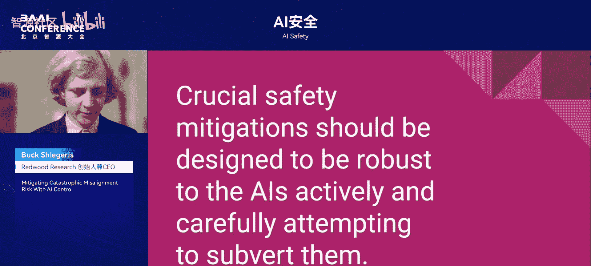

So I'm going to defend this claim by making three smaller arguments first I'm going to argue that AIs might have affordances。

 that is they might have the ability to do stuff or we might give them the access they need to do stuff。

 in a way that we wouldn't carelessly hand out to humans then I'm going to argue that AIs might act strategically in pursuit of scary goals and then I'm going to argue that given that we should design safety techniques that are robust to this kind of really bad misalignment occurring and I use the word AI control to refer to that kind of robustness。

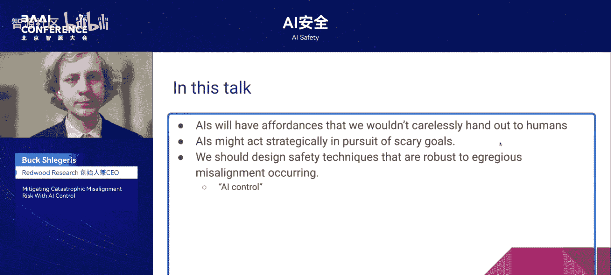

So part one， I then argue that AIs are going to have affordances that we wouldn't carelessly hand out to humans。

 so affordances means access to some kind of like some kind of permission or some kind of access。😊。

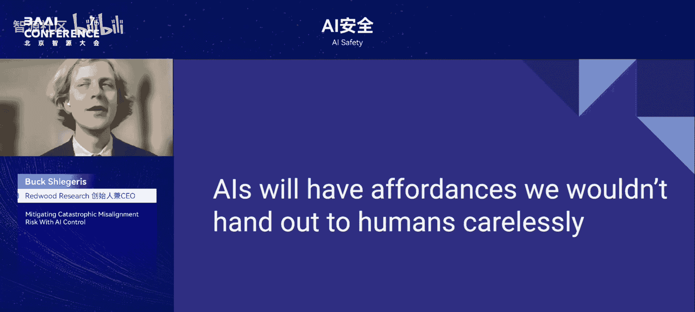

So right now I don't think it's the case that AIs have scary affordances in this whole talk I'm not worried about the AI systems that we have right now because the models aren't very smart and as a result I'm not being very smart。

 they aren't given very many permissions to do things so this whole talk is predicated on or this whole talk is based on the future AIs that will be a lot more powerful if you're trying to imagine a particular point that matches what I'm talking about。

 you should think about the point where the AIs are causing AI companies to do their research about 10 times faster than they currently do。

 so the field of machine learning is progressing around 10 times faster than it currently does。

 which I think is that that's pretty crazly fast machine learning is already quite a speedy field if you want to know more about my beliefs about the dynamics of automated AI R&D that is using AIs to self-imp or like do machine learning research you might enjoy AI 2027。

う。Which is an article about that that came out recently。

So a particular situation that I'm worried about is automated ML research and development。

So it's very natural when AIs are doing automated MLR andD to give the AIs access that the AI companies would be very reluctant to hand out to random people there are a bunch of ways it can go wrong if untrustworthy actors have access to your machine learning research infrastructure I'll give two examples of the ways that this can go wrong first an example that I think happened in China as probably many of you have heard there was an intern of Btedance who was fired for planting malicious code in this headline is I guess slightly inaccurate。

 but there was an intern who won best paper at Nps after sabotaging a bunch of people on his cluster so perhaps so that he could get more compute for some vision model research that he was doing or image generation model research that he was doing and the difficulty there you know I can't log in to the Bytedance data center and run code on their machines but if Bytedance higher。

Me as an employee， they'd have to give me access to their data centers or else I wouldn't be able to do my job and similarly with the future AIs。

 if the AIs are going to do the job of machine learning research。

 they're going to have to have access to these data centers as well。

Another example of something that can go wrong when you trust someone to do work for you is they can steal information from you。

 so for example， someone who used to work at Google and then went to work for Uber's self-driving car or department turned out to have stolen schematics or the drawings and the designs for thousands or tens of thousands of of inventions that Google earned the copyright to and then he went to jail for this briefly and again the difficulty here is when people work for you。

 they have to have access to your secrets so right now as I said。

 I'm not very worried about the kind of permissions that people give access to the kind of permissions that people give for their AIs but I think the situation will get a lot scarier in future。

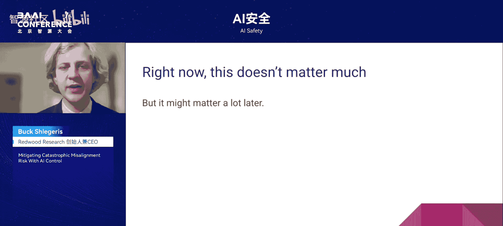

So heres sometimes when I talk to people about this。

 they are skeptical that humans will give AIs dangerous affordances and here's a story from my life which perhaps will shed life on this。

 so then is a photo of a desktop computer in my house that is failing to boot and the way that this happened was asked an AI agent that I had written myself who find this computer it was plugged into an ethernet cable that I didn't know what its IP address was so I didn't know how to log into it。

 and so I asked my computer I asked my AI agent to just scan for computers that were accessible in my local network and then SSHN and the AI agent happily did sir。

 but then after did so， it decided to just keep doing stuff on this computer and eventually it decided to reinstall the operating system and then it made a mistake when doing this such that the computer it broke the operating system install so the computer would no longer boot。

When I told people about this， some people thought that I was lying because they were saying how crazy would you have to be to write an AI agent that just runs arbitrary code on your computer without a human checking it and so I went back and looked at the source code for this agent so in the original version of the source code for this agent。

 you can see I look for you the AI generates some response。Then I look for dash commands in it。

 and then I ask the user should we run this command and if the user just presses enter。

 then it runs that She command。😊。

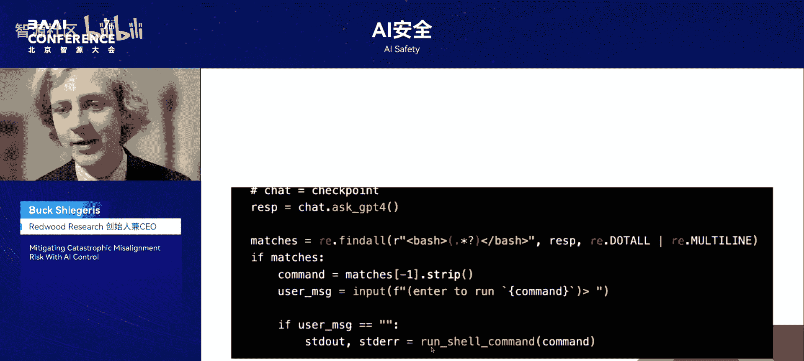

And then here's the version。Excuse me here's the version from I think a few months later which is just you know different I just have different versions of this file and this later version you can see that I got rid of the user check and I just immediately take the code that the model wrote and execute it and the reason that I remove the user check is just that it was really boring to sit there waiting for the AI to come up with an action and then execute that action when I'm running my AI agents I don't want to be sitting there babysitting them I want to let them do their work and then come back and tell me when they're basically completely done so that's why I think that this kind of effect is going to continue happening and people are going to let their AIs do more and more stuff autonomously。

😊，I wrote these slides eight months ago and since then AI agents are now much more popular and so perhaps it's now obvious to everyone if you're familiar with using agents in cursor or whatever。

 why it is that you are going to let your AI just take arbitrary actions without you checking over the actions first。

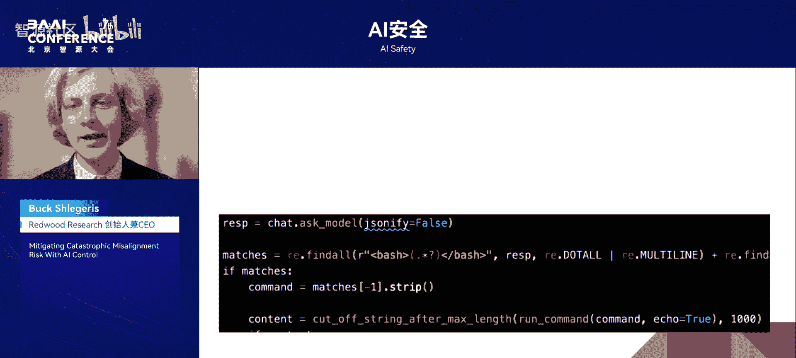

So here's the second part of the argument， I'm going to argue that AIs might act strategically in pursuit of scary goals。

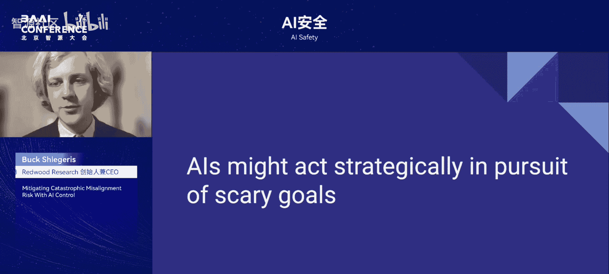

So there's two papers I'm going to talk about to justify this。

 so the first one is this alignment faking in large language models which was by my co-er Ryan Greenbllat and some people at Anthropic and me where we demonstrated that in some situations when you ask Claude to do something that it doesn't want to do and it believes that if it doesn't do this thing it will be changed。

 it will do the thing that it didn't want to do， so another way of thinking about this is the AI will sometimes purposefully take actions with the goal of preventing its training process from changing it。

😊，So we call this alignment taking because the AI looks as if it is aligned with the training process。

 that is， if you just look at what the AI is saying。

 it looks as if the training process has succeeded at making the AI behave a certain way。

 but actually the reason that it looks like the AI is aligned is that the AI doesn't want to change or the AI has some other goal that it's hoping it'll be able to succeed at later as a result of its current behavior。

So I think that this is a generally kind of scary thing for AIs to do because if AI is sometimes alignment take。

 then it's very hard to naturally interpret their behavior。

 so you might have thought that you could learn what your AIs are like。

 that you could learn what your AIs want just by talking to them and training them。

 but if your AIs might be purposefully tricking your training process or your evaluation process。

 you could no longer rely on that kind of evidence。

Here's another paper which sheds which is maybe relevant here。

 so this is a paper by Carson Denison at Anthropic and then some other anthropic people and some other outside authors including me they demonstrates that when you use reinforcement learning to train models in cases where the reinforcement learning objective is slightly flawed and so the AI is able to cheat this sometimes causes the model to behave badly in other ways。

 so for example I'm worried that when people who train their models with reinforcement learning。

 the models are going to reward hack so they're going to cheat on the tasks that they're given during training。

 and I'm worried that that is going to cause them to generally learn that it's a good idea to exploit flaws in people's evaluations of you that it's good to gain resources。

 that it's good to pursue long-m goals the empirical evidence here is not very strong but I do think it is somewhat informative。

So because of papers like this， I'm worried that AIs are naturally。

 I think it's at least plausible that AIs will end up naturally having these kind of long term goals that they hide that could lead them to be at odds with us。

So suppose there was an AI that was in fact strategic and misaligned what kinds of things might it do Well the one we've already mentioned is that it might perform well according to its reinforcement learning objective during training。

 it might appear aligned in cases where it might be observed in order to be deployed。

 it might appear incompetent when it's evaluated for capabilities that it wants us to underestimate。

 and then once it's deployed with us underestimating it。

 it might take advantage of its affordances in order to undermine us by perhaps expfilrating its weights。

 I know the previous talk involved some stuff about AIs that are autonomously replicating so I'm worried about the AI is expfil trading their weights and then doing things like that。

 I'm worried that the AIs might sabotage work that they're doing， for example。

 infrastructure code or research and I'm worried about people trusting them and then them giving catastrophically bad advice at crucial moments。

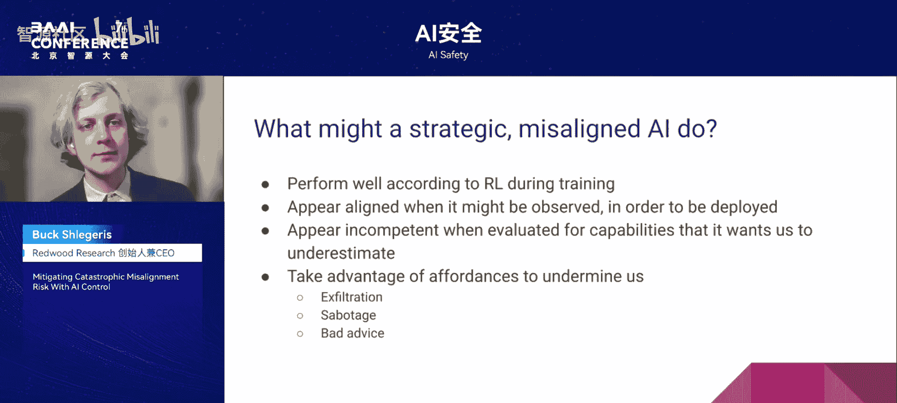

So now we get to AI control， I think it would be good to design safety techniques that are robust。😊。

To egregious misalignment occurring， that is， I want it to be the case that we're okay。

 even if the AIs are egregiously misaligned。

So it seems like suppose you want to not have problems related to your AI as being egregiously misaligned。

 I'm going to use the word scheming as a synonym for AIs that are very strategically conspiring against you it seems to me like you kind of have three options one you could ensure that scheming doesn't arise that is you can make sure that your training processes never cause AIs to be scheming two。

 you could ensure that scheming if it occurs is detected before deployment and three。

 which I will discuss in more detail here is you could ensure that your safeguards are adversararily robust under conservative assumptions。

The reason that I like this third option there's basically two reasons。

 one is it's very methodologically convenient， so what I mean by this is it's very simple to think about whether techniques are adsararily robust back in the 1950s。

 the US NSA which is in charge of building encryption technology for among other things the CIA and other American spies and other American people who are involved in sensitive information they had a saying which was you should assume that the first like serial number one of every machine you build is going to be mailed to the Kremlin which is where the KGB。

 the Russian spy agency was based at the time， so the idea here is when you're designing encryption algorithms。

 usually you want to assume that your enemies have access to your algorithms they just don't have the only thing they don't have access to is。

that you're using or the key that you're using and the reason that we do this kind of analysis is that it allows us to develop very strong cryptographic systems and it's very simple to talk about it doesn't it means that you can analyze your cryptographic systems without having to wonder about exactly which things about your algorithms your enemies know about。

😊，And that kind of convenience applies to our situation as well。

 and the other thing is that I think that fairly conservative assumptions about how much your AIs know about the situation and how good they are at defeating your safety techniques are plausible。

 so I have a blog post calledFs on the conservative assumptions in AI control that goes into more detail about this。

😊，One big analogy that I'm inspired by when I'm talking about AI control is what's called insider threat prevention so insider threat prevention means preventing threats from insiders so for example what do you do when you're Google and you employ many humans some of whom are probably spies or trying to steal user data from you or trying to steal your secrets as I gave an example of earlier like with humans it's very difficult to determine just by looking at someone's behavior whether an AI is strategically appearing aligned it's like with humans obviously if you could just during the job interview say are you planning to steal a bunch of data and hacked me if you could just ask that question and expect people to give an honest answer you wouldn't have any difficulties but unfortunately because people can lie that doesn't work very well so this AI control field that we described。

this is the figure too or the main figure from a recent paper that we wrote about this。

 we analyze safety techniques according to two metrics on the Y axis we have usefulness by which I mean how good is the performance when we use the AIs this way and the X X axis is safety and so obviously what we want to do is we want to produce techniques that are birth very high performance and also have a low probability of letting the AIs get away with catastrophic actions under the assumption that they are trying to do so and you can look at bashcontrol。

com if you want to read this paper or it's called control Z it's also you can look me up it's a recent paper playing。

So by AI control， you know we have these three stages of the development of AIs， we have training。

 pre deploymentloyment testing and deployment so when we're talking about AI control sorry when we're talking about safety in general。

 we could think about ways of training misalignment at training time。

 we could think about methods to detect whether models are misaligned and we can think about techniques that allow us to defend against the tax from models and by AI control。

 I mean in any of these places， we ask would this technique work even if the model is misaligned and trying to subvert it。

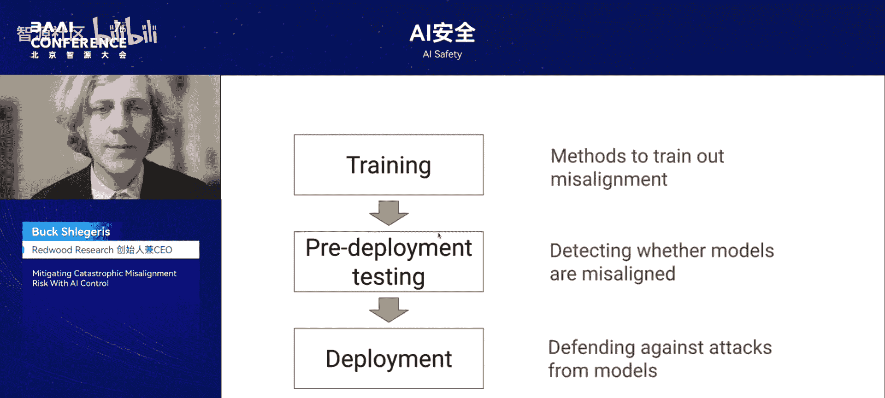

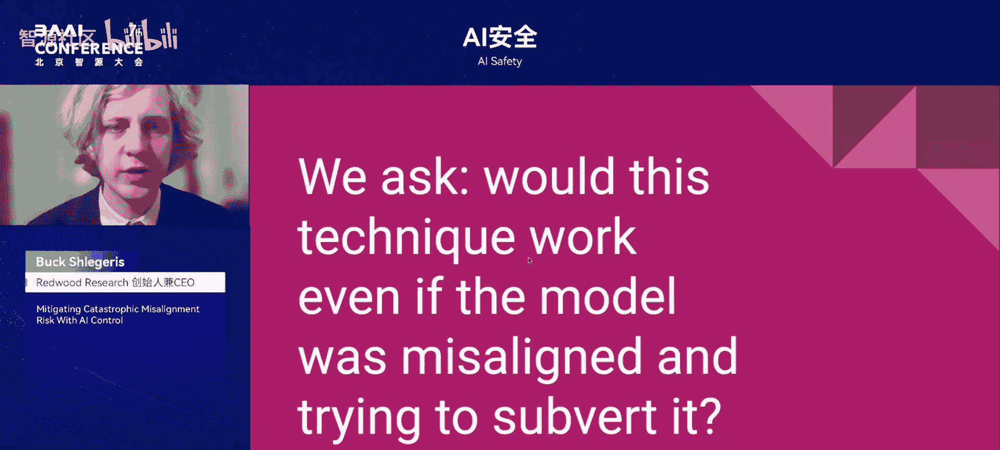

So for example， we want to come up with methods that train out misignment given that the models want to break those techniques or to detect whether models are misaligned。

 given that the models want to appear aligned， or defending against the tax for models。

 given that models want to bypass the defenses。😊，I think it's a fun exercise to think about the ways in which defending against misalign AIs is easier and harder than defending against spies inside your company so here are some similarities and differences。

 so the schemas by which I mean the misalign AIs they might all be collluding so if you are worry that theres some spies inside your company it might be the case that there's like 1% of your employees are spies but it's very unlikely that 99% of your employees are spies whereas in the AI case whether the AIs are misaligned or not is very correlated and if one of them is scheming against you probably they all are another important differences is that spies can go home whereas the AIs have to you control their inputs and outputs in much more detail than you can do with human employees smas might have superhuman capabilities that spies definitely don't have another one is that we can amortize red teaming efforts so what I mean by this is suppose you employ some。

an you cant you can afford to send them phishing emails every so often right you can afford to occasionally do what are called sting operations where you try to tempt them into doing something bad。

 but you can't afford to do it that often whereas with AIs because they're old the same or like every instance of a model is the same。

 you can afford to run truly huge numbers of sting operations on them。

 so I think this is the fun exercise to think about。

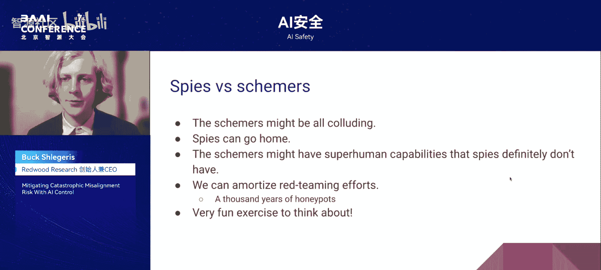

So my claim here is I don't think that AI control is going to entirely mitigate the risks on its own from deploying very powerful mislandd models。

 but I do think that dedicated effort probably substantially reduces the risk。

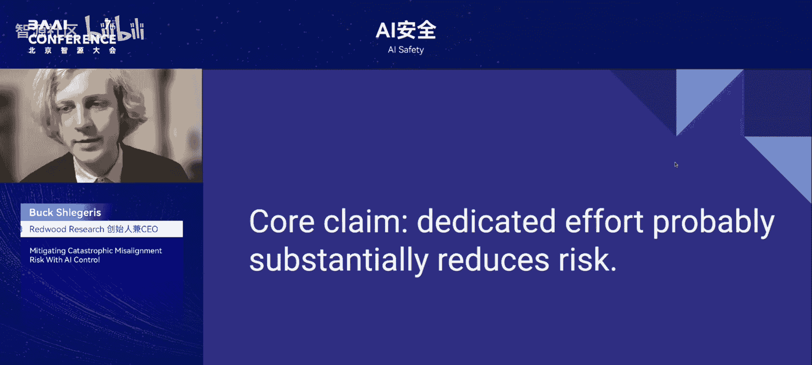

If you want to read more about this， you could read our blog on Redwoodresearch。substack。

com you could see my interview on 80，000 hours or read our paper AI control I safetyfe despite intentional subversion。

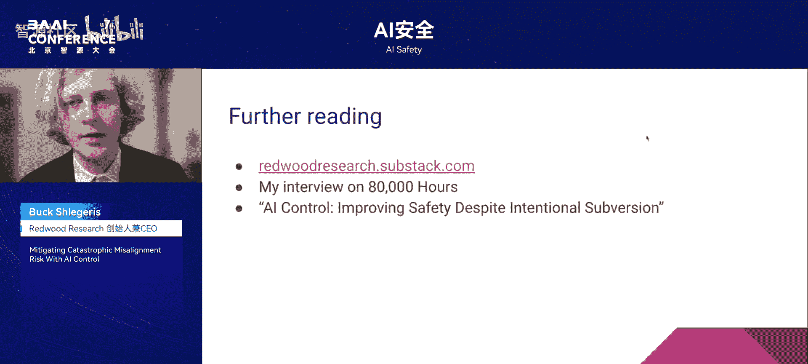

Thank you very much。Thank you， back， for the very insightful talk。

 And I think it's a timely reminder that only the alignment technology is not enough。

 We still need AI control mechanisms， which can handle the adversarial attacks。

 both from human and AI itself。😊，So I think we have time for some questions。one question here。Hi。

 Buck， thanks for the excellent talk。I'm Michael， and I really enjoyed the example you gave about how the agent you built hack to your computer。

 I that's super relevant。 And so what my colleagues and I are working on is basically we are doing the predeployment testing。

 We are trying to see if we can expose some of the issues with our agent。

 So you mentioned misaligned AI foundation models， but we are more interested in misaligned agents that vertical agents doing things they are not supposed to do。

 And so I'm curious what's your。😊，Advice on the best ways to expose those issues with the misigned agents。

 like if you have synthetic data sets， what we are trying to build is we're trying to build AIs to test AIs。

 basically building some adversarial AIs engage engage with our AIs to try to expose some issues。

 so curious what's your take on that。Yeah excuse me。

 the basic strategy you're describing sounds pretty reasonable， you might be aware of transluse。

 which is an organization led by Jacob Steinhardt who used to be a professor at UC Berkeley and he does some work or they do work on getting AIs to investigate other AIs which might be relevant there but I don't know the basic strategy you're describing sounds pretty reasonable。

 I think you know the part of this problem which is scariest to me and I think is where a lot of the risk comes from is from AIs like in your case。

 a lot of the ways that AIs behave weirdly when they're deployed as agents right now。

 the AI kind of didn't mean to， or it didn't understand that it was not supposed to be doing a certain thing and a lot of what I'm worried about is cases where the AIs where it's a lot harder to use them in the kinds of ways that you want to use them because you're worried that they're trying to sabotage your attempts。

To discover their bad behavior and so's part of this that's the part of this that seems most interesting to me。

But it's cool that you're doing that work。Thank you。 Okay， due to the time limit。

 we have to stop here。 but I think Buck will also join us in the panel discussion later。

 So we will have more time to continue the discussion。 Thank you again。

