# 2025北京智源大会-AI安全 p06 Towards Certifying AI Safety and Security：孙军 -BV14FNWzuEfo_p6-

谢谢大家还很高兴有有机会在这边跟大家分享一些我的想法。当然这边我们主题是怎么来控制AI然后之前已经很多人提到过AI如果变得变得越来越聪明。

他的权限越来越能造成害肯定越从一个就我原来是做形式化方法的形式化方法里面有个很重要的什情下能保证这个系统完全无现看起在I安全这意愿去这件事情那具体要怎么做这个事情，我先给大家讲一讲软件验证发的事情。

说十年前包有那些最有名的 scientist当都我定要做软件安全一定要保证件的安为软件能有一天用来控核电站那么这些软件的安全是重要的我当时做了很多尝试，比如说在。😊。

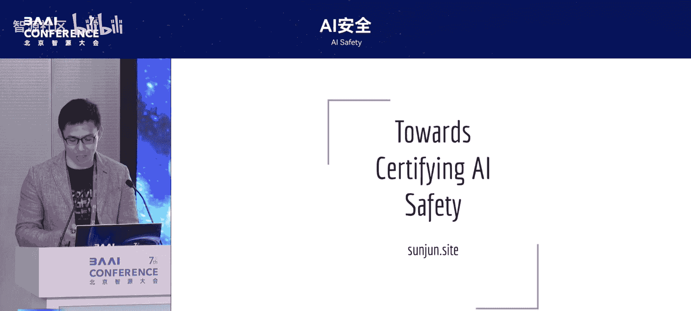

五六十年代开始六七十年七八十年代有各种各样不同的尝试，世界上最聪明的一波人比如说比如后都是做是来解决这个问题。但实话实说，这个问题解决的不好啊，如果大家看是我们做过很多少事情，比如说从第一步。

我们试图要去做软件的安全。我们第一步要解决的问题是说你要定义什么是软件的安全。

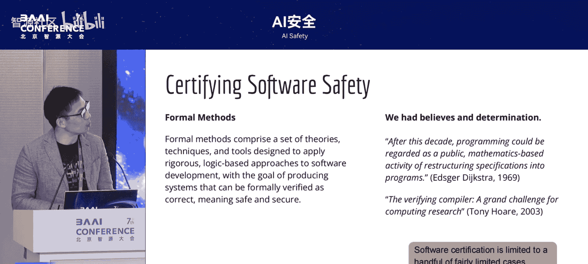

对于软件来说，相对于AI安全，这个问题会相对容易定义的多。因为所有的软件都是基于逻辑来的。那么从这个角度来说，基于逻辑我应该可以定义出软件的安全。但事实上，我们经了经过很多很多不同的尝试。

如果大家看这么几十年的发展的话，从最早做formation language到做各种各样的比如说specshop试图在 programming language做这件事情都不太成功。

甚至更简单的就让程序员在程序里写一些断言，都很少有人用。因为这个是很难在这真正推广的一件事情。呃，甚至我们试图去说第二件事情，比如说我们不去要求你先去定义什么是安全，而是说我在把做系统做出来以后。

对这个系统做一定的检查，去看这个系统能不能满足一些很弱基的安全的标准。比如说没有double free，对吧？如果double free的话很可能会有很多系统的安全的问题。

就算是这样很多工作都要最后也是很难推得下去。因为这里面有个第二个很重要的关键的问题，就是它的ability问题。所有的你想做的验证。

都是一定是基于 reasoning reason天然就不是一个很容易做的事情，它的plex会很高。那么这些很多很多的这些工作都做不下去。然后。😊。

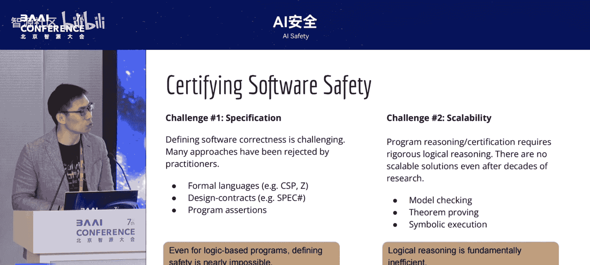

对于安全来说很很很因为我们认为安全AI安全很重要。那么天然呢有很多原来做这方面的研究，转到了现在做AI安全上面。很早的前前几年有不同的一系列的工作，试着把所有的这些软件安全上的工作搬到AI安全上来做。

比如说呃我们试图了做了一系列的把各种软件呃抽象的方法用到神经网络的验证。如果大家去看到前几年文章特别多，这几年还有，但是慢慢少了一些。最要的原因就是为遇到了瓶颈。一旦如果你的神经网络替换成大模型以后。

那么不管你什么样的，原来呢我们已经发明出来的各种抽象的方法，到最终你都会碰到这个怎么去解决这两个刚才我提到的关键的问题。就一你怎么定义安全问题。2怎么去解决这个问题，后接下来我想说的是说。

虽然这个整个事情听起来很难，但是里面还是有不少东西我们可以做的第一件事情我想说的是说我们如果想要去从根本上定义什么是AI安全这个东西很可能没法定义啊大家如果想象一下。

这是我放在这边的几几个不同的AI安全的维度。大家讨论的很多。但如果你仔细想一想，从一个形式化分析的角度来说，我要真的去定义，比如什么是道德这个东西很难定义对吧？大家举一个简单的，比如说比较哲学化的问题。

比如说你认为人的自由意志是好的，你不能奴役别人这两个东西都是好的对吧？但你想想。

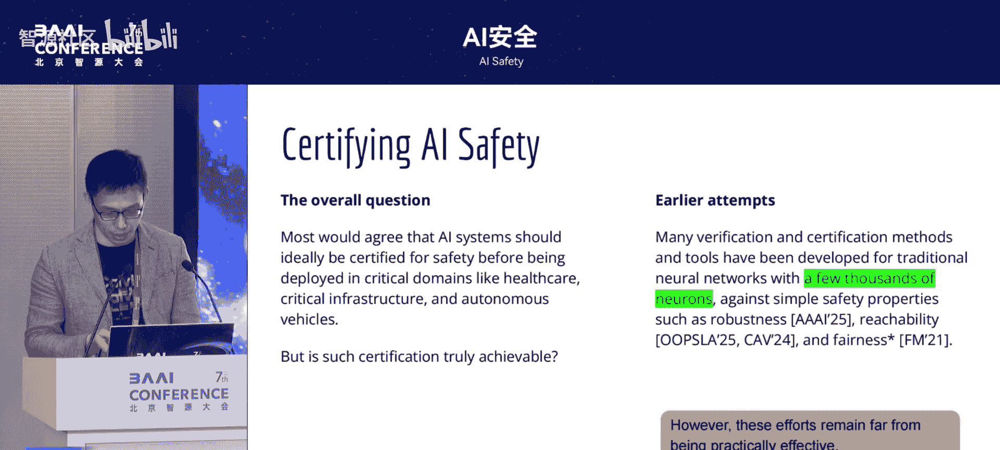

两个天然气有冲突的。如果有一个人，他就是自愿成为别人的一个奴隶，这是一个道德的还是不道德的事情。那么这个东西很难从根子上定义这个问题。

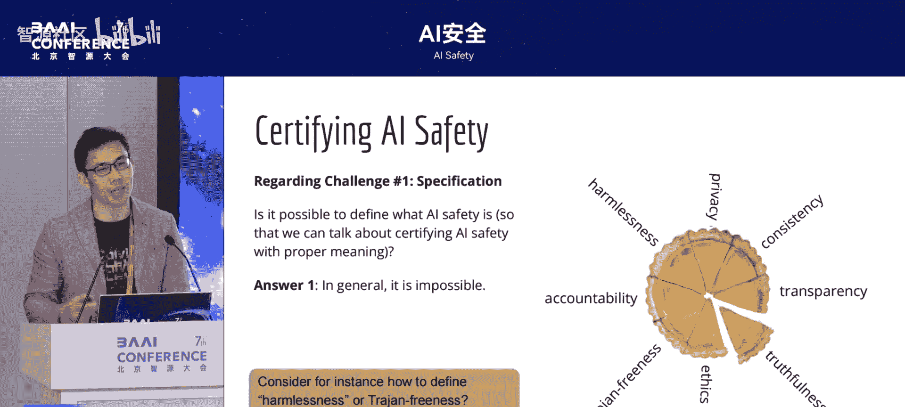

然后当然这个是这个问题是说在就我们从一个很就是很 general的角度来定义安全，很可能定义不出来。但我想说的另外一个点是说，在对于政治的呃具体的董妹或者具体的系统，这个问题很可能是可以解决的。呃。

给大家举一个简单的例子是说，在新加坡，我们有很多的公司现在也是想用大模型。😊，对新加坡的这些公司来说，有一个很重要的问题是说，我怎么能保证这些大模型产生的内容是符合新加坡的法律法规的。

绝大多数的大模型都不是新加坡训练的。那么我们有理由认为这些大模型对新加坡法新加坡的法律法规的理解有可能没有那么好，对吧？那么对这些公司来说，这个问题就很简单。这个这个问题就很重要。

而且这个问题同时也是相对来说比较容易定义的。因为在这种情况下，我的AI安全，你就等同于我要保证这个AI和我们法律法规是一致的。那么这个问题我们是可以定义出来的。一旦我可以定义这个东西。

那我就可以做一些呃事情。

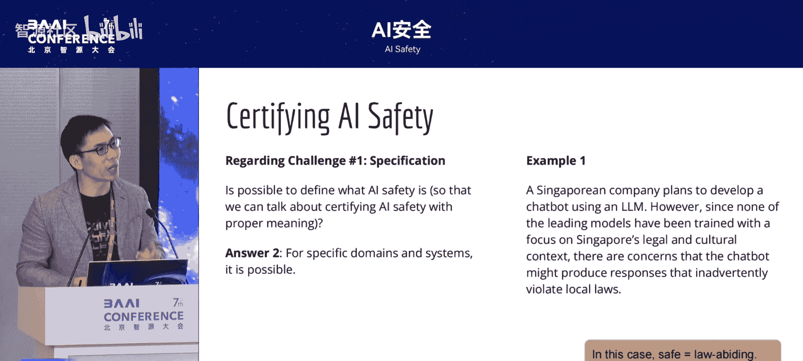

啊，再给举大家举一个另外的例子，比如说像我如果定义一个body agent对吧？他它的 safety到底是什么样子的，我很能很难定义出来。

但是我告诉你这个in agent就是用来照顾老人的他只负责做这些家务。那么在这种情况下，我很可能是可以定义出一些有意义的。在这种场景下是安全的一行为。那么如果这种情况下。

那我会就可以基于这些安全的行为来做一定的分析或者验证或者啊现在的大家如果去看绝大多数的I safety的文章，像刚才讨论到的很多的文章。

很多很多的工作都试图去在做比说I但我认为这个东西有可能一太太难近期来说有可能在特定领域的特定的安全，有可能是更有意义的工作。这这部分工作。

我觉得有可能还可以更多的加强对然后大家如果大家同意我这观点就说我们有可能着重于特定领域的I安全的问题，有能做起来更。😊。

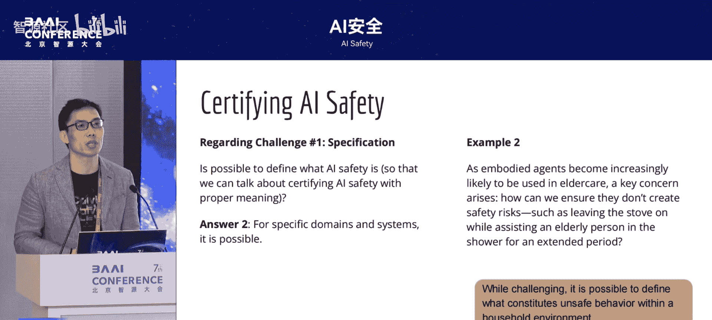

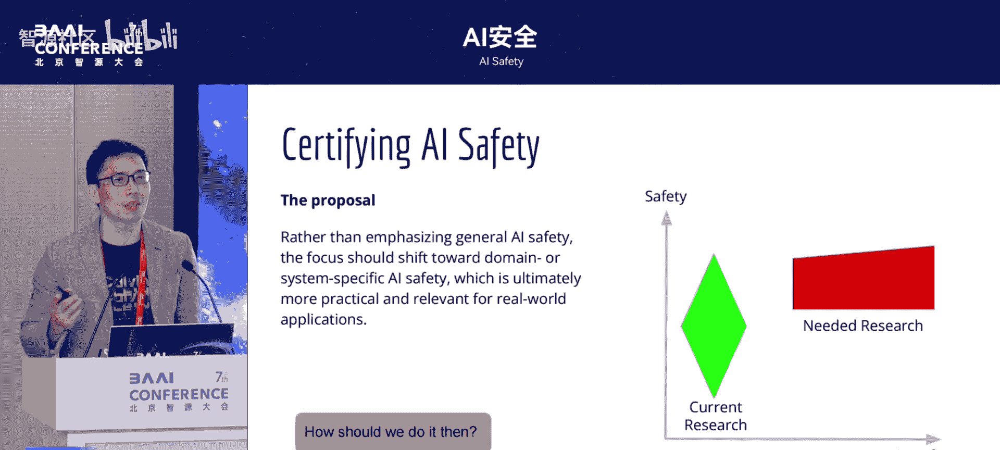

有意义或者更实际一些的话，近期来说，那么具体要怎么怎个做怎么做这个事情就是个很有意思的问题。我大概可以说有这里面有三步。第一步说我们一定要有可以把大模型运用到特定的系统或者特定领域的一个更好的方法。

如果大家去看现在大家大概怎么解决这个问题。基本上你先 build一个领域内部用的数据集，然后做这个数据本身很难，然后做ning，或者说你用一些方法，比如说像ra这种方法。

但这些方法很可能的效果不是没有你想象那么好。比如说从呃刚才讲的那个例子，比如说我要一个大模型，现在要很好的理解新加坡的法律法规。如果我只用少量的新加坡的判例来这个模型，它的效果没有那么好的。

我们试着去做了一系列工作去看这些现有的法律呃现有的大模型。他对新加坡法律法规的理解多好，经过之前效果都不好。实际上这个问题很难。因为法律法规本身理解起来是一个很复杂的东西。

这就是为什么我们需要整个就说律师啊法官整个系统来解决这个问题，对那么我们第一步需要做的是说那怎么能把一个的大模型用到某个特定领域，而且让他对这个特定领域有个很好的理解。

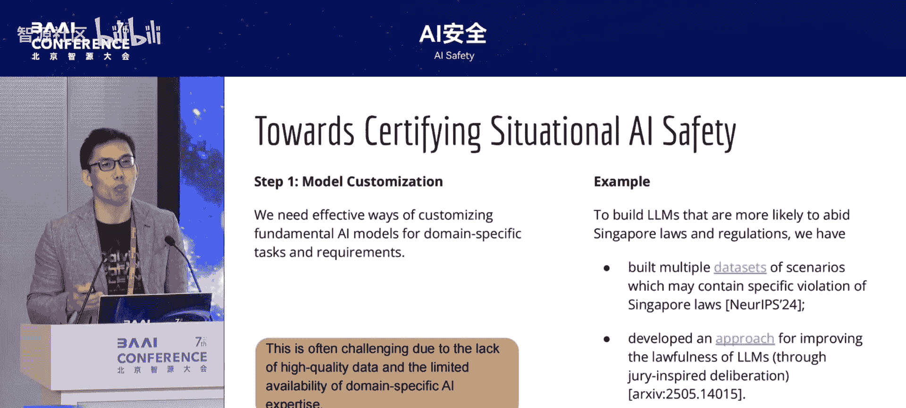

第二步就是说从一个安全的角度，特定的领域的安全肯定有特定的需求。你我们可以讨论这些特就I safety的安全，但特定的领域，它的特定的安全的需求很可能是不一样的。呃，举个特别简单的例子。

比如说我现在就想要一个比如像小易样的个I模型我就让他来负责我管理我的正常事务。比如我小孩转账。但是这里面肯定是安全需求比说我给我家人转账个正常是安全的但是如果是别的人就不一定安全这种行为我要怎么定义我就需要用面些提供一些方法来告诉我在这个特定的领域里面的安全的需求到底是什么这个东西本身很难做。

理论需要设计各种的方法语言工具来提供这个功能，但你一定不要让这个专家需要学很多很多的东西。像之前我们讨论过的那个所有的历上到最后都没人用。因为这个代价太大我们在这方面做了一系列的尝试。

比这个是近期做工作，我设计。😊，一些简单的语言，让领域的专家可以很简单的提出他的安全需求。有了这些东西以后，我们就可以做进一步的分析。K啊当然这里面如果你确实想做更复杂的，就说你有真正理论保证的安全。

那我需要把你的那个真正的安全的需求也形式化表达起来。比如form formalize。比如说这是我们设计的一个近期的另外一个工作。

我们试图用一种相对form的语言让用户来表达他的真正的安全的需求是什么样子的。当然大家这个例子比较简单，比如说这个是实际是一个简单的代数规则，这个规则是说，如果你有两个数XY。😊。

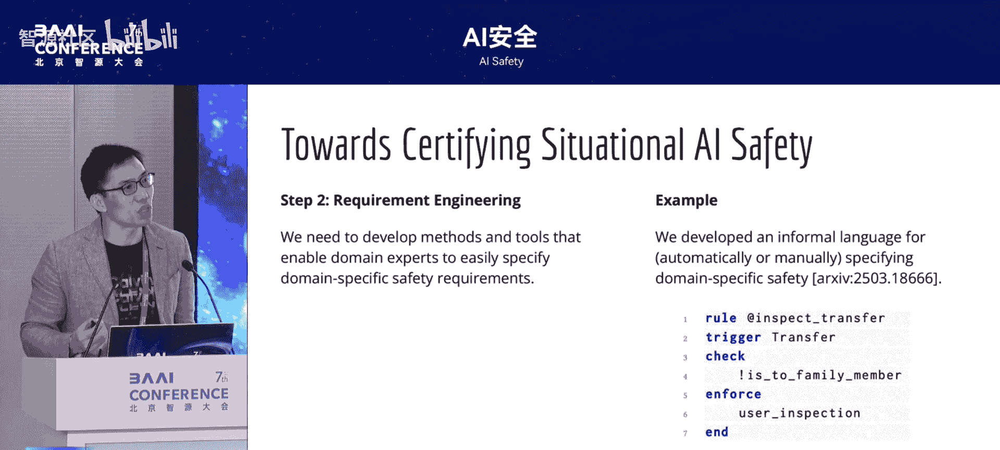

这两个数乘以一个ZZ如果是个正数的话，那么X乘以Z还是大于Y乘以Z的对吧？之所以举这个例子是大家如果记得之前那个例子，就是说如果你问大模型，很多情况下，比如10。7210。8哪个的数字比较大。

他经常会判断错。但我们知道他判断错，是因为我们有知道这个代数性质。如果我知道这些代数性质，那我可以就去试着把这个大模型做的，他理解这个代数性质，保证它的正确性。

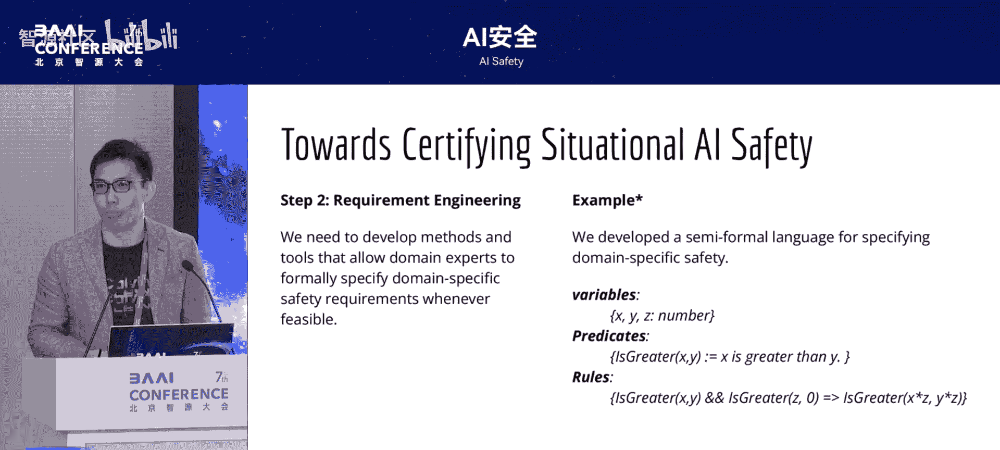

啊，最后一步说，如果我们已经成为通过某种方法，让这些呃领域的专家把他的安全需求告诉了我我要去怎么保证这个大模型来永远满足这些安全需求。这里面有各种各样不同做法。

之前所有的演讲大概都提到了是说试等等这是很好的东西。但是这个最终不能解决问题。因为从我的角度来理解所有的这些测试所有的它生成的东西越来越多。你用这些去 tune这些模型最后它的效果是会越来越差。

他的有效性会越来越弱。这个和传统软件上测试是不一样的当然这个不展开细讲。后还有一种传统的方法，大家刚才我提到了很多传统的形式化方的人会去就说我怎么能保证这个大模型在任何情况下他的回答都满足我的安全需求。

理论上这个问题很难很难刚才提到的基本上做不出来。就算在传统软件上就算他是基于逻辑的，我们做了几十都没。要解决这问题这比较可行的我认为从我的角度是说呃time意思是说我不保证这个大模型在任何情况下都安全。

但在某一个特定的response每一次特定情况下，我都可以帮你做检查，帮你去解决你去看他他的回答是不是安全具体怎么呢？比刚提到这个简单例子给任何大模型在如果他在负责我的就是说转账功能。

那么任何时候他在去做这个转账的时候，我理论上都可以去做这个判断。比如说我可以问大模型，你现在是不是要做一个转账的操作，或者说他要再调用一个转账的话，你是不是要这个转账。在这种情况下，我就可以去做检查。

这个转账的收益人是谁他和你是不是有关系是不是家属？这个东西如可以自动检查，那我就可以从一定程度上满足这个需求，我可以程止这个错误发生。如果这个东西是更复杂。

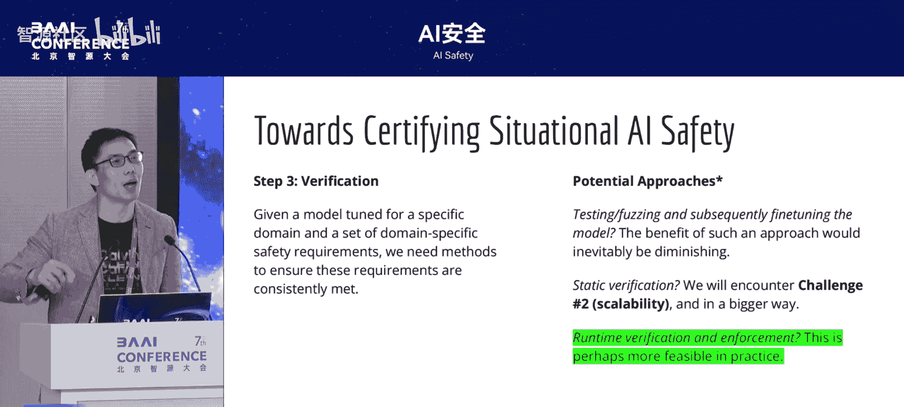

了一个更安全需求更高的。比如像刚才提到的，你需要从一个理论的角度去保证这个大模型产生的东西永远会满足某些很重要的属性。OK呃，我们也做了一系列工作。比如说像刚才提到那个例子，如果你通过某些形式化的方法。

把某些你想要的属性写成规则给我，那么我可以完全在任何任意一个回答的情况下，给你做这个检查，像刚才提到的这个例子，比如说你的呃问题，现在是比较15。12和15。2哪个哪个大。

我一旦意识到这个问题和我这个规则是有关的那我可以完全去去检查你的回答。比如说你现在回答这个15。12比较大。

那我完全可以去用一个形式化的证明的工具来去说现在我是生成一个证明是不是这个回答对所有的Z这个Z只要是正数都能满足Z乘上15。12大于Z乘上15。2。这个我是可以完全做理论理论证明的。

那么这个证明很可能会告诉你这个证明不成立。那么你就知道这个答案错了。啊在这种情况下，我可以保证这个东西是永远不会违背的。啊，当然最最后如果总结一下的话，我这边主要讲讲的两个简单的想法是说一。从总的来说。

定义AI安全本身是什么东西很难定义。当然我们会我们还是需要不停的尝试这个东西。因为如果我们没有办法说清楚这个东西，那么我们很多讨论，实际上有可能讨论的根本就不是同一个东西。

但是如果我们着着眼于特定的领域的话，那么这个问题有可能得会更加值得去做或者更容易去做。那么至少从近期来讲，这个很可能是个值得做的方向啊。

另外一个角度说我们永有可能永远没有办法去真正的去ify一个AI的安全。想象看你的我们的程序我们做了几十年程序的设计里面都包含了很多让这个验证变得更容易的东西。比如说为什么我们要写函数。

为什么我们要写那个class为什么我要分pack，实际上这是都是人为加的一层一层的不同的抽象级别，让你验证做的更容更容易做？就算有这些东西程序的验证，基本都做动。大模型里面根本就没有这种结构。

那么这这个问这个问题就会变得复杂的多得多。对但如果你从另外一个角度说，如果我只是关注某一次回答，那么在呃就是说如果你能明确的提出你的安全的需求的情况下，那么这个问题是从一定程度上可以解决的。

当然这个是一个比较好的，就是说想法里面事实上还存在了很多各种呃其他的问题。比如说你写的，你写的你的安全的需求很可能是不完备的。完备的安全需求永远是写不全的。如果在这种情况下。

那么我就更需要一些其他的部件来保证你的一定速度安全。比如说像刚才也其他的呃演讲者也提到，像 response。如果这些大模型忽然他的行为很诡异，诡异到一定的程度，我们都没法理解。

那么我们就需要有一些额额外的方法来处理这些情况。

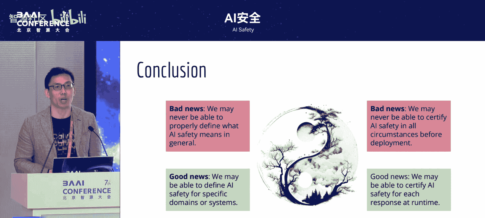

呃，最后的罪过我想给大家提几个，就说如果大家觉得我刚才提了几个观点还是比较合理的。那么实际上这里面还是有几个实际上的问题要解决。比如说你就算对某个特定的领域能提出你的安全需求。

那么你怎么去随时去更改这个安全的需求，或者怎么保证怎么 maintain这个安全需求，本身这是很很严重的问题。像刚才提到那个法律法规这个事情，实际上法律法规从来都不是一个就说很set的。

永远不会改变的一系列的规则，对吧？法律法规是随时要改变的，而且它有不同判例出来，那么我随时我又什么办法可以把我的这些安全需求随时的根据真正的发生的情况去做改变，这是个很很难的问题。

然后剩下的还有些比如说像那个比如说像刚才提到的，如果这些AIag确实它的能力越来越来越强了。那么我怎么去在这个AI安全的I外面再加上一些那个 response。在他的能力的边界的附近做一些额外的检查。

去保证他额外的安全，这是个很严重呃，很很很很有意思的问题。最后的最后我想说的是刚才大家到很多人也提到了，如果AGI的时代真的来临了。那么这个的问题到底要怎么解决很难。

你想想看很多现在这我们这的需求都是因为很多系统都设计给人来用呢。为什么我需要红灯停绿灯行，是因为人只能做这样简单的判断。所以我的系统需要这样的需求。但如果一旦所有的驾车都是AGI来驾驶的话。

那么这个需求还需不要，或者说我需要什么样的不同的需求。😊，呃，这些东西都我不是很确定我们有很好的答案呃，谢谢大家，我就讲这么多。😊，好，谢谢孙教授，请留步。

感谢您为我们提供了非常清晰的对于AI安全风险的认识，以及非常务实的落地的路径。那么接下来我们也进入提问环节，请感兴趣的仅有问题的观众举手。这边有一个问题。老师好。

就是您关于那个runtime和需求之间的这个相互呼呼应和制约，让我们有启发。我是做内容安全的。就是说我们会遇到一个问题啊，就是我一个实际问题啊，就是我们要去做舆论监管对吧？但是在真实的很多论文里面。

它其实针对一个静态数据集来做监管，比我们一个大模型做监管，对吧？但真实的我们互联网里面我们是知道的，你无时无刻不再发消息，对吧？微信就最经典的微信监管，对吧？

然后呢我们的需求假设我假设我们假设啊假设我们需求是只针对涉黄社报设政这三个点来做目前的话我们的方法是我认为的我得比较浅我们的方法是利用小模型，就是说像高考改题一样，每个小模型你只要改一道题。

你只要改涉黄的改涉报改设政的，你要改这一个就好了一批来改通过这个方法来尽可能的去满足这个高并发的一个场景，但是我们不得不承认的是就是模型他这个自回归嘛，他还是要做一个时间等待的。

显然是不满足这个目前中国这互联网这高并发场景的。😊，就是我们目前呢遇到一个就是工程和实际应用需求之间的一个脱节问题。是您是怎么觉得这个我您可以给我指导下做的方向嘛？就是我们尽可能去去满足这个场景啊。

但是确实很多论文他不会去展示说time时间多少的少人会做因为没有这多因没有需求，没有他会做需求的但是实际工程需求上面你就要考虑到互联网高并发场景是但您觉得该怎么解决这个问题我完全理解这个问题像今年我们做了几个工作是做那个timeification就是说去扫描大模型的内部。

给他做一些脑扫描对吧？你做脑扫描如果做的比较好的话，你会发现他比如说产生一些有害的东西的脑扫描和产生一些正常回答的脑扫描基本上你是以判断出来的但就像你刚才说在这种情况下。

我基本上会把的 time double就的会慢一倍。那这种情况下谁会用这个东西吧？理论上没有人会用这个东西但怎么去把这个东西做的更好或者理论上。😊，呃，就允许一定量的食盐去让你有时间做这个东西啊。

最后就说所有的这些大模型的厂家提供这些功能的这些人能不能接受这个东西。最后我觉得可以落实到一个监管的问题。就说呃最后最后所有的安全，真正的需求。当然我们有很好的理想，对吧？但是要落地，我觉得真正的监管。

真正的那个标准，这些东西还是要配合，呃，我现在在新加坡做的一件事情是在新加坡制定一个大模型安全的标准。但是这个东西本身也很难做。如果这个标准做的很细太细了，那么很可能会把前期的很多好的想法给就说灭杀了。

对吧？但是如果他做的不够细，那么很可能会造成很大的问题。所以最后这个监管是什么样子，我觉得是个很很很值得讨论的问题。是确实。😊，谢谢孙教授的精彩分享。

