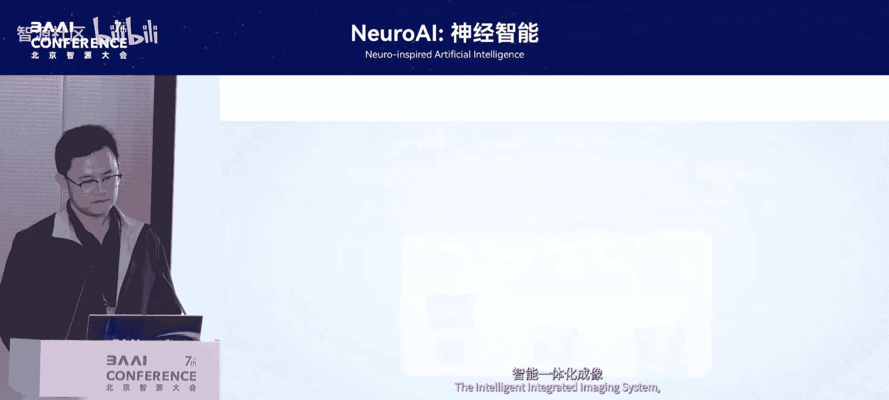
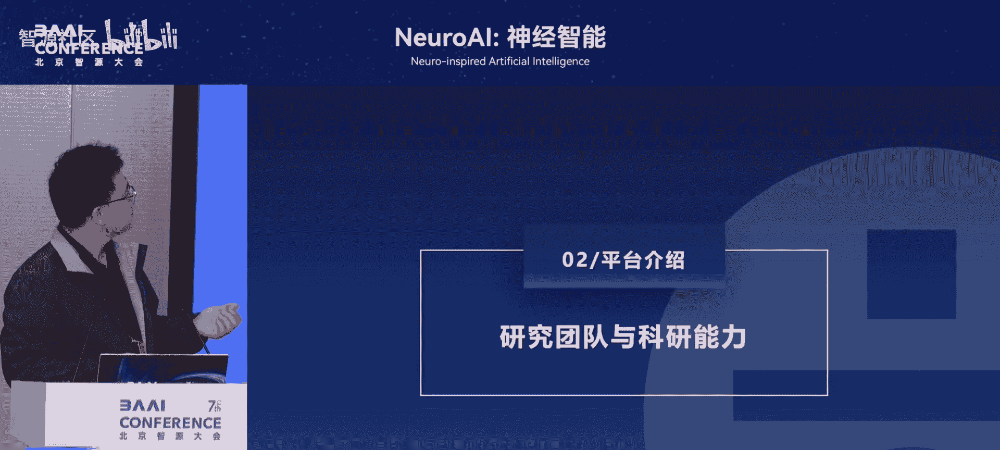
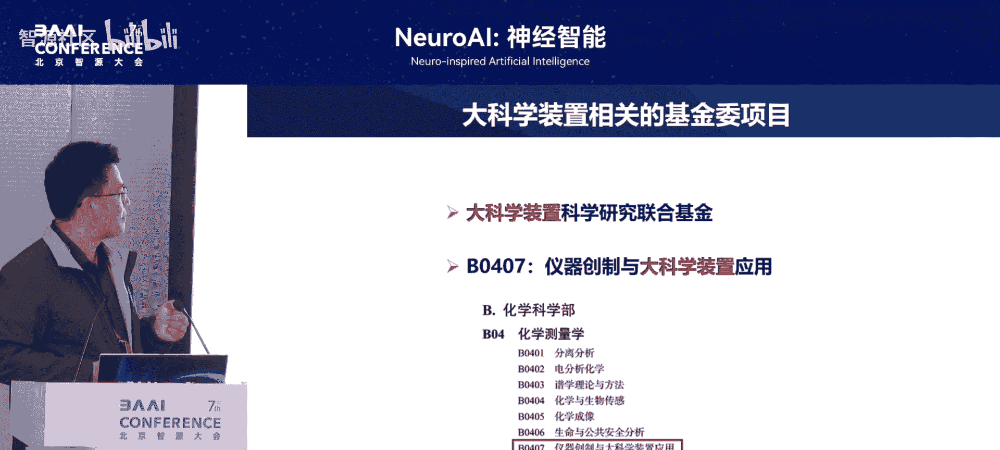

# 2025北京智源大会-NeuroAI： 神经智能 p02 国家大设施与数字生命计划：马雷 -BV1BUN7z3E3e_p2-

那个。呃，各位老师好啊，其实这个论坛呢是致援大会论坛里边最有趣。然后呢，在线人数观看最多的啊，就是过去几年我一直看智援大会的直播的后台哈，因为我一直是支援的一份子。😊。

特别有意思的地方就是刘佳老师的开场，刘佳老师的论坛。然后有时候吴思老师引起的深思啊，就真的是每次我都是回去都要观摩好几遍的。那个这次呢我我有幸以新的身份，然后来去这个参加咱们这个论坛。

我是先先用几十秒回顾一下，我跟智援大会跟脑模拟，特别是刚刘老师讲了很多工作的一个关系哈。其实那个我是202219年，我就在志援，我是智援培养出来，后来就进了北大。所以2020年的时候。

我你看那时候多帅啊，现在胖成那样了，那个那个就是我们叫大脑模拟仿真组啊，当时去第一次就是内部汇报精细神经元的网络可视化仿真的一个工作。当时是和刘志远一前一后。

他当时做的模型叫CPM就是叫相当于是那个早期的悟道早期的那个。😊，然后我们是做这件事。然后2021年的时候，其实是也是刘老师组织的一个论坛。当时我我的题目叫做高精度模拟去走向新一代的人工智能。

当时做了一。一点工作，其实还没有成果。然后呢，成立的生命模拟研究中心。然后2022年的时候，就是我们在线上当时是疫情嘛，居家阶段阶段，我们叫线上的智人大会去发布了那个现程模型，然后2023年的时候。

我们正式提出来，我们不应该指模拟现宠，我们应该做就是生命模拟，我们要做所有模式动物的数字生命，然后未来应该怎么做，包括拓展的更大。然后当然当时也发布了电名。2024年其实我没有做报告。

我是在那个当时生命模拟中心主办的那个论坛，由张恒辉老师主办，我是作为主持嘉宾和共同主席去做。但我我其实缺席了大我缺席了大部分的职责啊，所以这基本上是我过去几年，就是大家通过这个也能看出来。

其实我我一直是在做这方面的工作。而且我是一种工程主导。然后呢，科学为辅的思想去。😊，一步一步把脑仿真这件事做的很实。然后我今天其实是给大家放松的。因为今天我是在介绍呃在怀柔科学城的大设施。然后呢。

从这个角度上是希望把数字生命这个内涵。特别是我们从生命模拟走到数字生命，就是我个人的这个感悟给大家去加枪带棒的去做一个广告，差不多是这样一种想法，所以其实不会讲的很深。

然后呢呃待会儿我有一些对人工智能和和bring的一些思考呢，可能会在圆桌里面，如果有机会的话，我去做一下分享。我会尽量的去把时间留给后面的老师，我前面会快一点。中间有个video会比较长啊。

然后首先介绍一下我们这个大设施哈，我们这个大设施它的核心的这个我觉得科学问题呢问的是是一种技术的问题。我们认为就是这这其实都是17年18年，然后成和平院士的团队的一个思考。

然后呢就是大型的生命科学计划背后呢是这个拜托我为什么要往后看。因为我这个电脑上显示的画面。😊，看那个也可以呃，就是这个研究技术和手段的这个这个这个竞争。那所以其实我们如果要真实的去认识生命。

是多层次的这样的一个景观，你就需要更好的这个这个研究的手段，更好的测量的手段，我我我自己是把生命分为三个阶段，你要认识生命，然后要模拟生命，然后要改造生命。所以第一个阶段你要认识的更深。

你才有可能做模拟生命，然后才能改造生命，也就是刚刚也符合刘佳老师刚刚说的，你得认识大脑，然后呢你才能够做我们所谓的数字大脑，从精细层里面模拟大脑，然后最后你实现数字永生啊。

我觉得是一个这样的一个基本的逻辑。然后呢呃我们为什么要做多模态的这个这个成像的？就是这是一个非常简单的一个技术上的一个局限。任何一种单一模态的成像技术。

比如说CTFMI或者他各自在分辨率心噪比对比度角度上都是难以兼顾的。所以我们需要去构建一个非常庞大的一个成像的体系。😊，去对生命进行一个多角度，多尺度，然后多模态的这种成像啊。

这就是当时大师是成像的一个基本的一个逻辑。那到了今天呢，其实我们除了成像，可能还有很多组学的数据，包括这个呃蛋白阻学，然后基因组学啊，还有各种表型阻学代谢组学各种数据。

我们要集成进来去构建一个数字可以去模拟去计算的一个模型呢，它的应用的范围就很多。除了就是在大脑层面上，刚才刘佳老讲了，我们有可能会用于各种各样的关于意识探讨，关于大脑疾病的诊断。

关于数字永生这样的一个可以说是超现实超过科幻的这样的话题的这样的一个那我们对于我们当今眼下未来2到35年的这样的一个。比如说你的心肝脾胃肾，包括你的寿命的增长，新药的研发，其实都是有非常积极的意义。

如果大家观察到一个新的变化的话，就FDA其实在前几个月已经已经开始去取消了一定要做动物实验这样的一个限制，就。数字模拟数字模型的实验其实也可以帮助。所以很多制药的企业。

包括现在国内的很多做这种动物实验的，现在大家也开始做，我我是不是可以做数字模型，对吧？那这个模型是不是也可以做，它对产业的变化也在悄然发生。😊，呃。

大设施这里就是我们我们是由国家这个这个发改委去批复了17。17亿。然后呢，去2025年，我就不讲中间这个过程了去验收。它是北京大学承建的第一个国家大设施啊，也是教育部的这个为数不多的这样的一个大设施啊。

是我国在北京的生命科学方向的唯一的一个大设施当然现在紧接着呢他现在比较火的，就是在那个广州的人类细胞谱系的大设施啊，然后它里面的后面去讲的很多概念，其实也也也和我们有非常多的交流。

所以我们在这上面是有一个承前启后的作用。😊，🤧嗯。然后这里我就放一个大师试的视频。🎼时代浪潮。🎼无遥相见。🎼生命奥。🎼探索不息。🎼新一轮科技革命和产业变革席卷全球。🎼生物医学研究的大科学时代。然开启。

🎼此刻，我们见证未来。多模台跨尺度生物医学成像设施，一座史无前例的生命观象台。拔地而起。🎼十年磨一剑，从蓝图到洛成，从追随到超越。🎼全球成像模台融合程度最高、可视化、解析范围最广的全尺度成像系统。

🎼再次诞生。🎼多模态医学成像装置。🎼多模肽活体细胞成像装置。多模态高分辨分子成像装置。🎼全尺度图像数据整合系统分子影像与医学诊疗探针创新平台。🎼从人体到细胞分子，跨越宏观、界观、微观，打破尺度壁垒。

🎼从X射线到磁共振，光学显微，合塑成像，以多模态一体化理念洞察生命本质，在无数维度中捕捉生命的绽放。嗯。🎼在这片为生命科学展开无限探索的大科学园区。

北京大学、中国科学院生物物理研究所等科研机构合力攻坚数百位科学家、医生、工程师携手筑梦，自主研发新一代高灵敏脑磁图成像系统，全市场高分辨topDOIpa cT成像装置。🎼跨尺度光电融合断层成像系统2。

17克微型化三光子显微镜，活细胞超分辨显微镜。🎼生物单分子核磁共振成像仪智能一体化成像，多模态超灵敏探针，多模态跨尺度数据融合，整合理工一、信息与人工智能铸就领航未来的科技航母。

🎼这是一场智慧与创新的盛宴。🎼跨界科技精英共襄盛举，世界顶尖生物医学成像平台紧密联手，共建国际联盟，共创国际大科学计划，共同探索生命科学的最前沿，培养引领未来的跨学科人才。🎼这是一幅产学研转化的长卷。

发起生物医学成像产业创新技术联盟，针对未来临床需求，研制颠覆性的诊疗一体成像装备，打造高端生物医学影像仪器装备的中国创造。🎼这是一部科技与生命的交响乐章，依托大科学装置、大科学计划、数字生命应运而生。

🎼数学技术、大数据、人工智能、基因调控，从数字细胞到数字器官、数字生命体，解码生命，模拟生命，以全景视角刻画生命之相，揭密生命之向。🎼开启虚拟临床试验、个体化药物筛选，引领生命科学研究的范式革命。

精准守护人民生命健康。🎼来以来，东风正盛立生物医学前沿，看生命奥秘全景。🎼以科技之光点亮生命之眼。🎼生命观象台看见生命力。🎼呃，谢谢大家啊，那个我后面还有，所以我把这个这个片子有点长。

但是我希望把它放完，是因为这个片子我们是前面3月21号国家验收的时候，刚刚放过一次，我也是非常难得借智源这样一个平台呢，像这个无论是在线的，还是说现场的同学们去告诉大家，就是我们现在有了这么一个设施呢。

欢迎大家呢有机会跟我们去去利用这个能力去做出更好的研究。我后面所以就快一点。因为我后面的内容，其实呃片子里其实都有了。首先这是我们设施的基本的情况。

我本人呢是负责这个就是全尺度数据处理中心和全尺度整合中心，就是就是相当于是装置4啊，我主要是做数据整合。这是我们这个和其他的国际的这种呃在申请的时候，的其他的这种呃类似的成像平台相比的。

我们其实在跨尺度智能图像融合平台，也是和装置四比较对应的这个方向上，我们是有一些非常深的思考和和创新啊，然后这是我们的。😊，这个成像的这个能力。

我们最近会有一篇文章是专门介绍我们整个设施整合出来的一个成像能力，也欢迎大家去关注。呃，这是这是我所负责的装置4。我们基本的目的呢是希望把装置123的所有的数据去串联起来。

也有一种完全全新的范式呢去大家可以有点是去探索生命的每个角落里面的这种奥秘。呃，这是我们装置四的一些特殊的设备。比如说像这种呃完全一个大的环评啊或什么的，就是可以去展示很多。

我们未来可以在这里面去穿到细胞内部里面去研究一些现象。呃，我们同时呢也有个二期建设，这个在北京市的支持下呢，也拿到了大概6点66点多亿吧。然后现在正在建设，然后这二期呢也也明年预计明年或者后年应该。

呃，研究团队，这个我就快速过一下，我们团队很强大，都是北大的一个优势团队去双聘进来。然后这个我就不念了啊，就是就是很厉害。然后我们的这个方向呢，其实现在的这几个PI我们的方向也都很不一样。

然后大家都比较交叉。呃，特殊的一些典型的设备哈，这里也简单的介绍一下。就比如说这个这个呈现式的这种自由行为的小鼠的这种这种成像，从这个呃微型化双光子到微型化三光子到极身是呃这个三光子到超宽视野的双光子。

其实都和刚才刘佳老师说的，我能看到一个小鼠里面的这些星星点点的这个这个形状就预示了他要喝水。然后他要有什么行为。他和behavior这样之间的这种在活体情况下载体情况下的这种行为的研究。

其实就可以呃完全的去开展。😊，啊，当然我们在细胞成像上还有很多特色的，比如说陈良一老师的这个海丝结构呃，这个超分辨，还有孙玉杰老师的这个三维呃大市场超分辨。

还有比如熊汉星的这个呃这个这个食欲受击的拉曼散射技术，这些都是一些典型的我们的一个可以说是独门绝技啊。当然我们也欢迎我国学者自主研发的这种成像装置平台，都在我们的大城进行集成。呃。

当然我们还有一些其他维度的，比如说我们有电话学记录的，有这个做透明化技术的，也有专门做这种呃连接组学的。呃，然后最后说一下，我们为什么要去在全国范围之内去倡导这样的一个数字生命的大计划。

就是呃一一个可能大家都有所共识的地方，就是就是主学技术大数据，特别是人工智能啊，是生物医学现在研究的一个新动能。那那我们原来的那种生命科学里面那种假设驱动，或者说假设加数据驱动的范式呢。

现在已经悄然发生变化。很多时候我们的一个自由探索的那种目标，现在也变成就是一种更有组织更大规模，大家问大问题。然后一堆人来一起去解答问题的这种形式来来来来变化。那所以呢就是呃其实在34年前的时候。

那个成呃成先是和我们讨论说，那我们是否可以提出一个新的主题。这个主题就是扣准时代强音，可以用很多年然后举举中国的最强的精英的一批力量去做一件事啊，所以后来就是这个呃我我也是深度参与哈。

所以就定了这么一个数字生命这个主题。然后去聚焦这种。基础的这种用用把整个生命的这种可视化到模拟到预测，然后去做啊，就是这样一个。我们希望通过这样的一个体系的打法呢，去给年轻人去提供平台。

然后给一些重大问题去提供一种可研究的然后有体系化的去做重大发明重大发现领航人才啊，这是我们要推的一个具体计划的三个的点儿啊，我那个就是呃就是首先是生命的观测，然后呢是数字生命如何去和其他学科交叉。

最后呢在全国范围内如何去各布各个中心。这里面特别的其实我自己本身其实肯定是会做数字脑方向，还有其他的呃然后希望就把这一些都在全国都带动起来啊，所以我今天前面讲的这一些。

其实是我们在有有很多这个合作机构才去做的时候，我们现在在4月21号的时候，其实已经把这几个方向都已经列为我们大师是的重点知识方向啊，这里包含比如说这个脑细胞。然后呢这个。大脑里面的一些机制啊。

这都有合作的也都是后面的一些国内最最优秀的一些最顶尖的团队。基本上我们现在的这个运行的机制管理呢，就是我们会给你提供基时，然后提供专门的PI和你去对接问题。然后呢去去有专门的立项人员和你去去协作啊。

这里我我就快速的讲哈，就是在大市基金，你也可以去去申请我们的这这个代码这两个其实不是我加到这里这两个就我们去全国去讲的时候，每次都会讲，但这两个恰巧是我的工作。恰巧是就是一个是跟陈是去年合作的。

就是这个就是刚才也是有点像那个就是刘佳老师讲了去我们去解码大脑。如果我看到很多里面的这个这个信息的时候。

我如何去猜出他的各种各样的这种这种意思这个我们其实是观测的是一个SN的这样的一个和团里面的的时间表达的这个行为。所以这个我也就不不介绍了，虽然非常幸运。然后被选成了封面。然后这谁是另外一个也是我的工作。

然后也是非常幸运。然后去年被选成了那工作。刚才刘佳老师也有介绍。😊。

其实这个公作是22年的时候，就在智援大会发布。然后我们是去年的时候才真正发表。我也就不讲细节。我唯一想说的就是我们是完成了现城的一个闭环仿真。它close loop的 simulation。

这个非常重要。现在在抖音上，如果你们把数字线从搜搜入等于去搜的话，你们大概能搜到几十个，那全部是二创的，还有三四个账号就靠这个起号了，我觉得很有意思，什么世界科学家啊，对我今天现在是有线上直播的啊。

我可以澄清一下，那跟我们都没关系。就是如果你们抖音去搜一下，你们会搜到好多好多那些都是过度解读了啊，我们还是要以科学的态度来看看待这件事。😊，然后大实施的这个重大项目的终极目的啊。

当然就是希望就是真正的推动我国这个领域层面上的这个这个这个发展。最后呢就是哎我这里应该还有个视频吧。视频是在后面是吧啊。🎼OK好O那那最后就是我如果大家关注我们的话，发迎去关注我们的公众号啊。

选我我这里面所有的视频在我们公众号都已是已经公开了。所以我是只是再放一遍我们的公众号就是北大成像生物医学。然后我们会去发布我们合作的倾向，发布我们重大成果，然后向全国去去去开放。

这些视频都是公众号的视频，这是我们那个是未来将会产生史无前例的多度的生物医学成像的数据。AI帮助我们更好的去理解这种数据。通过构建数字生命I呢就有可能是打开未来我们对生命科学研究的一把钥匙。😊。

🎼我们希望通过最先进的前沿的AI技术去充分的利用成像设施的各种模台，各种尺度的成像数据，构建跨尺度的数字生命模拟器，帮助我们解码生命的本质，以一种前所未有的系统级的角度来去探索生命力各种复杂的现象。

🎼欢迎全国的科技工作者来这里一起和我们探索数字生命的新范式。🎼我们的大师师是世界上独一无二的存在。🎼一头大师是，我们的科学家有信心做出生物医学成现领域两弹一星级的成果。好，我就到这里，时间还没有用完。

谢谢。😊，应该就没有提问了哈，我们就介绍那个啊啊，刘老师，您您呃。😊，因为我这个比较比较比较泛，所以。😊，嗯。对。会会那么我的问题就在于说。数据的顺便读。一个掉的。我完全。生命科学的。对。

这是不是就代表着。探所是。能够能够知道，就是在这个模具上面能够去。他已经具备了。特种表征。范号了力。这就已经能够比较。奥秘你这个问题特别适合圆桌讨论。我简单回顾回答一下啊。

我觉得从我构建线程和解码那个脑核团，包括我们已经在做的几个工作和在审的几个工作的综合来看，我认为其实没有没有一个完全d driven的 model，这个是不合理的。

我们一定是fo engineering和back engineering相结合，就是至少在现阶段，因为你的数据量不足以diversity到表征整个物理世界。就是假如说吴思老师最后那个命题。

其实我特别有其实我也在思考这个问题。如果世界是个模型的话，那你表证这个世界的模型的数据要远远大于这个世界所能呈现数据的本身。😊，所以。Yeah这是我的答。

