# 2025北京智源大会-NeuroAI： 神经智能 p03 从通用生物智能到通用人工智能：卢萌 -BV1BUN7z3E3e_p3-

今天非常荣幸能到这个平台来呃介绍一下我的。跟那个合作者的工作。然后我也是支援的粉丝，刚才马老师说，之前每年都是有很多的那个线上人员，我也是线上人员之一。然后今天那个呃到现场来参加，感觉非常荣幸。

也感谢两位大会主席吕老师和那个吴老师给我这个机会来做报告。然后这个题目是刘佳老师给我起了一个命题。然后就让我讲这个，然后看到这个题目的时候，首先就想到了呃米开朗基罗这幅画。

他画的意思就是呃表达一种对呃上帝创造生命那种敬畏以及那种感激。然后我突然就想到在我们这个时代啊。在科学这个领域啊，我们唯一的上帝就是大自然。那经过一万年的这个进化。

大自然创造出了人类这种唯一具有AGI智能的生物体。然后现在我们人类又创造了人工智能，而且又在这几年，尤其是23年开始，也就是呃吴思老师跟刘佳老师经常反思脑科学的这个时刻开始啊。

人工智能已经在某些程度超越了人类智能，并且是从某些点上的超越开始到线上甚至到面上的超越。所以这种智能的传递，从大自然传递到人类，又从人类传递到人工智能。

我觉得就是呃从文艺复兴时期到现在一个非常好的一个隐喻。ok。对，这样会好。对，然后那我今天演讲的题目是从生物智能生物通用智能到人工通用智能。那么生物通用智能我们看到的是在这幅画里面。

在1万年的进化过程中哺乳动物的大脑。它以遵循着某种程度上的scaling low。也就是AI里面的那个啊啊规模定律。大家可以看到说从早期的一个啊比如说那个啊。一种早期的哺乳动物，然后到中期。

然后一直到人类甚人类以及比人类更大的那个呃大象和鲸鱼的大脑。我们都可以看到说体积。在不断的增大。然后随着体积增大的是啊神源密度的增多以及连接性的增多。然后更难能可贵的是，在这些直观的数目。

直观的数字之下，我们可以看到大脑结构也进进行了一个模块化的一个进化，产生了更多更更更精细化的分区，然后这些分区啊，它的功能让比如说人类的大脑从整个人整个哺乳动物大脑的进化过程中脱颖而出。

让人类以更小的大脑体积。比如说相对于鲸鱼或者是相对于大象来讲，我们的大脑体积跟重量都更小。但是我们有更好的模块化以及连接度，从而让我们具备更高的智能。所以。

这幅图就代表了说整个生物智能啊进化的一个这个过程。那么。

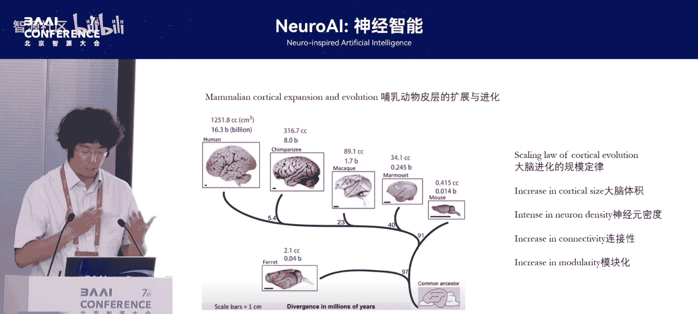

基于这种人类大脑的进化出来的结构，让我们人类有了通用智能，也就是gene intelligence。我们可以看到说早期人类进化过程中，猿人。从第一次使用工具来进行呃敲打石头来生活。

然后到之后产啊学会狩猎，并且产生的农业，以及之后的工程艺术和科学。我们可以看到说人类跟大自然的交互过程中，不断的进行探索新的工具，探索新的环境。然后探索新的一种本领。

这种在呃不同的环境中生存以及适应下来能力，就是智能的一个基础，也是人类智能能发展到今天的一个重要的一个原因。因为这种通用人工智能让人类在呃不同的环境。

面对新问题、新环境的时候都能去呃想办法去用已有的知识去解构它，并且是创造出一些新的方法来啊呃解决它。

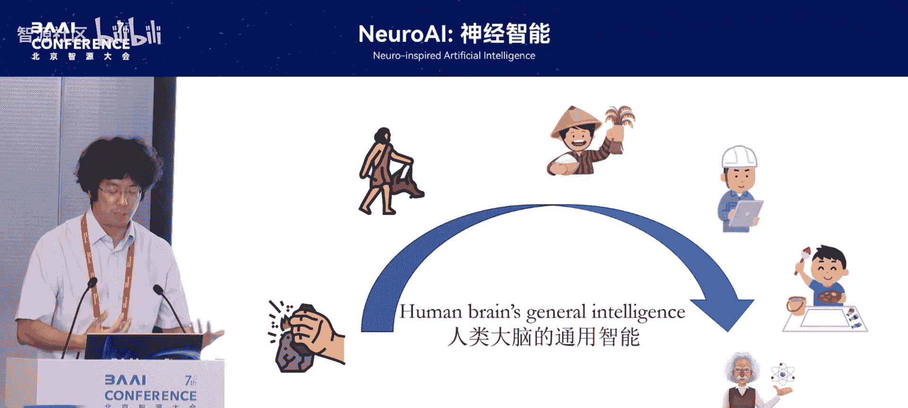

那么前面讲的是一些比较descriptive的一些啊啊描述。那么如果从理论的分析来讲的话，那智能其实呃我这里先引用一下吴思老师当时所讲的，也就在世界模型中构建一个新的分布，以及在分布外求解的能力。

这个分布其实就是比如说从大语言模型的角度来讲，他经过训练之后学到了一种呃统计模式。那么啊真正的智能不应该只是先在这个统计模式里面进行啊问题的求解。而更应该是面对新问题的时候，跳出这个统计模式。

在新的结构里面进行求解。甚至说创造出种新的新新的分布，然后创造出一种新的形式出来。

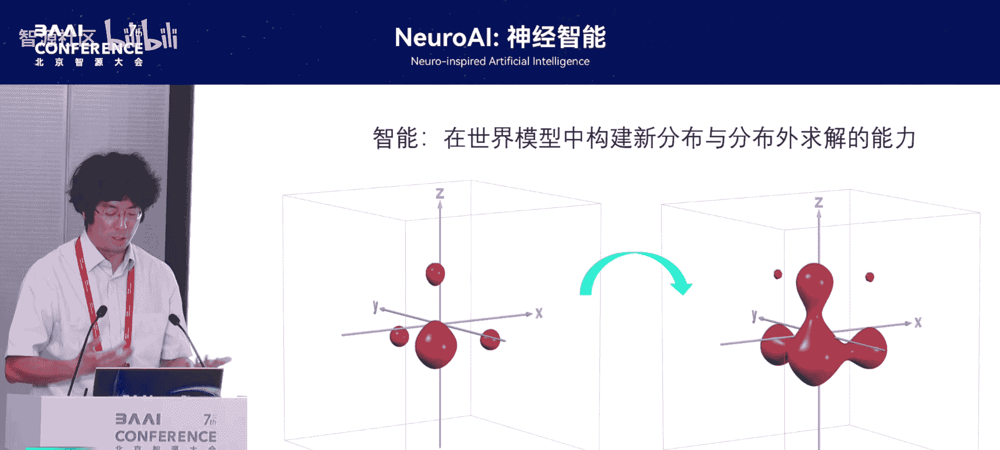

那。😡，我们刚才讲了啊，人类大脑进进化的这个结构基础，以及这种结构所赋予人类智能的一些能力。甚至说它的一些理论化的一些呃思考。那么我们再回到人类大脑看到看一下它的结构，到底是什么样的结构。

以及动力学机制，支持了人类也就是现在我们已知宇宙里面唯一的1个AGI的一个agent是什么样的结构，让它有这种能力。那么人类大脑啊，人人呃。神经科学经过这么一两百年的发展。

也帮我们解解码出了大脑的很多个机制。比如说啊pa encoding或者是那个啊频率以及那个啊不同脑区的结构等等。然后在这么多的那个啊pri里面，我们团我们团队就提炼出了三个最重要的点。

我们觉得是啊能够去概括或者说能够去生成其他大脑所具备的能力的。第一点就是模块化，模块化是整个大脑的结构性的基础。比如说在我在在这个图里面，我们可以看到各种回路啊，各各种那个皱褶。

然后不同皱者其实代表不同的结构以及功能分区。那么从整体的角度来看的话，大脑皮层也就是执行高级认知的区域，大概可以分成两个模块，一个模块是sensorytex就是负责啊局域的以及快速的模式识别。

进行低级信号处理。那么在更高级的区域，也就是PFC以PFC为代表的高级区域它。处理的是一种hierarchical reasoning或者是obtraction，还有deion making的这个过程。

这两个区域相互之间又有一个非常强的一个交互。比如说啊自上而下的调控或者是自下而上的信息传递。这种不断的循环过程中让低级信号能够逐层逐级的进行筛选以及分析最后送到高级皮层进行处理。

然后高级平在反馈给低级皮层，在这样不断的反馈啊循环过程中实现信息的经细化处理以及实现高级认知功能。那么还有一个很重要的一点就是啊就是前面所讲的模块化是结构基础双向调控是动力学基础。

那么能让这两个点真正啊真正工作起来的一个重要的机制就是频率耦合。因为我们知道大脑的不同区域它有不同的那个就是就是震荡。比如说P它有啊波或者伽ma波，然后sensor有各种各样的波。那么。

正是这种不同的波，让它有各自相对独立的功能。然后这种频频率的耦合，又让不同的区域能够在保持自己独立性的前前提下实现一种功能上的整合。所以这种频率耦合是啊能够把前两块模块化。

也就是分区和双向调控整体连接在一起的一个重要的机制。所以我们。这这这是我们现在所pro的一个三个重要的一个基础，模块化双向调控以及频率耦合。那么根据这三个机制，我们回到大脑。

我们就可以分析说大脑它大脑所具备的这种高级认知功能。它的一个特点是什么？第一个就是原引导性它类似于说那个me learning这种原引导性强调的是一种me。也就是说不同层级它有一个调控机制。

比如说底层的这个信号传递给上层的时候，上层对它有个反馈，也就是通过这种me guidance仍然仍能让人类的大脑能实现自我感知以及自我啊纠错的能力。这个是现在大语言模型所缺乏的。

然后另外一个是ization这个可能是AI领域的人更感兴趣，也是他们认为所有的学习最本质的过程都是一个啊增强泛化性的过程。那么从第一点的 guidance。

让这个大脑它具备了自我自我认知自我调控的功能之后，它就能够实现一个genization，也就是一个泛化性。因为当它跟外部交互的环境，他每时每刻面对的是新的环境。

新的环境所给他的input是不一样的那这个不一样的input如何去embedding到它自身的这个已有的认知系统里面，它就需要一个不断的迭代循环纠错的这个过程。所以由于原大脑的这个原引导性。

我们可以推断出它具有啊很强的这个泛化性以泛化能力。那么在这两个基础上，大脑就能实现一个mstep reasoning这个mstep reasoning呃重点是在于mstep。

也就是说它通过虽然是多步的这个推理过程，但是它由于由于有了一个自我纠错以及泛化性，它不至于说在推理的过程中出现偏差，而导致说最后的偏差越来越大。就像现在我们大模型的一个 hallination一样。

那么这是我们的一个思考，从大脑的呃结构提炼出了一个几个比较重要的一个啊它的结构动力学机制，以及再由动力学机制推导出他的一些啊认知上的一个原则。

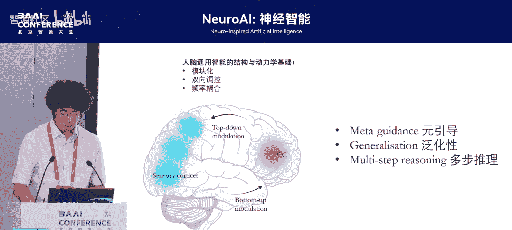

那么我们现在回到AI嗯，刚才所讲的是大人类大脑。那我们看到AI看一下AI呃人工智能支付jo他是怎么说AI的。他认为说AI是一门啊是一门让这个模型去适应。

并且去解决全前所未见的困难和前所未见的环境的的一个科学和工程。他在这里也非常强调说那个啊 never seen and have been never prepared for的 beforehand。

也就是说他非常强调这种AI面对新环境这种能力。那我们看一下现在的大语言模型是什么样子的。我就是希望用这幅画来展示一下呃整个啊。呃AI领域包括脑科学领域呃。

也包括那个就刚才刘佳老师所讲的那个呃AI发展的几个阶段来讲一下，我们现在呃脑科学和AI它各自处在一个什么样的那个阶段，以及脑科学如何继续的为AI的发展提供动力学的知持。那么O第一在整个智能的发展阶段。

第一个是差值法。也就是说他经过大量的学习之后把这个学习的这个知识结构embedding到内部的模型里面。然后解决已知的问题，然后生成已知的结构。因为它有一个非常好的一个拟合之后。

他可以在这个结构过程中进行抽样抽样的过程，所有在这个结构中抽样出来点都是符合这个内部结构，所以他能够生成生成一些非常漂亮的文字或者图片。然后解决的问题也是在这个结构里面。

所以这是第一步 interpolation差值法。那么我们现在。呃，人工智能的阶段就是在这里，我们在第一座山峰上。然后第二个第二步就是外推法。也就是说他面对新问题的时候。

他能够跳出已有的问题的已有的 knowledge的那个dding结构。然后跳到这个结构外面去，然后来解决这个问题，这就需要非常强的一个自我自我感知自我调控以及自我纠错的能力。

然后包括那个step reasoning。所以我们可以看到从差值法到外推法其实是体现了他的一个nalization就是泛化性能力越来越强的这个过程。

那么这个也是我们人类现在所具备的就我们天生所具备的一个能力。并且是这个问外推法很关键的一点是他可以发现问题。而差值法只能是去解决已有的问题。然后第三点也是最重要的也就智能领域最高的一点。

刚才刘佳老师也强调了就是创新性。这个我们要把我们要把我。我们的认知。对世界的认知往前推，我们不能停留在解决已有的问题，也不能停留在发现问题，而更应该去创造问题。比如说啊黎曼他创造了啊呃微分几何。

那他就是把不仅是把那个呃高斯几何，从高斯呃高高斯几何从那个二维平面推广到三维，更他更推广到无限的维度，并且是在这个无限维度里面创造出了一种新的几何结构，影响了后来爱因斯坦啊建立相对论，也也是那个整个。

相对论的一个数学基础OK所以说从外推法到创新这个过程，它是一个非常难以逾越的一个一个过程。但是我们人类现在也是在这个山顶上，因为我刚才我们看到那幅图，就是人类从早期的那个钻木取火敲打岩石取火。

一直到最后比如说爱因斯坦创造相对构建相对论。这整个过程就是我们从差值法到外推法到创新这这样一一整个过程。而现在AI所停所能达到就是第一座山峰。

所以我我个人认为我们脑科学可以持续的不断的给AI一些新的 inputput。然后接下来也给大家介绍一下啊。

从AI刚才所讲的那个从脑科学刚才所讲的三个啊重要的特征以及结构动力学以及耦合这块得到了一些启发设计的一个新的模型。

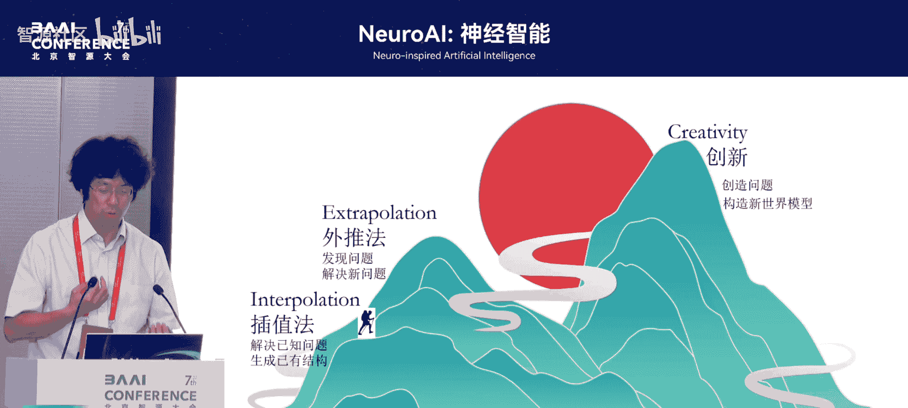

然后呃刚才批判了一大堆呃现有AI的模型。那么现有AI模型主要是什么呢？主要是基于au regression的一个模型自回归模型。

比如说呃transformer以及transformer衍生出来的GP还这些都是我们现在每天在用的一个ta模型。那么我在这里用简单的一个例子来讲一下这个aure它的一个工作的机制是什么。

比如说我们要创造一幅画一幅蒙娜丽莎画，然后这个画家学习了几十年的时间，每天在练习，后来开始来参加考试的aure的工作机制就是基于前文所生成的内容来生成下一个部分。比如说在画这幅画的时候。

我们给他一个input，然后他就一个点一个点的在这样画，然后不断的画画画，最后一幅画画出来了。那么这个这样一个是呃我们现在看起来是非常有逻辑，也是非常有规律的一个过程。他也非常符合统计的这个分布。

那么关键的一个问题就是他无法进行回溯跟反馈，然后也就是导致他无法进行有效的。一个自我更新和自我纠错。那么出现的问题是什么呢？呃呃比如说幻觉缺少一个那个真正的自我修正。

也就是说在前前文前面在生成的这整个sequence里面，如果前面有一点出现误差或者呃。出现误差的情况下，那么这个误差可能会被逐渐放大。最后导致说完全跟你所要的内容不一样的东西。也就是我们现在所讲的幻觉。

另外一个就是刚才所讲的一个统计模式匹配，它的采样都是在都是基于已有的这个分布上，它无法进行一个外推法。所以也是幻觉的一个一个一个那个机制。那么比如说从23年开始有出现了思维链技术。

然后以去年开始的那个t time scaling这个技术都是希望去解决这种啊 auto regression的一个本质上的一个de然后但是呢他带来的问题就是成本的海量增加。

而且并不能从根本上解决这种 regression的一个ck of self correction。还有一个问题就是现在所有的大模型，它的引空间都是一个 space也就是说他的他的那个推理空间是单一的。

然后但是在我们人的大脑里面，我们可以看到说在视觉。皮层的处理过程中有那个呃V1V2VA3，然后一直到IT它并且是视觉皮层处理了之后会投射给呃。

比如说PFC或者是那个啊呃海马体它有多个不同的那个层级化的一个处理式不同的层级都有不同也就大脑它的那个 space模块化以及层级化的这跟现有大模型的一个单一的那个啊影空间是完全不一样的。

那么这种多层级化的一个影空间，就让我们人类的大脑以及或者生物智能具有更强的一个表征能力。然后可以表证啊非常抽象的一个啊一个空散或者是一个特征。然后并且是这些特征能够稳步的进行一个抽象的过程。

然后另外一个 fundamentalament最根本的就是在我们大脑中语言空间和推理空间，它是啊分开的啊。2去年有一篇nature paperMIT发布的。

它利用人类的那个FMI测试发现说人类在推理的时候，大脑的空间大脑大脑的那个活跃区域和语言的活跃区域是完全不一样的。那么这给我们的提示，也就是说啊大语言模型可能只是一个生成模型。

如果把语言模型放在人类大脑的智能里面，它就是在大脑人类智能一个比较呃低端或者说。以或者说把人类的智能从影空间真正的推理的影空间里面解码出来，给外面进行一个交互的一个111个一个中间的一个1一个模块。

anyway。所以那我们来继续用蒙娜丽莎画画这幅画来看一这个过程来看一下啊，为什么这种au regression会有啊导致这些问题。还是像刚才例子，我们给他一个。11个一个一样的输入，然后让他来继续画。

然后每一点开始画画画画。

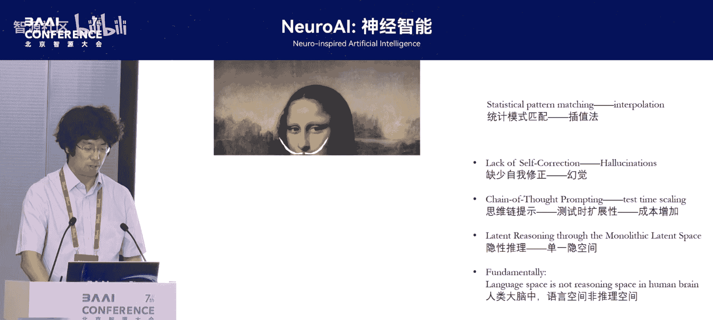

那他可能是根据前面的一点，他就把蒙娜丽莎画出一个具有胡子，或者说他可能看到达利画的蒙娜丽莎的画，然后对他产生了一定的那个影响。最后一步一步一步错步步错。最后整幅画就不是啊不是我们想要的样子。

所以这个就是现有大模型，基于auto regression的一个 intrinsic default。那么真正的人类的思维是什么样子呢？呃，我在这里就班门弄斧一下，就是接下来也希望各位老师。

有些认知科学的老师多批评一下。然后呃我们认为真正的人类的思维是并不是one short learning或者是那个或者是monistic space的一个reaing。我们认为它是一个多次迭代。

然后在迭代的过程中不断的进行自我修正的。然后这个多次迭代以及自我修正，就是由前面的三个特征，比如说呃原引导的能力泛化性以及多步推理它来实现的。然后我们继续用这个画蒙娜丽莎的例子来讲这个过程啊。

我们人类在画蒙娜丽莎的时候，一开始是画一个比较粗略的轮廓，然后逐步修改，然后再再不断的增加各种各样的细节，然后最后把这整幅画画出来，这就是一个不断递进，然后修改的这个过程。

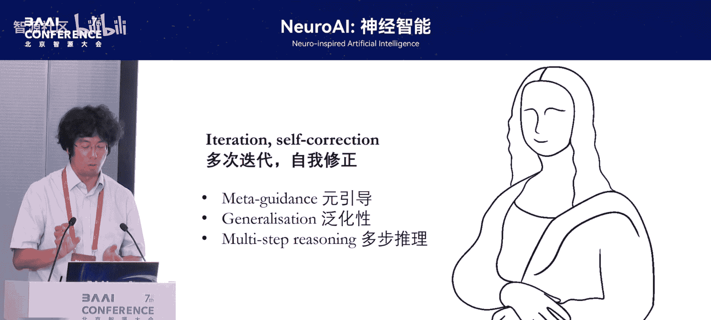

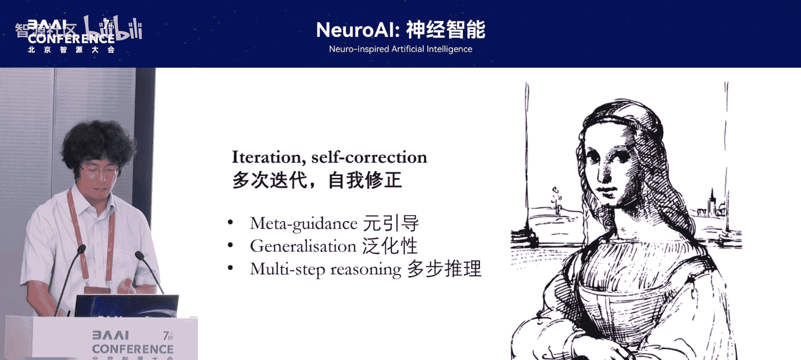

然后那么基于此，我们就提出说呃。在那个scaning load啊。我们现在所处的一个呃时间段应该是属于啊整个scal不管是I的第二个阶段就是通过模仿人类大脑这种模块化的结构设计出一种更精妙的一种结构。

然后实现一个 reasoningerative reasoning个机器。然后从而把整个I从深度学习它强调的更是一种学习atistic pattern matching到深度推理强调的是一种推理和理解。

那么我们根据这个大脑的这个模块化分屏以及它的那个mutual modulation设计出了一个HRM也就是arch recurt model。

我们把我们整个模型分成两个部分一部分是 level模仿的是FC的高级层功能。然后另外一部分lowtex level就模仿的是tex它它实现的是一个loc information或者是低级的一个信号处理功能。

然后两个模块进行一个频繁的一个交互。这个交互过程模仿的就是top down modulation和but modulation。并且是两个模块，它的频率是不一样的，这个也是模仿的频率。

比如说啊PFC里的它那个ci wave，然后那个啊sens是那个gava wave。

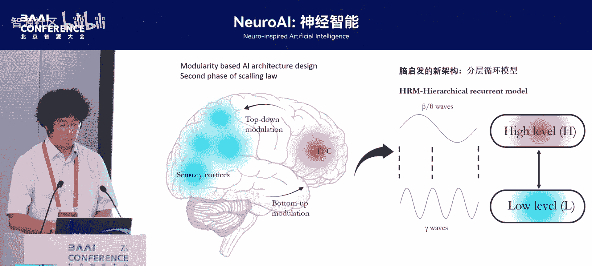

那么这这三个就是啊分层循环以及分屏，这是整个模型从AI大脑里面得到的一个启发。那我们现在看一下，这是呃我们现在最新的结果，在呃深度推理方面，我们是完全碾压现在所有的推理。

比如说者是然后我们的参数量只有的25千分之1，这是一个非常惊的一个数字，并且是我们经过model analysis发现这个模型它具有很强的一个认知灵活性以及层级维度所谓的层级维度就是它的low level和 level它表的空间的维度是不一样的low level只需要比较少的一个比较小维度的空间去表征。

然后igh level需要非常高维的空间去表。然后它在这个高维空间里面进行搜索进行运算。然后得到一个比优化的一个子空间，然后把这个子空间传递给low level也就tex让他在这个空间里面。

进行一个执行一个程序化的一个操作，从而实现这个呃功能上的分工以及整体。推理上的优化。然后这个是也是我们最最最兴奋的一个一个数据。就是我们在在那个up one和up two里面做小样本学习。

只有1000个题左右的训练量。然后来测试发现它远超现在所有的呃推理模型。比如说阿 one或者是呃cloud three或者是那个O three。我们。呃，我们的bench mark都比他强。

而且是参数量非常非常低。所以这就体现了这个小模型。当它当我们真正去用人类大脑这个模块化以及它的那个动力学机制以及分屏机制，把它embedding到这个模型机制模型的设计里面的话，它可能会真的涌现出来。

具有远远超越现在AI模型。它的这种能力。然后经过我们的模型分析，我们大概就是提出了这个模型工作的机制的几个方面。一个是呃meta module，它模仿的是一个慢系统，它在高维空间里面探索。

它充当的是一个领导角色。然后foundation的 module mimicking sensortex它执行的是一个快系统，然后在低维空间里面收到啊matta module给他的信号之后。

在这个低维空间里面执行一个程序化的一个操作过程。所以他只需要在低维空间里面进行啊工作就行了。然后他的角色是一个员工的角色。所以这两个module不断的进行迭代循环，就能够把一个非常复杂困难的任务分解。

然后并且在各个子空间里面寻找一个最优解，最后达到一个稳定点。然后这是我们的那个PC分析，就是对模型在数读任务中的这个过程进行分析。每一条线代表的是它在整个解题过程中走的多个步骤，它的每个点的状态。

连起来就是一条线。我们可以看到说在呃几十道题解题的这个过程中，他遵循他已经学到了一个比较固定的一个思维方法，然后确实是沿着这个方法在进行进行思考。然后这个是整个啊解题的一个起点。然后这个是解题的终点。

我们可以看到说在解的过程中，他有一个有有有思维上的一个一个波折，反复进行思维的过程，然后最后到达一个比较优化的区域之后，在这里循环迭代好几次，最后就达到正确的一个答案。然后这个是同样的题。

但是是对于一些非常难的题，它需要多个步骤进行推理的时候，我们可以看到说他他的思维路径跟前面简单的那个思维路径来。

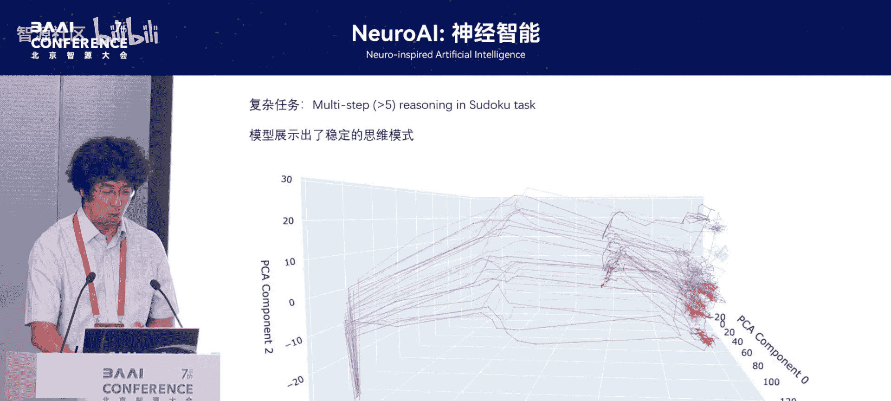

讲它是一样的，但是不同点就在于说它中间的这一部分，它停留了很长时间到啊，它再进行一个迭代思考，然后再不断的优化自己的这个啊啊contrain。但是他最整个呃思维的路径是跟前面结简单任务的时候是一样的。

然后也就是说他学到这个方法是非常consistent，也非常具有很强的一个泛化能力。然后这个就是我们把刚才的那个状态空间的呃结果把它。的抵扣除抵扣成真正的那个解题答案。我们可以看到说这个是输入。

然后这个是他思考了第一步，他大概有50%的正确率。然后之后经过多步的这个迭代，他的正确率一直停留在是在这个部分，一直停留在百分之那个啊啊就是50跟60中间，然后最后突然一步他就。似乎是顿悟了。

然后直接就把所有的题都给解答出来，这个也非常符合我们人类思考的过程。我们在解一个非常难的题的时候，并不是一个线性的一个解题过程。而是说你在中间你你看刚开始可能会有一个思维跃升，找到一部分答案。

但是你会停留在中间思考很长时间不得其解。嗯。当你对整个问题有个非常深入非常广泛的理解之后，并且把它跟其他的问题建立一种ining connection的时候，你可能突然在某一刻把所有的问题都解开。

所以这个模型在0。02啊B的0。027B的参数量的情况下，已经能够涌现出来人类大脑所具备的一些呃非常深刻的一个思维方式了。包括他能够体现了一些已经涌现出来一个自我更正过程。比如说这是在解题的过程中。

然后我们可以看到说他一开始。这个这个位置是对的，然后之后他有解错。那解错的这个过程，很有可能是他通过降低局部的正确率来满足整体约束的提升。然后当他整体约束逐逐步提升之后，他再返回到这个地方。

再对它进行一修正。所以这也非常直观的体表现的这个模型，他有很强的自我修正能力。然后这个就是呃我们呃接下来要开展的一些工作。今天时间关系就不在这里跟大家呃汇报了。

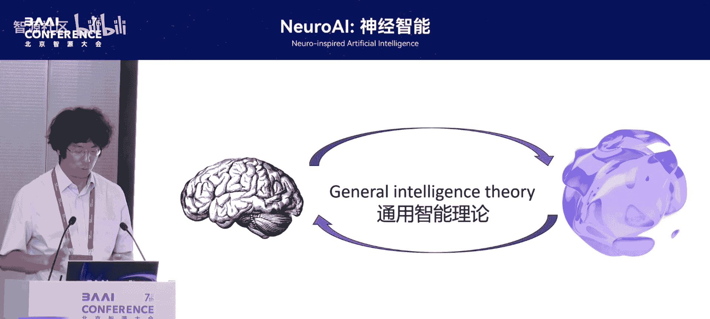

对，最后就是啊这个工作就是由啊CP他所呃领导，然后北大新华一起合作的。然后这是啊团队的几个核心人员，谢谢大家。

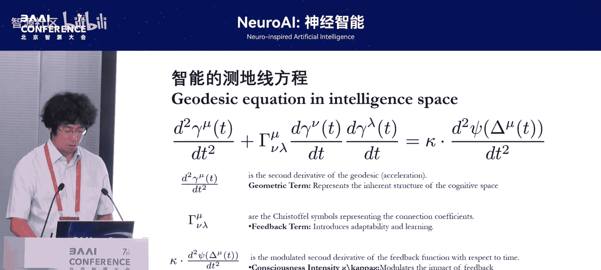

呃，下一位老师是。啊。那个呃呃谢谢罗老师的分享，特别有意思啊。你的那个结果特别神奇啊，就跟相比，要跟671B的，你只有0。02亿的这个模型的量就能够比它更好。我们很非常正经那这个底层的辑是什么？

就底的算法的FC交互它底是用传统的吗？还是说底这个模型它是有两个构是传统的经网络吗？对对就是不是那。😊，这只是纯缩嘛所构建的。哦，就就PFC也是用transformer。

然后sensor也transformer。对对对，这个模型神奇的地方就在于说啊它的那个初始状态，这两个mo都完全是一样的。但是你用不同的频率去训练它的时候，它会涌现不一样的能力。

比如说你让那个呃嗨就是mat module就顶层的那个模块的频率和底层的模块是一样的时候，它的能力就比较差。然后当你让他多跑几次的时候，下面也都多跑几次。也就是说让他有更多的机会去发掘这个问题的时候。

他就能学到一个更强的一个能力哦，对，这就很像我们人刚出生的时候，那个de setting都差不多。但是你经过后天不同的教育，你会涌现不一样的功能一样。好的好，谢谢你。谢谢谢谢。好，谢谢大家。

