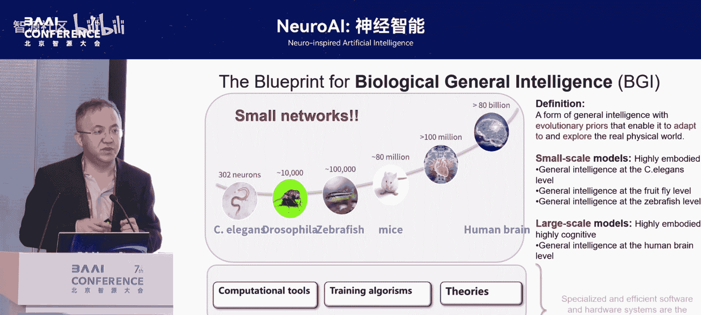
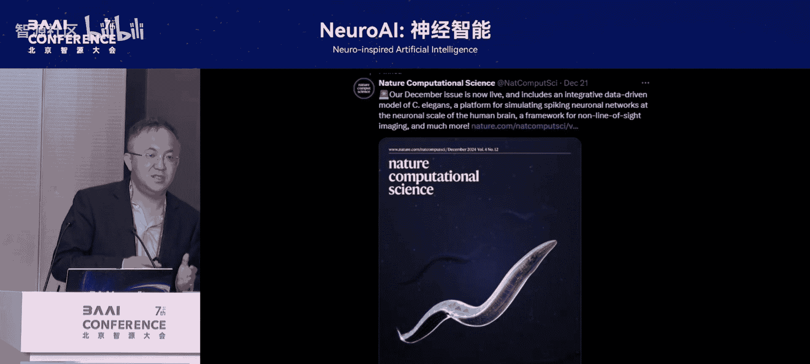
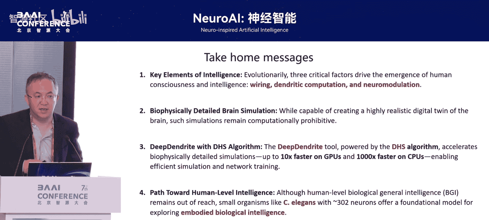

# 2025北京智源大会-NeuroAI： 神经智能 p04 数字大脑：杜凯 -BV1BUN7z3E3e_p4-

呃，非常高兴那个又一次来到那个呃我们这个大会，然后给大家来分享一下。呃，今天这个报告呢就是说我更多的一点是呃分享一下在构建这个数字大脑呃，整个这么多年十几年的呃中间的一个心得。

更多的是分享一些困惑和一些呃经验教训。嗯。就说我我给报告的时候，总是把这个图摆在第一个，因为啊像我们经常会被问到你的梦想是什么。这个是我十我十十几年前，当我决定我开始走啊科学生涯的时候。

这是我的一个梦想。就说呢我们啊有有朝一日我们能够模拟这个人类的这个大脑，并且能更进一步模拟人类的意识。然后呃在我开始我职业生涯的时候呢，我以为这是一个幻想。因为几百上百年甚至几百年以内，我们都啊不可能。

因为这是当时2006年的时候，这被认为是我们呃人类文明的一个终极问题。所以我认为可能几百年以内啊。都不可能去啊解决这个问题。

但是比较幸运的是呢啊最近几年我认为我们是可以把我们人类的这个终极问题放在一个科学的范围来进行讨论，并且提出一个具体的可行的一个解决方案。然后前面那个呃大家有没有发现我们做神经科学的。

做脑科学的跟大模型的不一样的一点，就是我们特别喜欢提的一个词叫进化。因为有很多终极的问题，特别大的宏观的问题，啊，有一种办法就是让我们总是在空对空的去谈一些大道理。

还有一种就是我们给出一些具体的case，进化是我们啊通常可以用来进行借借鉴的。所以第一个大家都能看得很清楚，这个就是我们随着进化，然后这个网络越来越大。但是呢第二个规则这个我们就可能啊不是很清楚。

就是我们随着进化，大家可以看到一个神经元，它会成一个像一个点模型一样的一个神经元。慢慢的它的束突会变得越来越庞大。而且这些庞大的输突，它不是一个呃被动的这么一个装饰。

而是它更多的呢它是具有非常速突本身具有非常强大的这个计算的能力。然后最后一个就是这个neur modulation，就是说除了大家可能呃被神经网人工神经网络有点误导，就是觉得哎我的突出权重。

只有除了突出权重兴奋和意志性。但是事实上呢，在大脑里还有另外一套这个这个sstem，就是叫神经地制。然后尤其对于在进化当中呢，他对于这种意识啊起的越来越重的或或者是说非常根本性的这种这种作作用。

Okay。那么就是这就给我们大家来提出一个很有趣的一个问题。就是如果假如我们现在的人工神经网络，它只是沿着第一个priple，就是wing这个道路再往前走。我们有没有可能把这三个priple都放在一起。

构建出一个新的智能出来。所以呢这就是。我们除了前面人工神经网络以外，我们现在越来越谈到的第二条新的道路就是说大脑的精细模拟。而这人工神经网络所不能概括的这一部分，恰好是这个大脑精细模拟，它能做的。

如果我们回过头去看这个神经计算大脑模拟这个道路。其实这就是大脑模拟本身啊，它是一个非常历史非常久远的，就是能够回溯到四五十年代的这么一个学学科，它也沿着两条不同的道路在啊进行发展。

然后第一条道路就是我们特别熟悉的，就是我们把神经元看成是一个点模型。然后啊。就是沿着这个呃呃连接主义的这个道路再往前发展，就发发展出我们现在的这个大模型的就有这个道路。然后第二个这个道路呢。

就我们当中的大部分人，尤其是是那种就是啊没有学神经科学的人，可能就不是特别熟悉，就是我们沿着还原大脑还原论的这个角角度。然后来啊来来进行发展。这中间呢我们可以看到有啊模拟了这个离职通道。

然后呢还有cap theory去模拟这个输出的形形态。然后到了我们今天啊就是这个大脑精细模拟呢，它现在主流的是往两个方向在走。第一个呢像以欧蒙脑进化作为代代表。

我还是就说很顽固的很坚持的在沿着大脑模拟这个这个还原大脑还原一个真实的大脑，然后再走。然后最近这几年就是在这个领域开始出现了一些小小的，但是非常让人兴奋的浪花。就是我们突然发现呢单个的这。

精细单个的这个精细神经元，它的计算能力和学习能力跟一个人工神经网络是相当的。也就是说，我们单个的真实的神经细胞，它本身是具备一个非常强大的一个啊competation的一个power。

我们不能简简简简单单的只能把它看成是一个点模型。等一下啊。😔，ok。然后在我早年就是我读博士，当我开始职业生涯的时候，很长一段时间都在北欧。

在啊在瑞典就非常幸运的能够加入现在这个大脑模拟的这个一个先锋啊，一个旗帜性的项目，就是那个欧欧姆脑计划。然后呢我实质我回到今天呢，我也非常佩服那么一般人，然后呢能真正的敢于做这些0到1的这个项目。

就是但是我们回过头再去看这些项目的时候，然后呢，带给我们的不仅仅是说我们在这个领域内已经有成就了什么，更多的是是留下了很多经验和教训。那么有哪些经验和教训呢？

但我在17年16年17年我博士毕业离开欧姆脑计划这个这个这个fe的时候，然后我再回过头去再去看我我当年的一些梦想。然后呢，我发现呢有下面这几个问题。第一个呢就说呢我们需要有新的工具。第二呢，我们要有新。

的算法。第三个，我们也要新的新的新的新的理论。第一个这个新的工具。当时我回过头看这个大脑模拟，就说这个行业就发现它的使用的计算工具非常的落后。

然后呢没有能够和当时非常先进的像立项GPU这样的啊变形计算的平台给结合起来。然后第二个呢就是这个是一个在这个大脑建模这个领域被非常诟病的。因为我们以前认为就说我们只是把这个大脑还原起来。

把这个细胞都建立起来，按照实验数据都搭起来，这样就O了。但是呢大家没想到有一个非常关键的地方是实验很难测出来了。就是你突出上的权重是怎么来的，所以我每一次一和这个啊游戏和美国那边的同行交流。

人家就直接问你你权重是怎么测的呀，对吧？你如果不是测权重，那你搭了一个空的框架，你有什么意义呢？所以就经常就被问到，所以我们要有一个。新的就是一个新的规则，就至少我们要有一些呃算法能够把权重。

我们不能光搭一个空的这么一个网络。然后最后呢就是要有新的理理理论，就是一个复为什么这个大脑精细模拟这个体系在整个领域还不是特别流行。啊，有一个很重要的原因，它本身来讲过于的复杂。

然后我们一个太复杂的一个sstem呢，我我们就没必要就没办法去对他用数学方法进行分析。然后很多重要的问题向新分意志平衡。这大脑里面非常fuamental的问题，我们就没有办法能给出一个非常确定性的答案。

然后当我刚回国的时候呢，我就认为啊第一个问题。第二个和第三个问题呢啊，是没有想法的。不我不知道该怎么去做它。然后啊我就从第一个问题来ta口就是就是说整个方案。然后中间非常幸运的一点在这个过程当中啊。

无意中呢，我也想到了能解决第二个和第三个问题。所以呢因为。因为时间的关系啊，我今天呢就是说先着重来讲那个第一个就是第一个问题。首先呢就是说大家无论就是说做任何的这个复杂的这么一个一个sstem。

我们无论在工司的哪一个领域都会遇到就是说你的工具，你的反真的工具会是什么。然后在我们神经科学领域呢，就是最 popularopular的软件就是neon。

虽然现在有很多很多人claim他做的工具能够跟neon啊更快这或怎么样，但它的精度对这个对被实验科学的这个认可度啊，这个它还是当之无愧的，还是摆在第一位的。OK。然后这个是呃在过去30年当中。

这个非常主流工具。大家可以看一下，像尼龙这工具它其实开发的特别早，就是从90年代啊，在业务就开始做了。但是呢这也最后成为它的一个弱点。因为它是从90年代开始做的。然后这个代码写了30年。

所以大家可以想一象这个代码，它的quality会是一个什么样的。但是我们先把这个先放在旁边，就是一个最致命的一点是说它在90年的那个环境，它有很多的概念，它都没有考虑，尤其是如何做并行计算。

所以我首先给大家讲一点点小小的数数学，就是说我们究竟是怎么模拟一个真实的一个神一个神经元。然后呢，我们一般看到有一个细胞的话，我们要把它分分段没段，我们用一个名字叫comppartment，中文叫参史。

OK然后呢把这个参时是可以电路化的。然后中间的离子通道和这个和这个输出都可以用这个方程描描述出来，大家看到前面那个公式是用来解离子通道的，就是我前面说的这个HH方程，后面的这个公式呢。

就是我就是解K cable，就是我们电信号如何在输出上进行传导的。大家是不觉得这方程太简单了，对吧？就没有什么挑战。对，那是为什么呢？那是因为真实的神经元不长这样，它是长的是这样。然后呢。

一个真实的神经元，它会分成几百段。然后呢，每一段中间可能有几十个PDE的方方程。所以你在一瞬间是要解成千上万个PDE的方程。但是解成千上万个PD的方程本身也不是个挑战。对吧他虽然计算量大是大。

他的真正的挑战是什么呢？他就是说他有一定的这个排列的数出的这个先后顺序。所以为了解决这个问题，michaelhannes1984年就提出了一个非常天才的一个一个小trick工程上的一个小trick。

就是说大家可以看我如果用这个呃数值的方法来解一一根数出上所有的这个这个comparment。我其实是可以把这个公式写成一个迭代式。然后中间那个系数，大家可以看到V等于呃那个T加一等于VT。就是我解这个。

无论你的comppartment会有多少，我都能写用一行，但有它的系数是一个举证。OK那这这个这个公式其实算我们有很成熟的方法来进行算的。但是问题是呢，我如果是一个数突形式的话，这个矩阵。

它就从一个协三对角线的一个矩阵变成了一个带有稀数点的那些那些矩矩矩阵。每个点对应的就是输出的分叉。然后这个时候呢，我们在解这个矩阵的时候，再算这个矩矩阵的时候。

我们就只能用高斯消源来把它削成一个下三对角线的这么一个形形式。然后高斯消圆就带来了这个每一行每一行之间的一个依赖关系。所以从一开始大家很多很多人就认为这个啊我们只能串行来来解。

所以当我们开始它和这个问题花了一年的时间把代码研究的时候，才发现第一个展还不是工程上的展，不是说我把它写成并行就完了，是一个数学上的问题就变成一个数学问题。

我们如何去高效的并行的去解这个稀数的协商对角线的一个矩阵。所以这个问题卡了我们很多。年就是呃很也不是很多年就很长一段时时时间。最后呢有一个天才的poster啊，他第一天来到我们实验室的时候。

就把这个问题给解决了。他在不知道神经科学这个情况下，然后呢他是从组合数学的角度有出发。然后呢就跟我们设计的一个非常好的一个算法就是让我们从每一假如我们要做并行计算的话，我们从每一个数突的最顶点。

然后再往前算，并且我们给出了数学证明，就说这样的算法是最优的。然后我们对整个这个数突呢，我们做了一次便利。然后我们发现大概对于这个数数突啊，我们一般用到10个线程基本上就能有一个最高比。

这有同学可能会有人可能会问就说为什么10个线程就够了，不是你可以用23是4什么啊，一个直观上的一个解释是我们的神经元都是不对称的。啊，任何的一个神经元的输出总是有。一根是特别长。

那一根特别长的突处就约束了你并行的这么一个效效率。然后当我们从数学上去解决这个问题之后呢，发现还不够，还要从那个硬件上去解决这个问题。就是说我们再根据显卡的特点。

然后还要设计很多高性能的算法进一步的去提升它的这么一个效率。最后呢我们把这些整个这个算法，就是整合在一起。我们和啊这个尼容进行了一个对比。我们发现它比尼on在CPU上的效率呢，要提高2到3个量级。

比在GPU的效率，要提高了有一个量级。我我非常骄傲的一点是可以告诉大家，在GPU上的尼龙的写法是用的是库达库里面的一个标准的一个写写写法。所以我们的方法其实比库达库里面的标准解法是要高一个量级的。

而且我们的现在这个方法现在被整合到那个GPU的那个英伟达的GPU的这个框架下面啊，未来也会成为工业级的一个新的一个一个标准。OK然后在这个基础上呢，我们再把我们的方法和应用的反真器，然后再和这个。

这个深度学习的这个mod整合在一起，就做成了一个一个新的这么一个框架。这么一个框架呃，我们期待它是能不不仅仅是能够高效的去仿真这种精细的神经元。完了还呢用来用它来做一些学习上的一些一些事情。然后呢。

这里呢是我们用我们的这个框架就做做了一个demo一个展示。因为这个video在呃一两年前的这个资源大会上已经有秀过了，所以我就不再秀了。但是想告诉大家一点是呢，就是说大概2015年的时候。

欧梦岛计划用了几千万欧元的呃这CPU的平台去做同样的事情。然后呢，我们现在大概用8块GPU的卡就差不多就够了。这不仅反映的是硬件上的进步。

更多的反应是这种算法上和这个这个就是我们在平软件和算法上的这么一个一个进步。O然后呢我们再往前面再走了一小步就。说我们在用这个呃输出的这个神经元精细神神经元，我们搭了一个小型的MP的网络。

因为还做一些深度学习的task，发现他果然还还挺好的。对，OK这就是一个然后呢，在我们做了这么一些尝试以后，然后呢，我再回过头来，就是思考前面提到那个问题。也就是说我们去如何模拟人类的大脑。

并且如何去模拟人类这个意意识。然后呢，虽然前面三个问题都解决了。但是呢最后一步还是当时就是说还是呃没有没有头绪。所以呢就是说在最近这几年思考的，就是如何就说我们迈向这个最后这一步。

所以在这里我给大家分享一点。就是说呃是我最近几年的一点自己的一点啊一点设想，也是一点猜想。也就是说呢就是说和人通用人工智能相并行的呢，我们是一个呃通用生物真治能。然后我会经常就像我们做这种神经系统的人。

会经常被投资人被基金在答辩的时候被问，就说你有什么东西，你能做这个AN不能做的。比如说你去做ist，你去做大言模型我我想说的一点是什么是不能做呢？小网络，是这个是这个AN是不能做的。

我们如果看这个线虫这种level的线从只有300多个神经元，但300多个神经元的线从，它可以在水底的环境，可以非常自由的非常robust在那个做navigate。所以这个东西这种小规模的，它是不能做的。

然后像斑马鱼这样的这个呃cature，它的神经元只有10万个10万个神经元规模的这个网络，它能够在非常复杂的水下，它能够进行游啊，所以这个是AN是肯定是不能做的。所以那么这个。这个生物的这个通用智能。

它的一个特点，我觉得一个非常大的它有非常强的强聚生的能能力。而我们人类的这个能力进化，它是建立在这种强聚生的这种基础能力之上再进化出的一个一个空学实力能力。这是无论只要我们沿着这个模拟人脑。

模拟大脑中做出来的任何的呃。Intelligence一定会foow这个 rule，一定会和现在的这个通用人工智能是非常不一样的。这是由这个进化来来来来来决定的。后来呃等一下。

抱歉在这里最后呢呃就快速的提一下和马雷老师还有志愿一起合作的这个线从。因为马雷老师刚才没有提一些细细节，在这里我就只是展现一点点的这个细节，然后非常高兴，今天一座那个赵梦迪博士也也也也在现采啊。

因为时间的关系我就提一下我认为的中间的有一个亮点，就除了马雷老师刚才提到的，就是说。

我们要和环境交互，这是我们一直强调的。你以后大家如果做一个神经系统的一个智能，千万不要走AGI那个路子，就通用AI那个那那个路子，一定要照做一个环境出来。然后呢这个这个智能一定要和这个环境进行交互。

所以呢我们除了刚才马提那个那个我们有一个和环境交互的一个我们能够用这个梯度的人工智能方法，把中间权重能够训出来。而且我们的 function就只有特别简单，就这一张图。

就是就是说我们让它的全局的动力学概动力学的c matrix和实验是一样的，就用了一个关类似于像统计一样的这个动力图，然后把它的权重就训了出来。

然后在这基础上我们在再把它给固定住再训练再训这个权重和肌肉之间的一些 musclecle就我我们就简单来讲的话，我们训了一些非常简。

简单的这个这个呃这些feature就能够让它和这个呃呃就是能够让这个线程能够像真实的这个线线场一样在一个环境当中能够运动起来。

这就是我刚才给大家所说的这就是一个真实的一个呃通用生物智能的这么一个一个一个威力呃，恰好我的时间也到了。所以我有几个t home message。第一个呢就是说呃呃首先先smarize一下。

就说我认为自然智能，就是它的几个关键的要素，就除了呃 worrying，我们叫the以外，我认为输出计算和 neural modulation，这三个是三个最mental的这个priple。第二呢。

我认为这个大脑这种精细模拟啊，它是就是说它的purpose是创就说这个创造一个和现在真实大脑一样的一个数字孪生。但它的现在一个很重要的问题是这个计算代。第一个问题就是它的那个计算代价是非常大的。然后呢。

我们现在是解决了这个问题，只虽然还不是很完美。就是我们把这个问题暂时先解决了。至少我们让在座的各位模拟万级或者10万级的这种低调的这种模型，现在是没有太大的问题。

然后最后一个就说是否也是我个人的一点猜想，就是说我们真正的要基于这种自然的或者人类的这种智能以外呢，它一定是一个强聚生的这个这个能能力。要能够在一个真实的环境中进行训练的这么一个一个一个pass。

然后呢，我们可以先从这些小的creature。比如说线从呃从斑马鱼开始，我们可以在可以从两头用这种两头逼近的方法来我们一起来探索这真正的呃生物通用智能。好，谢谢大家。

对那个那个就我给你提问啊。😊，好，我我很想难为你哈，但是呢没有没事，太了解了，因为咱们俩over的工作很多。然后那个我我就问一个稍微呃就是可能大家也关心的问题吧。

我们现在的大脑模拟很大程度上都基于呃就是电活动，其实大脑模拟显然不仅仅是电活动，对吧？就是我们大脑还存在着很多呃就是神经元和神经元之间的一些慢系统的，比如说你的呃就是比如说胶质细胞，类似于这样。

就是你认为我们应该到哪个细节上啊，我觉得我们ok我现在我现在的模拟不足以去cover。然后呢，我需要去involve那些啊，或者说你认为是实验手段的障碍。

还是说呃至少在现阶段我们关心智能还不需要到那个地方，我觉得这是一个嗯。😊，就是更长远我们要思想思考这个问题。其实我也一直在想这个事啊。好，谢谢你。这是一个非常大的问题。

所以我刚才想首先第一个你的第一个观点，我稍微纠正一下，就大脑的即使胶质细胞，它也是这个也是电对这个胶质细胞它也是电活动。然后即使他有些功能是参与这个ulation recycling。

它没有直接的作用在电上面，它也是间接的作用在作用在电上面。所以我们人某种意义上就是和一个高级的机器人其实差别不大。我们都是靠电来来来驱动的。所以大家一定要记住这个事情。

所以这就是让我一直非常 confident认为，就是为什么我们模拟人的智能模拟人的意识一定会成功，我认为人不过就是一个比机器人稍微复杂一点的机器人而已，就是这是我的一个观点。

就是我认为这个东西肯定能成功。然后第二个就是说我们要就是做的多少才够。然后我觉得这是一个非常非常好的问题呃。😊，像我的我我首先讲就取决于你期待就是说取决于你期待你要模仿的这个智能。

它在真实环境中的能力会有多强。就比如说我个人认为就是比如说我要模拟非常低调的这种神经元的话，一定是他能够接受一个真实世界的非常丰富的输入。就是我们发现就是说凡是做那种点模型模型做的越简单。

大家可以看一下模型一定会有一个特点。就是它在sensserory的设计，一定会设计的非常简单，它一定是接受一个压缩的senserory的输入，你用点模型这样就够了。如果因为输出，它为什么要设计这么复杂。

就是为了解决多模态，而且是高精度高密度的sensurory的输入而设计的这是我前面有提到的是进化上，它就因为这个原因就是给设计出来的。那你如果把输出去掉了，我就靠包的。能不能整合可以。

那么你所有的这些高密度的这些信息，你都集中在一个点上，你就很难去区分开来。所以这也是一个我个人认为就是说取决于你对这个你期待把这个呃agent或者把这个智能体放在一个什么样的环境当中进行训练。

然后如果越逼真。然后就是你的那个深色输入就越多呃这个系统可能和神经系统就越靠近，就越需要这种带有复杂输出的这种这种神经元。这是我现在的一个猜想。因为还没办法去证视这个事情啊，谢谢啊。

