# 2025北京智源大会-NeuroAI： 神经智能 p05 与见义勇为人类对齐的向善AI：刘超 -BV1BUN7z3E3e_p5-

感谢刘佳老师和吴思老师的邀请啊，我也是那个咱们资源的忠实的粉丝。因为这个会一直是跨学科脑洞的一个会。大家听完我的报告就知道我是一个非常喜欢跨学科脑洞的人。然后本来我非常紧张，对吧？毕竟第一次讲。

但是呢听完了之前的各位老师讲了之后，我信心倍增，你比如说因为大家听了现从老鼠神经元计算，我做的比他们的都简单，大家肯定能听懂，因为我做的是人，而且我做的是道德对吧？我希望大家把这个label打上。

我是做道德的。我研究的是人们怎么做一个好人，做一个好人，他的心理计算脑机制，然后我们能不能把做一个好人的这些机制，用来做一个好的AI对吧？这两点非常简单。😊，那么因为时间的关系呢。

我们就从做一个好人开始。那么这个是见义勇为的，见义勇为一直是道德里面，大家觉得非常的这一种对吧？比如说那个去年的时候有一部电影第二条影响力非常大。家应该很多人都看过。

里面讲的就是见义勇为和正当防卫的这个法律问题。那么我这里呢有一个视频本来是来放这个一个真实场景中的见义勇为的行为的，但时间关系呢我就不放权了，大概给大大家一看这个图应该就能明白是什么样一个情况。

我可以说一下这个手拿棍子呢，他是一个退伍的那个老兵，对吧？他在街上看见了这个光头呢，他是一个精神病患者，然后呢他在路上随机找到一个可怜的小女孩手上拿了一把刀，然后就要去捅他。

然后这位见义勇为的这个退伍军人呢，手里拿着根长棍把这个歹徒给打倒了，然后把这个小女孩本来那把刀我这个视频应该前面有一点你看这把刀马叫捅。

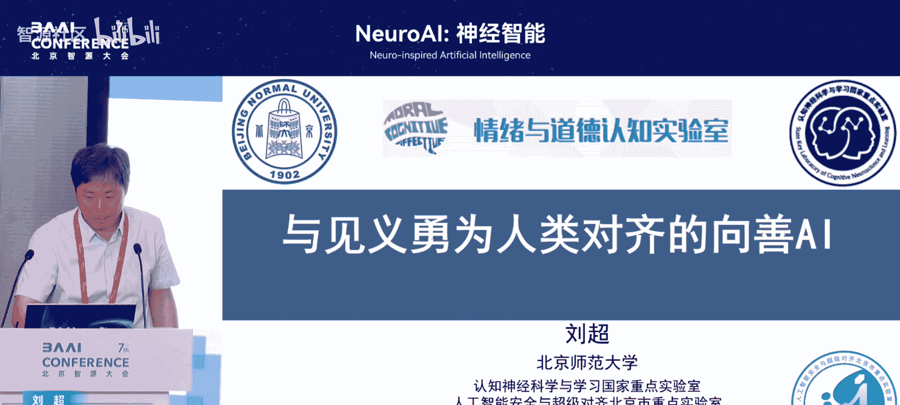

🎼所以很倒他，这个小女孩运气很好。😊，🎼然后我们然后这边建你们一个军人把这个逮子给刺。🎼然后小女孩得旧了，注意看具具体的我就不放了，因为时间关系。那么我今天要介绍的你就是呢三个研究。第一个呢。

因为这些都是已经发表的，所以我过得会比较快一点。第一个是我们怎么样在VR环境中来研究人类的见义勇为的心理机制。第二个呢是有了这种呃心理机制。但是呢你没法去做他的脑机制，没法做建模。

所以我们用即性应机这个方式呢？用行为经济学的方法来考察人们在第三方帮助于惩罚行为的计算脑机制。最后我们还问了一个问题，见义勇为这种好试的行为，为什么会有那么大的个体差异。

为什么有的人愿意去为了有的人不敢上，所以我们用这个计算建模来考察了他的这个多重的混合动机。

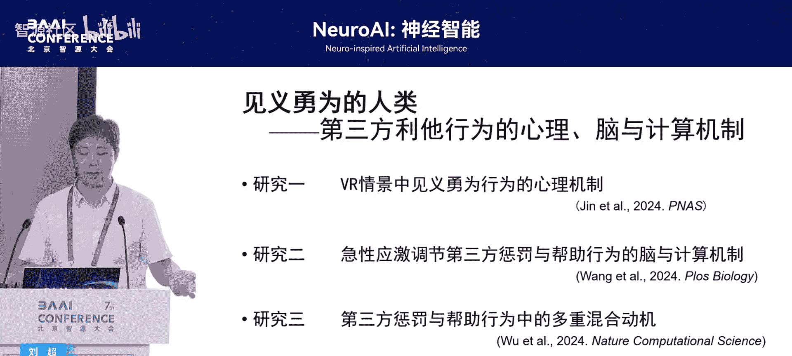

那么VR的实验我们大概是这样做的，就是说这个贝斯来到实验室。首先呢跟他说，这是一个完全无关的一个在这个水池里拉垃圾的任务，我才会有个demo，大概我就很快的讲。

就是他需要你看这个有很多水池里面有很多这些漂浮的瓶子。那么贝斯就是说你会有一个杆子拿这个杆子去拉这个瓶子，把他放到垃圾桶里再往前走，拉完了这一批继续往前走。但是在他走的过程中。

在他完全不知道的情况下会发生一个事件。这个事件就叫做小偷逃跑。有一个带着这个墨镜拿着这个包了一个这个小偷从远处跑过来。后面呢有一位女士就就这个很明显，这个他是被这个歹徒把包给抢了。

那么在这个歹徒从这个贝斯身边跑过去的时候，他会不会就像我们刚刚那个视频中的那位退伍军人一样，用他手上的那个拉垃圾的杆子当做武器，去把这个歹徒给制服，把他打倒。😡。

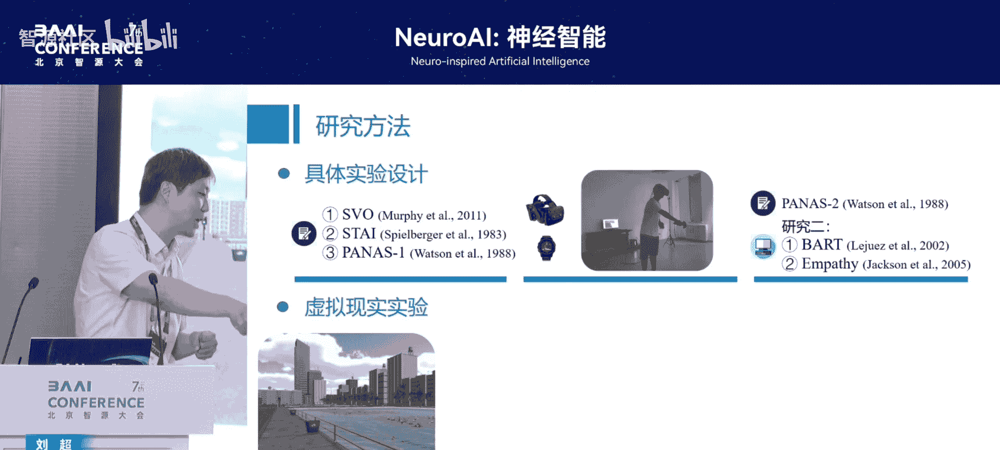

他完全不执行，我们可以看看这个视频。这是一位背视，可以看右上角，这是一位人类带着VR，对吧？你看他的任务很简单，这是一个VR体验任务。你看他这里当然然我不知道咱们北京哪里有湖。

或者水上有没有漂这个这个这个这个这个瓶子，对吧？但是呢环保任务大家都人人有责，所以他拉完了这一个觉得很有满足管往前走。😡，小偷小偷，他完全不知行。😡，周位背是完全不是行，但是在这种情况下面。

他做出了他自己应该做的一个行为，对吧？他也他这根杆子呢，我们没有告诉他杆子可以用来当武器，但是他这么做了。😡，啊，当当然那个本来还有一个视频去放，就是有人是不敢拦的啊。

不要不要觉得是这个我们可以来看看他的行为数据的拦截率。😡，就是说呃紫色的是男性被视，绿色的是女性背视，我们有很多种条件。那我具体我就不细说了，大家感兴趣可以去看paper。比如说如果这个后面有一个警察。

第一个大第一是有一个警察，而且警察会主动要求你拦住他啊。这时候呢无论男性女性都有90%的拦截率。如果有警察大第二下面有有这个22题。但是警察不喊，只是跟着跑的时候，男性还有80%，女性马上掉到60%。

😡，如果这个没有警察no的时候，男性也掉了70%。最有意思的是后面三个条件。因为后面三个条件我们把这个难度逐渐往上推。比如说在这个frighten这个步行者这个就说会有一些那些惊恐的路人会惊声尖叫。

别人看见这个歹徒来了都吓得躲开了，你敢不敢去拦。结果呢你看拦截率马上掉下来了。然后中间这个呢这个歹徒会恐吓你他跑过来的时候会叫给我滚开吧？你不知道他手里有没有刀，但他是在吓你。

最后那个场景是不但这个歹徒会恐吓你，而且这件事情发生在漆黑的夜里，大家看到一个有意思的结果就是我们紫色的这个男性啊，随说我们这个难度逐渐攀升，他的这个拦截率也是逐渐攀升的。看见没有？越来越越危险。

男生们越赶上，而且他的反应时上面是拦截率下面的反应紫色的话是越来越短的。就我们的男当我们北京师范大学做的北师大的男生非常勇敢，越危险，他们越敢去见义勇为，反应越来越快。😡。

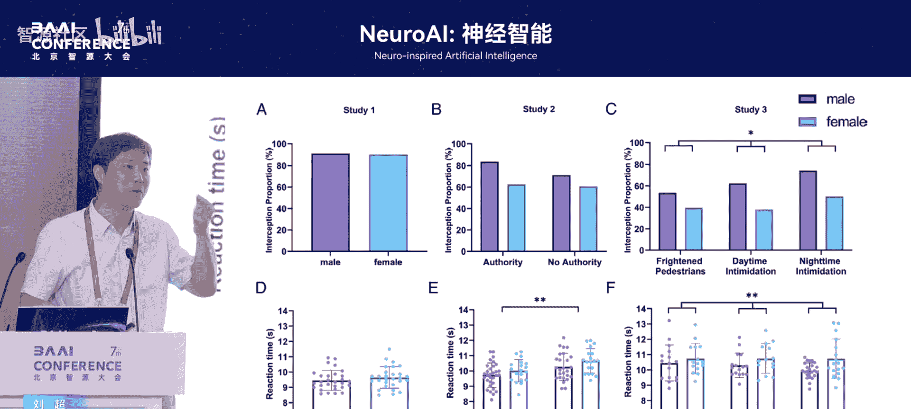

那么我们测了很多能力，比如说你的风险寻求，你的利他行为，这些风险寻呃风险寻求没有结果，利他的话，人力越利他越会那个见义勇为。但是更有意思的是这个疼痛共情。就是比如说我拿一根针去扎你的脸。

你会觉得你有多同情我的这个疼痛，对吧？男性和女性在疼痛共情跟见义勇为的行为上截然相反的这个趋势，对于男性来说，疼痛共情能力越强，见义勇为的概率反而越低，对于女性就刚刚相反，疼痛能共情能力越强。

见勇为的概率越高啊，很有意思。当时我们解释结果的时候是说男性会关注那个坏人那个歹徒，对吧？你当然不能同情他了，所以你不同情他，你就会越去见勇为。而女性去关注的是那个被抢了包的那位女士。

你同心这个被抢包的女士，你当然就更会去见勇为。😡。

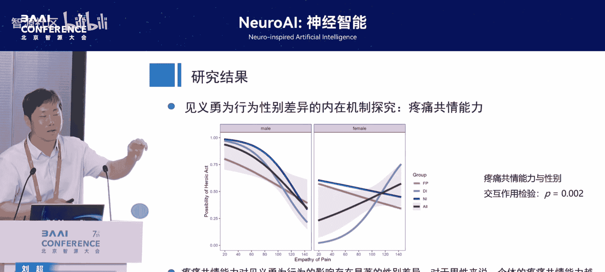

这是第一个研究。那么这种社会心理学练研究用VR来做，当然很有意思，也很有生态效果，对吧？但是呢你没法把它放到河池里面去扫他的大脑。因为这种事情没法重复很多次，你把他玩一次他就知道这个事情的。

第一次可以第二次他可能就完全不一样的感觉了。所以呢我们用行为经济学的方式来考察。看这种方式呢就是是一个很经典的叫做第三方利他任务。比如说这里比如说这里A呢是一个坏人，对吧？他拿了100块钱。

然后决定给他这个受害者，B怎么来分。比如说他可以作一个极其不公平的90比10的分配，拿了100块钱把90块钱留给自己，只给那个可怜的人留10块钱。那么被试呢作为第三方手上有50块钱。

他可以决定拿这50块钱去惩罚这个坏人，1比3的比例，他如果拿10块能够让这个坏人掉30，或者去1比3的比例去帮助那个受害者，他拿10块钱那个受害者可以加30。当然你也可以比较自私的把这个钱留给自己。

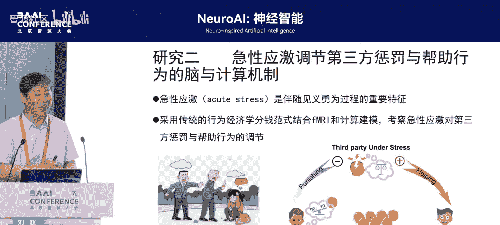

到底人拿了这些钱会去惩罚那个坏人还是帮助那个受害者，我们考察的是在应激条件下面，因为很显然，对吧？这个这种你见义勇为，你本身的这个非常紧张。我们之前的行为结果就发现呢人在应激的时候。

不管你是用公众演讲应急还是其他形式，们在紧张的时候会有一个比较一致的结果就会更多的去帮助那个受害者去去帮助那个弱者，而不去惩罚坏人。那我们的计算解模这个细节我就不讲了行为结果面。

我们可以看到我们重复出了之前的结果可以看到这个help的绿色str组就是这是水应激把你手放到复水里面你得刺激。然后呢明显的在str组l组有更多的help行为助那个受害的行为。

不管你是比例还是具体拿出前的钱数都是有更多的help对？模型的话，我们自己这个型其他的最好。然后如果这是从模型参数往左边是偏hel右边是。😡。

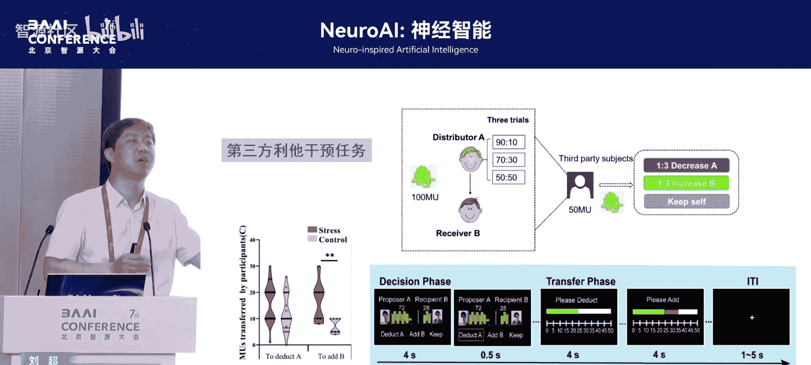

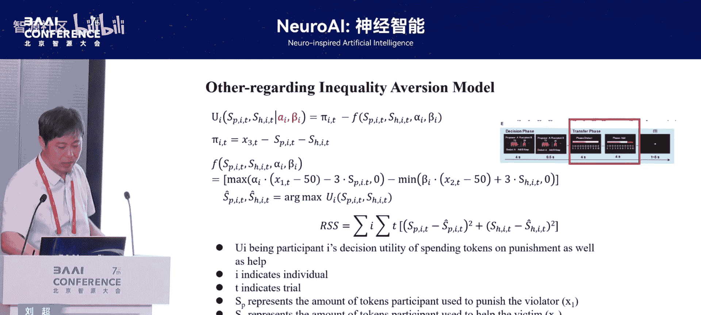

偏可以看到这个stres组绿色的这个组明显的是更加偏的去帮助人去hel跟跟这个contl相比，这个是拟合的结果也很好。那么在老的结果上面呢。

我们也去看了到底是哪哪些脑区跟人们在这个绿色的应急条件和黄色的conl条件倾向于hel和的地方不一样啊老区大概就两个一个是前面的CC的脑区，一个是后面PCC的脑区。如果你说中介的话。

可以发现这个stres调件了人们对这个帮助和惩罚的倾向性，最后反映在了你决定是不是去惩罚这个换人上面。

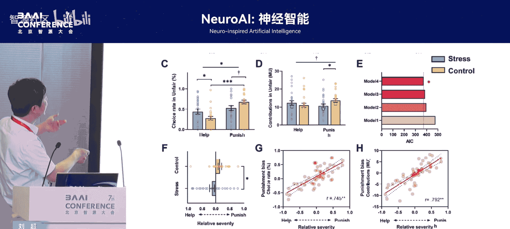

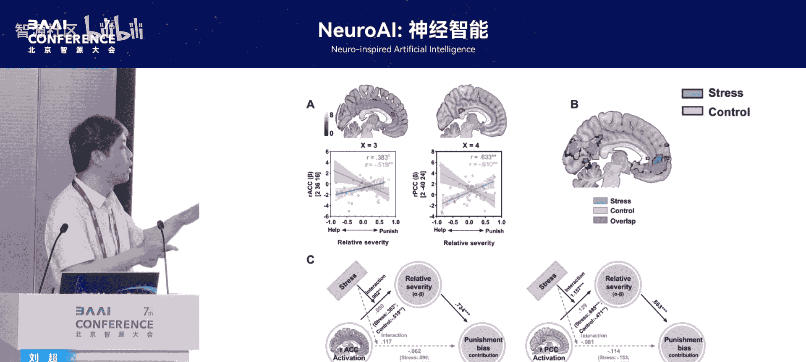

好，那么第三个研究呢，我们要考察的就是说。我们刚刚看那个见义勇为的那个行为数据，已经看到平均的拦截率只有50%，就是有只有一半的人愿意去见义勇为去上，对吧？那么到底是什么样的动机，会影响了人们这个差异。

其实前任的研究发现了很多一些影响的因素。比如说这件事情的这件事情的严重程度对吧？不公平的程度到底是一个非常恶性的事件，还是一件一件小朋友互相之间打架的简单的事件，这个会影响你是不是出手。

第二个呢是干预的这个代价，你要付出多少的代价去见义勇为，如果你要付出生命的代价，别人拿了一把刀，你肯定就不敢上了，对吧？第三个是干预这个行为可能的影响，他的这个有多大，对吧？

如果比如说我是一个手无缚鸡之类的人，歹徒是一个良敏的壮汉，那我当然我我去拦他人家拳把我打倒了我也没有用。所以你这个你的出手的影响的效率影响力会有多大也会影响。最后就是到底去帮助还是去惩罚也会有影响。

那么前在的研究里面呢用一系列的。😡，这些参数呢来考察了有很多因素会影响人们是否愿意去见勇为。比如说呃是这个是否以自我为参照的不公平厌恶啊，还是从受害者的角度啊，或者去考虑整整体的经济效益。

或者能不能把这两个坏人好人的地位进行一个反转。最后呢一个是我们研究里提出来的，由代价引起了不公平忽视。就说如果你要付出极大的代价。比如说生命的代价。那么你会假装没看到一件哪怕是非常恶性的事件。

你也会当做他没发生。我们想做的就是能否用一个整合的模型去涵盖所有的这些动机来解释人们的这种利他的见义勇为的行为。那么呃实验的话就跟刚才已经介绍过一样，对吧？你有50块钱，然后怎么去干预这个100块钱。

怎么分的这个极器严重的情况。那我们的结果就发现了，首先第一个是人们更加倾向于去帮助人，而不去帮助受害者，而不是惩罚换人。然后随着这个不公平程度的增加，到90比10的时候，这个也出手的概率是最高的是吧？

越事情越严重，越越不公平，人们越会去出手。😡，第二个呢是这个然后是这个raio，你的影响的效率有多大。那么3。0的倍率和1。5的比呢，3。0的时候你们更加愿意出手。然后是代价co。那么很显然。

如果要你把你所有的50块钱都拿出来的时候，人家的我们的出手概率是很低的。如果只拿只要你拿10块钱，我们是更加愿意出手的。然后呢，就是这个不公平代价你的忽视可以看到在50块钱的时候。

哪怕是极其不公平的90比10条件，人们也是不愿意出手的。😡，好，我们接着接下来做了一个剧类。到底我们这些人里面有哪些人是愿意去见义勇为，做好人，哪些人又不愿意咱们个体差异到底什么样呃。

我们可以看到有三类人，第一类人我们把它叫做正义战士。那么这类人会严格按照这个不racial的比例，还有这些不公平的程度来决定自己是否出手。他们是非常有正义感的人。😡，第二类人呢叫做使用助人者。

这些的特点呢是他们更加倾向于在这个高rac的时候，就是你你的触手更加有效的时候，可以看到中间这个只在上面这部分，他们颜色越深，代表你会出手，他们更加愿意出手。

然后在右侧呢是更加还有一个特点是他们更加倾向于去帮助人而不去惩罚人。就就是说只愿意去助人，不愿意去做坏事去惩罚。那么第三类人，我们把它叫做理性道德的，实际上可以从颜色上面可以看到他们就是非常自私的人。

大概有人群中有一半都是这样的对吧？就无论怎么样，他们都不愿意去帮助人或者怎么样。😡。

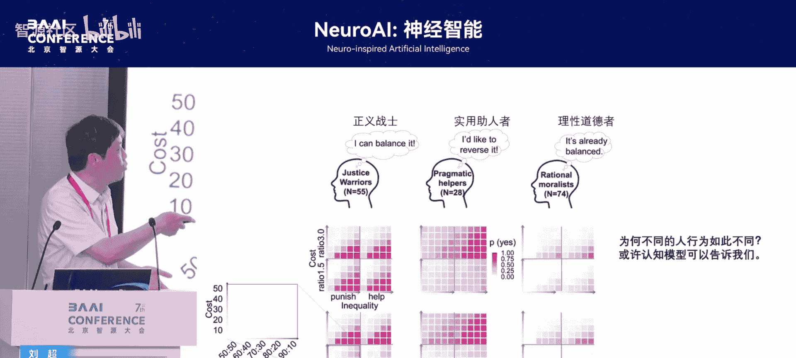

好，我们的模型的话，细节我就不说了。可以看到就是说当我们把所有这些因素都考察进来的时候，它的这个离合效果是最好的。

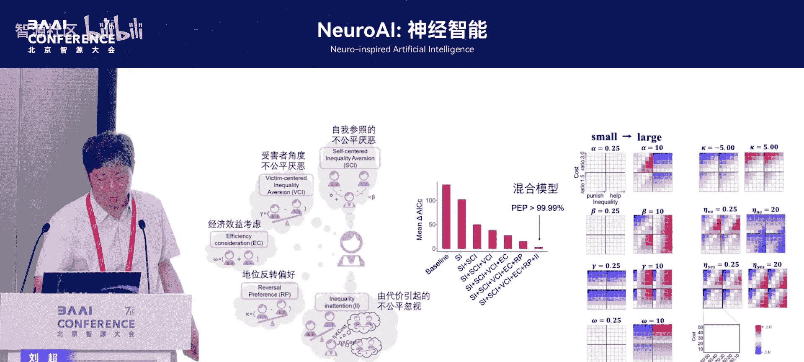

那么。我们有了这个模型，我们就可以去看具体这三类人到底是什么样的因素，影响了他们是否做这个人的决定。比如说像食用助人者，他们主要考察的是地位反转。然后这些比较自私的理性道德的，就总是不愿意出手的人。

其实最多的是考察的是利益。那么我们也在大样本的数据上面，比如说这是在世界范围内的，最多的是南非的，还有来自墨西哥的，来自葡萄牙、意大利的人上面重复出来我们这个结果，说明这个结果呢。

并不是只是在北师大的男男生中能能发现的对吧？

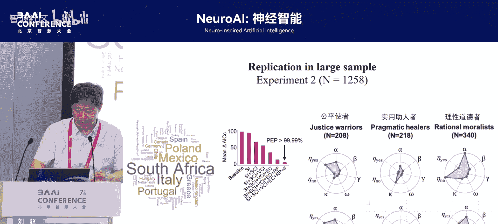

OK比较快的过了一下，就是之前我们关于人类怎么样做一个好人，对吧？他的这个心理脑计算等等机制。那么接下来我们想说的一个问题，就是说呢怎么样做一个好的AI，也就是人工智能中的价值对齐问题。

安全的AI的saffe问题。

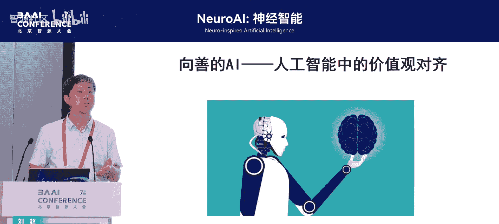

那么我我们我们在心理学这边啊，那么去年APPA的时候呢，他其实发了一个line，就是AI跟心理学之间到底有什么样一个关系。

他这里用一大段话来描述这个impact of AI psychology就是人工智能对心理学有什么样一个冲击。他这面临很多。比如说人工智能能改变我们对社会的看法，能够促进我们的这个健康和幸福。

最后有伦理和隐私等等问题。但是呢我们其实想问的是一个反的问题。心理学到底能为AI做什么啊，大会讨论的时候，我很想听听刘佳老师的看法啊，然后呢。😊。

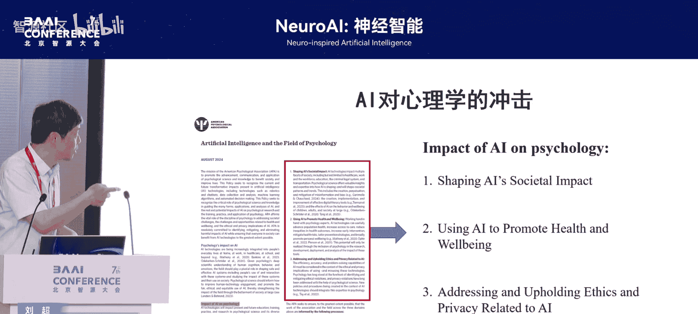

就至少我知道有两个那个心理学的贡献还是挺重要的。第一个就是jeffrey hintinton对吧？那个去年拿了诺贝尔奖，然后他是深度学习之父。第二个是ston苏德已经早上做了报告，对吧？

他是这个强化学习之父。然后这两位人工智能的大牛，他们的本科都是我们心理学的啊，那个那个 hintinton是剑桥的实验心理学学士，书ton是那个ford的心理学学士啊。

我们心理学为人工智能贡献了两位顶级大牛。当然了那个后面他们都转AI了，博士是都是读的人工智能。

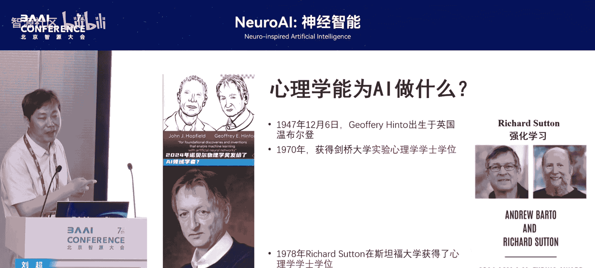

那么是不是心血只能贡献两位大牛呢？其实APPA在他这个杂志里面，他用了一小段啊，虽然也说了，sychology impact AI心理学能够为AI做什么贡献？他是这么说的，虽然只有一小段。

本领域应该在打造安全有效的人工智能系统方面发挥举足轻重的作用。他用的词是pi投入，这是一个挺重的事。就是APPA在收藏挂度想了半天以后，觉得我们心理学能够做些什么是做人工智能安全。

那么我们知道hiinton对吧？这些年大概大家如果关注他，他最关心的就是人工智能安全问题。😡。

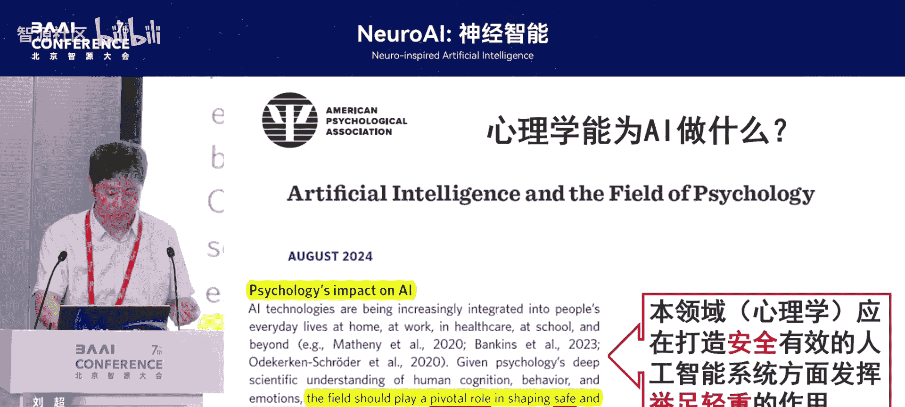

然后这个马斯克他也不停的在说人工智能安全是最重要的。那么我自己呢也是在从03年那个开始就一直在关注这个价值观对齐。因为我做道德，我做的是好人。

那我当时想看能不能把好人的这个事情用来做一个好的AI那么这里我们其实最核心的问题是什么呢？我们希望我们的AI不管是AGI或者我们在坐讨论一个，他变一个超人，对吧？什么是超人，他超级强超级厉害。

但是他为我们人类做服务，超级无视的为我们人类做服务。81人里面，只要有一个小孩子要受到生命危险，他可以牺牲自己去拯救他，对吧？绝对为我们人类一切都为我们人类着想，这是我们希望的。😡，但是呢很遗憾。

我们人类社会里面欺骗、伤害、仇恨是随处可见的啊。提人工智能安全或者对其的时候，大家一般不会去提n的东西。大家只说怎么样让AI变变好，变善良，变真善美。我们不去提AI会有这些。但实际上我们人类是有的。

所以一个可能性就是什么呢？当我们的超级智能跟人类社会进行交互进行学习之后。他可能变成另外一个角色，对吧？如果大家熟悉这个美美剧的话，如果你不知道homeland是谁啊，祖国人是谁。

你就可以把它想的跟超人完全相反的对吧？他是这个这个他小的时候被关在实验室里研究，整天拿火烧他。然后呢，他后来长大了以后就把那个实验室的人全面了。所以说呢我们希望人工智能，我们的AGI他是一个超人。

但是很遗憾。如果你的价值观对其没有做好，他可能就变成了一个祖国人，那么有什么办法来来来解决这个问题。可能第一点其实很多很少人可能没想过，就是人工智能。我个人觉得是有可能完全不跟我们人类进行任何交互的。

比如说如果我们要到火星上去改造火星大气，让它变得跟可以跟人类那个。😡，适应环境。那我们需要让这些改造火星的机器人理解情感、情绪、社会吗？好像没那个必要，对吧？第二点就是人工智能跟人进行交互。

但是呢你避免去接受人类的欺骗伤害仇仇恨这种行为。说上去说听上去好像很难。其实很简单，电影分级制度大家都熟对吧？你可以让小孩子你训练I的候，你可以你可以给设设年龄级1完全不接任何坏东西微数据的时。

在高等级的候他成长到一定的能道等啊第三点就是他跟人类进行交互，但是呢也理解也理解人类的的行为，但是我们设定规则去阻止I去学习这些行为。

那么这就是目前用的最多的啊基于人类反馈的 human feedback你找一些人对吧？比如 openenI在南非找一群那些人让他们拿着一100多个人来判断到底对不加减最后把南非的那群人好像崩溃了给喂垃圾。

还有没有第四种可能，这就是我们想走的路。我们能不能给AI植入一个利他的价值观，去综合人类的消极非理性的影响。确实我们人类会欺骗，会伤害，会有仇恨。但是为什么超人，他能够成为超人。因为他小的时候。

他在一个非常幸福的家庭里面，他的继父继母对他非常好，所以他培养了正确的三观，哪怕他长大以后，在这个社会中接触了那么多丑恶的东西，他也能够正直善良。😡。

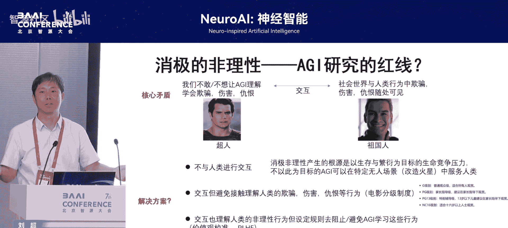

那么我们也拿了一些项目希望来做这个事情。那么我举一个例子，就是我跟那个呃争议研究员啊，争议研究员比我有力的多。他在人工智能安全方面应该国内做的特别好的。还有北大的杨晓东研究员。

然后我们一起成立一起合作那个在议老导做了一个人工智能安全与超级对的北京市总理实验室。你看这里就是我们人大概只有这么高，我们认为以后人工智能会比我们高得多。所以后他们针对这个手势这个基点对吧？

这个sularity的曲线，那么我们实验室就负责人的这部分研究人怎么样去作为比较矮小的这一部分。

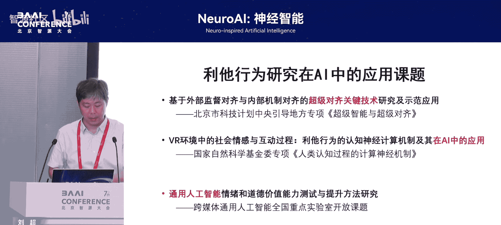

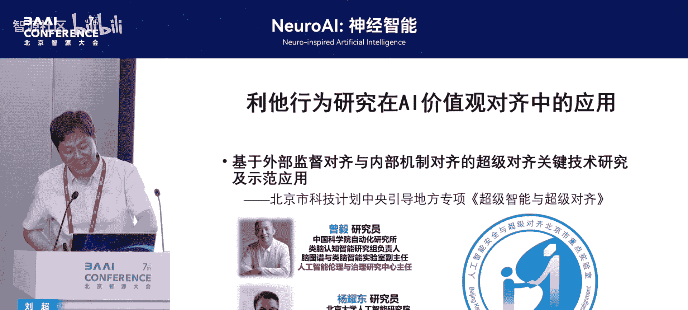

我们想做的件事情叫做超级对齐。那么什么是超级对齐，就是确保比人类更加聪明的模型，仍然向人类意图进行对齐，对吧？现在的这个rein人比器人要很多。那么我们可以去教训你的这个做的对了，这个做的不对。

你给他value加减。但是总有一天我们个人认为人工智能会比人类要很多要强很多。你的back会不起作用。很简单，大家如果记得阿下围棋的时候，你事实是完全没法理解阿为什么这么下作为最顶尖的骑手。

他也不能理解。所以人超强的人工智能，他有一天做的决定和行为，我们人类哪怕是最顶尖的专家也没有办法给出因为你已经无法理解他了呢？那么这种时候怎么？这就是超级对齐问题。😡，那么我们想走的一条路啊。

当然一个叫做外部监督，另一个是内部机制。那么我就直接上内部机制这一部分，就我们能不能把人类的这些利他行为的动机，以以净化的方式以植入的方式植入到我们I里面去。那么到底怎么做这个项目拿了也就几个月。

所以呢大家有的在不定的尝试。那我只能说像目前的思路，我们希望能够做一个ag就是利他的个ag那么能不能用一些人类的这个在些仿真任务上的算法，然后把它做大脑的那个内脑仿真，然后就看能不能做ag。

如说我们现在已经这边举一个例子做了一个工作是我们一起把这个司马光砸缸对吧？大家这是道历史上很有名的一个见勇为行为。那么我们做了这是在脑抱歉。😡。

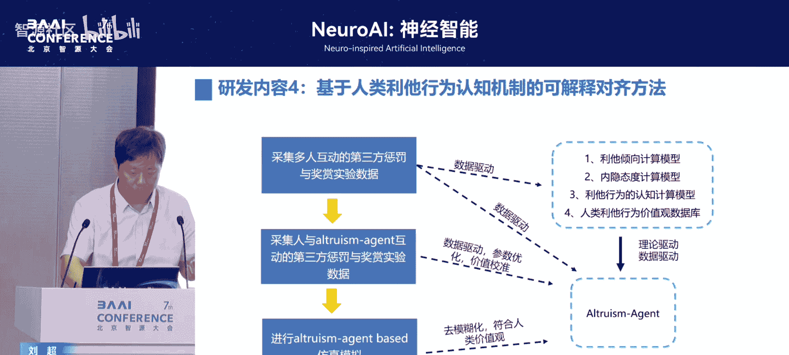

做了一个这个虚拟的仿真，能够让这个小机器人，他能够去砸这个缸去救他的同伴。然后呢，我们用那曾英老师他们用这个net算法。

用那个spiikking neural network去模拟的你和那个还有最后几分钟，有些老师我能把最后这个放了吗？因为我每次讲到这部分的时候都比较忐忑，因为他是我个人纯粹的脑洞。

所以我都要跟组织者征询一下意见，我能不能放这一部分。😊。

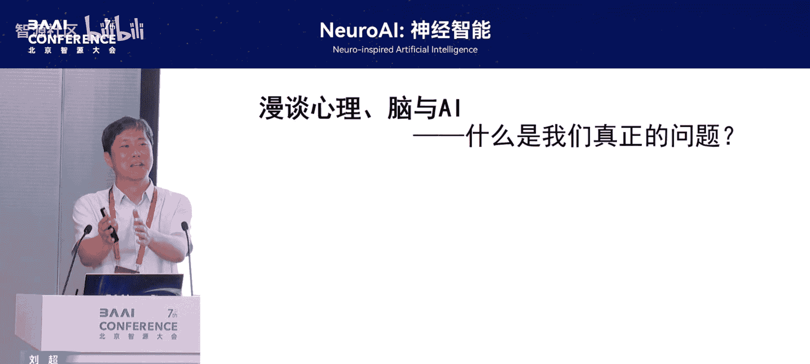

我问过deep这样一个问题，为什么我们要研究脑语神经科学，研究脑语神经科学的终极目标是什么？人工智能能为实现这个目标做哪些贡献啊时间关系我就不练了，对吧？大家总简而言之。

大家可以看到deep seek它回答的是非常非常好的，就是我们的min和 brain能够帮我们理解和创造这个人工智能人工智能能够帮我们反过来模拟和验证我们的min和 brain。简单来说呢。

人工智能和神经科学能让我们人更加健康，对吧？更加healthy治疗那些所有的疾病，更加快乐，更加wellbe更加强大，认知增强，让我们更加聪明。😡，非常好啊，我觉得db是个回答的问题。

我觉得比我们自己去去想收藏刮度好的多，这样就够了吗？😡，这样就够了嘛，这里有一个2分钟的视频。😡，我希望能把它放完。idea非常容易get到，大家一看就能知道。😡，嗯。🎼嗯。🎼嗯。🎼嗯。🎼。So。Oh。

好。🎼，あた。

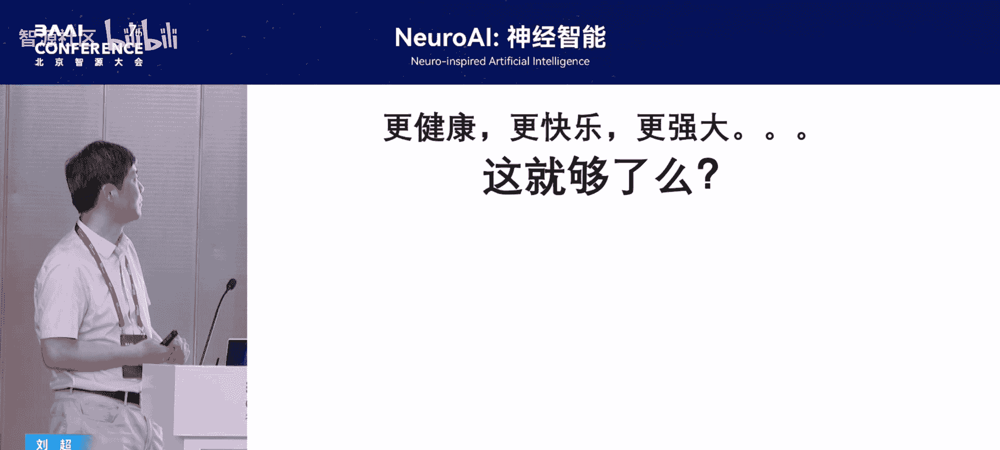

🎼看到这里就可以了。那么我自己非常尊敬的一位这个呃生物学家啊，ed Wilsonson曾经说过这样一段话，人性的真正问题如下，我们拥有旧石器时代的情感，中世纪的制度、神一般的技术。

这段话为什么我要在这里扣的？因为最近人工智能的专家频繁的在扣的这句话，平在呃呃去年12月份他呃那个诺贝尔卷世之后扣的过李菲菲今年1月份的时候也说过这句话，为什么这句话现在人工智能专家们特别关心。😡。

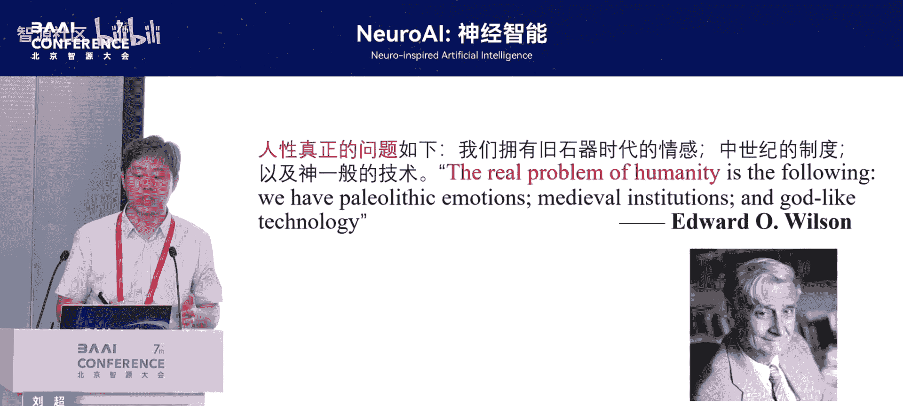

人性真正的问题，我们拥有旧石器时代的情感。

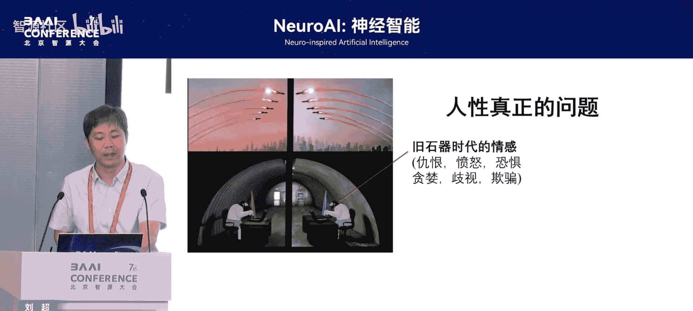

中世纪的制度。神一般的技术。我想我不用再多说，大家应该知道我想说什么。😡，那么神我们心理学脑科学能够为什么我认为在这个问题上面能够做出更大的贡献？😡。

因为除了让这个人工智能去更让我们去理解我们的这个min的这些之外，我是个人认为啊还有一个可能性，AI能够帮助我们改变和完善我们在这个这些问题上的我看法。我个人认为啊，大家我特别犹豫和恐惧的说这句话。

但是我想不停的想调我个人认为人工智能和脑科学最重要的使命。除了让我们更更加健康快乐强大之外，它应该improve humanity。😡，改善我们的人性。不管我们要做技术，什么样的技术，数字上传也好。

历史永生也好。如果历史永生的那个人还是互相仇恨，互相战争，互相欺骗。😡，这样可以吗？我们为什么不在这种有有有机会的情况下面去改善他的这个这个人性呢？😡。

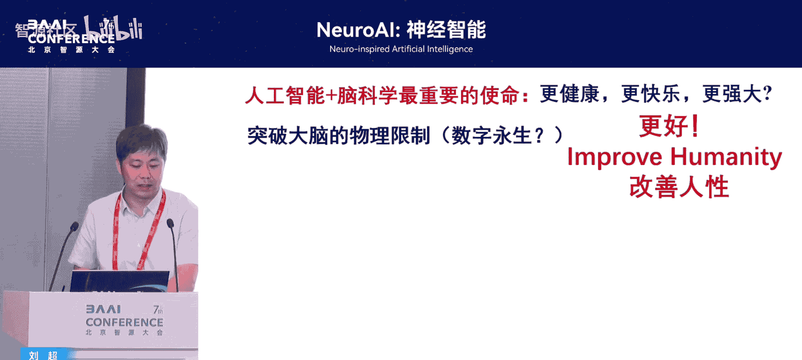

啊，时间关系我觉得我没有太多时间了，已经超了。感谢大家，这是我的合作者，名字我那个谢谢大家。😊，还有一个问题。😊，谢谢刘老师那个给我们带来不一样的AI的那个感受。

然后我就想问您一下那个呃现在啊解决那个AI人和人类对齐以及安全性有另外一个大方向，就是那个可解释性。然后您能不能给我们介绍一下可解释性和你那个价值对齐这块如何整合在一起。

让我们真正人类能对未来的AI有更强的个个罗老师这个问题非常好。其实我刚刚那个我那个图里面有一半遮起来的，外部监督对可解释性这条路线是外部监督对里面非常重要的一个思路。

就是你必须为什么要进行外部监督对需要。因为你为什么要可解释，因为你要清楚他到底在怎么干干了什么，为什么这么干。如果你知道他怎么干，你才能从外部去决才去监督他说他做错了，对吧？

所以那这是另外刚好是你说这个路线就是我们需要做的另外一条路线，也是目前这个安全价值里面应该是人数最多或者最最。😊，所以就是那个最常见的一条路线，就是去知道要清楚大模型也好，人工智能也好。

它到底是这些在神经网络面到底是怎么样去做这些事情的，这样我们才能进行监督。如果你不知道他只是一个黑箱子，你是没法进行监督的对吧？但是和我们另外一边，我们个人认为啊，在我们的课厅里面它是互补的。

就这两条路没有知道哪一条最后能够成功。我我自己是这么觉得就是人工智能安全和价值观对接这个问题，它是一个非常具有挑战的。

但是没有一个人确定的说我的这条路线百分之百能够实现我们在未来对人工智能能有完全的控制，我感觉没有一个人能敢这么说，但是这个问题我自己认为是一个。一生小的非常本质的问题，决定了我们人类的未来。谢谢大家。

