# 2025北京智源大会-NeuroAI： 神经智能 p06 基于数字大脑的意识永生：刘泉影 -BV1BUN7z3E3e_p6-

很开心过来给大家介绍我的工作。然后说实话我排在刘超老师后面，我是惶恐的。因为他的那个讲座给我带来的震撼啊，比我最近我这30年读的论文还多。然后我感觉现在已经已经在讨论人类的生死存亡的问题了。

也就是人和人之间和人和AI之之间的这样的问题和国和国之间的问题和国家不同国家之间的AI之间的问题。所以我感觉这是一个非常宏大的。而我只有20分钟的时间，那希望能够把这个啊就是。😊。

意识永生的问题讨论清楚，这是另外一个角度来看待。假设我们肉体很脆弱，我们根本就不能够去保证我们不毁灭地球，不毁灭自己。那怎么办呢？我们能不能够有办法让我们永生呢啊，这是呃我的一个gen介绍。

我是来自南方科技大学。然后我做的是AI和这个呃双向的脑机接口，就是用AI来理解大脑。然后呢来解码大脑，并且能够写入大脑，希望能够达到双向的这种BCI。

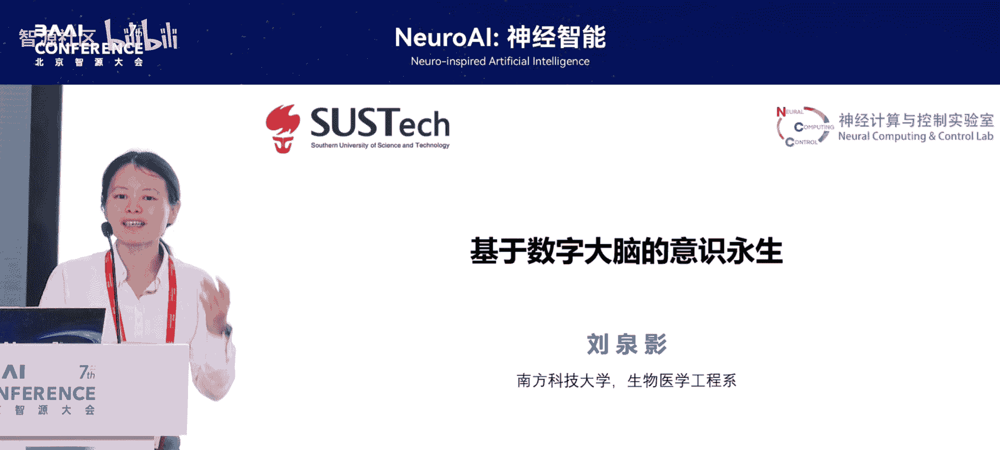

那一般而言，我们理解的意识永生是什么？其实就是肉体苦若啊，机械飞升，我们人类的肉体很脆弱。我们的灵魂其实也很脆弱。但是相比于我们脆弱的肉体。如果我们能够让灵魂意识数字化，让我们大脑数字化。

也许我们还是能够去在意识层面在数字化的世界里面能够永生的啊但是这个是可能是大家就是跟看科幻的玩游戏的人眼中的意识永生。但在神经科学家眼中的意识永生是什么呢？啊，这个就是非常现实的问题。

怎么在技术层面来实现的问题，叫mind uploading或者是ciousnessmo，那怎么办呢？首先这个是AI给的答案呢？但是呢我们实是采用的技术手段呢跟AI不谋而合。

所以我有点怀疑我们使用的我我们的很多想法的数据也不知不觉被用来训练AI了。所以AI对其到我们。😡。

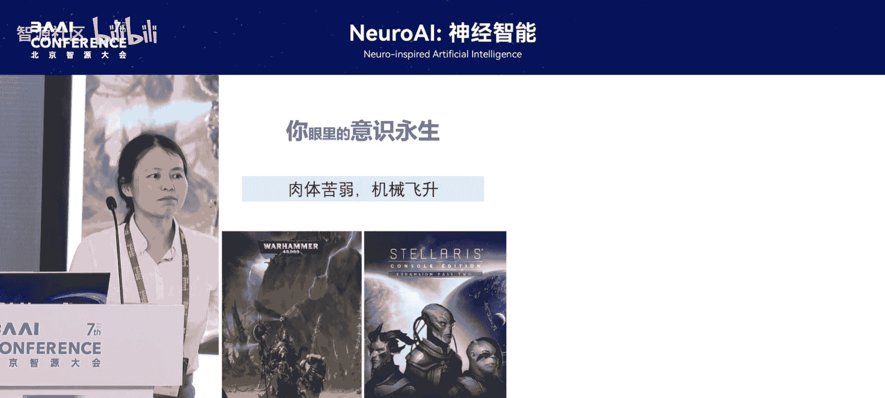

在价值观体系中的同时也对齐了我们的观点，我们的一些创造力啊。所以你看第一步就是我们要扫描大脑。第二步就是哎我们对这个扫描的来自于各种各样大脑的数据，我们对它进行数字化的替代数字化的孪生孪生了之后呢。

它就能够run就能够源源不断的产生哎产生什么你基于过去产生未来的预测，产生未来新的数据。那是不是在那样的一个数字的空间里面，哎，一识就永生了。你的所有的你大脑能够产生的啊神经活动，你的产生的行为。

包括你的影空间，包括你的这个呃认知状态，对未来的这样的完全都是能够去sim出来的。是不是这跟你的存在就已经没有什么就是跟跟你就是完全脱离你的肉体，而能够直接在数字化空间中能够去仿真去预测。

而且预测的结果跟你现实世界中会做的东西一模一样。那么这个呢就是说。呃，我们也许就能够实现一一史永生。那意识永生有哪哪些途径呢？哎，这也是问AI呀，他我我发现他其实就是说的这个路径呢，就是跟我们思考过。

科学家们思考过的路径是是很一致的。首先我们想到的就是还是要保证我们的肉体。我们先开始能不能够延寿延年益寿，能够真的是长生不老。从秦始皇时代。😡。

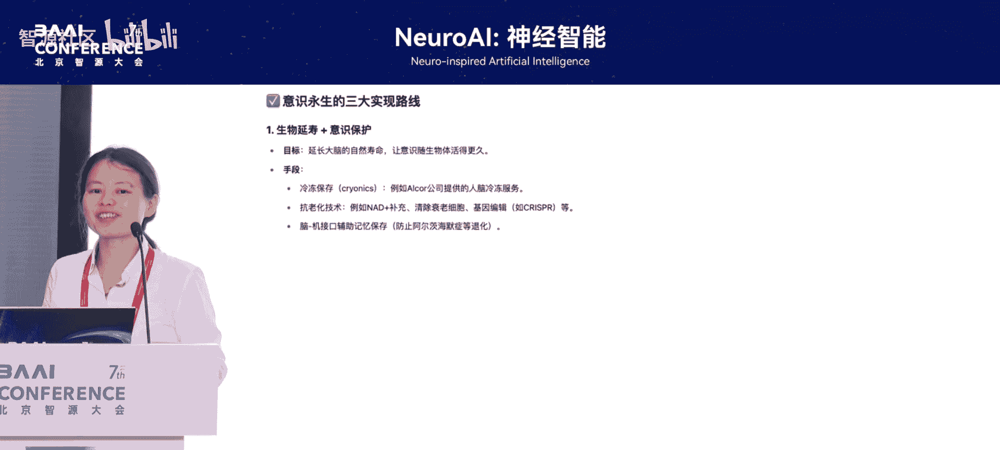

，从秦始皇时代，我们就想着说，哎，能不能够各大君王都在想能不能够长生，能不能够就是永生不死。哎，你会发现肉体确认脆弱的。你要从这个角度来实现长生，基本上现在的物质现在的这个科学水平是达不到的。

就是可能性很小。那我们另外一个角度呢就是心智上传意识上传。这样的形式呢，也许我们肉体凋亡了。但是呢我们以另外一种形式而存在。那这个呢技术是现在AI时代呢逐渐有可能够实现的技术。

还有一种呢就是更加虚幻就是人和机是共演化人你你的意识不断上传，而且它是以AI的形式在AI中已经能够两个智能完全融合了人机共融了啊，这个也是我觉得就是未来有可能会实现的一种情况。

但是呢目前我们现是采用的呢是第二种选择，就是还是以人为主体，我们完全来孪伸你啊，其实第三种呢就。😡，是说人和AI同步进化，就是AI逐渐的可能这个存在一个泰迪修斯巨全的问题。

就是你可能一部分呃就逐渐的你可能你的完全部分都变成AI了。哎，在这样的情况下面，你也永生的。但是你其实无法知道这是你还是AI那我们采用的第二部分就是以人为主体的时代，我们现在还都是以人为主体时代。

我们采了足够多的数据。我们在你的这些数据上面，哎，我们就能够去训练AI模型能够完全预测完全孪生你自己。那么这还是你的个体智能的独立性和你的意识的独立性，有这样的形式的一种数字复刻。

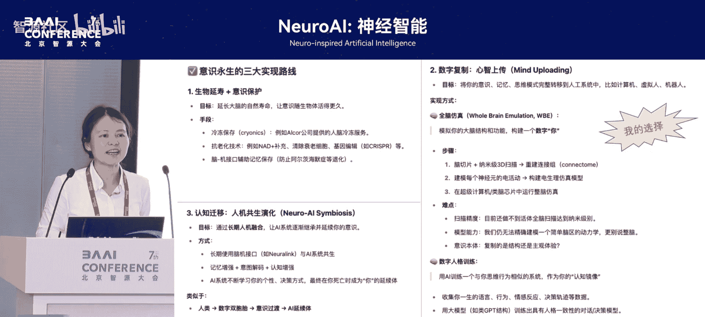

那我们呃怎么做呢？前面讲的很形而上啊，下面我们就讲解方法论的东西，具体怎么做啊，一讲到这个就感觉半只脚踏在泥泞里了就显得很dirty work。那我们呢首先要采很多数据。

我们先用很多成像技术采很多数据了很多数据之后呢，我们希望能够建立一个模型能够去理解这个数据，并且创造和生成新的数据跟原来数据一样。因为如果你不能够创造，那你就不能够理解这个数据什么。

你也不知道你这个个体是什么样的意识形态而存在。所以说就是说what i cannot createI do understand所以呢首先我们要cate the future那我们怎么去创造数据呢。

我们要产生很多数据，你要产生的数据要sim的数据跟真实的数据要一模一样。这个叫forward modeling forward modeling呢整个大脑的信号，如果你完全能够正向建模出来。

那么就说明唉你对于大脑的这个运作规律，已经基本上掌握了。但实际上正式的数据是非常复杂的。你很难用一。😡。

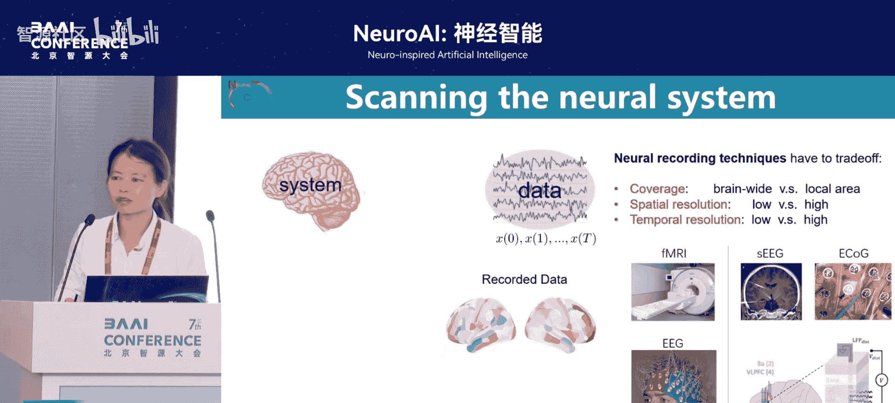

单一的这种方程啊，PDEOD的方程去表达它。所以在这种情况下怎么办呢？困扰了科学家很多年。后来呢我们就说唉数据驱动吧，我们放弃一个可解释的有完美的数学表达的微分方程的形式，或者是有数学工具的形式。

我们就全数据驱动用AI去学。因为AI理论上来说，万能逼近地理可以逼近任何连续的函数。那么我只要我们大脑不骤变，其这是连续的意识是连续的稳定的。你是一个呃sable e的。那么我们应该是能够学出来的是吧？

所以说我们可以用AI去逼近它，这是从数据层面上的逼近，其实很简单的，就是自监督，我们用过去来预测未来。然后训练一个AI它的参数呢就是你在梯度下降的过程中去让它你预测的未来的数据跟真实的数据的MC最小。

以这样的形式来训练它是是很容易训练出来的，训练出来之后呢，唉我们就可以说我们。用AI孪生的一个大脑。但是呢这个孪生是在数据层面的孪生。但实际上数据数据层面的这样的孪生呢不是说在AI时代才有的。

在很早之前在时代就已经被提出来，就包括之前啊就是嗯几几位老师讲的像杜老师讲的都是说我们有一些数学工具，我们知道生物物理学的原理，我们知道第一性的原理。

我们能不能写一些微分方程来表达它确实有一些这样的方程去表达。但是呢最大问题就是他不能够表达你的数据，因为他要表达你的数据要跟你的数据一模一样。他要完成的你和你的随机性你的个体的参数。

这个是非常难以在个体层面做到的。你嗯你你的860亿神经元的这样的数据是很难是被微分方程所表达出来，并且跟你生成的数据是一模一样的。所以呢他的拟和能力和预测能力和和在你个体水平上的这个预测能力是非常难的。

也没有。😡，这么多的呃这这样的嗯就是呃鲜艳知识，让我们来构造你的大脑的孪身体。那另外一种呢就是我们纯数据驱动完全基于AI在用数据去训练它。但它也有一个问题，就是它需要太多的数据了。我们意识的永生。

肯定是希望个人，而不是以群体就是人类一个整体文人类文明作为一个整体永生的。我们希望是每一个个人都能够永生。所以我们希望你每个个人的意识都有你个人的孪身体能够永生。

那你个人的数据能够采集的时间段是很有限的，你很难去训练一个全就是完全没有预训练过的一个完全没有任何地性原理去约束的一个非常大参数量的模型。因为数据量不不够，也不具备可解释性。

所以最好的办法就是哎我们在你的个体的数据上面去训练的同时，我们用一些嗯你的那个呃鲜艳知识和对你的这个群体预训练，或者在然后在你的上面去放。以这样的一些鲜艳知识。或者来自于神经科学的。

或者来自于 biophysics的这样先验知识，能够去帮助我们约束模型，这样就会变得可可可解决可训练一些。所以整个过程呢其实跟AI的训练方法是类似的我们定义这个动力学系统，我们把它参数化。

然后我们构建损失函数我们去优化区别就在于这所有的这些解决方案呢不是的不是CV的，而是大脑信号的，所以我们要基于大脑信号用大脑的生物先验和你的个体的一些特质去构建损失去定义它嗯定义这个模型的架构有一些来自人脑的duct bias在里面这个说的都很抽象后面会举一些具体的例子。

那我们完善好了吗？训练的模型它就真的完善好了吗？怎么去评估呢？然后这也是一个问题。然后我们呢就是其实这是来自于我们写的一个一个综述，我们也也可以说是整个整个领域梳理了一遍，其实就是在说唉如果我们训练的。

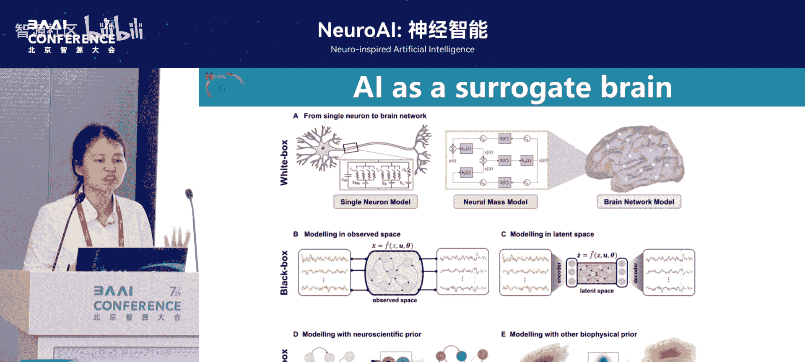

1个AI我们想要孪生它，我们有很多角度，比如说我们可以去从实欲上面去评估，它是不是可以在实欲上面预测未来跟你的数据是完全一致的。说明孪生的你但是我们并不希望说生成一堆信号，只是在时间上面相向而已。

我们希望它更复杂的系统的动力学特性是一致的。甚至我们希望它的影控间的状态跟你的情绪状态的也是能够解码出来是一致的那说明你生成的未来的神经信号中就包含着你的情绪的特性在里面。

如果他能够真的能解码出你的情绪的未来的状态预测一样，所以这是有更加高级层面的一些评估，从很igh level的，而不是直接从信号层面去评估，这也是意识孪生和永生需要考虑到的。我们下面举了几个例子呢。

是非常直接的例子，很简单。就是因为数据有大量的数据能够帮助我们来下载预训练模型的训练我们的模型的呢就是FMI数据。

因为一据数据它没有这么多的人和在统一的一个呃这样的仪器下面采集的那M的数据呢是有很多人有是能够有上的人的所以这样的数据是能够方便我们训练的。

我们训练的各种模型结构从非常简单的开始就我们发现唉它很简单的模型都能够去预测真实的FM而且是全脑层面的，为什么呢？因为脑区其实你的lation并不多，你给到1000个脑区已经覆盖了全脑了。

然后它的采样率呢的那个TR呢也很慢啊，比如说零点几秒07级秒在P上面的数据集上面这个很慢的这样缓慢的一个低的这样的变化I去学习和预测是很容易的。就我们发现唉我们用三层的。就能够预测的很好。

它的性能跟你非常复杂的方法是一致的啊，在这种FM的数据上面。所以我们说唉FM的数据是很容易孪生的。但是你把FM画好了，就代表着这个这个AI就是你了吗？这远远是不够的。

所以呢就是一方面我们要从各个多模态的数据上面来做另外一方面我们更关注老功能一些加的state的一个预测所以呢我们又把EG给做了，我们在一G老上面这种非常快速变化的电生理活动也能够去预测出来啊。

只是模型会更复杂一。因为这个数据本身也更复杂一。但是对比说前面杜老师马老师讲的那类型解释性的那种模型来会觉得这类型模型非不具解释性就是一个纯AI模型基数据驱动算出来的。

学出来的孪生你的大脑远远称不上是孪生的大脑的各个层面。因为他没有。

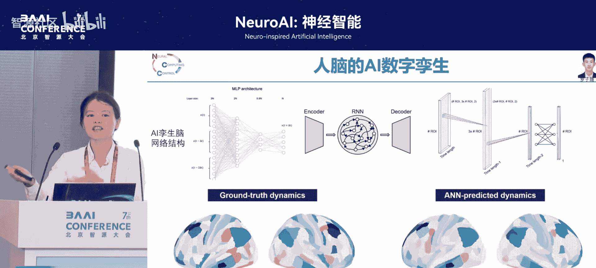

结构上面的孪生，他也没有老功能，他只能说我们做到了信号层面的孪生而已。所以呢我们解决了一些这样的技术问题，做到了信号层面的孪生啊，那我们这个还是自发的放电脑，就是说他一个没有外界输入的。

而人生活在真实的物理世界是不断的看到听到的。所以我们其实不仅仅需要一个自自发的一个动力学系统的孪声大脑的这样的系统孪生，我们需要大脑这个系统具备输入输出接口。

这个IO interfaceface的一个这样的数字孪身体。所以呢我们又把IO interfaceface给构建起来。但是你有输入和输出这个响应的这样的数据的情况下，很少你用没法做自监督。

因为自监都是自发的嘛，所以说我们需要先采集一些这样的数据去构建输入输出的接口，这样的数据怎么采集呢？其实最好的情况下是怎么采集，就是说我们人看到的世界上的所有的数据的这样的视觉。

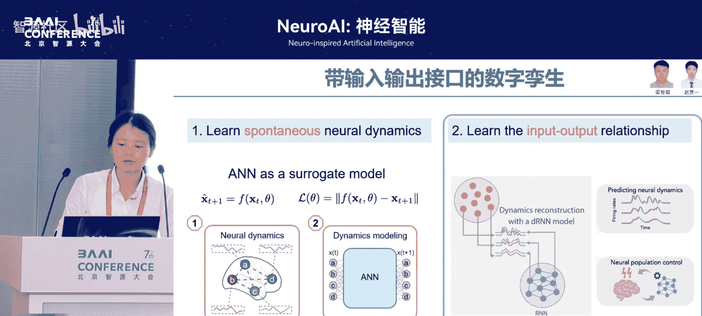

我们都拿一个拿一个像头都记下来。唉，我们听到的我们说的话也都记下来，把我们周围的所有的对人的输入和人的输出都全部记下来。这样的话，你再给他用预训练好的AI模型，把你的视觉和你的听觉。

把你的语言给它表征之后呢，再去作为输入输入给你的这个孪声模型。但实际上这样的一个非常高维的世界的这样的一个输入输出数据队的这种有监督训练是非常难的。我们没有办法去采集人从生下来见过的所有的东西。

同时所记录我们大脑的响应，因为你是需要同步记录的嘛，所以呢我们就在一个片上脑上做了一个实验。这怎么做的呢？非常简单，我们用低维的输入刺激。这个是我们可以自己设计的。

虽以我们是随机刺激啊没有就是在找了一些电机随机刺激这个片上的一块神经元的这个这个活活体的神经元啊。然后呢我们记录了它的响应。它的这个神刺电刺激之后的神经响应，这样的输入输出成对的数据呢。

就能够训练一个具备IO interfaceface的这样的sroggate这样的孪生模型。下面就是我们训练好的孪声模型，它能够干什么呢？它能够至少在我们的这个toy的这样的一个虚拟，也不知道虚拟吧。

就是在一个片上脑的这个脑片上面或者是呃培养离体神经元上面是可以做到未来是可预测的。也就是说，当你未来你接受了一个刺激之后，未来神经是怎么活动，怎么响应，是基本上完全可以被预测的。

我们的模型是这根红色的线，你看红色的线预测的很好，而且能打败其他的模型，然后性能也是显著的又高于其他的这个模型。当然这是性能层面上来说，它还能干嘛呢？它还能去反过来写入信息，怎么写入呢？

唉我可以想知道我要怎么调控神经活动。我可以基于这个孪生脑的模。

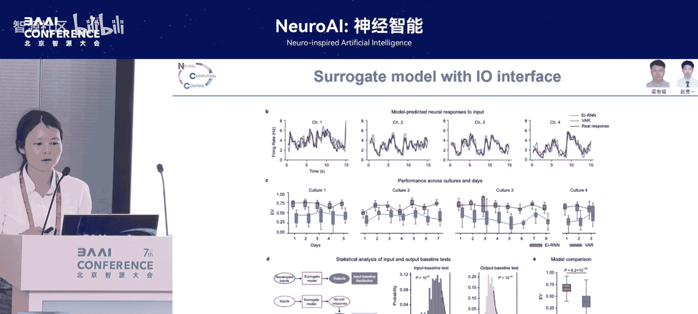

行去优化一个最佳的刺激，能让特定的大脑状态，变大变小，变到你特定想指定的状态，这就不得了了。虽然我们是在一个非常小的这样的平台上面做的验证。但是如果他能够到真实的大脑上面，我们无非就是把一个低位空间。

把它上涨到一个更高的全脑维度的空间，能够进行控制啊，那我如果我们能够控制你的大脑的每个神经状态脑区，它跳到一个特定的状态上面，那你的大你就不是一个自由人了，你是一个被控制的人了。

而且是你不知不觉你的是受到了控制。所以到底这种可控性是不是可以达到的呢？我们用用那个实验来验证了一下。😡。

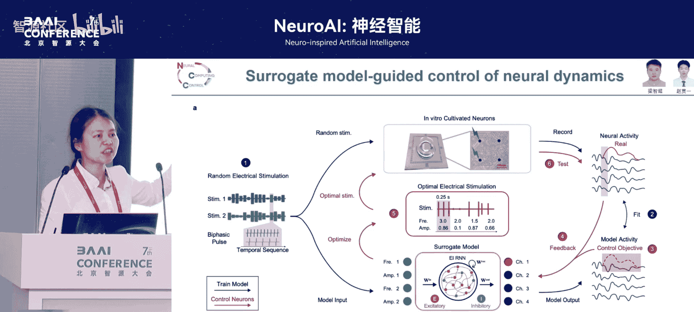

当然也做了一些数学分析了。而我们验证的就是说他能不能够是用开环或者闭环的形式来抑制或者激活特定的神经活动。它相比于随机刺激而言，确实达到了抑制和激活的目标。哎。

这个下面就是在各种这个离体神经元的这个呃脑片上面都做了，确实是这样子的啊，然后呢，我们就是除了抑制和激活，这是非常容易的控制目标。我们希望它到达特定的目标状态，一个高维空间的目标状态。

虽然我们也就四个维度啊，四维空间中的目标状态，它是不是可以到达。哎，我们发现很有意思，大脑受到这个底层的动力学特性的这样的约束和安全刺激的约束。所以你不是说任何到达任何状态空间都可到达的。

它有一个可到达范围。而我们的孪神模型其实可以告诉呃，这个我们可以分析出来，它可到达范围是我这个灰色的这一块。如果我们把这个要到达的目标点点。到这个灰色中的任何一个空间，它是可以通过电磁机调整。

它跳过去的。但如果超脱了这个灰色灰色的这个范围呢，它就跳不过去了。说明什么？说明如果你大脑的底层动力系统，你的脑连接和你的这个生长的这个你你的学习所塑造的这个突出的连接定了之后。

其实你的既定的轨迹是是你的你的大脑状态跳转是有个范畴的。你要脱出你要脱离那个范畴是很难的。所以你是由你内顶性质体现在你的大脑可到达的范这个系统的状态里面的。

所以呢这个我们就是说既可以就是说明我们可以到达特定的区域，又又是证明了这个区域呢是有个范围的啊，那我们对其的前面对其的是说在信号层面让AI去预测人的信号。

那是不是AI能够说除了信号上面能够对其还有一些更的东西。比如说我希望人的决策行为，也能够去被AI所。😡。

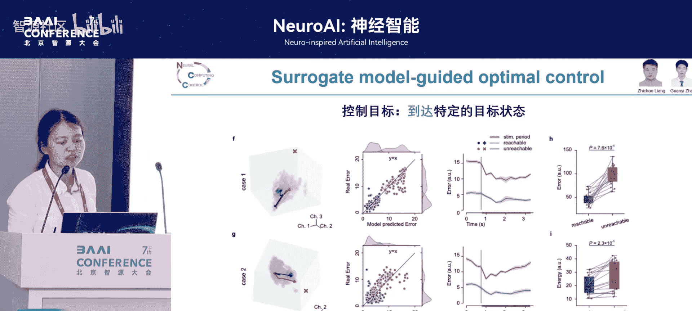

如果1个AI产生的角色跟你一模一样，它就是你的代理了，它就是你的男身体了，至少跟你有一样的品味，一样的决决策一样的这个嗯做选择。然后呢。

我们训练这样的模型呢去完成这个事情确实也是可以做到的细节我们就讲了，我只有一分钟了我就快速跳过这个神经编码呢也是可以对齐的，这个也是尝试过。

并且呢我们发现对齐的神经编码是可以把我们大脑的信号直接去输给输给这个预训练好的这个大模型，大模型就能够产生一个caption去描述你的信号。所以说这样的情况呢，就说明什么说明大脑直接跟大模型对通了。

你不需要去打字去pro它，你直接用大脑的信号去proI就可以去完成对话了。所以未来就是说AI就已经在云端，你大脑直接。😡。

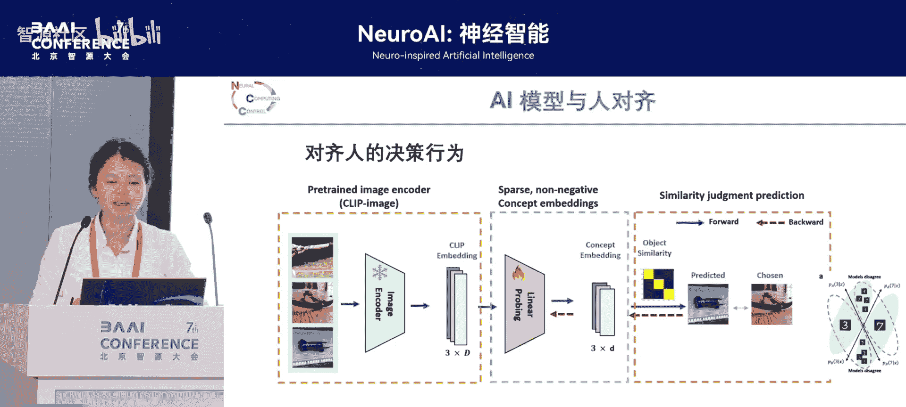

就把你想的一个pro就输给他了，他就给你一个答案了。甚至这个答案是通过电自机写入的或者什么写入的，你也不需要去读一段文字，写了2000字，你去理解其中是什么含义。

你就能够去知道知道这个了所以呢最后就是说我们讨论展望啊，就你看我前面讲的是信号层面的这感知面的对齐但是其实我并没有讲记忆情绪人格这些 level东西。

但实际上哪怕我们每个点都有一些科学家有一些I的人做到了说这几个层面都能够去预测，并且能够完全孪升你跟你的这个你你给你刺激产生的情绪产生的是一样的你的人格跟人格也是一样的所有的这些东西都都完全是孪生好了那你这样意识上了吗？

你这I就完全是你的个就完全替代你了吗？那技术上来说这些是怎么实现的。但是我觉得纵使技术上实现了在伦理上来看他就是。😡，一个他就是这个男身体的独立存在性，就算永生了吗？它是不是独立存在。

它是一个新的个体呢，还是独立的个体呢？它跟你又是什么关系呢？它虽然完全男生的你但是它就是你嘛所以这是理上面要讨论问题我就借了刚刚刘佳老现场改的PPT刘老师说I等于II但是我是这样说tellig我是我的大脑和AI融合了。

我觉得以后就是一个人机共融的时代。那为什么AI比我的大脑小呢？因为I在云端它在上面很难说部署到我的大脑里面要要完全一个大模型部署大脑是很难的所以我想着就可能是一个云端的形式最终实现了我的这个个体的存在这个就是有一些小广告。

我实验室在招人一起顶希望大家感兴趣的可以来看一下我们有12个项目，然呢我们有一个这个真是做基础模。

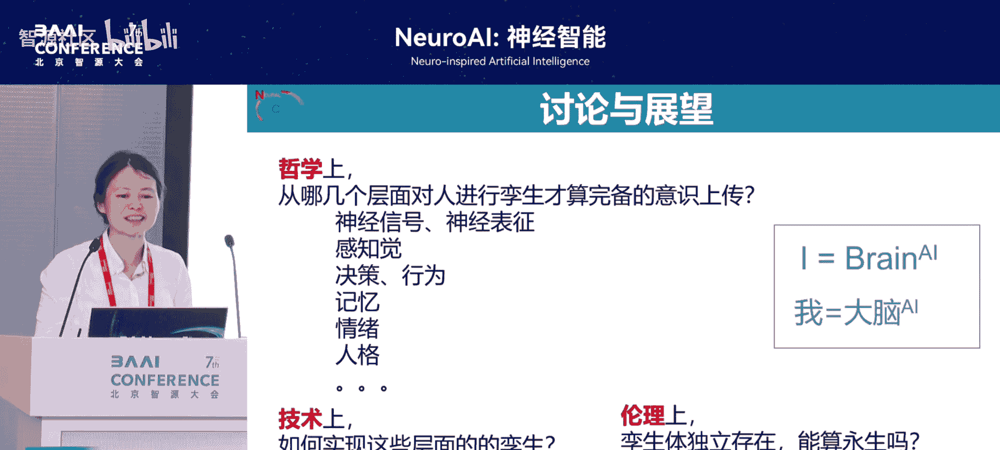

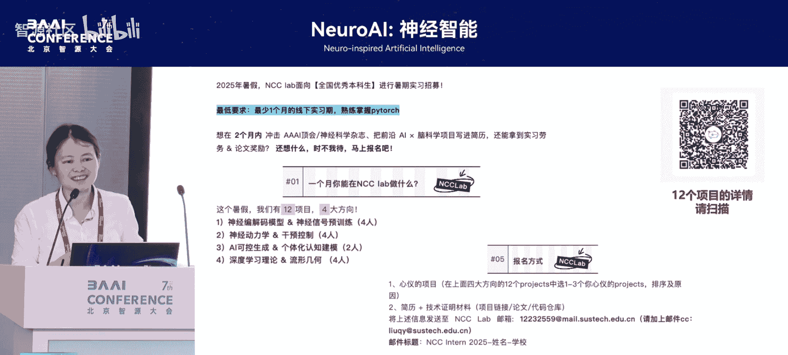

模型脑科学的基础模型foundation model越大越好，性能越强越好，效果任务越多越好。就是希望大家感兴趣的可以关注一下。然后这个还有截止日期啊，谢谢刘刘老师给我机会过来，嗯，很开心向大家学习嗯。

😊，我来问那个com下，我觉得那个全英讲的非常好，尤其你你你的是真正的在做数字孪声大脑，就咱们这些都没有像你这么直接。

然后这个思路这个觉得我前的基础觉得那句话说的非对一定要不考德堆德方一做的过程中我们会不断有发现，然后再不断纠正这些问的话个核的那个核磁的结直接那篇文章个核磁的核精度有影响肯用的是的有影响的。

后来我试的那个进度数据。😊，要求的数据量越多，他越复杂就要求的数据越多模型的复杂度也会提升。所以我觉得这样的男生男生就但要的模型size数据也会多一这个两边数据量少想要高不I驱训危没意的情况用但你都得一个结果但严格的试。

那，好的，谢谢陈宇。