# 2025北京智源大会-NeuroAI： 神经智能 p07 世界就是一个模型：吴思 -BV1BUN7z3E3e_p7-

嗯，刘佳知道我们这个论坛的传统就是要那个取一个标题啊，标题党，语不尽人事不休。所以我就取了个世界，就是个模型。我估计很多人想想的就是一杀一世界啊，我星际宇宙。啊，没有，其实我这是很严肃的科学问题。嗯。

就说如果你要让我用一个词来说，什么是智能最重要的东西，我就是世界模型。就人工智能的核心在我看来就是要发展高效世界模型。而我们私人生物智能的核心就是什么简密大脑类的世界模型。什么意思呢？

如果可能有些听众不知道什么世界模型的话，我们就去问那个lip。呃，dept回答特别好呃，英文叫wordorl model。那么世验模型简单说它是一个跨学科的概念，核心思想就是一个系统，一个智能体啊。

它要通过学习和推理呢，构建构建对所处环境的一个内在表征，就一个内部的模型。然后他呢好利用这个模型呢和外界交互，预测未来规划行动，以及理解复杂的现象。

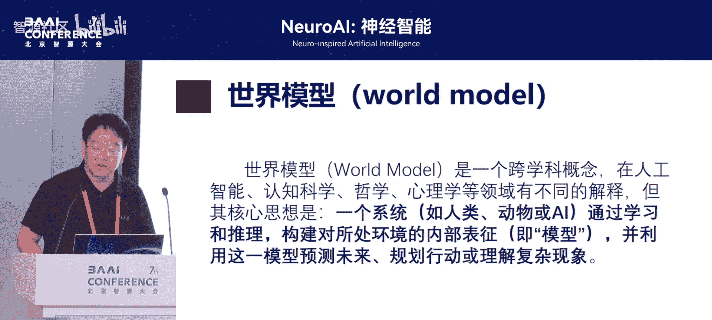

说现在在AI这个领域我们都知道，现在世界模型特别火，大家都在提世界模型的呃架构啊，但还没有做成功啊，但是大家都反复强调，我们要构造一个世界模型。我们根据这个世界模型中预测推理抽象表征自动驾驶等等。

那么在心理学中其实也也对世界模型。这个模型呢我们叫做很心智模型，大家就说我们我们生活中的经验啊，在不断我们修正我们心智的模型，我们对世界理解，就我们所谓的世界观。

那么世界观呢会指导我们的判断或行为的行为和外界交互，反过来进一步修正我们世界模型。所以可以说我们人的一生就是不断完善我们自身的世界模型的过程，只是你不知不知道你的一生就是训练你大脑的网络。

你在experience学习中不断不断比叫奇怪，反正不断的完善你的那个心智模型大脑世界模型，然后帮助你的个世界上进行生成和抉择。那么在AI领域目前发现怎么样呢？我觉得在知识。😊。

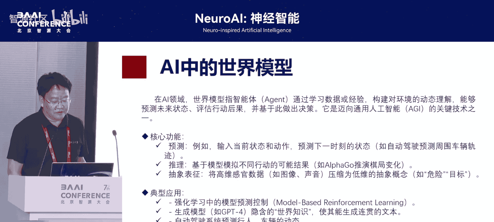

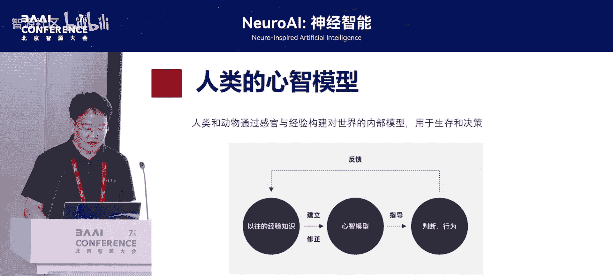

表真的层面上的世界模型做进做的特别好了。我这画了个简单例子就是VAE是吧？一个生成模型。我们一个图片，然后我们进行高度压缩，高度压缩以后，我随便做一个sling做一个随机采样。

我们都能生成一个像模像样的个图片这个生成模型大家在玩。为什么高度压缩以后，你还能生成的好。那这么个高度压缩真的是一个特别好的一个知识表真的模型，它已经把那个核心给抓住了。

比如说猫是吧猫压缩以后随便一个采样都生成一个模，其实它不是过去的个猫了，但是压缩特别好，抓住了另个一个静态知识的世界模型。那么现在目前其实呃这个世界模型做的不好在什么地方呢？我这就举个例子。

就是说我们看到的视频人形机器人很火我这没有没有说就说人机器做的不好。我只说这个问题真太难了但我们都看到在网上经常看到这样的视频看到一个机器人做特特别的好，然后我们都很惊叹。如果我们关心术。😊。

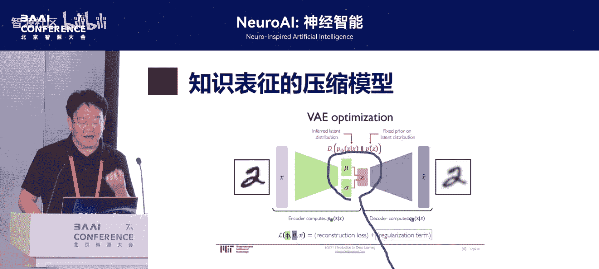

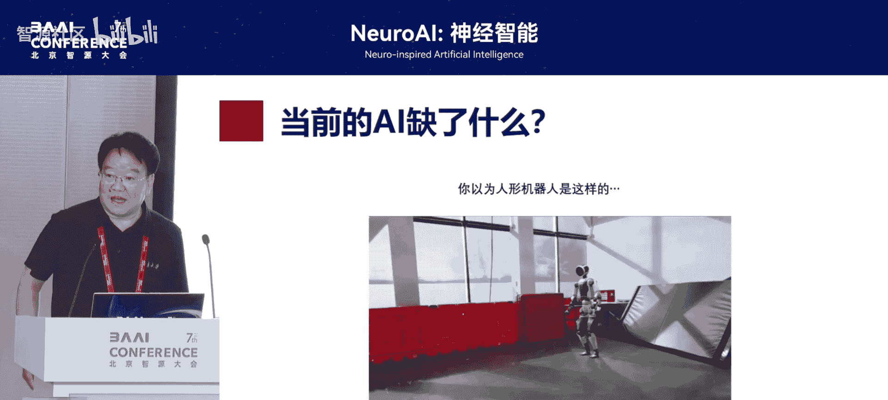

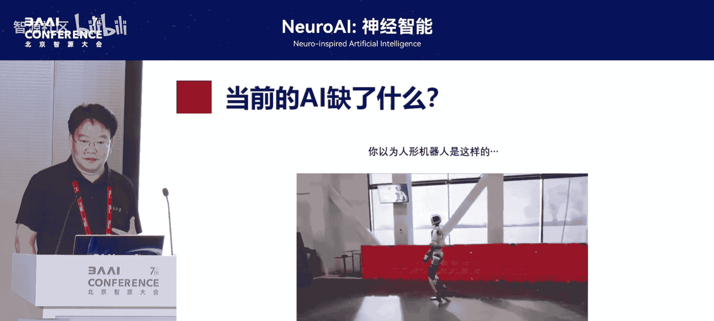

细节现在机器人这么厉害了，能干这么这么复杂的那种呃任务呃，我我这就不放了吧。反正那个网上大家都能找到这种特别多精彩的视频。OK但是如果你放在一个真实的场景中，其实是这样的。

你一个非常对我们人就他也做不好。

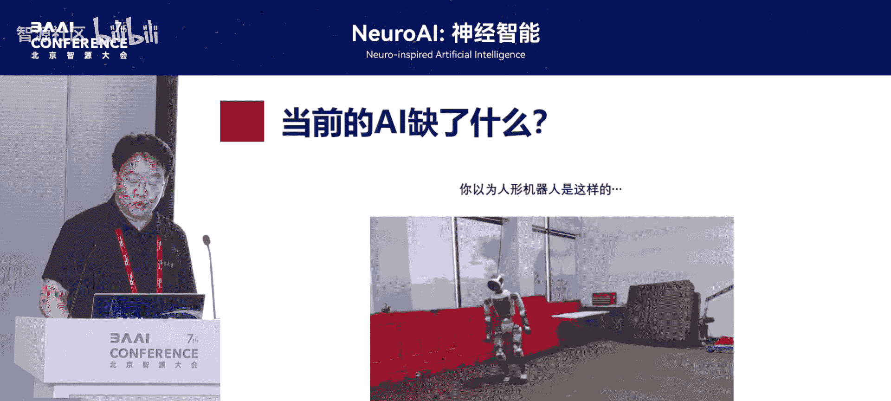

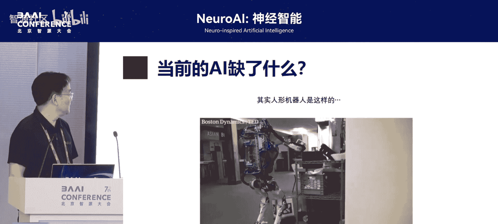

对包括这次那个机器人的代马不是闹了很多笑话吗？问题出在哪呢？问题出在就是说对一个一个特定的场景，我们能把program好，一个简单的环境program好，所以说它表现的那个特别完美。

然后我们就press但是像我们人的话，我们每天处在的环境都是一个不可知的，随时变化的那我们就做不好。那么人性技术做不好，但我们人都做的好。那么我们缺的是什么呢？

缺的也就是呃累困在各个场方强调的我们需要的是一个通用的物理的世界模型，就说我们这个模型啊不是因为像一个机器人的话，你一个特定场景你可以编程一次，你不能所有场景都编程吧是吧？

我们需要的是一样一个通用的一个模模拟物理世界的一个世界模型，我就先简单举个例子啊，这个什么意思呢？比如说我们现在可以闭上眼睛，我们可以想象一下，我们怎么照这个园明听的。

那么我们就可以想哦我们进来的时候过来安检概念我们上个楼。😊。

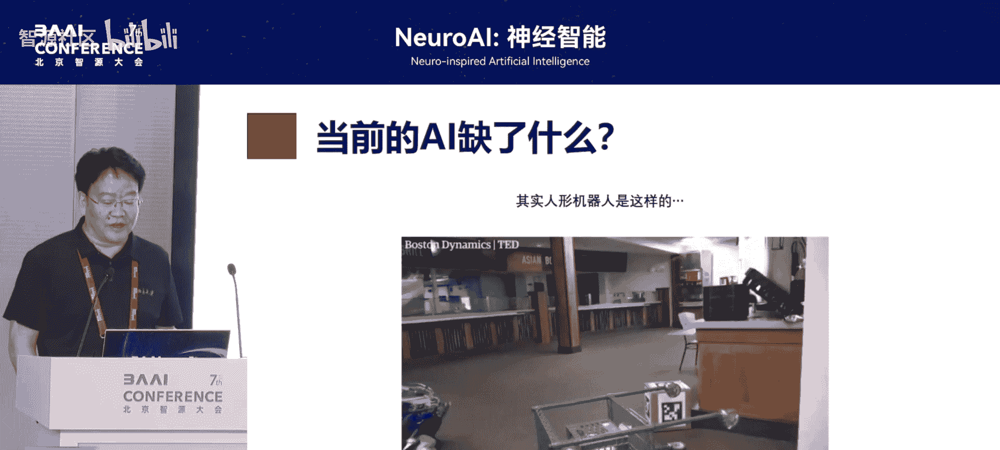

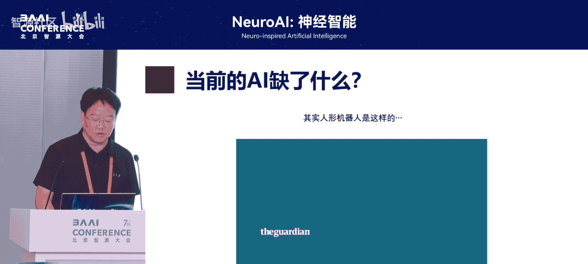

然后我可以在旁边还有什么样的东西，我们都都能想象出来。就说我们闭上眼睛后，我们可以回忆想象我们到达这个圆明厅整个的物理的过程。我们中间怎么上楼梯，怎么看到什么东西的。

那就表示我们大脑内有个模型它不是tokenized它是真实的一个物理过程被我们表下来了这样一个模型对我们和动态世界的交互，一个未知的那个交互就特别特别的关键。我们能做特别好。

机器没做的好所以对机器领域来说那个AI这个领域来说，我觉得这个是一个发展的一个下一步最大的挑战也是关键，那么这顺便就说一下我做的领域叫神经计算建模然后我就构造一些神经元动力学的模型来表大大脑信息的那个。

呃，加工的过程啊，那么过去我一直有一个别人老袋那个牵认你，我说哎，我们现在AI模型做的挺好的，你在搞神经计算项目到底什么意思嘛？我这我这两天突然想到了，其实我们在做那个神经计算模型的时候。

我跟AI的模型不一样AI模型是一个就是一步反应，你给个输入，我给个输出。但是我们神经计算计模的时候，我们会模拟这个输入怎么来的，神经元怎么产生反应，怎么传递到别的神经元，这个网络怎么反应？

实际上是我们在构建了一个。😊，物理的。信息加工的过程。所以说神经计算建模从某某种意义上说，实际上是构建大脑类的物理的世界的模型。O那么这个大脑的世界模型该怎么做，但现在没没有定论啊。

我自己觉得可能那个出发点一个很好的切入口就是我们回答我们的空间认知我们三维世界模型它是空间感知怎么做的那么这个三维空间感知的那个神经基础已经很其实相对比较清楚了就11年前的诺贝尔奖就给了那个play的发现的一个发现者。

他们认为大脑GPS但是这个实验神经科学只是告诉我们是g sales参与了空间的感知但是具体怎么做需要我们做数学的建模那么这数学建模时间关系呢我就快速的提一下我们怎么做或者我认为该怎么做那顺便呢我也。😊。

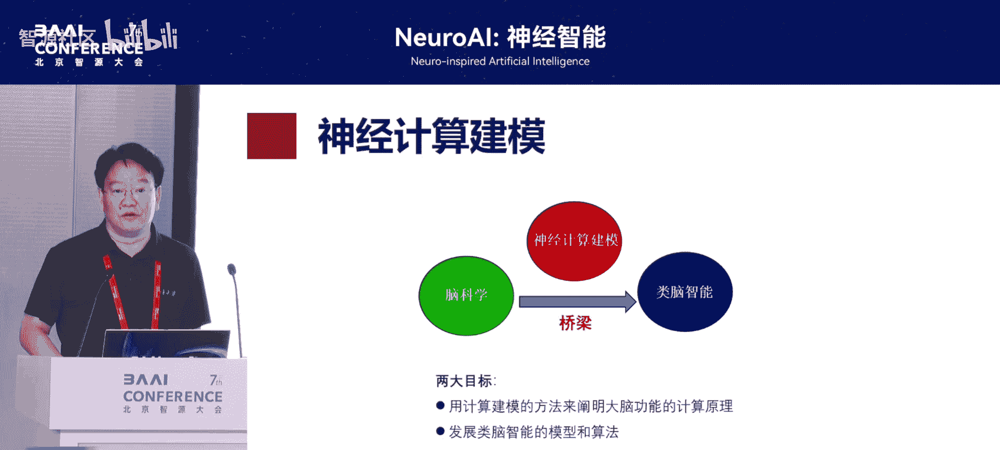

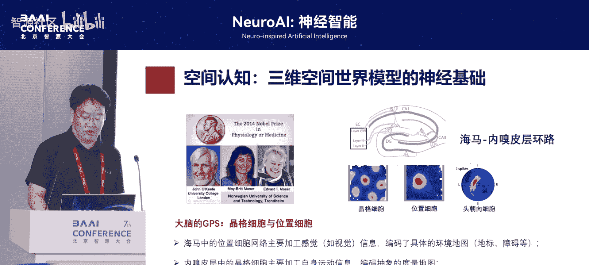

那个一个重要的历史事实啊呃是那个今年的那个诺ber而言，物理学奖的是给了johner。然后原因是因为他提出的 model是关于呃新因子神经网络的一个模型。啊，但是实际上那个呃真实的情况是呃。

我在日本老板孙比早1年前就做出来了，数学框架的一模一样，我在知识分子上写篇文章，澄经这段历史，所以说我现在也像可能像祥林嫂一样，一有机会我就把这段历史给说出来。因为我觉得这是科学的呃真实真实的历史吧。

那么就是呃可能就十来天前，然后我带着我组里的学生专门去日本去拜访了先生，他已经呃明年1月份就90岁了啊，他也专门见了我们的学生，还还给了报告，还提了他对AI下一步发展90岁快9岁了。

他还提出一些核心的思考，他觉得是关键的问题。

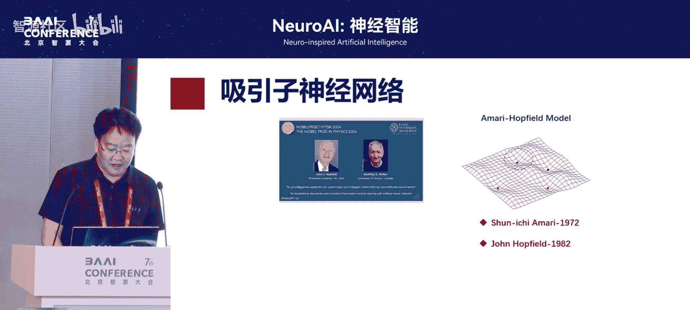

O那么我我不讲细节，我们大家想象一下，就是说呃这个这个左边那个图是来自今年诺贝尔奖的那个呃委员会，他们人给错了，但他们那个图用的是对的，他就想象下我们在大脑做信息加的候。

我们个网络就像构造了一个小星子网我们连续新智网络一个表的空间。么我的逻辑推理我们planning我们的呃想象其实你就可以想象一个小球这样一个tract space里面走来走去，那么作为我们数学建模。

我们构造这样 space把我们的对外界的感知，我们的记忆呃用一种这样一种新智网络的空间表。然后我们这数建模我们就我们我们科主干这样的事情。那么设计的空间感知呢。

我们最近也做一些工作呃就是用到了海马我们用连续性智网络g就网两个续性质网络相互合呢，我们就建了这样的。😊。

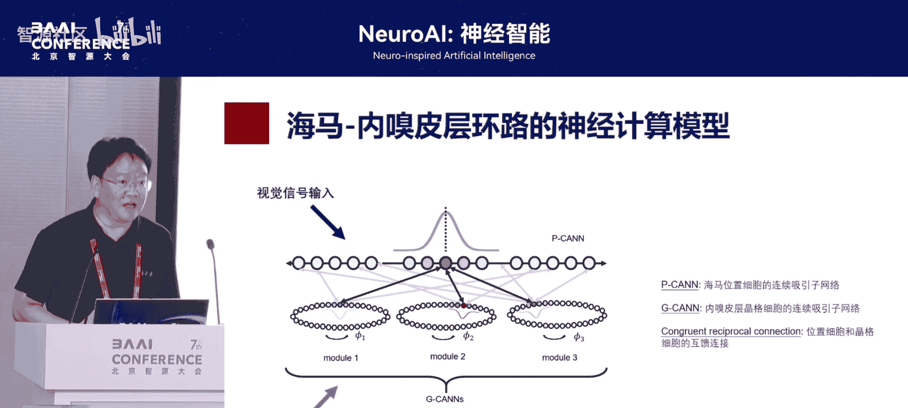

模型。那么这样的模型的话，我们就可以。嗯，和环境进行实时的交互。然后呢接受视觉信息和呃运动信息。那么这是我们大脑怎么和环境交互啊建立空间地图的过程。那么一个应用就是我们可以做一个内脑算法。

比如说这个做机器人，我是为了节约时间放的很快。那么他机器人做那个。那么在工程上是一个很著名的问题叫slamme。那么这个我们在模型跟slamme有什么不一样呢？因为我们是模拟了这个空间建图的过程。

那么我们可以把这个嗯比工程上的slamme多个东西，就是这个机器人在走的时候，我们可以实时展现，它在那个时候它看见了什么东西，它的空间那个运动的路径积分是怎么做的。我们能把这样物理的过程给重现出来啊。

那么我为什么要对空间感知这个问题特别感兴趣。而认为我认为它是我们大脑建立世界模型的核心呢？是因为。

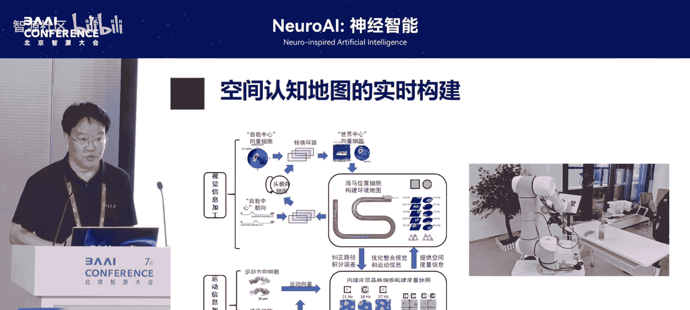

这个一个结构它能表示非空间的抽象关系的一个啊一个关系，叫认知地图。呃，这生物上有个特点点，就是生物的我们都是进化来的是吧？进化有一种保守性啊，那么在脊椎动物它早期发展的海马和力球皮层来表示空间关系。

那么他发现这个这个环路特别好用。那么他在后期进化的高等动物的时候，他会把这样一个环路结构呢拿来复用，来表证一些更复杂的抽象的关系比如说父母的关系，兄弟姐妹之间关系以及各种复杂的关系。

那么他就这个复用的一个间接的证据就叫做所谓的心理学的寄生认知现象，就说我们本来表证空间关系，我们有远近呃高低。但是你看我们表示人际关系的时候，我们也用远近啊，他这个人离我很近啊，它地位比我高。

但高和远近是空间关系，但是我们去了表人际关系了，就是因为我们在大脑中把这样一个表证空间关系的结构给它来复用了。所以说我说搞清楚这个空间认知的那个环路，对我们了解更复杂的。

嗯呃事件模型或认知地图啊具有重要作用啊，那么。康德在纯粹批评上说了一个著名的话，就是空间和时间是我们认识世界的基本模式。呃，那么我把这些话给推广一下，就是呃空间和时间是我们构造世界模型的基本框架。嗯。

呃，那么先简总结一下，就是说AI和大脑的世界模型有什么不同呢？就世界模型是我们智能的核心。不管是我们生物大脑还是AI那么当前AI呢，它主要通过数据驱动的方法来学习这个世界模型。

但是我们大脑呢通过意外进化，我们发展出一种高效的表物理世界的世界模型其中海马内球皮层环就是个核心架构。那么我们人呢是先天就接受了这个网络结构。

我们生下来的内球皮层动物实验看很不是通过后天先天就有了我们后天实际上是不断的修正这样一个世界模型。但优点就是我们小孩很快就能建立世界模型，对物体的物理系基本的物理的感知怎么球在空中会掉下来。

我们很快学会了是吧那个I就很难学。为我们个先天的结构，我们能实现小样学习。当然任何东西都有优点和缺点缺点就是这个框架也把我们限住了，使得我们人类只能认识我们能认识的世界。

我们有这先天架构但是脑科学总的说来呢有这样的先天的架构。😊，如果我们把它搞清楚的话，我们就能为我们AI发展试验模型啊提供了一个瑞脑智能的呃，提供借鉴，就说叫瑞脑的智能。

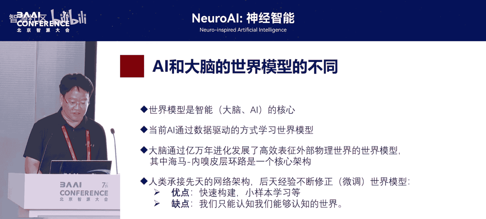

所以我有点畅想啊呃也就是呃刘佳说的要反思。呃，现在我比较乐观了。就是说我们知识模型大语言模型做的特别好，实际是超过我们人类了。因为它数据量他的比我们人类读的远远很多。

但是我们现在缺的是一个物理的一个世界模型。如果我们把这个物理的世界模型做好了，又把知识模型做好，那真的就是没什么人类什么事了，就我们就算超人的一个呃一个巨生智能。呃。

那么我这呢就借用那个加勒比的海盗里面的一个场景来给大家看看。

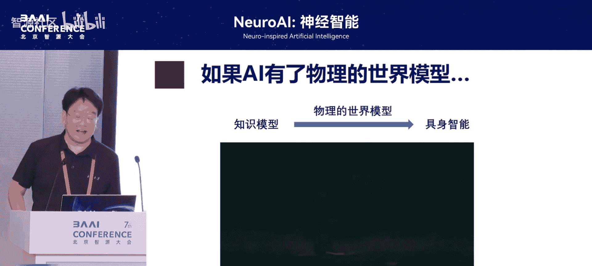

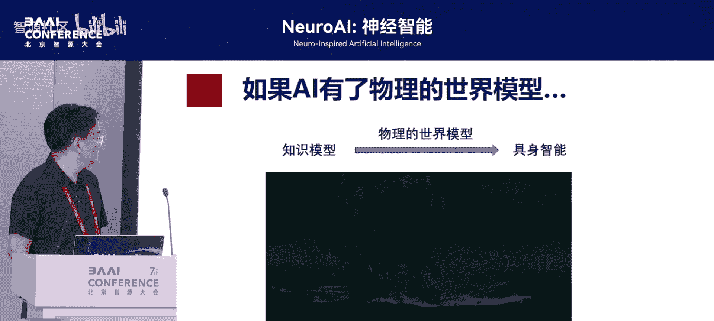

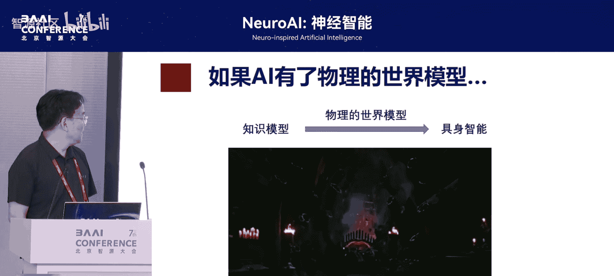

🎼不知道他还看了那个场景没有，当时我看有觉得。🎼呃，特别。🎼现在我觉得是真有可能。🎼呃，那么你看他假设我们未来的是一个呃知识的模型来呃来读这个图谱。

但是我们的运动能像章鱼章鱼的运动能力比我们人强多了是吧？啊，所以说章鱼来做一个巨生的那个执行的任务那个物理模型做好这个是完全是真有可能实现的O那么再回到这个主题啊，世界是个就是不是个模型。

为什么在困扰着我呢？是因为物理模型，我刚才谈到的它全是一个确定性的系统，你有什么样的输入，就有什么样的输出。所以说难道我们人类就是一个一个被动的一个物理系统嘛？我们人类不是还有意识嘛，是吧？然后呢。

又把那个刘家梳理的那个图给拿来再讲讲，就是个意思。就说我们认为这个实验怎么做的呢？就让一个人在想象你什么时候想动手指，你什么时候动完全由自己决定，但是你动的时候你要告诉我时钟指向了儿。

那么这个人呢就做这个实验啊，我想动手指了，动一下，看那个时钟他汇报，我这个是动的。

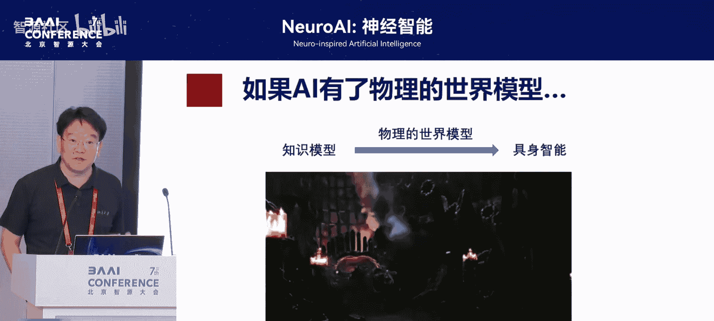

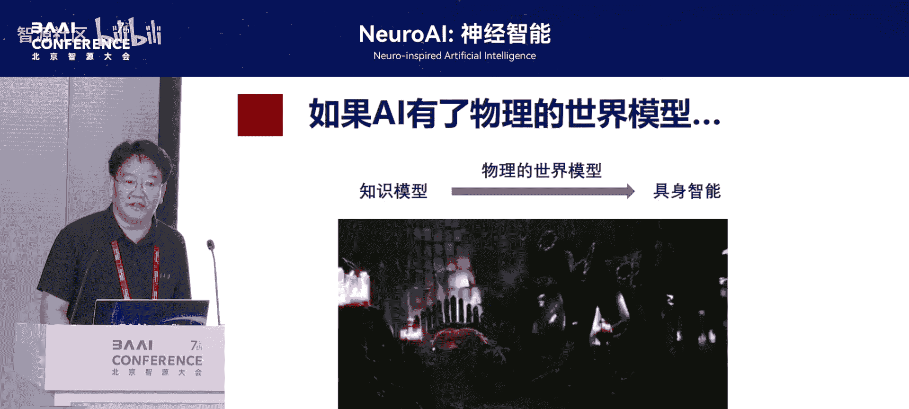

但是实际上如果我们记录他大脑内部的活动的话，通过解码的方式发现，在他动手指，他自以为他来控制他手指的200毫秒之前，从脑信号中读出来，他要动手指。就他自己感觉他在动手指，其实不是他是一个被动的在动手指。

所以说这个实验至少就但也不是说完全正确，就是感觉就是对自身自动而言，我们人类没有自由意识。我们所谓自主的决定或选择可能就是个假象是个错觉。那个斯宾诺撒说句好，所以自由意识。

只是一颗自认为选择了路线与落点的石头。他觉得啊你看我石头我们扔出去我们的字他是一个确定性的物理系统但是石头自己觉得你看我在选择我飞行的路线。就说意识呢他可能不是产生行为。

而是来解释我们行为的弗洛伊德说了一句话也说的特别好刘佳给转移一下，但意思就说意识让我们人类爱上了自己，我们实际上就是。一个很确定性的一个被动的物理系统。只不过呢我们在解读这个行为的时候呢。

我们就觉得哎你看我有意思，我想怎么样就怎么样。实际上是很有可能意思是我们只是对我们行为的一个解读。那么大家觉得哎你看我实实上生活中我下一秒行为我都是不可预测的呀。我觉得可可以这样来理解。

这个像计算机的一个为随机数一样，我们电脑我们产生一个随机数是吧？其实你根本产生不了随机数，只不过它这个周期特别的长，它要很长才能重复，然后你感觉啊我产生随机数了。

那么我们人的大脑呢可能就是一个也是个被动的物理系统。只不过呢我这个我们人与人之间相互交流。它这个宇宙特别复杂。在个体的上，你看到你这个随机行为，但整体上有可能就是一个就是一个物理的确定性的世件模型。啊。

所以说。😊。

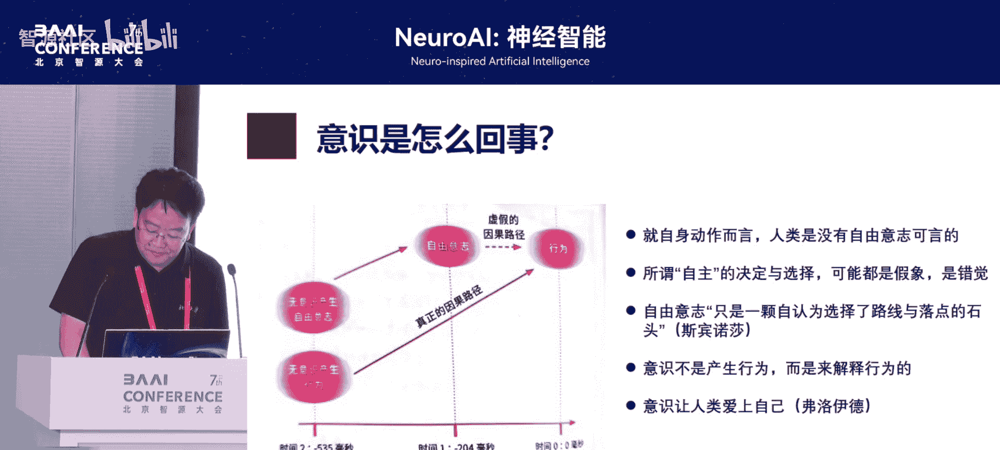

嗯，有时候啊大家都在谈论这个AI嗯超过我们人人类毁灭了怎么样。呃，我发现我我不知道我是不是一个冷酷的人，我从来没担忧这一点，我担忧的什么呢？

我担忧的是如果我们世界真我们的世界我们大真的是一个确定性的模型。那们怎么怎么就面对这个生活呢。那么我这用的是一个一个很好看电影叫个楚门的世界出门的，这个电影呢是一个是一个叫楚门的人。

他是从小就在一个真人秀里面，他自己不知道，他从小长大每天他生活，他都觉得他又像我们人现赶丰富多彩世界上他是个真人秀，所有除了他以外，别的全是演员在扮演。然后这个嗯。😊。

出啊楚门终于有一天啊有阴差阳错的原因，他发现他生活在一个虚幻的世界里，一个被别人呃编造的世界里面啊，但最后他就勇勇敢的要推开那个门，去看看外面那什么样子。啊。

我这讲的啊就是呃符合我们这个论坛的呃神侃是吧？呃，我现在讲的不是一定我真正的这世界就是这样子的。但是我就有这种可能性，就是我们的呃大脑里的物理的世呃这个世界模型，它就是一个确定性的系统。

然后那么我真正担忧的就是。就是这样的，然后我有一天搞懂了我怎么能面对这样充明的面对生活。OK好，报告就完了。😡，我来那个就是回应一下你最后一句话，最后一句话就是那个什么是这是你才说的吗？

知道了生活的残酷，然后还要继续对，还要继续热爱这个世界。就是说有时候其实理解脑科学，我觉得然后就是在解码自己就像拿一个望远镜，然后在看那个显微镜在看自己啊，这其实即使有趣，也让人感到震撼。

就我但是我想回应你一个问题啊，就是说你谈到那个就是我们的世界是一个物理世界。我这点特别的认同。但是我也认为这个物理世界，它其实是一个主观的世界。为什么呢？因为每一个物理世界虽然说有我们的那个海马。

有我们的那个就是内秀皮层等等这些加工。但是其实我们每个人看见的同样的物理世界其实是不一样的。嗯，你说个子高的和个子矮的，看见这屋理世界也是不一样的。OK所以说我想问的一个问题是，可能这个物理世界。

它可能到最终它还是变成了一个主观的世界。所以我我特别希望然我我的问题其实是想请你comments，我在你的物理世界前面再加一个词叫inbody的那个那个word。

embodyed word model就说其实环境也是我们是那个就是计算的一部分。对我觉得让你怎么来看这个观点？对，其实是这样的啊，我原来觉得我们有个客观的事界，一个主观的世界，我觉得挺好的。

这个主观世界是我有意识，我呃我能那个主观的控制的。现在的我担忧的什么？我这个主观世界也是个数学方程可描述的，就是说。所有的东西就是一个呃数学数学东西方程可以可以描述呃，可以预测呃，可以预测我的看到什么。

我下一步干什么，我未来生活什么样子。呃，所以说我的苦恼在于我还天天干这样的事情，我把这个数学方程给解出来。那解出来以后，万一我正确怎么办？所以说这个是一个困惑？呃，我我觉得是这样子的。

然后我我完全认同你的观点啊。那个我觉得第一个，然后我的观点是到了一定可解的。啊，所以你也同意，就是说我们最后大佬就是一个最有描述的一个数学方。对对，肯定是一个可描述的数学东西。

但是呢由由于你的经验不一样，你的输入不一样。其实让你每次所产生的那个那个prection是不一样的，就对 token不一样的。所以说为什么我们要去经历这世界，然后各种花花绿绿，然后那个各种各样的。

然后大千世界去经历，我觉得这是让模型不一样的地方。OK就是我接受我是一个确定数方程。同时我接受总有噪音，让我的行为不可预测。对对或者你做一些随机的动作的行为OK好好。

