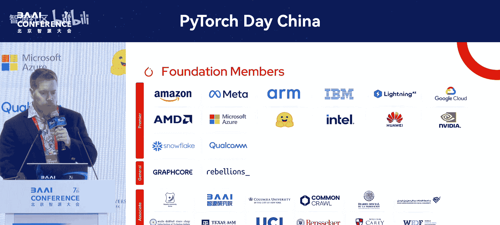
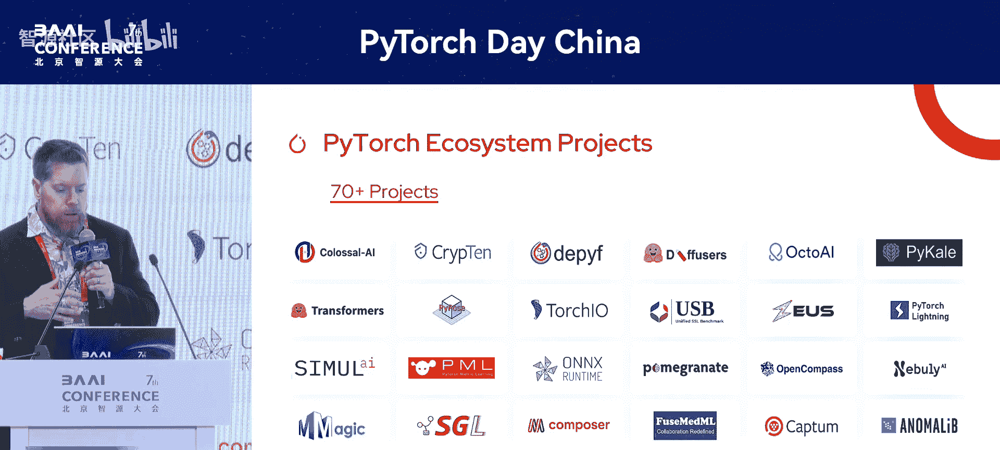
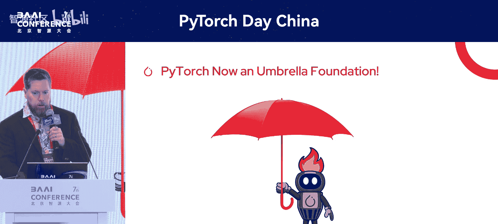
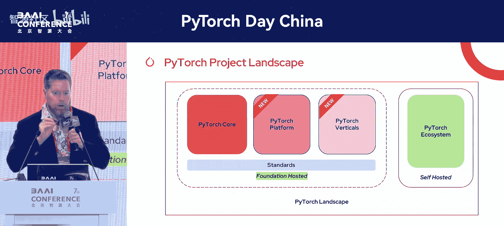
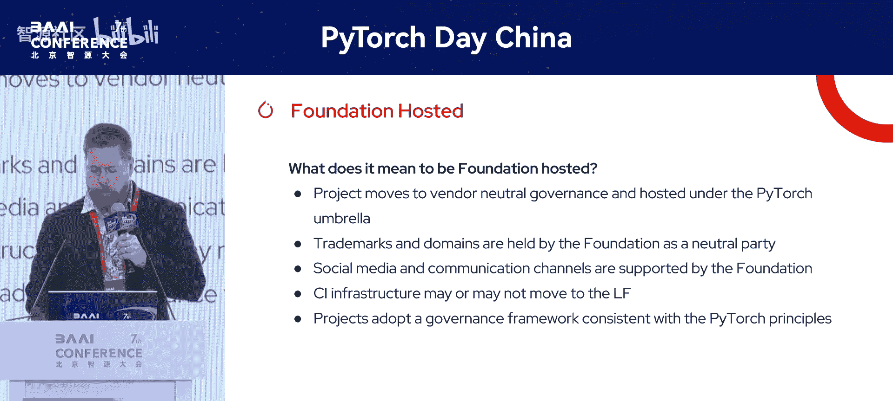
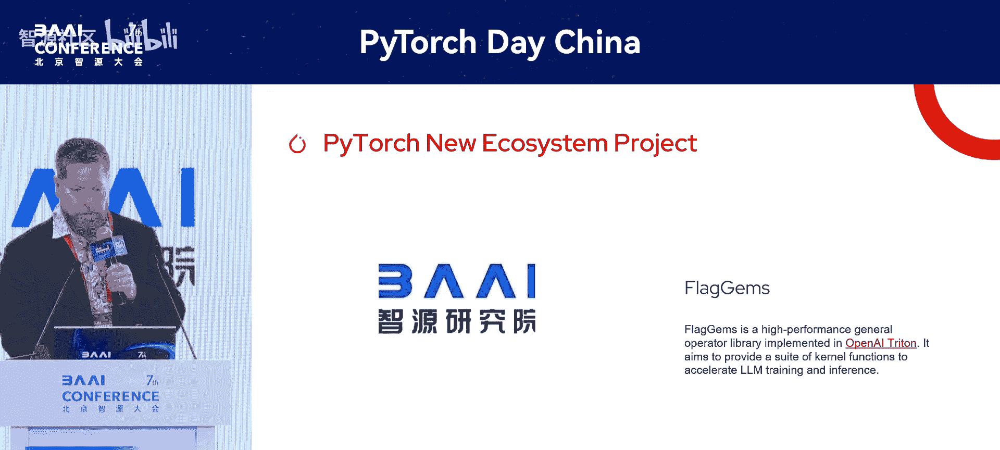
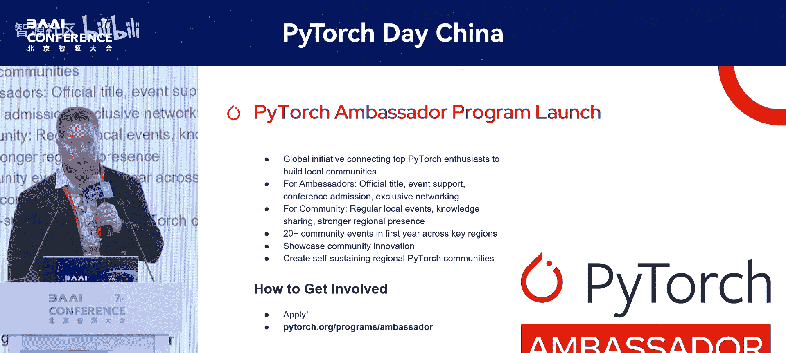
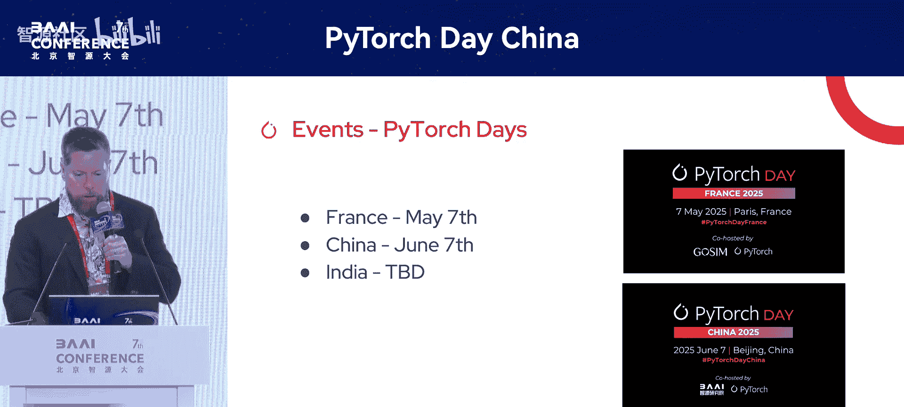
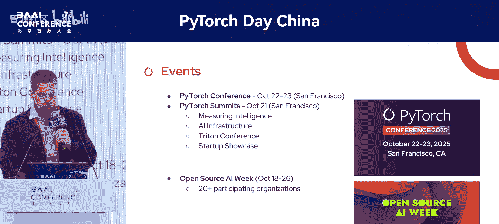
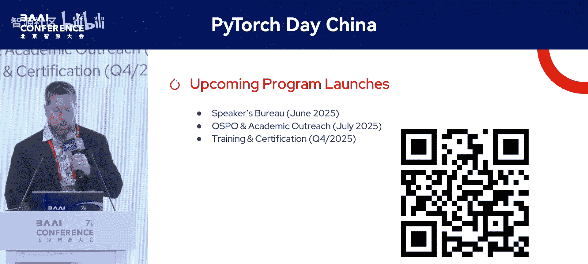

# 2025北京智源大会-PyTorch Day China p01 Welcome & Opening Remarks：Matt White -BV1PPNWziED7_p1-

Zhao Shanghao， everyone， welcome to the very first P Torch Day China。

 Thank you very much for being here。Get started here。So before we get started。

 I'd like to say a very special thank you to BAI for hosting this event。

 I'd like to hear really a round of applause for them and for this great event and all the great speakers that we've listened to for the last couple of days。

 so thank you BAI。All right， so I just have some preamble a few things I'd like to share with you before we get started and have a great day of excellent speakers on a lot of very important and contemporary topics in Pytorch。

So I'm going to put the mission the new mission statement up here。

 this is very important because the Pytorch foundation is evolving right AI is moving fast and the foundation is evolving to keep up with the time so。

What the foundation stands for now is to really accelerate innovation and build make available tools for Pytorch that are widely available and also to enhance open source AI across the industry and so we're here to democratize access to tools to allow tools to be accessed by anyone anywhere for their purposes。

 and so we're continuing to move the dial and we have some announcements that we'll make throughout this talk。

I do want to quickly highlight the foundation members here we are now at over 30 members。

 this foundation is only two years old keep in mind a very young foundation and we're growing very quickly and so。

I would like to thank all of our members and thank you BAI for also being a member of the foundation。

We also have this very rich ecosystem of projects in the Pytororch Foundation。

 so beyond all just the Pytorrch framework we've had this ecosystem of projects for several years now that is continuing to grow we have you know there's going to be names that you recognize here like transformers and diffusers。

 onyx， SG Lang and so forth and these are all great projects that are associated with。

Pytororch or the foundation and these tools are really here to show the community that there are tools that are accessible under open source licenses and really work well together with the entire ecosystem。

So I'm going to share with you a few announcements。You may have heard。

 but Pytorrch is now an umbrella foundation。And what does that mean， right？

It really is that we've evolved to become a foundation that can host projects beyond just the Pytororch core。

 and so for the last couple of years we've hosted Pytororch Co as our principal project along with a bunch of auxiliary projects。

But now we can host new projects that the community contributes to the foundation and what this does is builds a very strong and trusted ecosystem of projects。

That you can depend on for your use in research and production and know that the project is gonna stand the long。

 the long test of time。And so what this also does is aligns projects with our governance and all of those pieces that are integral to the process。

 of development of these projects， it also encourages collaboration between projects so projects that are in the foundation。

 their core maintainers collaborate with other core maintainers and what we do is we break down these walls and silos and get maintainers talking。

 get contributors talking together and working on cross promotion of projects。嗯。All right。

 and so what the world looks like in Pytorrch now is we have this Pytorrch landscape。

And we still have Pytorch core， which is a very important part of our， our project platform。

 But we also have some new boxes here， right， We have the Pytorch platform。 So these are。

Posted projects with the foundation that are general purpose in nature。

 And so these are like serving engines。 These are platforms。 This is software that allows you to。

 you know， use， not just use Pytorch， but also have， you know。

 access to serving engines to access to data preprocessing and other functions that are very generic。

And then we also have Pyarch verticals， which are projects that are very specific to applications or domains。

 so these are things like protein folding and know geospatial analysis。

 these are very domain specific applications。And then we still have the PyTtorch ecosystem and so you know if you have a project that you think is really valuable and bring value to the community in AI and open source AI。

 PyTtorch ecosystemstem is your starting point， this is where all projects begin and then they can evolve to become actual foundation projects over time。

So what does it mean to be foundation hosted。 So I talked about ecosystem ecosystem projects go through a process through our ecosystem working group。

 and that working group will review the projects and then。

Either approve those projects to join the ecosystem or work with the core maintainers to help them get to a better place where they can actually join the ecosystem。

But for foundation hosted projects。These are projects that you really have to be certain that you want to。

 you're taking open source seriously。 You want to be in a vendor neutral space。 and so。

The Linux Foundation and the Pitororch Foundation function as a neutral third party。

 a trusted third party to hold the trademarks， domains， and other assets。

That are needed for that project so that no one company can tell one other company what they can and cannot do with a project。

 And so we are here to help make your project successful and help grow the open source community。

And so we do have some new hosted projects， these two projects just joined us in the last four weeks。

 one you've probably heard of here is VLLM， a very solid inference engine and for model serving for LLMs that was born out of UC Berkeley。

And then deep speed， which is more of an orchestration layer or level tool that allows you to do basically your entire life cycle for models from inference。

 sorry from training to inference。And we have a new ecosystem project announced today。

 which is BAI's flagag Gems， so very happy that the flagag Gems was approved and is now part of our ecosystem。

 so maybe just a quick round of applause for BAI。

All right， and so we just， we actually about a month ago。

 we launched the Pytorrch Ambassador program。So part of what we're doing here is we want to connect with local communities。

 we want to connect with leaders in each community to help move the dial forward on open source AI。

 so not just you know， not just P Toch， right， VLLM。

 deep speed and the other projects that will eventually join the foundation。

But anyone that's really passionate about open source and passionate about AI。

 this is the type of you know person that we're looking for。

 and so what we do is we provide resources and funding so that you can run your local meetups and you know run small events and conferences and these sort of things。

If you're going to do webinars， we also give you access to our platform to be able to promote your events and to promote what you do in your local community。

And so。I'm not giving you a lot of time。 The， I think it closes。Today。So if you are interested。

 please visit knowiketororch。org/ programs/ambassadors and and apply to be an ambassador and if you don't make the cutoff today reach out to myself and we can talk about getting your submission in。

 but yeah， and so we'll be reviewing these over the next month we've had over 200 submissions so far in four weeks。

 so a lot of interest from the community and participating in this program。

And a small announcement here， we did launch a new website。

Really looking for feedback from the community。If there's， you know。

 if you feel like there should be something here that's not， or if it's changed you drastically。

 I think maybe let us know and we can see how we can improve the website。

So I just want to touch a little bit on our events。So obviously here you're at Pytororch Day， China。

 we had Pytorch Day France last month in May 7th in Paris and we will have a Pytorch Day India later this year as well。

 we really have organized these events so that we can get out more into the community。

 get to where the audiences， get into the community and engage and hear from you like what we could be doing better。

 what we should be doing， where should we should be focusing our efforts and and we hope to be back you year after year。

And so we also have our like Marquie event， the Pytorch conference。

 and so that is in San Francisco this year， October 22nd and 23rd。We are in a new venue。

 we also have added an additional day， like a day zero。

 and I think this will be very interesting to a lot of folks。

 so we're going to have half day on measuring intelligence。

Wwhich is is really around benchmarking and you know benchmarking AI agents。

 benchmarking LLMs and benchmarking overall AI systems and we'll have a lot of great speakers there and then AI infrastructure so we have half day on infrastructure so serving training you know distributed training these sort of things will be discussed and we have a really great lineup as well the Triton Conference will also be there that'll be a full day event。

And we also also have the startup showcase， which will be in the afternoon。

 which we are inviting startups to come in， pitch and we you know have a very。

We've got a great panel of judges that are VCs and it's an opportunity for startups to get some exposure。

Also to make the week worthwhile we have an open source AI Week。

 so that whole week will be open source AI Week， it's a great opportunity to come to San Francisco and visit a lot of events that are going to be throughout the Bay Area and we hope to have a very full agenda for everyone to participate in。

So what， what's next for the Pytorch Foundation， right， the。

 I think our focus now is really on ecosystem and project growth。

 So we'd like to see more projects come。 We'd like to grow the ecosystem。 We have。

This you know these boxes here really demonstrate the domains that we're sort of addressing and this goes from like you know at the bottom of the stack and infrastructure。

Up to models， data and applications， and so there's more interest in standardizing protocols these days around MCP and A to A and other protocols and then there's also a lot of interest in looking at different layers of abstraction how can we get better measurement out of models。

 how do we deal with contamination of benchmark data and so forth so there's a lot of contemporary topics and we're looking for like a lot of tools that will address real problems in this space。

So we do have some additional programs that are going to be launched。

 The first one is the speakereakers Bureau， so that'll launch this month。

So there may you could be an ambassador you can also be a speaker but you don't have to be either you know they can be exclusive we do want to see folks sign up for this this is where we're going to connect speakers in different areas to go to conferences and speak on behalf of projects and the foundation so this is where we want folks to be able to get out there。

 get in the community， talk about their projects and you know make real change in the community。

We also have OSpo and academic outreach， so this is a pretty interesting program what we are doing is working with universities。

To provide them with the instruction packets that they need for。Professors。

 TAs to go and teach Pytorch right how to start with Pytororch and how to go into some of the advanced topics and so this is really useful for academia it's really useful for folks that are just learning about Pytororch and they may be studying computer science and so we want to make sure that we can connect with universities and know if you're studying now or your professor you know feel free to reach out to me and we can talk about how we can get you piloted in this program。

And then the next program is training a certification。

 so we have had for a few years now a lot of people asking about training a certification。

 a lot of people from China are asking for it， and so we finally are working on this and we hope that we'll expect to launch it later this year probably at the Pytororch conference and so we're hoping to do a day zero event which will be will offer two training courses and certifications which you could take on the first day of the conference before we get started。

And then we'll subsequently make that available online。And with that。

 thank you very much for joining us today， and I'm very excited about the great speakers that we have lined up for you。

 All right， thank you。