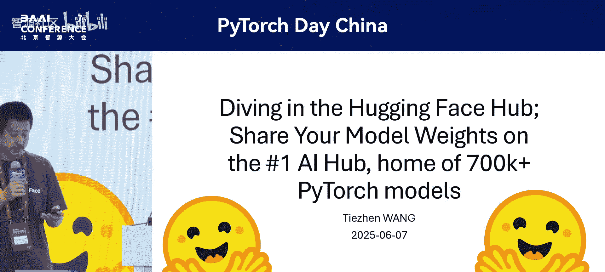
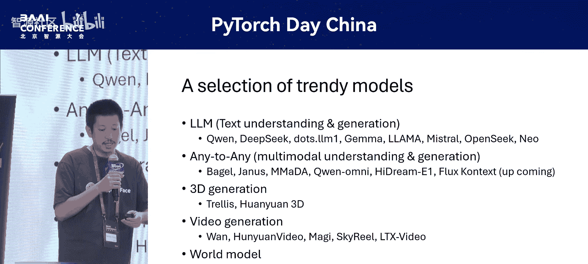
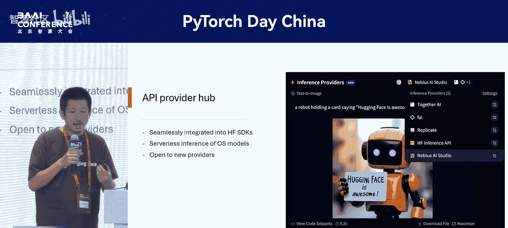
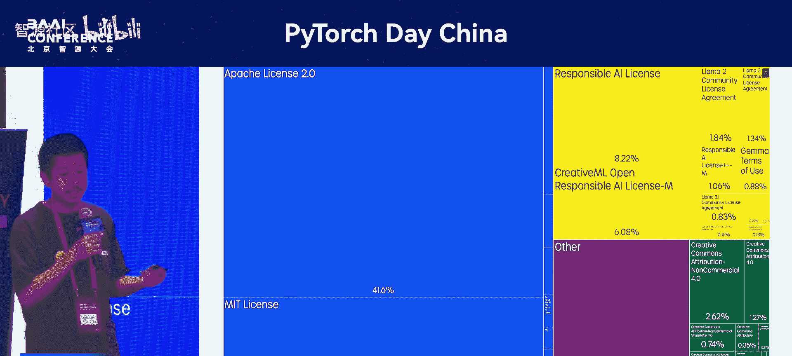

# 2025北京智源大会-PyTorch Day China p03 Diving in Hugging Face Hub; Share Your Model Weights on the #1 AI Hub, Home of 7 -BV1PPNWziED7_p3-

All right， so our next speaker is Wang Tiaqian from Huging Face and maybe is speaking about diving in Huging F H。

 share your model weights on number one AI hub home to over 700，000 Pytorrch models。🎼Thank you， Matt。

 Like， I wasn't aware that Pat today is such an international event。

 So let me try to I give deliver the talk in English。😊，So thanks for the for the invite。

 I hope like my talk today is going to help you better understand the whole hack phase ecosystem。

 what hack face hub is and what it does。😊。

Okay， so hug face up。 what is hug face up， I think like， like let's do a live like quiz now。

 like has anyone heard about hanging face up。 Like if you have heard about hug face up， like。

 try to raise your hand。Okay， we have like half of the audience already heard about Higingface hubub。

 So in general， Higingface hub is open source AI community。

 you can think of it as the Github for AI and it has a lot of great open source models and dataset。

 and after so many years of development It has go beyond that。

 It's not just models and data it also has like spaces where you can easily like try out models without actually downloading the whole ways Also we have the kernels。

 I think there is a lot of collaboration we could have with flag jam。

 We also have a gateway for API providers where you can integrate your serverless API service into into hackging face We also have a lot of communication and social network features on hackging face and lastly we have exposed a lot of metrics about open source models and dataset where you。

Can have a lot of insights into the current open source ecosystem。

So the model hub is the key feature of hack face。 So like we provide a free service to everyone who wants to upload models and dataset sets So for now。

 we already accumulate 1。7 million public models and it's like like more than 10 x girls things I joined3 years ago。

 So we provide lot of like easy features for you to filter and find out the models you want。

 for example， you can use filters on the left to find what are the most trendingtoch models in the past like 30 days。

 for example， and you can also filter by test， like for example， I want like large language model。

 etc。 we maintain a page of like trending models。 and here is a selection of recent trend models that I feel like very interesting like we have like deepse and red note。

Xia yesterday released dots dot L1 Google has Gma Lama Mi and I want to call out for open Opense from BI because it is a model in the traditional science of open source because you have access to all the training code。

 you have access to the data you can even participate in the program if you want its pure open models and nail from map is is another instance of pure open source models another type of models that is very trendy now is called any to any its basically multimod understanding and generation model。

 meaning that the model can not only see images videos it can also generate some type of multimod data big model from dance is really popular its able to generate bunch of images etc。

 is another example from deepse。Mata is very like very interesting because it's not based on the traditional transformer architecture。

 It's based on diffusion， but it's also like any to any model。

 is able to generate audio like high dream E1 is able to do image editing。

 and theres one model that is coming up， which is going to be a big release connects like it's said to be having comparable performance at chat G4 So there's also like a bunch of 3 generation model like the whole area is booming up likeies from Microsoft andan 3 is also like very trend So video generation model is also developing super fast like we have one from Alibabaan video from Tencent Maggie is very interesting because it's using the regression to generate videos instead of using the diffusion models like a new type of。

😊，Model is called world model， where you can interact real time with the model。

 and the model is going to give you the like real time videos。 and you can also play it as as a game。

 So like overseas Microsoft， the Min world and like Sworks metrics game are good examples。

 if you want to give it a try。😊。

Okay， so for each model， we provide like a model model page。

 So on the model page you can find out on the left， which is the model model card。

 you can read through the model card written by the author to understand what model does and how to use the model typically it will include code page where you can just copy and paste to run the model on the right。

 you can see a lot of structured data， for example。

 the number of accumulated like download in the past month what are the model model size the model type and also very interestingly the model like hierarchy like the whole model family like what are the models derived from this model and what are the adapters like quantization models related to this one。

 And theres commonly asked questions people were trying to upload model hack face。

 but they are not using diffusers nor transformers they are they are creating their own framework and。

M that the number of download is always 0。 Like， that's actually a known feature。

 It's actually not a bug。 It's， it's a feature because the number of download is like the， the。

 the way we track the number of download is based on the the library。

 So if your library is not register in hiking phase We can help you so that you can have a realistic download download tracking。

So Power models we also provide the same level of service for datasets。

 like a very important feature of that is we provide support for getd rip。

 So if your data its not pure public its semi public。

 meaning that user would have to acquire your permission before they can have access to your data。

 you can use get getd user will provide a bunch of information and you can make decisions if they can have access to the data we also provide data visualization。

 like you can see all all the entries and theirs before actually downloading them so you can inspect some of the data and if this visualization is not enough you can use to do SQL query on the data before you download them and you can do pretty good like visualization and have insights from the data。

 We also provide a very powerful programming。F you can see the screenshot on the， on the。

 on the bottom left。 So you can just give it the data name。

 and the library provides you a unified interface to download the model and streaming the data from the server back to you。

Okay， so apart from models and dataset sets like space iss a very interesting part。

 like one challenges for a lot of users to try out so models is that they do not have the GPU to run the models。

 they do not want to wait for a couple of like days before the model is downloaded。

 So we recommend is that when you when a researcher wants to release a model。

 you can just create a hug face space that is running inside browser。

 So your user can just go to that web page and the input required to the model and user can already have a feeling of what the model does。

 And if the model is doing what what you want。You can， you can build the demos on top of radio。

 but also like on other， like application framework， such as streamlate。

 You can even build it on a like static web page if you are using jascript。

So we provide a free grant of H 200 if you are trying to build models where0 GPU。 So what is0 GPU。

0 GPU is a way that we gave on spot GPU instance for every users。 So like when the space is stand by。

 it doesn't have GPU attached to it。 But then if your user come to our space and trying to use the GPU you are like the GPU is attached to the instance。

 And then user will be able to use it for maximum5 minutes for every four hours。

 And if the user has subscribed the pro account， they have moreta。

And all of these spaces is compatible with NP。 So you can just call。

 call them from your large language models。So kernel hub is a new feature we have in like piloting recently。

 So the goal is that we can learn from what we have offered for models。

 datasets and we want to provide the same experience for kernels because loading kernels is very hard。

Develop kernels is also very hard you have to think about what are the like how you can handle the dot S O how you want to make it compatible with different version of Python different versions of of kuda。

 So what we propose is that you can upload the compile kernels to hugging face for all environments。

 Then users would just need to dynamically call get kernel with the kernel name to pull the kernel from hugging face and you can just like immediately use use it like right here。

😊，So we also provide a bunch of kernel discovery features。 So if you are developing kernel。

 you can upload it to hack face， Add bunch of tag so that user can easily find these kernels。😊。

So a new feature we have been working on is called like API provider hub like inference provider。

 So before that， like we provide like a playground for models like if you go to a model page on the right。

 you have a playground。 You can like just like bunch of input and try try out models。

 And now we open that capability to thirdpart providers。

 And as long as you provide serverless inference of open source models， you can be added。 like。

 for example， this one， it's a fluxs model and we have bunch of inference provider like replicate nebulous and together。

So hackface hub also has a bunch of like social network features so you can post community articles like you can write like Twitter。

 Twitter like posts。 And what more importantly， hack face provide daily papers where you can find the latest progress of like the whole the whole industry。

 So if you find one article is interesting， you can use the discussion panel inside the daily papers to communicate with the author and ask questions for example。

😊，Okay， so hugging phase has a bunch of dataset sets and models。 It has a bunch of like users。

 So this kind of metrics， this kind of data is really valuable if you want to dig and have some insights about the whole open source ecosystems。

 So we provide bunch of UI features where you can filter out models based on like frameworks based like the task。

 etc。 we convert all that features like everything you can get from UI。

 you can get it from API and we provide API playground to help you understand like how to use the API and it's really powerful and what's even more powerful is that if you are not just interested in what's happening right now。

 you want to know what's happening in the past。 For example。

 you want to say okay let's compare the AI ecosystem a year ago with what we have now and what are the fastestts growing。

Models， etc。 You can actually get all the historical data from this ripple called Hts。

 and it's refreshed every hour。 and you have a snapshot of hourly snapshot。

 And you can use that to analyze what's happening in the open source world。

 So I give you some examples。 This is some visualization we did in the end of last year So this is very simple visualization of to answer the question which license should I pick like what are the most popular license。

 And apparently Apache2 and license are the most popular one。😊。

This is another visualization using the auto metrics to show in the in the past year in 2024。

 what are the most downloaded models。 And like Q 2。5。

 like the small one is particularly like popular。 and like Lama and stable diffusions as well。Okay。

 so that that's all for， for my talk。 if you are interested in hackging face。

 you have questions on hacking face or if you have models you want to upload to hackging face。

 feel free to contact me。 And I'm happy to help。 That's my Wechat。 Thank you。😊。

