# 2025北京智源大会-PyTorch Day China p04 verl  An Open Source Large Scale LLM RL Framework for Agentic Tasks：Yuxuan Tong -BV1PPNWziED7_p4-

All right， we're doing good for time。 So our next speaker will be Tong Yoshuan。

A researcher from Bte Dance， speaking on Burl， it's an open source large language open source large scale LMRL framework for agent tasks。

I'm going to give you a different mic here。🎼Okay， hello， everyone。 today I Im。

 I'm Tong Yuan from Baid down seed。 And today， I'm very happy to share with you about the topic that the。

 the V R L， an open source large scale L M framework， R L framework for agent tasks。😊，🎼So first。

 we have to think about the motivation behind such a framework。

 A good framework should solve an important and challenging problem。 So the first problem is that。

 why is large scale RL so important。

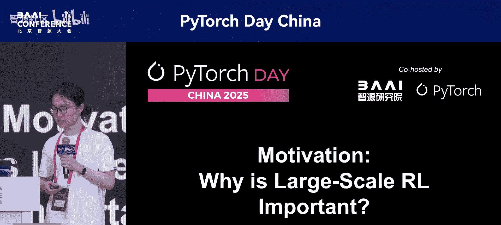

First the first thing came to our mind might be the learning to reason with large scale here。

 we show some evaluation results of models that without large scale and with scale we can see that learning to reason with large scale greatly boost performance of L Ms。

 We can see that the the GP G40s performance is is hugely behind the reasoning models train with large scale like O1 and R1 in almost every domains across math science and code such reasoning heavy tasks。

And another important important usage enabled with large scale R is the agent task that we many of us cared a lot about。

 we can see a good example for such an usage is the deep research product from open AI。

 We can we can see that they are trained on real world task requiring browser and Python to use。

 and it also enable with their R methods behind open open I O1。

 So we can see that large scale R is very important。

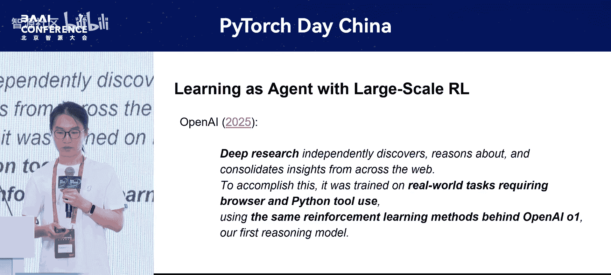

And another problem is that why is large scale are so challenging so that we have we have to develop a special framework to help us tackle this challenge。

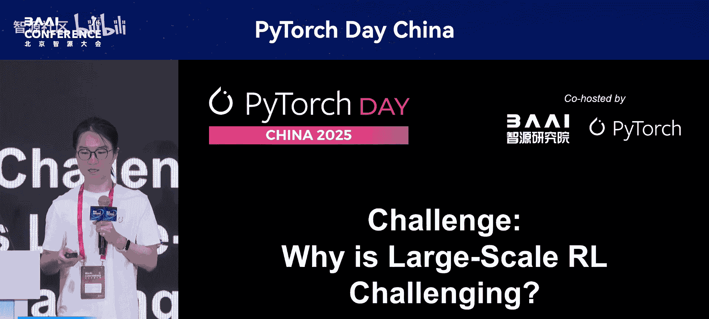

So the first point is that the RL is a complex data flow by itself。Here we show several algorithms。

 R data flow。 We can see that they are very complex。 They are consisting of multiple models。

 We can see that are on top of the figure。 there are many models across actor， critic reference。

 reward model。 So there are multiple models。 and there are multiple stages。

 We can see that all the all algorithm here include three stage like generating。

 preparing experience and training。And last， it also include multiple workloads。

 We can see that different color represents different workload like generation inference and training and optimal strategy to implant such workloads are also very different。

And and besides that， actually， another difficult point in such a work is the R LM workloads are often distributed。

 We can see in this figure it showschial L M workload it often involves many GPus and complex parallel strategies like the data parallel pipeline parallel and tensor parallel。

 And this is also the workload we are familiar with before the R L paradigm。

So combining these two points， we are focusing on RL with our I Ms。

 So they are actually large scale distributed data flow。

 Each operator in the RL data flow as shown in this figure is actually a large scale distributed computing workload itself。

So it combines the complexity of the R O data flow and the distributed workloads。

 which makes itself even， even more complex。And based on such a formulation。

 we also have to consider the constraints like the data dependencies and resource limitations like the comm computation with dependencies should execute sequentially and considering the resource limitations。

 we can see that only models in the same stage on different GPU can be paralleled and coll models on the save part of devices should execute sequentially。

 So we have to We have to consider trade offs between various constraints。

 which makes a problem very complex in in implementation and practice。

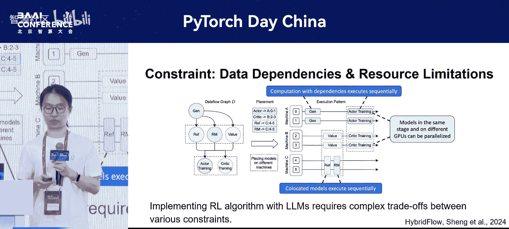

So based on such motivations， why we should choose we are for I with LL Ms。

 So the point is that we are a very flexible and efficient framework or striking a balance between the these two features。

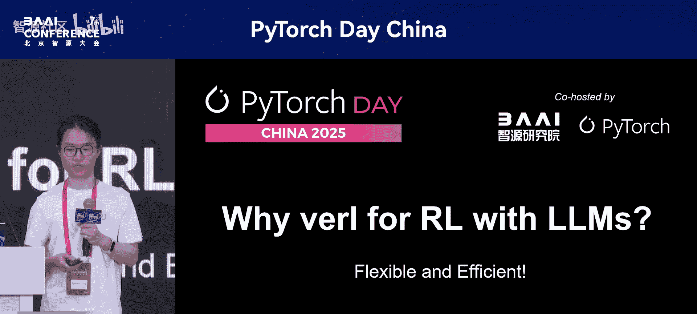

So the first pro point is that we we have flexibility in programming。

 which is based on single controller。 We can see here is the example data flow of PPO algorithm with the K regulation and actually the core logical code in our framework is actually only a few lines of code as shown in the right figure。

So this is enabled by the programming interface based on the single controller per paradigm。

Which is very different from different from the previous frameworks。 So with such a paradigm。

 we have implemented that we can describe the algorithmism core logic in a few lines of code as in this figure。

So with such support， we have supported diverse RO algorithms， including PPO， GRPO， ROO， and so on。

Emhasize that， we also achieve efficiency with a paradigm called multiple multi controllertroller。

 which makes the interop operations very efficient。

This is based on the features like the different parallel algorithm supported。

 like the parallel we mentioned before。 and also the context of sequence parallelism。

And we also support efficient kernels like flash attention to and torch compile from the Pi ecosystem。

 and also the legal kernel from like open source community。

And we also support different training back and like FSDP。 And in the newest version。

 we also embrace embraces the FSDP too。 And also， we also support the Macron backend。

 which are very complex and hard to write code with。

And we also support different generation backhands， like VLM and S G long。And besides that。

 we also achieve achieve efficiency with the feature called hybrid engine。

 which makes the inter operator data flow operations very efficient。

 it utilizing mainly two features。 The first one is the so called offloading and reloading。

 which means we between the stage。 we offload the model。

 we want use in the next stage of the of from the GPU to the CPU or even hard disk and reload and reload them when we want to use them in the future stages。

 which enables fully utilizing the GPU memory。And another important feature is is called rechararding。

 which means we between the stage。 we always restart the models to enable the optimal parallel strategy。

 For example， in this figure。 we show an example like we are changing from from stage to another stage and swaps the DP parallels to TP。

 which makes the which makes the parallel optimal for the corresponding stage。

And the last point is also very important。 Like we have a very impactful and inclusive open source community。

 So far， we are has gained like over 8。4 k stars and over 1000 folks nearly 1000 PRs and about 200 contributors。

 And we're also waiting for your participation。呃。Actually。

 many popular projects have been built on on top of V RL， including the tiny 0。

 simple R L Zoo R L M and Sky salt。 So they have also gained many stars， too。

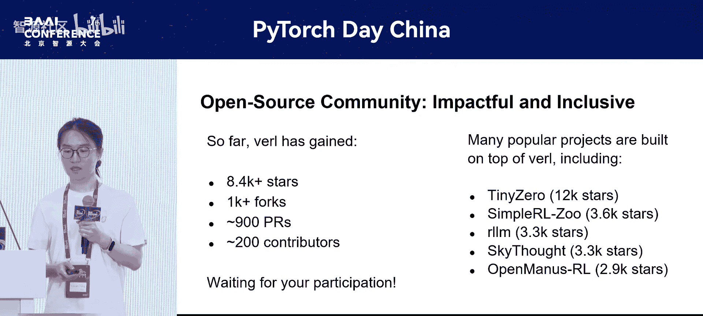

So for the next part， I think we can delve delve into a little more the paradigm behind V I the so called hybrid flow。

 which is also a paper accepted by the MC U C conference。

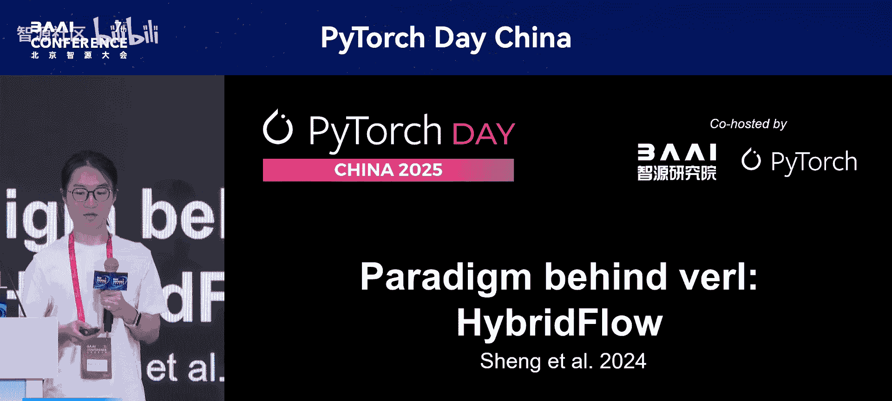

So the we， we also now want to explain the background like the so called paradigms。

 like single controller versus multi controller。So the single controller also like the MPMD paradigm。

 which is means that we have a centralized controller managing all the workers running different programs actually in such a figure。

From passs paper and another paradigm is that is called multi controllerter。 we can also call SM D。

 which means each worker has its own controller， running the same program with different data like actually in this in the right figure。

 We can see the workload in different controllers are actually very symmetric。

So we have we have a conocchial trade off like to when we implement a distributed framework。

 should we use single controller or multi controller， obviously。

 we have a different pros and cons for different paradigm， like for the single controller。

Its flexible via the centralized control， but it also introduced the communication overhead from the single centralized control。

 And on the other side for the multicontroller， iss actually efficient via the SMD communication。

 but also it makes the programming very complex because the logics are scattered in different different places。

So a problem is always existing that which paradigm should we use for a distributed framework。

 like in the RL with LIMs， so actually our answer is that we can have both so we introduce a new paradigm called hybrid controller actually in this figure like that hybrid controller is actually actually means we have a single controller controlling multiple multicontrolls。

So in the hybrid controller we can see that the single controller manage the overall data flow。

 and each operator in this data flow is can be actually scaled up as a multicontroll distributed workload。

 which achieve the flexibility of single controller and also the efficiency of multicontroller。

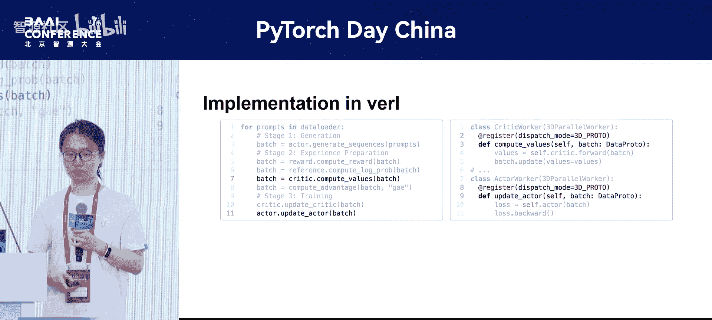

We can see the specific implementation in the VRL。each call in the single controller。

 like the C compute values or the actor update actor is an actually an RRPC to the multi controller worker worker group on the right side。

The registered the decorator shown in the right figure。

 it also actually manage the distributed data transfer。

 which also makes multi controller programming easier。

So in the right figure is the a common paradigm or we have been used to before the R paradigm。

 And in the new paradigm of R L， we introduce the new programming interface on the left side。

 which strike balance between flexibility and efficiency。

So the next part is that we are actually a framework approaching more stable agent RL。

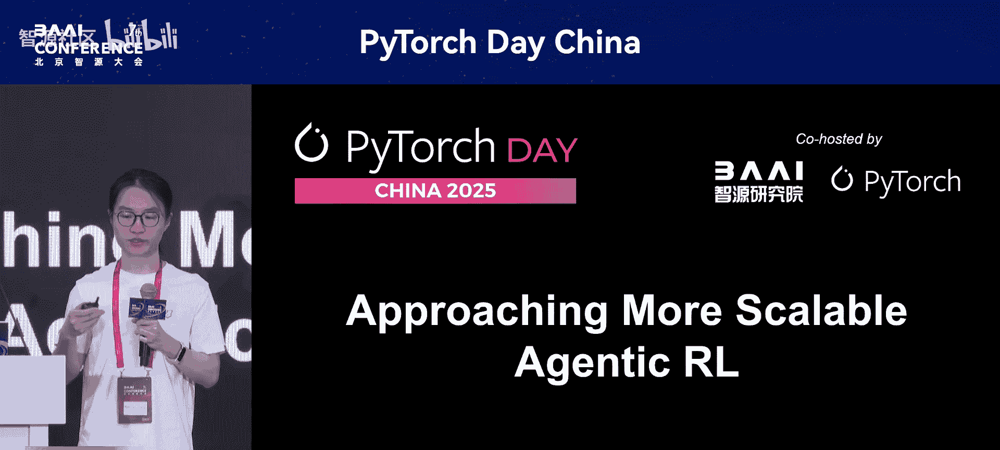

So the first point is an important feature shown in the news version of VRL。

 it is actually in exactly this morning， we have release our 0。

4 version and a version and this is one of the released features it's called a sync engine for multiter rollout it's like that if we use in the multi turn roll。

 if we use a synch engine which returns all the outputs in the batch at the same time。

 we can see in the upper figure， there are many bubbles between different terms。

Which makes the rollout very inefficient。So the one of the work round is that introducing we can introduce the synchronous engine。

 which returns each output as soon as it's ready so we can schedule the next rollout after after the previous request is over。

As shown in the lower figure， we can see that the bubbles are all disappearing。And besides that。

 we also support many basic capabilities like the multiple multi multimods。

 we can input the data with the images and video fields in the data set。

 and we also support many different multimod L Ms like the queen V L。In our， in our model back end。

 And besides that， we also have different extensible interface for tool calling like the base tool。

 which is also an important feature released in the 0。4 version。And besides that we also。

 we have also integrated sand sandbox Fusion library also from the buy downs。

And another important another important passage we are working on is integrating diverse environments and tools。

 So actually， they are mainly ongoing。 but we also have some ready features as mentioned。

 the sandbox sandbox Fusion interface and for other for other features or welcome to discuss about our contribute to is the our ongoing RFFC and we are also planning to integrate like MCP and also integrating existing environments and tools like the K R also from By or the attributetros library from North research or even other environments and tools。

 we are also welcome。

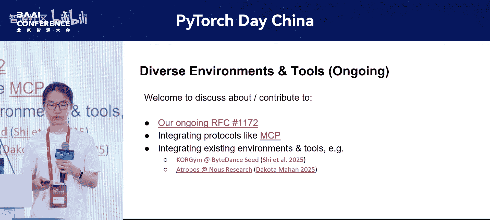

And last， we want to introduce some recent updates and road future road maps。

 And one of the most exciting feature is we have officially support efficient I with huge M O E like deep6 V 3。

😊。

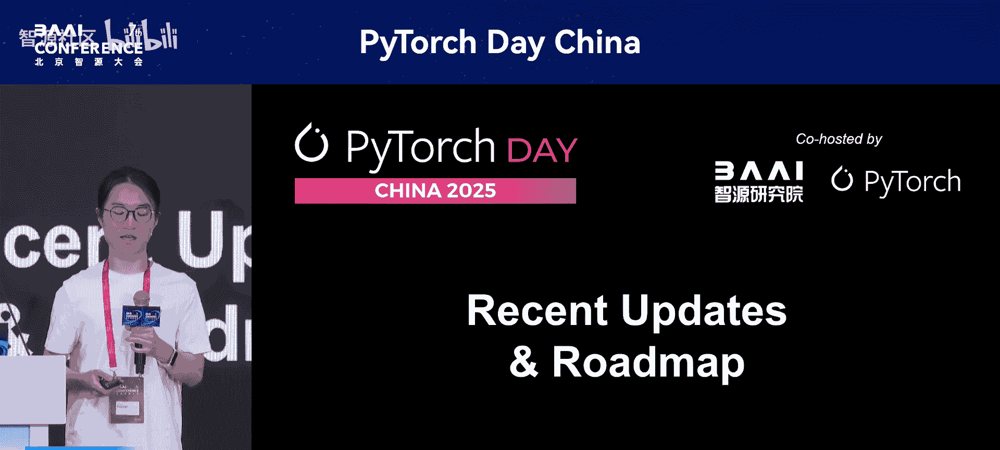

So this is also one of the most important features released in the 0。4 version。

So we have support the following features on the training side。

 we have support MOE models classes based on Macron GT model。 and for the inference side。

 we have supported the multi nodeode inference because the huge Mes cannot fit in only one thing only one node in the most。

 in most cases。And for the hybrid side， we have to connect the training and influence in our R framework。

 So we also implement the parameter shing manager for the newest Macron core version and latest version of inference engines combining the this three different features we have achieved efficient I with huge Mes。

 And besides the deep3， we also support the23 M E model。

 So welcome to try out our new feature with huge Mes after the talk。So for more details。

 where you can check our tracker or our release log for 0。4 version。

And we also have different other plans。 We are waiting for the participation from the open source community。

 like the partial rollout， which actually we have a draft PR from the Shanghai Jiao Toong University。

And we also want to implement the MP prediction， which canel accelerate the rollout stage。

And for the most timely update of important features。

 please keep an eye on the VR roadm in our resumeme file。So thanks for listening。

 So welcome to join the VR community to discuss and contribute with the amazing open source community。

 and our reposory is open fully open source on the Github。 And for further questions。

 you can resort to my email。 and we are also recruiting which you can contact with our department leader。

 Lin Haibin。😊，And here are two Q， R code for our open source community。

So here are all the contents we Im going to present today。 Thanks for listening。

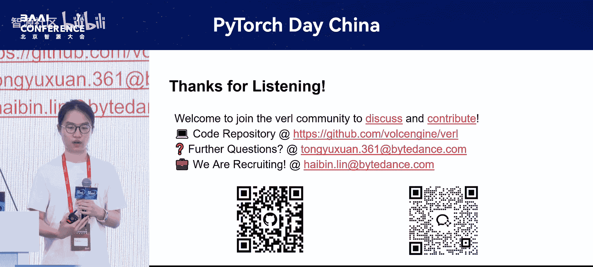

Sure you one。We have like one minute for questions if you wanted to answer any， I don't know。

 are there any questions？Will we move on。That one over here。好了。

That is also very popular from framework factory。 Could you comment for the。

 for for those guys who want to train models how to choose these training frameworks。

Could you comment on a little bit on the other frameworks doing the reinforcement learning so we can know better。

 Thank you so much。 Okay， thanks， thanks for a question。 This is very important。

 but also very tricky problem。So first for the framework you mentioned like the Lama factory R S N know。

 it mainly support the S F instead of the R。 and actually for the I。

 we have we have also very amazing and compatible framework like the open our and Nimo I from in videodia and role from the from the quantum and also the。

😊，A real from research。 And every framework has its own pros and cons。

 and it's actually very hard to say wish frameworks is absolutely better than others。

 and maybe I can just qualify。show explain some important feature that VR has supported better。

 I think the main advantage of us is mainly about two features。

 the first one is we I think we are the only only framework that supported the efficient R with huge Ms like deep V3 and Queen3 M E and another point is that we are the framework with the best open source community participation and extendtenible support from the also from the By down Sea and volcano engine team。

 So we have actually。Gered many supports from different participation。 And in in this way。

 we have the best flexibility or like availability for different features like the Laura or different hardware support like the RC M。

 which is rare across other framework。 So I think if you want to use this features we are we might be the best choice for your workload。

 And besides that， we also framework actively approaching the agent task like we are going to support better synchronous architecture support and to calling utilities in the next season。

 So you can also look look forward to our support for the agent side。

Hope I have answered your questions。Great， thank you。Okay， thanks。

