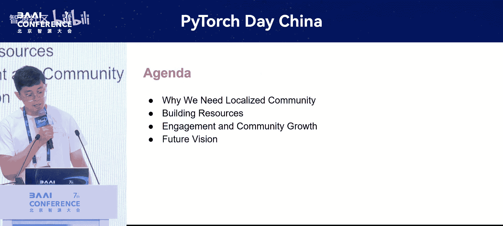
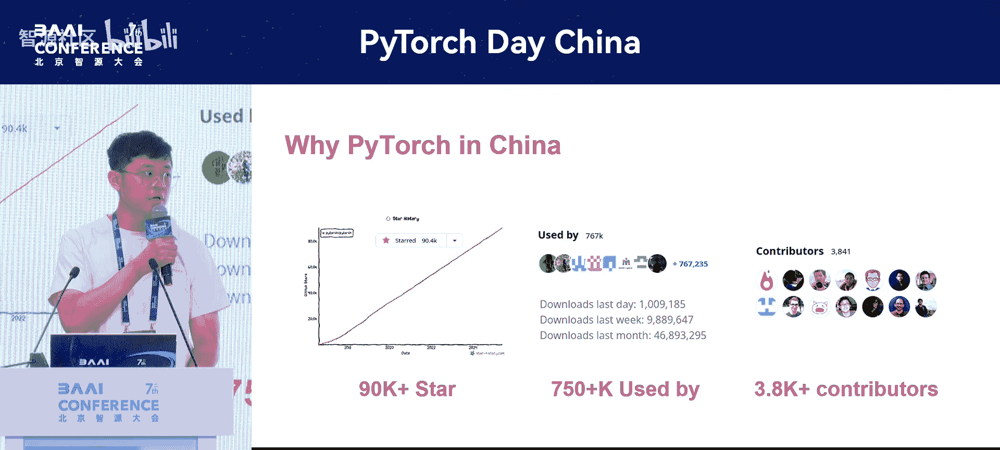
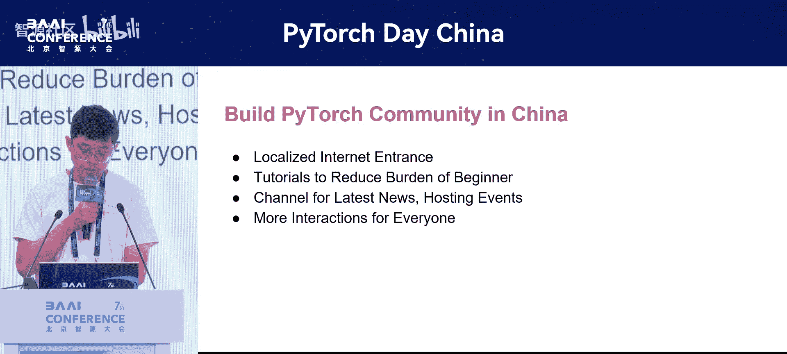
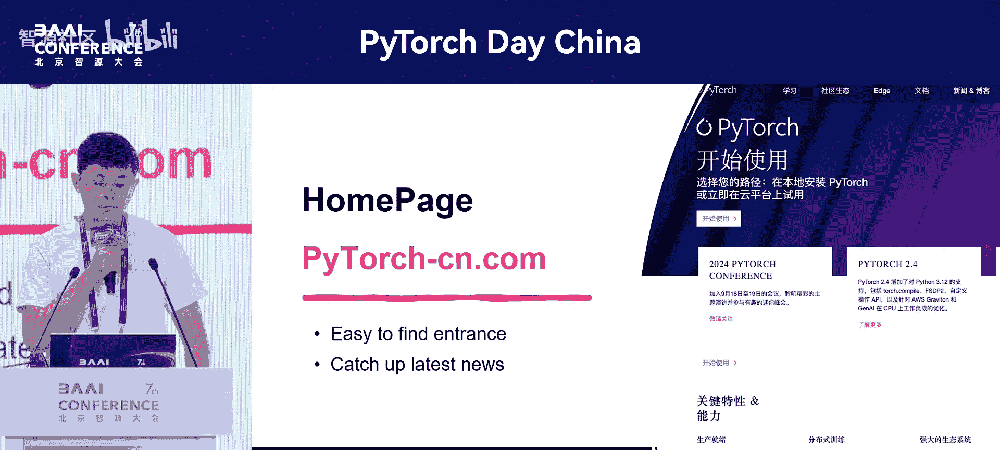
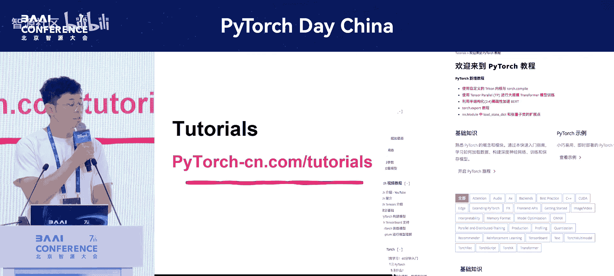
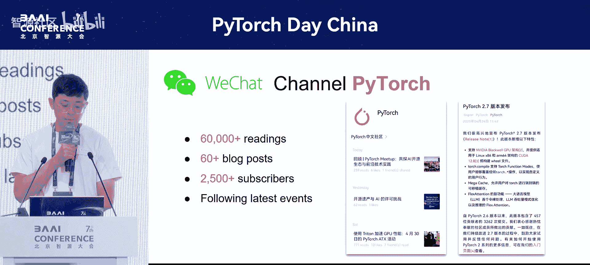
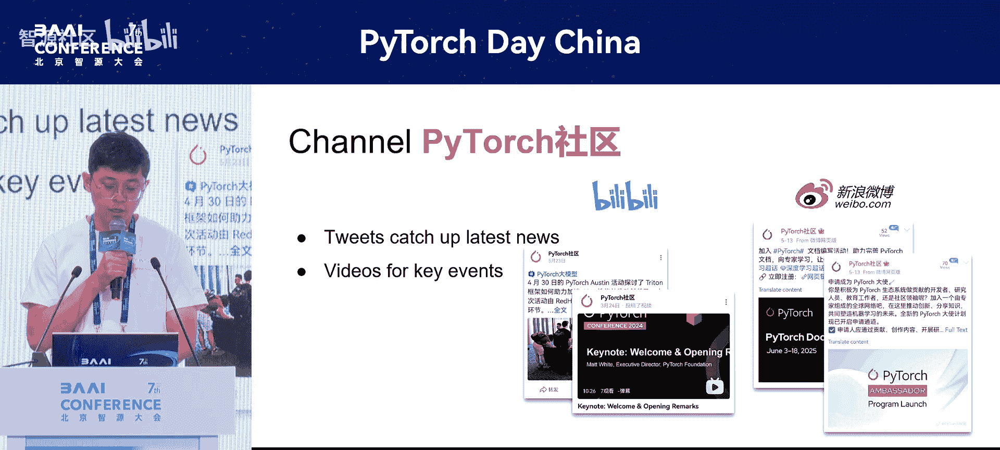
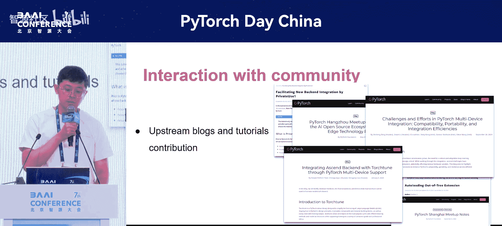
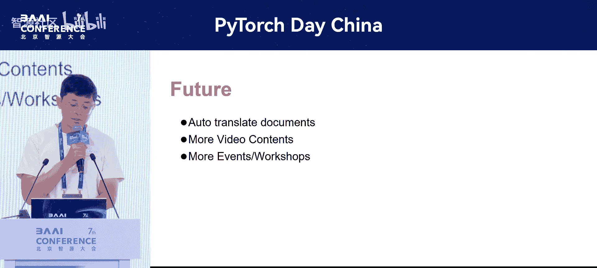

# 2025北京智源大会-PyTorch Day China p05 PyTorch in China  Community Growth, Localization, and Interaction：Zesheng Zong -BV1PPNWziED7_p5-

Alright， before we move to our next speaker， I wan to remind everybody that there are translation services here。

 So if you scan this QR code on either side of the stage， you can do a real time translation。

And so our next speaker is a song Se Sheng from Huawei， and he'll be speaking on P Torch in China。

 community growth， localization and interaction。Thank you。Hi everyone。

 I'm glad to be here to have a chance to introduce current studies and our progress and the future vision about a localized community in China。

Today's agenda search form introduce why we want to build a localized community and what current resources we can provide it for our community members and if you want to participate in how you can join us and our future vision。

So as we all know， Petorch currently has become one of the most popular AI framework in the world。

As your developer or beginner just join in the AI community。

 you probably choose Peytorrch as your tools to build your works and currently on Github it's already has over 90000 starts subscribe and。

There more importantly， has over750000 project build their own based on the pettorch。

Which indicates that there are。A great and a large active community in the world。

Because the Petorarch is keep it open and whether you are an expert or beginner in the community。

 you can find a way to make contribution to the community， so there are over 3。

80 contributors has actively may change the code in the core libraries。And based on the statistics。

 the there are large amount and groups coming from China。

 The this second of the all the location all around the world。

When I first got in touch with Peytorch， I found a big gap between a large group of users and localized materials。

If you are beginner in the AI AI area and probably overwhelmed by all the term terminology and all the tutorialtors and make you tired between the translation tools。

So the first thing we are trying to do is find a way to better make a translation and make a homeage of the community while translating all the contents from the official website and make everybody knows this is the entry point for everybody and you can find your resources and events in here。

We also translated over 80 pages tutorials from the beginner level that get started and to the medium and higher level to help users to become an user or contributor in the community。

Currently， we are trying to introduce some automatic workflow and use LIM to boost translating speed and synchronize more valuable contents and high quality tutorialtors for our users in this community。

Beyond these static resources， so we also want to actively get in touch with our users and so starts from the end of the last year。

 we start to create our Wechat channel。

And trying to get in touch with our user while posting over660。

Tecology technicalical AI blog post and currently is over 60，000 ratings and have 2。5。

000 subscribers and if you want to get in touch with the latest news and technology trends。

 they can subscribe our channels and we will post catch up with the community every week。

Beyond these contents， we also wanted to let user actively discuss about the pettorch。

 the technology they are use。 So we are open the channel in the largest actively discussed platform。

 Zhuhu in China。

Last two months currently has 15000 readings and over 50，40 blog posts。 And in last month， we first。

 have our， first live stream in Hangzhou。And if they are over。5000 views for about this meetup。

If you are focusing on the video， video content and all the events from the world。

 we currently want to transfer more meetup and conference and tutorialtor video content to our new platform on Biilibilli currently already have almost 20 posts on the video content and we get almost 2000 displays in last two weeks。

And also please subscribe our channel on send Bs， which will let you know the latest trends in the community。

Beyond these online resources will also would like to host some offline some in person meetups last year we have our meet up in Shanghai and invite senior developers come from Intel and Huawei to introduce their works regarding。

Toch compile and inductor and also a multi hardware integration in their working experience。

And this year the event even bigger， we also invite the developer come from Tenscent and the anT group to introduce their experience in more wider range AI technology like peripheral peripheral de separation and the parallel training using RA。

Beyond just the galleryway resources front the community to localize we would also to bring some feedback to the official community。

 while are trying to describe our work from our local developers and explain it and why tutorials and to the official community to light the developer worldwide and who make focus on the area to know what we have done in China。

Our next plan is to make more the translation much more automatic and be more efficient and to bring a lot more high quality resources to everybody。

 both the document and the videos and there will be more event in the next several months。

So if you are interested in all the resources， please visit our website or join our channel to leave a message and helping us to make our community better。

That's all the contents I'm sharing today。Thank you。

ing to I can't emphasize enough how hard Zing works to translate documents。

 it is not probably not very fun sometimes but we're hoping that we can help you out with that as well and if you want to get involved in the community here in China。

 please connect with Zing on the Pytorrch WeChat。Thank you， thank you。All right。

 so we've got 20 minutes to go on break。 I would， if you'd like to have a look at the posters on both sides here。

 we will start back here at 1050。Thank you。