# 2025北京智源大会-PyTorch Day China p06 The Development of AI Open Source and Its Influence on the AI Ecosystem：Jianzhon -BV1PPNWziED7_p6-

He's the senior vicece president of CSDN and chief technology expert at Bolan。

And he'll be speaking on the development of AI open source and its influence on the AI ecosystem。

So please warm warm welcome， thank you。🎼喂。好，谢谢。😊，好，那今天呢跟大家分享的主题是整个开源AI的这样一个发展和它对我们整个生态的影响啊。对我是呃下次李建忠。

然后。OK。哎，看一下。这个翻译笔好像。能帮我往下翻一页吗？或者我们工作同事直接帮我翻一下也可以。好，那我先说一下，我演讲整体会分两趴。

第一趴呢我会讲一下我们整个大模型啊啊包括我们的在开源方面的一些发展啊。第二趴呢我会谈一下，就是我们整个这个啊AI生态的影响是吧？因为那开源呢从应该说。呃，从去年到今年。

实际上大家都能感受到是一个加速发展的一个过程，对吧？那我觉得这这个反向的对生态的影响会反向影响我们整个基础设施啊。嗯。或者我们同OK哎。好，OK好，谢谢。😊，那对，那么我先退回去啊，看一下。

这一页那么这个整个大家会看到左边呢是global的一个一个一个全球的啊技术生态，开源这么一个技术生态，对吧？那么右边呢是我们中国的整个在这个呃AI呃上面构建的整个这样一个技术站啊。

这个技术站呢其实大家会发现这里边的应该说80%都是开源啊，某种程度上我觉得啊作为中国AI社区，我们也看到中国AI的开源在全球的这个分量呢越来越重要，是吧？

那么接下来我谈一下这里边啊AI发展的几个关键问题啊。

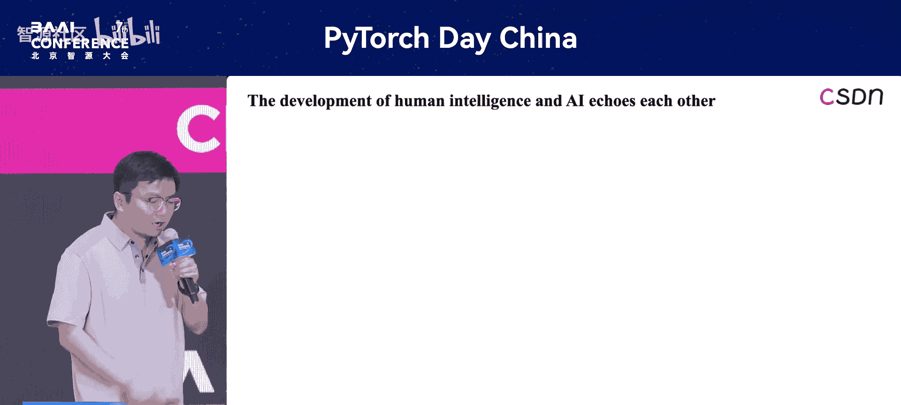

那其实这幅图呢，大家看它实际上是把呃我把这个AI的发展和人类的这个智能的发展呢做了一个对比啊，还蛮有意思的。而且这里面能看出非常有规律性的东西啊，大家看看就是整个啊人类智能。

实际上啊或或者是地球的生物智能吧，大概5亿多年前对吧？首先出现了什么？第一个生物的大脑和神经网络啊，然后呢，我们的呃1940年左右啊，就是图灵当时提出了计算机的理论模型，对吧？

后来弗诺伊曼实现了整个计算机的架构，包括当时图灵也早期的提出了神经网络的思想，对吧？大概在40年这。

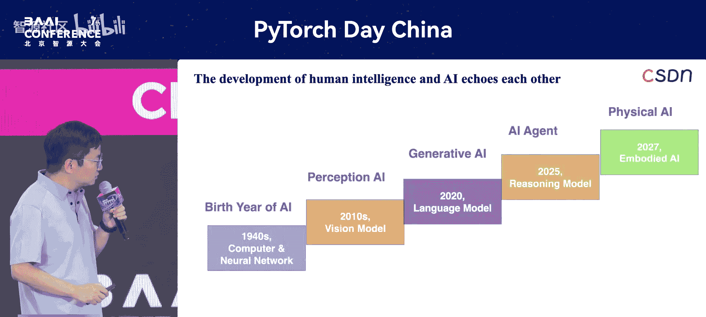

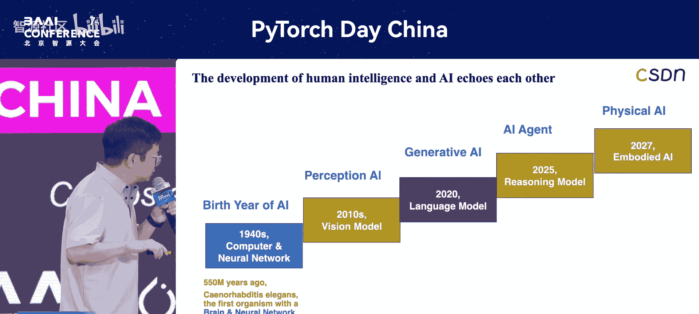

那我们说这个应该是在AI的一个一个birth year，对吧？一个诞生日啊，然后呢。我们再来看就是呃大概在2010年左右，呃大家做AI的朋友应该有印象，我们整个是以视觉为主的对吧？

就是以imagenet为为主导，对吧？引发了整个啊啊AI在视觉领域的这么一个比较大的一个发展啊，当然它还是主要是一个识别，对吧？所以我们把它称为一个perception AI对吧？

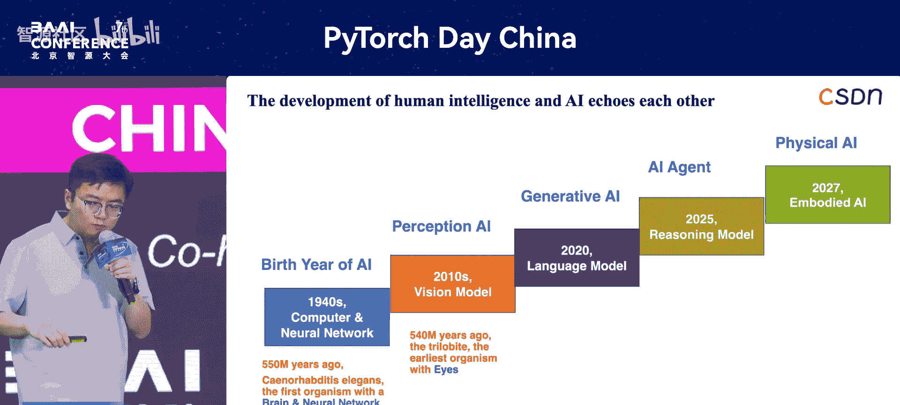

这样一个时代啊，然后呢，如果对比地球的生物呢，大概在5。4亿年前呢啊地球上呢出现了第一个有眼睛的生物啊。好，然后我们再来看。大概在55000年前对吧？

人类啊诞生了人类诞生的一个从所谓古猿、非洲古猿到到智人对吧？等等这个发展历程。人类诞生有一个很重要的一个标志啊，或者人类文明的诞生的标志，实际上就是人类发明的语言对吧？

人类和地球动物最大的一个差别就是人类有语言而动物没有对吧？然后呢，那我们看2020年啊，我们整个人工智能的一个爆点，对吧？大概这个左右时间啊，如果说以GPT1。0的话。

大概是20就是呃啊2018年如果以transformer来标志的话，是2017年对吧？如果以GPT出来的话，大概是2022年22年但any我们就说20年左右这个时间吧，就genative为对吧？

生成式AI啊有语言的模型出来了，对吧？

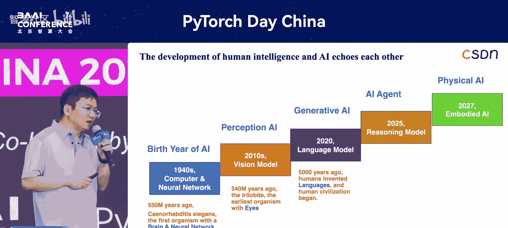

然后再往下我们看，就是大概在16世纪到呃16世呃到17世纪，整个科学革命对吧？就文艺复兴啊，然后是科学革命对吧？等等，带来了人类进入一个所谓理性的时代，对吧？

这个理性时代就是age of reason对吧？那大家看我们2025年最大的一个变化是什么呢？啊，其实当然从去年呃下半年就已经开始了，对吧？就是所谓的推理模型raason model，对吧？

那么这个带来的是一个agent的这样一个一个一个一个蓬勃的发展啊。

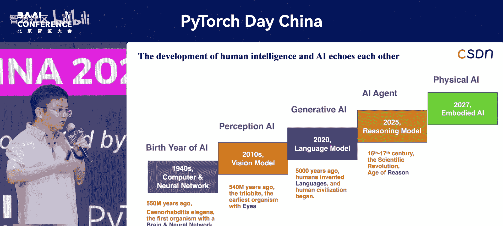

当然接下来大家普遍的预计应该是physicalAI对吧？物理AI啊，所以巨深智能这个部分啊。好，然后呢，我们呃接下来再来看一下，就是大家从地球生物的这个发展，以及我们整个这个AI的发展都发现了。

就是语言在这里边啊，是一个很重要的元素。

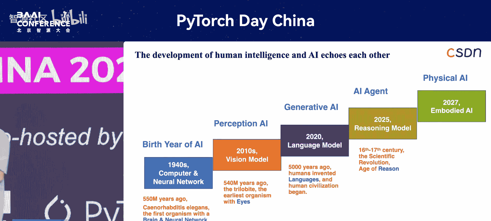

对吧在人类没有语言之前，其实人类和动物的智能能力是差不多的。人类有了语言之后，发现人类的整个智能在飞速的发展。同样啊当我们的整个AI在把大语言模型，对吧？大家知道其实open A最早在17年。

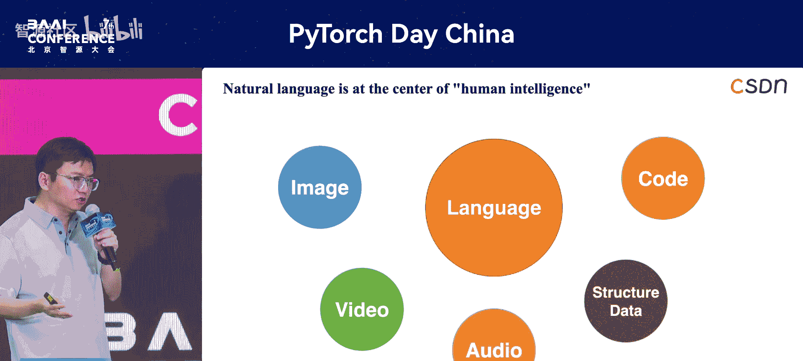

开始下注语言模型。

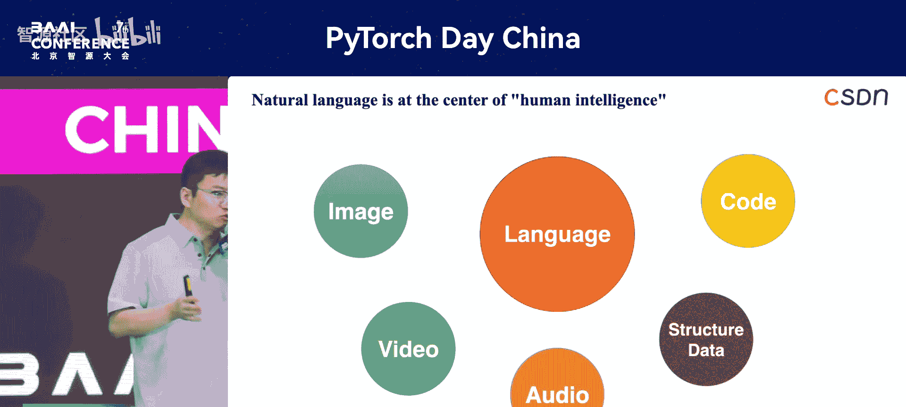

对吧走出了一条。那个时候大17年我想在座，如果做AI上都知道业界的主流都是什么，都是视觉模型，对吧？所以17年OI下注语言模型之后呢，到当然到了22年的呃出现突破，对吧？XGB出来之后。

所以语言呢在整个人类智能里边，以及在机器智能里面，其实都是一个啊，我认为是有个中心的地位啊。

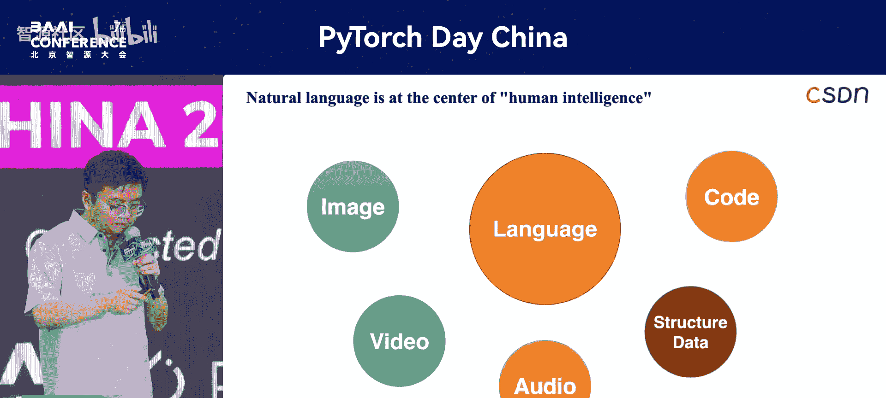

当当然这个观点未必是所有人同意的啊，他在今天仍然是不是共识啊，不是共识我这个我要承认啊，那。呃，这里边我想谈几个关于语言模型的一些，我认为是一些呃呃误区对吧？那么第一个呢大家看到就是。

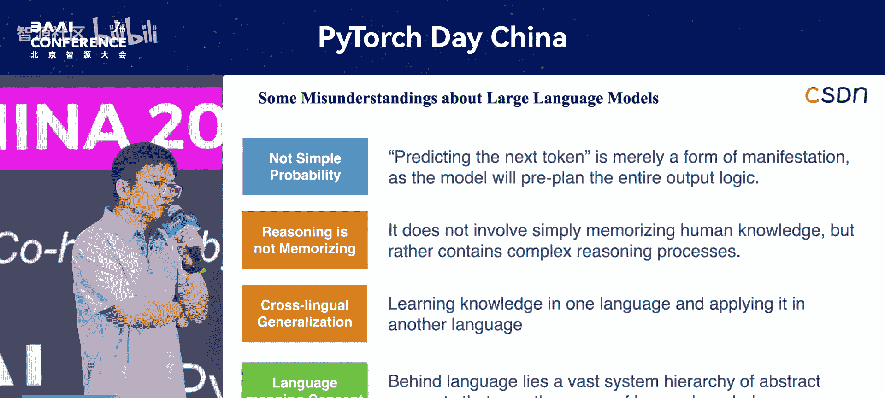

很多呃论者会认为大言模型是一个概率模型啊。我觉得如果我们深刻理解啊大言模型这几年的发展，你会看到它不是一个简单的概率模型，或者概率不是它的全部概率只是它的一个表象，对吧？就像我们人类对吧？

我们人类说话也有随机性也有概率性，但是你不能因此说人类的智能是一个概率模型，对吧？人类的智能跟但现在大言模型一样，它在 next的时候，它是有完整的规划的啊吧？

那么第二个呢就是推理呢其实也有论者最早一直在谈索大言模型是一个记忆，对吧？学习过的才会不学的没学过的就不会这个论断我觉得可能去年前年还还还非常的流行。

但是到了今年尤其去年下半年到今年整个推理模型的发展之后，大家会发现大模型推理能力已经大大提升。虽然当然我们要承认它不完美，但它的复杂。多跳的推理还是有弱点的对吧？

但是他在一些呃呃常规相对于之前没有推理模型之前已经大大发展了，对吧？就推理和记忆是两回事情，它不是一个简单的背诵啊，也不是鹦鹉学舌，对吧？还有就是我们看到大约模型天然的这种跨语言的泛化能力，对吧？

从一个一个语言里面学到的知识，它能够迅速的对吧？泛化到另外一个语言啊，这已经非常证明它不是一个简单的记忆，对吧？

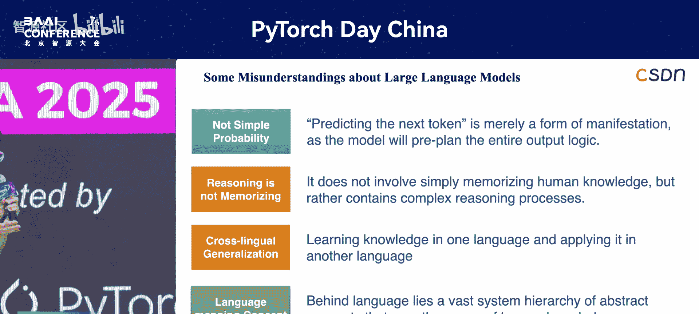

然后语言映射概念啊，这个非常需要解释一下啊，这个这个这个实际上是那个asobic在3月份出了一篇论文，对吧？就他们用了一个呃技术在在探究啊所谓模型可解释性的时候呢，探究这个大语言。

就是类似对人脑做核磁扫描一样，就大语言模型在它思维过程里面呢去扫描它哪些活动区啊做了计算，对吧？发现一个非常有意思的现象啊，比如说苹果这个这个单词对吧？在中文苹果在英文apple对吧？

在其他语言有各种各样的表示。但是呢在大语内部呢发现呢呃不管是输出中文的苹果还是英文的苹果还是法文的苹果，它不是简单找在找那个呃这个模型里面的语言区，其实呢会触及到一个共同的概念区。

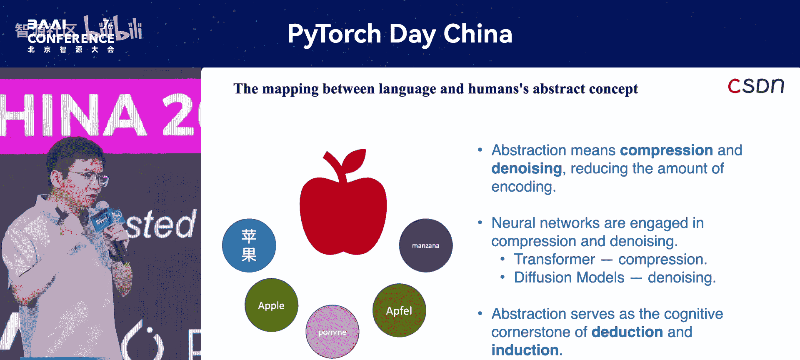

这个就很有意思了，对吧？就是中文输出苹果的时候，英文输出apple的时候都有一个共同的区域，就在大言模型的内部。这个其实跟我们人类的思维过程是非常像的。😡。

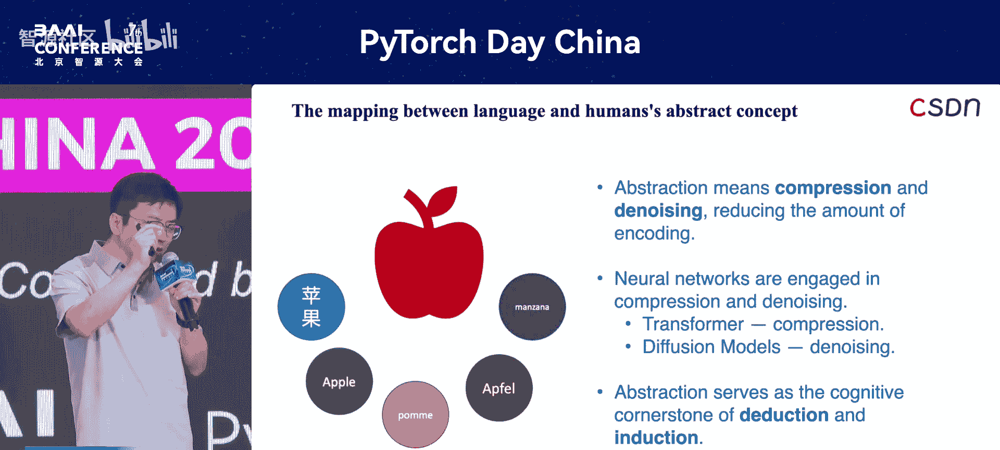

对吧我们人类其实是在语言训练的过程中建立的一个一组组concept。对吧甚至甚至呃我在那个人类的呃这个简史，对吧？

哈哈赫拉利写的这个人类简史里面讲人类相对于动物里面最牛的地方就在于我们有很大量的语言可以描述这个世界上根本不存在的那些抽象事物。对吧随便说，比如说有限公司对吧？

有限公司这个东西在世界上是不存在一个具象的事物的，它是人类通过一系列法律经济制度创建出来的一个抽象的概念啊这种概念对吧？只有在人类这个体系里面才存在。人类里里面有大量的抽象的概念。

这些概念其实在大语言模型训练过程中，对吧？通过语言它最后形成了什么？模型里面的概念区啊，我觉得 anthic这篇论文其实是被它的重要性被低估了啊，我觉得它对大语内部的这种语言和概念和智能的解释性。

我觉得是非常值得我们深入思考的啊，啊，当然我们说其实啊抽象，对吧？人类的思维的更高艺术就是抽象，对吧？抽象的本质是什么？其实我们思考的话，抽象本质实际上就是去造和压缩。😊。

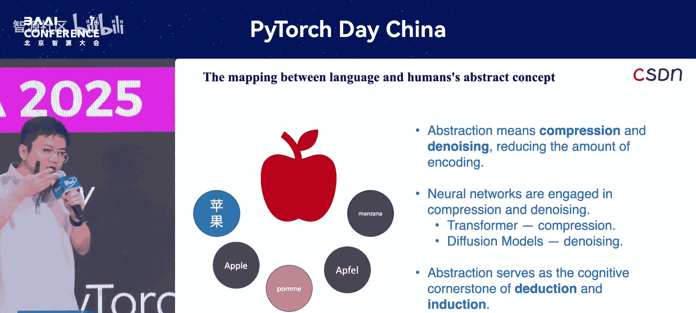

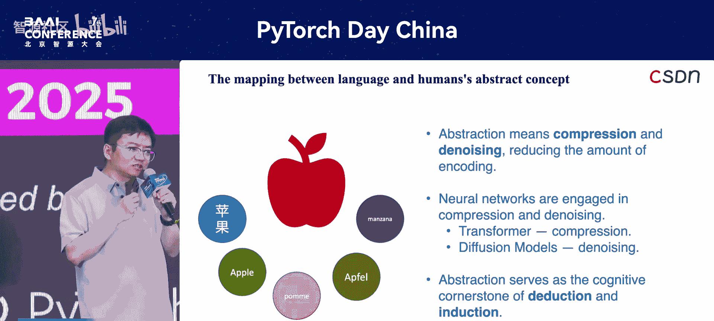

对不对？如果我们人类没有抽象，我们对这个世界的认识将是非常碎片的，非常非常隔离的。但人因为人类有了抽象，对吧？比如说我呃对汽车啊，自行车对吧？摩托车，我认为它同样都属于一个概念叫交通工具。

交通工具就是人类一个抽象。对吧人类有大量的这种抽象，而抽象的核心就是什么？就是去噪和压缩。而啊非常熟悉大模型的同学都知道我们目前的神经网络啊，两大模型对吧？呃架格transform的架构核心是什么？

核心是压缩模型，对吧？而dusion model呢核心是一个什么是一个去噪模型，对吧？它和人类的抽象思维是非常好的这个这个match在一起啊，当然我如果这个主题稍微展开的话。

抽象其实人类的这个啊所谓演绎法归纳法对吧？dduction啊inuction对吧？这些其实在神经网络络目前的计算里面都有非常好的表现啊。😊。

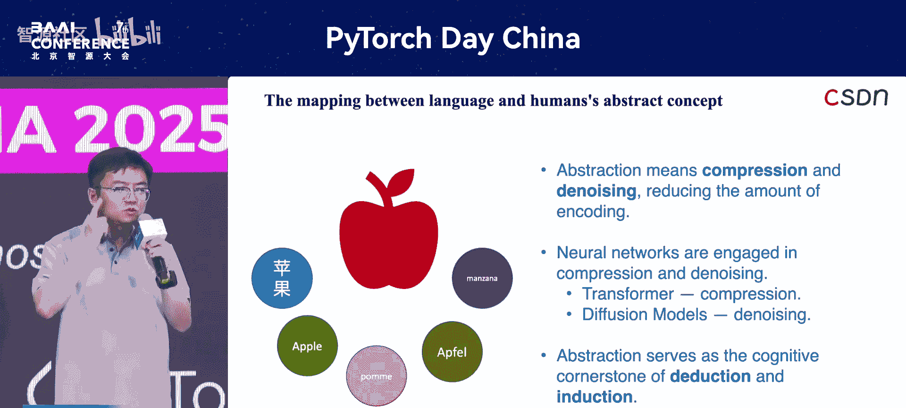

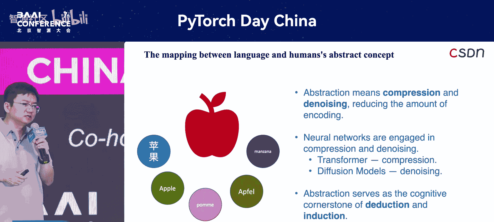

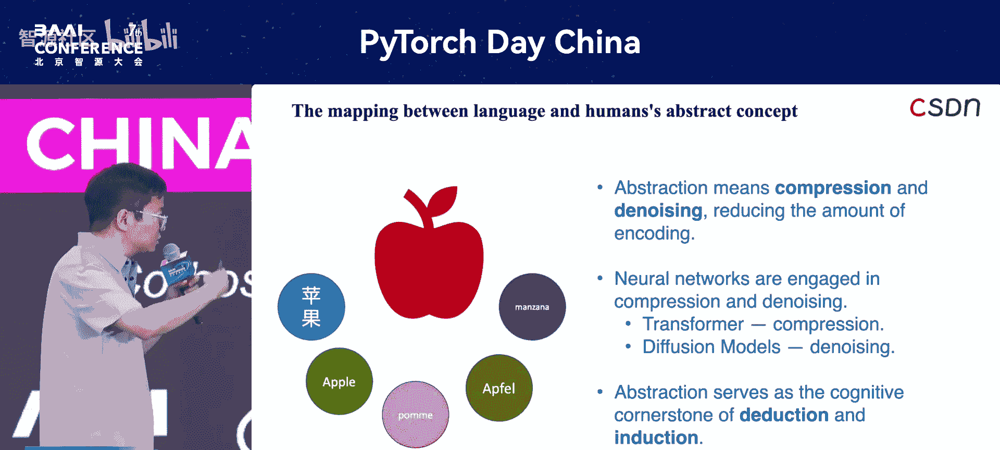

嗯。啊，那我觉得呃维特根斯坦对吧？当年也是跟图灵在剑桥对吧？大概40年左右啊，这个奇齐敏他们讨论过很多机器智能的问题啊，人类智能的问题。当然维特根斯坦是一位哲学家，对吧？啊，他有著著名的一句话叫语言。

就是思想的边界，对吧？我觉得这个呢实际上对于我们啊去理解大语言模型的智能和人类的智能是有非常深刻的一个启示的啊。😊。

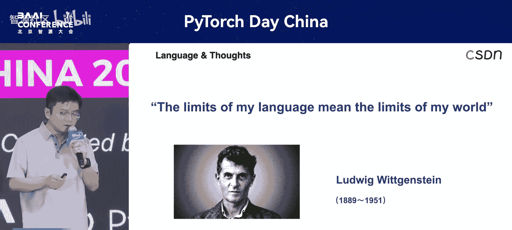

Yeah。好，接着呢我们再来看一下，就推理模型的发展，对吧？那呃我们知道在推理模型之前，其实大大语言模型主要做的是快思考，对吧？这个呃思考的快与慢啊，卡尔丹尼尔卡卡尔曼对吧？一个诺贝尔经济学家。

他这本书啊，我也建议大家读一读啊，非常有对我们理解大模型的从快思考到慢思考这样一个呃迁移，非常有帮助啊。

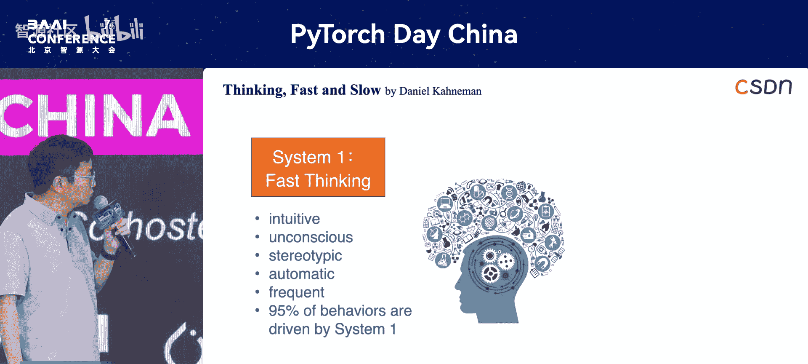

那么如果我们再来看，目前推理模型的发展，实际上是发展出来了整个大模型的这种慢思考的能力，对吧？它需要规划啊，需要需要一定的时间在推理阶段去思考啊，然后我们人类的5%的思考是由什么慢思考做的对吧？

而人类啊日常活动里面的95%的思考其实都是快思考决定的。啊，那我们再来看一下，就是从去年应该说啊9月份open i one到今年对吧？大概1月份啊deep的RY对吧？

在推理模型上对整个大语言模型的这种这种啊范式级的改变，对吧？如果我们说传统的这种以训练为主的啊，对吧？预训练加后训练的这个模型为主。它虽然当然我们说训练模型也不是说没有推理。

只是说它它依赖传统的这个训练语料里面的这种思维链数据这种推理的信号是非常微弱的对吧？为什么？因为其实大家知道思维链数据本身就是就是很难标注对吧？标注成本是极高的。

靠人类这种标注源来完成所有的人类这个思维里面的这种思维链，那是一个一个一个一个imppo的事情，对吧？但是呢我们啊呃这个在强化学习领域发展出来了是么？机器合成数据，对吧。

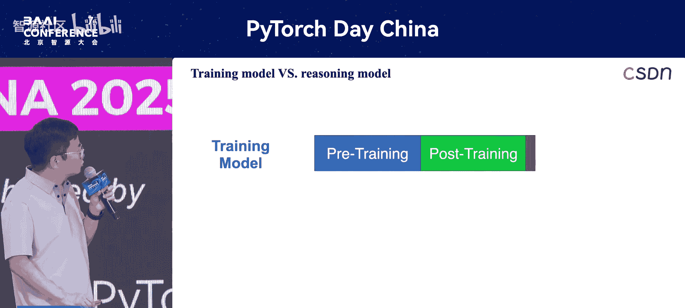

reason model在这个啊inference阶段对吧？实现了这样一个慢思考啊。

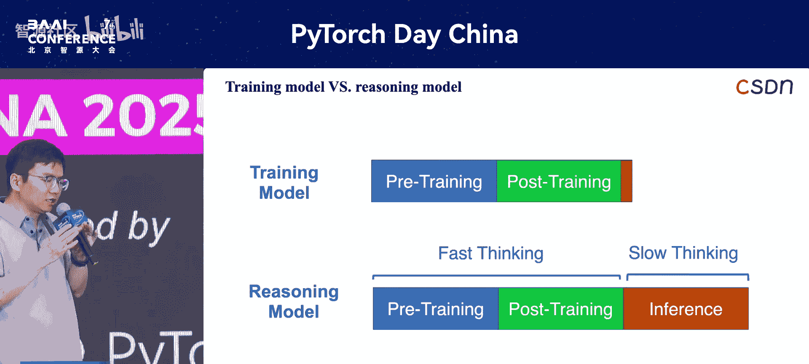

那如果简单一点映射来讲，就是其实我我们讲预训练是一个什么是一个讲知识的阶段，对吧？学习啊，那post training呢是一个对吧？讲文明的阶段，就是和人类的所律所谓的价值观法律法规去对齐的阶段。

而inence呢是什么讲道理的阶段，对吧？当一个比如说一个小孩对吧？七八岁的时候，那你可能他要讲知识，十几岁的时候，他要讲文明，但是到他二十几岁的时候，他说话就得讲道理了，对吧？就是你得有逻辑体系啊。

所以我觉得大模型的发展跟我们人类的这个智能的发展，我觉得是有非常啊异曲同工的啊。😊。

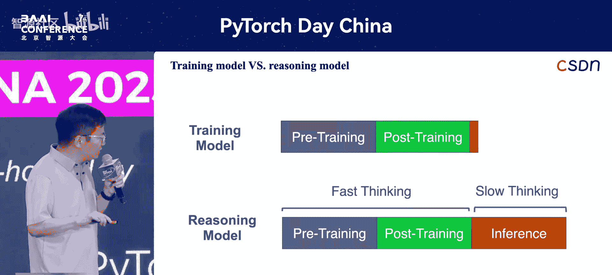

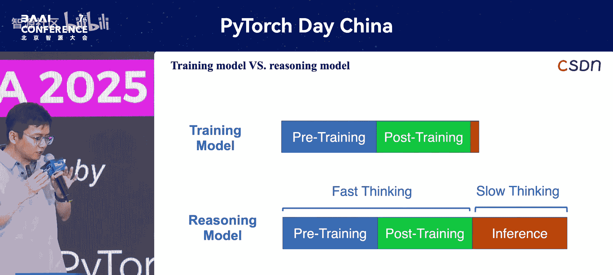

好，那这个当然就是我们啊今年对吧看到deep seek在整个引领这个推理模型的这个R one的引领推理模型的这个呃范式转换上，我觉得啊给全世界啊都带来非常大的一个一个震撼和引领的作用啊。嗯。

那其实整个大模型从啊啊这个所谓传统的这种预训练体系为主的这种模模模仿式学习，对吧？就是所谓看过的学过的才知道怎么做，对吧？到这种啊所谓实验性的对吧？啊经验性的学习啊，所谓经验性的学习。

这个经验需要解释一下，其实这个昨天那个强化学习之付对吧？re certain对吧？他讲的这个演讲里面其实解释了一个问题啊，就是啊，所谓啊er of experience对？

当然这个经验指的不是人类的经验，这个经验指的是什么？指的是通过强化学习来机器探索的这种经验数据啊，机器经验数据啊。

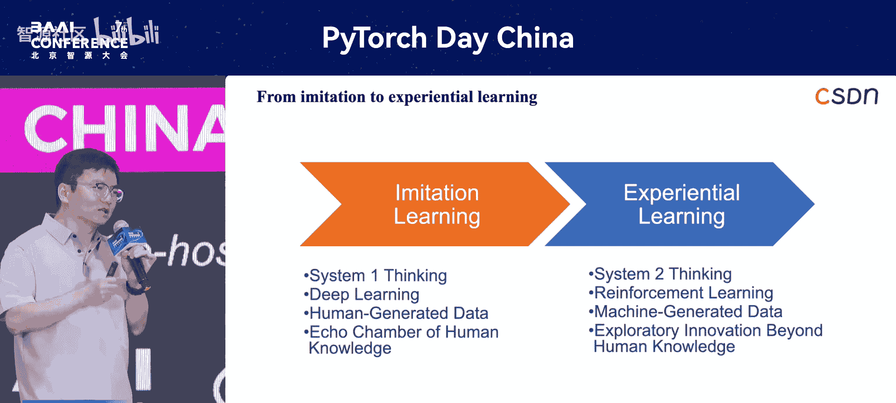

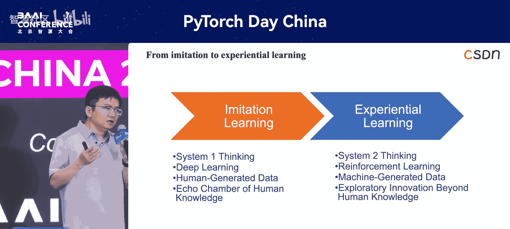

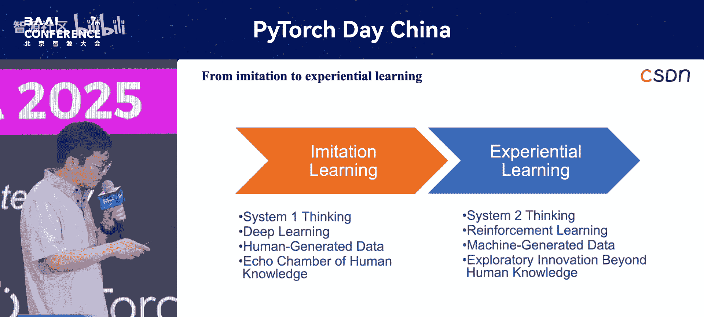

哦。那s law这个确实去年应该说在去年大概5月份在这个时间，56月份的时候，其实业界都有一种质疑啊，怀疑论者说s law是不是停止了，对吧？呃呃，当然就是我们说s law的停止其实。

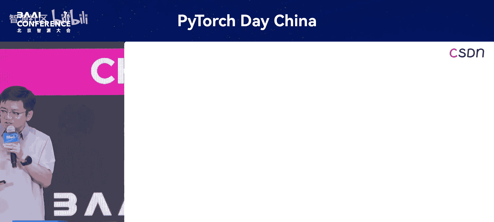

呃，表象是去年那个阶段是停止了。但是但是我们如果仔仔细发掘原因，实际上是什么？是预训练阶段的数据啊，公益领域的数据基本快被耗光了。啊，换句话说，screen law没有失效。

但s law的前提条件啊发生了一个一个一个阻塞，对吧？数据被几乎被耗光了啊吧？那。如果我们再来看，就是今年大家又这个这个就彻底改变了，对吧？基本上应该说从去年9月份 one之后对吧？到今年的这吧？

23年呢我在硅谷这伯克利的个克利的一个论坛上个mit上碰到了这个啊当时我不知道他做什么，道他是在用机学习在研究德扑的扑克啊这个领域非常著名啊。

当时他在open后来呢去年大家知道9月份他们推出了 one的主导者就是啊我23年伯克利的论坛上他讲了一句话，就是说这个让让这个机器思考吧？多思考一点啊这个性能对吧上1万倍的增长啊，当时大家都觉得是吗？

当时我也有一些怀疑啊但是呢我们从去年到今年整个推理模型的发展发现他的推理上的性能个这个所谓推理时的这种计算你给他一定的时间。

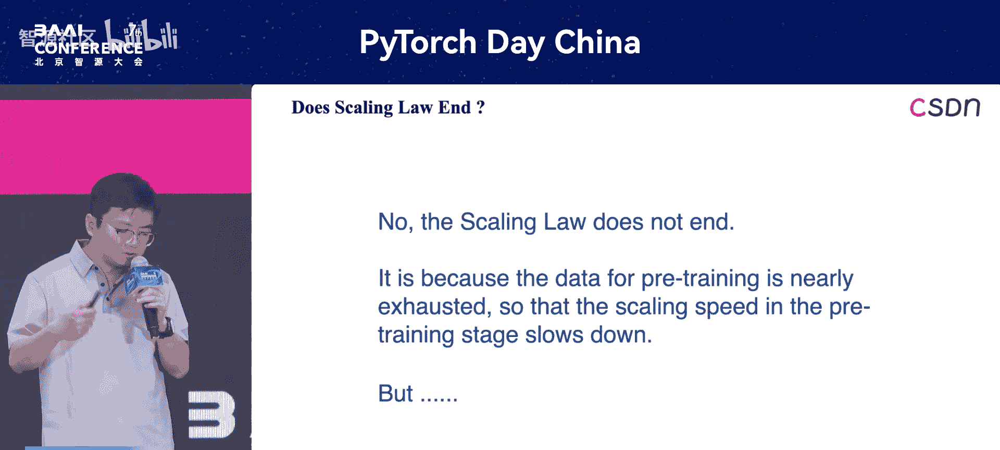

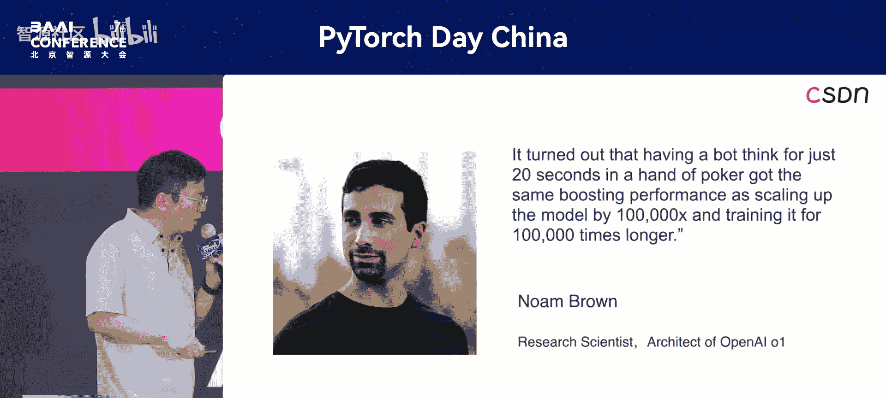

对吧啊比如说最近这个cloud的这个模型啊，能做到七八个小时的思考，对吧？对，非常复杂的任务啊，想想我们人类对吧？哪怕爱因斯坦想相对论也得花好几年，对吧？未来可能在科研领域需要更长周期的对吧？

可能是数呃数数月甚至数年的这种思考时间，对吧？😊，这个当然就是推力模式和我们传统的这种训练模式啊，非常不一样的地方啊。所以呢skin law我们来看一下，其实呃我们说去年呃这个89月份之前。

大家一般说skin law指的是print train阶段的预训练阶段skin law好像停止了。但是我想说的就是说它停止是因为它的一个条件，就数据被耗光了，是吧？

但是呢我们的post train阶段的s law对吧？机器合成数据对吧？到我们test time的这个s law其实又蓬勃的发展出来了，对吧？这个当然就非常依赖于强化学习，对吧？

这个也要非常这个这个感谢我们这个强化学习支付，对吧？昨天在支源大会上有一个非常精彩的演讲啊。😊。

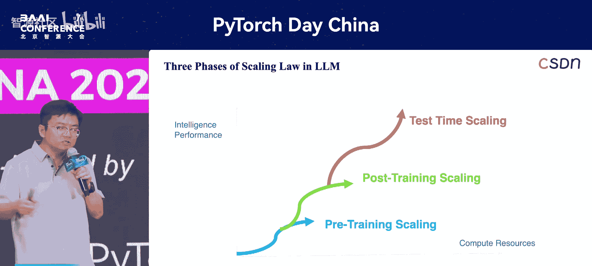

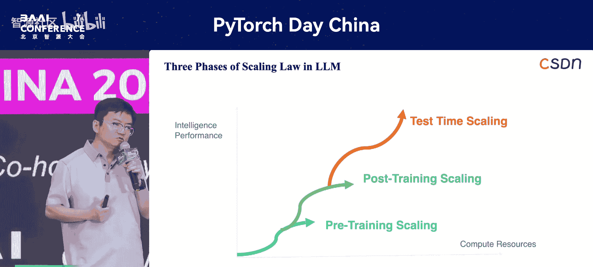

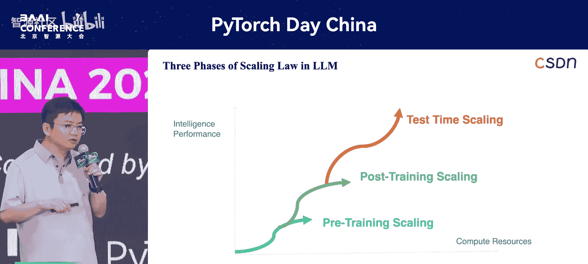

呃2。好，然后呢呃接下来呢我想谈谈生态的影响，对吧？前面主要谈的我们的语言模型，推役模型，整个这个发展的几个关键点啊，接下来我们来谈就是对生态的影响。我觉得呢呃开源。

尤其是今年的这个deam seek呢。

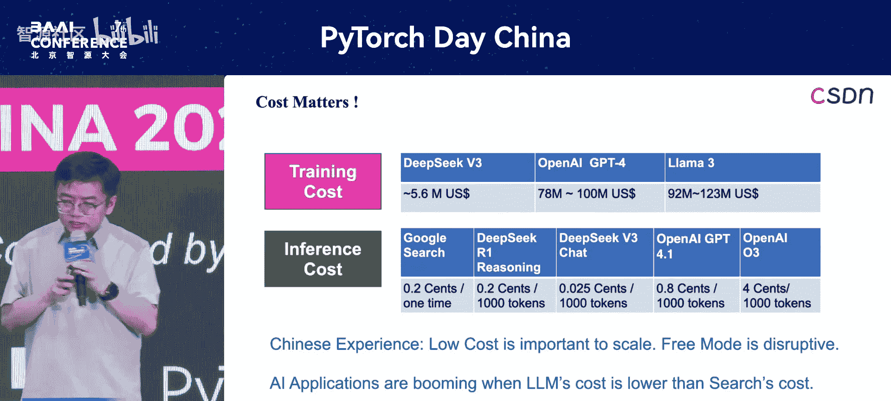

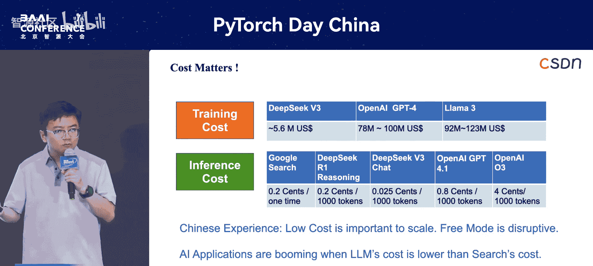

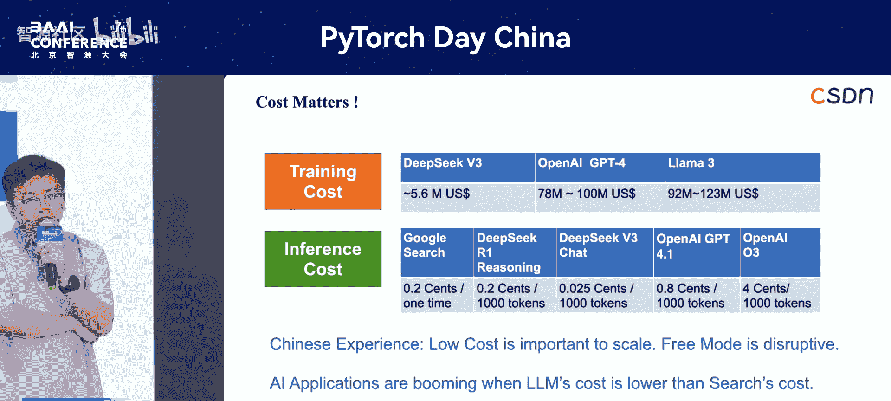

把整个这个模型啊从训练测到这个推理测的cos都都是数十倍的在下降。对吧其实我呃我23年呃4月份在硅谷的时候呢，当时跟google的一些朋友聊，当时其实外界都在指责google对吧？

就说HGP已经很厉害了，对吧？2年底推出来23年那个时候大家都很焦虑，但是我跟google当时一些人聊，他们谈起他们不焦虑，为什么？当时google的朋友告诉我说他们一算账，他们早都算过。

因为transform也是在在google内部发明的对吧？啊，他们之所以述枝高阁，就他们内部有算过账。如果用这种生成式AI来做google的 search的话啊。

google当年是那年是大概盈利400亿多美金吧，就2222年的盈利，他他们算过账之后，他们要亏损几千亿美金，就成本负担不起。😊。

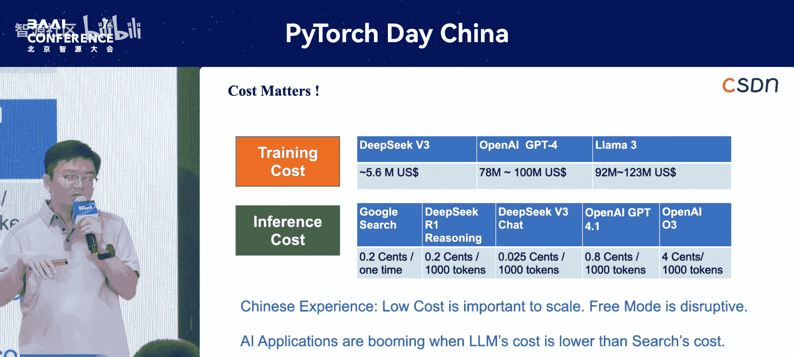

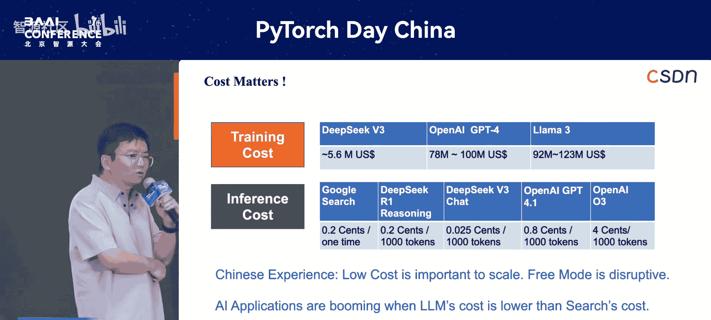

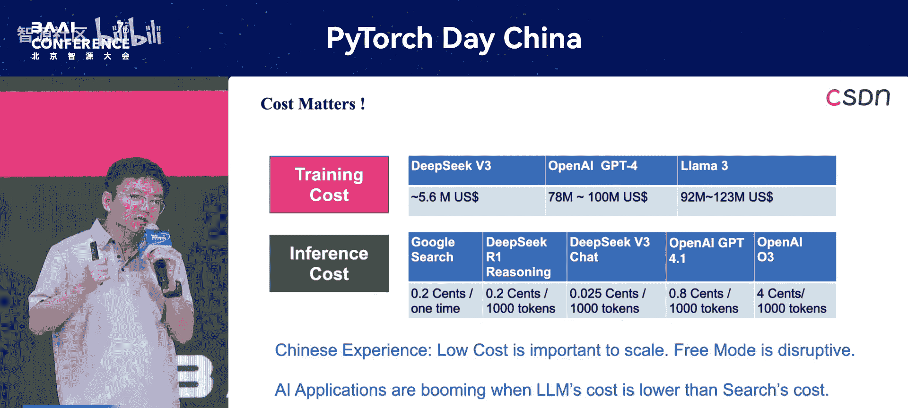

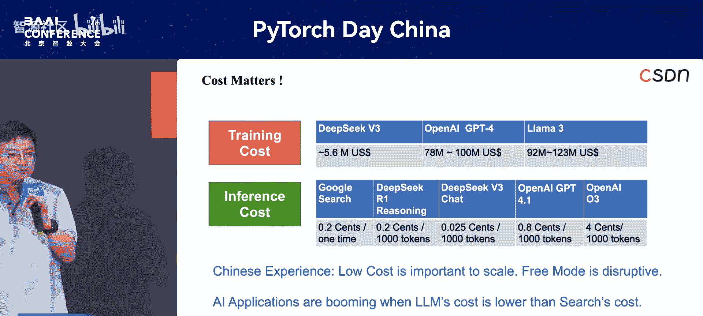

对吧但是啊整个这个业界的成本大家看发发生有多快。因为那个时候一次生成要比一次查询的成本高数百倍，对吧？但是今天大家如果看de seek的这个R one和V3的话啊，当然R也很快出来了。

估计成本还会再再降，对吧？这个成本其实已经比搜索还要低了。啊，我今年3月份在我们那个deep1日谈里面就谈到这个这一点很多VC过来跟跟我聊啊，就是这是一个 point对吧？就是以前整个这个价格对吧？

没有没有低下来，一直比搜索高啊，当然它就没法爆发，对吧？当它的整个搜索整个价格对吧？生生成一次的价格啊，我这里面时间关系我就不不去呃仔细推导这个公司了。

大家可以拍下这张照片就能看到整个价格是低于搜索的啊，或者等于或者低于搜索啊，这是绝对一个对吧？它会带来整个生态应用级的繁荣，我觉得这个意义其实跟当年大家知道小米推出1999的这个安卓机对吧？

虽然iphone当时也很厉害。但是呢当时整个中国的应用生态对吧都没有起来移动应用生态都没有起来大概那个时间点就在于2002011年2010年到11年之后，大家。😊。

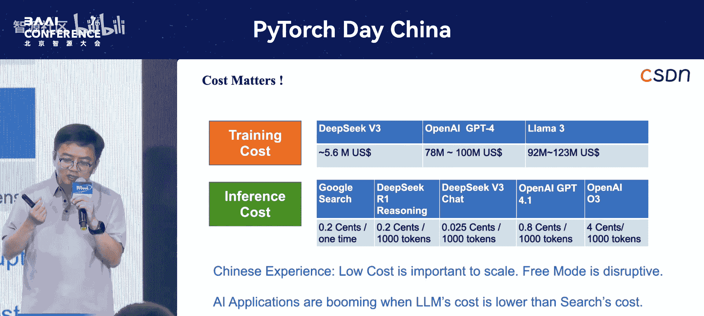

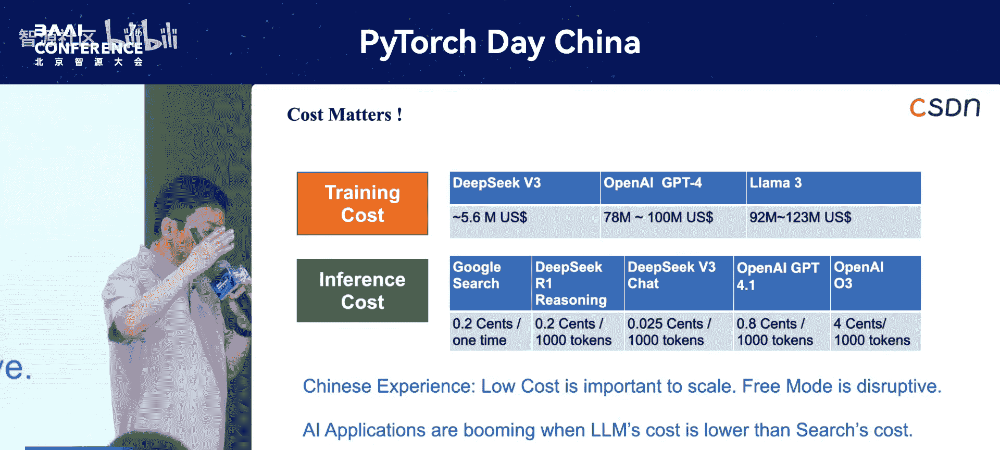

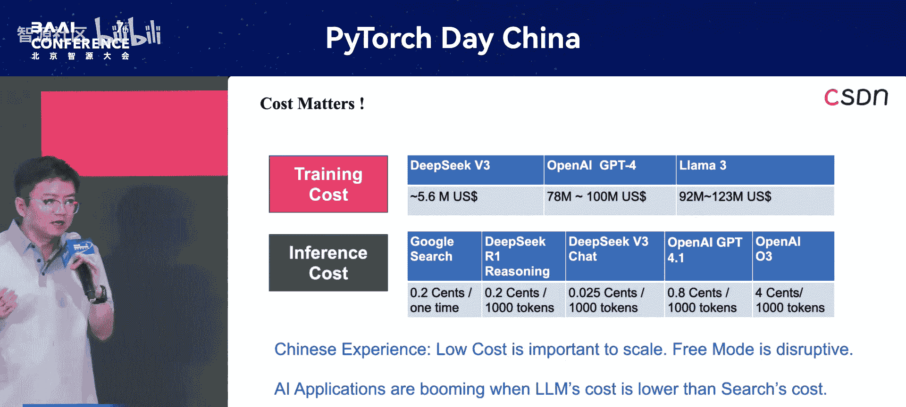

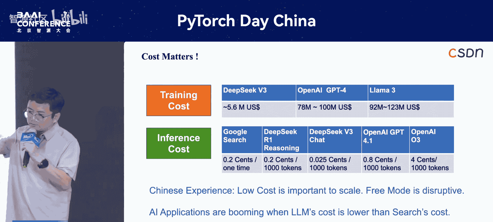

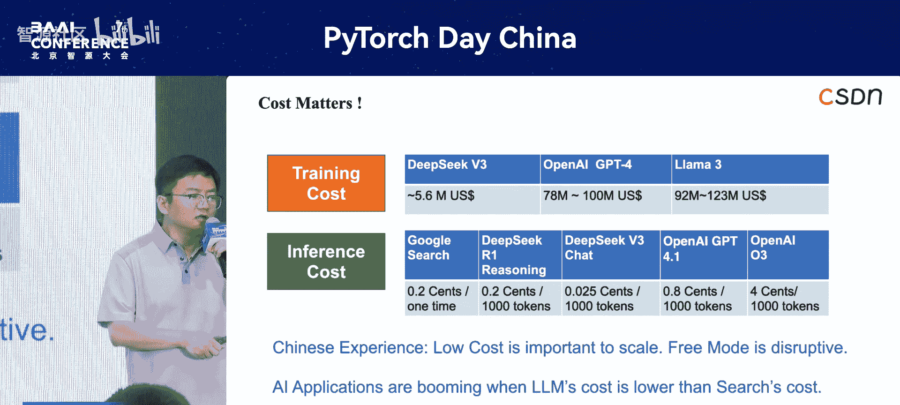

才看到整个移动互联网才爆发，对吧？一样的，我觉得就是de seek其实整个带来的生态级的就是价格把它成本打到搜索一下啊，给整个这个呃生态AI生态带来一个非常大的供给啊。

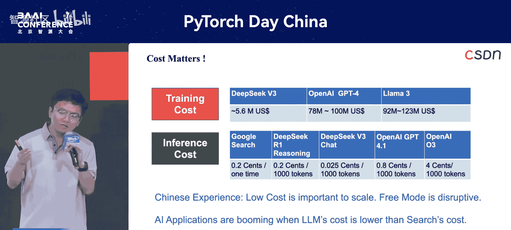

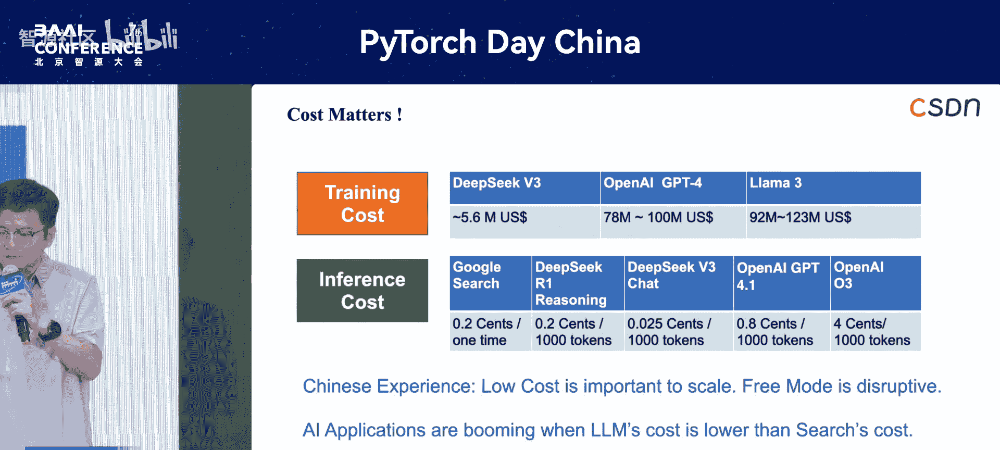

🤧嗯。啊，那么啊我们的生态会演变成什么样子，对吧？这个前几个时代对吧？PC时代桌面的软件，对吧？互联网时代是一个啊网页的时代，对吧？到了移动时代是APP的一个一个一个应用形态。那在AI时代。

我们的应用形态是什么？呃，当然去年在9月份我们呃在北京举办的这个产品经理大会，我当时演讲讲AIagent的时候，很多人还不信，我觉得今年可能这个共识已经非常强了，对吧？今年我觉得大家都很清楚。

就是AI的整个应用形态就是agent啊，就是智能体啊。😊。

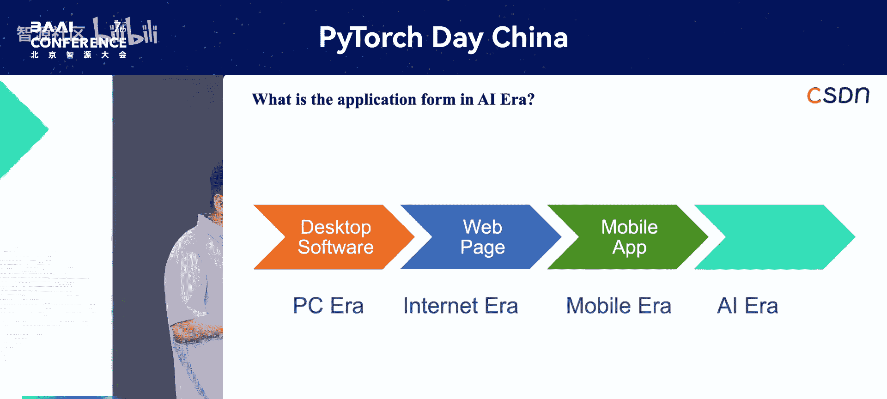

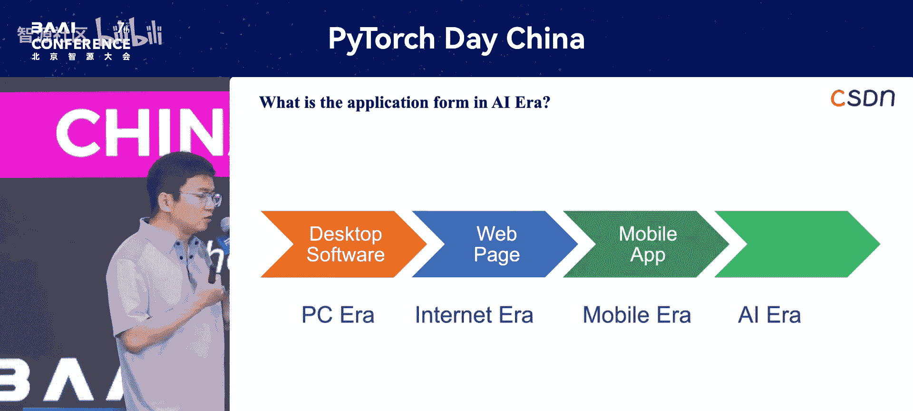

好，那我们快速来说一下智能体啊。智能体呢其实这么五大能力，对吧？这个最早是在那个open eye对吧？啊，当时是维维你。

然后呃他给出了这个啊五大的这个能力定义，是吧啊。我觉得这五大能力我们对应一下啊对应一下目前的技术呃技术的发展，对吧？planning核心就是什么啊啊，推理能力对吧？啊呃。

为什么今年agent呃能快速发展，很大程度上依赖于什么？就是前面讲的推理模型上来了，对吧？😡，啊，所以re来对应它的这个规划能力。然to呢啊我想讲就是我们传统的所有的这种啊结构化计算时代的工具，对吧？

什么叫结构化计算？简单一句话啊，就是用诺伊曼体系基于CPU的非非神经网络式的计算，对吧？就是我们传统的这种这种种软件，传统的APP传统的web service都是结构化计算啊。

或者冯诺伊曼体系底下的这种结构化计算，对吧？这些结构化计算，未来呢呃它会变成agent的下游工具，啊？就未来他们不会被人类调用，他们会被agent调用，对吧？去年讲这个的时候。

去年9月份产品经理他会讲这个时候，很多人还觉得是吗？今年大家看到像min啊，对吧？包括最近cloud啊，还有微软推的很多很多的这种对吧？agent都能看到对吧？传统的工具都逐步的下游化。

下游怎么和上游的agent连接呢，就是靠的是什么SMCP这个协议。

是吧是吧最近很火的model啊对吧啊context protocol是吧？所以MCP连接了agent和传统的结构化计算带来的那些工具啊啊，为什么说他们会被下游化，而agent会上游化呢？

原因就是大模型带来的整个什么交互范式，对吧？就是人类跟未来跟大模型的实际上是啊用这种自然语言对话是更方便，也也用也用最简单的语言能表达最复杂的需求啊。呃，然后还有一块呢就是协作对吧？

colboration对吧？协作呢需要什么agent和agent单一一个agent未必能完成很复杂的任务。就像我们单一一个人在牛对吧？你你也造不出原子弹呀，对吧？造一个原子弹需要几千人上万人的协同协作。

对吧？人类的这种协作组织是非常庞大的啊，那么我们现在的agent协作基本上是在停留在几个agent的水平，大概几个到十几个吧，最多了，对吧？上百个的agent今天还没有看到啊，他的协作是非常复杂的。

对吧？当然我们知道人类的协作本来就很复杂，对吧？人类从最早的作坊几个人对吧？后来发明了有限公司对吧？包括到啊国家国家是也是人类的一种协作方式，对吧？甚至我们说宗教对吧？也是人类的一种协作方式。

就未来复杂agent的协作对吧？啊，上百个上千个甚至甚至上上万上亿的这种agent的协作怎么协作啊这里面其实有大量的机会和大量的机制。😊。

是需要设计是吧？甚至有些需要一些市场化的机制，对吧？简单说我们知道在公司里边，你凭什么让员工干活啊，对吧？如果没有给他发钱，这个员工是不听你的未来的Aent也不是说你告这个ent帮你干活。

他就帮你干活对吧？你给我什么样的机制给我什激励来来让我干活吧？所以ent然用自然语命令它是可以的但是你没有机制这个是不听你话的对吧？还有memory对吧？memory应该说在今年是非常已经有所突破。

只是目前业界还没有达成共识，很多不同的比如他T现在也推出了长期的这种功能，对吧？微软也有自己的方案啊等等但是这里边呢现在还没有没有标准化对吧？

各家模型还都在做自己的一包括google也有些方案的我觉业界普遍的预计到今年年底就长周期的长期的memory大型的这个能力建设是是会成为一个事实上的一个一个业界标准啊，我觉。😊。

这一点呢也是特别值得我们关注的对吧？模型没有记忆能力，这个太痛苦了，对吧？啊，或者简单的传统那种rg，那些的记忆，实际上是替代不了这种长周期的这种内化的记忆的。😡，啊，然后最后一个就是action是吧？

就是有了这些之后啊，他就能行动了啊，那action我想说一下。

嗯。这幅图啊，大家看就是我们最早啊先看成色部分啊，在在我们结构化时代啊，吧诺伊曼的整个计算体系结构里面，大然我们叫这个retrive model检索模式对吧？

其实我们做的所有的什么CIMERP什么电子商务什么其实本质上都是干了三件事，什么信息的存取查找计算就这三件事对吧？就这就是所谓的检索模式啊啊，我们的整个数字化时代是干的是这个事，对吧？

然后到了我们的生成式的模型呢是什么啊学习预测创创造对吧？这是所谓的啊生成式的模式genative model啊？那agent呢给我们带来的是什么啊，我这里叫做什么action mode啊，行动模式啊。

他将做的什么planrate execute对吧？啊规划协作执行吧所以它是个行动模式。😊。

那我觉得呢呃去年9月份也是在我们产品营业大会上当时提了一个概念，叫我觉得就是说呃我们整个互联网传统的互联网，我们构建的是个信息网络，对吧？是人类去互联网上获取信息然后呢我们在人类呢去做什么做规划。

做做做决策啊，然后人类来去行动啊，对吧？人类最后得到结果啊，所以互联网给我们提供的只是一个信息的啊这样一个reference的作用对吧？但是有了agent就不一样了，对吧？

大家看到我们人在在agent的网络底下呢，我们人类呢是pro我的需求，对吧？然后呢，agent去做plan啊，然后agent来去take actionction啊，去行动，最后人类得到结果。

以agent在中间啊做了两步，一个是plan，一个是action对吧？所以我我讲就是整个agent会把我们传统的互联网从信息网络把它演变成什么转变成一个行动网络啊，未来的互联网不是人去跟他们打交道。😊。

而是什么？而是agent去打家的。其实大家看minors也好，还有包括最近的这个呃呃这个呃open air推的对吧？还有微软呃推的，包括微软的build大会。

谷歌的IO大会纷纷推出了自己的在互联网上的agent的产品，对吧？这些agent的产品，你都能看到互他们在在啊模拟人类的浏览动作，模拟人类的购物动作，模拟人类的这种各种各样的什么这种创建数据库的动作。

对吧？都是一个什么action的这样一个一个网络啊，去年9月份谈这个概念呢，很多同学还觉得哎。😊，就好像是是这回事嘛，但今年我想对吧？大家看到这些比较创新的产品出来之后。

就就已经验证了啊我整个互联网会从信息网络到这个行动网的一个演化嗯。

那。open source对吧？我觉得对我们整个生态还有一个就是我们刚才讲的偏应用层的比较多。其实生态里面还有一个底层对吧？或者或者计算层或者infer层，对吧？

底层呢其实大家看到以deep seek为代表，在在inference层对吧？推理侧大家看到成本巨降，对吧？降的也很厉害对吧。嗯。

那么而且大家知道传统的英伟达在推力测实际上呃训练测的优势要远大于远高于在推理测优势，对？训练测优势确实英伟达是遥遥领先的对吧？可能其他厂商大概十分对吧？英伟达可能90分。

但在推理测其实我们有很多元的选择，对吧？那么像这个升腾啊AWS的方案，google的TPU啊等等对吧？啊，国内当然像包括摩尔现上等等，很多公司都有各种各样的方案。

这些方案其实相对于英伟达可能稍微落后一点，但也没落后没那么那么那么多，而且在有一些特定场场景里面，甚至还能稍微呃有一些些微领先，对吧？所以推理测其实对整个以前以预训练为主的这种算力版图啊。

就是整个这样一个一个开源对吧？方案啊，会对以预训练的为为主的这种算力版图进行一个结构的结构性的一个一个范式的变化啊，所以我觉得这里也会迎来很多很多这种算力。呃厂商的利好啊。

这也是年初那个英维达当时的股价为什么下跌，对吧？好，呃时间差不多啊。最后呢我呃在讲座里面多次提到我们产品经理大会啊，虽然顺便做个广告。我们今年呢啊在8月份15号的16号啊，在这个亮马桥的威斯汀酒店啊。

有我们这个全球产品经理大会。呃，这个大会也是我在2009年一手开始创办啊，伴随中国互联网的产品啊，到现在AI的产品一路走来啊。那我们有十二大专题，也有啊这个50多位这样一个一个一个嘉宾的演讲啊。然后呢。

😊，有上千的观众啊，也欢迎大家关注，尤其对AI生态AI的整个创新是吧？关注的朋友啊，希望大家可以关注一下。那最后这是时间关系啊，我其实每一篇每一个slides都有很多可以展开的东西啊。

当然有些更更dtail的东西，我会有时候会在我的公众号上写些呃更深度的思考的文章啊，欢迎大家关注。好，谢谢各位，谢谢。

