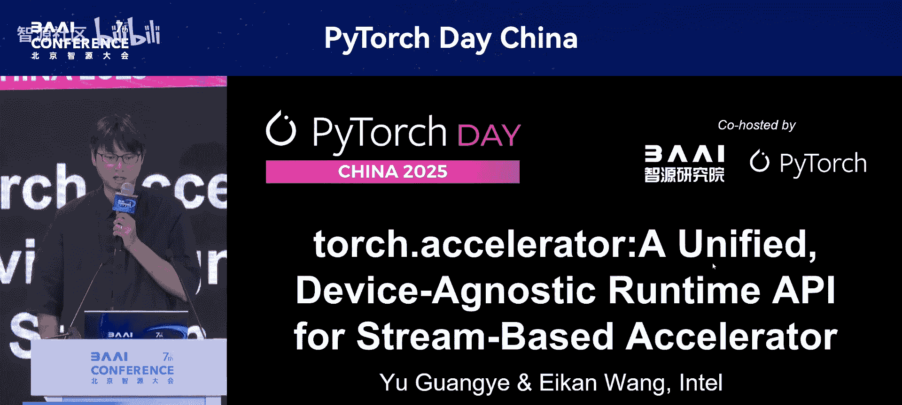
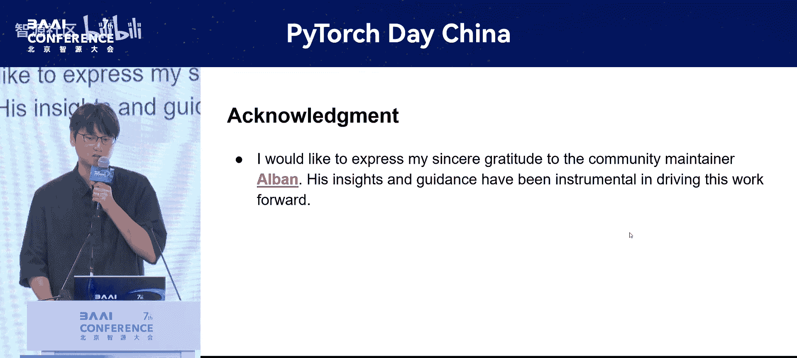

# 2025北京智源大会-PyTorch Day China p07 torch.accelerator  A Unified, Device-Agnostic Runtime API for Stream-Based Accel -BV1PPNWziED7_p7-

So our next speaker is Yu Guangye。Guang Yi， who will be speaking on Torch accelerator。

 a unified device agnostic runtime API for stream based accelerators， so please welcome to stage。嗯。

OK呃。Thanks everyone for being here。 I'm Yu Guangye from Intel。

 today Im excited to introduce a new API set that is coming in pay To2。

6 touch dot accerator an unified devicegno runtime API for stream based accelerator。

P touch as the as the most widely used machine learning framework already support a variety of acceleration hardware beyond CPU such asuda MP S X P U H P U and N U for is well design architecture enable seamless backend integration through to key pathways for e mode is is based on8 operators and device runtime system for graph mode is powered by induct on top of and device runtime。

嗯 and each backend has its own runtime， such as呃kua runtime MPPS runtime and X P runtime。

In A operators inherent devicegno most A operators accept device argument that can be said or CPU or other backends。

For graph mode， induct provide a flexible registration mechanism through the device interface abstraction。

 this base class defined an API site that each back and should implement induct use this interface to support various device backhand。

嗯。However， the run time is slightly。Coupled with device specific module for for for instance。

 if you called touch dota dot current device in your code。

 it will only works on ka device and will fail on other back ends this device specific logic limited code port and prevent user from writing devicegno code。

呃。Here is an example of how to support。This by using device specific runtime API。

 it requires using so many if else statements to handle each backend type。This approach。

 this approach post a significant。呃。A challenge for a hardware vendor who attempted to integrate support for a new backend into pet or its ecosystem。

It's not scalable and maintainable for to use this if else conditionals in these repositories。

If pay touch could provide a unified devicegno runtime API。

 it would greatly simplify the progress of adding new backend support and reduce the integration burden for hardware vendor and ecosystem developers。

As pet continue to expand to support a growing variety of hardware accelerators。

 the need for device agnostic programming interface become increasingly critical。

So we have a broad vision make your code run on any device through a unified device diagnosticgnotic runtime API。

呃，Forly嗯。A significant advance happened in Pat 2。5， which introduce an accelerator concept。

An accelerator is explicitly defined as a touch dot device used alongside CPUU to speed up computation。

It adopts an synchronous execution model to handle and handle a synchronization through stream and event。

Pa currently a zoom， only one accelerator type is available on a given host at a time。

The supported accelerator includes k X P U MP M T I H P U and private user one notably CPUU is not classified as an accelerator under this definition。

In by accelerator concept， we proposed a unified device diagnosticgno runtime API in2。

6 this API are designed to closely measure existing device specific API offering almost a11 mapping functionality they accept the same input argument ensure code change are needed when migrating from device specific API code。

In addition we introduce a new utility to dot accelerator current accelerator on the right list the first one。

It returns the currently active accelerator type as determined at time it means if you if touch build with support it return if build with X P support it return X P if touch is built only CPU support it will return line。

Meanwhile also provide the corresponding c plus plus API to easier for developer to write code in c plus plus。

呃，They are offering one one mapping functionality with touch dot acceleratorthon API。

As unified run time touchdot accelerator overlaps with some device specific API to maintain backward compatibility both will continue to coexist and for functional they are designed work seamless together it means if you use a device specific API to set the current device to index one this change will be reflected by the touchdot accelerator when he cur the current device interface。

呃， deviceice index and vice ver。Now we already have the generic runtime API as mentioned above。

 But how do we handle the other runtime components components such as stream and event This issue was addressed in touch 2 point5 touch touch do stream and touch dot event into a base class that support some some common method。

these common methods are available across different backends and the device and the device specific stream or event enhance this space class and can override method as needed。

now touch dot stream can represent k stream on k device and X P stream on a X P device。

This benefit this design the benefit of this design is that since touch dot stream and touch dot event is base class we can capture any device specific。

countpart as the base class even if in in in or other components， especially for out of tree backend。

When discussing the design philosophy of touch dot accelerator， here is a quick story。

our initial idea was to put unified run time and touch touch namespace directly。呃。

such as touch do food嗯。This this is inspired by how touch dot X P dot stream was generalized into touch dot stream following this model touch dot X P dot4 would be general to touch dot4。

 but after discussing with album and and other community contributor we decide to put this API and touch dot accelerator namespace。

 this is a new namespace introduce in touch 2 point6。And we have and they let clear design ruler。

 if an API work across CPU and accelerator， it should goes in touch name space and accept a device type argument and if A is specific to accelerator。

 it would be place touch dot accelerator name space and doesn't take a device type。

Before touch dot accelerator， touch use different method to support various device backends for example。

 F SDP use touch dot get device module， which delegate to device specific module and in use an inherance pattern where each backend should in from an from an base class and implement its subclass。

This delegation and inherent patterns are also commonly used in other popular repositories。

 such as force。他跟 face。Comped to previous approaches。

 touch dot accelerator provide a unified build in API that is easier to use in dynamo and more。

 It provide more elegant and consistent interface for device diagnostic programming。The main。

 but the main limitation is that touch dot accelerator currently only support a subset of API that are available through two other approaches provided。

For example， for some memory me for some memory related function such as touch dot device type dot empty cash is currently not yet available in touch now dot accerator namespace。

How to support touch dot accelerator for a new backend is is straightforward。

 you only need to implement the device card implement interface and register its instance instance。

 this leverage existing existing。Mechanism through the stream guard and device card in C plus reuse。

In pet touch， we can categorize run time into six components such device stream event gut generator and allocator。

 we now we already general device stream and event。

 The next challenge is how to handle stream guard and。呃， deviceice card。Previously。

 Pat offered touch dot device type dot stream as a contact manager to ensure the operation is running on the expected stream。

嗯。But now， from pet 2。7， the dessert stream can be used directly through this statement。

It's easier to use to generalize for a different backend。

Similar pay touch provide touch do device type do device as a contact manager to ensure the operation is running on the expected device。

 It's a front and person API。But now touch dot accelerator provide a new API touch dot accelerator dot device index to do the same thing is。

It can be used in on different device backend。After analyzing usage across popular repositories。

 we find that some memory related API are commonly use in line with RFFC 1，340，7。

8 we propose introducing a set of touch a set of device memory API and would put them under touch dot accelerator namespace to better support the common user case as another follow up we plan to generalize touch unit test to improve reusability across different。

Backhand。Now， I'd like to revisit the example mentioned early with touchdot accelerator。

 the implementation becomes much clearer and simpler。

It makes the refined code can run on any device without any adaptation。Finally。

 I would like to express my sincere gratitude to the community maintainer。

 his insights and guidance have been instrumental in driving this work forward， thanks。

