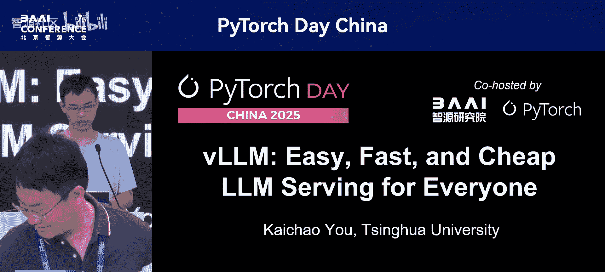
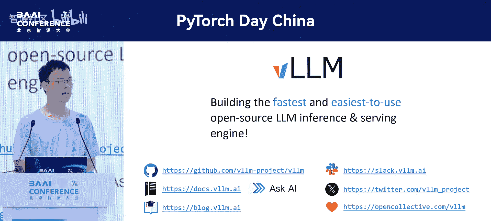

# 2025北京智源大会-PyTorch Day China p08 vLLM  Easy, Fast, and Cheap LLM Serving for Everyone：KaiChao You -BV1PPNWziED7_p8-

We have our next talk， which is B O M， easy， fast and cheap L O M serving for everyone。

 And our speaker is you Kucho， student from Singjua University。 Thank you。

🎼Container of the OEM M project。 So are they， I'll briefly introduce will M to you。

 which brings easy， fast and cheap L M inference to everyone。

And let's be quick。 So obviously， we are in the era of L Ms。

 and we are talking about error L Ms every day， like search and the chat and coding， so。

Without no doubt with no doubt that serving L M is very slow and expensive。

 So before will M every single GPU， like a 100 manage to serve a moderate size L M with only one request per second。

 So that's very expensive。 And even like Microsoft needs to buy lots of GPS and it complains that it does not have enough GP。

 So。Due to the auto regressiongress nature of the large language models。

 we know the key optimization is to optimize the memory usage of intermediate activation。

 So we need to cache the KV cache and reuse it。And to in enable the flexible reuse of the KV cash。

 will M first introduce the H attention technique， which stores and organize the KV cash into blocks。

 And this approach significantly improves the GPU memory utilization。😊，And at that time。

 compared with the implementation from hugging face and T G I， V I achieved over a tenfold speed up。

 And even compared with the T G I， it has two to three times faster。So in in June 2023。

 the women project was open source and received tremendous attention from the community。 Now。

 it has over 40， actually， this is 48。 but I just check it is 49000 Github starts now。

 And during my visit to U Berkeley， I joined this development of the project。

 And now it has been more more than one year since I became involved。

So the goal of the project is to provide the fastest and easier to use open source L M inference and serving engine to everyone。

 And let's briefly visit the usage。 The first is a pretty simple and nice end user API called the offline inference。

 which has the L M class。So this is for offline batch inference。

 You can create an LM object and then just call the general method just like you call a a normal function。

 and then it will return the all all the results of the full batch。

And then you can also start where I as an open eye compatible APII server with a single command。

 Then you can run the normal open eye client or you can reuse it for your own like chat service。嗯。

VM also supports a wide a wide range of models， not only tax generation models like Lama and deepse。

 but also multimodernality models like lava and also embedding models and river models and more covering the mainstream types of models you would use。

And V M is the official launching partner of many major L Ms companies。

 before their models are officially released， they often collaborate with us for better compatibility and integration。

 So as a result， by using V M， you， you can always deploy and run inference at every moment at the very moment。

 the model is launched。 and some models are contribute by the model vendors。

 So you can trust the implementation。And will M supports a wide range of hardware from GPU and TU to CPUU and specialized accelerators。

 and most platforms like invidia， AM D， Intel and AWs， Google。 they are supported natively。

 And we are also exploring the plug based integration starting with the Huawei Asson and IBM spre。

 I think this is an exciting direction to build ecosystem together with hardware vendors。

 So this plug based accelerators。 they offer the same user experience as the native supported hardware。

 while the hardware team can have much better control over the project。😊。

And V M is highlighted in Google Cloud， like TPU and also in Invidias GTC launch。

And Will M is already in our daily life。 The when you open the Amazon and chat with the chatboard Ras。

 you are actually chatting with Will M On the prime day last year， Amazon actually served 3 million。

3 million tokens per minute using over 80000 tri and in chips。😊。

And wed like to thank Pytor for the support。 This is a Py Day China conference。

 and the diverse hardware support could not be possible without the support of Pys narrow waste structure。

 So these hardware platforms they usually work with Pytor first， and then they adapt to where M。

And as model becomes larger multi GP or even multi GP with multi machines are needed to run a single model。

 And these are the scenarios where the problem are pro to occur and will provide some simple and easy to understand debugging manual for you to understand where is the problem。

 how to identify the problem is a hardware problem or network problem or software problem so that you can identify the issue quickly and we support a wider range of that we have good support for Tensor which can partition the ways and cache。

 it can also reduce the latency if you have good interconnect like GPU and link。

We also have support for pipeline parallel， which distribute the layers to different GPU and pipeline execution。

 It helps the throughput， but increases the latency to because it needs although it needs less communication。

 but the yeah， the latency will be increased。And as mixture of expert models are becoming more and more popular。

 we also support the expert par case， which places a subset of experts on different GPs during the runtime tokens need to be routed。

 dispatched and combined。 And the benefit is that every instance only loads part of the model。

 so you can have more space for the K cash。And for large scale deployment。

 we are also actively investigating the pre deco deaggregation。

 It allows us to separate the concern on the time for time to the first token and temper output token。

 And it also enables lots of optimization because pre and deco。

 they have very different computation characteristics。 So you can optimize them separately。

And there's lots of inference optimization in， for example。

 will empireones the hash based automatic prefi caching。

 which accelerate the request with common prefis like the long system prompt。

Will M also supports spec decoding， which is an idea of using smaller model to generate a draft and then verify them together。

 And there's also a growing interest to use the one additional layer to propose new token stack Eagle series or M TP from Gick。

 which are both supported in Will M。And as hardware supports more and more native quantization instructions。

 More and more models， they are trained in a quantized way natively。

 So L M can be quantized along three dimensions like the ways K cache and activation。

 The weight quantization mostly give savings on the storage and K cash quantization can help the attention competition and also enable the larger K cache and activation activation quantization accelerate the matrix multi multi so that you can have faster competition and。

I think will will M has an ecosystem project and L M compressor。

 So this project can produce the quantized model， and then will M can run the quantized model。

 And you can check the documentation for the latest support status。

 I think willm has the widest support for the quantized methods。And V M is keeping evolving。

 and it has successfully pushed forward the we one major architecture update。

 boosting the performance twice or even further for commonly used models。

 You can check the announcement block for more details。😊。

And one bitter lesson we learned while migrating to the V1 architecture is about the CPU overheads because to fully utilize the GP。

 we need to pay close attention to everything happening in the CPU。

 This is due to the architecture of the accelerated computation nowadays because we need to use programming language like Python and fast to control the CPU and this CPU launches the kernel to the accelerators。

 So if the CPU does not launch kernels fast enough。

 then the accelerators are waiting for the CPU to launch kernels， which waste the GP time so。

What's happening in the CPU。 this is an example analysis in the old version of V M。

 which shows that the A server actually takes 33% of the total time。

 And then there's additional 29% of time spending on prepare input and processing the output。

 and only 38% of the time is spent on the actual model execution。 This is definitely not good。

So to reduce the CP overhead， we propose to optimize all the engine loop and the A server。 So here。

 preproces is kind of like you convert the Jpeg images into inputtensers and also tokenization and post processing means you need to detokenize token Is into token strings and do lots of checkings。

 and then H T B request handling is like you need to stream outputs to many users。

So to reduce the CPU have used the multi processing approach in Python。

 separating different components into different process so that they can run in parallelil。

 And then the model itself can run in a busy loop。And for the input preparation part。

 we take the precision batch inspired by the L deploy。

 instead of recreating the batch from scratch every step。

 input tenss are cash and we only apply the di because we assume that every decoding step theres only a minimal change to some requests。

And we one not only focus on the performance， but also on the code simplicity。 For example。

 Cgraph is a powerful tool for accelerating the model inference。 But in0。

 we capture the one singlegraph for the whole model。 This leads to increased development burden。

 And because we don't not no CPU operations are allowed during the model forward。

 And in the we one approach， we take an alternative approach by splitting thegraph into pieces using touch compile as the compiler。

And we run the attention operation in eager mode and only run like other operations in graph in graph mode。

 So this takes makes the max freedom for the attention operation while running other operations efficiently。

 I think this approach does have limitation。 like if model is very。

 very small than CPU overhead actually matters here。

 our measurement is like its negligible for8 B models on H100。 Of course。

 if you have smaller models than this matter。 So we are actively investigating how to turn on the full callgraph for the for the full model。

 But this does need some attention backend modification like currently。

 I think only fresh attention3 supports it。And besides performance。

 we also pay close attention to the user experience that we provide both packages and docker images and also 90 build versions for the latest willM。

 and comparing willM requires a lot resources we know。

 So we provide some precomplied wheels so that you can only add one environment variable and then you can download the preview wheel so that you don't need to compile all the things because we assume that most developers only touch the python code。

And we also have a powerful continuous integration system。

 and every code change need to go through lots of changes。 Of course， the。

 the cost is that we spend more than $30000 per month on testing。

 But given the popularity and the widespread usage of will M within the costs worthwhile。And now。

 Williamm is a project owned and driven by the community。

 And as Pe expands to the umbrella Foundation， Williamm also joins the Pe Foundation as a host project。

And we also host meet ups and every two months and office hours every two weeks。

And will I misused in many places， including like open source projects and foundation model labs and private deployment and also cloud service providers。

The wormm has been a default L M serving engine on many cloud services。

 and you can find many worm based products。And also。

 deepse also publicly announces acknowledges that its inference engine is based on will M。

 The will M is a popular choice if you want to run L M inference。

And will M has more than 1000 contributors now with several dozens of dedicated full time developers。

 They mainly come from U Berkeley and also big companies who actively use will M like IBM。

 Redhead and Meta and Google。 So we are very grateful for the large community supporting the development of V M。

😊，WM is not only a standone project， but is also building the ecosystem for inference。

 we have close collaboration with Hy， hackging face and open R HF and As， etc ce。

 So you can visit our blog post like blog dotM dot AI for latest update。

And we are very grateful for all the sponsors。 They sponsor lots of compute for the projects deployment。

😊，And just for the brief introduction for the M， we strive to build the fastest and easiest to use L M inference and serving engine。

 You can find the relevant resources and links on this slide。

 And one thing I like to mention is like it works very， very quickly。

 and there are many new features every week。 So even the developers might not have the full landscape of what the current status。

 So we actually investigate how to enable AI to help the developers and help the community So in our documentation you can find there's ask AI button you can ask ask questions that what's the current set of the future support。

 and it can gather all the discussions from PR link issues and to give you the most up to date answer。

 so that yeah it can help the community grow better without introducing the additional burden for the developers。

😊，And yeah， I think that's pretty much。 Yeah。 and thanks for joining the Pats conference and listening for to the Web talk。

 Thank you。

