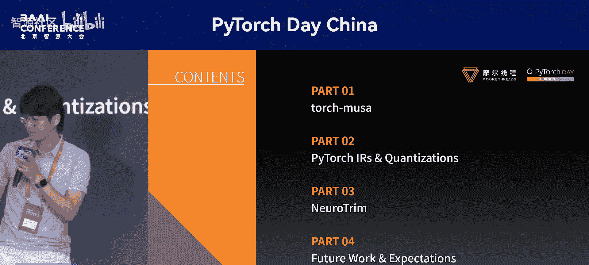
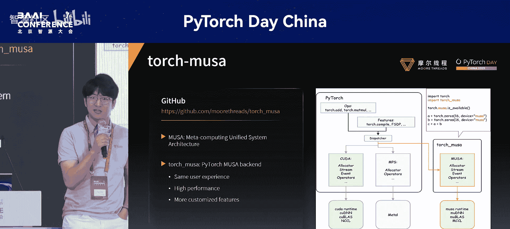
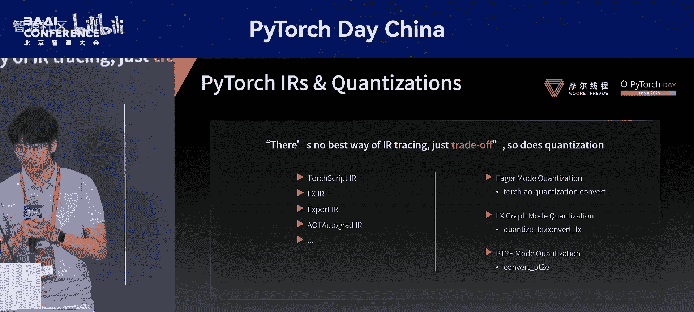
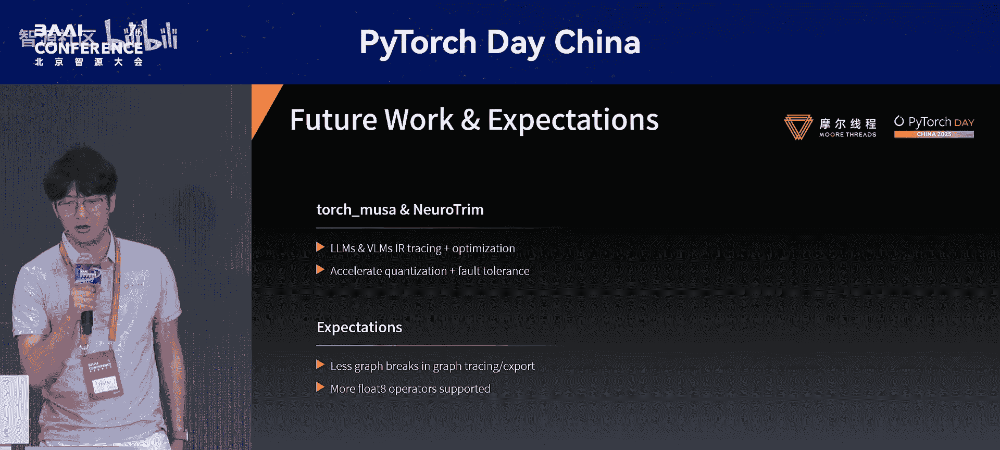
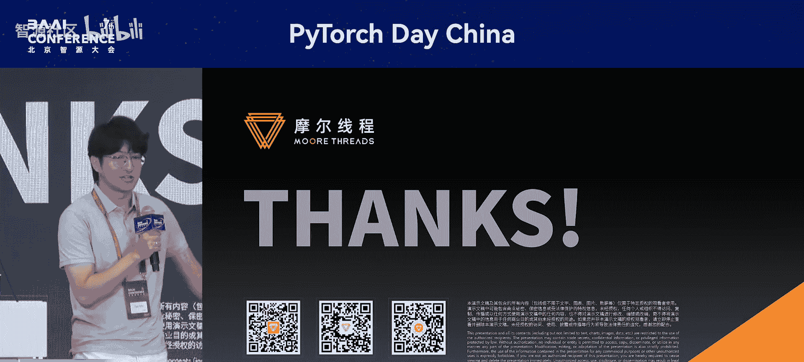

# 2025北京智源大会-PyTorch Day China p09 A torch.fx Based Compression Toolkit Empowered by torch_musa：Fan Mo -BV1PPNWziED7_p9-

We have one more talk before we will head to lunch。

 our next speaker is Mophon from more threadreads who will be talking about Torch FX based compression toolkit empowered by Torch MUS or Mosa。

 I guess is the right was it。Thank you。Hello， everyone。'm far more from more thread A R R D。

 I'm gonna talk about this is compression toolki that are based on Toch F X and Tosh Mua。So， the。嗯。

The talk will will be within 10 minutes and consists of these four parts。

 First of I show introduction of the Toa。 And then we have little walk through of the I R and some quant methods that has provided。

 And then we're gonna go deeper into our new trim and what what it is and how it works。 And finally。

 you're gonna share about some future works that we gonna do and some expectations by。😊，Of the Pes。

Okay， let's， let's get started。So some of you might have know that the more threads has released the Mua。

 which is a meta meta computing unified system architecture。 Well， it's quite similar to Kuda。

 like we provide many libraries at Quda does。A from the figure that we provide the Mo runtime。

 Mo M U D N N， M U plus and M L for communication as well。

 So if you are proficient in kda programming， it would be easy for you to transfer to the to our Mo platform。

In the other hand， the Toshmoa is kind like a a plug for P that enable enables the Patche runs natively on our Mo platform。

 And by using Toshmoa， you can have the almost the same user experience as P test。

 you can just simply modify the backhand string from the kudta to Moa and run it is。😊，And also。

 we have some features and operators that are highly highly optimized。

 especially some GMM M kernels and attention kernels。 So if youre running on large limited models。

 we， we're gonna have some high performance。😊，And last。Un we have some more customized features。

 especially on the field of the conversation， which are on top of later。

And before we go into the comparing tool kits and the new trim。

 we got to have a little walk through of the Ptor I that Ptorche has provided。Oh， well， as you know。

During all the years of the Patche， it provides many Is like from the early stage who have to script。

 I know the the Gity script。 And from the Pat 1。8 or 1。9， I guess we have the F X IR。

 and it's widely widely used until now。And from by toch 2。4 or 2。5。

 we have the export IR from the export program and also the L T Autograd IR that used for training。

With all these I S， the P has provided three ways of of the that they are the eager mode and F X mode and the P T2 E that we can call it the export mode。

So among all these options was some， some might like to ask what the best way of tracing。

Well， I read this phrase like months ago in the Pat forum。 I cannot find the page right now。

 but it do say sad what I like to say。 Just， there's no best way of utter tracing just trade offs。

So what's the trade offs， I think it's just we don't have to take a specific one way of eye tracing。

 We can have both of them， or we can have them all。

Then we move into our new train and see what is see what the， see what the。Drade off that we made。

As we all know， if we would like to quantize the model， Well， it's be important for us to have the。

 the full graph， a full model graph。Right， something like the open Vino and M A N。

 they have their own IR definition。 but we like to do it within the P itself。

So heres so we chose the F X as O I R。 And why F X based。

 because it the three three reasons that first is deable。 Like。

 we can easily add them Py hooks or it's running， running with PDB to check the input and output values from each node。

 And secondly， we can easily modify the graph or the sub graph when。

 when we do the conditionnotation。😊，And last， it's。

 it's very easy to try to integrate with other frameworks or even with by to itself。

 like when do P TQ or update the weight。up the weight during the transition。And I can I。

 I cant see from the picture that the new trim just take only take one pet model and one configuration in。

 and it outputs a Pat IR that will can stand it to the。😊，Inference engine。And inside the new trim。

 the first stage we call the IR tracing stage。 That's the trade off we have made。 Like we took many。

 many ways of I tracing。 Like we have symbol symbolic trace。 we have the namo， we have export。

 It's kind of like a full back mechanism。 If one way is failed。 Then we move to another。

 And after the tracing stage， we can have the the whole whole whole model graph。

 Then we can move to the optimization and the most lower， which is backend specified。😊，Well。

 for the optimization optimization and most are lowering。

 we can share about some customized optimization that we have done。 First。

 we have some customized con。Like from the right， right figure。

 you can see that we have the convolution。 come with。

 come up with a bash and then come up with a silu。S can be easily find in the model of euro。

 and we can run it with just a single kernel and it runs so we can get higher performance。😊。

And more that， we have the some customized weight update。 Well。

 it's not like a P TQ or some some fine tuning。 It's just updated weight on the fly like the bias correction or the GTQ。

For the large language models。And most importantly， you have some many D types supported。

 like accept the in in teacherger 8 or U T G 8 or in the4， we have floating。8 supported。

That is not cannot not only be only used for the， for the large model。 but we can apply it to some。

 some some CV models so we can have the high performance and good accuracy。Well。

 last I'm gonna share some future works that we're gonna do。

 The first is like we trying to make the large leveraging models and the vision language models that are traceable。

 Now， if we like to have the full graph of something like deep R1。

 it will be very hard and it's hard to know for us to do some optimizations。

 So we are trying to make that， that doable。And also， we are trying to accelerate the con。

Since we have tried to you know， con deep R 1，6，6，71 billion model。 and it it took our like this。

 and it's easy for easy to know to throw some， some arrows So we are building a full tolerancele system that can restart the condition from some checkpoint。

Well， last， I'm gonna share some expectations of the Pyche。 First， we。

 since we are using the symbolic trees and the enammo and support。

 which hope we can have less graph breaks since every graph breaks will will。We bring more。

 more optimization works。That and， and so we hope that we can just just run， run the model and with。

 with one graph。And last days like we have， we are， we are hope that Pat support more floating。

8 operators since the the P8 now can only be used of the G M M in P now。

 but we think the float 8 can be treated like like the float 16 or B flow 16。

 so we can can add more optimization in it。

Okay， that's all I would like to share。

Thanks。😊，Okay all right， we are going to head to lunch for the next two hours。

 We will reconvene here back at 2 PM。 Thank you。