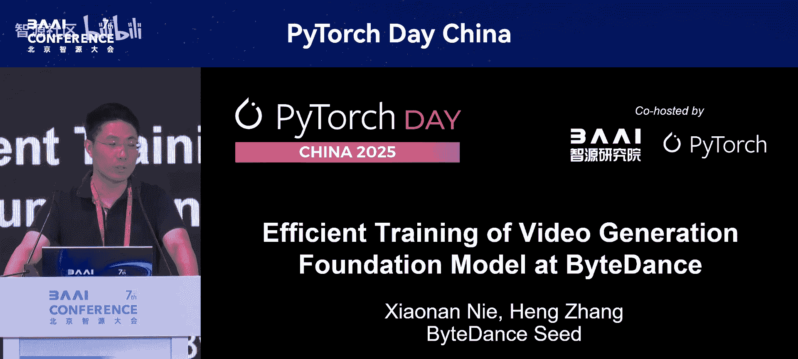
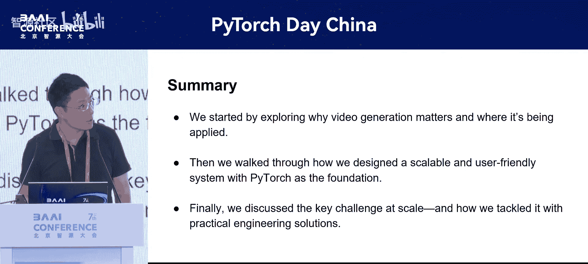
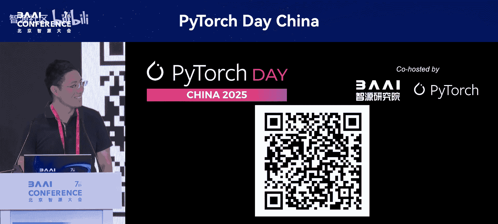

# 2025北京智源大会-PyTorch Day China p10 Efficient Training of Video Generation Foundation Model at ByteDance：Heng Zhang -BV1PPNWziED7_p10-

🎼う。All right， welcome back everybody， hope everyone had a great lunch。

 I do promise we have a lot of great talks this afternoon， we'll be here for the next few hours and。

You know， I hope you enjoy what we've got curated here。

 So our first speaker this afternoon will be Zhang Heng from Bike dance。😊。

And they'll be talking about efficient training of video generation foundation models at B danceance。

Thank you。好，大家好，我是来自字节跳动自术团队的张恒。然后我今天和金小楠一起，然后为大家介绍呃字节跳动，然后在视频生成，然后基础模型大训练大规模呃高性能训练方面的一些经验和实践。

好，首先跟大家一起快速的过一下呃过一次的过一下背景。然后视频生成其实在像广告、电影，还有像动画等等多个场景，然后已经得到大规模的一呃应用。呃，其实视频生成模型不仅是能够扩呃让大家的创造力得到释放。

而且能够大规模的去减少呃，在实际生成过程当中的一些成本和时间。然后这里有两个例子，然后可以大家可以大家一起去看一下。大家可以看到这个例子其实是在整体的这种3D的运动，然后包括镜头的控制，还有整体的人物。

然后细节，然后还有在背景的这种人物细节上控制都是非常好的。后面还有一个动画的例子。对，这个动画的例子同样来讲，不但它的那个细节是比较好的，而且它的美感，然后以及整体的完成度都是非常好的。

然后另外可以多提一句的是，在最近几天，然后我们最新的一个C dance1。0的整体的那个新的模型。然后即将发布，大家有兴趣的话，欢迎大家去试用。

然后让我们来深入看一下整体的这个视频生成模型的整体的模型结构大概是什么样子的，以及它的那个训练流程。呃，在整体的这个训练过程当中，呃，最关键的两个部件其实就是VE还有MMDIT。

然后我们可以把整个视频生成的流程，然后简化为三个部分。第一部分就是VE的一个编码。然后紧接着是MMDIT的这种扩散。然后最后就是MMDITVE的这边的这个解码的过程。然后对应的训练流程的话。

一般也是分成两步。然后第一步的话，我们就是只训练VE，然后把VE的这个输入，然后做一个呃编码，然后之后再做个解码，最后然后去做一个lo的计算，然后就可以了。然后第二步的话，我们就把VE还有 code。

然后只去训IT就可以了。在这个流程当中，大家可以轻易的看到，其实是有一个比较明显的优化。就是我们可以把VE的这个编码，然后你进行离线去做。这样的话我们不但可以去减少整体在训练过程当中的这种存储的需求。

而且可以去降低这个我们在训练过程当中可能出现的一些数据域处理的瓶颈，还有一些数据域处理的一些那个IO的访问。然后最终我们去训练的时候，其实是分成三个部分的，三个三个阶段的。

第一阶段仍然是去正常的训1个VE。然后第二阶段的话就是把VIVE的这种编码，然后单独的去离线的去做。然后VE编码之后，然后直接去拿VE的这种lain，然后去训练MMIDIT，然后就可以了。

然后具体然后我们的训练系统，然后是怎么做的。然后我们可以深入的去看一下这里面的细节。然后首先从我们的设计原则上来讲，我们希望整个训练系统，然后它是医用的，而且是高效的。另外就是可扩展的。

然后我们在拍照纸的这种生态下面，然后我们也是做了计插机用的这种优化。然后比如说像一些ion，还有一些CPU flow等等。然后我们后面就会逐步去展开，然后去介绍一下我们在每一个模块或每一个方面。

然后大概去怎么样去做的，以及如何去实践的。然后首先第一块，然后就是这边。然后的话呃，大家在做大规模的这种训练系统的时候，去做其实是一件大家都众所周知的事情，而且也是一个很必要的事情。

因为毕竟我们存在了大量的这种member或者说这种仿存瓶颈。呃，但是怎么样去做这个confiion，其实大家是有不同不一样的选择的。你比如说呃通常情况下，大家现在都是用定制的这种扩大或者是春定的的方式。

然后去实现它。但是这样其实非常消耗人力的。你可能经常会遇到一个复杂一点的这种扩大你就需要投一个人或者投好几个人，然后花两周的时间去做实现。但是花两周的时间两周的时间。

然后去做实现之后还还不一定能解决问题，你可能还要再花一个月的时间，然后去做验证。整体来讲，这个人力的投入和产出比其实是非常低的。然后我们这边的解决方案的话，其实是追随生态，然后最新的技术。

然后用to然后去解决绝大部分的的问题。呃用to去解决这些问题之后，不但我们减少整体的这种。就是人力的投入。而且对于算法那边的整体的体感也是非常好的。但是在用touch compile的时候。

其实也会遇到各种的问题。因为touch compile整体来讲还是一个稍微不太成熟的一个技术。呃，我们用的时候经常会遇到一些奇怪的 error或者些等等这种问题。

而且用comp的时候其comp会经常去触发一些异常的recomp情况。你比说我们的如果去化了。者是我们现在有些用到一些in value如flash里的这种 lens然这种in value如果变化它都会触发comp加上我们在大规模的情况下可能几千卡去行训练每一个后触发comp场景或时机不太一样。

整个comp会持续一个小时甚至几个小时不等这其实也是不可接受的。但是经过我们的努力吧，我们最终也是达到一个好的一结果。像现在我们comp基就能做到零comp就个comp差不多一分钟然后comp。

是一分钟就能结束。而且。呃，一个员工基本上就能覆盖绝大部分的这种comcon的情况。当然我们也不排除，就是有一些呃比较复杂的con，然后我们仍然需要一些人手动去写。但是绝大部分的这种connel。

然后我们都可以自动的去完成了。对，然后另外还可以多提一句的是呃，他是可能还有不单要求我们自己，然后把compil的问题解决好。他其实还要去解决跟其他优化技术的一些那个兼容性问题。

比如说后面马上会提到一些简存优化的一些技术等等。然后在显存优化方面的话，呃，其实随着模型越来越大，但是我们整体的各种GPU的设备，包括AI加速器的设备，它的那个显存大家可以看到。

整体来讲还都是维持一个几十G的水平。所以我们一定是需要非常强的这种呃显存优化的一些技术去做的。但是显存优化的技术，整体来讲其实是比较明确的，基本上都是采用这种重那个重算，还有一些offload的技术。

然后我们采用的也是选定性重算和那个CP flow的激活值。然后对于重算来讲，这里有一个简单的图示，然后这里又不细节展开了，因为也是一个大家可能都比较熟悉的一个过程了。然后可以看到的一点是在右边。

然后有一个代码的事例。然后我们用的就是这种接口。后在个口面的话，其实只需要去实现这种compcomp这种policy就是重算的策略就可以了。然后并不需要去修改太多用户的代码。然后直接做到即插即用。呃。

特别是还还需要可以去提一点的是像我们在做重算策略的时候，一般都是对或者说种去重算策略就可以了。对通常来讲，我们希望它其实是仿存瓶颈或者计算量并不是很。

以我们一般都是直接重算它就可以所以整体的重算策略也是通用的。很多时基本上你写完一套。整个模型或者说多个场景里面可以用同一份策略即可。然后另外就是呃进货值的offload了进活值offload的话呃。

我们这边采用的也是outgrade的 safe hook。然后你在包完这个s hook的这个conts之后，基本上每一个呃 backer，然后都会触发这个 hook。

但细节点是如果我们每个探er都会触发这个 hookook。但并不是你每个在每次触发这个 hook的时候，你都需要立刻去做offload。你需要去定这些策略，然后去避免可能你后面还会遇到用到一些er。

然后去立刻触发offload导致些系统上的错误和混乱。然后以上就是还有那个显存呃优化相关的一些工作。然后除了这两部分的工作之外，还有就是我们在于分布式，然后扩展方面的一些工作。分幕式扩展的话。

然后对于分幕式策略，我们现在首先选择的还是AP首先它不但是应用性比较好。而且其实对于视频生成的场景，有一个比较典型的这个点是在于视频生视频的数据。

一般它的 sequence还有它的那个数据量其实是比较大的。所以通常来讲，我们的视频数据。它的计算量是完全可以去掩盖住FI的这种 reduce通信的。所以我们选择FIDP，然后既能达到应用性。

又能达到一个比较好的一个性能。然后这里的细节点是说，如果我们使用FIDP，然后扩展到256卡以上的这种规模的时候，其实我们的环其实是比较长的。它的这个环的延迟其实是比较大。

然后导致整个通信的效率会比会比较降低。然后这里我们就会采用像分层通信的这种方式，然后去避免然后通信效率的降低，然后保持整个系统有一个比较好的一个性能。然后此外就是对于这种长视频的这种情况的话。

还会出现出现这种序列并行的这种需求。然后我们这边主要是采用这种的方。然后这个在后面的一个例子里面，然后还会再详细的展开。然后另外就是在大规分训练的情况下面呃，还有不得不提的就是两点了。

就是容错和那个错误恢复。容错基本上大家很明显的大家都会想到，然后去用情况的，然后去解决这个问题。但在情况的里边的话，我们有两点细节可以跟大家去提一下。

一个是我们刚才提到我们的分布式策略其实是用FIP去做的。但是在用P去或者其他分策略去做的时候，希望整个模型的存储和恢复都是一个耗时比较短的一个过程。基本上比说一两分钟我们希望是嗯可以忍可以忍受的。

但是在大规模的这种训练场景下，可能你的模型是一个非常大的规模，你仍然能维持一个一两分钟的这个和这个耗时是一个需要花点时间和努力的一个工作。然后另就是 load边我们希望 load的。同时在的情况下面。

我们希望 load整个存储的耗时，还耗时存储的需求也是比的。然后这这这两点，然后都是我们在内部然后都能够实现的。然后除此之外的话，还有就是我们在错误恢复的时候，我们在resume的时候。

我们除了刚才提到的dload resume，然后希望它能耗时比较低。比如说只花一分钟或2分钟的时间。然后另外就是经常大家会遇到的是在模型初始化的时候，模型如果去做重新去做这个那个。

然后可能它就耗时会比较长，甚至对于一些大的模型来讲，耗时十几分钟，接近半个半个多小时都是有可能的。然后我们这边采用的就是呃拍套式生态的这种tmate test的init，然后去跳过。

然后整个模型的这种随机输入化，然后让整个这个启动的耗时，然后能控制在一个几分钟的范围内，然后达到一个快速恢复，然后快速失败的一个效果。

然后除了这种从系统机制上面的一些就是框架层次的一些那个恢复之外或框架层次的一些工作之外，我们对于底层的硬件，然后也有一些工作。比如说我们在训练开始之初，然后就会提前去做一pro。

因为你很可在大训练的时候会遇到一些坏机器，一些网络节点不的这种情况。然后这种很好帮你避然后这种你启动之后才发现这种错误的情况。然后在训练过程当中可能也会临时的出现一些说你有个卡然后突然坏掉。

或者说你的然后突然住了等等这种问题。然后包括甚至出现一些更诡异的。后你整个训练速度，然后开始降低了10%或降低了30%，然后我们这边就会做一些检测和的这种这种抓取，后把大家的这种机器信息然后汇总起来。

然后达到一个快速汇总，然后快速然找到节点的一个结果。然后以上就是关于错误恢复，还有这种容错，然后相关的一些工作。然后对于视频生成呃模型来讲，其实他也有一些特殊的挑战，特别是在大工作的情况下面。

具体来讲的话，主要其实是这这个负载不均衡的问题。因为对于视频数据来讲，大家可以显而易断。比如说我经常会有一些一两秒的这种短视频，但我可能也会有一种几分钟甚至几十几个小时的这种长视频。

然后更严重的来讲是我们对于attention来讲，其实我们的attention的时间复杂度是s平方的这种时间复杂度。对于MLP它其实是一个s一次方的复杂度。

它这样的话其实是会导致整个这种训练的这种不均衡的问题其实是更加复杂的。然后我们可以来看一个例子，你比如说现在在这个例子里面，我们第一个GPU可能是有两个短的sle。

然后第二个GPU然后直接处理一个长的sle。当是对于第一个GPU来讲，它可能就会有一些这种空闲的时间或空闲的id time。然后我们希望把这些 time然后给消掉。避免GPU的浪费。

然后我们比较简单的一个方式，就是像现在这样，然后我们把三个sample，然后都直接去做一个均等划分。然后这样的话整体的这个work balance。

然后它其实就是一个均衡性的一个这个balance的一个workload了。但是在这种均衡性的均就是balance就是它的那个workload已经均衡性的情况下，但是大家可以看到。

其实它其实会有些冗余的通讯的。我们可以做一个更聪明的一个做法或更好的一点做法。比如说我们现在把两个短的sle，然后分别放在两个GPU上面。然后我们只去对那个长sle，然后去做一个划分。

然后这样的话动态的去选取一些每个sample的SP策略。然后这样的话就可以达到既走到均衡，然后又把时间的这个损耗，然后做到一个比较低的一个水平。然后这个工作然后在我们团队然后也已经有一篇论文工作。

然后有兴趣的话，大家可以去参考。然后以上就是今天我分享的主要的内容。然后。

呃，更重要的是我们正在招聘当中，二维码隐藏巨大惊喜，希望大家欢迎扫描，欢迎欢迎投递。😊。

