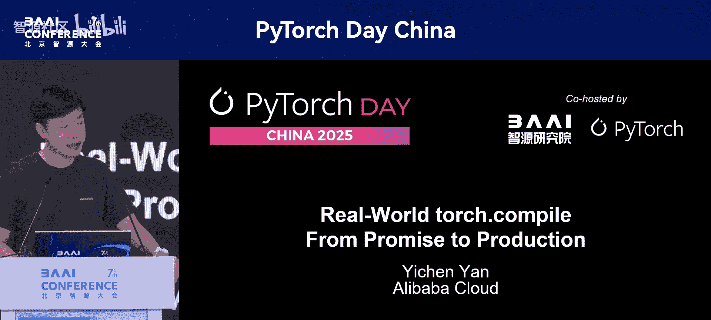
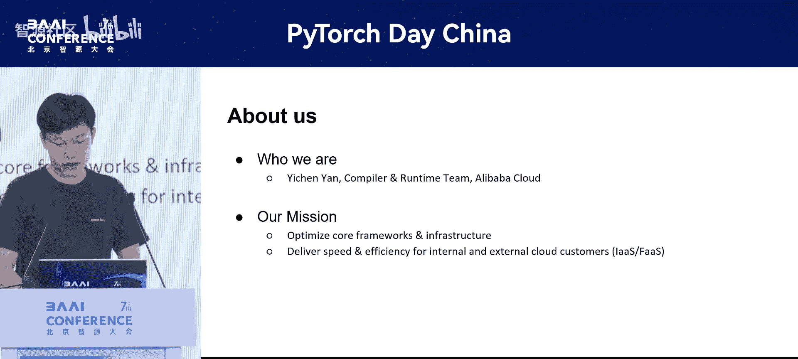
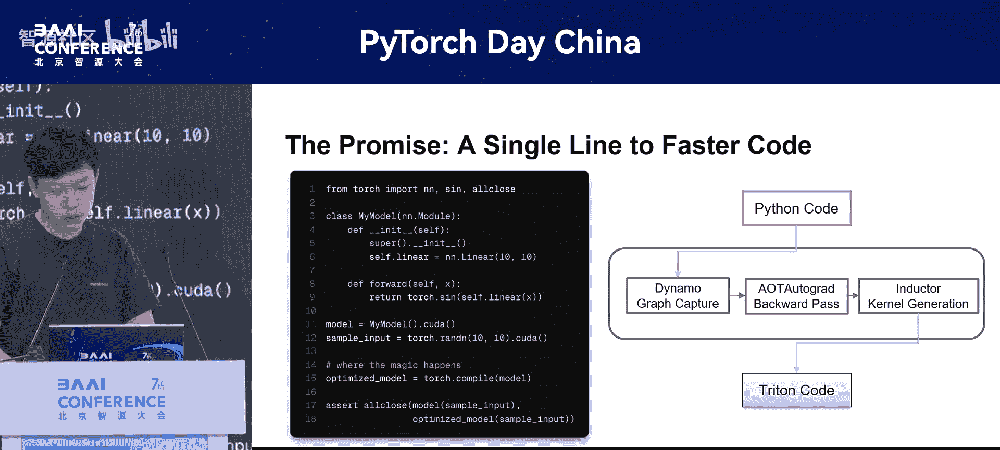
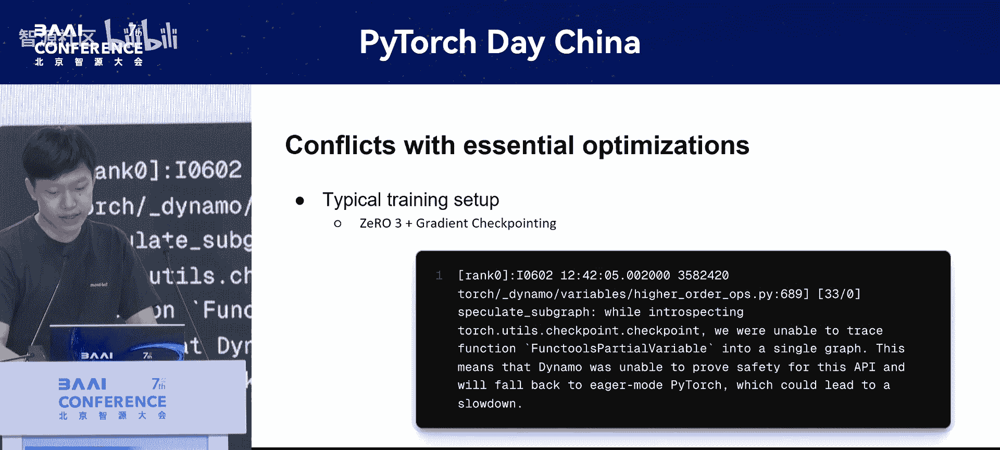
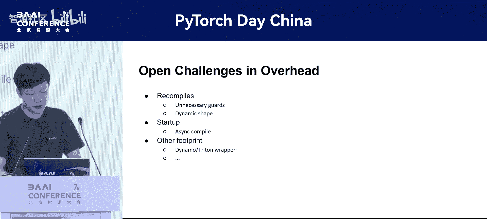

# 2025北京智源大会-PyTorch Day China p11 torch.compile Practice and Optimization in Different Scenarios：Yichen Yan -BV1PPNWziED7_p11-

Our next speaker。Let me just check， make sure we're okay on time here。All right。

 so our next speaker is Janan Yishan from Alibaba Cloud that will be speaking on Torch compile practice and optimization in different scenarios。

Okay。Thank you， Matt， actually， the last talk from the colleague By colleague has stole a lot of ideas from my talk。

 that's kidding。 So we do have a lot of overlap。 So my topic is the real world touch compile practice from our team。

So， let's begin。First， let let's introduce a little bit of our team。

 We are the compiler run time at Alibaba Cloud。 Our team's mission is to optimize the core frameworks and infrastructure that powers everything from our internal service to the eyes and fast products。

 Our external customers rely on。 Essential， our job is to make things run faster and more efficient on our cloud。

 And this fundamental drives the performance is precisely what li to explore and push the boundaries of Torch compile。

Alright， so let's quick assign align on what torch compile is。 As you know， the dream is simple。

 You take a standard high touch model like the my model on here on the left。

 then apply to compile on the model。 Torch compile will compiled for you。

 Gene an optimizeim model with the same output as the original one。 It's not illustrated here。

 but backward can be also optimize as well。 So what's the magic behind this Basically torch compile involves three components as the right part。

 it use dynamo to capture graph。 A T auto grid to handle backward passes and inductor to generate optimized kernel from the captured graph。

So the promise is fantastic。 A guaranteed correct speed up from one line of code。

 or thanks to this sophisticated pipeline。😊，But what happens when this clean。

 ideal picture meets the messy reality of the production model and training frameworkworks。

 That's why our really work began。

So when we move from the ideal picture to our production environment。

 our challenge boil down to three main areas。 first。

 we immediatelyly ran into conflicts with essential optimizations as our team rely on。

Touch Compel doesn't exist in welcome and get it work with critical tools like0 for distributed training or with grading checkpointing for saving memories was a major initial。

H， we call this the ecosystem tangle。Second。We focus on what we called the last mile to optimal kernels。

 This is also double but important issue。 Even when Torch Comp ran successfully and gave us a solid speed up on e mode。

 which is already a away。 we found that we still leaving performance on the table。

 This happens because small unrecognized patterns in the user code can prevent the compiler from creating the most efficient fusion。

So the challenge wasn't about fixing something that was broken。

 but about choosing the closing the gap between a good speed up and an even better one on enabling these smarter con fus。

Finally， we had to manage the run overhead。 The benefits of completionilation are not free。

 We saw significant performance still from recomps when input shape changed and noticeably start up latency。

 which is some case made the compile model slower than eager mode。😊。

And now let's look at each of these more detail， starting with the ecosystem conflicts。呃。

Our user employs a diverse range of technology stack for their training jobs to make the ecosystem challenge we face on concrete。

 I'm going to focus on one representative and very common example。 the use of deep 3，0，3， often。

 and if not always， paired with great checkpointing。Now， the initial problem looks like below the。

The code wasn't crashing， but it ran without errors， but we saw no speed up at all。

 The compiled model was just as low as the eager one。

 which completely defaults the purpose of using tor compile in the first place。

This was mysterious as first， so we had to dig into the logs of touch compile to diagnose the issue and when we saw this we found that the graph break caused deep speed operators and theres more critical log indicate that grading checkpointing is not supported by dynamo as you can see on the screen。

 is when this means dynamo was consistently giving up on tracing checkpointed module and falling back to regular Python execution。

So while the program ran， we weren't actually compiling the parts of the model that matters。

 The challenge wasn't fixing a crash， but rearchitecting the integration so that the compiler could actually see the photograph and do its job。

So our solution was a two phrase process， focusing on just making it work and then making it fast In phase one。

 we focus on fundamental capabilitiesat。 We patch dynamo to correctly understand and handle torch。

Checkpoint at， and at the same time， we taught it to identify and skip the space。

Some deep speed communication ops that were breaking the graph to make this solution widely available we submit to the deep speed integration to hugging phase transformer and accelerate libraries so users can just use the Torch compile arguments to use deep speed with Torch compile。

So at this point， the module ran without compelling graphic or higher order ops a lot as a huge milestone。

First2 was all about performance。 We found we could skip even more deep speed of Stan。

that were redundant in the compiler context， we also developed a heuristic to automatically identify the best units to compile。

 which allows torch compile to create a large fuel region within the graph。

 and finally wed update the default zero per arguments。

 ensuring our data pipeline could skip up and efficiently overlap communication with the now much faster computation。

By leveraginging this target optimization on the top of fundamental fixes。

 we finally achieved a system that gave us the best of both worlds。

 the memory efficiency of training ecosystem and the speed of torch compile。

So let's talk about the last mile to auto kernels。 While torch compile often generates good kernels。

 we found some common situation where it's leaving performance on the table。 today。

 I will walk through two cases studies to related to the scale dot product product attention。

 the SPA function。The first case involve a custom version of attention that use an Aliba buy with a default compiler didn't know。

How to optimize into the single kernel。 The second case deal with a simple but common scenario where and empty attention marks was pre。

Wassgiven and preventing the use of even faster hardware backhand。

So let's dive into the Aliba first to see how it's handled。As as the diagram shows。

 the user' code calculate attention by adding a scaled Ali Aliba buyers and stand mask together before the soft map。

 This is a perfectly valid way to write attention。However。

 Torch compiles pattern measure is very specific。 It does not yet have a rule to recognize this combined Aliba plus mask structure as part of the fusion feasibleible attention block。

 because the pattern doesn't match。 It gave up on high level fusion and fall back to the default mass implementation and To compile will compile each operation separately。

 Our insight was that from a logic perspective， the combined B multiple with Aliba plus mask is just a single final bias mask。

We realized we could teach dynamo to see that way。 So in we implemented a custom pattern match pass。

 This pass identified these exact structures in the graph and rewrite it to use the canonical memory efficient SPA implementation。

Treating the entire Aliba plus mass expression to a single valid attention mask。And this。

Gives us 30%。Speed up comparing with the defaults。A defaults mass implementation and total 260% faster than the original eager mode execution。

A second last mile case study is different。 It's not about recognizing a complex pattern。

 but about simplifying a。A simple one to unlock the absolutely better performance。

We started from good place。 So many of our model was already compiled and with the standard SDP kernel。

 which is memory efficient。 I very knew that there's another level of speed up。

The problem was the attention mask。 The SPA function is a dispatcher， and its fast best best backend。

 F attention has a very strict requirements。 One of this is that it cannot be used with a arbitrary mask。

Even if the mask is full of zeros， our key said was that many of the important use case like influence on uned data。

 this mask is always real， and therefore redundant。So we。

 we implement the targeted constant folding pass this past run before the main main compiler inspect the mask tensor。

 And if it can prove that the tensor constants only contains zero。

 it rewrites the graph to replace the tensor input with a simple non value。So this simple change。

 swapping a tensor from zero to now。It satisfies fresh attentions prediction allowing the SDPA dispatcher to select the fastest past。

真。So this optimization gave us additional speed up and without changing the user's code。So finally。

 let's touch the challenge of fronttime overheads。 This is a very broad topic。

 but I want to share one concrete example of how we tackled unnecessary combinations。

The root cost was very suceptible to ensure correctness tor compile create guards on the properties of your inputs。

 one of these properties is the memory alignment In our use case， with dynamic shapes。

 sometimes the input would be aligned to a multiple of8。 and sometimes it wouldn't。

 This constant change in in the alignment property triggers thegars and force an expression recompile。

 even though the SP kernel itself would handle either case perfectly fine。

Our solution was to make this alignment perfect。Property consistent。 We implement a change to the。

Pad to pad all inputs to a multiple of 8 before they are passed to the compiled function。

Because these inputs that torch compile analysis is always aligned it has no reason to create a guard on the property anymore。

 We effectively elements the recomped by removing the source of the variation。

 So this patch has reduced reduced the recomps from 7 to3 in our benchmarks。

 and this is a great example to how to understand the compiling compile internal guarding mechanisms。

 and this allows us to make small changes that lead to significant real world performance improvement。

There are also other fixes， and overheads relate。E related to the the overhead。

That diamonds fix was a great win， but it's。Really， justs just a piece of the iceberg。周。

For my final contents。I want to briefly touch some of the open problems and the future directions that was。

And。To， to the Pra community。 And maybe we can have。Some good idea about this。 First。

 on the dynamic shapes， the obvious solution what to recompile is to compile a single dynamic kernel。

 However， these introduce a difficult tradeoff a kernel compile for dynamic shapes a is less specialized。

 which means the triton compiler can can make as many assumptions as the resulting performance can be slower than the specialized kernel。

 So the open question is when is best when is is it best to。To accept a slower general kernel versus。

 paying the cost to recomp to several faster specialized ones。

 we believe this future isn't simple in the future。 This is not a simple switch。

 but a smarter cost based strategy。So the next is startup latency。

 The first call to compile is block where actively is investigating the working progress a synchronized synchronized compilation feature in the upstream Py。

 The idea is to run the first few iterations in I mode while the model compiles in the background hiding the latency。

 We think this is the amazing and has potential beyond juststar。

Perhaps for hot swapping new compiled functions in the background without even stalling the main process。

Another subtle issue is war overhead When a kernel isn't significantly faster than eager。

 say only 10% speed up， the overhead of dynamo inductor and Triton kernel launcher itself can be a bottleneck。

 We've seen cases when this overhead actually leads to a new slowdown。

 Future work here is about making the。Overhead， as。Less as possible。

And there's also some kernel caching mechanisms。 The current on disk or ready space cache is functional。

 but naive。And I think this is。A major opportunity exists。

To bring this level of intelligence to P caching system。

 potentially creating a shared cache that dynamically reduce compound times for common model and GPUus。

So when these challenges is key to making touchch compile truly stay。

Stteamless and zero calls for any workloads。 And it's where a lot of our future explored。

Exploration with be focused。So to bring everything together， what are the。

Main main content of our work。 First， touch compile is absolutely a game changer for P performance。

 But as we think， it's not a silver bullet or a magic black box that works perfectly in every production scenario。

Our our experience shows that unlocking its full potential requires a multilayed approach。 First。

 you need to work on the efficiency as a compiler。 that this means writing target passes to help it generate better kernels or use existing ones more effectively。

 Our work on pattern matching and some other passes are perfect examples for this。 Second。

 you have to focus on frameworks integrations。 To compiler doesn't exist in a vacuum and making it compatible with entire training and inference ecosystems like we did with deep speed is critical。

 And some of you may also。Have seen the discussion on some inference frameworks。

 Then they are writing their own kernels rather than using to compiles。And。Finally。

 we must tackle runtime optimization to reduce overheads。

 Our work on eliminating unnecessary compiles shows how crucial it is to manage this cost to ensure you are getting a true net performance win by working on these of these layers we were able to successfully。

 harness the powerness of touch compile in our complex environment。😊，So that's all。 thank you。

