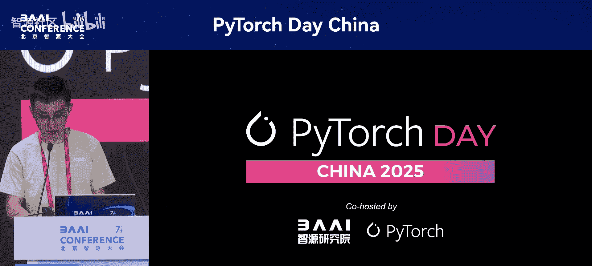
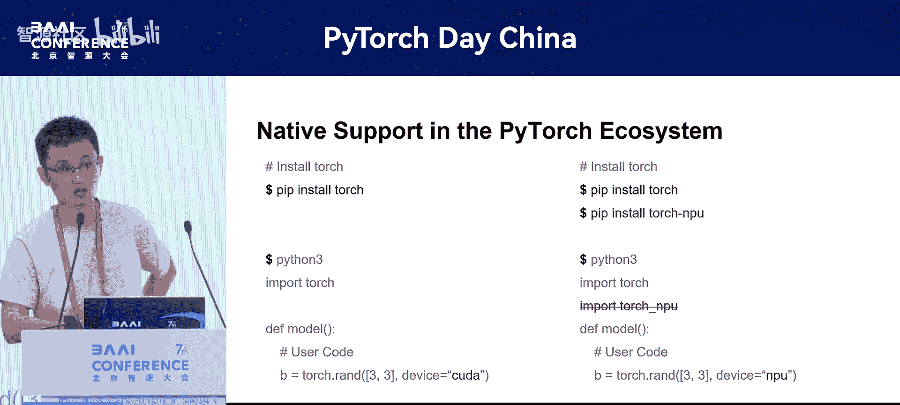

# 2025北京智源大会-PyTorch Day China p12 PyTorch in Production Boosting LLM Training and Inferencing on Ascend NPU：Jiawei -BV1PPNWziED7_p12-

Next up， we have Lee GRwei and Li Jing， both engineers at Huawei Technologies。

 and they'll be speaking about Ptorrch and production。

 boosting LLM training and inferencing on Ascend NPUs。呃，大家下午好，然后非常荣幸。然后有这个机会给大家介绍一下风投NPU在嗯排套着生态的一些。

一些进展。然后这次的议题主要分两个部分。就第一部分的话，主要的是围绕着排套是在上游的一些多样性支持的一些工作。然后第二个部分的话，主要围绕的是嗯盛团NPU是如何集成到排套水当中以及它的性能。

以及它的生态支持情况。然后第一部分的话，由我来给大家做分享。然后第二部分的话会由我的同事李晶，然后给大家做分享。

呃，然后呢，首先先介绍一下三方设备介入机制。然后大家在使用排to的过程中，嗯，可以通过pto的一些工厂函数指定一些设备，然后可以创建一些tensor。然后后续的话的一些操作的话都会在对应的设备上执行。

比如说看左上角的这一张图片。然后现在的话有2个GPU的tensor，然后再做加法的运算。那么它后续的运算都会在GPU上。进行一些计算。然后其实背后的原理简单来说的话。

是每一个tensor其实都会有一个标识，就是左下角那写的一个扩大标识。嗯，只要是带了有扩大标识的两个tensor，后续在做加法运算的时候，都会被路由到扩ta对应的一些算法实现上面去。

所以就是从这个角度上来看的话，其实对于每一个设备，它在排套室内部都得需要有一个唯一的一个设备标识。在排套室内部，这个东西叫做 dispatchK。然后看一下右上角这个图，像嗯扩像GPU的话。

它内部的一个K叫做扩大。像CPU的话，对应的就是CPU那么对于接下来要接入到排套池当中的一些其他的设备。那么它这个K是什么呢？嗯，针对K这个它其实是有一些限制的，就如左下角所写的，就是对于社区来说。

由于社区当前的一些嗯设计上面的一些限制。第一的话是它的K的数量是极其有限的。然后第二点的话就是每一个K再加入到排套的社区之后，他得需要有一些应编码相关的一些开发工作。

这样的话会造成排套池代码仓里面后面代码的一些可维护性。但是呢对于厂商来说，这个K又是必须的。那么我们有有没有一种能够兼顾这两种。问能够同时解决这两种问题的一些方法。哦，答案当然是有。

我们可以看上看一下右上角的这张图。然后在排套者社区，就是在排套室的核心代码仓的话，有一个可以搞一个叫做公共K的一个东西。然后它的名字叫做 one。然后这样有一个好处。

就是第一是解决了一个K数量稀缺的一个问题。还有一个的话就是我们不需要把很多很多K相关的一些应编码放到套社区，这样也有助于排套式核心代码仓的一个可唯性。然后对于一些新的后端。

他们可以通过这个K接入到排套者社区。然后呢，它的代码的话可以放在一个数外的一个自己的一个仓，这个仓是完全由nder由自己的厂商自己去控制了。所以后续的话，比如说像代码的review代码的合入。

后都可以由厂商自己去决定。就对于厂商来说也是比较灵活。呃，然后嗯在排套是2。0的时候，其实这一套机制的话就已经有了一个雏形。但是嗯当前的能力的话是不足以支撑三方设备集成到排套室当中的。

因为对于K来说的话，只是新设备集成中的一小部分，还有很多很多的一些其他的模块的话，目前是没有提供相应的能力的。所以我们当时的话就在社区提交了一个RFC。然后后面的话也是在社区的一个帮助下。

然后共同把三方设备接触机制进行了一个完善。然后总共涉及到了有10加个模块，然后涉及到了有200多个PR。嗯，然后我们在上游社区的时候，把这个机制完善的同时，我们也在把华为的生存MPU基于这套机制。

然后集成到了排套池社区当中。然后呢，在集成的过程中也发现了一些问题。然后同时的话也把这些问题都在上游社区里面做了一些闭环，做了一些优化。所以在排套是2。1版本发布的时候。

然后生存MPU的话也基于这套机制成功的接进去了。同时的话也作为了一个官方的参考实现。然后出现在了排套池的2。1的rease note当中。同时的话也把。其是同时的话也提供了一个to套，就是一个教程。

用来帮助一些其他的硬件厂商，可以通过这个机制接触到社区当中来。呃，然后故事的话到这里还没有结束，因为前面的话只是做了一些基础，只是做了一些基础设施相关的能力，就是能够让硬件厂商能够接进去。

但是接下来的话还有一个比较严重的问题，就是质量问题，就是三方设备接入机制更多的话是一个接口层相关的一些能力。它没有对应的一些后端对它进行功能相关的测试。就是以英伟达的CPU为例。

排套社区里面每一个贡献者提交了代码都得需要把扩打相关的测试用力全部跑过，然后才能合入到排套的社区。但是对于这套机制来说，缺少相关的一些检查相相关的一些门禁。所以大家可以看上右上角这个图。

这张图的话是我们当时把华为嗯的生腾PU接到排套的社区的时候，在下游做了一个每日的固件任务。然后这张图片的话截取的是2到3个月的一个一个结果，然后对他进行了一个分析。

大家能够看到已经有了至少有10家的一个上下游功能的一个break的一个情况。所以针对这个情况的话，我们就嗯采用了一个基于CPU的一个模拟后端。然后呢，通过了三方设备接入机制，然后给他接到了。

排套的社区里面，然后把它当做了一个这套机制的一个测试后端，用来看护整个这套机制这套接口的一些功能性。然后可以看一下右上角的这个图，就是当社区的comit提了PR了之后。

除了会像以往的去做一些CPU扩以及其他后端相关的一些测试。同时之外的话也会去跑一下open这样的一个测试用例，只有open测试用力跑通过了之后，然后相关的这个PR才能够合入到百套社区当中去。呃。

刚刚说的刚刚说的那个open rack更多的话，看护的是一个。三方设备接入机制中间那一层。但是呢对于我们硬件厂商来说，其实还是不够的。

因为我们希望做到的是我们的生腾NPU这个插件或者是其他硬件的插件跟排套室之间的功能是完全的是兼容的，完全是O的。所以针对这个情况的话，其实最理想的一个场景，还是说在上游社区的开发者提了PR之后。

我们在它的PR合入之前，就能够把一些风险给提前的识别出来。所以理想当中的情况就应该是呃社区的开发者提了PR以后，然后呢，他会给下游的一个代码仓推送一个不管是一个PRcate的一个还是其他的vent。

那么下游的代码仓受到了这个之后，他就会把对应当前PR的排套代码拉下来进行编译。然后把最新的生腾NPU的代码也同时进行编译。然后再去运行本地的，比如说单元测试集成测试以及一些其他的一些测试。如果。

不管有没有问题，都会在当前PR下以comment的方式，就看一下右下角这个图片，以这个方式对当前嗯PR的进行一个标注。但是这个地方得需要提，就是得需要明确一点的是呃，这里只是一个提醒。

但是它不是一个强制性的，不是说。这个地方如果到时候报错了，那么社区的。PR就合不进去。但是通过这种方式的话，也可以去帮助厂商或者是提醒上游的开发者，然后去做一些适配的一些更改。呃。

然后上面说完了一个最基本的一个基础设施，然后说完了质量。那么接下来要谈及的一个就是一个用性。然后我们再往排的一些北向生态去做一些呃生NPU适配的时候，经常会遇到一些情况。就如上面这两个图片所说的。

就是呃一般情况下的话，很多场景都只需要额外import一下NPO就可以了。还有包括用户在使用的时候，也是他可能得需要先import一下touch再import一下toNPU才能更常使用。

而且在上游的一些社区的一些tainer他们也发现了这种情况。就是下面大家看到的这张图片。所以呃针对这个场景的话，就是当时跟英特尔的同事，然后呢一块搞了一个叫做autoloading的这样一个特性。

其实这个特性的话更多的话其实就是借助了一个python的一个包管理的个能力。然后达成的一个效果，就是在import的时候，可以自动的把注册到touch里面的这些插件包也给自动的import进来。

那么对于插件包的一个开发工作，其实就像右下角所写的那样，就是给touch点backend注册一个自己的一个后端就可以了。呃，那么最终实现的一个效果就是左边的话是一个扩大的一个效果。

然后右边的话是当前那个升腾NPO的一个效果，就是在安装方面的话，依然是有一点差别的，就是都要安装touch。然后对于生腾MPO的话，还得需要额外安装一下toNPU。

但是从使用的角度上来说是没有任何区别了。就是大家都只需要import一下touch。然后呢，就可以去使用一些to相关的一些API。然后以上的这一些的话就是围绕着三方设备接入机制的一个基础设施一个质量。

然后一个用性。然后都是关于我们在上游所做的一些进展。那么接下来的话，关于生团MPU，还有一些性能细其他类细节，将由李晶同学，然后给大家再来分享，谢谢大家。

