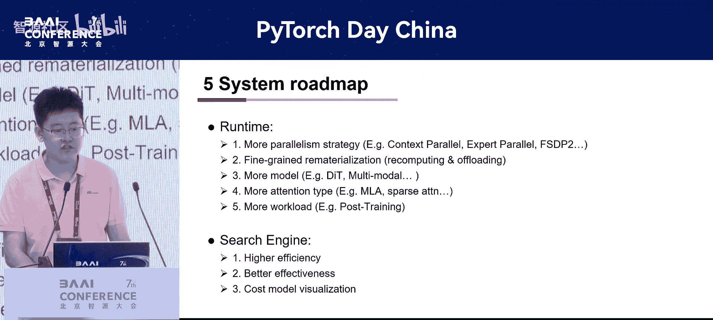
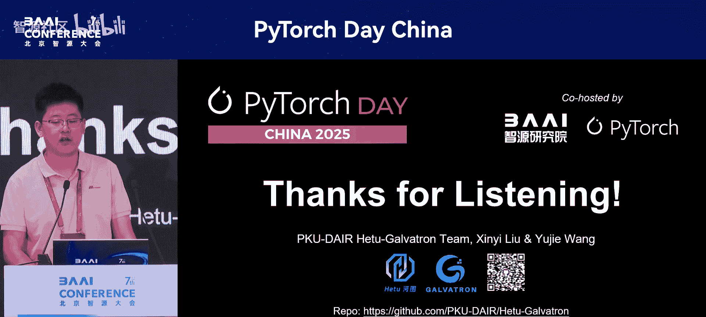

# 2025北京智源大会-PyTorch Day China p13 Galvatron  An Automatic Distributed Training System for Efficient Large-Scale Tr -BV1PPNWziED7_p13-

Hello， everyone。 I'm Xin Liu。 Next， I'll dive into the details of culture and its key features。

ative auto， versatility and user friendly。First， lets start with Patro native coretrain of our of Garon is its fine grain hyper long time。

 which built entirely on native Pat。 users can take a standard single GP Pat training model。

 and Garoron will transform it through several key steps。 First。

 it replace layer with special specialized model that support ten and synchron par。

While also incorporatingfuse kernel for in enhanced efficiency。Next。

 these models are organized into a sequential model and partitioned into different stages。Finally。

 native weaponss like F P and checkpoints are applied to each pipeline。

 This flexible architecture allows different models to imply diverse power strategies。

 achievingieving true fragrant hyperparism。Importantly， the model granularity is highly adaptable。

 ranging from few transform layer to individual attention of MO P layers。Next。

 we are going to talk about auto optimizationization。 As mentioned before。

 Gurotro features an efficient auto optimization engine based on cost model and search engine。

We developed a precise cost model by balancing profil overhead and simulating accuracy。 During pro。

 Gu gathers essential discretized data points， such as bandwidth under different volumes。

 computation times and memory usage on under various sequence and special size。

 This is crucial because runtime information， such as the use of field kernels will significantly affect computation computational times and memory efficient。

Making the simulating with standard formulas inaccurate。In the simulating phase。

 Gach phases collect data points into continuous modeling curves。

 Then it simulates execution times for different parallel strategies and provide accurate time and memory estimates。

 Notably， our model also considered the slowdown caused by the combination and computation overlap。

 as combination also utilize S M resources。To make the cost model more accessible。

 we have developed a visualization demo。 as shown on the rise。

 this two offers an intuitive ways for user to compare memory consumption across different parallel strategies。

Gaochang also offers an automatic and efficient search engine which constructs the search space using decision trees and prints in ineffective strategies based on several observations and takeaways。

When they integrates the cost model with with parallel search chain and feed them into the serving algorithm。

Disag is based on enumeration and dynamic programming。Specifically。

 the dynamic programming approach is similar to a na algorithm where we need to find a para strategy for each layer。

 The memory and time consumption for different para strategic can be viewed as the capacity and value of items。

 Furthermore， the em part can be accelerating using multiread， ensuring a rapid resolution。

As for versatility， Lron supports a wide range of model architecture and adapt to multiple hardware backs。

 including inmedia GPs， Ascent N Us and Hi dis use。As as for ancient hardware。

 we ensure seamless integration through toch NP。Finally， let's explore user friendly。

 Use can convert a standard single GP training model into a five hyper parallel model with only two interfaces。

 one for obtaining parallel strategies and another for model modifications。

 Minimal change are needed for existing training code and comprehensive documentation and examples are provided to get user up and run quickly。

To further enhance its ease of use， Gao Zang also adapt to other framework data load。

 All direct use of prepared data sets。 Additionally。

 we have innovated checkpoint management by storing checkpoint at layer granularity。

 This approach ensure checkpoint compatibility with any any parallel strategy。

 We also provide convenience scripts for converting checkpoints to and from highly fees mass。

So as for experiments on in clusters， which test different large large language models across different GP types and and cluster size。

 We compare its performance against manually turned meron and deep speed。

 while macroron and speed each have their respective strengths and weakness across clusters and models。

 Gaoung consistently adapt adapt to different cluster and models characteristic for superior efficiency。

Gaochang is effective on eastern cluster 2 on a 256 cloud 910 before cover， a cluster。

 Gaochang achieve an 8080 speed。Improvement over model link 1。1。

 demonstrating the benefit of finger parallel strategy in optimizing limit memory for better performance。

 We also perform performed a accuracy test to confirm the correction of of culture。So in， in summary。

 Gaochng is an innovative， innovative pet based system that delivers a comprehensive。

 f automatic parallel training solution by tightly integrating provider to changing and run time。

 It achieves it of us to put。And we have established extensive collaboration with partners in both academia and industry。

In the future， we will continue to developing in culture。

 Our roadmate includes incorporating more advanced parallel search such as context terrorism。

 and the latest torch FDP2。 We will also exploreization。

 support more models and attention sites and auto post training work workflows。For the search engine。

 we aim to enhance the search efficiency， reliability and visualization features。

So that's all。 Thank you for your attention。 You can find our repository at the address through shown on screen or scan the Q R code。

 We sincerely welcome you to explore the。 try it out and share your valuable feedback。

