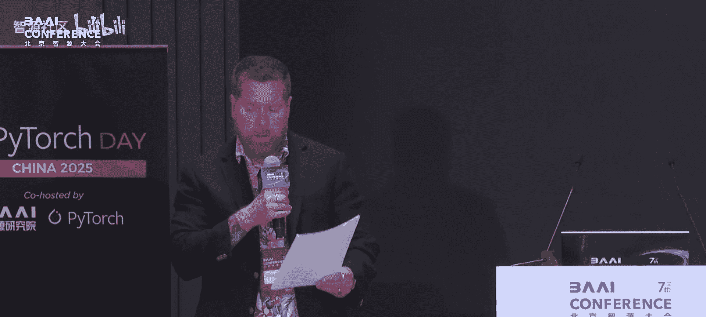
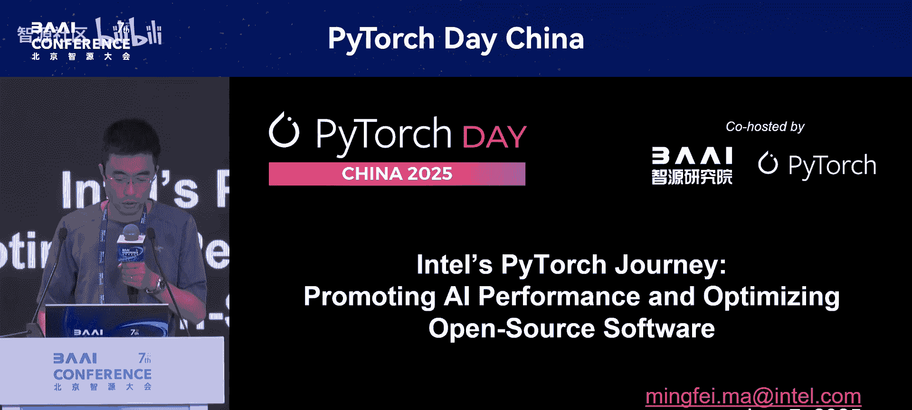
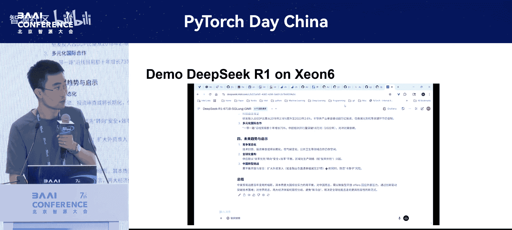

# 2025北京智源大会-PyTorch Day China p14 Intel's PyTorch Journey  Intel's PyTorch Journey  Promoting AI Performance and O -BV1PPNWziED7_p14-

All right， folks， so we're going to start with our next speaker is mom Mingfei from Intel。

 Intel Research and Billy speaking to us about Intel's PyTtorch journey。

 promoting AI performance and optimizing open source software。

呃，大家好，我是来自于英特尔拍套团队的马明飞。呃，今天演讲的题目呢是英特尔的拍套之旅。主要重点介绍一下我们团队过去这些年在呃拍套社区做出的一些贡献。

呃，今天演讲的主要有以下几个部分。首先是我们在呃英特尔GPU上对于拍做出的一些贡献。另外还有我们团队在呃toch compile就是大上面呃CPU做的一些优化工作。最后呢一部分介绍一下呃今年以来。

我们在呃d671B满血版上做的一些在6上的性能优化工作。呃，首先呢这里有一个。整体的框图呃，英特尔呢有一个特点，就是硬件种类比较多。呃，我们呢不光有CPU，也有GPU，也有所谓的NPU呃。

然后为了是配这些硬件呢，我们实际上有几个不同的优化层级。比如有我们有这个one APII的lib，其中有像oned，类似于像酷的这种呃acel libraries，另外还有通讯库。呃。

我们叫oneCCL，类比于英特呃英伟达的这个内。然后呢，我们中间的核心层呢就是呃优化拍套式的生态。呃，在此基础之上呢，我们还有一个产品叫做英特尔的pyytoch extension。这个呢是一个插件。

大家可以通过利用这个插件呢，在outto box的排ych上拿到一个更好的性能。呃，围绕拍套本身呢，我们会在整个生态系统当中优化一些呃比较。popular的一些工程。比如说像现在非常嗯热门的这个VRM。

还有SG land，包括hgging face transformers，还有DPP等等。呃，首先呢第一部分来介绍一下我们在英特尔GPU上的优化工作。呃，刚才提到过英特尔的这个硬件比较多啊。

不光是硬件多，就是GPU种类也多，就是GPU呢我们包含呃IGPU就是大家笔记本当中用的这个呃图形显卡，就是集成显卡。另外呢也包括呃图形卡，就是插卡的。然后呢。

也有dta center当中给AI当中用的这种计算卡。这三种产品其实英特尔都有。然后呢，我们针对这三种产品都在out box的排套上做了支持。其中呢包括linux，也包括windows。呃。

我们过去这一年多时间，在windows support上做了，其实做了大量工作。呃，windows的 support呢对于呃计算卡来讲可能不是特别重要。

因为很少有人会在windows上去训练一个特别大的模型。但是对于像AIPC就这种呃IGPU它就比较重要。整个支持的框架呢，我们可以分成4块，呃，包括run time，还有这个一 mode的支持。

还有包括现在2。0之后的to compile，还有这个分布式训练。呃，首先第一个run time的部分，我们是做在排套是里面的呃，包括像这个一些deised abstraction。

包括还有像呃memory allocation，还有stream这些概念的一些抽象。这部分做在排套式呃原生排套式仓库里面的。然后另外一部分就是对于e个 mode的支持，我们用C口写了。

所有的atten kernels这个sco其实就是in特GPU上的一种编程语言，类似于像英伟达的ku达。然后这一部分呢是做在一个呃 party library里面的。然后大家在编译拍套纸的时候呢。

他会被当做一个呃get up的3呃3。9来编译到拍套纸里面去。然后在拍套制步入2。0之后呢，我们团队也非常深入的参与了包括英特尔GPU，还有CPU方面的呃induct方面的支持。然后在英特尔的GPU上。

我们也是通过呃英特尔的这个project，然后对呃to compile实现所有功能的支持。最后的这个distributed。

我们也是通过一个呃刚才提到过的YCCR的libry实现了目前排套支持的所有功能。然后这里展示的呢是呃to compile在英特尔的GPU上。相对于一格 mode拿到的一个性能提升。

我们对比了三个bench mark，一个是hgging face，还有一个tams，还有toch benchnch。呃，包括三种不同的模式，比如包括这个RP32的。

还有AMP的AMP就是auomomic precision，有的是actation走P32，然后呃model wait会被con成BF16或者是RP16这种格式。

还有一种是完全把activation和wa全都呃con成BF16或者F16的一种形式。呃，大家可以看到。差不多在infrence上呢是能拿到1。5倍到呃两点几倍的一个提升。然后在群形上呢是差不多呃1。

51。6上下的这个样子。然后呢，我们团队从呃拍套是2。0这个feature从刚开始规划呃，的初始就非常。积极的参与了整个architectture的设计。呃，包括整个CPU套大概他的后端。

实际上都是由我们这个团队去动点负责的。然后。这个林林总总其实做了很多的油化跟各种各样的feature。呃，上面列的这些呢是去年然后加入的一些比较重点的一些feer。呃。

其中包括是去强化一下呃CPUization的一个er。这个是说原来的时候我们只s一些比较基础的dta type，包括像是BF16啊，还有IP32啊这种。

后来我们把这个data type的情况给他加以了拓展。然拓展到呃in8呀，Uin8呀，这样你就能去cover一些现在LM当中的呃卫通ization的情况。然后另外还有这个现在使用的FP8。嗯。

然后第二个 featureature呢是做jaim template play的au营。嗯，默认的情况下，在CPUpass上呃，我们的Gm实际上会去走完。呃，YMQL或者是走oneDN。

就是实际上调库的。然后我们发现在很多情况下，这个调直接调库呢，它并不能拿拿到一个最佳的性能。所以在induct当中实现了一个jam template，然后这样它可以去实现呃动态的。根据你当前硬件，嗯。

包括你ja输入的各种各样的ship。然后还有呃你当前硬件使用多少个核心呢，你的L one开始的大小啊，你的L two开始的大小啊，然后去动态规划你。做jam过程当中呃。

powerall的这些blocking的一些策略。然后还可以通过策略的不同的调整，然后各种各样的不同的组合，拿到一个在当前硬件条件下的最佳性能。然后第三点就是刚才也提到过。

就是在CPU的 backend上，现在整个to是完全支持windows的 support。嗯，这张图展示的呢就是to compile在英特尔的CPU上的一个性能提升的一个曲线。嗯，可以看到就是我们。

这个团队其实从tos这个项目规划的一意识，就非常积极的参与了整个aritecture的设计。从2023年9月份的时候，我们就参与了这个项目。Okay。然后呢。

同样也是选取呃toch benchnch huggging face，包括teams3个benchmark。呃，可以看到在。随着时间的推移，我们的这个加速比是在逐渐提升了。嗯，这两年呢随着大模型这个。

这个东西的兴起呢，我们也把。注意力逐渐转化到呃对于大模型本身的优化上面去。呃，在toch compile当中呢，加入了很多针对于LRM的一些性能优化。

我们这里展示的就是touch chat上面的呃拉玛38B的性能的一个情况。最右边的这个图呢是一个 mode，它跑的一个状态，看到这个在单个CPU上跑的还是比较慢的。

如果通过to compile呢呃只需要一行。那他当前这个东西呢，它就能提升4倍。然后另外在他comp。呃，flag里面去把奥托呃jiim template max auto twin给打开的话。

还能额外再有个1。2倍的提升。然后下面这部分呢介绍一下我们今年以来做的一个比较重点的项目，就是在优化DBC跟满血板。嗯，这个项目呢是做在SG练上面的。然后硬件呢使用是我们最近发布的Z样6。

就是GNR的呃GN2的平台。呃。我们差不多过完年之后，没有别的项目，全都是这个东西。天天地 seek。我相信很多在座的同人，尤其是搞硬件的，也是这种状态。我是大年初四看到了他二一发布的那个新闻之后。

就已经意识到。过年回来肯定就是天天加班一个状态。我估计大家。很多人都是这种情况。这个东西我们大概是呃差不多每天晚上加班写6周，然后把整个IC land的CPU后端给他。完整的写了出来这个优化的点在哪呢？

是说D seek本身这个模型它现在参数比较大。然后呢，如果你要把它跑在GPU上，可能是需要8张卡呀或者16张卡。这个它的。这个系统的成本会比较高。应该是在100万或者200万左右人民币。

当然如果你本身应用这个并发度高的话，那你能把这100万200万的钱把它用回来。我们针对的点是说，如果你的系统并化度没那么高，比如说你需要的这个concurrency可能只有10以下。

那么这个时候你去用一个呃Z样6的方案。他完全可以满足你的需求。啊，这个时候他的cos呢非常非常的小，这个东西的成本应该是在10万人民币以内。呃，这里对比的的性能呢是呃对比的是拉杆CP的呃。

原始的拉杆CP其实跑。第一个是1个阿万的效果并不是太好。嗯。其实拉马CDP上的AMX的U化就CPU上。AMX的优化也是去年我加的，但是可以跟大家透露一点的，就是deep这个模型用不到我去年写的那些优化。

原因是因为去年在我的写的时候呢，只去添加了这个呃linar这个毛球。然后D模型呢主要都是MOE，所以他根本跑不进那个油画里面去。呃。事实上说呢，我们也可以去把拉maCGP的性能提到一个非常高的状态。

但是后来跟。这个customer负责 customertomer团队来沟通过程当中，大家觉得VRM或者SGlan的前端，或者包括一些其他的serving engine，嗯，它会更加有商业价值。

所以我们选择了做Ilan这个后端。呃，可以看到经过我们的优化呢，在呃。DDR5，还有包括我们的MRD的平台上，对于preview针对于拉玛CBP持有大概14倍、15倍。在某些极端情况下。

应该是在20倍、30倍左右的一个性能提升。然后呢，抵扣的情况下是大概有3倍左右。呃，我们现在如果是sing go request的情况下，解一个词。in特8的671B大概是60毫秒。

就是一秒钟能解16个头根。嗯，如果是四路并发或者是八路并发的话，这个差不多能做到每一路达到呃10个头坑每秒。基本上能满足实质性的要求。这个在IC上里面，现在是sport的三种不同的data type。

其中包括in8。呃，这个实际上用的就是美团做的那个W8A8模型。美团今年的DRY发布之后呢，他们很快的做了一个适配A100的版本。然我们刚好就利用了这个东西。

因为在CPU上实际上是没有FP8的sport。然后我们额外也添加了FP8的这个支持，这个用的就是换方发布的呃outto box的这个model。嗯。

这个里面FP8的呢是通过模拟的呃reization的 code来实现的，它会比in代8大概慢5%到10%左右，会慢一点点，但是它的精度会稍微高一些。然后另外我们也做了in4的支持。

in4走的是AWQ的这个目前呢是一个pro type的状态，不是呃性能还没有到完全toppick。呃，也非常欢迎大家去尝试一下ICline上面这个纯CPU的方案。有什么问题的话，都可以在这个哈上提出来。

到时候我会处理的。嗯，下面呢。这个这个这个下面有一个。可以放一下子，这个就是这个视频。能点一下吗？对，这个就是我在开这个会之前，在我们内部的这个嗯服务器上录的一个。DC的嗯视频视频是没有经过加速的。呃。

大家可以看看就是纯CPU的方案，它能达到一个什么样的效果。呃，提的问题呢也是一个。当前比较热门的话题就是中美贸易战。然后DC给我们很多答案。我特别喜欢这个这个刚开始这个正在思考的过程。

就像他写八股文一样。我在想以前。念书的时候，如果有他来帮你写小作文，那就太好了。这个东西写学后文这写的特别好。但是有一点呢，就是它的废话特别多。所以会导致这个contex slice越来越长越来越长。

然后我的慢慢会变慢。嗯，大家可以看到，就是哪怕一个纯CPU平台，也可以基本上满足你。呃，日常的一个需求。还有强调一点呢，我们并不是说当前的这个CPU平台，它比GPU平台好，这个是不现实。

我们是说他现在这个东西呢，它比较便宜。他会很便宜。Yeah。呃，应该是目前。GPU方案的。10分之1或者20分之1左右这个价格。呃。DPC个还是说啊，他废话比较多，现在还没说完。嗯。

当然这里面提到这个问题本身，我觉得他回答的还是挺好的。这个中印中美贸易战核心呢在于这个科技竞争力是吧？然后我们在今天在座的各位都对。中美。贸易战这个科技竞争力上提供了自己的一部分贡献。好，快说完了。对。

我们接下来还会去继续优化这个方I量上的这个方案，包括做一些PD分题的尝试。然后还有目前刚才说的每秒钟16次，其实并不是硬件的一个P performance。我们projectction的结果的话。

硬件的pick应该在20左右。就是还能够进一步再提升一下。当然大家都知道这个写在to do类似上的事有可能永远都完不成。嗯。哦，这就是我今天要分享的内容。

