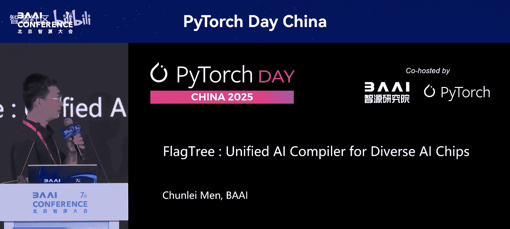
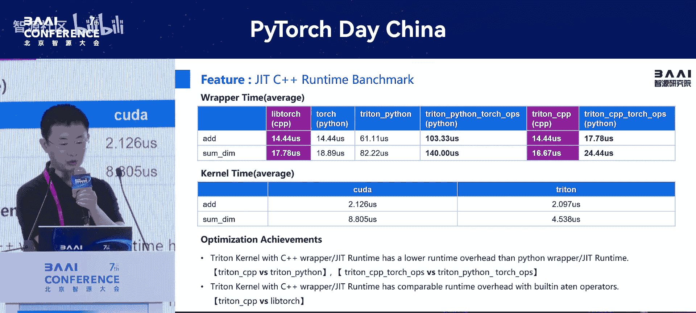

# 2025北京智源大会-PyTorch Day China p15 FlagTree  Unified AI Compiler for Diverse AI Chips：Chunlei Men -BV1PPNWziED7_p15-

Our next speaker is Men Chunle。We'll be speaking about flagagtree。

 a unified AI compiler and or diverse AI chips， and is joining us from BAAI， thank you。嗯。喂。是这个吗？嗯。哦。

啊，OKOK好，谢谢大家。😊。

好的，呃，感谢各家呃各位呃的到来。首先呢我分享一下那个OS啊，简单的概括一下，呃，是由智源研究院呢联合着多家单位呃呃打造的开源的呃一站式的软硬件呃软软件的呃这个技术站。呃，主要呢服务于多元的AI芯片。

😊，呃，那呃针对于底层的大模型这个场景下呢，最算力的急需需求呢，所以说算力的供给呢也是多样化的。可以看左边这个图的下面呢，其实是算这个AI芯片的种类呢非常的繁多啊。

每个芯片呢都会有自己的编译器加这个通信库，那解决芯片这个编程的问题呢呃我们共同打造的是flan tree统一的编译器。基于统一的编器呢上层呢构建了是面向大模型的呃统一的算库f jams啊，然后呢。

基于这个为了实现多算力芯片的通信呢，我们这边呢有faxs，然后基于faxs，然后呢这个实现多芯片的呃互相通信。然后最终呢呃这个由呃并行的讯推框架呢，将各个组件集成。

最终呢面向支撑上层的大模型的呃训练也好，或者说推理也好。对。😊，好的，这是整个的我们的这个呃技术的架构图。接下来呢在这个里面呢我们会讲那个呃重点会讲f tree tree之前呢。

我们先把前期的一个工作f然后进行分享。呢当的利益呢是我们想为用户呢打造一个这支持多种AI芯片。然后用且高性能的这样的一个大模型通用算子库也非开高兴呢今天un这个呃我们呢被呃这个呢所接收。呃。

然后呢在个算子库里主要几个特性呢，我大概也概括一下首先呢基术架构上来说，它是一个插拔式的使用方式，让用户呢无感知的可以使用的这个算子库接入到当中。然后这里呢其实核心呢他分了多种的接入方式。

一种呢就是无感知的通过ten这种方式注册进来。然后通过 dispat然后调用到的这个这个上面来。然后。😊，近期呢我们也会增加了一些像castOP的接入方式呃，来扩充它的这个算子的覆盖的范围。

然后另外呢一个比较大的成就呢，就是已经在11家呃国内外的芯片厂商呃18款芯片商啊做过这个识配和验证。这里呢既包括了像呃这个有国外的，也有国内的这种厂。厂商。

然后最终呢我们想实现呢通过这个算子库的一字编写到这处处编译和处处之行。为了实现这样一个理念呢来扩充to对AI芯片的扩展能力。然后目前呢呃算子库的体量大概有180多个。

然后呢这个性能呢呃在某些这个主流的芯片厂商上呃平均性能呢也超过了这个呃原厂上的这个算子的性能。对，这是对它的一个概括。然后呢，在年当算子库的体量呃上来以后呢，呃我们也开始加加强这个算子库的它落地的应用。

在这个重点模型的无论是推理，还是训练呢都做了一些验证。首先呢保障算子库的它的结果呢是正确的啊，其次呢要保障它的这个覆盖度呢要足够多啊。

这样呢最终呢然后进而呢通过一系列的优化呢也达到一个高性能的这样的一个目标啊，这是呃展示了两个主流模型，一个是天天。是吧这个D下的推理。

然后另外呢就是我们呃支源这边也在牵头一个叫open seek的这样的模型上的开源模型的一些训练，也做了一些结果正确性的验证。对以这是相应的一些呃成果。接下来呢呃算子库呢早期呢我们是基于opI的啊做实现。

呃，这里呢我们也要呃这个呃非常的呃。😊，感谢一下OBI开源的这种ting的技术，呃，也概括了它的几点这个优势。第一点呢它是thonic这样的编程范式。这样的话呢使得在GPU编程或者说要高性能编程的时候。

它的应用性得到了保障。第二点呢就是因为借助底层的呃这个编译器的技术，然后呢我们呢可以就是呃一些并行策略呢，或者说一些并行的事情呢由编辑在呃在那个去完成。所以说呢这个用户呢也是无需感知。

另外呢ting呢也率先引入了t的这样的编程的范式呃，也带来很很好的这个呃性能也得到很好的保障。另外呢就是呃像主流社区，像拍to也进行了深度的集成。呃。

而且呢现在呢拍套式的官方语言呢这个编程语言呢也那个把也当做了官方的一种编程这个算择编程语言呃，对，所以说呢也是呃和主流。社区呢也是高度这个呃耦合在一起的。那接下来呢。

随着啊我们这个使用的这个范围的增过增增加，我们呢也越来越发现呢，如果一个体量非常大，覆盖度比较广的算子库依赖于ting呢去发展呢，也发现了一些啊局限性。这里呢大概概括了这样几点。

第一点呢就是说呃叫易用性或者叫开发效率与性能上的tra offt呢更加的侧重于是它的易用性啊，带来开发效率的提升。但是呢呃像相比于相比于像ku大 C来说呢，它的性能呢呃可呃。局部是优的。

可能呢大范围呢其实还是没有把这个硬件的性能呢挖掘出来。呃，这是第一点的这个局限性。然后第二点呢就是说针对于多种AI芯片，就是除了在因为设计之初是针对于GPU的架构做了这种编程上的建模。

所以说呢针对GPU啊天生就带来一个不错的性能。虽然比如说比这个原生的可能会差一点，但是呢性能还是比较可观的。然后呢，但是呢针对于非GPU来说呢，其实呢性能呢往往是不及预期的。对，这是第二第二点。

那第三点呢呃就是关于这个社区的治理和这个生态的约束力。这里表现的什么呢？因为呃现在的train呢是由opI在内的，这样的话呢导致这个需求的演进呢是围绕着企业的需求在演进。而社区上的一些小众的需求。

或者说一些非GPU上的一些硬件的需求呢，往往往这个社区呢是。兼顾不到的。所以说呢一个是就会出现了这个右边这个图所示。上层呢会有比如说f jams这样的通用的算子库，在做这样大一统的算子。

下面呢也在基于这种ting的这样的呃编程语言，也在做语言成的统一。但是呢底层的traingcompilr，它是一个呃分散的呃，各个厂商呢硬件厂商呢为了满足各自叫定制化的需求都会fk自己的分支。

企业这个分支是perate的。呃，开发者呢是访问不到的。所以说呢这就局这样的话呢，为后续的呃我们想实现这个生态的呃统一呢其实带来很大的那种局限性。针对这几点呢。

我们呢呃进行了一些的思考和这个广泛的这个调研讨论。然后呢达成了一个这样的motivation。就是一呢我们呢想既保持着ting上游生态的这个兼容性。

又能够借助于MLIR这种标准的语标准的这个变音器的设计呢，来把这个底层的硬件呢加强多硬件的支持。这是这所以说呢带来两个好处。一呢是减少了这种这个呃。呃可以可以呢这个复用t有的这个能力。

二呢也加速一颗芯片呃，这个投向市场的这种呃这种加速这种效率。另外呢，其实我们想通过这个编译的技术达到。基最基础最统一的这种编辑来实现一次编写呃多芯片运行的这样的一个目标。

而且呢要共享一些呃通用的编译技术。然后呢，另外呢来实现这个尤其是上层的这个算子啊，这个或者说软软件这能够呃smooth的左迁移，这是我们的这个愿景，或者说也是定的目标。

然后接下来呢我们也是分阶段的在实现这个达成这个目标。第一阶呢呢我第一阶段呢我们在3月份的时候呢，我们发布了这个0。1版本。呃，当时的主要的 featureature呢就是说呃统一版本支持多芯片啊。

这是主要的特特点。呃，然后呢在这个系用架构图上来可以看得出来呢，我们呢这个统一的呃代码库里面呢呃支持两个编译路径。呃。

第一点呢就是呃TTGIR针对于GPU架构的所有的这个芯片呢都能通过这个编译路径呢接入进来。然后第二点呢就是林那这样的呢像DIC的芯片架构呢。基本上可以复用这样的一套编译链路。那那所以说在0。

1版本的时候呢，我们支持了多款的这种呃这个呃AI的芯片，像有GPU的，像有DSA的啊，这是当时有大概四五家的芯片。然后呢另外呢就是在接入的方式上呢？

因为这里面呢其实有一个叫呃求同存异的这样的一个合作的模式。所以说呢我们在接入的形式上呢有s code的接入，也有呢libry的形式的接入。而且呢在这架构设计呢。

也采用这种模块化的可插拔式的这种呃这种设计，让各个厂商呢都能找到自己的接入的方式。所以说呢实现代码仓的统一。然后另外呢也是建立了比较完备的CSA的流程。

然后呢能够而且呢每一笔提交的保障在对应的硬件上都能得到它的正确性的验证。对这是0。1版本的特性。那正在我们正在做的是什么事情呢？正在做的事情呢有三个重要的特点。第一点呢就是说我们要加强这个编译的技术。

所以说这里面就要解决一个前面。提到了一个叫呃开发效率和呃性能上的这个t off。那这时候呢我们在DSL这一层呢，我们做了两层的设计。

一个呢叫base leader所谓base leader呢就是满足呃叫普通大众用户的这种编程需求，也就是继续保持着t自身的呃它的应用性来保持它的一个开发的效率。另外呢还有一部分用户呢想达到它的高性能。

那这时候呢我们会有expert leader这样的一个设计理念。呃，和设计的考虑。也就是说呢透露给这个这样的呃开发者呢呃更多的硬件特性，这样的话呢能达到一个呃比较不错的性能。

后面呢我们会有一些这样的实现的一些介绍。然后第二个方面呢，我们这边这边呢更多的是什么呢？要呃中间层中间层呢就是这个呃硬件的呃这个抽象层。

我们呢在针对不同架构呢做这个呃统一IR的设计满足不同的芯片大类的这样。的呃诉求和要求。呃，所以第三点呢，其实呢我们也会在会接入更多的AI芯片。这里呢包括后期已经在接入的像呃华为盛腾的这种芯片。

或者像呃一些可重扣 five AI这种扩展指令级的，像轻微智能那种芯片。像呃像armar chin的这个NPU的IP呃，也在陆续接进来。这是当前版本的一个特性。然后呢。这呃。

这样我们有了统一的编辑以后呢，上层的f jam就它底层就有了呃强强有力的这样的依赖。就不至于像之前上面那张图一样，底层有多种呃编辑器的版本。现在呢通过统一的这种flanlink tree呢，这样的话呢。

jame的实现呢，也能够得到了这个呃有效的保障。然后呢接下来呢我会分享几个呃里面接入多后端时的几个架构上的一些设计方案。呃，像华为盛腾的这种NPU呢呃采用了非常标准的接入的方式，走的呢是的路线。

这里面呢对其实这里面既可支这支持生成t的呃这个呃也支持呢单呃就是手动实现的这种叫单叫单叫单算子这种这种方式。而且呢这里尤其华为的同事呢。

针对这里刚才又提到就是说针对针对于NPU呢也做了一些有感知的这种语义的这种实现。然后再往下走呢，其实呢这里用了一些能力。这些能力呢就是包了这个这如何去使用t的中间的IR。

还包括了底层这尤其是NU这个IR这一面有硬件感知的R和硬件无感。这这种IR的这种设计都是非常典型的MLR的这种标准规范的实现，也是非常有具有代表性。然后这个呢是这个arm China，它的周译MPU啊。

呃这个的场景呢是呃当当时呢叫周易的MPU呢有自己的编音器。那如何。😊，既借力于ting的编译器，又保留着原有编译器的路径。所以说呢这里呢就把那个林那个到这个呃这个AIPU的IR做了一个con。

这样的话把两个编译器的路线呢进行打通，相当于既享受到ting带来的上层的成果，又能保持底层的编辑的路径。然后这个呢是一些轻微的，它和呃华为的圣腾走的路线呢非常相似，我这里就不赘述了。

接下来呢就是我们正在做的几个特性啊，这里向大家提前的呃呃分享。呃，这里呢就是就是我们的高级用法。所谓的这里呢会引入一些特性。这里呢我们设计的一个叫基于注释的啊编程范式。

这里呢其实主要的一个几个feature呢，就是说既保持着ting自身的编程语言的特性。我们通过引入这种注释的方式呢，能够把硬件信息呢进行层级的传达，最终呢传达到这个硬件的IR的层面上。

通过硬件的pass把硬件的一些特性呢啊挖挖掘出来。这是它的核心设计理念。😊，然后这分了三层DSL层呢，我们引入这种呃这个注释的这种语义信息。

包括了比如说我们这个这里呢涉及的叫是井号一个艾加这个这里呢就是相当于对于某一个的语语言这SL要做语义上的一些注入啊，这里有一个有一个信息比说我们会注入它会采用share memory感知的一些优化。

这样的话呢就会传达到中间的这个通过AST的passing呢，把这个上层的语义呢传达下来，经过注释到把这个语义呢注入到这个MIR的tribute上面。这样的话呢一个IR就硬件语义信息了。

那接下来呢通过底层的pass呢，就能够硬件厂商拿的这个信息呢，就能够做比如share层面上的一些re memory面上的一些优化。最终呢能带来一个非常不错的这性能的收益啊，这是一个一个在做的ature。

然后另外一点呢，就是说我们这个traing自身呢呃它有一些这个游戏尤其一个 kernell呢，它会包含了呃包含了三层，一个是rapper层，其实呢就是对各种tensor的预处理。

然后包含了这个调用 kernel的叫这叫ge function这一层。然后另外呢最最底层呢才是traing实现的 kernell。这三层呢来。总总体的影响了一个这个算子的这个性能。

当前的这个pper呢因为th实现的这 function呢也是也是thon实现的，所以说带来很大的性能的呃损失。这里呢就举了一个例子。

正常case一呢是一个这里展示这个图呢就是CPU视角它的时间的这占比和PU视角它那时间的占比可以如果说一个这个车它执行的时间非常长，CPU呢这一次这个GPU呢其实占的很满。

都是连续的大家可以可可以看得到当case2的时候指的是什么呢？这个车路耗时比较比较小，所以说就出现了叫气泡吧？这种这种气泡呢就会导致GPU利用率比较低。

这种情况呢就是因为这个pper或者说这个它的耗时比较长针对这种情况呢其实核心的一个本质呢是语言的一个局限性成的。所以说我们做了一系列的优化这里优化呢核心是我们重写了或者说重构了这。😊。

try这个编译器的这个runtime或者叫ge function，用C加加重构了一遍，重构一遍呢，这样的话我基于C加加的这样的runtime呢又开始去写这个rappper。这样呢最终呢能实现就是说呃。

最真正的执行呢，无论是rappper层还是这次 function层呢，呃都是采用C加加实现的那接下来大家可以看一下效果，这个效果这这这里面是举了一个demo。😊，这个demo呢就是我们这个呃。

第一步呢其实上上面呢是因为我我们的rappper呢是采用C加加实现，所以说呢我们可以直接调用里面的这个C加加的这种API去对tensor做这个相应的预处理或者准备工作。然后呢我们对 time进行重构。

所以个其实就是C加加的表示它可以把一个实现好的。这里举个例子，这点呢其实就是用语言或者用on写的描述了一个。然后呢通过这个它的 time这种我们从搜重构的这个run time把它给调用起来。

那这样的话最终呢呃保证呢就是说这个pper或者说这个run time都是C加加的实现。唯独呢这个这个的实现呢是用on但的执行呢其实就是因为到。以说它执行的都。

然后接下来呢就是看一下这个nch mark这里呢我们做了一个呃这个验证，呃分别呢统计了克隆的时间和rappper的时间。

而且呢在ad和这个some这两个算子上呢做了这个多个维度的多叫多个实现方式的对比和验证这里的对比验证呢我在这里可以在这里展示吧。

从这个rapper这个面上我们第一列呢这个li这是这个toch自身的呃这个C加加的实现tochon呢就是to个O的一个用on来调用的一个实现可以看得出来这个基本上这个rappper呢这两者呢是比较接近的。

然后我们重点看一下什么呢？on和后边的ting c加加CPP之间也如C加加的实现。可以看得出来，通过我们这样重构以后的这种视现呢，它的这个呃这个呃longtic降低了这个几倍的这种量级。然后呢。

进而呢把这个这个这个这个算子呢，然后封装成这个呃trying呃这叫可调用的算子，可以看得出来呢，也也就是后面的关于这个toch OPS可以看得出来也降低了这么几几倍的这种量级。

所以说呢可以看得出我们通过重构以后呢，能带来run time层面上有很大的这种呃节省。然后层面上可以看得出来，我们采用ing描述的还是和对比采用ku C加加来描述的 kernel来说呢。

反正呢traing其实描述的这种 kernel的性能呢，其实它是有优势的对。

行好，我的分享到这里。好，感谢各位。😊。