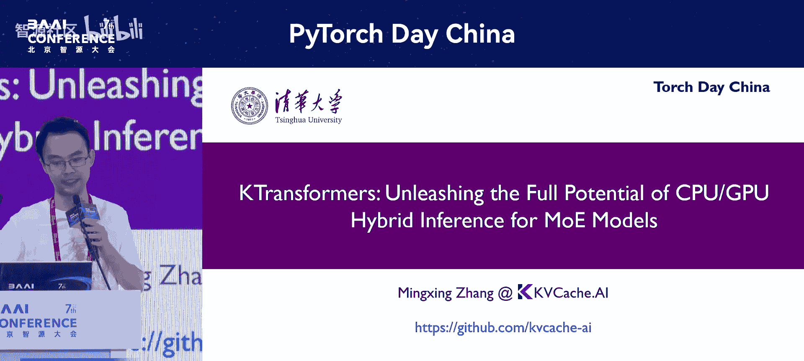
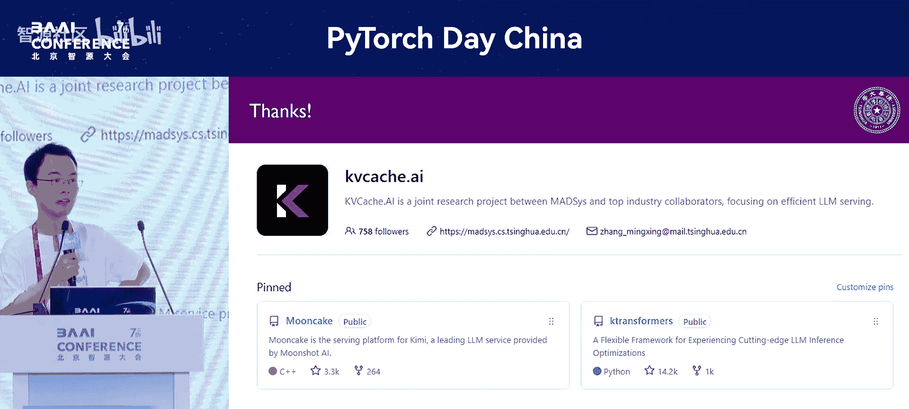

# 2025北京智源大会-PyTorch Day China p16 KTransformers  Unleashing the Full Potential of CPU GPU Hybrid Inference for MoE -BV1PPNWziED7_p16-

All right， so our next topic here is K transformformers unleashing the potential of CPUU GPU hybrid inference for MOE models。

 and our speaker is Dr。 Zhang Mingxing from Qing Wa University。Thank you。对，感谢要请我就也用中文讲的比较能够放飞一点一点。

就是呃我演讲的这个主题还是去介绍一下我们的quicktransers这个库。呃，这里稍微在提就是我们是ck有这么个S。因为我们是基于那个这个这个库的基础上去做的。

所以我们只是说我们增加了一些其他的各种优化的算子啊，更优秀的更好的这样一些数据排布的这个策略。所以加了一个quick作为前缀。

当然其实ck transformers最早的design的这个目标其实并不是一个纯粹的高性能的推引擎。其实我们是希望他作为一个flex的这样的话我们可以把更多的不同算子层面的这个优化去整合到一起。

当然因为这个也是碰巧这个一把我们这个库给带火。所以现在他被提到的时候主要被认为是一个在本地去做CP。😊，有混合的MOE模型推理的时候的这样的一个库。今天也就是简单的去介绍一下。

然后其实为什么会做这样的事情？其实也很简单了，就是我们现在belve in我们希望用更多的数据去训一个更大的模型。然后同时让这个更大的模型去支持一个更长的这个上下文窗口，这样的话我们就会获得更高的智能。

但是问题就在于无论是你把模型变大了，还是说是把这个上下文变强了。其实它都会让我们的这个推理的成本有一个显著的提升。如果你两者全部都变大了的话，那你就会有一个二次方。

甚至因为本身这个attention是一个二次方的可能是个三次方的这个cost的提升。所以这个显然并不是我们非常理想的一个状态。当然如果你有钱的话。

那就另说你终归可以找到很多很多的这个GPU相信下一个这个也会去展示如何用非常多的这个。😊。

GPU去比较低成本的去设为一个如此之大的模型。但问题在于这个世界上的有钱人还是没有那么多的那么多的。所以在很多的情况下，我们还是希望能够在找到一些呃这个场景。

我们是不是能够比如说我们是呃对吞吐的要求没有那么高，或者说我能够使用的并发没有那么多。在这样的一些场景下，我们怎么样去尽可能低的这样的一个起步门槛，然后至少模型能够跑起来。

然后未来我可能还能对他做些微调，然后或者说我在做一些呃杂七杂八的这个实验做一些创新。那么这里的话，我们其实就利用到了一个呃也是未来的大模型个人认为一个比较重要的发展趋势。就是它的稀疏化。

就是这件事情就和我们刚才提到的两个趋势都有关系。就更大的模型。那么更大的模型，它意味着更大的这个训练成本。那么如果说你的这个成本不够，就是你或者说我们看到了，比如说40。😊，05B的ma。

然后或者说是更大的一些其他的模型，可能它的这个收益相比70B，它可能是一个maral的提升。那么怎么样去平衡我一个训练的成本和我的这个效果的收益呢，那可能我们要做稀数化，做MOE的这个模型。

这是一种的稀数化。然后另外的话其实后面也会提到我们做了更长的上下文之后，这也是一个非常大的训练成本。那么这里的话可能我们也需要做一些系数化才能够去解决相关的问题。那么一旦模型本身开始稀数化。

特别是在我们的这个并发不是特别高的时候，就意味着什么呢？就是我们有非常大的容量的需求。然后这个容量的需求虽然大，但我一段时间内或者说我sing batch或者说这个small batch的场景下。

我真正激活的这个mod的其实不是那么大。那么我们能不能找到一个容量成本，相对来说便宜。然后但是它的带宽也还可以的这样的一个。那很显然。

现在的DDR特别是DDR five开始其实是一个呃非常好的这样的一个choice，它的这个容量成本可能比对应的HBM可能低10倍，比GDDR也是低个几倍。然后它的带宽随着DDR5。

包括最新的有DR之的这样一些新的内存技术。然后未来可以看到像apple其实也做了那个LPDR非常多的那个max studio。然后未来的AMD的像它的的系列。如果内存容量做的更大一点。

带宽也做的稍微好一点的话，其实都会是一个非常优秀的选择。就你可以在本地去很便宜的，买到几百个甚至上T的这样的一个容量。然后同时它的带宽也没有那么差，可能有个300400G也是在本地如果推理的话。

也是非常够的。那么显然这样的一个发展的的趋势和这个s大模型本身发展的趋势，正好是mat上。😊，那么在这样的一个match之下，我们首先肯定是也要做一些这个系统层面做的事情情。

刚刚明飞提到了这个全CPU的方案方案。但是我们做的其实是一个这个CPU和PU这的方案，这主要也是结当前这个模型的一个特别大的特点，就毕竟它还是有MLA这样的一个算子。当你实现一个很好的MLA算子的时候。

它的这个计算强度还是会被拉到很高。那这个时候这个相对来说GPU的这个算力会是一个非常呃非常适合去算它的这样的一个位置，特别是他之所以计算强度这么高，再干一件事情，就是在压缩这个。

所以他把整个的大小其实压到比较小。正好就能够放到相对来说比较小的这样的一个显存里面。特别是像最近英特尔其实也支持我们做了那个X的这样的一个支持。你想770才多少钱？就是个才2000块钱不到还是多少。

反正就这么。😊，就能买到16GB的显存，然后往里面一放的话，可能就塞了个100K的这个上下文啊文正好把dep的这个上下文也就也都用满用满了。所以是非常适合的一个一个状态。

然后当然另外的一个问题就是实在是太多了。那么你如果是像比如说之前的它主要支持的一个GPUload的策略是暗层offload就是横着切。但这个问题就在这种稀数模型下就不是特别适用。

因为你的这个一层就很大一层好像就是十4B还是多少B，本正有十几个呃的这样的一个。那你可能24G显存，你根本放不下去两层可能顶天的放这两层。那么60层你放两层效果几乎是就提速效果其实很少的。

所以这适合的其是一个纵着切。当然这是一个针对ep一个特化的这样的一个切分方法，本质上它底下就是说我们要根据你的这个计算的强度，所谓的这个me intensity。😊。

然后把优先把计算强度高的放到GPU这样的一个呃它的比较compation efficiency的这样的一个地方。然后把其他的的部分的部分应该放在这个未来假我个MP那么P因为它被利的这个次数会更多。

果你有更多的这个显空间的话，那优先应该把MP相关的这个参数给塞到P里在这个里的一个原则。然后这么做了之后，其实我们就了非常多的这个可能性。特别是现在这个在这样一个带动下。

其实新一代的这个这个模型在比较大号的时候，其实全部都是对？就然后刚还是前天发的那个 note的个 one实全部都是的这样一个模型。然后同的话我们又可以有非常多的这个这别大家只是想本地跑起来玩一的话。

我们还有这个叉99。😊，个神版，然后还有这个15的这个CPU，然后再加上这个2770这样的GPU几2000块钱，或者说是3000块钱，可能就能组起来一个机器，把这个deep稍微再压一压。

可能搞个两比特或者是什么本地跑个三四客每秒就是自己玩其实还是挺好玩的玩的就是这个这个反正自从开始运营这个社区之后也是大大解锁了我对硬件这个社区的这个理解理解就见到了各种各样神奇的之前从来没有听说过的这个这个硬件硬件。

无论是主板也好，CPU也好，都非常的神奇。但不管怎么说，这个其实这样的一个交叉，它其实需要的是一个灵活的配置。就是你可能在不同的情况下，你可能有的时候我的这个显存多一点。

有的时候我的这个呃这个带宽低一点，那怎么去做一个比较容易去做组合配置的这样的一个策略。这也是我们去这个flexible的一个初衷。当然为了去再做到这。😊，事情之前，其实我们首先还是要先把性能给优化上去。

那么性能优化的话，无非就是两个方面，就一个decode的一个preview。那么在decode的这个事情上，其实关键其实就是latency。而且这里面可以看到。

就是呃我们现在在讨论latency的时候逐渐进入的一个状态。这个其也是我从博期间就开始大家在讨论的一件事情。就大家总之前总是觉得传输是比较慢的。所以我们要尽可能的优化的是locity。

然后我们去减少我们的transmission。但是现在实际上会发现这个网络和通信的速度越来越快越来越快。所以更多的时候大家会要去尝试说我们怎么去做一个无论是易购还是分离还是说池化之类的这样的一些策略。

让不同种的这样的硬件尽可能的都充分充分的发挥出来。那么在这个时候，通信就变成了一个非常关键的作用。但是问题就在于说最后会发现，其实是软件站的问题。

问题就是现在的通信很多时候它的卡点并不是卡在它底下的这个物理介质上，就物理介质无论是带宽还是延迟，现在都有很多的手段，相对来说不是那么贵的去扩展到很大。但是你扩那么大了之后。

你上层的这个软件站其实如你每一个你都要自己去这边重新扩一次的话，那这一块的latency比你物理的latency要大很多。那么它就要去当然这个这经典做法大家也都知道用扩graph。

但是问题就在于说这个dynamic graph和这个 graph吧？和这个ten开始其实也是在这里这里面有一个分叉，就是无论如何还是动态的这种情况下灵活性会更高很多。特别在推理这个情况下。

我还有一个的问题。未来加了MTP之后，还有一个的问题。这一后我们现在做了CPU和GPU的这个通信它又有一个这个。😊，schronization的这个问题。这些如果是用简单的做法的话。

其实都会打断你的graph。最后导致你虽然好像用了一个标呃，比如说你用tochcomp直接去做。其实最后发现它最后至少最多可能也就是一层一个graph还是会切的断断续续的所为了解决这个问题。

其实我们也是把所有的这个包f其实稍微都改了一下，让他去支持这个dynamic shift的问题。当然未来可能编译的技术做的更好的一点之后，呃，其实最近也看到一些工作可以去尝试直接在这个情况下完整程土。

如果能做到这个的话，其实我们下层其实做的事情就会相对来简单一些一些，但稍微总结一下，就是呃通信现在不是问题。而且通信越来越快，大家其实更倾向于多用通信。但是在通信的过程中。

我们还是要通过这个sstem software这一层去降低它的在control panel的这一层的调用的开销是当前比较关键的一个降低la的。呃，这样的一个手段。然后在pre阶段的话。

其实就剩下的另外一个问题就是说虽然我们总说ity。但是在pre的时候，我一下进问进去几十K的这样的一个pro怎么着它都变成了一个这个计算密集性的场景了。那么怎么去解决这个问题呢？

那当然要CPU自己蒸汽嘛，对？要有一些新的这种这个指令像X其实就是一个典型的代表。结果两年前就在跟明飞在聊说哎常四出来了这个AMX我们有什么办法能把它给用起来。

当时最早是因为那一阵子我们买不到GPU有钱都买不到GPU所以想着说在一些这个离线吞吐ient的场景下，我们是不是可以用AMX这样的技术去做一些这种这种推理推理。但是因为诸多的原原因。

当时那个项目并没有实际的这个最后走下去。但是这个最后在这个这个场景下这个成功的开花结果。😊，本质上要做的事情其实还是很相似于我们去写ta的这个算子的，就写ta算子，无非就是做tling。

然后去做这个loc的优化。然后这个在这个CPU这个场景下其实要一样的。因为我也用L3L2L1这样很多级的这种这种ca然后同时因为在CPU上它带宽本来就受限。那么我可能要做一些量化。那你量化的时候。

你的量化的格式怎么去设计，你怎么把这个de和这个呃这个还还有回去的这样的一些操作，尽可能的去这个fuse到它对应的里面去把互 overlap起来。

特别是因为现在的CPU还只支持这个的这样的一个矩阵的指令。那如果你这个最终的去乘法的时候，这里面也需要有一些转换的这个操作。就因为时间原因就不谈很多的细节了。但终归来说就一旦把这些事情都做好了之后。

目前的这个CPU还是能发挥出一个。比较好的这个TB这个其实也是一个早期的结果。现在应该理论上能做的比这个更好。当然特别是如果你用Z的话，比这个Z的这个效果应该也会更好。虽然和这个GPU可能还差一点。

但总体来说肯定还是一个比较好的性能。然后最终就是这个应该很多人也见过很多次的这个了。当是这个因为24G的这个显存能够装128K的。所以那个时候大家新闻稿这个就会就强调一张显卡。

但其实没提的就是还有328382GB的这个这个还需要在这里放着。然后之所以382就够了。就其实是因为我们其实也是探索了各种不同的这个ization的这个组合。最终其实效果比较好的。

其实也很自然就是在这个GPU需要的那部分。比说qKVO还有然后还有这个需要其实去使用一个FP8的就原始精度，然后在CPU上的话，可能就做一些。😊，这个低精度的这个尝试。我们甚至其实也试过。

就是比如说我把Q4Q1Q2全部混合。然后我在做专家激活的时候，比如说最低位的一些专家，我就把它的这个精度再往下降一点，其实会变得更快一点。但是因为它的代价就是让这个内存变得更多。

而现在内存已经消耗的挺多了，所以就没有没有特地去去讲这样的一些一些故事。就他它一定程度上margial里可以增再增加一个之20%的这样的一个吞吐的这个性能。O然后这个其实是最早的时候。

我们其实做的就是一个sing batch的这个推理。但后来的话因为用的越来越多了，所以大家也希望我们去支持一个这个本地的小 batch。然后这个的话其实也很简单，我们其实主要参考的就是计的架去ch。

它可以去的这个过程和GPU的过程给这个起来。然后同时因为你在多 batch的时候，至少在GPU的那部分互相之间又是要的。所以同时在CPU那部分，因为你增加了并行度，你可能在一个比如的时候。

它可以更好的把你的这个CP打上去。所以终国还是会有一个一个这个比如说两倍多的提升。但更大的时候，它基本上就会卡在这个P的可能要换更好的才去解决这个问题。如有更多的P的使用量变小。

其实也是另外一个纬度去解决这个问题的方法。😊，然后更后面的话其实也呃跟Qu three的这个团队去做了呃早期的一些这个支持。这样的话，在他们最开始发布的时候。

我们也就作为一个最开始就能支持的这个 system。然后对这块的话其实也可以看到像671B其实对本地用可能有点有的时候也有点太大了，太大了。

那么未来的话我们还是会期待能看到更多就呃design sizeize的这样的一些的比如说像这个我们其实就是一个消费级的CPU再加上一个消费级的显卡。其实4090。

因为我们只买了4090其实用个4070或者说XPU或者说是M其实可能都是性能不会差太多。因为在这个场景下显入卡这个宽。所这个时候可能之前大家讲了很久的IPC的概念。

如果大家现在能够针对某一些特定的IPC的这个设备去des对应的MOE模型的话，那可能未来就可以成真。而后最后还有一点时间的话就是。稍微再聊一下呃吸入性的另外一个比较关键的这个方向。嗯。

想其实就是attention这一层的吸入性。因为在在来这个会场之前，就就在主会场跟袁建聊那个NSA的相关的节事情。就是我们包括我有参与上面的这个模的工作，然后他们做的这个NSA的工作。

其实我们都看到了一个很重要的事情，就是未来我们终归特别是agent，我们要做history让lifelong让或者说是这样的一些场景的时候，你的contex lens一定要比现在要做的更长。

一个mediaion甚至都可能不够10个m100个 million是不是都要做到这个程度。那么这个时候如果你还继续用for attention，他是不可能去维持下去的一个状态。

所以我们一定要把sity做下去。那么正好无论是我们还是他们其实在这个呃实际的场景下，我们是也都看到就ity其实是一个可以学习到的这样一个特性。而且在很多的场景下，特别是你的conex lens越做越长。

如果你用for attention。😊，可能不一定是好事，可能反而是一个坏事。因为它的上下文干扰太多了，他其实一定要强制让模型去学会怎么样去做怎么样去注意到它真正关键的那个部分。

其实这个是attention的一个有机的这样一个补充。所以从我个人的角度来讲，未来其实spaity这个事情，一定会成为一个标配。当然其实也看到呃昨天资源老师他们的mini cM for的这个团队。

其实就是应该是开源这边第一个可见那个chanable的这个这个spaparity attention的框架框架。然后实际上呃不过这个这个好像现在有一点break。但其实在去年的时候。

我们的 transform就已经支持了这种s attention的这样的一个支持。因为基本上大家虽然说有各种不同的做法。但底层的框架都是类似的切个块每个块有一些代表性。

无论是le的还是说是这个这个average的就是规则的其。都是这样去去做，然后挑到了一些重要的到top之后，再对这些top block去做。然后之后可能有一个这个换换出。

那也是一个很适合CPUGPU混合的这样一个架构。对这个其实是未来应该下半年会比重点要去做的一件事情。然后最后的话其实也是提到就其本身的初衷，还是说我们有一套灵活的这个注入框架。

如果大家有单算子去做一些优化的话，就很灵活的可以把它换进来，然后去做一些优化的尝试。然后然后我们应该会在可能一两个月之内，我们就会在推理的基础上再增加这个本地的微调。

那这样的话大家就可以基于本地的CPU加GPU无论是去本地微调671B的模型，还是说是什么就是让更多的这个实验的场景被出来。然后最后其实也是宣传一下之外，我们还同步在维护另外一个mon这样一个。

项主要是在分布式推理的场景下被使用的。所以如果大家对我们的项目感兴趣的话，也非常欢迎来我们的这个社区和我们一起交流，谢谢。

