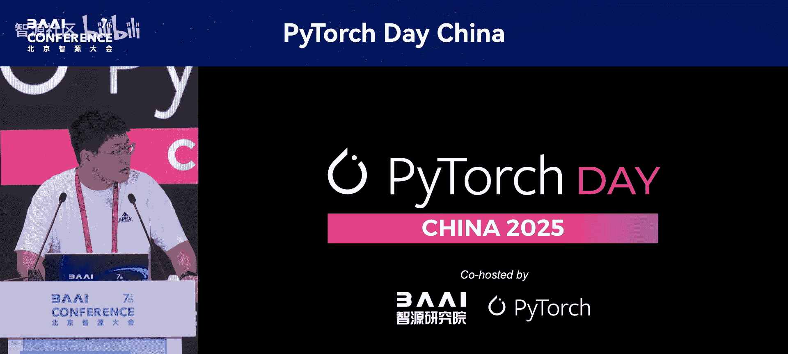
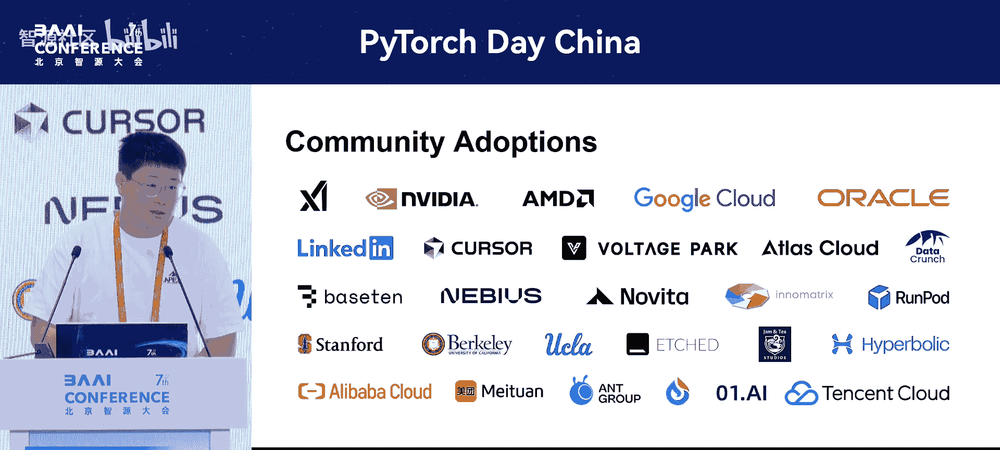

# 2025北京智源大会-PyTorch Day China p17 SGLang  An Efficient Open-Source Framework for Large-Scale LLM Serving：Liangshen -BV1PPNWziED7_p17-

All right， so our last talk of the day is SG Lang， an efficient open source framework for large scale LLM serving。

 and we're joined by Yin Lianxiung from Shanghai Jiaot Toang University。Hi， everyone。 today。

 I will present the talk at an efficient open source framework for large scale Im serving。

 And I'm Liang Xnging。 I come from Sha University as a graduate student。

 and I am also a member of the organization， LM Cs。 Yeah， so。

Yeah， so let's introduce what is。 I believe that most of you today may heard may hear heard of our open source project。

 we are a fast serving engine for and whereMs and we are we are currently one of the state of the art performance open source engine and we are the first open source implementation to nearly match the throughput reported in the official deepse blog at large scale。

 and meanwhile， I want to stress that our elegant lightweight and customizable design has attracted wide adoption from academics and big tech tech companies and such as X A and media M based on Microsoft and linking。

And we also scale as a high performance solution in the RL side。 Yeah。

 so today's talk I will today's talk I will the outlines into four parts。

 The first part is milestones and overall features overview。

 and the second part is our efficient design of implementation of PDD seggregation。

 The third part is large scale EP support and deep seek block reproduction。

 and the last part is our ecosystem of the strong community and future development。Yeah。So let's。

 let's take in the first part， yeah。This is our milestones and overall key features on 2023。

 we released our initial release with the structure LM programming and previous caching and also as well as constrain decoding in this version。

 we introduce the first open source and efficient previous caching to reduce the K cache and to reduce the redundant computation and last year summer we introduced our 0。

2 version we achieved leading performance in among all the open source inform with deploy of the Lama 3 and with 0。

3 release we release our  seven time faster deep ML and faster with torch compile and we also support multi image and and video video models and the last。

year， we release our 0 point4 release。 This is this release contains zero overhead batch scheduler cash aware D P router and X integration。

 And we are meanwhile， we are the first to serve deep S V3 and。呃。

Just oh just last month we first open sourced the implementation of a large scale expert par with pre and deco desegregation。

 we achieve like five time faster thanila D P and we match the performance mentioned in deep block and we match the API cost like0 point to dollars1 million token。

 Yeah， so the second part is is the efficient design and implementation of PD desegregation。 Yeah。

 let's talk about the issue with non p deaggregation non dissegregation scheduling mode as as we all know that without dissegregation scheduling the decoding batches will always be cr by preing this will introduce extra latency to the token generation。

 and the second problem is。D P attention with non disagation mode。

 it brings the communication and communication im balance within the same D P D P attention group decoding and prevailing batch they may mixed with each other and being executed simultaneously。

 this will increase the latency for deco tokens and cause the load imbalance。

The third one is encountered by with DP EP and this part I will also introduce later。

 Pre and decode they usually use a different dispatch mode without disaggregation。

 DP cannot support both in a same communication group so and we and we implement the P deaggregation and this is overview of our architecture for example。

 the purple one is the pre instances or clusters and orange one is deco instances we use the load balancer as a request entry point and this load balancer is for both pre and deco path So in our design。

 LB is decoup from computational logic and only responsible for select PD pair and routes to and return request is decoup。

And we also support non block and R DM A based K B transfer。 And also， we， we are。

 we offers flexible API integration of the transfer engine， for example， like Nxo and moon cake。

 just as Doctor。 Zhang just mentioned in last talk， yeah。

Here is a demonstration of the PDD seation timeline time time time step。 Yeah， first。

 we suppose that we have a pre instance and we have a deco instance。

 The first thing is the load balancer they should to send a request。They。

 they should choose a PD pair and send the request to both pre instance and deco instance。

 And there the first there is a handshake hand handshake process。

 The handshake exchange the metada of like index and address and the send the K cache center and the cache receiver they they are initialized during this phase。

 and the second thing is when you want to transfer the k cache to the engine the deco they must have enough memory to to put this cache。

 So the second。The second event is the pre allocation。 after the deco instance。

 they have enough memory for the K cash。 they， they。

 they pre allocatecate the K cash in the memory pool and then notify the pre instance that yes。

 we have enough memory so you can start the you， you can start the preing phase and and send K cash to us and then the preview。

 they begin the pre for words and after the pre they send the K cash to the deco instance。

The last part is the decoding instance to， to， to， to do the decocode after the decocode。

 the result is returned to the load balancer and the load balancer return the result to。

 to the user side。 And this is a P desegregation time step is also a demonstration。 yeah， so。

The next part is the large scale expert part and support and deepick block reproduction， y。呃呃。There。

 even there is only like three layers of dense layers in deep models。

 we still need to figure out how to efficiently serve these layers with dense FFN。

 we choose to use pure pure data parallel instead of tensor parallel or mix of them。

 this is for we we can avoid the TP fragmentation on large hidden size。

 we we we don't need to cut the tensor into into different T P ranks。 And and the。The the。

 the second advantage is we can optimize the memory efficiency for both pre and decode low T P degrees。

 they can benefit from only D P equals one。 this can reduce per device memory and。

The biggest and the third optimization is they can bring is to minimize the communication overhead by using purely。

P data parallel， we can avoid all the communication within the tensor person group。

 Then for all layer for every layer is only one scatter and one or。

 the scatter is before the attention part and all gather is after the the the the attention part only only twice communication。

And also for the M O E layers is Sprse FFN。 we use the parent strategy in deep block DP attention with therse FFN with expert paradigm。

 The reason is we can scale the model capacity， different expert can be partition in different devices。

 So this can this can support more expert numbers and removing the memory bottleneck。

 and the second advantage is we can this is not this is the challenge brought by the M strategy by the expert parent strategy。

 when you deploy the M layers with one DP attention dispatch Ee FFN and then combine。

face the pattern of a dispatch expert combination。 this brings some communication overhead and under utilization of GP P resources。

Luckily， this can be optimized by DP P and two batch overlap， which I will also introduce later。

And also， this this also brings the load imbalance problem。 And this can be addressed by the E P L B。

Yeah， so。The first， the first problem is to solve the compatibility issue with DP DP they hold two dispatch mode for for。

 for normal mode and low latency mode， normal mode they are they are friendly。

 but they use symbolic tensor shape。 this， this doesn't support the graph and the low latency mode they use static tensor shape is deco friendly and both of them they can support D P attention。

And there is auto mode to， to automatically handle both input and output。

 But as just just as I mentioned in in in several slides before。

 when you use per andcode within the same communication group in DP they are incompatible because there you cannot put to dispatch mode in within the same communication group。

 So this is a reason this is a how we the compatibility issue with D and this is also one of the reason that we should use PDsegregation instead of unified scheduling。

呃。this part， I will introduce the implementation details of two batch overlap for short T T TBO。

 This is an example of improper launch order of T PO。 You can notice that。

We want to implement TO with communication and computation are executed at the same time。

 simultaneously。 And if we dispatch the if we launch the dispatch kernel before the kernel。

 for example， the yellow ones dispatch kernel is launched before the green batchP kernel。

 So the dispatch， they will synchronization which means the CPU will be blocked until the GPU receive all the metadata from all other Ep ranks。

 then they can allocate the right shape ten the correctly size the tensors So you cannot launch two kernel yeah so the dispatch kernel launch will the launch。

 which brings the waste of computation resources and so we need to solve this by。

By placing the computation kernel always before the communication kernel。

 So there is a slight difference is we put the green ML LP before the yellow dispatch kernel。

 This is a launch order。 And for the execution side， they are executed simultaneously。第。So呃。

So in each round， follow the pattern of computation and communication。 Yeah， this is a launch order。

 than GPU can remain active during the communication。呃。So how to implement this in a clean manner。

 So we use the abstraction operation list and yield points。

 This enable cooperative scheduling and this eliminates code duplication and avoid some some possibly variable post fixes。

 and this can。This can also manage the partial completion of between different attention layers。

 decoder layers。 Yeah， so。This is our throughput performance。 and this。

 this benchmark result is also posted in our LM blog。

 You can just search at Google LM dot org and you can find the block。

 Yeah this benchmark is evaluate pre and independently assuming that unlimited resources for the other side。

 So and we can notice that for the pre mode， we achieve three times faster throughput than vanilla Tensor of 16 T ranks。

 and we for the deco part， we successfully enlarge the batch side from around maybe 15 to more than more than 200200。

 Yeah， and we also improve the throughput ofder by 5。1 times and this can roughly match the。

Blog post by Deeps in this February。Also， we we also implement expert par load balancer in real world solving challenges the imbalance worse at scale with some some know they will accept so many routed experts and some know they are they are staying idle without routing expert to them。

 So two strategy to improve balances we can improve the batch size and improve the clusters we can improve this while cluster scaling and speculative decoding like mP with mP。

 we can forward like one or2，3 four tokens at the same deco time and then the batch size they can be multipleied like three or four times。

Also， ats implementation implement a a re rebalance for。

 for just exchange experts ways with toch P to P operations。

And this is operation study of effects of scale and ELB to balancedness。

 The balancedness is defined as the ratio between mean computation time as a maximum computation time for M O E layer among GPUs。

 the balancedness decreases when the system scales with a number of nodes。 and we can。

 we can find that enabling EL B significantly improves the balancedness。Yeah。

 and this is all part of our reproduction of deepseick block。Yeah。

 so the last part is our ecosystem and a strong community and future development。Also。

 we we are the first we are the first one to open source the deeps large scale E deploy。

 and there are some future work we need to solve is the first one is the latency optimization the first latency and intertken latency is is still too large and we need tuning for realtime use cases。

 and the sequence length is constrained by by limited 96 GPU set up and mP and data parallel attention is not fully integrated together and is only in in simulated workload and and the dense layers of FFN they can be benefit from small T size and we only support tensor full tensor and all four data parallel。

And we also plan to support black wh architecture。 And if anyone here want to join the community to contributed to the black wh support。

 you can just join our slack。Yeah， so this is our team。 Yeah， we， our team is incubated by L Cs is。

 is a corporation and non benefit。 And the the there is the list of the major maintenanceers。

 and we have contributors over 400。Yeah呃。The last page is our community adoption。 So we have yeah。

 the， our biggest client is X A I and Nvidia and AM M D。 And also。

 thanks to Pytors to give me this chance to give this talk。

Yeah， thank you。All right folks， so just a few more thoughts before we wrap up the day。

 I do want to thank again BAI for hosting us and of course I also want to thank each and every one of you for attending today as well as our speakers who have imparted their knowledge and skills and onto us and so I think very happy for that so maybe we can get a round of applause for everybody here。

All right， just some final thoughts。It's a great time to be alive in AI。

And I think as long as we work in the open， as long as we work together and we build community。

 I think we get much better results and we strengthen you know our resolve and so if you're building something。

 you're doing research or you've got a great project， strongly consider you to do that in the open。

 open science， open source， it's the right way to go if you're training a model。

 look at open licenses for those models as well like the OpenMDW license and you know I think it's just very important that we keep the dialogue going that we collaborate across borders and you know talk to the peers that you met here today。

 work together， join the WeChat for Pytorch， and let's work together to build an open source AI ecosystem。

 thank you very much and thanks for attending and I hope to see you next year。

