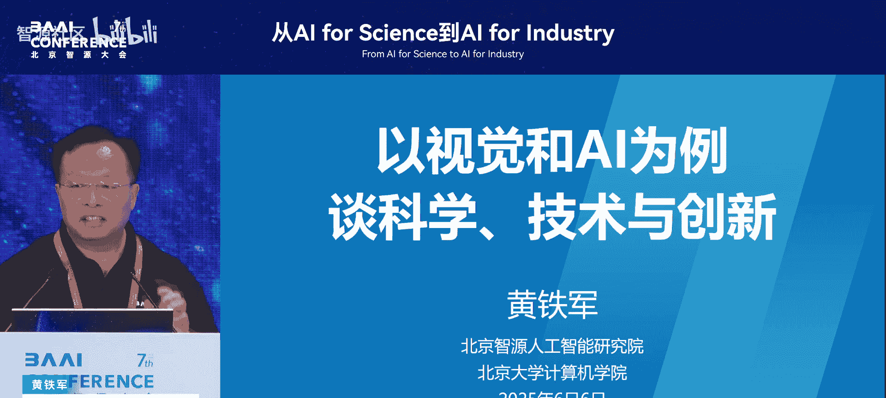
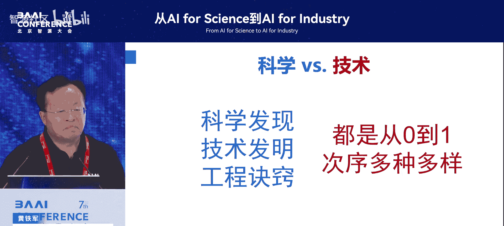
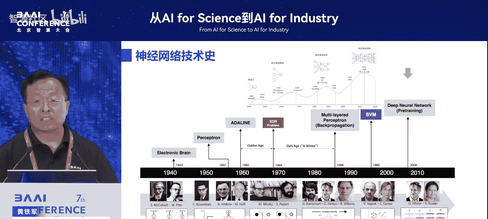
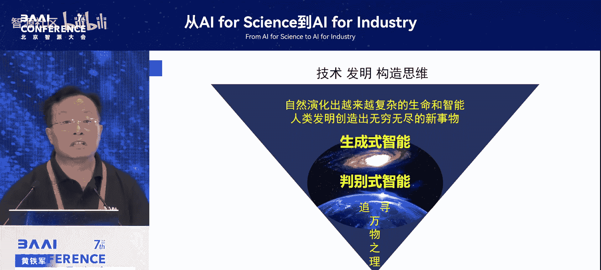
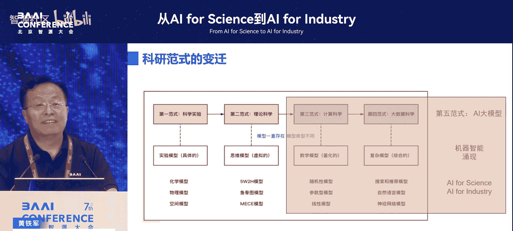

# 2025北京智源大会-从AI for Science到AI for Industry p03 以视觉和AI为例谈科学、技术与创新：黄铁军 -BV1r7NjzCEGd_p3-

那么下面呢我们听一下科学家的声音，有请黄铁军理事长。🎼以视觉和AI为例，谈科学技术与创新，有请王院长。🎼呃，刚才程总啊，这个把咱们今天主题的论坛诠诠释的特别，我觉得既强大又前沿又这个呃也可以说接地气啊。

在很多领域都得到了很多应用。我呢是来自于大学咱们智源的研究所学界的哈，我就从学究的角度啊，学究哈，就是喜欢抠这个词来这个谈一下呢。

对这几个AF for science AI for industry的一个呃个人的一些一些看法跟大家探讨啊，所以我就用了这么一个名字。呃，刚才呢这个南总介绍啊，我是科学家。这个呢我就开始不同意了。

我不是科学家，但是你因为咱们中国人讲科学家是包括科学技术工程，但凡这个搞科技的，都都叫我们科学家。但其实呢科学和技术是两个物种呃完全不一样的这个思维方式。

所以AI呢作用到科科科技科学技术和包括我们工程呢实际上是形式方法是是是不一样的。😊。

呃，什么叫科学呢？科学呢？是探索发现事物和现象背后的规律，叫做科学。最典型的就是自然科学、物理、化学、生命。因为这几个对象它是它是客观自然存在的那这个科学呢就要去发现背后的规律。科学家啊。

咱们叫文武这个这个这个什么文文武第一文物第二哈，科学家只有只有发现发现就只有谁最先发现谁就是唯一的这个这个number one所以他没有没有没有第二的哈，科学没有说你第二次发现，没有。

谁发现谁就是这个第第一的技术是什么呢？技术是创造发明新的事物，叫做技术。😊，技术的这个发明对象，研究对象就是一个一个。主要的还是人工物啊，就人人造的。所以你看啊刚才是自然科学。

它是自然存在的技术搞的是人工的。你看我们手机对吧？这都是人造的人工智能啊，这都是人造的。所以我说我不是科学家。我是这个如果如果大家同意的话，我也也最多能算到搞技术的这么一个一个一个一个门类。

为什么要去纠结这样的这个概念呢，是这是跟我们今天的这个这个创新啊，特别重要的一个。因为我我认为呢长期以来哈，这个所谓长期也就是一个世纪吧，以来。😊，尤其是以北京大学，这个当年讲呃赛先生德先生。

赛先就是science，对吧？这个我们全可以说全民对science的这个认知呢，经过一个世纪以来得到了很很很很很加强啊强强化。😊，甚至形成了一种偏见，就是认为科学技术科学是基础，技术是应用。呃。

这是我们可能想都不想的一种典型的思维方式。其实这个是片面的啊，我现在说片面的，呃，在某些方面是适用的，但是在很多方面不适用啊，咱就举例子看哈。😊，比如说这个核能原子弹核电站，这是技术啊。

因为地球上本来没有原子弹，对吧？也没有核电站，这当然是是技术。但是呢它确实是受益科学的发展。呃，我就时间有限，我就不一一的去说了哈，大家看这个我们这个物理学呃。

特别是这个这个上上个世纪前面的几十年量子力学这个这些物理的发展，对于核原子原子之下呃更小的这个单元的认识呢，是起到了一个基础性的作用啊，一直到一直到1932年。😊，之后就进入了技术时代。

就说就是核的技术时代，就是你人工要能控制这个原子，然后让它爆炸，对吧？以及产生受控下产生核能，这全是这全是技术。所以在这个例子中，科学发确实是基础技术呢也可以说是应用啊，也也没有错。

但是你看任何一个技术点都不是科学家告诉你怎么做的，怎么做是技术的问题。所以一个可控的核聚变，这个整个它是一项一个一个自然没有这个对吧？自然就是在自然发生的这些这些这些事情。😊。

所有的这些呢某种意义上都是技术发明，怎么创造一个人工的结构，让他去去爆炸。技术是界第第二啊第二不是谁第一第二那个意思就是比如咱们说两弹一轻为什么伟大，因为美国这个把原子弹爆炸了，他不告诉你严密封锁。

对吧？你中国要造这个原子弹氢弹，那你就得想这个路你再重新走一遍，他事先爆炸，但是他不告诉你的情况下，你又把它再做出来，这是从零到义啊，因为别人不告诉你，你看你还得重新摸一遍，所以咱们今天很多卡薄的问题。

就是这一类，别人也会哎就不告诉你，这个是事能做出来，就不告诉你怎么做的那如果谁能解决，那确实这这这仍然是这个原始创新。😡，所以这个例子里面呢，科学先发生技术呢这个这个后发生，但是技术要要发生。

仍然要有这个技术的很多呃这个技术自身的这个这个创造和创新。😊，这是一个例子啊，这是很多也是很多人认为科学是技术基础的一个最最重要的例子啊，所以我就摆在这儿。😊，但是再再换一个例子，哎。

他就又又又不是一一回事了。比如说这个因为我是做视觉的哈，这个做这个这个咱们今天视觉到处都用每个人的手机，对吧？你都有摄像头，这就是这个记录光，对吧？技术就是要你你你你光是自然存在的。哎。

你怎么把它这个这个记录下来。😊，但是光本身的认识那是科学，对吧？那是科学。那自古以来大家都关心这个问题，牛顿会更会更斯到一直到1905年，爱因斯坦光是什么？光是玻璃二象性，对吧？

这是这是我们对光的一个基本的这个科学认识达成达到了。😊，但是呢记录光他要不要以科学为基础。哎，你先看啊，1905年这个咱咱先说哈，牛顿那个时代对科学的认识不清楚，还得争论，谁也谁也说服不了谁。

到底是例子还是播的时候呢，哎搞技术的人就搞出来了，照相对吧？这个能能拍照片了。所以这两件事没有关系。搞照相的人和他根本都不参与他们俩的争论到底是啥，反正我能想出一个办法，用化学的办法，哎。

把它给记录下来，这就算这个这个这个达到了目的。😊，哎，但是技术一旦这个进入这个轨道之后啊，技术惯性特别强，就一直会沿沿着这样的技术方案就就就就一直走下去，一直走到今天。😊，走到今天啊。

你们所有人手上的手机那个照照相的方式和1839年的照相方式完全一样的。曝光打开快门关上，哎，形成这个一幅一幅照片。尽管今天用的这个这个技术手段，是光电的这个这样的一种一种新的数，咱们叫数码的方式。

但实际上你照相的方式还停留在差不多两个世纪之前的这个这个呃模式上技术方案上啊，技术技术技术技术方案上。😊，我刚才说了，1905年，爱因斯坦都告诉我大家了，这个光是柏利安天我们很清楚光是什么。

但是在整整的100多年中，就没人去去去去去关心这个事儿。科学家当然关心，对吧？但是搞技术的人视而不见。😊，终于一个人视而见了，就是我就是哦原来我们今天照相早就不应该像两个世纪那是之前那样的方式了。

我们应该用今天的光电这个这个这个器件，它是离散的一颗一颗的这个这个颗粒哈，来记录一个离散的一个光子流。那我们就应该用一个新的摄影的方式。所以。😊，也可以说历史哈给给我留了一个重大的机会。

因为科学有100多年的发现，竟然就没有人利用它啊，所以我觉得呢我做了一个重大的这个发明啊，是因为就我像小学生一样的认真的看一看啊，光是这么回事。我们搞这个摄影就应该这么做哈。这个今天实间有限不展开了。

有机会在家跟大家讲我做的强大的这个将来哈希望咱们移动的每人手机都是一个超高速相机连续不断的能拍摄世界的。我们现在已经做到了，但是还没做到手机上，后续在在这个努力哈，所以这是另外一个例子哈。

就是说你看着科学和技术的关系啊，这个好像啊很很经常互动，其实不是那么回事。大家真的认真的你这要研究一个东西呢，再看一看的话，其实创新机会很多，当然关于光的认识，不仅仅是爱因斯坦。

后边科学上还有很多发现的。那在我科学上生生命科学里边，生物视觉上有很多发现，但这些发现都没有在。😊，我们今天的这个这个手机啊视觉系统里边得到得到得到得到得到应用。所以创新机会呢可以说无处不在。😊。

所以我刚才讲这个两个例子呢，多多少少是跟科学都有关系的。但是今天我想更重要的说，很多时候技术的发明跟科学没关系。😊，根本都呃不依赖于科学例子太多了，那就就经常举三个哈，一个就指南针。😊。

中国发明指南针的时候是宋朝甚至于更早的时间，发明指南针的那个人，他有科学知识吗？对吧？电磁学、南极、北极啊，没有完全没有不可能，但是他就发明了指南针。莱顿兄弟1903年发明飞机，他是有科学指导吗？

有科学理论吗？没有，因为科学理论是在1939年到1946年才出现的，所以他就是工程师，他就是用这个一个一个一个一个技术手段啊，然后飞起来了，人工智能也一样，深度学习大模型。

我们今天讲的都是这样的一种人人人这个我们就说技术啊，不叫技术家哈，咱们技术人员工程师。😊，创造了这么一个东西，哎，它具有智能了。它不以科学为前提。尤其是很多人老是对这个质疑说有没有真的智能，有没有真的。

你测就行了嘛。飞机会不会飞，这还用说吗？它天上能飞，这还用你质质疑吗？至于说你知不知道为什么飞会飞。为什么这个智能的这个这个原理，那是另外一回事儿，不知道它发生了。

那我们就得首先承认这个客观的客观的存在。😊，所以呢这个世界上很多时候是先有人类发明出一个东西，这东西太多了。我说豆腐混凝土，随便你看现实生活中的这个这个这个这个所谓的新东西。

人造的东西都是大多数啊都是人先发明出来，后面后之后再去找背后的这个科学原理的。呃，这个刚才讲过了哈，时间有限，我就我就我我就跳过去啊，有很多例子啊。

包括的我们今天经常我们今天啊讲这个信息产业这个最重要的一个一个发明晶体管，晶体管是晶体管，当然是人造物，对吧？它又不是自然存在的晶体管，但是它得了诺贝尔物理奖呃，大家就认为它是科学，它当然不是科学。

它就是它它首先是一个技术发明。😊，然后这个这是几位这个学者啊，所以他们当时呢就当时获这个领奖的时候就说我们基础研究应用研究二分法的主要目的就是贬损一方抬高了一方，这件事在北大出现的特别多，我们数理化啊。

这个经常说哎，你们计算机的，你们这个什么工学院的都是在我们的思想指导下，这个做的应用，我说我们不对，我们很多时候根本都不要你们启发，对吧？我们就是自己在在创造，呃，确实如此。

所以但是这种思想已经被广泛的传播，所以造成了这个什么叫创新，对吧？这样的一些一些一些一些误解。其实中国有很多创新。如果如果不被这种思想所所误导的话。😊，所以你看哈这个这是两个轨道哈。

这个英国的两所著名的大学哈，牛津剑桥牛津是科学，可以说偏科学，剑桥是不能说偏技术啊，这个但是到这里如果你一定要区分的话，可能这俩还是有这个特点。但是呢他们正好反过来写科学史的是剑桥。

写技术史的是是这个是是是牛津。😊，呃，咱们就看技术史啊，我们一般说这个科学都是从这个这个16世纪哈，伽利略发明望远镜，大概那个时代科学开始这个兴盛起来。

但是之前人类这个说中世纪黑暗时代再往前那个蒙昧时代，那个时候人就不活着了嘛？人就不要创造事物嘛。当然要创造，否则的话，你还在树林里面摘果子呢，对吧？所以从这个树林里面走出来摘摘果子，你到底是爬上去摘。

你还是用个树枝摘，这这都是技术都是不同的对吧？所以这么几千年甚至几万年过程中有大量的技术的这个发明，那时候都不是科学指导，那都是一个从从从这个从可以说从实际需求来来来做的这个从零到一的这个创新。

所以你看技术史啊，这个里边我我我刚才讲，大家仔细愿意看的话，很多例子都是跟科学没关系，对吧？他就他就他就这个发明出来了。😊，所以但至少呢我们可以说这两个啊这个是相互促进的，绝对不是单向的。说科学是基础。

学好数理化走遍全天下。学好数理化，剩下的问题就是用数理化来解决问题。这个这个逻辑是片面的啊，所以它是它是相互的。😊，我们今天啊最近还在报国家奖哈，这个我们国家奖呢是分这个几类啊。

自然科学奖技术方面奖、科技进步奖大家一般都认为自然科学奖是创新性最强最基础的，我觉得到了科技进步，就是这个就是应用了，其实也是也是做的啊，科技进步不光是应用。但是有些科技进步确实是应用。

但是呢如果你像刚才解决卡脖的问题。别人是实现了，就不告诉你，你你那那那不是从零到一吗？对吧？又没有理论指导，对吧？又没有前人的这个这个这个刚才说模板，你就得那都是从零到一，所以我所以呢我们说创新啊。

就是科学发现是创新，技术方面也是创新功程诀窍，同样是创新。😊，真正的这种创新都是从0到1，并不是靠着别人的这个这个这么理论指导下做的啊。

次序呢可以多种多样。呃，这样咱们就讲AI啊，今天是AI的会哈，咱们就看AI的例子。其实呢AI同样如此。我一直很长时间，我就说AI首先是一门技术。虽然不能说它只是技术，对吧？说只是技术有点绝对哈。

就是首先是一门技术。你看啊从咱们今天用的大模型人神经网络，从1940年代到现在这么多年，这么多人做的什么人工神经网络，只要加上人工这俩字，它就不是科学，它是人要设计一个这个网络，对吧？训练一个网络。

让它产生智能，这全是技术，不断的改进技术，不断的这个这个这个优化，然后让他的这个智能的效果能做出来，它不是以什么科学原理，以智能的大脑的奥秘为为为为这个技础。

而而是呢当然一定程度上是借鉴了生物的这个神经网络这样的一个参考来设计的这么一个人人工的对象。所以今天啊人工智能能有今天主要是技术的这个这个。😊。

你看1985年的hinton为代表的吧，这个反向传播算法到现在为止我们也没在大脑里边找到反向传播算法。但是这样的一个算法呢，确实是在这个这个训练神经网络里边效果效果很好。😊，呃，有一些理论的分析。

但是这个理论分析是在这个效果好了之后的理论分析，对吧？呃，这是1989年的一篇文章哈，就是说一个神经网络是可以做任意逼进的。简而言之是这样，这是一个解释。

这个解释是在有了神经网络多层神经网络之后的一个一个解释，也很重要啊，就是告诉我们这么走是有数学依据的。😊，今天我们的人工智能叫生成式人工智能。大家一说生成就理解生成是生成图像，生成文本，对吧？

这可以帮我这个这个呃做这些代替文案很多工作，这是这是生成的一个意思。但是它更深刻的意思是。😊，它是两种创新的思维，或者两种这个这个甚至我们可以说宇宙演化的两种模式。科学呢是判别式的这种思维方式。

总要去找背后的基本原理，对吧？物理物理我们找的是最后的原理，但那只是整个的一个维度，那是向下找还原论。自然界不是还原论，自然界是像说比如说生命是本来不存在，后来有人对吧？后来存有了生命。

后来再有人有了智能，它是个演化发展的过程。生成是更重要的是这个意思。😊，你随着时间的这个发相互这个发展相互迭代，这个世界越来越复杂，智能越来越强。那今天的人工智能主要是走的这样的一条路线，不是刨根问底。

说这里边这个背后的这个这个这个有什么这个智能的基本原理，在决定着我们的人工智能的发展。所以生成式人工智能更多的是一种思维的方式，创新的方式，甚至于我们可以说是呃复杂系统。

包括智能在内的一个产生的这样的一个一个方式。😊。

然后这几位那个。今天上午啊ban着那个做报告哈，之前hinton和乐坤都做过报告，他们是2018年获得这个计算机的最高奖图灵奖。所以你看到获奖理由说的是在概念和工程上的重大突破。😊。

所以你首先就得有这么一个想法，然后工程上你把它实现出来效果做出来。哎，他就可以得奖了。所以所以他主要是这个尽管黑ton也得了诺贝尔这个去年的这个诺贝尔物理奖哈。但是我想今天如果大家这个同意我都说好的话。

他更多的还是一个技术专家对吧？然后做成了一件一件事情。😊，呃，我们今天讲的大模型啊，最主要的贡献就是奔轴哈，今天上午做做大会报告的。😊，他的贡献大家看哈，我们今天说这个比如G呃GPT啊什么这样。

其实是2000年到2003年奔着发表的两篇文章，已经把怎么训一个GBT的技术路线都很清楚。😊，都说就是预测下一个token把每个token用一个高危向量表示，这都在那论文面写的清清楚楚。

所以方法是他从零到一提出来的。后面的有发展啊，但是时间你看我还有6分钟啊，我就快速的这个呃跳过一下这些发展呢也重要。但是最基本的咱们就说这个技术发明的这个从0到一的思想呢是本n9的。

不是我们后来任何公司包括志源在内啊，那都那都是后来用这样的一个方法在在再优化在在发展。😊，所以你看2018年那个openI这个提出来这个大家耳熟能详的用。前K个单词预测DK加一个单词，预测下一个ta。

当年的论文写的不不完全一样，叫用前N减一个单词预测第N个单词，也就这么点区别。😡，方法上啊是可以说是是完全一样的。当然你要优化一个系统，工程上优化一还是有很多工程的工作要做。呃，但是呢就像我刚才说的。

这样的一个这样的一个一个技术实践哈，随着网络规模的扩大，技术这个数据的增加，高质量的提升，使得它出现了越来越强的智能。这个智能不是设计出来的这个智能是这样的一个大规模的网络系统自然产生的，所以人能做的。

就是设计这么一个一个一个一个结构，用数据去训练它，这是人人能做的，但是它到底产生什么样的智能，什么时候产生智能，什么时候涌现。

这件事不确定的这件事是一个是一个类似于类似于就是这个这个演化一样的出现的出现的功能，所以不要认为搞人工智能多聪明，搞人工智能就是咱们讲马农对吧？现在说马农又不太准确。因为它迅动模型，不光是变代码了。

但是总的来说，就是一般工程技术人员在这玩一个东西。哎，这个东西玩的越来越能力越越强。造飞机。😊，对吧那你去优化它啊，最最后这个飞的这个越来越越来越高越来越远。当然就这么一个一个一个方向啊。😊。

但是呢确实是出现了在一个规模达到一定程度，确实出现了这样的智能。而且甚至于呢在这个一些方面，这个对人的能力已经超越了，比比人更强了。但但是背后的方法是一样的，背后的方法没有变。

是这个系统复杂度提高之后带来的一些11一些效果。😊，当然我们一定能能造出这么个复杂系统之后，当然就要反思，就要去找背后的为什么，对吧？这是科学。所以现在人工智能开始有科学的一些属性了啊。

我就举几个例子哈，比如说这个2021年的时候，那个鄂卫南院士呃呃发表过一篇文章。当时他是呃这个因为都在北大呃，我们还专门讨论过，就是原来的一些传统认识。😊。

在大模型实大模型这样的一个新的继器学习大模型的这样的一个新的这个实践下呢，要要做根本性的变化。我们原来解决问题，包括计算机里边很多问题，微数灾灾灾难位数越高，哎呀，这个计算复杂度越高。

指数增长这个计算没法没法算了。所以我们上来就想降维维度降低一点，哎，这个东西就就可行了。😊，但是对神经网络对大模型不是这样的，不能说维度越高越好，但是威度高，反而是好事，反而是好事儿。

这个这个很多这个问题呢，而且这个计算量还没有指数增长，变成了线线线性增长。传统数学工具解决不了的啊，就靠这么一个高维的这么一个一个一个工具呢，就就就能提升。😡，第二个，如果大家年龄大一点哈。

我就是年龄大一点的哈。这个这个上个世纪80年代上学的时候，这个教授们都会讲，对吧？这个优根据这个优化理论。😊，你这个神经网络搜索从一个任意点出发，最终要达到最优值呃，这机会很小。

你基本上很快你就落到一个局部最最优掉坑里面，掉到一个潜的坑里面了，你找不到那个最优值。这就是我们大家学生都这么培养的，都这么认为，哎，但是到了大模型。😡，事情变了。很容易达到最优值。

那后来你就反思这东题为啥呀？实践证明确实如此啊，为啥呀？是因为高位空间和低位空间，它本身的规律就是不一样的。我们不能把低位空间的这样的一些常识简单推广到高位空间。呃。

当特别是大模型是千维万维这个这种高位空间的时候，你就一人只能三维空间去想象，对吧？你想象不出这个一万维是什么样。但是在1万维里边的这个数学哈确实有新的规律，就是。😊，我们是低位空间。到处是坑。

高危空间到处是马鞍点。😡，很容你到一个按点，你你是在一个坑里边，但是很很很容易跳到一个按点，又滑到另外一个坑一个一个坑里边。😡，而且呢你你你可以说你不管走哪条路，最后你总能找到那个最优点。

这原来想都不敢想，怎么回怎么可能呢？但是它高位空间就是如此，所以这就是这个事物的这个这个复杂啊，我们是复杂复杂系统复杂性，存在的这种这种机会。所以要没有大模型数学家想都不敢这么想，对吧？

它会他很简单的是从低位往高维去推广，但是事实当真的你可以玩高位空间的时候，就发现这里边完全有全新的规律。😊，还有呢这是原这到现在我还有很多人啊说大部型就是统计。😊，统计是对传统统计的那那个场景是合适的。

对大模型来说，传统的统计它就解释不了。咱们就这么讲，他解释不了哈。比如说啊这大家都知道的一个双下降，传统的说你用的这个网络参数。我们现在都用千亿万亿参数啊，参数太大的时候呢。

确实可以逼近这个这个让误差逼近零，但是你的算法能力就变差了，就这就跟高考，你把所有的题目背一遍，是每天每道题都能答对答对，因为你因为你这个参数足够多，对吧？你根本都不问为什么，咱就就是问题和答案。😊。

但是呢给你新问题你就不会了，对吧？那就叫泛化能力太差。所以原来就这样认为你真的用一个什么什么这个刚才别说万亿级啊，就是说这个参数就是很大的模型的时候呢，它就不行。哎，大模型就就就不遵守这个规律。😊。

随着网络规模的这个参数的这个扩大，它不仅是误差降低了，它发挥能力增强了，这就是事实。所以先把这个这事实发生了。然后咱们再说啊啊我们这个我们这个认识要变，对吧？我们得用你去创造新的数学数学理论了。

所以这就是今天啊，当然这都我想举几个例子的意思，就是呃这个我们不能用传统的思维方式来看待这些东西。如果这样就没法创新了。你要真听那些传统的统计学家的数学家的那一套的话，不可能有大模型。

不可能用人工智能的这个这个这个创新的出现。😊，这个呢是一本书啊，最近应该一两个月就会出版让我写了写这个写这个推荐哈。所以我就这个引用了其中的图。但是那里边还有更多的一些这个介绍啊，大家可以看。

所以最终啊哈时间到马上就到了哈。我想说呢就是AI呢确实是给我们的这个这个创新带来了一个新的全新的机会。

它对AF for science AF for technology AF for engineering AI for industry呃，AI for o。

说所有的其实都是一个全新的这么一个一个一个一个一个工具，甚至于是一种全新的思维方式。😊，为什么会这样？😡，因为我们今天啊我们很多人对科学，对我们搞科学的人搞科学技术的人的认识，总是当成一个象牙塔的。

就就是一种基本的假定。其实呢传统的方式，传统的这个这个手段哈，可能真的是解决不了这个这个这个问题。传统的用方程用这个用用这些包括我们计算机里面的这个传统的这些算法的方法解决不了。

因为你根本都人就认识不到人你就我们的智力就没到那个程度能够给你一个答案。所以这时候呢就要创造这个没有办法形式化，没有办法用传统的方式，没有办法用传统的算法去刻画去表达的这些难题，怎么解决现在一个新工具。

就是用神经网络，用更多的参数，更大规模的网络去尝试逼近它来这个来找到这个解决解解决的问题的方案。所以我们说AF scienceence啊，这个science这么多年五六百年期间一开始做科学实验。

后来呢是理论啊，包括我们这个牛顿万有引力定律，对吧？😊，确定了方程，很多都是靠方程，靠这样的麦克麦克思维方程，对吧？这是这是经典的方式。但是今天我们面临的问题，很多现现实问题，包括很多工业问题。

科学问题都是很都是复杂问题。这个复杂问题呢用原来的理想的那种简洁特别美的方式解决不了，只能用新的方法，这个新的方法前几这个之前啊我们叫这个计算机的仿真，对吧？现现在这个计算机的仿真一次核爆炸。

咱们不报了，咱们直接在计算机这算算一遍，呃，前十来年之前吧，叫大数据对吧？用大数据分析。今天呢我们叫这个这个大模型。其实这这几个啊，也许可能我们也可以放在一起啊，就是总的来说。

我们是以这个计算为一个基本工具来让它在这在让一个复杂的系统在上面运行，然后呢试图产生一些新的复现一些新的一些现象，产生一些新的现象，然后呢争取呢能。😊，能够对这样的一过程呢，通过人为的方式可以控制它。

可以让它发挥作用。大概我们就真的是进入了这么一个一个一个新的这个呃创新的时代。经典的科学我们很尊重，但那都是殿堂中的东西。我们现实中的科学技术工程。呃。

我们要用这个最新的这种工具和最新的思维方式呢去解卷。好我就讲这些谢谢谢谢。😊。

