# 2025北京智源大会-从AI for Science到AI for Industry p04 能源化工行业大模型建设实践：杨文军 -BV1r7NjzCEGd_p4-

我们有请。中国石油数字研究院院长杨文军先生进行主题为能源化工行业大模型建设分享。大家欢迎。🎼好，感谢主持人哈。😊，🎼呃，我是来自中石油数字研究院。

这一年多呢一直在做这个这个中石油的大模型的一个建设实践啊，这一年多一直跟咱们冯老师领导的这个团队啊，呃天天加班加点呃，一个季度迭代一次，刚好完成了第四轮的迭代，呃，冯老师前几天说让我过来讲一讲。

我一看开始我就拒绝了。我说这个这个我们做的东西吧，跟咱们这个AF上还是有距离的。因为我们做更多是说企业里面是如何解决实际的问题。如果能够用上，而不在于说把这个技术一定要做的多深啊，多好。

所以这整个出发点会有些差异。但是正好今这是咱们的主题啊，是F science to aF for in。那这个倒是可以给大家提供一个在工业界。或者在像这种我们的中石油这样的传统的能源企业。

如何去实践应用这个大模型技术的一个案例啊，所以我觉得还是有一定的给大家一个借鉴的意义哈。所以今天也给大家做一个简要的报告。😊，那么整个中石油做的大模型呢叫昆仑大模型，它整个开始的时间啊。

其实是从去年的年初开始准备，正式启动的是在去年5月份。

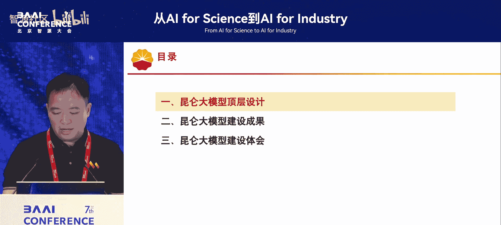

到5月28号启动的，到刚才那个这个前几天5月28号正好是一周年，我们是一季度迭带一次，总共完成了四轮的连代。那么它是整个能源化工行业首个通过国家备案的一个行业大模型。那么我们做这个事呢，上来先做什么呢？

我们先做顶层设计，我们先要弄清楚，要做在一个企业里面，尤其这种集团级的企业里面，如果要做大模型的应用，从哪下手？那么总的来看，我们认为要从五个方面下手，也就是我设设的五大目标任务。

第一个你要建一套国内领先的行业大模型。在这个基础模型基础之上，要面向这个企业的应用，面向行业的应用，要设计自己的一套大模型。第二个要做创新应用场景，这是企业的一个强项，因为企业里面有太多的一个业务流程。

太多的这个价值链，这里面都有很多的场景可以挖掘。第三个是要有高质量的行业数据集，这又提到在企业里面不缺数据，每时每刻都能产生数据。而你如何能把这个数据用上，才是真正有价值的地方。

所以我们还要把这个数据集给建好。第四个要建集中统一的AR中台，这也是跟冯老师的团队一起来建的啊，这个一会可会讲一下，他为什么要在企业里面建AR中台。第五个呢就是你得有算利。那么我们要有个自算的中心。

所以我们把整个企集团级的企业，如果要开展大模型建设。

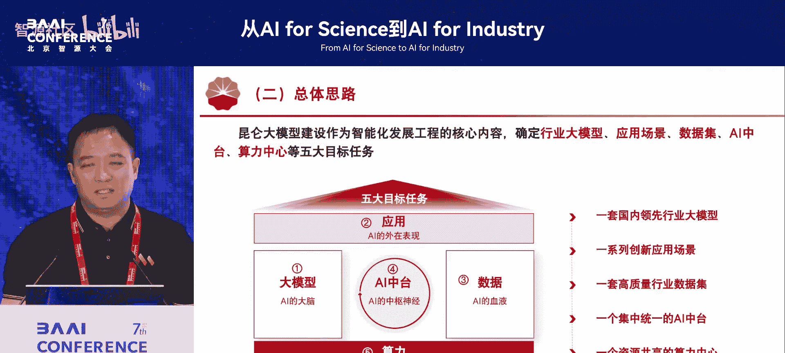

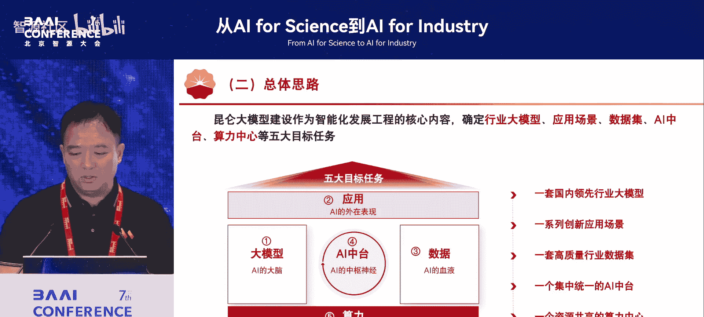

分为这五大任务。

那么我们首先做大模型的规划，大家说模型为什么要规划呢？可能AF size不需要规划啊，这个可能有版本的规划。但在一个集团企业里面有上百家这种企业，大家都在想去做大模型的时候，你要有规划，否则是做散了。

做乱了，做重了。在这种情况下，我们把这个这根据中石油自身这个产业链比较长，业务比较多肽，多多某种多种形态，以及我们想面向行业的提供服务的这么个特点。我们把整个大模型的规划成四层。

大家可以看到L零层其实就是我们。😊，这个采购的商业的啊这个基础通用大模型啊，包括我们采购的咱们移动的啊多模态大模型，也包括这个科大讯飞的语言大模型和华为的世界大模型。在这基础上。

我们来训做做增强预训练啊，我们去训自己的行业大模型。这个行业大模分训完不光给中石用，我们是面向整个能源化工企业来提供服务的。第三个呢，我们在这个行业大模型上再去分专业大模型，这一层是个难点。

就是有那么多的业这个业务流程，业务的单元。你怎么去划分这个这个专业大模型，分的太细的话，浪费了很多的资源，分的太粗的话，难以达到一个专业化的水平的要求。

所以我们基本上分成4条线分别是业务条线管理条线共性能力和科技计算。再在专业大模型跟行业大模型基础上再去做面向业用应用场景的，通过微调就能够实现的，或者通过ra就能实现的一个场景大模型。

所以我们把整个大模型分成4个四个层景。这种划分的话，因为对面向集团及企业，还目前来看还是比较适用的。第二个场景场景也是非常多，怎么划分颗粒度怎么设计，才能够让这些场景互相之间不打架。

同时呢每个企业在做的时候互相之间不要重复建设，而能够遵循同一个标准去建设。这也是一个集团及企业开展大模型建设必须要面对的问题。否则话各企业各做各的，一定是最后出现很多划分颗粒度不一致，重复建设的问题。

所以我们按照这个这个一突出主业体现价值，这是密集，语料丰富的技术可行。五大原则，我们设计了470个啊，这个这个应用场景。其实下面还有上千个细分的应用啊，就是指子场景。

所以形成一个十亿百景千应的一个全景视图。有了这个规划，并且始终维护这个规划之后，我们就可以开展整个大模型的建设了。那么我们在这个过程中发现，我们在做时候没有太多的。可用的模板没有太多的方法论。

不像我们做信息化建设啊，甚至数字化转型的建设，我们总能借鉴很多国内外的一些案例。但是实际上在to B领域，用大模型全面开展建设这方面的经验还是比较少的。所以我们经过一年的时间之后呢，把这些方法提炼出来。

形成自己的方法论，所谓的三阶十部的一个建设方法的一个体系。啊，这是我们在顶层设计方面做这些工作。那么具体做了哪些工作呢，这边一一展开讲一讲，其实也是围绕五大任务来开展的。第一个呢我们做大模型的训练。

我们训了多少个呢？一共是60个，其中包括行业大模型是4个，有包括问答的推理的，也包括那个语言的视觉的多模态的。那么还有专业大模型8个这三个班装个8个专业大模型，更多是面向科技计算领域来做的。在体之上。

我们去微调形成48个场景大模型，目前我们形成的大模型的数量总共是60个。这个是按照一个季度迭代的方式来持续迭代这些模型。😊。

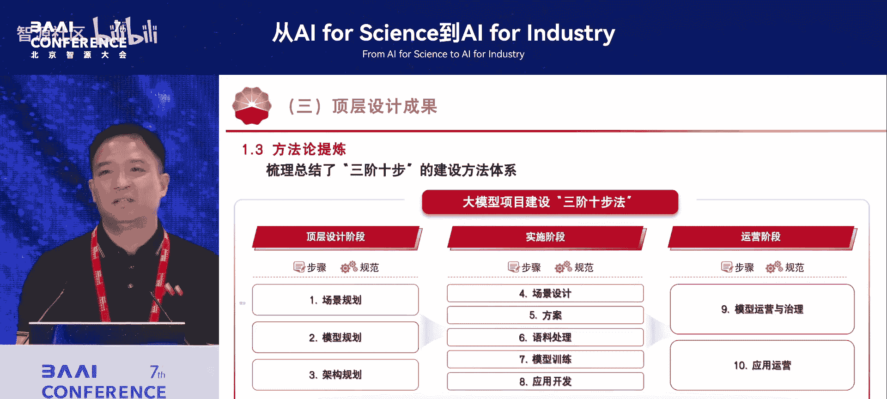

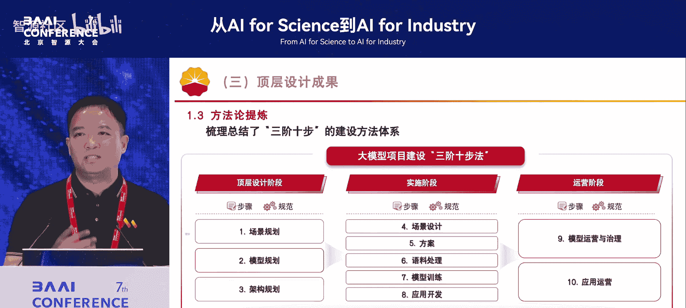

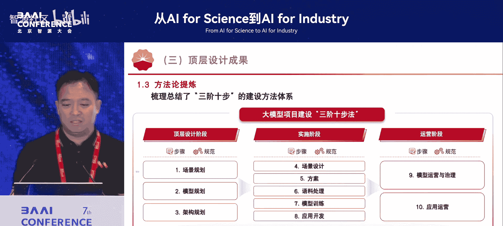

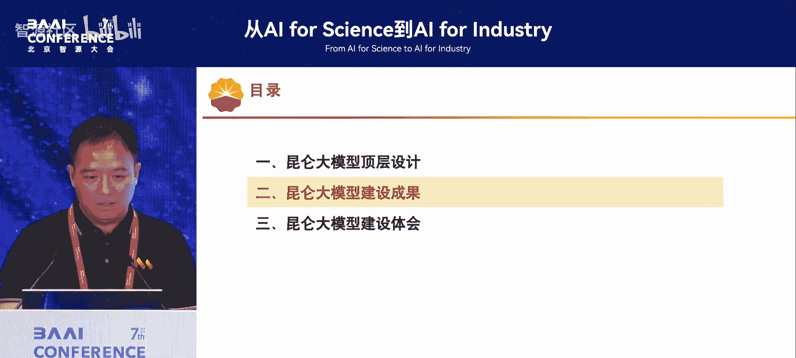

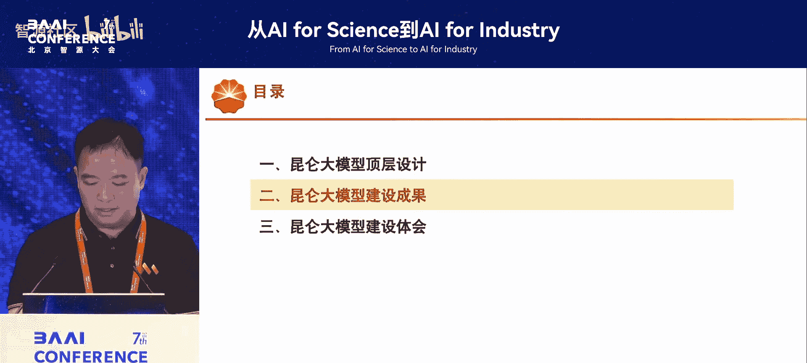

那么目前来看，我们的语言大模型已经从700亿最最最新一次的迭代升到了3000亿。视觉大模型从3亿升到了44亿，多模态大模型从160亿升到了800亿。整个来看的话，我们也通过内部的测试跟第三方的测试来看。

整个行业的理解能力，行业的推理能力会比基础通用大模型有一个较大的一个提升。那么专业大模型这块其实是工业界，我觉得是未来的是一个未来。就是在专业大模型层面上。

更多是要解决在专业领域的一些实际工工业场景中所面临的一些能够用大模型解决的一些相对能提升效率效能的一些一些领域。那目前呢我们做的一个是在勘探领域啊，我们的那个地震处理地震解释，测警的处理解释等等。

我们形成勘探领域的这个全领域的专业大模型。在炼化这边，我们做了一个持续大模型，去解决炼化领域的参数优化设备的预测性维护等等相关的工作。同时我们还做了用视觉大模型做的安全生产大模型。

以及物资招采大模型、问数大模型的代码大模型，这是我们在专业大模型方面做的一些工作。那么在数据集这一块的话，应该说是整个大模型的血液。高质量数据集是保证你整个大模型这个这个效果的一个一个一个根本。

那么我们根据大模型的分类分成，划分为行业专业场景三级的大模型，明确每一级这个数据集的责任主体管理主体，设立了内部的共享机制，尽管是一个企业内部的数据，要想进行汇聚，进行共享。

也需要有相应的考核激励机制来保障，来助推整个数据集质量的持续提升。那么存量的数据拿到手之后，发现完全不是为大幕厅训练准备的。那么我们希望增量数据不要再出现这种情况。

所以呢我们在一方一方面处理存量数据的情况，一方面又去制定相应的数据集的建设规范，来确保后续系统产生的数据。人工标注的数据能按照一个标准的规范来走。这样的话可以使我们后续的数据处理的效率大幅提升。

在这种情况下，我们制定了14项行业级的实际上呢专业级和48项48项的场景级的数据采集跟标注这个标注的标准来提高整个数据的质量。那目前整个数据集呢一共有500TB这500TB里面80%是工业数据。

真正的像我们的教材期康呃，这个论文这个行业的这些相关的一些资料加起来也不到20%。那么整形成的问答队是100万个，这100万个基本上为什么要突出这个数呢，很多都是人工表组的一个结果。

在这个自动生成的这个问答对呢很多需要人工在进一步进行处理校合，这里面的工作量非常大，所以这个产生的过程也是一个非常这个需要工作量的一个过程。那么最近呢也形成了行业推理的问答对，25万个。

那么再说到AR中台，这个这个AR中台在企业里面非常重要。可能A size不需要AR中台，大家直接就用这个命令行去处理就可以了。但对一个企业来讲，尤其是有多支队伍，上百支队伍同时开展建设的时候。

是需要通过1个AR中台，把所有的操作，能够进行图形化来设计，并且提供了用户来使用，这样就能够降低大家使用的门槛。比如说我们部署了三大流水线。这三大流水线就能确保你要做一个AR应用。啊。

用这三大流水线跑下来之后，就能够达到你预期的效果。同时呢我们也把这个多家的商业大模型的讯推工具链，这个统一来纳管。这个以前咱们纳管都是开源的纳管商业的要把多家的商业工工具链放一起。

其实不是一件容易的事情。在这里面也做了大量的磨合的工作啊，现在已经形成统一的操作界面，就能去训各种商业的大模型。😊，那么也支持主流的开源大模型的私有化部署啊，集成整个智能台智能体的一个构建平台。

那么为什么强调AR中台的重要性在企业里面呢？因为我们原来在信息化的时候，甚至在数字化的时候，我们没有很好的办法去管控整个集团内部的相关的资源。很多企业愿意自己来自建系统。

但是呢在没有一个很好的管理的手段。那么在AR中台这块呢，它集成了大量的资源，包括整个算力资源是统一来管理的。整个的这个人力资源算语法啊语料的资源，算利的资源模型的资源都是统一大的中台里面。

所以整个集团都在一个AR中台里面开展人工智能建设的时候，这项事情是可控的。而且一旦出现有重复建设的时候是可是可干预的。所以整个AR中台是整个人工智能建设管理的一个中枢啊。

这是做AR中台的一个一个重要的意义。还有是智算算利建设这一块，这块我们是完全以逐建结合的方式来构建国产化的算利体系。这个大家可能我去好多地方讲这个事之后，大家都有这个疑问。

是不是真的能够让各个大模型都在国产化的算利里面，也就是我们用的国产化的算力芯片国产化的计算架构，就能够完成这个训练，中断率是多少，差错率是多少，造成多大的一个这个重复训练的这个情况。那目前来看。

我们整个完全是控制的可控的范围内，通过国产化就能完成我们60个模型的训练以及推理那目前我们的高峰时的算利规模已经达到了1900多P啊，应该说这个也表现了表现出我们目前整个这个模型的使用跟应用的使用的。

现在的一个情况。那么应用场景的建设，现在总共是建了100个应用场景啊，主要先挑一些价值大一点的，相对难度可控的数据比较丰富的啊这些场景先做目前是一定一共是100个场景。其中生产管生产领域呢总共是69个。

就是办公类的营销类的服务类的这一类有31个啊，目前已经全部投产啊，全面提高整个的业务的效率跟效能。我们先看生产类的都做什么。在生产领域呢主要是覆盖了我们的主营业务。

包括开档开发、尤其生产内容化工、油其销售、装备制造等这些领域。那么这边我举了三个例子哈，因为大家在讲AF大学到怎么怎么AF大。我拿三个例子来讲一讲。

可能大家会有一个这个这个这个这个更多的一些一个一个体会。第一个我拿整个地震数据的处理。这是原来地增数据处理，大家可能都知道，一般都是要用超作中心来做的，就是一一般都是通过超作作。因为它的数据量非常的大。

但是现在呢我们通过强述分暴重新去改写这个算法，通过GPU的并行计算来提高这个效率。总的来看的话，目前整个效率是有大幅的提升。😊，这样的话，我这个效率提升有什么意义吗？同样去国外竞争一个一个一个石油区块。

如果你的计算速度比别人快很多，那么你就能更早的去啊落实整个的这个竞标的这个这个这个相关的方案。这个快本身就意味的是效率，本身也意味的是效益。第二个是已烷自乙烯装置工艺运行的一个优化场景。

就是我们现在在工业生产领域是获得大量的工业数据啊，都在存在实期数库时期数据库里面，以前这些数据呢也用来做机理建模，但是用的数据量很少。第二就最重要主要拿来做监控，了解当前运系统这个装置运行的状态。

但实际上这里面的数据本身蕴含着。整个未来的装置运行的未来发生的情况。那么通过强述风暴算法，能够去把这些高多维度的数据啊能够进行序列化，能够转成强输风暴去做这个整个这个深度神经网络的分析。最后出来结果。

我们发现现在已经跟基理模型相当。而且我们在增加更多的数据跟更多算力，有可能这块会比基理模型的反应会更好。第个第三个关于智能制造这一块，在整个的这个研发设计环节。

其实完全是可以通过这个大模型语言大模型就能够生成整个设计文档。整个的那个CAD图纸。那么在制造环节的话，整个质量检测这个用视觉大模型能非常好的解决泛化型的问题。

也就是我原来做整个装备制造的一些缺陷检测的时候，我是一种缺陷，用一个模型。一种缺陷用这模型。但现在我经过这个大模型的泛化之后呢，我能够识别同时识别多种缺陷，并且有一些缺陷，原先的提供的样本并不多。

也能做很好的识别。哎，所以在装备制造领域的话，这个大模型的应用也是非常广泛。😊，那么在管理服务领域，其实这个大做的比较多了。我们现在也做上上线了一批数字员工啊，很多的原本原本靠人来做的事情。

现在至少可以辅助人整个提高整个工作效率。比如说我们最近用这个这个这个数字招聘员工啊，就是解决这个几万份简历的啊筛选的问题啊，一下子把整个人这个效率提升了55倍。其实就是原来人要做大量的一些筛选工作。

现在全靠大模型来筛了。这样的话，整个的人只要去复查一下其中的问题，以及有一些模糊的大模型不确定的一些场景，通过这个人再去校验一下。所以这整个的效率就会大幅的提升。😊，那么最后要说一下，就是建设的体会。

其实我整个我参与整个大模型的建设，其实也就一年多的时间。呃，我个人觉得在企业里面做大模型啊有这么几点体会啊，供大家参考。第一个还是要强化这个顶层设计，这个顶层设计不是一成不变的，应是动态更新的。

因为技术在发展。比如像科技计算的这个大模型，我们刚开始考虑的很少。但是我们发现在工业领域更多就是用科技计算大模型解决问题了。而且能带来更更大的效益跟效率。所以呢我们始终会去保持这个最新的顶层设计。

随着技术的发展同步来开展。那么这样能够确保整个集团级的企业，大模型建设能有序开展。因为底下100多家企业都是希望能够快速开展大模型建设。因为这股热潮的话，把大家的这个卷起来了。但这个过程中。

你需要有有序开展，就需要有一个顶层设计来做保障。第二，投资回报里不应该作为大模型建设项目立项的必要条件。很多企业上来。😊。

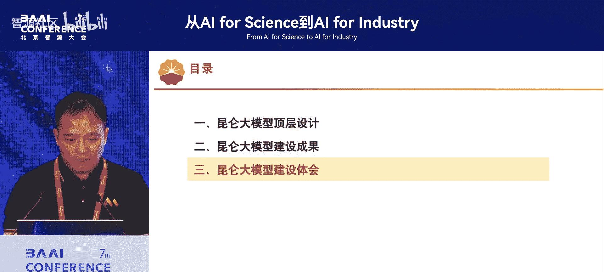

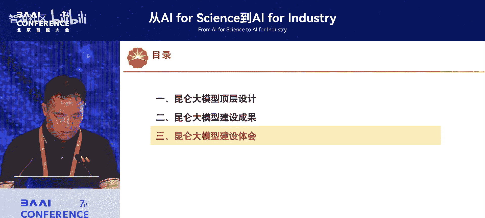

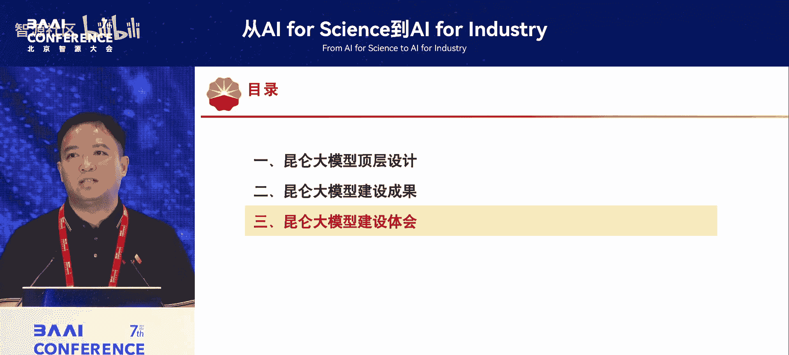

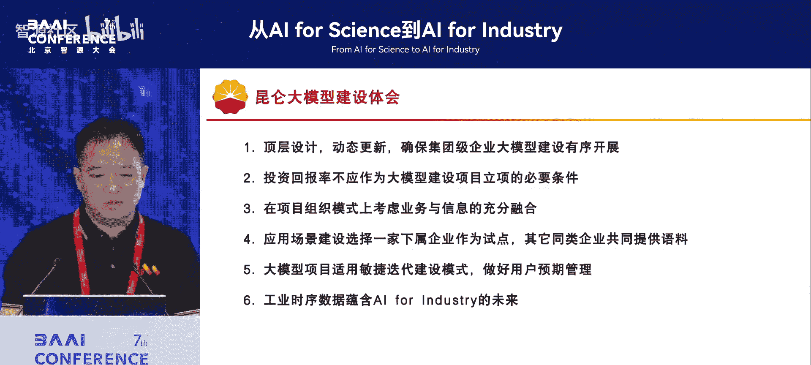

问一句话，投这么多钱，什么时候能收回？😡，啊一旦陷入这个问题的话，基本上很难回答的基本上很难回答。因为现在大模型做很多都是试探性的尝试性的。那么你要是想收回好，那你可能论证的时间就很长。

甚至很多项目就开始做少量的尝试，而不敢大面的全面投入。如果看准这个方向看准这个赛道。那么就不能把投资回报率作为它的必要条件。第二是项目组织模式上，要考虑业务跟信息的充分融合。我们一直在强调业务驱动。

那么在大模人工智能建设同样要保证也要要强调业务驱动。我们在设计上专门为每个业务板块设计了一个装一个装班。这个装班由业务的人员，业务的部门来负责。😊。

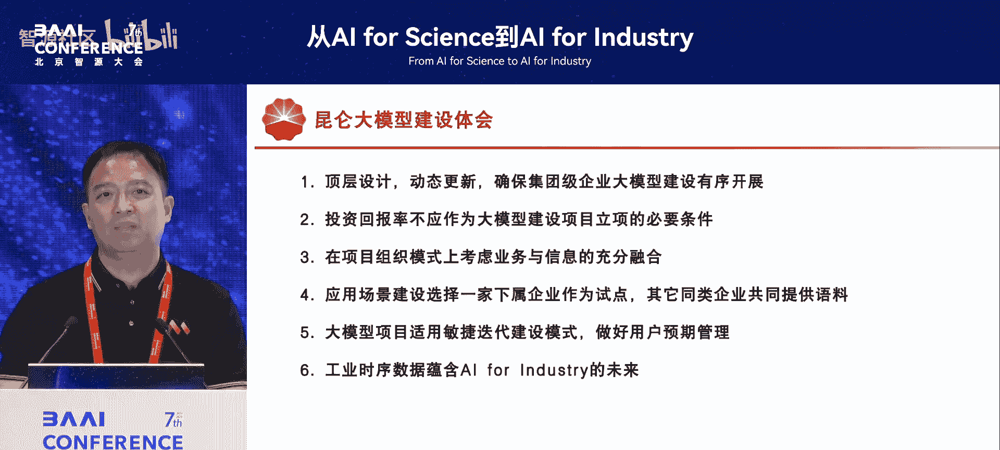

加上人工智能算法的专家以及相关的数据处理的专家，形成一个联合体来开展这个工作。让确保我做的每一个应用场景，业务是接受的，并且是愿意参与的，这样才能够让这个场景做出来之后真正有生命力。

第四个是应用场景的建设啊。

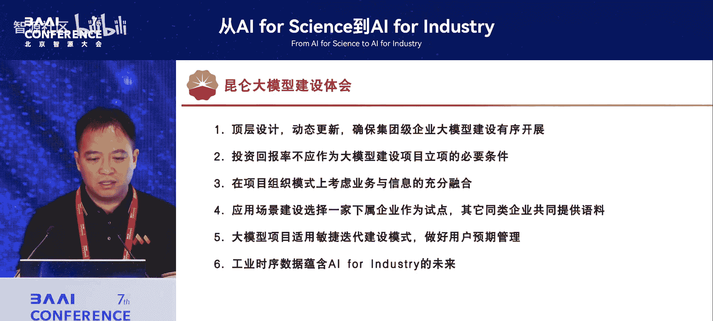

要选择一家上输企业作为试点，其他同类企业共同提供余料。这什么意思呢？就是比如说我们炼化企业20多家，大家都想做以完自息这个场景，那这肯定做乱了。但是呢如果只一家做它的数据量又不够。

因为大模型本身的通用性泛化性，要求你数据量应该是能够越多越好。这种情况下，我们就找一家炼化企业来负责做其他炼化企业把它的那个装置数据都汇集到一起来，让这家企业来做做完之后呢。

它既能够保证这家企业的这个特有的能力。同时呢未来在做一些微调做为一些这个增强，就能够用到其他企业里面，这是一种最省力的方式，而不是每家各做各的，最后形成一个重复建设的局面。第五个是大模型项目。

我们觉得特别适用于这种迭敏捷迭代的建设模式。因为传统企业做信息化项目往出采去瀑布式的模式。一个环节，一个环节做一做下来一个项目做下两年或者一年半或者更长时间。那么对于大模型项目来讲的话。

你根本不可能等那么长。😊。

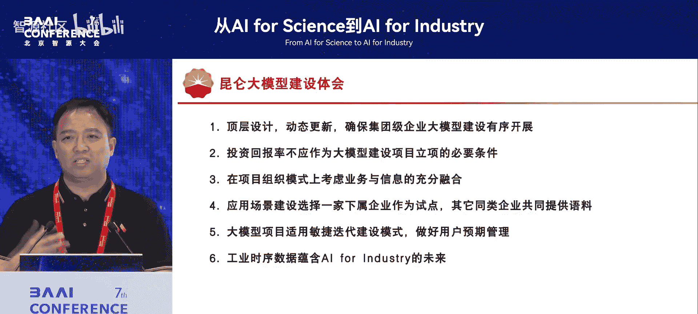

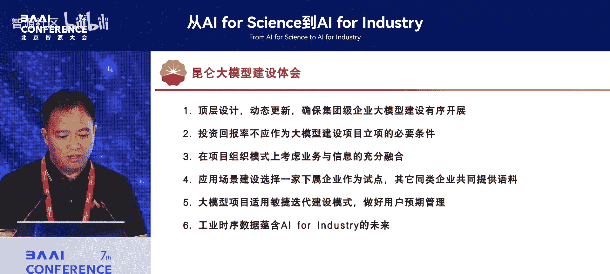

之间才出成果。那么我们只能是采取就是3个月1迭代，每三个月就要迭代一把。那么这过这个过程中，最主要要做好用户的预期管理。大家觉得人工智能已经能干掉，能做好一切了。

尤其是我们看到各种短视频给我们看显示了一个美好的前景。但实际我在企业实践中来发现，没有没有那么容易。哪怕是一个简单的应用场景，你真正的用到实用的话，依然要很大的投入，甚至需要多轮的迭代。

我们在第一轮迭代出来的东西，整个准确率基本在60%左右。但目前我可以说四轮迭代之后，现在很多的场景准确率都在90%以上。😊。

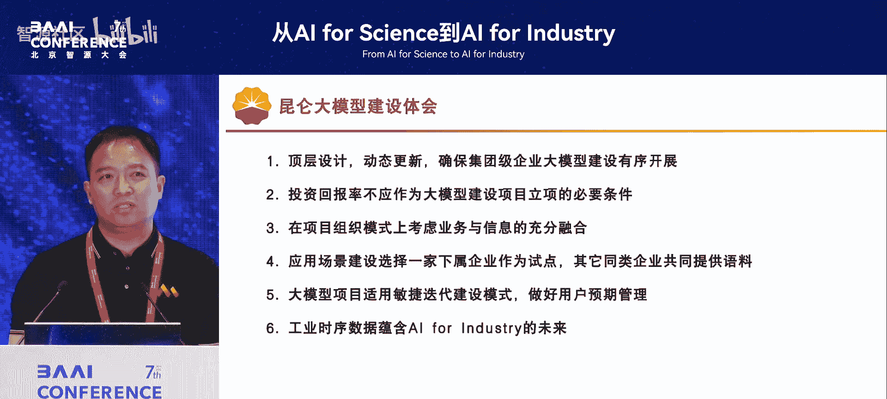

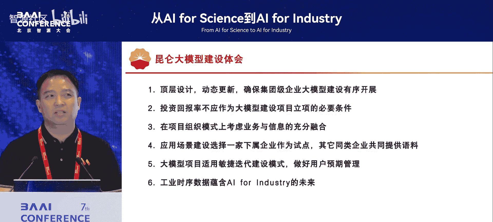

但是如果60%，你给他把它抹杀了之后，就没有后面的迭代，也就没有后面的更好的一个效果。所以敏捷迭代管好用户预期。第六个最后一点想说的是工业实续数据蕴含的AF in大学的未来。为什么这么说呢？

我们一直在尝试。

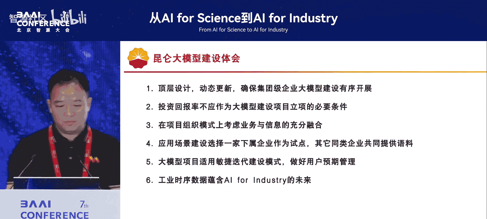

整个工业界其实大部分数据都是实际数据，打了时间戳的顺序数据，这本身就是大transformer能够去处理的啊，比较好的一个数据。

而且这个实际数据里面本身蕴含着很多的下一步这个工业这个这个现场的一些未来要发生的一些可预测的东西。如果把这样的数据通过强风暴算法，能够把它展示出来。那么未来这一块能做的领域非常广泛。

并且能够获得的效益获者效率往往都是更大更倍层的一个一个效果。所以我认为工业实际数据其实蕴含的A音大学的一个未来。应该说整个还只是一年多的一个实践哈，应该说很多还不成熟。

今天本来觉得这个咱们这边很多专家都是做特别深的研究。所以我这给大家相当于做一个工业领域，或者是一个企业做大模型的一个一个一个一个一个怎么说呢？一个一个案例的一个介绍。

供大家在后续在研究模型的时候也更考虑如何落地来实现的问题。好，我的演讲到此结束，谢谢大家。😊。

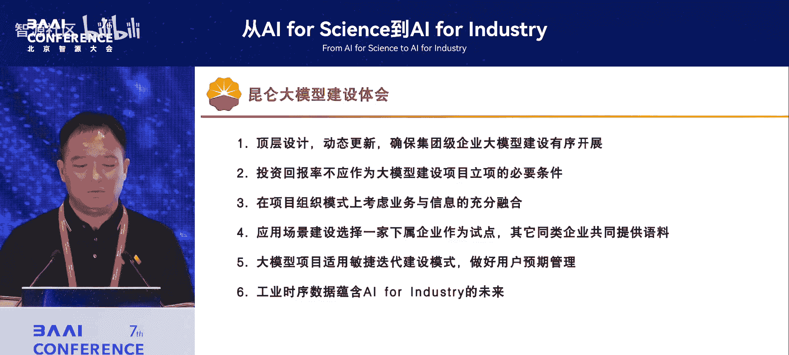

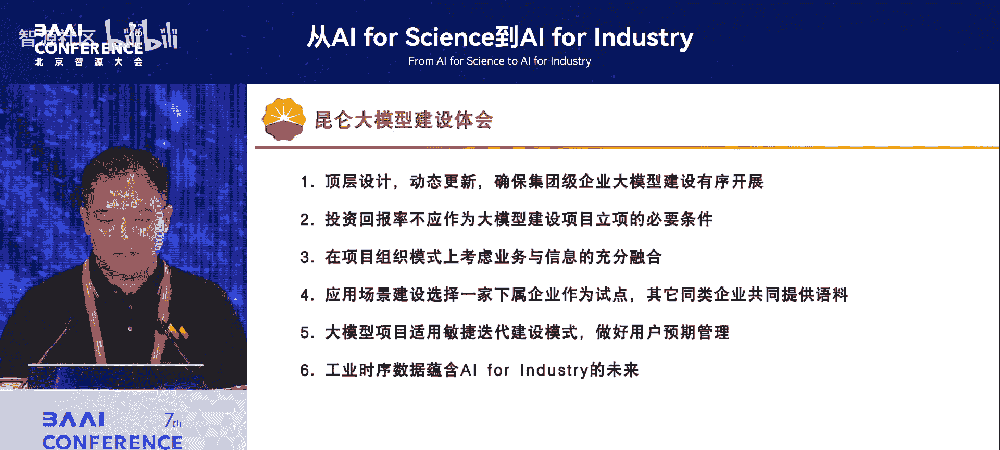

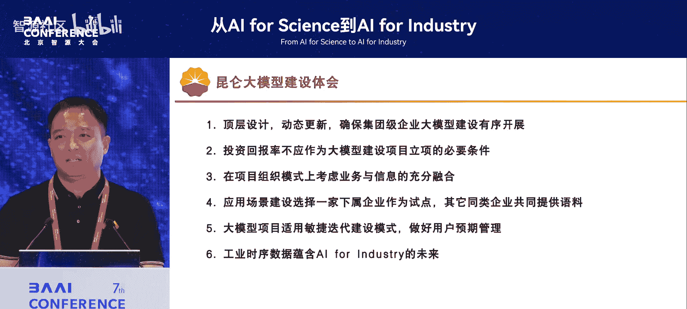