# 2025北京智源大会-从AI for Science到AI for Industry p07 人工智能赋能生命科学：曾泽贤 -BV1r7NjzCEGd_p7-

那么下面有请北京大学研究员博士生导师曾泽贤先生进行分享。不。好，感谢呃主持人介绍，然后感谢组委会邀请。😊，呃，换一个不一样的话题呃，聊聊生命科学啊，然后今天我想跟大家分享一下。

就是呃一些AI for life science的一些工作。

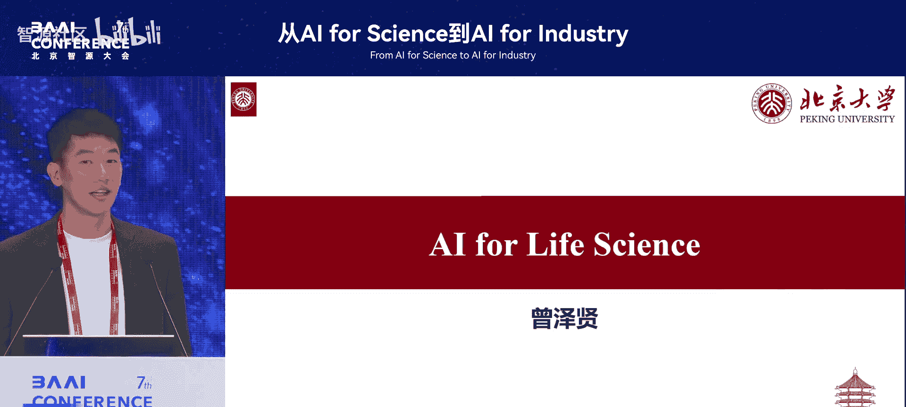

然后我是郑德贤。呃，几个方面来讲讲吧，就是针对AF life science，然后我也尽量少讲我们自己的一些工作啊，讲一讲现在这个领域就AF life science大家都在干什么。

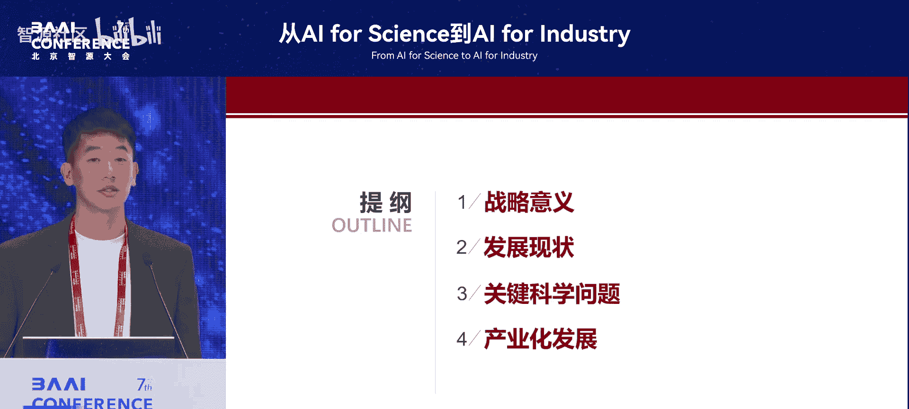

呃，首先AF science大家肯定知道它的一个非常重要的一个意义，对吧？包括24年啊这么多一个奖项的颁发。😊，啊，这是也是一个非常有代表性的啊，大家应该都了解的比较多的。然后生命科学的这个范式啊。

也是在这么一个数据驱动的啊这么一个范式下，也是在快速的一个进行迭代。大家提到了一个第五第五代的一个工能革命。所以AFO生物医疗的产业的一个预测到2023年全球能到达一个1600亿美元的这么一个体量。

这是一个非常大的一个市场啊，然后AI生命科学它也是比较符合一个国家的一个科技战略啊，包括它的一个做为一个新智生产力，或者服务健康康中国。当然也是一个国际竞争的一个激烈一个竞争的一个一个关键的制高点。

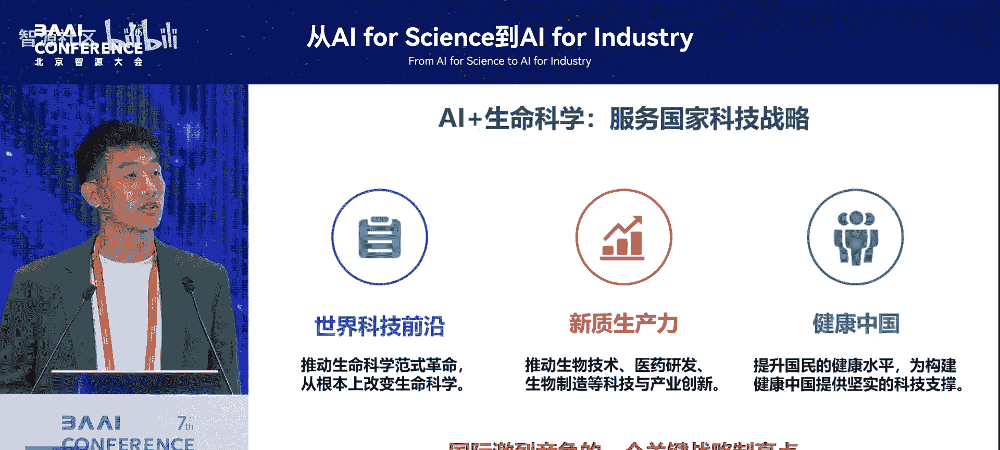

啊，然后跟大家聊聊一个发展的现状吧。😊。

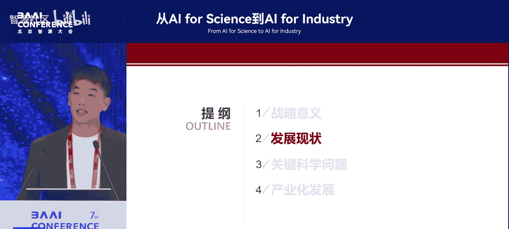

阿法 fold就是刚才展示的啊，拿了那个诺贝尔奖的去年的那个阿法 fold。呃，其实如果说从模型或者从生命科学来理解阿法 fold，它其实相对比较。能之所以阿法fo能成功。我们说总结一下。

其实就说在我们现在回来来讲，阿法fo可能相对比较简单。当当然这个工作当时也是做的很好的。但这个工作之所以成功几个因素，一个是因为它是一个线性的数据，就是说阿法 fold。

我们主要从这些序列啊来预测它的一个结构，从最左边到最右边。😊，第二个是一个任务相对简单啊，就从序列啊，它有一个序列，它怎么把它折叠成一个蛋白，就这么一个任务。😊，然后原理已知啊。

那在这么一个有大量的数据，原理已知的情况下，任务简单的情况下，他就相当做的比较成功。当然了，这也是只是说我们万里长征的一个第一步。

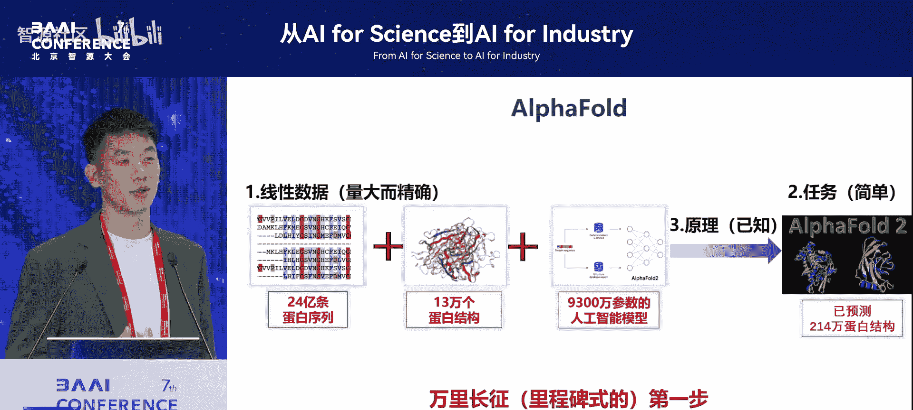

呃，生命科学随着AI的一个发展，数据的一个爆发啊，现在也有非常非常非常多的一个所谓的生命科学的模型进入了一个爆发期。这里展示了一个从啊从这个阿法 fold的吧，然后到近期的。

特别是到20242025年的啊种种的啊模型的一个。发展。然后就说因为如果说我们拿数据拿模型来建立这个对生命科学的认知，那我们可能也要说了解生命本身。这里这个图就是说想展示一下啊这个生命它是非常复杂的。

从微观到宏观吧，的一个多层次多尺度的这么一个复杂系统啊，左边这个图啊可以看到对吧？从细胞保成分子啊，应该是纳敏级别到微敏啊，到啊厘敏啊，甚至到最后到我们人体的一个敏级别的啊。

每个尺度的一个跨越10个量级啊，然后每个层次呢它又有自己的一个逻辑结构，然后又互相影响。所以就说这首先我们在获取数据这个方面啊，我这里把它分开来，就说从分子、细胞、器官、人体不同的测量手段。

应该说非常的不同啊，也非常的割裂。比如说同样是做生命科学的那一个医生对吧？跟一个分子生物学家那来看这个生命科学的测量手段就非常不一样。同样的两个分子生物学家，一个做核酸的跟一个做蛋白结构的哎。

他们对于生命科学的理解也非常不一样。所以整个领域里面现在是处于一个数据的测量手段非常多，发展非常快，设备的。一个迭代也非常快，但是呢处于一个严重的割裂的一个状态。我举几个例子。分子跟细胞啊。

这个是一个非常经典的中心法则，这个是跟每个人都息息相关的。从一个细胞里面，我们从DNADNA就是我们比如说我们比较传统的认知，我们的遗传物质，我们继承了我们的父母，我们的主代的DNA它有什么变异啊。

它有什么序列，就是ACGT嘛，那个这么一个一个一个简单的一个啊编码，但是遗传的物质DNA在我们体内它编码成RNA最后形成在完成蛋白的一个翻转入翻译啊，形成蛋白来形成结构。那么在一个细胞里面。

从DNA到RNA到蛋白有不同的测量的方法跟手段。举一个例子。我们一个细胞大概是比如说7微米左右，7微米，那是非常非常小的肉眼是肯定看不到的啊。但是在这7微米里面，我们的DNA就是我们的遗传的DNA。

它得在里面各种折叠到一起，把它折叠到非常复杂结构，折叠到一起啊，然后放到细胞核。如果说把这个DNA拉长拉开，拉成一条直线那应该是2米多，但他必须得把它折叠到啊这么一个7微米的细胞里面的一个细胞核里面。

而且还得经常把它打开复制打开复制细胞啊，这么一个复杂的工程。到RNA它DNA嘛要翻译成翻译出来就行驶功能，到RNA再到蛋白啊，非常非常复杂。那么做DNA的人，他有很复杂的。

因为非相对成熟的方法去测量DNA跟RNA啊，跟蛋白。但是往往这个领域里面啊DNA做DNA的人，他就不管做RNA的RNA不太管做蛋白的这么一个相对割裂的啊。😊，好，到器官到了器官。

那可能就跟临床相对相关一点。比如说我们举个例子，在这里有一个比如说我们去医院，我们做一个肿瘤的疾病诊断，对吧？那这时候我们就有一个切一个片子，我们去做一个病理，做一个染射啊，包括现在发展比较快的。

像空间转入阻学啊，这些都是一些相对器官层面的一些测量的手段。最后到人体，人体的话，那可能更多的说我们讲的是医院层面的数据。像这里我举的两个例子啊，非常比较相对比较经典的一个是电子病例啊。

电子病例在比如说我们去医医院，对吧？医生对我们的一些情况的描述，对我们病情的一些描述，包括对我们检测啊，最后这些预后的跟踪，这些都算电子病例数据，电子病例的数据纵然是非常非常宝贵的。

现在大家都在讨论在医院里面对吧？到底AI能不能取代医生啊，院其实如果说我们说医生如果说都是按指南来看病的话，大多数情况下，那AI是否能取代很大情况下。

其实AI确实是能去辅助医生来做一些疾病的一些诊断对吧？一些案情这些一些一些一些一些辅助性的工作，这没问题。但是对于我们来说，电子病历最大的问题是在于数据啊，因为现在包括我们的一些数据的一些隐私性，对吧？

一些规定。😊，啊，大家都说嘛，数据不出院。所以其实要在大程度上面的规模性的获取到足以去训练大模型的医疗数据是一件非常困难的事情啊，这是一个现状。还有一个就是影像学影像学也发展非常多年了啊。

之前在最早期的CNN model202几年2020201几年200几年的或CN model的时候就发展非常多了啊，相当于比如说我们基于一个啊肺的影像啊、CT啊1个MI呀来做一些疾病的诊断啊。

这些是一些医院的数据。这里之所以花这么多时间来描述，就是说这个领域大家其实数据量也非常大。因为每天我们不管是基础实验室，还是在医院还是在检测中心，每天都要产生大量的数据。

但是这些数据呢其实它并不互相流通。并而且这些数据其实很难有一个共同的体系，就是。

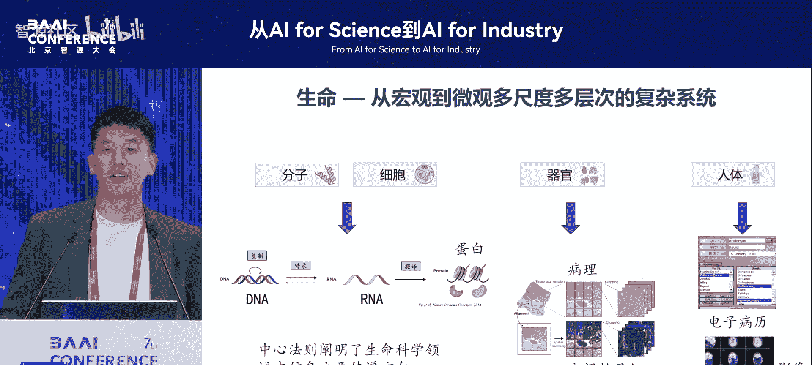

非常严重的一个孤岛现象。好。那就说从核酸刚才讲了从核酸细胞对吧？病理到医疗啊，现在也有很多的，比如说我举一个例子到DNADNA那么也现在做我们DNA的序列，如果说从生物的数据来说，我们现在量最大的。

应该是核酸的数据。因为这几年随着测序数据的发展，测序技术的发展，产生的非常大量的测序的数据。比如说人体的遗传物质的测序啊啊，疾病的测序啊，肿瘤的测序啊等等等等，测出来的是非常大量的数据。

而且这个测序的数据，我刚才讲的，它其实就是一个AC具T的这么一个编码。那这个编码它其实相对相对比较适合这种模型去理解它的这个序列的结构序列的上下文信息，虽然它没有语言那么一个有逻辑。

但是它也是有一个上下文的信息的。这一个像这里举一个例子呃，是一个DNA序列的大模型啊，那么DNA很长很长很长，对吧？的一个编码。😊，我说扯开来，那么就是一个2米多的一个序列，ACGT2米多的一个序列啊。

它发转录成RA，那么RNA的数据也非常多，因为它也是核酸数据。那所以也有很多很多的RNA的模型。呃，这篇mature是当时我们在那个哈佛的时候，然后有我们也是颗粒组一起做的啊。

这么一个单细胞的RA啊来做一个所谓的序列的一个设计。现在在做RA的表达量的模型啊，我们现在也可以听到。如果说大家关注生命科学多一点，可以听到啊，包括什么单细胞大模型啊。😊，啊。

包括这种啊什么单细胞的图谱大模型啊，类似等等等等。其实很多是基于呃我们这个工作之后发展出来的呃一些所谓单细胞的模型建设。好，再到蛋白，蛋白其实比较经典的，其实还是那个阿法fo。

就是蛋白我们重更重顺序的这个注意者结构啊。

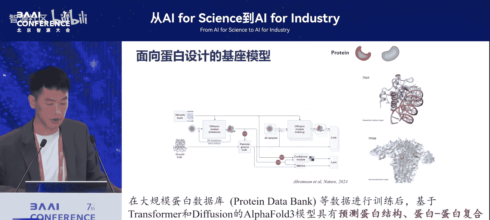

呃，临床也有很多很多的一些模型的。这里我然后包括这个是一个影像的一个心脏的跳动的视频的一个模型。啊，还有刚才提到的一个病例啊，病例再往后，还有一些人体的一些一些一些模型。呃，我之所以举这几个例子。

还是想说啊这个各个数据各个模型大家都在做各个模态都在做。但是就是还是就是说呈现出来一个非常局部化碎片化啊，意制性噪声的质量问题啊这是其实如果说从模型来说，这个是现在啊生命医学里面。

我觉得比较大的一个挑战，就是数据。😊，那这个数据的割裂也导致了这么一个现在我们说的高科技版的盲人梦想，你做你的我做我的对吧？核酸做核酸的蛋白做蛋白的。待会我看也有两位那个那个会来讲，对吧？

就是基本反正我们核酸的还是玩核酸的，蛋白还是玩蛋白的啊，大概这么一个一个现状。😊，还有一个共享机制，对吧？出现了这个一个一个一个呃孤岛或者说不流通的一个现象，还是一个有一个跟共享的机制有很大关系。

其实我们国家其实在数据库的建设方面还是非常严重的滞后于欧美的。

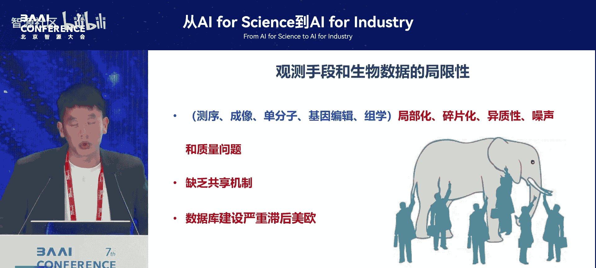

呃，美国其实在包括我们现在在很多地方的立项的时候，都会举啊，美国有个TCGA美国有个老计划，美国有这个美国英国有b bank啊一回中一收回我们国内啊，我们国内没有这个数据，没有那个数据。

但是其实这个事情也说了很多年的。经过了这么多年，我们还是没有数据。所以我们现在也在说，就是说其实这个数据生命科学相关的数据，它缺的已经不是一套或者两套的数据的，它缺的是整个生态的系统啊。

它没有一个很好的生态系统来共享来处理这些数据，进而把它形成一个可以去流通，可以去共享的这么一个资源库。😊，呃，这里简单讲一下，就是AI的一些模型吧。就是说因为刚才讲到了一个核酸，对吧？他既然能把自己。

😊，捆绑到一个河，一个7微米的河里面啊，2米多还能去行驶它的功能，那就说明它在三维结构等等等等，它是非常复杂的。它不是简单的一个线性的一个啊或者说一个语义上面的，所以我们都叫token。

其实这里更多的我们是需要一个新的，比如说适合生命科学的一些embeddding的方法啊来做这些生命科学的数据。😊，因为生物数据跟自然语言它还是不一样啊，对吧？

所以我们说需要一些新的immaticdding或者新的架构。好，然后科学问题啊，就说最后最后吧就说我们还是想着去怎么去把这些多模态的生命科学的数据真的能放到一个桌子上。

能把它做成一个大家能就做成通用型的啊这么一个事情。所以如何去整合多模态多层次的这一个大模型，我觉得将是我们做AF for science的lifeense的一个一个一个比较重要的一个任务。

因为生命它一定是有一个持续的特征，因果的关系，它有很强的复杂性啊。然后包括怎么样用AI因为生命科学里面，包括我们最后是是病科学还是想用到病人，想用到制药。那用到病人用到制药。

那它一定得有一个普适性通用性，那怎么样对吧？不仅仅说这么一个黑盒子，我们怎要能通过AI的模型。最后能在发现一些生命的普世规律啊，来帮助我们制药，当然也非常重要，也是重要的一些生物啊一些关键科学问题吧。

产业化发展啊这是因为AF industry。我最后再讲一下这个产业化的一个发展。呃，我们就说觉得在AF life science的这么一个大的竞争下，之后的一个很重要赛点一定是数据。

因为可能每个行业都面临数据的问题。但是尤其在生命科学这种高隐私性不流通性孤岛现象，大家专业专业必垒很强的情况下啊，这是一个怎么样去能真正把这个数据做到高标准高质量。

而且能统一到一起来为模型的建立提供这么一个资源。我觉得才才是我我觉得哈就是说这可能是未来的一个啊一个最关键的啊一个一个赛道之一吧啊就是一个数据的共享。当然现在生命科学其实可以找到很多公开的数据。

这个也是说从网上怎么去整合来制定这个标准，这个也是可以做的。第二个是人才，对吧？就说怎么样来真的。😊，找APP又懂科学，又懂AI的人来做这些事啊，因为现在有很因为生命科学，它本身是相对避垒性比较高啊。

那如果说很多做AI的人，他其实你说他懂生命科学的嘛？没那么懂。你说做生命科学的话，他懂A妈妈感觉又没那么懂啊，当然我相信也有啊，也有这种人才，但是相对我觉得就是说还是相对少啊。

那就说我们得有一些体制性的包容性的宽容性的。比如说对吧？我们在招人在公司在招人，学校在招人，我们是不是多一点包容性，都来培养一些这种交叉性的人才。😊。

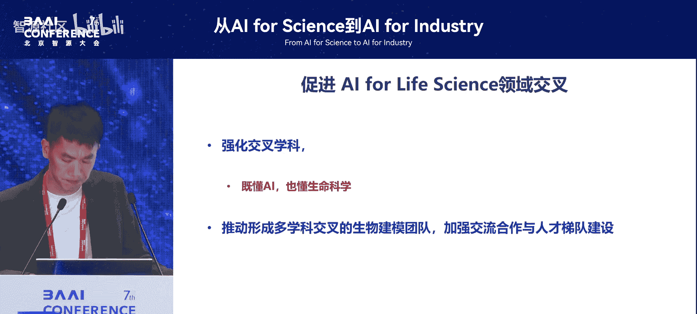

好吧，然后最后的一个一个就说我们怎么样，这是我们prourpose的一个框架啊，这么一个人工智能的底层框架，再有生物数据资源赋能，然后来做一个多模态的整合。

然后希望就是说能找到一些适合生命科学的embedding的一些方法来做这些事情。

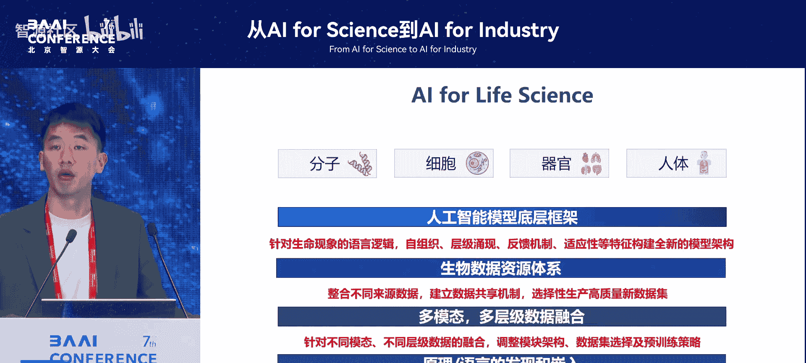

然后来布局这么一个生命科学的一个大设施大模型。好，那我就分享这些，谢谢。

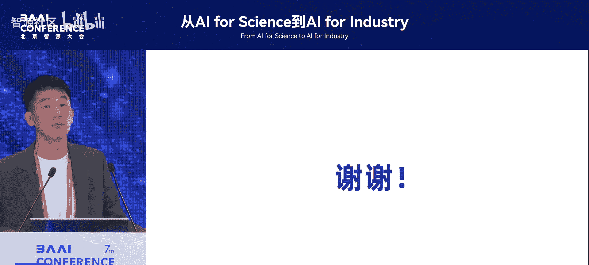