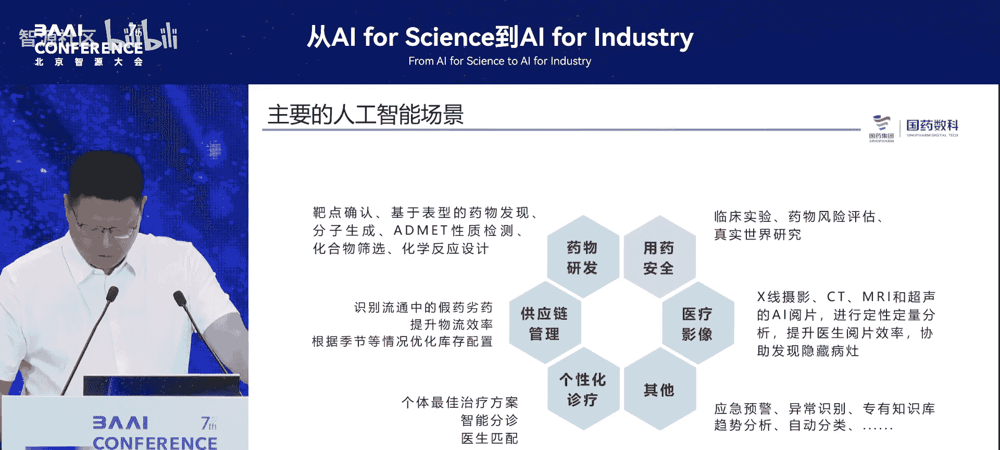
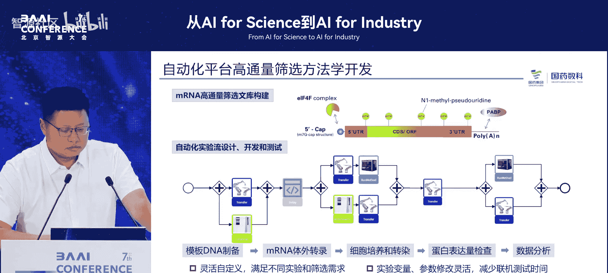
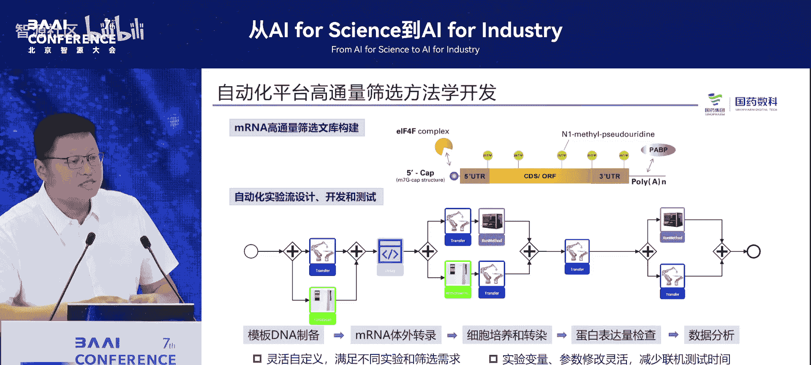
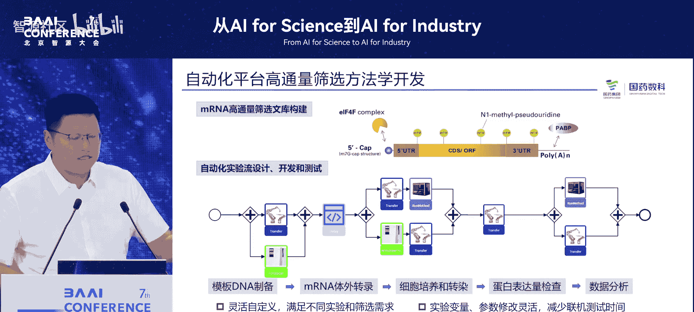
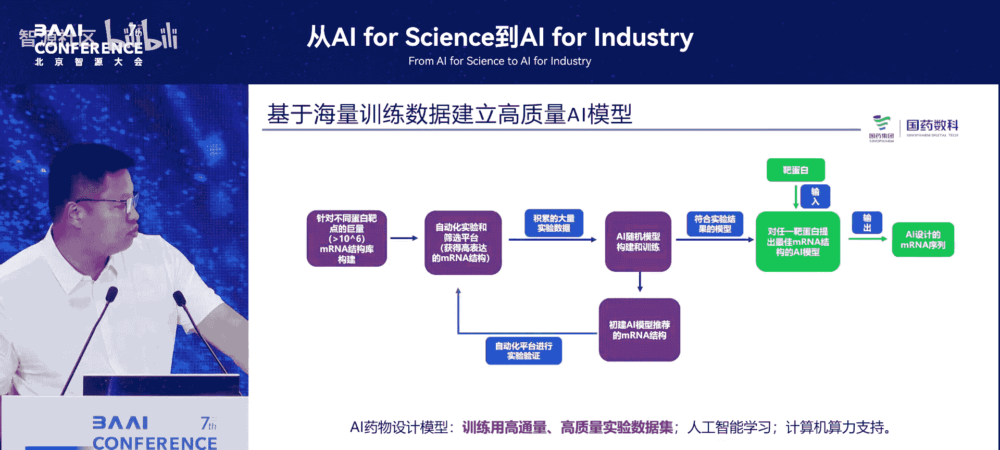
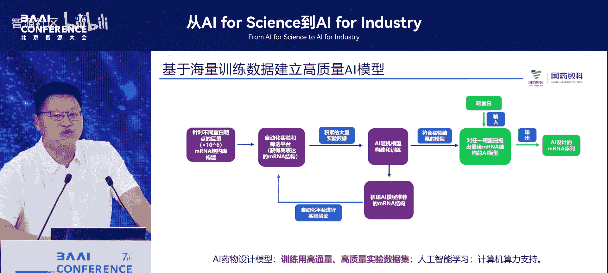
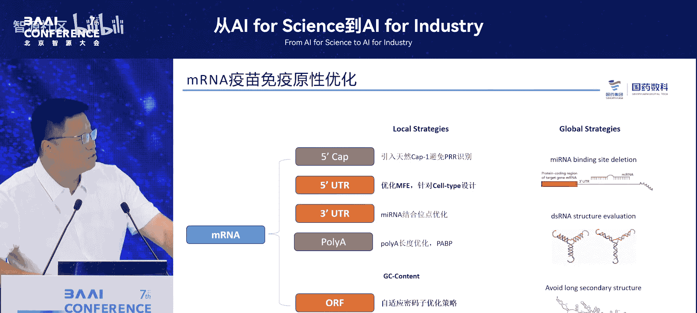
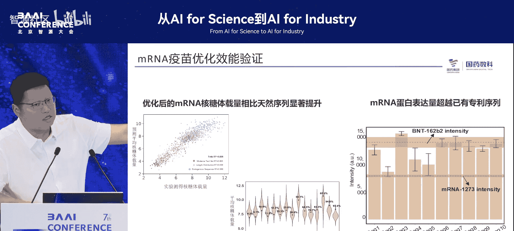

# 2025北京智源大会-从AI for Science到AI for Industry p08 基于AI的mRNA疫苗研发实践：罗 皓 -BV1r7NjzCEGd_p8-

那么下面呢，有请国药数字科技北京有限公司技术总监罗浩先生跟我们分享。有请。那个尊敬的胡记方老师，各位领导下午好。就是很荣幸今天在这个地方跟大家报告一下，就是中国医药集团在人工智能方面的做了一些工作吧。

但我们可能因为今天是这个F size的专题哈，所以我们挑了一个可能跟这个F size比较有关系的这个这个点来阐示一下我们的一个简单的认知吧。就是你大家都知道哈，就是现在这个人工智能国家提了很多的要求。

就是这个是4月3号，这个月4月呃，今年4月3号刚刚。就是工信部联合七部委发的一个文儿，对吧？包括就是今天我看胡局在好，就国资委，正好今年2月份那个人工智能加专项行动里面。

就是也把国要列成了就是中央就是国资央企业人工智能战略性高价值场景库10个啊成员单位之一，首批10个事业单位之一，是吧？这个呢都让我们感到了这个。😊，坦白说是很大的压力哈。

因为就中国医药集团呢是一个非常商业化的企业啊。😊，刚才那个就是。石油的领导讲哈这个这个人工智能投入，首先不要看投资回报。那我特别的羡慕。在我们这个地方哈，就是真的做任何事情。

因为因为国家是个非常非常商业化的公司啊，就其实做任种事情，我们就要想一想我们到底。😊，花什么钱，然后最后要怎么样把这个效益的挣回来。对。呃，所以这些趋势刚才就是那个曾老师讲了很多了，我们就不再重复了。

对吧？但是我想必须要说的是说确实就是在呃我们的实践过程当中哈，确实发现人工智能能够极大的提高我们的效率。就这些说的我就不多说。我们举一个很现实的例子，就是就是这个用药合理性的问题。

就是原来哈就用药合理性是很多，就是几乎所有的医疗机构都会面临的这个问题。而且而且就是其实在原来在。😊，人工在没有这种相关的工具的时候啊，他的这个稳定性很差。因为好大夫可能用的非常的合理。

但是其实很多医院的很多大夫他就会很差。😊，然后呢，在国内目前哈就做这个用药合理性的这个最大的一个企业，我就不知是谁了哈。他现在大概有400人的团队，他只做用药合理性。😊，呃，3分之1的是药师，职业药师。

3分之1是IT人员，3分之1是部署实施人员，大概他们能够做到中国所有的这个这个药品。但他有个比较大的问题，就他全靠人，他的所有的规则都是靠人总结的。所以呢当这个用药规则在发生大的变化的时候。

这个可能就比较大的问题。大家会就很奇怪，为什么用完规则会发生很多的变化呢？对吧？那个说明书写出来这什么病就很明确了，对吧？这是在过去是这样的，但是在今年或者你该理论说在去年呃。

三一联动国家医保局对这个药品医保报销有了新的这个这个要求之后啊，这个情况一下子就变了。比如说某种病是吧？它既在说明书里面，它是治乳腺癌也治胃癌，但是呢在某一个省他就只能报乳腺癌。

在某一个省他只能报乳腺癌的一期二期和胃癌的一期。😊，所而且他因为他们这个是中国就很有特有地方，就中国特色的是吧？属地化管理。然后呢，就是医保政策，随着医保基金的这个结余情况，它会每年都会做变化。

那么基于传统的这种用药的这种用药合理性的这种审查就不能满足这么靠的变化的要求啊这个时候人工智能的出现就使得我们可以用相对比较少的人极大的来解决这个用药合理性的问题啊。

就所以这个这就是我们其实打实的是通过我们自己的实践哈能看到的人工智能对于我们整个这个行业带来的很大的变化。那么这也不用多说是吧？国内的国际的巨头几乎都在布局这个事情啊，这就也就不不多的那个讲了。

然后就是刚才曾老师也说了是吧因为我们主要是做的这个就是就是MRA的这个疫苗的研发，所以说就是在这个领域确实有很多的这个就是也有很多的这个积累是吧？刚才郑老师也都说了，对吧？这里面确实比较难。

因为对于我们来说哈，M疫苗对吧？它。😊，他可能他要找一个平衡是吧？第一个他要高表达，然后呢就是第一免疫原性啊，就比较专业啊，反正就是说他一方面它有效果。第二方面他又不能把这个人的免疫性刺激的很强。

产生很多的这种副作用，对吧？然后包括呢半衰期要长，结构要稳定，易于生产的好多好多问题。那这个时候其实你就会发现它又是一个特别特别复杂的结构，对吧？就是四的多少大次方的结构。

所以说你怎么在这里面这种如此海量的结构里面筛选出你需要的那个结构啊，这就是个很像是个问题。😊，针对这个呢就是集团就是应该说还是高度重视哈，就是专门在国资委这个AI这正性行动之后。

马上集团就发了相关的这个文件。然后其实其实内容应该都差不多哈，就聚焦四个方面是吧？应用数据算力、人才啊，大概四个方面。嗯，就刚才也介绍过了。

那么这里面呢就是我们也设计了专门的就是跟就是那个石石油的这个情况一样哈，我们也专门做了这个就专门的这个就是结构的设计，但是我们其实落地的时候，就技术讲了。

就我们可能确实跟就就是国药的这个这个高度市场化的情况下，我们其实整个落地的时候可能策略还是有所不同。第一个呢我们的基础大模型，更多的还是拿来主意的，我们基本上不会自己训练基础大模型。

因为这个成本实在是太高了，成本实在是太高了，我们更多的对我们来说是选择好，就是我们要用的模型。但然这个肯定不是一个啊，因为其实我们的理解哈，像大模型其实跟人脑一样，对吧？

人大家知道人脑是分不同的部位的对吧？有的部位特别擅长做慢的精确的长思考。比如像我们今天那写这个PPT对吧？但有的部位呢肯定特别擅长快的思考。比如说一个球飞过来，我躲下意识的躲它一下，对吧？

其实在我们最后这个场景落地的时候哈。😊，你会发现我也是这个逻辑。比如说就刚刚我们继续做高测审报那个场景，对吧？其实对我来说一定是把那个分成两步的。第一步呢就是我需要把那些说明书啊。

把那些要点呢把它慢慢的提取成，但一个一个很复杂的知识库，对吧？是这个结构啊，这个结构可能不是一个结构化的结构化的知识库，对吧？第二个呢是来了一些处方啊，处方有一天要一定要多少多少张呢，对吧？

我们一个药店一年50万张处方。😊，对吧那这些处方来的时候要审核，对吧？我怎么样能够在很短的时间把它审核好，他尽量就很快的能够给一个反应，就大家都用大家都用吧？实很慢，有时候？

所以这个时我会用不同的模型来解决这个问题。这里面包括视觉的问题是吧？还有就是这个就是这个语音识别的问题。所以说肯定我要好多好多的模型。那这个东西大家分散建设确实难度就很大。

所以这个集团要统建来选好往上那么各个我们我们在国家上面有160多家企业那么这些企业干什么呢？他们去找场景找场景，然后用这些模型来解决他们工作当中的问题大概呢我们是这么一个布局。

就集团像我们主要是负责基本能力的建设。选好给大家选好这个积木而上面呢大家是通过找场景去更好的搭这个积木这样呢上下协同一起来尽可能的让人工智能赋能更多的高价值的场景，但是对于那些特别重要的场景。

比如面我介绍的这个就是。😊，这个这个疫苗的研发，对吧？那么可能集团就会直接就就最最左边那个对吧？就最右边那个应该是集团就会直接下场，跟这些科学家一起，我们去推动这些高质场景的示范的应用。

也给大家提振信心。第二个呢也快速看到效率。😊，大概是这么一个结构。所以主要场景呢，其实他跟曾老师讲的很像哈，基本上就是在药物研发用药安全。

然后当然我们还有供应链管理、医疗以上个性化诊疗这些方面我们都是做了很多的工作哈，也有好多的这个场景，这就不一一介绍。然后呢，这就简单的介绍一下这个其实其实是差不多就这么回事。

我觉得主要就是因为这个MR的研发对吧？他可能有好多的这个它有大概三个主要领域的7个主要任务，包括这个结构的预测是吧？二级结构三级的就那个多维的三维的结构，还有包括这个就是公能的预测是吧？

它每原性的预测呀，包括就序列的性质，就是这个结构的稳定性翻译的效率等等等好多是吧？那么我们呢确实这个模型在这些方面都还是在行业里面做的算是比较领先的吧？比较领先的。😊。

呃，他这个过程呢其实比较比较明确，他就是他就是首先通过这个高通量的这个实验平台去筛选数据去，然后就去不断的做实验，就非常快的做实验。大家可以这么理解，然后呢获得一批数据，然后基于这个数据拿来训练模型啊。

基于这个模型再来筛选，再筛再就是减就是在减少我做实验的这个量来提升我的研发效率啊，大概是这么一个逻辑。呃，这个这个过程我就就就不多描述了。对，但是这个地方就讲到了刚才曾老师说的那个数据的问题。😊。

坦白的说，开始我们没有想过自己做实验，我们就想买数据。后来就发现这个数据买得当，但是质量太差了。就那个那些数据训练出来的模型。完全就是不work，就不工作。所以最后没有办法。

就只能是自己买这个高通量的实验设备这是不是很贵很贵。我们买了4台。一台就是就是就是几千万。对，因为他你要积累足够多的数据，你才能训练出那么多的模型啊，对吧？

所以说但是这就是确实我们也觉得这个数据是个比较严重的问题嗯，对。

呃，当然这也包括免疫研续的优化，就不多说了，就得太都太专业了，就不多说了。但但确实反取得了很好的效果。比目前已有的药品的这个就是这个效果明显的有比较大的提升啊。

就明这个这个结构比现在已有的这个专利的结构明显有比较大的提升啊，这个不用多说了。

然后这就是我们那个高通量设备下边哎，我看这。是不可以播放一下？对他他就是他就是不断的，他它那面上他他就是他那是一个现在这个是老老的视频啊。原来那个现在最新的是是那个384通道的。

就是这种跟那个国外厂商一自一联合研发的一个东西。然后他就是不断的去他这个一下子做384就是384组实验，然后不停的做这种实验来那个获得数据啊，这个就不用多说。那这里面呢其实也有一些药品。

其实我们做这个没有没有多久，大概两年多的时间，他实际上已经取得了一些比较好的效果。确实对于这个药品研发的这个加速啊，有比较大的作用。😊，就是但是我其实更多的我想说，就今天这个机会来的话。

也想跟大家分享一下我们的一些。😊，体会吧。第一个呢就是后面哈，我就我们还是觉得说人工智能赋能这个就是业务的发展真的是非常的必要。就是大家知道医药行业有一个3个十的约束，对吧？就做一个药。

十年嗯10年时间，10个亿投入10%成功率。这个确实是对我们是一个很大的挑战。那么我们还是希望通过人工智能技术的引入呢，能够把这个东西有所这个缓解啊。因为作为一个中央企业来说，就是其实这么大的投资。

我们不像很多民营企业哈，就是其实他是能够接接受比较高的失败率的。但是我们其实有时候坦白说不太能够接受这么高的失败率。但是而且更多的牺牲我想说，我们还是希望找到更多的场景啊。其实刚才大家讲了哈。

找场景都要找高价值的场景啊，这个我们非常同意。但是我想到高价值场景只是我们找场景的一个部分。其实我们找场景呢是两个两个主要的要求，一个就是高价值是吧？用的人多，然后单价高啊。

居多anything很多东西，但是我们还有一个很重要的场景，就是什么？是还有一个很重要的标准，是吗？就是它容易落地，它易于落地。😊，就是因为这就技术就是一个就国药，它这个这个比较特色。就因为就像我说的。

他他需要实时的把这个AI投进去，把钱挣回来。所以我一定要找那些。😊，能够落地，很快投入就能够产生效益的场景。然后来做这样我们才能既能保证我的人工智能投入在一个比较高的水。

持续能够保证在一个比较高的水平啊，大概是这么一个情况。所以这是第一个是找场景，第二个呢就是要建这个体系。就是这个人工智能。其实我们后来我们现在也其实做了好多这个就就做了大概100多个场景了吧。

就是但这场景里面我们就感觉它不是一个单纯的AI的问题，它是一个体系的问题。我举一个例子啊，就是举我们刚才举过我沈芳那个例子。就是就是大家知道哈。

就是这个一就是这个患者的处方是一个是国家卫健委明确要求不能够外流，就是不能够离体。他必须要在这个医院。所以呢患者到我们这来开药的时候，我们的药店来开或者到我医机构来买的。

只能拿着他那个处方纸质的处方不能电子处方是不能来的。所以对于我来说就有很重的这个CR识别的这个事但OCR不是很简单的事原来我们也做CR我们什么物流回单做CR对吧？

一秒钟5秒大概几几百几百几百毫秒就能识别一张这个这个结构化的识别一张但是当你在落到这个场景时你发现就变成一个很严重的问题。为什么比如说以某一个省为例这个省可能至少有10家20家三甲医院。

每个医院的处方都不一样，且像我们这样我们卖的一些药都是高价值的药那些药他光有处方是不行的，他还需要诊断说明书病情认定书各种各样的检查报告汇到一起刚我举的一个？如医保给你报销的话。😊。

那必须是什么什么疾病，什么什么几期，首次用药买多少，二次用药买多少，复发买多少，全都是规则，这些规则都需要通过证明材料来证明的。所以对于我来说，我就需要一个泛化能力很强的OCR的模型。这个有没问题，有。

但它有一个很严重的问题，它识别一张图像，返回结构化结果需要10到20秒。😊，调油之后需要5到10秒，我卖一盒药省一次方，一次性的要识别至少5张。5张这样的纸。所以这个时候落地的时候。

一个患者在那儿等你一分钟。你说我在神发。啊这个事就办不下去了，患者就炸了。啊这个就怎么办呢？你再往下把它调到疫苗，难度很大呀。😊，那所以这个时候就需要一到工程化的方法，对吧？很简单。

你就说因为其实这个患者来买药的时候，他一定不是就买一次，他是买很多次。你就跟他说，哎，你这次来买的时候，你只需要提供处方，就审一张单子。但你剩下的那些东西都是你的病例，对吗？你什么诊断说明啊。

解释或这的病例是吧？你建档哎，你需要把剩下的都在建档，先建档再审方，建档需要两分钟省方只需要10秒啊，通过这种产品设计，通过这种工程化的产品的落地，就能够把人工智能哎，和我们的这个业务很好的嫁接起来。

产生经济效应。所以我想说人工智能首先他真正要落地要赋能的时候，他是个工程化问题，而不是一个单纯的AI的问题。😊，当然再往下可能就是刚刚说的这个人的问题啊，就是我很严重的问题。这是一个是吧？

我就刚刚刚才那个药品研发就这样子，我们有很好的这个药品研发的专家，但他就是不懂AI，他就是不懂AI。😊，然后我们有很强的AI工程师，他们完全不懂不不能不懂怎么做这个样。

让他们能够对话起来就是一个很严重的问题啊，就是一个很复杂的问题。所以说这块确实我们也做了很多的努力和工作吧，就是希望反正确实就是互相学习，尽可能去就是大家各自往前走一步呗，大概那想形成这么一个趋势。😊。

最后呢就是我想引用比尔盖茨说的一句话，我觉得这这句话我觉得我很喜欢。我觉得对任何新技术，尤是是AI这个技术都是这样的对吧？就是。😊，我们不要觉得人工智能现在能解决所有问题，不要高估它。

但是呢我们也不要低估它，因为他未在未来的十年一定可以改变我们的生活。好吧，谢谢大家。