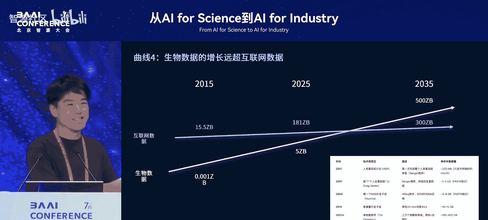
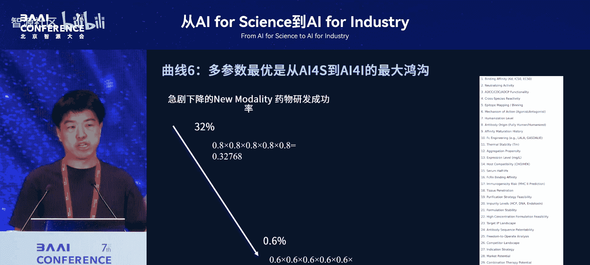
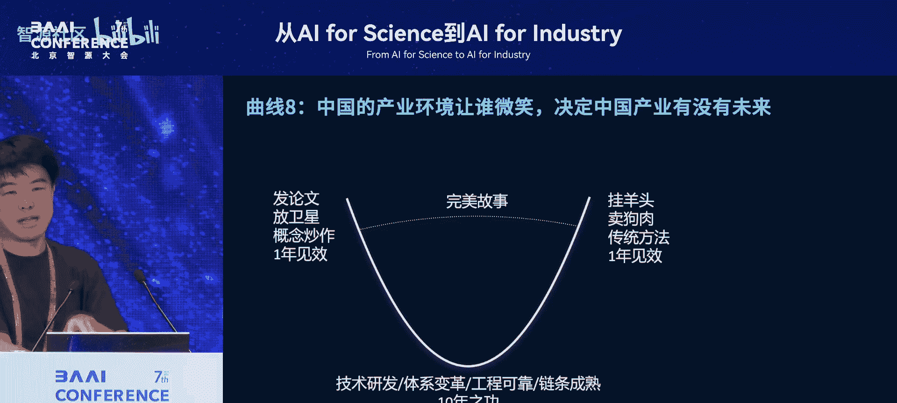
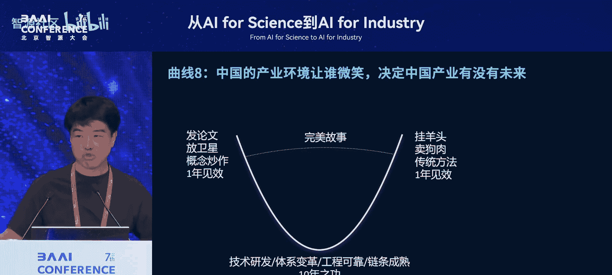
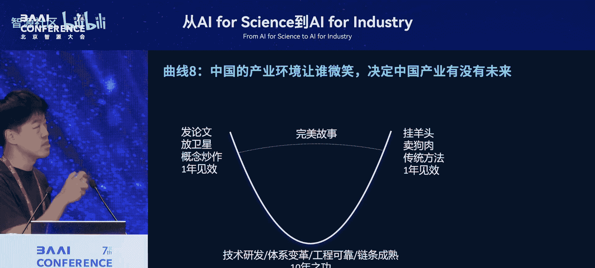
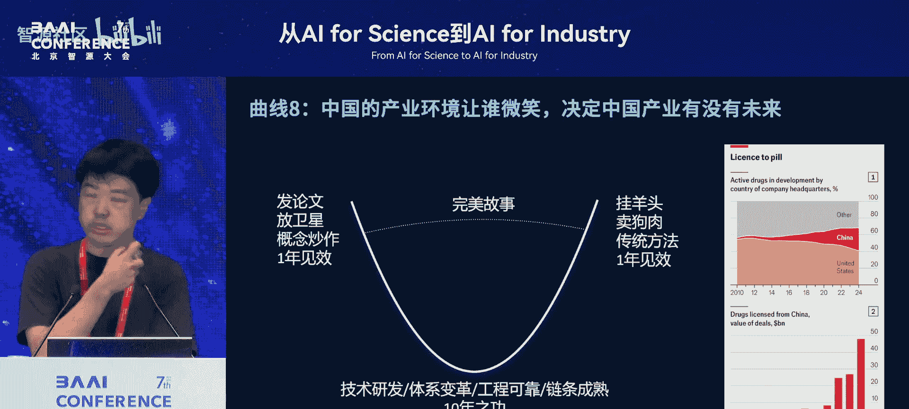

# 2025北京智源大会-从AI for Science到AI for Industry p09 生命科学AI落地的几条规律曲线：刘 维 -BV1r7NjzCEGd_p9-

下面呢我们有请百图生科联合创始人兼首席执行官刘维先生给我们分享生命科学AI落地的几条规律曲线。有请。🎼谢谢主持人啊，谢谢冯老师邀请，谢谢大家。我我给自己加了个难度啊。

这个我虽然也有比较讲的比较娴熟的公司介绍PPT，但今天没有用这个因为我觉得致源是我非常尊重的一个学术型的会议。以我这个特意呢重新写了几页非常简单粗糙的PPT来谈谈我们在一线这几年做工作的一些一些感受吧。

但是这题目起的有点大规律曲线谈不上。其实就几条曲线做一些总结吧。虽然说不做广告呢，但是第一页呢我们借一条这个业务发展曲线来讲讲我们是谁吧，还是要稍微讲一两句简单总结，我觉得在过去1年的时间内。

这个作为风险投资人和作为这个公司成立这4年来吧，我和这个百度创始人彦红呢我们俩作为这个公司的fo包括在之前我们俩创立这个百度风投十年大概投了11美金左右在这个领域其实大家会看到在16年到20我们投了当可国内国外比较领先的第一代的大部分的AI创新药物研发的这些公司。

😊，recursionical深士科技啊等等。但是20年呢我们还是决定自己做一个公司。为什么呢？就是我们想做基术大模型呃，20年大家都知道。

在I的这个会上大家都知道这个openIG20的出现给了我们一个非常大的启发，我们能不能在生命科学领域搭建一个基础大模型。

刚才这个国药的朋友也提到术大模型很昂贵无论是他的算力他的数据还是刚才国药的朋友也提到他的高通量实验体系。但是正因为这样的这种昂贵，让我们发现我们原来自己投的这些公司作为单点的技术创新的公司。

他们可能都负担不起这样这种投入。所以我呢跟拉上了李彦宏李彦宏这是百度之后20多年来第一次用个人作为创业者创业我们俩自己投了几千万美金的天使投资开始这几年的时间内也通过不断的融资发展。

我们下决心要做世界上第一个用生物数据用生物的语言数据生物的序列数据训练的这种大规模的基础大模型。所以应该说这几。年下来呢还是有一些成绩，今天不展开了。但是这个22年推出第1个千亿参数的基础大模型。

到去年呢这个升级到2100亿参数跨模态的建模生命科学的从DNRNA蛋白PPI细胞，包括细胞的这个系统作用这样的一个生物的一个基础大模型。现在基于我们的基础大模型上面呢。

大家所构建的所谓的生物的专业大模型，类似于什么脑科学大模型啊，海洋生物大模型啊，抗体药物大模型啊，这种专业版的大模型，可能也有几十个。所以这个其实加起来是一个基础大模型和专业大模型的这么一个家族。

那我最想说的呢，因为志源是一个在在国内的会啊，其实我说现在我们也是上了一个光荣榜的，就是最右边的这个就是美国国家安全委员会最近发布的这个国家安全生物国家安全的这个报告。在这个执行摘要部分。

把我们呢作为这个第一家也是全报告最重点点名的一家公司调子提的很高，就是在生命科学领域，美国一直觉得自己是全球的绝对领先者。😊，现在利用AI的交叉技术AI加生命科学的这个交叉技术来map这样的公司呢。

其实起取得了这个世界领先的领跑者的作用。当然这个对我们也是很大的业务上的打击。后面我也会提到我们原来的业务，很多依靠的还是全球市场。

我们怎么在国内的市场内重新的找到我们的这种product market觉是一个新的这样的这种挑战。以这个是第一条曲线吧，就我们在这里头在做一个全球的领跑者第二条曲线呢其实简单来说，为什么要做技术大模型。

其实我想在智源的这个场合里，大家对这个问题都比较了解了大模型我觉得利用这种泛化的弱关联的unsupervise的数据对于远离这么一个精准的数据标注好的领域做出这种genative预测的这种能力等等这些的能力比较强。

我想回到这个药物的这个领域。因为今天生命科学AI或者药物AI也是一个说的比较多的话题，我们自己原来也投了很多第一代的公司。那么我们为什么还要做一家公司呢？😊，其实我想从应用场景上画一条线。

这可能不是很清楚啊，就是我们一般说药物的核心在于新药发现，左上角这个是新药，对吧？因为它可能是一个新的靶点，它可能是一个完全新的管线做成功了，它也有很高的价值。

但是它不是一个新形态的新药或者用药物的行业词，它不是一个new，不是一个new format，它可能还是一个传统的单克隆抗体对吧？用小鼠啊，用非 display啊，这些筛选平台就能筛出来。筛的过程中。

其实筛的就是这个20个CBRH3区的氨基酸的这种变化。😊，筛的基础上呢，人再用一些经验，用一些工具改一改，再去试一试。这个状态空间，搜索空间也挺大的。20的20次方也是一个不小的数。

靠高通量试验这个成本其实也非常非常高。所以这里头无论是试验。我们说试验学的试验的方法学算是第一代筛选这个方法学，今天还没有进化的，还在不断的进化。

人们还在不断的发明新的动物模型试验模型高通量试验去提高这个的效率。但是这个毕竟是一个便利的这么一个逻辑。

第一代的AI我们管它叫第二代的发现系统它其实可以让你不用对这个试验筛选空间里一定要把每个地方都便利了，它可以去建模，但是它可能需要个350%的数据点才能有效的去建模这个空间，包括它也能做适当的返化。

但是问题是，今天全球领先的这些药物研发真正所要做的。我们说当10亿美金分子可能仍然是上面这样。但是现在大家知道国际市场出现很多百亿美金分子千亿美金分子，因为生命科学行业。😊，魅力就在于开玩笑讲。

咱们在所有其他行业赚的钱，最后大家都要花到生命科学行业？今天所有的行业AI我们以前赋能我作为一个老AI投资人啊，我们投了智能城市智能汽车智能每个行业某种意义上都是零核游戏。

你这个智能汽车做了多少就代替传统汽车，只有生命科学领域不是生命科学领域的这个药物，今天A公司做一家药跟B公司同一个适应症，它不是竞争关系，因为他把B公司那个药的患者的生命进一步的延长了。

然后这个患者可能A公司的耐药了又去吃B公司的B公司耐药又去吃C公司的，所以这个市场总量在非常快的增长，非常非常的这个有前景。但是这个领域真正高价值的是什么样的东西呢？

是我底下列的这可能有点挡住了这样的这种新药。我们说是一种新方法学的药。这个是我们实际在做的一款药物，它是一种programmable免疫调控的这样的一个机器人为什么叫机器人呢？

它可能有非常多的不同的传感器能够去人体内的各种的微环境。😊，能有控制器，就像咱们的数字电路一样，and gate O gate它if a and B两个条件激活。

它才去激活C这个ar这些arm本身也可能不是自然界中已经存在的抗体构型的这样的 format。所以总之吧长话短说，就他可能在一个抗体的全场，也就是1000个氨基酸的变化范围内可以去变化。

那它的空间有多少20的1000次方？那么在这么巨大的一个空间内，我用右边这个图来表达它的实际在状态空间里的点可能非常远离今天任何的一个已知的实验结果。

那这种情况下靠试验盲筛靠传统的AI模型去预测的成功率都等于0以我说每页有一条曲线啊，但这也没有曲线，这也是条直线就是传统AI的成功率急剧下降到不可用。在这样的工业界真正关心的问题上。

其实今天在一个偏学术的会议上，我们说点尖锐的话，我们自己原来投的很多AI公司，我们发现也是这样，就是有的人是讲了个AI。😊，的故事，发了篇AI的论文，仍然用传统的方法筛药，贴一个标签说我这是AI药物。

也有的人呢更诚恳一点，真正的建了一套AI方法，也有很多投入，确实筛出了一些药物。但是行业不买单。因为行业会说你这些AI学来学去学的是我的实验数据，我的实验也能用类似的方法做出来。

也就是你做的要跟我不用AI做的药并没有本质区别。当然大家都会说AI提高效率，但是坦率讲，在生命科学这么一个大家极致追求创新，对研发成本并不在意的领域，效率不是最重要。

所谓的效率也应该是你能不能做出别人做不出东西。我们说firs in class或者only in class的东西的效率才有意义。但是对不起上一代的AI的公司。

包括今天绝大部分的学术性的AI因为今天的主题是I for science到I for industry。所以其实我也想制造一点这样的对立和矛盾啊，就是说在我们这个领域for狭义的科学研究发论文容易。

但是真正把它做成工业的要难得多。原因我后面也会。😊，第三条曲线呢这个不展开了，就是其实这也是有点广告吧。就是说我们的生物语言的这个基础大模型。

其实从呃我们做的那个时候ESM twoESM3100多亿参数，我们做千亿参数我们来做2000多亿参数大概做在做一个万亿参数的更多的模。因为生物的数据快速增长生命科学的基础大模型。

它的ing还是非常显著的在提升。但是今天时间原因我觉得不能太去展开了。但是整个这里头我觉得有非常显著的这样的一个提升和呢带来的如果再用一个数字来说的话。

其实我觉得带来的是对大量的跨领域的任务模型能够快速的做到刚才国朋友讲领域大家可能要通过比较多的数据比较多的how能在RNA的这个几个参数领域这个是非常有意义的。我们不可能脱离这些数据。

但是基础大模型我觉得带来的最大的意义是在于我在每一个领域能够减少它数据的消耗量因为实际上它通过对整个自然。😊，进化术化物种又基于同源约束规律，对于蛋白质的序列空间DNA的序列空间或者细胞。

我们把它理解为一个DNA的矩阵的话，它的inbeing这个空间做了学习之后，它投射到这么一个特定的数据问领域的数据问题上，其实它使得这个数据的消耗量，可能对对于这个amine的30%下降到了5%。

这个下降可能听起来也不那么实质30到5，但是在生命科学领域，尤其在我们刚才说的前沿任务上就很实质。因为前沿任务的这些领域呢，所有的数据，友刚才也讲了，就是说每一条数据都是非常昂贵的高通量试验产生出来的。

这还是成熟领域，对吧？你凡是能高通量试验的领域，就意味着它的生物试验技术已经改造的比较好了。但是真正的前沿药物研发的这个领域。比如我们说今天做一种新形态的抗体吧。

可能是需要假设随便说纳米抗体已经不那么新了，对吧？可能要对羊驼这种倒霉的动物，这个做反复的育种改造，对它进行基因编辑转基因。反复的折腾它，让它能够去产生更多的数据。但是既然它是来自于一个实验模型。

你的实验模型，它有它的局限性。一开始它往往在一个空间里的数据高度cster到一起，对吧？因为你改来改去都是这几只羊驼的子代，它就继承了这个羊驼本身的这个门啊这些东西，它高度c到一起。

所以你想对整个这个问题的状态空间的其他区域做预测，往往是很难的。而我觉得今天基术大模型解决的就是在整个进化术里，其实在这种不同的局部最优聚合到上面，它其实重新去学习这一个全局最优。

所以我们老说最近其实美国也有一些概念，这个虚拟细胞啊等等，这些都说的很对，但我觉得本质上讲，我们生命科学技术大模型的星辰大海是虚拟进化术，对吧？其实我是在推演进化术的过去，未来或者把地球重启100万次。

进化术每次的压力进化不一样，它到底能进化出什么样的东西。这个其实才是底层的生物语言大模型的这样的这种规律。对为了不太广告啊，我也不不太说多了。但是比如我们比ESM啊，比EVO啊。

包括在问答问题上比或者阿尔这样的这个可能一些领先的因素，但是不做广告。曲线4其实刚才所说的这个背后，当然我们为了做这个生命科学的基术大模型，用这个万卡0这个集群，每一轮几个月的训练。

确实这个是非常大的投入。但是其实更大的一个投入和这个事的可行性的来源，其实刚才这个曾老等等也提到了，就是生物数据的海量的这样的这种增长。其实我用这么一张一个图来形容。当然这个大家有不同的口径。

就是说2015年的时候的互联网数据可能有15。5个B当然是完全不同的口及标准15年没多少没多少年前，我们开始投I的时候，那时候生物的数据可能只有0。

001在到25年我们得这个数字的对比已经大概到181B到5就生物语言的数据积累大概有5个我们自己这两年做的。😊，工作呢就是也是靠很多公开数据的聚合半公开数据的合作。包括像这些年。

比如说论文里有大量的表层的数据，但是论文里更有大量的原始数据集的生信的数据，请你把它重新聚合起来，重新去去抓取这头有非常多的这样的这种机会，再到很多的这个高通量实验的这种数据。

我们自己聚合的数据没有到ZB级啊，但是也到了这个大几百几百PB的这样的这种级别。我们现在训练我们基础的生物大模型。上一版所用的这个数据的条数不是token数啊，已经到了一。8万亿条。

所以就是整个这个行业，因为得益于各种基因组学转录组学的颗粒度不断的变细吧？从原来的到到这个单细胞，从原来的不带空间信息到现在带有更强的空间信息。包括测的频次测的这样的这种成本逐渐的降低。

原来在科研上那可能一共一年全球就做500个研究。现在到了临床。理应用，那可能全球每天都有这个5000万人，5000人在做这样的这种测定。所以我们自己是比较乐观的看啊，这个最迟到35年。

也就10年后生物的数据会超过互联网的这样的这种数据。互联网数据当然也在快速的这样增长。但是生物的数据的增速得益于底层技术的发展要比这个快的多的多的多。其实这也是激励我跟我们最早做这个公司的原因。

因为我们当年作为投资人的时候投的最多的其实就是下一代的生物技术和生物的数据，生物的传感器。这里头呢其实也是古雨呼一下，就说这个东西也一定是美国下一步对中国禁运和限制的最主要的一个东西。

其实就是这种微尺度的这样这种传感器，其实这里头也基于大量的底层的技术技术。没有这个东西我觉得其实技术大模型是无从谈起。但有一个观点呢跟刚才国药的朋友不一定完全一样。

就是说技术大模型的本质意义也恰恰是要利用一些有ch effect不是特别完美的数据，因为存在即合理。我们说。生物的这种多样性导致它的很多测定本身它是带有误差的。

你是不是一定要把这些bat effect都消除，一定要做精细的标注，其实是不可能的对吧？这个我觉得基础大模型的世界观跟生信的世界观其实还是挺不一样的。在这个问题上。

第五个问题，其实刚才几位谈跟生物有关的都提到，就是我我觉得在我再hlight一下，就是闭环验证的效率仍是巨大的阻碍。其实在今天这个时点呢，我们会发现。

因为今天谈for science到 for industry嘛，在for science的角度来讲，有时候大家很容易做到so它。因为你有一个特定的数据集，对吧？你基于这个数据集的模型训练。

每年可以迭代无穷次。但是如果你是for industry。你要做创新药物的设计。我们先不谈我们前面说的那种前沿药物啊，前沿药物其实你把它表达出来稳定测定这里头每一个问题都是很难的生物学问题，对吧？

比如我们现在做前沿的这种多靶点的免疫细胞的类免疫系统的靶点互做的发现，那你实际上这要做一套cture的类免疫系统，这里头有大量的技术，包括AI本身要去做状态维持等等，要有很多的东西。

但就算是工业界相对成熟的，我们挑最成熟的蛋白质的表达，对吧？那么在过去这20年内这个速度也从60天不断的缩短，对吧？今天如果你是这个指粒转染抽细胞的可能能做到在通过自动化提高效率，做到21天吧。

做到十几天，如果用无细胞体系的可能能三四天再快。好，即使是你4天，每年的迭代次数也只有360天，只有90次。一个模型，你只能迭代90次，其实肯定还是很时间很有限。虽然我们现在可以通过96孔板三八四孔板。

我们通过这些东西，在。扩大它的并行率，但是它的绝对时间仍然还是很长的。在大量的生物问题上去进一步的优化这样的绝对时间。其实它的阻碍不是简单AI公司能解决。它需要整个生命科学行业，要围绕着AI的世界观。

特别是围绕着生成式AI的世界观，愿意做投入，愿意做发展。这话怎么讲呢？比如我们就拿chISR举例子。cISr技术本身也是个很新的技术。但是在过去20年的快速发展中，它绝大部分优化的方向是建库，对吧？

就是扑cr。我通过一轮的试验能做更多的通量。我争取在这里头能够用生物竞争的方法筛出来几个东西，所见即所得。我把筛出来的这个东西后面再去做测定，至于说我在这个过程中，其他的东西是什么，我不知道对吧？

因为它竞争争夺中没有赢生物技术原来都是在优化高通量筛选，是库筛。但是现在呢我们从AI的精准预测的角度，从这个我没有时间展开讲了，从生成式AI的角度来讲。

实际上我们在一个状态空间里在做diffusion在做探查，在通过几轮高分布的这样的每一轮有一些探针，吧？然后再去做收炼，那我们要求什么，我们要在一个空间的高分布内精准的把你预测的序列。

无论是蛋白还是DNA要能打印出来，要能够制备出来，而且要快要准要测定的 batchch effect要低这些。😊，都对生物技术其实是巨大的挑战，不是不能做。但这里头要有生物的创新，要有自动控制。

要有很多为这个事儿所做的传感器，包括末端的这样的一种计算。其实我个人也觉得这个是未来20年最大的机会。就像自动驾驶的发展，一定是要基于激光雷达，对？我们手机的这些发展，一定是基于手机的很多的这种传感器。

所以时间原因不展开了。但是我想就说今天讲一个AF science的故事，在药物研发领域特别容易。因为这个每一个数据集都可以去训练搜它，但是真正的把创新药物的分子做出来，并且要去改这些东西。

除了咱们刚才说的难度，还有一个难度是钱从哪来，对吧？就如果你不能够去结合一些高价值的前沿管线研发项目，不能去找到高价值的为这些项目付费的这样的这种无论是大药厂还是大型的投资机构。

因为人家一个管线成功可能能赚100亿，人家愿意在前面投你一个亿来做这件事。这个东西其实是循环不起来。其实这也是我们坦率来讲，对中国现在这个产业界的。新是吧这个我咱们在中国，包括刚才国药的朋友讲。

就是到底有没有这样的容错机制和投入机制，真正的去搞前沿创新药。如果没有，那坦率讲，我觉得这个领域不像自动驾驶等等。中国咱们有中国的场景可以拉动起来，甚至比美国场景还好。这个场景咱们对不起没数据。

没有应用，没有专家，没有需求，其实一定是做不起来的。好，对，这个也是我们苏州实验室的一个一个一个事界，我们也建了一个大概1万平米的高通量实验室，也去在做各种各样的高通量的实验。好，时间原因我尽快结束啊。

抱歉，这个曲间六是说什么呢？是刚才我们说了半天，其实都是在谈一个抽象的AI参数预测的问题。但是其实现在AF science到AF industry一个更大的鸿沟。呃，这个数字大概是讲的一个比较抽象啊。

但大概也是这个逻辑，就是new买袋的前沿药物的研发成功率在过去这些年急剧在下降。为什么在下降呢？其实是因为它远离了原来的生物筛选空间。在生物筛选空间里，不仅它的单一参数的成功率高。

还有一个重要的问题是很多参数它不用去测不用去考虑。因为你比如你在生物筛选中筛选出来的抗体，它本身肯定是稳定的对吧？你所见即所得，它肯定也是能表达的，它肯定有很多参数整体还可以。

但是你今天ote抵在的这些东西，对不起，你每个参数的准确率，就算从80%下降到60，你的参数量还极大的扩展了。我这一个抽象的例子，你多去考虑几个参数对吧？5个0。8和10个0。6比起来，5个0。

8的成功率还有3210个0。6就只有0。6%，就是今天的前沿药物设计的核心阻碍是多参数最优，这也是我们在今天这个时点，即使美国也一样，前沿科学家做的这些创业公司，10年前20年前。

他在实验室里成功了发了好的论文转化成一个好的药物早期研发公司的成功率还是挺高的，因为它解决了最关键的参数。别的。参数或者不用测或者行业CLO啊什么能提供，现在对不起你一个参数可以了，对吧？

你亲和力可以了，你的稳定性，你的免疫源性，你的可表达性，你的业务的右边随便列了一个，这还是传统双抗的这样的一个开发的清单，几十个不同的参数，像锯桌子腿一样锯不平。

所以这里头其实给AI带来一个巨大的机会就是篡改病？原来的咱们的药物研发都是串行的解决一个参数再到下一个环节，另一个人解决下一个参数。铁路警察客观一段每个人有自己专长的事。

反正每一段的成功率失败率不那么高，不行，再回到上一段。那现在用这种方法，我觉得就几乎不可能做出创新药。所以在前天创新药领域一定是要篡改病篡改病，那你不可能60个科学家一块坐在那开会，对？

AI模型就有巨大的机会。特别是基础大模型，我觉得有巨大的机会。因为在这样的新兴领域，你一下要做几十个参数的AI模型。坦率的讲。😊，数据永远是非常非常不够。

能不能利用技术大模型来使得我们降低对这些数据的这样的一种需求。

好，基本是最后吧曲线期就是我觉得从15年我们在这领域投第一代的公司开始到现在呢，我个人觉得终局现在已经很明确了。就是我把24年其实这上写错了，应该是24年是一个拐点之年。24年发生了几件事，大家都知道。

对吧？诺奖颁给了这个几个AI戴维维ker也好，这个阿尔也好，证明了科学界的认可。大家可能没有关注的呢是FDA现在其实非常激进的在推进利用AI实验来代替一些动物实验来解决单抗啊等等。

这些有比较多数据的领域的实验问题。还有呢国际巨头这个我们一年多前跟赛诺飞签了一个超过10亿美金的纯AI模型的订单。当时大家都觉得是不可思议的。说赛诺飞是唯一一家欧应I的大药企。但是在过去的一年中。

辉瑞里莱阿斯利康MS诺华等等都任命了首席I大药企都开始激进的相信原因是什么？经历的这个客户原因是什么？15年到20年的时候，第一代I百欧泰特公司，其实带了大家的很高的预期，但是最后掉下来了。

包括一些上市公司掉下来。因为就像我前面说的，他做出来的药分子人家打开一看，跟我不用AI做的没什么区别。你多烧了好多AI的钱，其实就是讲了个故事掉下来了。但是23年24年25年渐渐的包括我们所做的。

包括美国的一些同行所做的，确实是eno的一些难的，无论是刚才说的可编程药物还是现在有大量的咱们就说抗体大量的不可成药靶点用传统筛选方法筛不出东西。但是用方法能够做出完全不一样。

我其实举一个具体的例子大家都知道现在全球。几千个PB万药物的分子申请了专利的，但是它的亲和力水平都在这个皮莫尔级的都在纳摩尔级的水平。因为它受限于动物平台。

但是用AI生成始终做到皮莫尔级的水巨大的这样的提高。所以现在行业对此有信心。但是这种信心反过来讲呢，我觉得过程还仍然很艰难。还有1年的苦日子要过这说的是美国啊，中国可能稍微更长一点。

就是说为什么因为现在其实大家开始拿核心研发预算在投AI了以前国际大药企用AI用的也是它的创新预算IT预算现在用核心研发预算，我对终局是很看好的，就像我们举了一个汽车的例子对吧？

汽车的芯片在采购制大中的占比，10年前可能只有1%，现在在电动和智能驾驶汽车中有的已经到了30%甚至可能更高。

我们自己对这个事终局看法是AI模型代替的是实验模型今天全球大药企每年在早延阶段的实验模型的投入。动物实验呀、科学家呀细胞系CO3000亿美金。😊，代替10%，也是1个300亿美金的巨大的市场。

这还只算了早言，没算临床，没算生物制造，没算技术科研所有的这些。但是这里头还有一个曲线。为什么？因为要等用强AI做的真正的第一代的药物到二期临床才会有更多的人跟随fo才会用到三期临床才会整个行业才会去用。

所以这头还有一个很长的这样的一个过程。所以这个是真的最后一页了，就是中国的产业环境，这也是比较尖锐的一个话题，中国的产业环境让谁微笑决定中国产业有没有未来。这个有点王婆卖瓜的这个逻辑啊，什么意思呢？

我觉得这个行业里头始终有两种力量，一种是发论文放卫星做概念炒作，这一年就可以见效，对吧？这个反正你炒作一些概念嘛。另一个挂羊头卖狗肉用传统方法也一年可以见效。就像我刚才说的。

反正你用传统CRO的方法也能做出药。但现在比较可怕的是什么呢？我觉得在现在万众创业科技创新的环境下，我们说这两者有点结合。😊，起来这两者结合起来，两层皮贴在一块，它就是个完美的故事。

它既快速做了药进了临床，做甚至做出了收入。这边好像又有一些AI的概念，但它并不是一个真实的有机结合，吧？这个我觉得这是最怕的。因为你要认真的去做这件事，其实需要技术研发体系变革。

刚才国药的朋友谈到的工程的可靠，要把整个链条做成熟，上游的数据下游的试验没有十年之工是没有希望的，我觉得这个东西市场长跑，我个人不觉得在创新药物研发领域，AI今天的作用是把十年模一要缩短。

而恰恰是把原来百年都做不出来的要用十年或者20年做出来。这个其实才是对人类意义最大。当做出来20年之后当然可以再缩短再缩短。所以这个事其实是很不容易的。那么到底中国的产业环境是支持完美故事呢。

还是去支持这个十年模一件呢，我觉得决定咱们这个产业有没有未来。但是最后我的一个积极信号是。😊。

大家都知道，虽然现在中美中外的这种形式这么差，但是从去年以来，中国的创新药，不是那种firsting class创新fastpho的创新的license out new交易快速在增长，对吧？

现在我们经常听到超过10亿美金甚至超过百亿美金的总交易金额。这在中国几乎所有科技行业的出口中是唯一逆势在增长的。所以在这个角度来讲，因为这些人买的是真的东西，对吧？

我们相信其实再过一些年这些东西肯定会带动我们的这个微笑曲线下面的人往上涨。但是同时我也相信中国的产业环境，投资者像国药这样的大佬们是吧？像这个咱们的中央企业们其实一定会也会支持这些咱们真的把东西做出来。

用两弹一星的精神，用系统工程的思维，十年磨一剑做出咱们中国做出的全球领先的，不光是技术大模型，不光是生物技术而是真正的创新的药物。所以我抱歉超了这么长的时间啊，但是非常感谢今天有这个机会能跟大家分享。

最后一句话就是希望咱们一起来做这个难儿正确的事。好，谢谢。😊。

