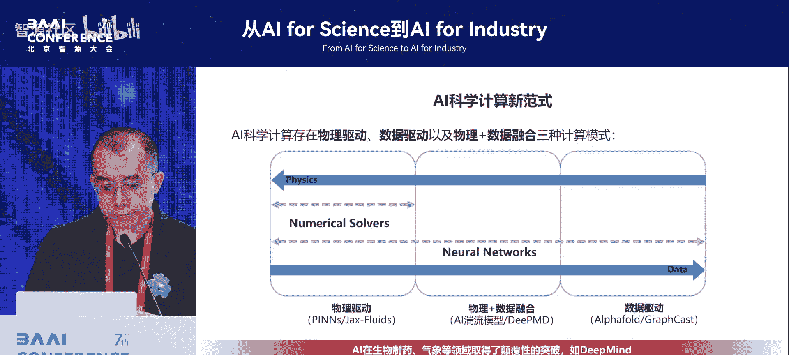
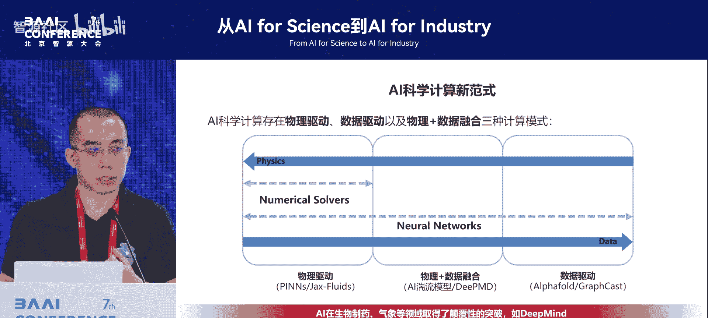
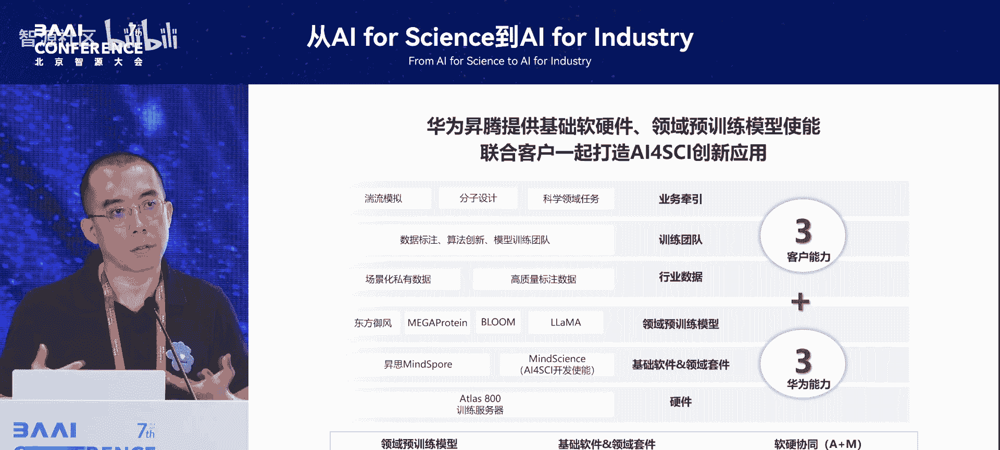
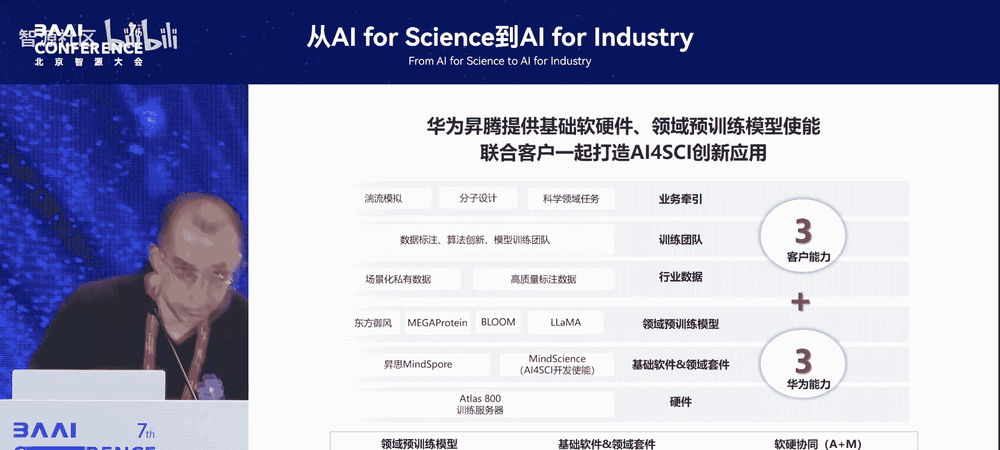

# 2025北京智源大会-从AI for Science到AI for Industry p10 大模型时代下的AI科学计算业界趋势及MindSpore实践：于璠 -BV1r7NjzCEGd_p10-

有请华为mind sport软件领域的科学家AI for science lab的主任于帆先生给我们分享。谢谢冯老师的邀请。然后呃各位领导专家，大家下午好。😊，然后其实我准备了80页PPT。

我觉眼见这是要超时的，我尽量看今天能不能完成这个不可能完成的任务啊。😊，然后我我先简单介绍一下，我是来自于华为2012实验室，华为还是做一个基础设施的一个提供方式，希望能支撑好。无论是科研还是产业。

咱们这个应用。所以我后面的我的主要的出发点都是从基础设施的角度来去讲，然后支撑了各行各业的这个科研，然后还有我们落地的industry的一些应用啊。但是。😊。

很多的其实科研和这个interry我是不太懂的，可能就班门弄斧的讲一下。😊，可以的。不。要是。好，那好。我今天大概题目是这个样子，主要还是把这个大模型和Fs能结合一下。然后前面可能我还是不能免除。

我是来自于企业的，还是稍微给自己打一下广告。我们做了华为在2018年发布了这个AI的平台。然后我所负责的是在这个呃这一层。然后前面刚才中石油还有我们移动的领导也讲了一下，我们用用应用的情况。然后打开看。

我们其实除了底下的这个内核上面主要是把我们这个大模型和F science这两个主要的这个能力去支撑好。而且我们这个是一个全站国产的。然后完全自研的，基本上几乎每一行代码都是自己自己来写的。

包括知识产权都是有自主可控的这个能力的。😊，然后先还是讲一下大模型啊，然后呃主要是从deep seek这个出来以后的一个趋势变化，从这个技术摸高变成了一个技术摸高，加上工程创新这样并行来走。

并且从预训练走向了这个预训练加后训练加推理这种三三轮并行的一个状态。然后deep这个大家可能知道的比较多了，我就稍微挑一个跟我们相关的。呃，当时发了两个1个V31个R1真正可能大家用的多的。

现在是R一这个模型，它这个效果跟当时的O one是差不多的。但是它最好的，我觉得就是开源了，也不能说所有都开掉了，开源了大规模强化学习的这个方案，然后整个的范式都给大家都演化出来了。

我觉得这个是非常棒的。当时可能在图形推理还弱一点，最新发布的0528这个模型就已经图形推理已经变得更强了。然后这个把他这个强化学习我稍微列了一下。

因为我觉得后面很多的案例其实并不一定大家要遵循原来的这种预训练SFT的模式。比如说刚才国药的呃领导说的，他们清洗数据其实我也赞同刚才百图生科的领导说的，我们可以用后训练的这个方式。

可以减少这个数据标注的这个压力啊。😊，然后这个特别讲下来这个的意义在哪里，就是列了这几个小点，它开启了一个无监督强化学习的一个新范式，就是你不需要利用数据，我就能搞得定。第二个就是给大家打了个样板。

我光说这个没用，我得从一个非常挫的模型给你训到业界扫塔，大家才能信，然后这个过程当中，我都把这个东西交给你。然后第三个就是我弄完了这个模型，我还能赋能到大家小模型上。比如说你的企业已经布了千问。

布了我们的9天布了讯飞的模型。那de还能再去蒸馏呃蒸馏出数据来，再把大家提一下，所以他打了好几个这个范式上来，我觉得大家可以去去参考这些范式，并不一定真正要用它啊。😊，当然了，跟我们F相关的就更多了。

我觉得呃知乎上gitthub上马云上一大堆一大堆的方案。我这边随便列两个。第一个就是deep在这个流体做这个风力发电的这个选址。这个选址其实除了本身的LM的能力。再加上一点科学的能力就可以做得到了。

大家这个可以自己我每一个都列了这个链接，大家可以自己去看一下。第二个就是呃语言和这个气象去结合。比如说用呃自然语言来去进行气象的这个对话呃，气象的这个信息的这个交互等等这种应用。

还有就是在我们生物医药领域，我这边举的例子是这个呃清华的水木的他们的，然后加上了这个de以后，它几乎所有的这个指标都在网上上升，并且具有困惑度的这种指标可能就会变得更低一点。

还有就是刚才其实也列了好多好多，就是诊断。然后疾病的风险预测，还有知识库的挖掘。😊，然后也会变得更强。另外我觉得可能更有意思的就是在右面这两个。第一个就是呃发布以后。

当时中科院物理所举办了那个天目杯的物理竞赛，他弄完了以后让这个大模型也来去答了一下题，就选了3个R1GTO one和cloud。然后大概最后结果就是呃deR1是100分，100分大概什么样子。

相当于嗯整个所有选手当中第四名，第一名是120多分。然后他相当于第四名，其实他答不对那道题都是犯了第级的错误。我觉得在稍微如果prompt做好一点，多轮对话一点，恐怕就就搞得定了。😊，呃。

所以就是我觉得那物理题大概什么样子，都是热力学的量子的，有证明啊，有计算，大概就那么七道题，它其实都能搞得定的啊，这还没加上SFT和强化学习。然后下面这个数读这个就其实不算是de的代码上的直接应用。

应该算是把刚才说的那个范式给用进来了。我就是用GRPO的就是它里面的强化学习的算法的思想，然后用在了这个解决它的数读这个问题，其实数读本身有很好很好的这个求解器了。但是它用这个还是比较轻松的就能搞得定。

并且这个效果非常好扩展性也好。然后在我们各行各业其实现在也用了。然后最后一个广告，就是我们本身mans加生腾也把这个训练推理强化学习能力都支持好了。然后大家基本上可以开箱即用。然后大模型我稍微说一下。

就是呃我们大模型训练的能力还可以。然后在我们全站国产的这个软硬件上能。😊，可能比业界的最强的可能会有20%以上的这个收益啊。然后在国产化的这个大模型知识上也占到了百分之可能40%左右的这样的一个份额。

啊，现在可能才回到我们正题上啊，然后这个是求教了很多很多的老师和行业的这个专家。然后整个是科学上就分这么三大部分。嗯，前两个部分其实非常非常重要。但是现在从我的视角来看，从基础设施的视角来看。

其实还是比较零散的一个状况。我做基础设施还是希望能做那个系统化一点的。然后所以我后面讲的主要是第就右面这个怎么样和本身原来这个科学计算去结合的。尤其像这个生物和流体方面的。😊。

我们从这个计算的角度，把这个稍微计算范式给分了一下。呃，最左面的是物理驱动的，最右面是数据驱动的，主要还是根据用的数据多少。比如说像左边这个pins，其实基本上就没有应用数据，我就可以去求解一个方程。

就是大家都学过这个数值分析，上课都要解方程，你要么去用有限元有限体积，你要么就是能求出一个解析解AI在这里面扮演的一个角色，就是能找到一个近似的解析解，然后以后就去推理就好了。

大概是这么样一个一个样子啊，右面数据驱动这个成果就很多了。像生物的气象的等等等等。后面会稍微展开讲一下。另外在我们做这个F，其实我大概也做了能有56年了。然后这个过程当中有很多的新技术产生。

比如说大模型诞生了，其实像openI他们走的路应该是从下面再往物理AI去就是把物理知识也能融进来，其实做这个生成式。😊。

他很多已经符合物理规律了。那我们也不知道他为什么就通过图片和语言就能把这个物理规律给拿下来了。但是当然还有点弱。但是从我这个做基础设施的角度来看，反正我在右面我把大家所有可能的路径就梳理一把。

右面反正我就该基础呃基础设施就该支持下面右下角这些事情，我就把它支持好，然后就可以了。比如说这个范式的变化模型有哪几类，然后软件需要支持这种很长很长的序列，然后什么样的s，我在这里面把它梳理好。

支持好就可以了。然后我们同时也在这个跟科技部，然后跟跟部委去联动去做了很多的业界的梳理，这个是今年我们也应该也是在中关村这面发布的第二期的F science的呃大地图。

相比于我们第一期其实更细化了深深入到了我们好多的这个行业当中，当然也看到了，就是生物这个生化这个领域还是最最庞大的。😊，然后面可能就前面很多专家讲了，我就稍微快一点了，就是讲几个业界的进展。

第一个就是这个蛋白质折叠到阿尔法pho3，这个已经能把蛋白质DNI配提等等，这些都能给他们的结构和相互作用都给纳入到一个模型来去支持了。😊，当然它变得更通用了，其实就会节省这个泛化性的成本。

但是很多比如说在一些关键的领域的因为，比如说抗体，刚才说纳米抗体可能精度就还不够。那你还要需要有微调的数据来去搞。然后ESM这个刚才也提到了，我就快点过了，这是一个大的比较通用的。

从AI从做AI人的视角来去做这件事情。然后的基础模型。然后另外一个就是就是刚才曾老师也提到了那个DNA呃基因的模型啊，当时我不知道是不是讲的是这个，反正我们当时现在看到很多的呃行业的这个客户。

他们会对这个的诉求比较强烈，就是DNA和基因的这个基础模型。但是确实这个数据会比较多一点，所以他训练的效果也会稍微好一点。然后斯坦福和英维达他们在训练Evo three就是下一代这个模型。

我也我也不知道怎么接进去了。反正就莫名其妙的跟他们去听了一下。😊，然后呃当然我们不仅是要去跟着，就我虽然做基础设施应该去把这些塔模型都支持好。

但我也希望咱们更多的国内的这种原生的诺桨级别的以及行业能产生巨大价值的模型，能原生的就在咱们这个整个的一套的个体系结构下能诞生出来。所以我们往前看了一下，就刚才也提到了这个虚拟细胞。

这个论文反正是去年的今年我们西湖大学，还有其他的老师也在发这个。但是确实还没有一个具体的形态，应该这么构建，更多的可能现在相当于一个智能体的方式把呃DNRA蛋白质的一些已有的模型给串联起来。

是这么样一个形态。但是我不清楚别人会怎么想这件事情，所以我们多往前想一步。然后材料呢其实化学这块，我觉得进展会比生物要慢一点。我这边稍微写了一下。

当前可能进展到从2D的有机分子到3D的无机晶体底下有一堆的模型。另外一个。😊，就是确实进展到了这个多体系下，我们也在和中石油去做一些这种联创。气象我觉得就我感觉基本上差不多快都征服掉了。

可能它不仅是有用了，也影响了很多的这个已有的科研工作组工作者的一个模式。但是还有一个环节，就是以前进来的数据还是比较干净的这个数据，但是真实环境不是很干净的。它有假的，也有雷达的等等等等，非常多样化。

真正能用的话，你最好把这个AI也把它给吃掉啊。所以AI也不不单单能干这种干净数据的事儿，他也能干这种脏数据的事。😊，还有一个就是很多行业其实还是在解PDE方程。

就是我们也希望AI能真正做成一个基础的模型，把它整个的所有方程都解掉。嗯，最近可能比较多的就是像谷歌呃open air他们做的deep research，就是从大语言模型的角度来去往科研上去做。

其实通过他这个模型也确实发现了很多的好的一些假说以及一些关键性的成果啊。我觉得这个地方也是我作为基础设施可能比较关注的。好，这前面都是业界的。然后这几页我想讲一下，华为在这里面其实也洞察了一些东西。

能给大家讲一下。一个是呃确实F science是从微观粒子到宏观体整个系统的一个连续的体系。大家我就列一下这样子。其实呃我们觉得现在可以做成一些更跨界的一些呃研究或者突破。我这边画了几个圈。

这几个圈在下一页就稍微有一点呃具象化的。比如说我们觉得材料这个领域，有可能会诞生像阿或者说代维 bakeker的做蛋白质结构设计的这样的关键性的诺桨级的成果。然后左侧这个生命，我觉得虚拟细胞脑科学。

然后右侧的像流体，然后飞行器，然后气象预报，我觉得这几项可能都是我们华为洞察的有可能就是往前走一步，大家能发现很多强大的这样呃模型的一个领域。然后我们也愿意跟就是各行各业的人去联动。😊，动去做。

然后有同学愿意来做，我们也欢迎。然后工业界其实谷歌和英伟达在这都走的比较快了。这个在外面都能看到他们的这个结构。特别讲一下谷歌，就是从底下到上面基本上全都做了。就这个是他们一直就是想重塑整个的这个行业。

然后基于业界的这个洞察，我们其实做了一个自己的这个升级啊，嗯把我们这个技术软件，从不单支持AI，然后扩展到科学计算，我们底下有一串的这些能力我就不追述了。

然后上面主要是科学家和行业客户来帮我们构建这个套件。其实前面我们的领导和专家也提了，就是科学家，你不能直接用AI其实这个鸿沟还是比较大的。😊，然后我们也广泛的跟头部组织啊好各个国家级实验室再去联动。

做这件事情。基本上呃实价的国家实验室我们都走过了，然后都能去联动在一起深度合作的。比如说像昌平崂山啊，广州实验室，然后那个怀柔啊等等。我们都联动在一起做一些关键的穿刺。

然后也支持我们国际民生重要的这个央企来去进行技术行业的这个突破。啊，生物这块我就不搬门弄斧了，稍微讲一下，这个都是常平实验室的老师帮我们去规划的啊。然后我们底下是一些基础的能力，上面有一些典型的应用。

我们持续的再去做很多的这个突破创新。当然我觉得说的最对的，就是怎么能在真正的药企，然后制药和医疗行业里面把它用起来转起来，这样才是最关键的。这个是老师带着我们梳理的。😊。

然后第一个就是蛋白质这个呃结构这一块，然后跟老师联合创新呢，我们把这个模型前面那个隐瞒阿科夫那个部分给干掉了，变成一个神经网络，并且在孤儿序列和这个数据集上全部都开源掉了。大家可以在外面去看到。

在这过程当中也把我们软件给锻炼的比较好。然后在这个做完了以后，我们其实也比较有信心了。然后支持了像中科大他们做的这个蛋白质结构设计，基本上就跟那个他们也去参加了那个比赛。

然后跟戴贝克做的差不多的这样的一个东西。然后还有中科院那个微生物所。以及这个抗体的设计，然后抗体可能稍微暂时过时了一点，但是这个肺炎呃看起来是周期性是比较强的，很快还会再有。

然后同时也支持那个北生索做这个多组学大模型。然后另外一个就是跟上海药务所这个药物文献，其实刚才提到数据的时候也也讲到了，这个大概是呃老师那面去讲了一下嗯，谢谢讲了一下整个数据的一个状况。

然后关键是里面还有很多多模态的，然后很多错误的数据。因为大家写专利的时候，很多药厂就故意写错，就不想让你给拿出来。所以在这里面我们怎么能通过一个呃AI的模型，把这个事情都给搞定啊。😊，啊。

同时我们自己在这个华为的这个软件上，也把阿尔法pho3也给支持了。现在。我们整个推理已经是没有没有问题了，然后精度也是跟业界的这个s塔是对齐的，而且能做到我们这个单卡可以推理呃2K长度的这个能力啊。好。

生态持续在做，这个本身就是企业的比较强的一个地方。嗯。那化学同样我们做了生物，化学这面也就比较有经验了。然后跟呃科研院所以及我们跟中国最大的这个呃。那个化学的企业就是万法化学来去做。因为没有企业。

我觉得确实就像说的，他最后就是不work的，就是断点。然后跟那个化务所做的薛定谔大模型，他们是做这个量子力学的一个求解，主要是用了我们基础设施的二阶优化的二阶微分的一个能力。

我们在这里面做的还是性能是不错的，是线性增长，所以效果呃性能还不错。然后另外一个化务所这个化工大模型，他们其实从这个化学最后一环来去做。就是怎么把这些呃已经定好的这些化合物。

这个反应物温度输到这个整个化工流水线上。然后最后能让这个整个的设备去work起来。呃，同时在支持中科大的机器化一些。其实这个更多的像一个agent，然后来去运转。好。流体这面我就讲几个例子吧。

第一个就是我们跟商飞，就是我们刚才说了，我们不仅是要支持科研院所，最重要的还是把我们国之重器的这些企业我们联动，大家一块能看看有什么可以发力的地方。

第一个就是支持我们商飞做这个整个的就是它整个的动力学的一个模拟，其实核心核心就是在求它的一个那个NS方程。嗯，刚开始我们先做的是呃就是那个鸡翅膀的一个二维的一个切面。然后后来给拓展到整个三维的一个过程。

然后在这过程当中，除了这个效性能上肯定是提升的。因为最后我们是推理跟它原来的这个整个的有限体积的方法的PK但是更多的是我们把那个鸡翅膀和机身结合的那个位置，它的预测，我们变得非常非常精准。

原来的方法你是算不准的。然后这个也获得了就是WIC的CO奖。😊，啊，同时在去年的时候，我们去跟另外一个国际重企，就是电网，然后来去做他们的核心应用。因为就是本身的CVLP的模型的延展的应用。

我觉得我在这里面就没有什么需要去特别做的。然后我们就挑了他最核心的业务，也是跟他们的核心这个业务的领导勾兑了很久，就是做这个电力的复合的预测，以及潮就是在这里面选的它的一个细分场景，就是潮流的预测。

相对来说可能比较简单。其实嗯这个幻化到我们一个科学问题其实比较简单的，就是。😊，就是有很多的电力设备的节点，可能全国下来可能有上百个，每个设备有5个控制参数。那我来了不同的场景。比如说新能源来了以后。

我怎么控制这5个参数，让他满足，比如说技入和复定律，然后同时它整个的效率是最高的。其实核心的问题就是在干这个原始的方法就是求这个矩阵的不断的迭代的运算。然后我们在这里面用AI的方法。

看看能不能做一些事情，在这最后的结果还是不错的。然后去年也获得了这个WIA的CO有奖。然后这个是跟29基D他们做这个风动的，然后去做飞行器的设计。因为他们有很多的数据。对，这地方是他们数据的一个关键。

因为所有都要去吹，最后数据全拿下来，通过他们可以设计飞行器。但是这里面没有加上发动机，加上发动机就就非常非常难。但是最后要落地的话，一定再加上这个，然后北大的团队在做PD方面的求解。

这个现在是做到了二维，然后应该在他们在整理论文。然后三维的会发一篇，这个我觉得嗯可能到三维的时候才相当于原来的GBT2的这样的一个节点过程吧。哦这。然后这个刚才那个呃那个我们中石油的领导也讲了。

其实呃昆仑大模型里面还有一个就是做地质勘探的这块，其实就是他在一个油田里一般就是先去放几炮，然后再把这个炮的数据再收回来。然后通过这个数据来去看底下的这个矿藏的一个情况。

然后这里面我们就帮他用不是我们帮就是大家联动在一块去把这个呃速度给提上来了。然后当然更多的其实我们希望以后我们能在不同的场景下，别的已有的方法发现不了这里面的关键的油舱。

我们在这个AI的方法上能发现这一块。然后其实这里面最关键的一个替换，就是原来的呃方程的正向求解，变成了我们一个呃神经网络的一个求解。这里面就是用的FNO的这个方法，就是这FNO就是一个新的模型吧。

就是呃副列变换加上transformer，然后联合来去把这个方程就搞定了。😊，好，其他的我就快速的给大家翻一下，过一下我们的一些案例啊。然后刚才说了气项，其实我觉得全流程基本上看都已经搞定了。

就差中间的数据统化了。然后华为自己也发了一个模型，但是我说实话，华为自己的这个气象模型和业界的sota的模型我觉得都差不多了。大家注意就是这个还有我们上海的很多的模型都差不多。

然后反正在华为的这个算理技础社上都支持了，然后。😊，也支持了我们那个海洋上的一些关键的模型的应用啊。嗯，这个是老山实验室，他们把已有的fortune的这个代码迁移到python体一下。

我觉得这个还蛮有意义的。因为他们很多很多这个行业都是还用比较老的东西，如果能签上来，这个还是就能和AI就结合在一起了。好。嗯，电池这个我就提这么两个。第一个就是我们做这个无线的。第二个是做这个手机。

其实两个是一样的，就是给了这个工况。然后我就用呃方程来去求解。这个华为当时手机还是比较如日中天的时候就是能卖2。4亿部，这个价值还比较大，现在可能没卖那么多步了。我觉得价值就会稍微小一点。呃。

就是仿原来就是仿真这一个手机的电磁场信号的时候，他就用大概4卡，然后算10个小时，然后大概能得到了他这个手机的不同部位的电场和磁场的强度，然后嗯换算下来，当时2。4亿步一年可能有几千万美金的。

就单讲这么一个仿真，可能就有几千万美金的这样的一个成本，这还不算电热声光力就只是电的一部分。当时用AI，反正他们也提了说如果不提升，就是几十倍以上就不要做这件事情没有意义。

因为放到整个流程当中就被淹没掉了。所以这个。也是我们做了呃联合北大呃，做了好久，然后把这个问题大概给做掉，最后误差小于10%。反正客户也不知道是原来的仿真队，还是AI仿真队，他觉得差不多就行了。

然后但是速度提升的非常快。啊，我们有了这个就是把这个方法，再接着用到那个那个东南大学他们的电磁脑的这个项目，最后也都发布掉。然后最后还是形成我们这我觉得一个个案例可能都不是特别的重要。

最后还形成了这一套的一个方法论吧。就是华为能在底下提供一些基础的基础设施上的一些能力，以及做的一些案例的。呃，大家可能觉得还能作为一个模板可以继续复用的。

上面我们还需要依赖我们更多的行业的客户以及科研的专家，大家联合去打造。然后我觉得只有一块往前投，然后才能把这个东西给走的更远更深。好，谢谢大家。😊。

